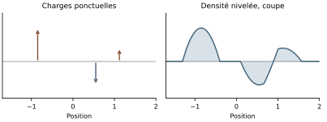
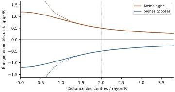
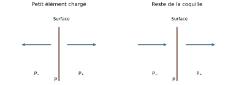
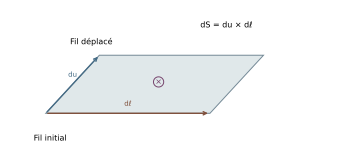
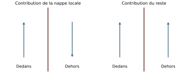
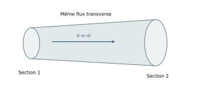

# ENS Ulm, PC 2025 — Physique C · Corrigé guidé

*Corrigé rédigé par IA, non officiel. Signalez toute erreur.*

**Rédaction** · GPT-6.2 Astra Ultra · vitesse non renseignée

**Autour de l’énergie électromagnétique.** Les énergies d’interaction sont référencées à séparation infinie. On posera $k=1/(4\pi\varepsilon_0)$.

Le rapport du jury confirme une erreur de sens de variation à la question 20. Il demande aussi de justifier le passage du flux balayé à la variation de flux, et de distinguer le travail mécanique du stockage de champ.

## Systèmes de charges ponctuelles

### Question 1 — Travail de Coulomb

> [!INDICATION]
> Écrire d’abord le travail de la force électrique et sa relation à la variation d’énergie.

#### Solution

Posons $k=1/(4\pi\varepsilon_0)$ et $r=r_{12}$. Lors du déplacement radial, le travail de la force électrique est $\int_\infty^r k q_1q_2\,ds/s^2=-kq_1q_2/r$. Son opposé est l'énergie potentielle acquise avec la référence de l'énoncé, $U_{12}=kq_1q_2/r$.

### Question 2 — Force sur la première charge

> [!INDICATION]
> Préciser la coordonnée de dérivation.

#### Solution

Avec $\mathbf r_{12}=\mathbf r_2-\mathbf r_1$, on a $\nabla_1(1/r_{12})=\mathbf r_{12}/r_{12}^3$. Ainsi $\mathbf F_{2\to1}=-\nabla_1 U_{12}=-kq_1q_2\mathbf r_{12}/r_{12}^3$. Dériver par rapport à $\mathbf r_2$ donne la force opposée. La même fonction scalaire des deux positions décrit entièrement les forces électrostatiques de la paire.

### Question 3 — Paires ordonnées

> [!INDICATION]
> Compter les deux ordres d’une même paire.

#### Solution

Le potentiel de $i$ au point $j$ est $V_{i\to j}=kq_i/r_{ij}$. L'énergie est $U_q=\sum_{i<j} kq_iq_j/r_{ij}=\tfrac12\sum_{i\ne j}q_j V_{i\to j}$. Ainsi $a=1/2$ pour les paires ordonnées. Le résultat peut être positif, négatif ou nul selon les signes et la géométrie.

### Question 4 — Deux groupes de deux

> [!INDICATION]
> Isoler les deux paires internes avant les quatre paires croisées.

#### Solution

$U_q=U^\alpha+U^\beta+U^{\alpha\leftrightarrow\beta}$ avec $U^\alpha=q_2V_{1\to2}$, $U^\beta=q_4V_{3\to4}$ et $U^{\alpha\leftrightarrow\beta}=q_3(V_{1\to3}+V_{2\to3})+q_4(V_{1\to4}+V_{2\to4})$. Cela donne les six paires distinctes des quatre charges.

### Question 5 — Interaction discrète de deux systèmes

> [!INDICATION]
> Le domaine de sommation contient une charge de chaque groupe dans un ordre imposé.

#### Solution

Posons $V_{\alpha\to j}=\sum_{i\in\alpha}kq_i/r_{ij}$. Les paires croisées sont chacune comptées une fois dans $U^{\alpha\leftrightarrow\beta}=\sum_{j\in\beta}q_j V_{\alpha\to j}$, donc $b=1$. La symétrie de $r_{ij}$ et la permutation des deux sommes donnent aussi $U^{\alpha\leftrightarrow\beta}=\sum_{i\in\alpha}q_iV_{\beta\to i}$ avec $V_{\beta\to i}=\sum_{j\in\beta}kq_j/r_{ij}$.

## Formulations intégrales

### Question 6 — Décomposition continue

> [!INDICATION]
> Développer les quatre produits et garder le facteur commun.

#### Solution

Développer $\tfrac12\int(\rho_\alpha+\rho_\beta)(V_\alpha+V_\beta)d\tau$. Les deux termes diagonaux sont $U^s=\tfrac12\int\rho_sV_s\,d\tau$ pour $s=\alpha,\beta$. Les termes croisés donnent $U^{\alpha\leftrightarrow\beta}=\tfrac12\int(\rho_\alpha V_\beta+\rho_\beta V_\alpha)d\tau$. Le noyau de Coulomb symétrique rend les deux intégrales croisées égales pour des potentiels nuls à l'infini.

### Question 7 — Signification des termes propres

> [!INDICATION]
> Comparer l’auto-interaction d’un point mathématique et celle d’une boule de charge.

#### Solution

La somme ponctuelle écarte $i=j$ et omet l'énergie propre de chaque charge élémentaire. Dans l'intégrale continue, chaque petit nuage possède une interaction interne finie avec ses autres éléments. La diagonale de la double intégrale est de mesure nulle pour une densité régulière et son noyau est localement intégrable. Les relations croisées entre deux systèmes distincts se correspondent directement.

### Question 8 — Référence de potentiel

> [!INDICATION]
> Calculer l’effet du terme constant dans chaque formule, puis revenir à la convention de l’énoncé.

#### Solution

Le remplacement $V\mapsto V+\Delta V$ dans $U=\tfrac12\int\rho V$ ajoute $Q\Delta V/2$. Dans la forme symétrique de la question 6, si chacune des deux contributions $V_\alpha,V_\beta$ reçoit le même décalage, le terme croisé se décale de $(Q_\alpha+Q_\beta)\Delta V/2$. Dans les écritures séparées (12), décaler seulement $V_\beta$ y ajoute $Q_\alpha\Delta V$, et réciproquement $Q_\beta\Delta V$ dans l'autre. Ces conventions arbitraires ne peuvent pas être mélangées. Les potentiels créés par les charges avec zéro à l'infini satisfont simultanément la superposition et la réciprocité indiquées. À charges fixées, les constantes de référence ne changent pas les forces ni les différences entre configurations.

### Question 9 — Formulation par le champ

> [!INDICATION]
> Conserver le terme de surface jusqu’à avoir étudié sa limite.

#### Solution

Avec $\rho=\varepsilon_0\nabla\cdot\mathbf E$ et $\nabla V=-\mathbf E$, on a $\rho V=\varepsilon_0[\nabla\cdot(V\mathbf E)+E^2]$. Sur une boule de rayon $R$, le premier terme donne $\varepsilon_0\oint V\mathbf E\cdot d\mathbf S$. À l'infini $V=O(R^{-1})$ et $E=O(R^{-2})$ au plus, donc ce flux est $O(R^{-1})$ et s'annule. D'où $U_{\rm es}=\varepsilon_0\int_{\mathbb R^3}E^2d\tau/2$.

### Question 10 — Énergie positive et attraction

> [!INDICATION]
> Développer le carré du champ total et examiner son terme croisé.

#### Solution

Cette énergie est positive ou nulle. La somme discrète de la question 3 exclut les énergies propres élémentaires alors que l'intégrale de champ les inclut. L'attraction se lit au gradient de l'énergie d'interaction. Une énergie totale positive peut décroître quand les systèmes se rapprochent, et son terme d'interaction peut être négatif.

### Question 11 — Divergence d’une charge ponctuelle

> [!INDICATION]
> Introduire explicitement une petite sphère autour de la singularité.

#### Solution

Hors d'une sphère de coupure de rayon $a$, $U(a)=\varepsilon_0(4\pi)(kq)^2\int_a^\infty dr/(2r^2)=kq^2/(2a)$. La divergence vient de $a\to0$. Dans $\int\rho V$, le potentiel propre au point de la charge est également singulier. L'énergie d'une charge ponctuelle isolée exige une régularisation ou la soustraction conventionnelle de l'énergie propre.

### Question 12 — Énergie finie de la paire

> [!INDICATION]
> Seul le terme croisé conserve l’information sur la séparation.

#### Solution

En développant le carré de $\mathbf E_1+\mathbf E_2$, on retrouve deux énergies propres divergentes et $U_{12}=\varepsilon_0\int\mathbf E_1\cdot\mathbf E_2\,d\tau$. L'intégrale croisée converge localement près de chaque point car un seul champ y est singulier en $r^{-2}$. Par $\mathbf E_1=-\nabla V_1$, intégration par parties et $\varepsilon_0\nabla\cdot\mathbf E_2=q_2\delta(\mathbf r-\mathbf r_2)$, on obtient $U_{12}=q_2V_1(\mathbf r_2)=kq_1q_2/r_{12}$. Sans distributions, exclure deux petites boules donne le même résultat par leurs surfaces. Celle autour de $q_1$ a un terme $O(a)$, celle autour de $q_2$ restitue $q_2V_1(\mathbf r_2)$.

## Grandeurs nivelées

### Question 13 — Nivellement de la densité

> [!INDICATION]
> Conserver le signe et la charge intégrée de chaque nuage.

#### Solution

Chaque Dirac $q_i\delta(\mathbf r-\mathbf r_i)$ est remplacé par le nuage $q_if(\mathbf r-\mathbf r_i)$ centré en $\mathbf r_i$. Les nuages se superposent algébriquement. Leur norme intégrale conserve la charge $\int\rho\,d\tau=\sum_iq_i\int f\,d\tau=\sum_iq_i$.

### Question 14 — Fenêtre sphérique uniforme

> [!INDICATION]
> Diviser l’unité par le volume de la boule.

#### Solution

$f(\mathbf r)=3/(4\pi R^3)$ pour $|\mathbf r|<R$ et zéro au-delà. La valeur précise à la frontière ne change pas l'intégrale. La densité produite par $q$ est $qf$.

### Question 15 — Potentiel d’une densité bornée

> [!INDICATION]
> Couper l’intégrale en un voisinage de la singularité et son complémentaire.

#### Solution

Fixons la position d'observation $P$. Dans la boule de rayon $a$ autour de $P$, la contribution en valeur absolue est majorée par $k\rho_M4\pi\int_0^a s\,ds=2\pi k\rho_Ma^2$. Sur le reste du support, $1/s\le1/a$ et la contribution est majorée par $k\int|\rho|d\tau/a$, finie puisque le support est borné. Ainsi le potentiel est borné même à l'intérieur de la distribution.

### Question 16 — Énergie des charges nivelées

> [!INDICATION]
> Utiliser la borne uniforme démontrée à la question 15.

#### Solution

Pour un nombre fini de nuages de fenêtre bornée à support compact, la densité totale est bornée et intégrable même lors d'un recouvrement. La borne précédente est uniforme en $P$. Par $|U|\le\tfrac12\sup|V|\int|\rho|d\tau$, l'énergie reste finie. La simple normalisation d'une fenêtre arbitrairement singulière ne suffirait pas à garantir cette conclusion sans hypothèse de régularité.

### Question 17 — Boule de charge uniforme

> [!INDICATION]
> Calculer séparément les deux intégrales radiales.

#### Solution

Gauss donne $E=kqr/R^3$ à l'intérieur et $E=kq/r^2$ à l'extérieur. Dans l'intégrale du carré du champ, les contributions sont $kq^2/(10R)$ et $kq^2/(2R)$. Leur somme vaut $U_{B_R}=3kq^2/(5R)$. Le facteur $3/5$ diffère de celui d'une coquille.

### Question 18 — Rayon classique de l’électron

> [!INDICATION]
> Comparer la valeur à une longueur quantique indépendante.

#### Solution

L'identification du modèle donne $r_e=3ke^2/(5m_ec^2)\simeq1{,}7\times10^{-15}\ \mathrm m$. C'est une échelle de modèle. La longueur de Compton réduite de l'électron $\hbar/(m_ec)\simeq3{,}9\times10^{-13}\ \mathrm m$ lui est déjà très supérieure. Localiser l'électron à une telle échelle exige donc une description quantique relativiste, et le calcul classique ne mesure pas un rayon de l'électron.

### Question 19 — Nuages disjoints

> [!INDICATION]
> Remplacer successivement la première distribution puis la seconde.

#### Solution

À l'extérieur de la première distribution sphérique, $V_1$ est celui de sa charge ponctuelle centrale. Il est harmonique dans toute la seconde boule. Sa moyenne sur chaque sphère concentrique de ce second nuage est donc égale à sa valeur au centre, par le théorème de la moyenne ou celui des coquilles. En intégrant ces moyennes pondérées par $\rho_2$, $U_{12}=q_2V_1(\mathbf r_2)=kq_1q_2/r_{12}$. La seule égalité du champ extérieur de la première boule à son champ ponctuel ne suffit pas à remplacer la seconde sans cette étape.

### Question 20 — Recouvrement de deux boules de signes opposés

> [!INDICATION]
> Étudier d’abord le recouvrement du potentiel positif avant de multiplier par la seconde charge.

#### Solution

Le jury confirme une coquille. Pour des charges opposées, l'énergie est **croissante en fonction de la distance** et minimale à la superposition. Le potentiel de la première boule positive décroît radialement. Son intégrale sur la seconde boule est maximale lorsque les centres coïncident. Pour le voir, décomposer le potentiel positif en couches de niveau sphériques. À chaque niveau, le volume d'intersection de deux boules décroît avec la séparation. Multiplier par la densité négative de la seconde renverse le sens de variation. À recouvrement complet $U_{12}(0)=6kq_1q_2/(5R)$, obtenu en retranchant les deux énergies propres de celle de la boule de charge $q_1+q_2$.

### Question 21 — Courbes d’interaction

> [!INDICATION]
> Raccorder les branches au premier contact $d=2R$.

#### Solution

Pour $d\ge2R$, toutes les courbes coïncident avec $kq_1q_2/d$ pour leur signe de produit. Quand $d$ descend sous $2R$, les nuages gardent une énergie bornée. Pour des signes contraires, elle part de $-U_{12}^m$ à $d=0$ et tend vers zéro par valeurs négatives. Pour des signes identiques, elle part de $+U_{12}^m$ et décroît vers zéro. Les courbes ponctuelles divergent respectivement vers $-\infty$ et $+\infty$ à l'origine. Pour les boules uniformes, la pente des courbes nivelées s'annule en zéro par symétrie.

### Question 22 — Distance effective minimale

> [!INDICATION]
> Examiner deux distributions qui s’annulent exactement.

#### Solution

Une charge lissée impose un plafond à $|U_{12}|$. Pour $|q_1|=|q_2|=q$, la superposition de charges opposées annule le champ total. L'interaction doit alors annuler deux fois l'énergie propre de la boule, soit $U_{12}^m=6kq^2/(5R)$. Égaler ce plafond à $kq^2/r_{\min}$ donne $r_{\min}=5R/6$. Cette distance est une représentation énergétique. Les centres géométriques, eux, peuvent coïncider.

## Sphères concentriques

### Question 23 — Champ sur une coquille chargée

> [!INDICATION]
> Séparer la discontinuité locale du champ régulier créé par le reste de la sphère.

#### Solution

Pour une coquille de rayon $R$, Gauss donne $\mathbf E_S(P_-)=0$ et $\mathbf E_S(P_+)=kQ\mathbf e_r/(R+\epsilon)^2$. Autour d'un petit élément assimilé à un disque plan centré en $P$, les composantes normales de son champ sont opposées aux deux points symétriques, donc $\alpha=-1$. Au centre, le champ propre du plan chargé n'a pas de valeur ordinaire univoque. Sa valeur principale symétrique vaut zéro. Le reste de la coquille crée en revanche un champ continu près de $P$. En moyennant les limites des deux champs totaux, les champs propres du petit élément se compensent. Il vient $\mathbf E_{\bar\Sigma}(P)=kQ\mathbf e_r/(2R^2)=\sigma\mathbf e_r/(2\varepsilon_0)$.

### Question 24 — Pression électrostatique

> [!INDICATION]
> Exclure le champ que l’élément exercerait sur lui-même.

#### Solution

Sur $dS$, $dq=\sigma dS$. La force du reste de la coquille vaut $dq\mathbf E_{\bar\Sigma}$, d'où $d\mathbf F=[\sigma^2/(2\varepsilon_0)]d\mathbf S$. La pression $P_{\rm es}=\sigma^2/(2\varepsilon_0)$ est dirigée vers l'extérieur pour les deux signes de $Q$.

### Question 25 — Travail d’une coquille sur elle-même

> [!INDICATION]
> Le déplacement normal est le même pour tout élément de surface.

#### Solution

Si le rayon croît de $dR$, le travail électrique est $\delta W=4\pi R^2P_{\rm es}\,dR=kQ^2dR/(2R^2)$. Donc $W=(kQ^2/2)(1/R_1-1/R_2)$ et $\Delta U=-W$. La référence à rayon infini fixe $U_S(R)=kQ^2/(2R)$.

### Question 26 — Travail sur la sphère extérieure

> [!INDICATION]
> Seule la coquille extérieure subit le déplacement de cette transformation.

#### Solution

Le champ de $S_a$ en $R_b$ vaut $kQ_a\mathbf e_r/R_b^2$. Lors d'une variation de $R_b$, $\delta W_{a\to b}=kQ_aQ_b\,dR_b/R_b^2$ et donc $W_{a\to b}=kQ_aQ_b(1/R_{b1}-1/R_{b2})$.

### Question 27 — Travail sur la sphère intérieure

> [!INDICATION]
> Ne pas remplacer un travail par une résultante ni comparer des déplacements distincts.

#### Solution

Le champ de $S_b$ est nul en tout point intérieur, d'où $W_{b\to a}=0$. Les travaux des deux expériences ont des déplacements différents et n'ont aucune raison d'être opposés. Les forces de Coulomb entre deux éléments demeurent réciproques. Les résultantes vectorielles sur les coquilles complètes sont nulles par symétrie, même lorsque la pression effectue un travail à la dilatation.

### Question 28 — Énergie totale des coquilles

> [!INDICATION]
> Réécrire le résultat en isolant le carré de la charge totale.

#### Solution

Les énergies propres s'ajoutent à l'interaction $kQ_aQ_b/R_b$ trouvée en amenant les deux systèmes depuis une séparation infinie, ou en contractant la coquille extérieure depuis l'infini autour de l'intérieure. Ainsi
$$U=\frac{k}{2}\left[Q_a^2\left(\frac1{R_a}-\frac1{R_b}\right)+\frac{(Q_a+Q_b)^2}{R_b}\right].$$
Cette forme est positive pour toute configuration chargée dès que $R_a<R_b$.

### Question 29 — Vérification pour un condensateur sphérique

> [!INDICATION]
> Localiser les seules régions qui contiennent du champ.

#### Solution

Pour $Q_a=Q=-Q_b$, le champ n'est non nul que dans $R_a<r<R_b$, où $E=kQ/r^2$. Son énergie vaut $\varepsilon_0(4\pi)(kQ)^2\int_{R_a}^{R_b}dr/(2r^2)=(kQ^2/2)(1/R_a-1/R_b)$. Elle coïncide avec la question 28, y compris le facteur un demi.

### Question 30 — Dilution du système

> [!INDICATION]
> Faire tendre la densité surfacique vers zéro à charge totale fixée.

#### Solution

Pour des charges totales fixes, les termes de la question 28 tendent tous vers zéro quand les deux rayons tendent vers l'infini. Des porteurs microscopiques de taille fixe garderaient chacun leur énergie propre, même isolés des autres. La description par densité surfacique lisse assimile le transport à une dilution de charge continue et choisit la référence d'énergie nulle à dilution infinie. Elle laisse de côté ces énergies individuelles constantes. On les ajouterait à la comptabilité microscopique sans modifier le travail macroscopique calculé.

## Forces de Laplace et théorème de Maxwell

### Question 31 — Travail sur un élément de circuit

> [!INDICATION]
> Conserver l’ordre cyclique des trois vecteurs.

#### Solution

La force de Laplace est $d\mathbf F=I\,d\boldsymbol\ell\times\mathbf B$. Pour le déplacement local $d\mathbf u$, la permutation circulaire du produit mixte donne $\delta w_L=I\,(d\boldsymbol\ell\times\mathbf B)\cdot d\mathbf u=I\mathbf B\cdot(d\mathbf u\times d\boldsymbol\ell)$.

### Question 32 — Surface balayée orientée

> [!INDICATION]
> Dessiner la position initiale et la position finale de l’élément orienté.

#### Solution

Un élément de fil et sa position translatée délimitent un parallélogramme d'aire vectorielle $d\mathbf S=d\mathbf u\times d\boldsymbol\ell$, orienté de façon à produire le travail précédent. Le long du contour, l'ensemble de ces éléments forme le ruban balayé. Son flux est $d\Phi_c=\oint_C\mathbf B\cdot(d\mathbf u\times d\boldsymbol\ell)$, donc $\delta W_L=I\,d\Phi_c$. Au premier ordre, $\mathbf B$ se prend à l'instant et à l'emplacement de chaque élément.

### Question 33 — Champ et courant variables

> [!INDICATION]
> Examiner quels termes de l’intégrande dépendent de l’horloge.

#### Solution

a) En général les seuls états géométriques initial et final ne donnent pas le travail. Un circuit peut revenir au même endroit après avoir été déplacé dans deux champs d'intensité différente. b) Le trajet géométrique seul ne suffit pas non plus si $\mathbf B(\mathbf r,t)$ dépend du temps. Il faut savoir quand chaque portion est parcourue. c) Pour $I=I(t)$, il faut également l'histoire du courant, qui pondère chaque élément de flux. Même pour un champ stationnaire, l'intégrale $\int I(t)d\Phi_c$ ne se réduit pas en général à une constante fois la différence des flux aux extrémités.

### Question 34 — Théorème de Maxwell

> [!INDICATION]
> Fermer la surface avec les deux sections orientées avant d’appliquer $\nabla\cdot\mathbf B=0$.

#### Solution

Prenons une surface initiale orientée $S_i$ dont le bord est $C_i$. Après déplacement, la somme orientée du disque initial et du ruban balayé est une surface de bord $C_f$. Avec l'orientation $d\mathbf u\times d\boldsymbol\ell$, le bord du ruban est $C_f-C_i$. Le flux de $\mathbf B$ à travers la surface finale $S_f$ égale celui à travers $S_i$ et le ruban, car le flux sur leur différence, surface fermée, est nul. Cette comparaison emploie le même champ stationnaire pour tous les éléments. Ainsi $\int d\Phi_c=\Phi_f-\Phi_i$, $W_L=I(\Phi_f-\Phi_i)$ et $\eta=+1$.

### Question 35 — Énergie potentielle mécanique

> [!INDICATION]
> La force de Laplace effectue un travail positif quand son énergie potentielle diminue.

#### Solution

À courant constant, $W_L=-\Delta U_I$ donne $U_I=-I\Phi$ à une constante près, pour le champ imposé. Un circuit rigide laissé libre tend à augmenter le flux algébrique $I\Phi$, donc à diminuer ce potentiel mécanique. Dans un circuit déformable, les contraintes mécaniques, l'énergie élastique et les forces propres peuvent contribuer. Le seul flux extérieur ne décrit alors pas tout le mouvement spontané.

### Question 36 — Translation A1

> [!INDICATION]
> Pour une translation, regrouper les forces avant de calculer le travail.

#### Solution

Le champ est uniforme et le circuit est fermé. La force totale $I_s(\oint d\boldsymbol\ell)\times\mathbf B_0$ est donc nulle. Pendant une translation rigide tous les points ont le même déplacement et $W_L=0$. Le flux $B_0a^2$ reste constant, donnant le même résultat par Maxwell.

### Question 37 — Rotation A2

> [!INDICATION]
> Projeter le couple sur l’axe de rotation en gardant le signe.

#### Solution

Une spire plane fermée dans un champ **uniforme** a pour couple exact $\boldsymbol\Gamma=\mathbf M\times\mathbf B_0$ avec $\mathbf M=I_s a^2\mathbf n$. La formule dipolaire s'applique ici sans correction de gradient. Si $\theta$ est l'angle entre la normale et $+z$, le travail est $\int_0^{\pi/2}-I_sa^2B_0\sin\theta\,d\theta=-I_sa^2B_0$. Le flux passe de $B_0a^2$ à zéro. Maxwell prédit la même valeur. L'opérateur extérieur doit fournir le travail opposé lors d'une rotation quasi statique.

### Question 38 — Champ exerçant une force sur la paroi du solénoïde

> [!INDICATION]
> Décomposer les deux champs limites en une composante régulière et une composante qui change de signe.

#### Solution

Écrivons le courant de surface $\mathbf K=nI_0\mathbf e_\theta$. Le champ total vaut $B_0\mathbf e_z$ juste dedans et zéro juste dehors. À l'échelle locale l'élément retiré est assimilable à une nappe de fils parallèles. Par symétrie ou par Ampère sur un rectangle traversant la nappe, sa contribution tangentielle est opposée de part et d'autre du plan. Le reste du bobinage crée le même champ régulier à la limite des deux côtés. La moyenne des limites donne donc $\mathbf B_{\bar\Sigma}(P)=B_0\mathbf e_z/2$. En particulier, utiliser tout le champ intérieur doublerait la force propre.

### Question 39 — Pression magnétique

> [!INDICATION]
> Utiliser le courant surfacique plutôt que l’intensité d’un seul tour.

#### Solution

$d\mathbf F=(\mathbf K\times\mathbf B_{\bar\Sigma})dS$. Comme $\mathbf e_\theta\times\mathbf e_z=\mathbf e_r$, on trouve $P_{\rm ms}=nI_0B_0/2=B_0^2/(2\mu_0)$. Le sens est vers l'extérieur même si le courant est inversé, parce que le champ change également de signe.

### Question 40 — Dilatation du solénoïde

> [!INDICATION]
> Intégrer la pression multipliée par la variation de volume.

#### Solution

À $n,I_0,L$ fixés, $B_0$ et la pression sont constants. Pour un rayon courant $s$, $\delta W=P_{\rm ms}2\pi sL\,ds$. D'où $W=3\pi R^2L B_0^2/(2\mu_0)$. Appliquer naïvement $I_0\Delta\Phi$ au flux propre enlacé par toutes les spires donnerait le double, puisque $\Delta\Phi=nL\,B_0\,3\pi R^2$. Le champ est créé par le circuit qui se déforme. Le théorème de Maxwell de la question 34 suppose un champ extérieur imposé et stationnaire au sens spatial. Le traitement par le champ régulier de la question 38 évite ce double comptage.

## Énergie d’une distribution volumique de courants

### Question 41 — Absence de rayonnement dans l’approximation

> [!INDICATION]
> Un flux à travers une sphère croît en aire comme $r^2$. Examiner la décroissance de son intégrande.

#### Solution

Dans l'ARQS magnétique, le courant est conservé et les champs sont reconstruits instantanément à partir de distributions localisées. Le champ magnétique lointain de ces boucles décroît au moins comme $1/r^3$. Le champ inductif associé est au plus d'ordre $1/r^2$ pour une distribution dipolaire magnétique variable. La puissance de Poynting à travers une grande sphère tend alors vers zéro. Les composantes radiatives transverses en $1/r$ et leur retard de propagation sortent de cette approximation. Une source réelle variable peut rayonner lorsqu'on restaure ces termes.

### Question 42 — Puissance reçue par les charges

> [!INDICATION]
> La composante magnétique de la force est perpendiculaire à la vitesse de chaque porteur.

#### Solution

La puissance volumique de Lorentz est $\rho_e[\mathbf E+\mathbf v_e\times\mathbf B]\cdot\mathbf v_e=\mathbf j\cdot\mathbf E$. Les ions sont fixes. Pour la partie $-\nabla V$, l'intégrale s'écrit $-\int\nabla\cdot(V\mathbf j)d\tau+\int V\nabla\cdot\mathbf j\,d\tau=0$, puisque le courant est fermé dans le volume et sans divergence. Le champ électrique inductif $-\partial_t\mathbf A$, créé par la variation de flux, peut en revanche fournir ou recevoir du travail intégré.

### Question 43 — Bilan local et global

> [!INDICATION]
> Vérifier séparément le signe du flux sortant et celui du travail reçu par la matière.

#### Solution

Avec $\boldsymbol\Pi=\mathbf E\times\mathbf B/\mu_0$, $\nabla\cdot(\mathbf E\times\mathbf B)=\mathbf B\cdot(\nabla\times\mathbf E)-\mathbf E\cdot(\nabla\times\mathbf B)$. Faraday et Ampère dans l'ARQS donnent $\nabla\cdot\boldsymbol\Pi=-\partial_t[B^2/(2\mu_0)]-\mathbf j\cdot\mathbf E$. Intégrer sur $V_R$ donne la dérivée de l'énergie magnétique égale à l'opposé du flux sortant de Poynting et à l'opposé de la puissance fournie aux charges dans $D$. Le terme de stockage électrique a été négligé dans la même approximation qu'Ampère.

### Question 44 — Énergie magnétique stockée

> [!INDICATION]
> Distinguer le travail exercé par le champ et celui fourni contre l’induction.

#### Solution

À l'échelle de tout l'espace le flux radiatif est nul dans le modèle. Intégrer de 0 à $T$ le bilan précédent depuis l'état sans champ auto-induit. Le travail fourni **contre** le champ induit par les dispositifs qui établissent les courants alimente le champ final. L'énergie magnétique stockée vaut $U_{\rm ms}=\int_{\mathbb R^3} B^2 d\tau/(2\mu_0)$, avec zéro de référence à champ nul. L'énergie totale dépensée par un générateur peut inclure en plus des pertes ohmiques.

### Question 45 — Variation de l’énergie du solénoïde

> [!INDICATION]
> Identifier la source qui entretient le courant pendant la déformation.

#### Solution

Dans le modèle long $U_{\rm ms}=B_0^2\pi R^2 L/(2\mu_0)$. Doubler le rayon multiplie par quatre cette énergie, d'où $\Delta U=3\pi R^2L B_0^2/(2\mu_0)>0$. C'est aussi le travail mécanique positif des forces de Laplace de la question 40. Le maintien du courant exige un apport électrique. Pour un circuit sans pertes à courant constant, cet apport d'induction $I_0\Delta\Phi$ est égal à $2\Delta U$ et se partage entre champ et travail mécanique.

### Question 46 — Contributions au carré du champ

> [!INDICATION]
> Distinguer le coefficient d’un carré de celui du terme croisé.

#### Solution

Pour $\mathbf B=\sum_a\mathbf B_a$, $U_{\rm ms}=\sum_aU_a+\sum_{a<b}U_{ab}$ où $U_a=\int B_a^2d\tau/(2\mu_0)\ge0$ et $U_{ab}=\int\mathbf B_a\cdot\mathbf B_b\,d\tau/\mu_0$. Ce dernier peut être positif, négatif ou nul. La somme totale reste positive ou nulle.

## Énergie d’un ensemble de circuits

### Question 47 — Indépendance de la surface du flux

> [!INDICATION]
> Inverser l’orientation de l’une des surfaces pour fermer la frontière.

#### Solution

Deux surfaces orientées de même contour forment par différence une surface fermée. Le flux magnétique à travers cette différence vaut $\int\nabla\cdot\mathbf B\,d\tau=0$. Les deux flux traversant les surfaces initiales sont donc égaux.

### Question 48 — Conservation du flux d’un tube

> [!INDICATION]
> L’une des sections a une normale sortante opposée au champ.

#### Solution

Fermer le tronçon du tube par ses deux sections transverses. Le champ est tangent à la paroi latérale, qui ne porte donc aucun flux. Le flux sortant total étant nul, les flux des deux sections, mesurés dans le même sens du tube, sont identiques. Pour un tube étroit, $d\phi=B\,ds$ est constant.

### Question 49 — Devenir d’un tube de champ

> [!INDICATION]
> Expliquer ce qu’interdit le flux nul sur une surface fermée.

#### Solution

Un tube de flux non nul ne peut avoir un début ou une fin ordinaires au sein de l'espace sans monopôle magnétique. Une petite surface fermée autour d'une telle terminaison laisserait sortir un flux net. Dans la description par tubes réguliers du sujet on suit donc les tubes fermés ou prolongés jusqu'au loin. La seule équation $\nabla\cdot\mathbf B=0$ ne démontre pas que **chaque ligne individuelle** de tout champ tridimensionnel soit périodique ou fuie à l'infini. Lignes récurrentes et points nuls peuvent requérir une description plus fine que ce découpage.

### Question 50 — Courant enlacé

> [!INDICATION]
> Appliquer Ampère à la ligne de champ elle-même.

#### Solution

Sur une ligne fermée régulière orientée dans le sens de $\mathbf B$, $\oint\mathbf B\cdot d\boldsymbol\ell=\oint B\,d\ell>0$. Le théorème d'Ampère l'identifie à $\mu_0 I_{\rm enlacé}$. Une surface bordée par cette ligne est donc traversée par des branches de courants de somme algébrique non nulle.

### Question 51 — Énergie propre et flux d’un circuit

> [!INDICATION]
> Extraire du tube son flux transverse constant avant de calculer la circulation.

#### Solution

Sur un tube de flux $d\phi_a$, $B_a^2d\tau=(B_a ds)(B_a d\ell)=d\phi_a\,\mathbf B_a\cdot d\boldsymbol\ell$. L'intégration sur toute sa longueur donne $dU=(1/2\mu_0)d\phi_a\oint\mathbf B_a\cdot d\boldsymbol\ell$. Par Ampère, la circulation est $\mu_0 I_a$ fois le nombre algébrique d'enlacements du circuit. Sommer $d\phi_a$ avec cette multiplicité restitue le flux propre enlacé $\Phi_{a\to a}$. D'où $U_{C_a}=I_a\Phi_{a\to a}/2$ et $\beta_1=1/2$. Un fil réel de rayon fini régularise le flux propre au voisinage du conducteur, singulier pour un fil mathématique de rayon strictement nul.

### Question 52 — Énergie mutuelle

> [!INDICATION]
> Choisir les tubes d’un seul des champs et calculer la circulation de l’autre.

#### Solution

Découper l'intégrale croisée $\mu_0^{-1}\int\mathbf B_a\cdot\mathbf B_b d\tau$ en tubes **de $\mathbf B_a$**. Dans chacun, $\mathbf B_a d\tau=d\phi_a\,d\boldsymbol\ell_a$. La circulation de $\mathbf B_b$ sur un tube vaut $\mu_0 I_b$ multiplié par le nombre algébrique de liens avec $C_b$. Les tubes qui ne le lient pas ne contribuent pas. La somme des flux signés fournit $U_{ab}=I_b\Phi_{a\to b}$. À courants et énergies propres fixés, l'interaction positive est maximale pour le couplage le plus fort de même sens. Cauchy-Schwarz donne $U_{ab}\le2\sqrt{U_aU_b}$, avec égalité si les deux champs sont partout proportionnels dans le même sens.

### Question 53 — Somme sur tous les circuits et réciprocité

> [!INDICATION]
> La somme double compte deux fois chaque paire distincte.

#### Solution

Intervertir $a$ et $b$ dans le produit scalaire donne $I_b\Phi_{a\to b}=I_a\Phi_{b\to a}$. En écrivant $\Phi_{a\to b}=M_{ba}I_a$, on retrouve $M_{ba}=M_{ab}$. Les termes propres et chaque paire croisée comptée une fois donnent $U_C=\tfrac12\sum_{a,b}I_a\Phi_{b\to a}$, donc $\beta_2=1/2$ y compris pour $a=b$.

### Question 54 — Signe des énergies magnétiques

> [!INDICATION]
> Choisir clairement le système auquel appartient l’énergie.

#### Solution

Inverser un courant inverse son champ. Son énergie propre ne change pas et reste positive. Son interaction avec un autre circuit change de signe et peut prendre les deux signes. Le terme mutuel de l'énergie **du champ** vaut $+I_a\Phi_{b\to a}$, tandis que le potentiel **mécanique à courants imposés** de la question 35 vaut $-I_a\Phi_{b\to a}$. Les sources de maintien du courant échangent de l'énergie au cours du déplacement, ce qui réconcilie les deux signes.

### Question 55 — Rotation et flux de la petite spire

> [!INDICATION]
> Distinguer le flux mutuel final de la somme des énergies propres.

#### Solution

En configuration finale A2, la spire est dans le plan $yz$ et son flux reçu du solénoïde vaut zéro car $\mathbf B_0\parallel z$. Par réciprocité, $I_0\Phi_{s\to S}=I_s\Phi_{S\to s}=0$. On le voit aussi directement en couplant chaque tour du solénoïde au champ de la spire. Dans son disque horizontal, les points opposés par réflexion $x\mapsto-x$ contribuent par des $B_z$ opposés. Le flux à travers chaque tour est nul. L'énergie mutuelle finale est zéro, l'énergie totale est la somme des énergies propres. Par rapport au départ, la variation mutuelle est $-I_sB_0a^2$.

### Question 56 — Translation vers une extrémité

> [!INDICATION]
> Reconstituer un solénoïde centré en accolant deux exemplaires de celui qui se termine au niveau de la spire.

#### Solution

Au milieu d'un long solénoïde le flux reçu par la spire est $B_0a^2$. À l'extrémité, représenter le long solénoïde centré comme deux demi-solénoïdes symétriques accolés. À leur plan de séparation leurs composantes axiales et leurs flux sur une spire plane centrée sont égaux. Un seul des deux fournit donc environ $B_0a^2/2$. Le flux retour éventuel aux extrémités éloignées est négligeable dans l'approximation donnée. Ainsi $W_L=I_s(\Phi_f-\Phi_i)\simeq-I_sB_0a^2/2$. Le travail quasi statique **à fournir par l'opérateur** est $+I_sB_0a^2/2$ pour l'orientation initiale précisée.

## Énergie propre et électrons de conduction

### Question 57 — Limite de la transformation galiléenne

> [!INDICATION]
> Comparer les coefficients de la vitesse arbitraire de la charge test.

#### Solution

Supposons $\mathbf F'=\mathbf F$ pour une charge test de vitesse quelconque et $\mathbf u'=\mathbf u-\mathbf V$. L'identité $\mathbf E'+(\mathbf u-\mathbf V)\times\mathbf B'=\mathbf E+\mathbf u\times\mathbf B$ impose par identification $\mathbf B'=\mathbf B$ puis $\mathbf E'=\mathbf E+\mathbf V\times\mathbf B$. Dans le référentiel de repos de l'électron il n'y a que son champ électrostatique. Une transformation strictement galiléenne donnerait donc $\mathbf B=0$ même dans le laboratoire où la charge se déplace. Ce résultat contredit le champ d'un courant. L'électromagnétisme requiert la transformation de Lorentz, même pour retrouver son premier terme magnétique en $v_e/c$.

### Question 58 — Champs d’un électron lent

> [!INDICATION]
> Appliquer le changement de référentiel dans le sens qui ramène au laboratoire.

#### Solution

Dans le référentiel propre, $\mathbf E'=-ke\mathbf r'/r'^3$ et $\mathbf B'=0$. Pour un laboratoire où l'électron avance à $\mathbf v_e$, la transformation inverse au premier ordre donne $\mathbf E\simeq-ke\mathbf r/r^3$, la correction électrique relative étant d'ordre $v_e^2/c^2$. Et $\mathbf B\simeq\mathbf v_e\times\mathbf E/c^2=-\mu_0 e(\mathbf v_e\times\mathbf r)/(4\pi r^3)$. Le vecteur $\mathbf r$ part de la position instantanée de l'électron.

### Question 59 — Énergie magnétique d’un porteur

> [!INDICATION]
> Faire la moyenne angulaire avant d’utiliser la convention de rayon de cette partie.

#### Solution

À l'extérieur de l'électron, $B=(v_e/c^2)E\sin\theta$. Comme $\langle\sin^2\theta\rangle_{\Omega}=2/3$, l'intégration donne $U_e^m=(2/3)(v_e^2/c^2)U_e^{\rm es,ext}$. La section 2.4 définit ici $U_e^{\rm es,ext}=ke^2/(2r_e)=m_ec^2$ avec une convention de rayon fondée sur le seul extérieur. Ainsi $U_e^m=(2/3)m_ev_e^2=(4/3)(m_ev_e^2/2)$. Le facteur $\lambda=4/3$ est bien d'ordre un. Dans ce modèle, la masse représente une inertie électromagnétique associée à l'énergie du champ propre. Cette identification classique ne fournit pas une description microscopique complète de l'électron.

### Question 60 — Énergie de dérive dans le bobinage

> [!INDICATION]
> Calculer séparément l’effectif des porteurs et la vitesse qui produit le courant net.

#### Solution

La section du fil vaut $s=\pi a^2$, sa longueur est approximativement $2\pi RN$ et il contient $N_e=n_e s\,2\pi RN$ porteurs. La vitesse de dérive a pour module $v_d=I/(en_es)$. D'où
$$E_c^{\rm tot}=\tfrac12N_em_ev_d^2=\frac{m_eNR I^2}{e^2n_e a^2}.$$
Cette énergie supplémentaire liée au mouvement d'ensemble utilise la vitesse de dérive et non les vitesses microscopiques déjà présentes à courant nul.

### Question 61 — Comparaison numérique

> [!INDICATION]
> Évaluer le champ dans la section du solénoïde et la vitesse dans la section du fil.

#### Solution

Avec les valeurs données, $v_d\simeq2{,}3\times10^{-5}\ \mathrm{m\,s^{-1}}$, $N_e\simeq1{,}7\times10^{26}$ et $E_c^{\rm tot}\simeq4{,}2\times10^{-14}\ \mathrm J$. Le champ intérieur vaut $B_0=\mu_0 NI/L\simeq3{,}1\times10^{-2}\ \mathrm T$ et $U_{\rm ms}\simeq B_0^2\pi R^2L/(2\mu_0)\simeq0{,}10\ \mathrm J$. L'énergie magnétique dépasse l'énergie de dérive d'un facteur d'environ $2{,}4\times10^{12}$.

### Question 62 — Termes croisés et borne absolue

> [!INDICATION]
> D’abord superposer deux champs égaux, puis appliquer Cauchy-Schwarz aux $N_e$ contributions.

#### Solution

Le carré de la somme des champs microscopiques contient des termes mutuels absents de la somme des énergies cinétiques individuelles. Deux champs identiques superposés donnent quatre fois l'énergie d'un seul, alors que les deux contributions propres n'en fournissent que deux. Plus généralement l'inégalité vectorielle $|\sum_{i=1}^{N_e}\mathbf B_i|^2\le N_e\sum_i|\mathbf B_i|^2$, intégrée dans tout l'espace, donne $U_{\rm ms}\le N_e\sum_i U_i^m\simeq N_e E_c^{\rm tot}$ en suivant l'instruction d'omettre le facteur $\lambda$. Le plafond numérique formel vaut environ $7\times10^{12}\ \mathrm J$. S'en approcher demanderait des champs microscopiques pratiquement identiques en direction et en position, y compris près de chaque porteur où son énergie propre est concentrée. Il faudrait donc réunir les centres sur une dimension d'ordre $r_e$, soit environ $10^{-15}\ \mathrm m$, avec vitesses parallèles. Un bobinage de taille macroscopique, dont les porteurs suivent de plus des directions différentes autour des spires, est très loin de cette limite théorique.

[Sujet officiel](https://www.ens.psl.eu/sites/default/files/sujet_physique_c_2025_1.pdf) · [Rapport du jury](https://www.ens.psl.eu/sites/default/files/rapport_jury_ecrit_physique_pc_2025.pdf)
