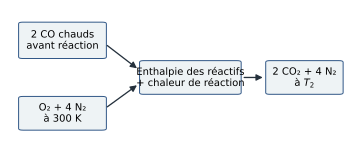
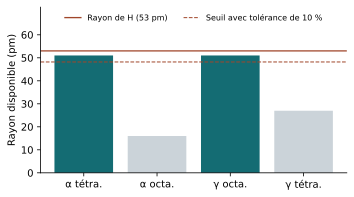
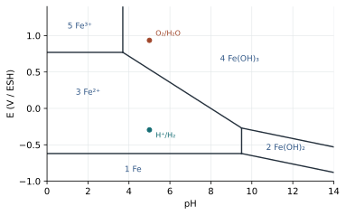
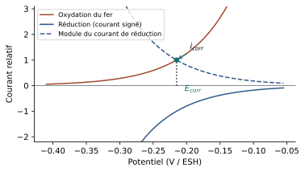
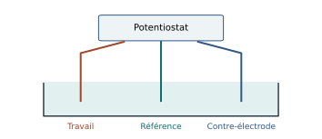
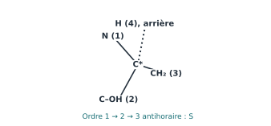
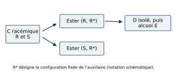
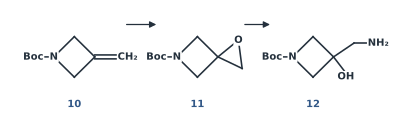

# ENS Lyon et Paris-Saclay — PC, Physique-chimie 2025 · Corrigé partiel brut

*Corrigé rédigé par IA, non officiel.*

**Rédaction** · GPT-6.2 Astra Ultra · vitesse non renseignée

**Couverture.** Les 30 questions du volet physique portent sur un lanceur magnétique et sont hors de la présente édition. Dans le volet chimie, C1 à C6 et C11 à C36 sont intégralement traitées (32 questions). C7 à C10, qui étudient la décomposition et la surpression d’un gaz confiné, sont hors périmètre.

## Thermochimie de la flamme de soudage

### C1 — Bilan des deux combustions

Au cœur de la flamme, le modèle fournit $\mathrm{C_2H_2(g)+O_2(g)\to2CO(g)+H_2(g)}$. À la périphérie, le sujet retient l’oxydation $\mathrm{2CO(g)+O_2(g)\to2CO_2(g)}$. Dans la seconde équation, le diazote de l’air est spectateur.

### C2 — Bilan enthalpique au cœur

À pression constante, pour une transformation adiabatique, $\Delta H=0$. À $T_0=300$ K, la loi de Hess donne $\Delta_rH_1^\circ=2(-111)-228=-450$ kJ par mole de réaction. Avec les capacités calorifiques constantes de l’annexe, la somme pour les produits gazeux vaut $2C_p(\mathrm{CO})+C_p(\mathrm{H_2})=90$ J·K⁻¹. Il vient $-450\,000+90(T_1-T_0)=0$, soit **$T_1\simeq5,3\times10^3$ K**. Le modèle suppose la combustion totale selon l’équation retenue et des espèces gazeuses intègres à toute température.

### C3 — Bilan enthalpique à la périphérie

Prenons les deux moles de CO formées en C2 et de l’air contenant une mole de $\mathrm{O_2}$ pour environ quatre de $\mathrm{N_2}$. Les deux moles de CO apportent $2\times30(T_1-T_0)\simeq300$ kJ d’enthalpie sensible. Leur oxydation à $T_0$ fournit $-\Delta_rH_2^\circ=2[394-111]=566$ kJ. La capacité thermique de $2\,\mathrm{CO_2}+4\,\mathrm{N_2}$ vaut $2\times25+4\times30=170$ J·K⁻¹. Le bilan donne $T_2=T_0+(300+566)10^3/170\simeq\mathbf{5,4\times10^3\ K}$. On a isolé le flux de CO dont le sujet suit la combustion. Si le dihydrogène chaud accompagne le flux comme spectateur, il faut ajouter sa chaleur sensible à l’entrée **et** sa capacité thermique à la sortie. La valeur reste voisine de $5,4\times10^3$ K à deux chiffres.

### C4 — Écart avec la température mesurée

Les pertes d’énergie vers le métal, l’air et les parois, notamment par rayonnement, diminuent la température. Les capacités calorifiques des gaz varient sur plusieurs milliers de kelvins. À haute température, des dissociations endothermiques deviennent importantes et l’équilibre limite la conversion. Le partage de l’énergie entre ces processus explique qu’une mesure d’environ 3 800 K soit inférieure à l’estimation de C2.

### C5 — Effet d’un excès de réactif

Dans le modèle de combustion retenu, l’excès de combustible ou de comburant abaisse la température par rapport au mélange stœchiométrique. L’avancement est borné par la quantité du réactif limitant tandis qu’une partie de la chaleur dégagée échauffe aussi l’espèce en excès. La couleur dépend notamment des espèces émettrices.

### C6 — Carbone dans l’acier

Le carbone peut entrer dans les sites interstitiels du fer et participer, selon la composition et le refroidissement, à la formation de carbures. Les distorsions locales freinent le mouvement des dislocations. La dureté et la résistance mécanique peuvent ainsi augmenter. Une teneur excessive en carbone peut aussi compromettre la ductilité.

## Soudage à l’arc et structure des aciers

### C11 — Ions et stabilité de l’arc

Dans les données, la valeur absolue de l’énergie réticulaire est plus faible pour $\mathrm{K_2O}$ que pour $\mathrm{TiO_2}$ (2 240 contre 12 150 kJ·mol⁻¹). Les entités ioniques sont donc moins fortement liées dans l’oxyde de potassium. K possède aussi la plus faible première énergie d’ionisation des éléments cités, 419 kJ·mol⁻¹. À haute température, la présence d’espèces potassiques contribue à la population de porteurs de charge, ions et électrons, et donc à la conduction dans l’arc.

### C12 — Comparer les volumes par atome

La maille cubique centrée du fer $\alpha$ contient $8/8+1=2$ atomes, la maille cubique à faces centrées du fer $\gamma$ en contient $8/8+6/2=4$. Les volumes par atome sont donc respectivement $2,3\times10^{-2}/2=1,15\times10^{-2}$ nm³ et $4,5\times10^{-2}/4=1,125\times10^{-2}$ nm³. Les chiffres tabulés arrondis indiquent une contraction de l’ordre de **2 %** ; le calcul à partir des paramètres de maille donne environ 3,6 %. Au degré de précision pertinent, les deux volumes restent très voisins. La transformation seule fournit peu de variation volumique pour expliquer une craquelure ; les contraintes thermiques et la géométrie réelle importent aussi.

### C13 — Perte d’ordre à longue distance

Un refroidissement rapide peut figer une organisation hors équilibre avant que les atomes aient diffusé jusqu’à leurs positions régulières. Cela favorise les défauts, les très petits domaines cristallins et, dans les conditions appropriées, des zones amorphes. La perte locale de cristallinité s’interprète par la cinétique de transformation.

### C14 — Sites disponibles pour l’hydrogène

Dans le fer $\alpha$, les douze sites tétraédriques de rayon 51 pm acceptent un atome H de rayon 53 pm selon la tolérance de 10 %. Les sites octaédriques, anisotropes, sont limités par une distance $a/2$ et offrent environ $143-127=16$ pm. Le modèle compte donc **12 sites admissibles pour 2 Fe**, soit 6 par Fe. Dans le fer $\gamma$ CFC, le site octaédrique offre $a/2-r_{\rm Fe}=178-127=51$ pm. On en compte $1+12/4=4$ par maille. Un site tétraédrique offre $a\sqrt 3/4-r_{\rm Fe}\simeq27$ pm ; il est trop petit. Il reste **4 sites admissibles pour 4 Fe**, soit 1 par Fe. Ce comptage géométrique donne à $\alpha$ la capacité d’insertion la plus élevée dans le modèle de l’énoncé. La solubilité d’équilibre réelle dépend aussi des énergies d’insertion.

### C15 — Surpression dans un solide enrichi en hydrogène

Notons A la zone pauvre en H et B la zone enrichie. Pour une solution solide idéale à température fixée, $\mu_{\rm Fe}\simeq\mu_{\rm Fe}^{*}(P_0)+\bar V_{\rm Fe}(P-P_0)+RT\ln x_{\rm Fe}$. L’égalité des potentiels chimiques du fer donne

$$P_B-P_A\simeq\frac{RT}{\bar V_{\rm Fe}}\ln\frac{x_{\rm Fe,A}}{x_{\rm Fe,B}}>0.$$

L’effet de dilution du fer dans B est compensé par une pression accrue. Cette analogie avec la pression osmotique rend compte des contraintes locales ; elle ne nécessite aucune phase gazeuse interne.

## Corrosion et passivation

### C16 — Domaines du fer en solution aqueuse

Du bas vers le haut, le diagramme favorise les états d’oxydation 0, +II, puis +III. À potentiel approprié, l’élévation du pH favorise les hydroxydes solides. **1** correspond à $\mathrm{Fe(s)}$, **2** à $\mathrm{Fe(OH)_2(s)}$, **3** à $\mathrm{Fe^{2+}(aq)}$, **4** à $\mathrm{Fe(OH)_3(s)}$ et **5** à $\mathrm{Fe^{3+}(aq)}$. Les limites entre deux espèces du même degré d’oxydation sont verticales lorsque l’équilibre ne met aucun électron en jeu.

### C17 — Fer dans l’eau désoxygénée

À 25 °C et pour une pression de référence de dihydrogène, $E_{\mathrm{H^+/H_2}}\simeq-0,059\,\mathrm{pH}\simeq-0,30$ V/ESH. À pH 5, ce point tombe dans le domaine **3** de la figure 3. La formation de $\mathrm{Fe^{2+}(aq)}$ est thermodynamiquement possible. Il s’agit d’une **corrosion**, dont la vitesse dépend aussi des processus de surface.

### C18 — Fer dans l’eau oxygénée

Pour une pression de référence de dioxygène, $E_{\mathrm{O_2/H_2O}}\simeq1,23-0,059\times5=0,93$ V/ESH. À pH 5, le domaine **4** est celui de $\mathrm{Fe(OH)_3(s)}$. Le diagramme prévoit une **passivation thermodynamique**. Le caractère continu, compact et protecteur de la couche détermine l’efficacité réelle de cette passivation.

### C19 — Courant de corrosion

En circuit ouvert, au potentiel mixte $E_{\rm corr}$, le courant extérieur est nul et les deux réactions partielles se poursuivent : $i_a(E_{\rm corr})+i_c(E_{\rm corr})=0$. Après réflexion de la branche cathodique sur l’axe des potentiels, l’abscisse du croisement est $E_{\rm corr}$ et son ordonnée $i_{\rm corr}=i_a=|i_c|$. Sur le tracé fourni, l’abscisse est de l’ordre de $-0,2$ V/ESH. Aucune graduation de courant ne permet de chiffrer l’ordonnée.

### C20 — Quantité de métal oxydé

La demi-équation $\mathrm{Fe(s)\to Fe^{2+}(aq)+2e^-}$ libère deux moles d’électrons par mole de fer consommée. Ainsi $i_{\rm corr}=2F\,\mathrm dn_{\rm Fe^{2+}}/\mathrm dt$, soit $v_{\rm ox}=i_{\rm corr}/(2F)$ en mol·s⁻¹.

### C21 — Épaisseur perdue par unité de temps

Sur une aire $S$ soumise à une attaque uniforme, $\mathrm dV=S\,\mathrm de=M_{\rm Fe}\mathrm dn/\rho_{\rm Fe}$. La vitesse de perte d’épaisseur est donc

$$v_{\rm usure}=\frac{M_{\rm Fe}}{2F\rho_{\rm Fe}}\frac{i_{\rm corr}}S.$$

Avec $M$ en kg·mol⁻¹, $\rho$ en kg·m⁻³ et $i/S$ en A·m⁻², on obtient des m·s⁻¹. Multiplier par $10^6\times365,25\times24\times3600$ pour obtenir des µm·an⁻¹. Avec une attaque localisée, il s’agit d’une moyenne sur la surface choisie.

### C22 — Montage à trois électrodes

La pièce métallique possède une surface exposée connue ; c’est l’électrode de **travail**. Le potentiostat impose sa différence de potentiel avec une électrode de **référence** (ECS sur la figure), de potentiel stable et pratiquement sans courant. La **contre-électrode** inerte assure le retour du courant ; le potentiostat mesure le courant échangé avec la pièce. Un balayage du potentiel fournit $i(E)$ ; la division par $S$ permet la comparaison des matériaux.

### C23 — Pic et plateau de passivation

Le courant actif monte tant que le métal est directement accessible. Dans la comparaison proposée, **$i_{\max}$ renseigne sur l’importance de l’oxydation précédant l’établissement de la couche**. Pour estimer quantitativement son épaisseur, c’est la charge de formation $\int i_{\rm film}\,\mathrm dt$ qui importe, avec la stœchiométrie, la densité et la part du courant réellement affectée au film. **$i_{\rm plateau}$** renseigne sur l’efficacité protectrice du film formé : à surface identique, un courant résiduel plus faible correspond à une attaque résiduelle plus lente.

### C24 — Comparer fer, chrome et alliage

Sur la figure 5, le plateau de l’alliage Fe/Cr est voisin de celui du Cr, vers $\log(i/S)\simeq-7$, alors que celui du Fe est voisin de $-4$ (environ $-3,7$). À potentiel passivant, la densité de courant de l’alliage est donc inférieure de plusieurs ordres de grandeur à celle du fer. Une couche compacte riche en oxyde de chrome limite les échanges et protège la surface.

## Cobimétinib et stéréochimie

### C25 — Centre stéréogène du cobimétinib

Le carbone de la pipéridine lié au carbone porteur de OH est **l’unique centre stéréogène**, de configuration **$S$**. Les priorités CIP sont N, puis le carbone lié à O et à deux C, puis le $\mathrm{CH_2}$ du cycle (voisins C,H,H), enfin H. Dans la projection fournie, H est à l’arrière ; la séquence 1–2–3 tourne dans le sens antihoraire. Les deux chemins autour du petit cycle azétidine sont équivalents : son carbone porteur de OH n’est pas un second centre.

### C26 — Activer une fonction acide

Le fluor attire fortement les électrons par effet inductif. Le carbone carbonylé du fluorure d’acyle 3 est plus électrophile que celui de l’acide 2 et l’addition de l’amine est facilitée. De plus, l’acide non activé serait susceptible de protoner l’amine. L’activation permet ici d’obtenir l’amide de 5. Dans le mécanisme retenu par le rapport, l’addition contrôle la cinétique ; classer seulement les aptitudes de F⁻ et HO⁻ à partir ne justifie pas la réactivité observée.

### C27 — Former l’amide

Le doublet de l’azote libre de 4 attaque le carbone de $\mathrm{ArCOF}$ ; le doublet π du carbonyle se reporte sur O. L’adduit tétraédrique porte $\mathrm{O^-}$ et un N ammonium. La reformation de $\mathrm{C=O}$ s’accompagne du départ de $\mathrm{F^-}$. La base encombrée $B$ (DIPEA) accepte le proton de l’amide protoné, ce qui donne 5 et $\mathrm{BH^+F^-}$. Une déprotonation de l’adduit avant élimination conduit au même bilan. La DIPEA piège l’acidité formée et son encombrement limite une acylation concurrente. L’amine entrante agit sous sa forme neutre.

### C28 — Basicité d’un organolithien

Avec $\chi(\mathrm C)=2,55$ et $\chi(\mathrm{Li})=0,98$, la liaison C–Li est fortement polarisée $\mathrm{C^{\delta-}-Li^{\delta+}}$. Le carbone butylique est fortement basique : l’arrachement d’un proton forme le butane, acide conjugué très faible. Cette polarisation explique aussi le caractère nucléophile de l’organolithien.

### C29 — Solvant et ligand

L’éther diéthylique est un solvant **aprotique** et donneur par les doublets de l’oxygène ; il solvate $\mathrm{Li^+}$. Il doit aussi être **anhydre**, car l’eau consommerait la base par transfert de proton. Les deux atomes d’azote tertiaire de la TMEDA chélatent le lithium sans porter de liaison N–H ; la complexation modifie l’agrégation de l’organolithien et facilite la métallation recherchée.

### C30 — Origine du faible rendement

La voie désirée passe par la formation d’un dérivé lithié de B, puis son addition nucléophile sur le carbonyle de A. Or les deux groupes $\mathrm{CH_2}$ adjacents au carbonyle de la cétone A portent des protons énolisables. L’espèce basique peut arracher l’un de ces protons et produire un énolate au lieu de former la liaison C–C voulue. Ces voies concurrentes rendent compte du rendement de 13 % sans l’attribuer à la seule étape d’isolement.

### C31 — Séparer les énantiomères

C est obtenu racémique. L’acylation de sa fonction alcool par le chlorure d’acyle chiral représenté transforme ses deux énantiomères en **deux esters diastéréoisomères**. Une colonne de silice ordinaire peut les séparer grâce à leurs interactions différentes avec la phase stationnaire. L’ester D sélectionné est hydrolysé en milieu basique ; la coupure au niveau de l’acyle détache l’auxiliaire et restitue l’alcool E de configuration conservée. Il s’agit d’un dédoublement de racémique.

## Voie industrielle et analogue

### C32 — Rôle du nitrile

Dans 6, le proton du carbone adjacent au nitrile est plus acide que le proton en α de N dans B. Après son départ, la charge peut se délocaliser selon $\mathrm{R_2C^-{-}C\equiv N\leftrightarrow R_2C=C=N^-}$ ; l’effet inductif du nitrile contribue également à la stabilisation. La formation du nucléophile carboné est ainsi favorisée.

### C33 — Intérêt de la brique chirale

La brique 6 est accessible industriellement sous forme chirale définie. Ses centres déjà présents différencient les faces lors des étapes suivantes et permettent une synthèse diastéréosélective. On évite le dédoublement tardif d’un racémique, qui écarte une part importante de la matière dans la voie précédente.

### C34 — Ouvrir le N,O-acétal par réduction

Dans 7, protoner l’oxygène de l’hémiaminal éthérifié facilite la rupture de sa liaison au carbone commun à N et O. Le doublet de N forme simultanément la liaison $\mathrm{C=N^+}$ ; l’ouverture libère l’alcool porté par le bras auxiliaire. Le milieu acide contient ainsi un **iminium**, forme cationique de la fonction imine imposée ici par la substitution de l’azote. Le transfert d’un hydrure du cyanoborohydrure au carbone électrophile déplace le doublet π vers N. Il donne l’amine de 8 et laisse en place le nitrile et l’alcool du petit cycle. Le rôle de ce réducteur dans la question est sa sélectivité envers l’iminium.

### C35 — Attribuer les spectres de 10 et 11

**10** est la N-Boc-3-méthylèneazétidine : le sommet opposé à N porte une double liaison exocyclique $\mathrm{C=CH_2}$. Les neuf protons du tert-butyle donnent le singulet à 1,42 ppm, les deux $\mathrm{N{-}CH_2}$ du cycle donnent 4 H à 4,4 ppm, et le méthylène vinylique donne 2 H à 5,05 ppm. La bande à 1 640 cm⁻¹ est cohérente avec cette double liaison.
**11** est l’**époxyde spiro** de cet alcène : un oxygène relie désormais le carbone du cycle au carbone du méthylène terminal. Le nombre de H ne change pas tandis que la formule gagne un O. La bande de l’alcène disparaît sans nouvelle bande de carbonyle ; le carbonyle du Boc était déjà présent. Les 2 H de l’époxyde apparaissent à 2,75 ppm, les 4 H voisins de N restent vers 4,4 ppm et les 9 H du tert-butyle à 1,35 ppm.

### C36 — Ouverture régiosélective de l’époxyde

Le doublet de $\mathrm{NH_3}$ attaque le $\mathrm{CH_2}$ terminal de 11, le moins encombré, par une substitution concertée avec rupture de sa liaison à O. L’oxygène demeure lié au carbone spiro et porte transitoirement la charge négative, tandis que l’azote entrant porte une charge positive. Les transferts de proton dans le milieu conduisent à **12**, N-Boc-3-(aminométhyl)azétidin-3-ol. En l’absence d’activation fortement acide, l’attaque suit la régiosélectivité de type $\mathrm{S_N2}$ à ce carbone primaire ; le carbone spiro encombré garde la liaison C–O.
