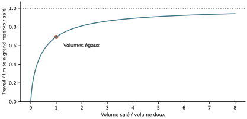
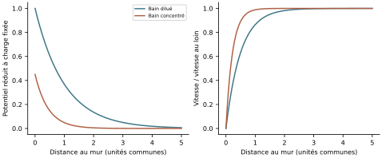
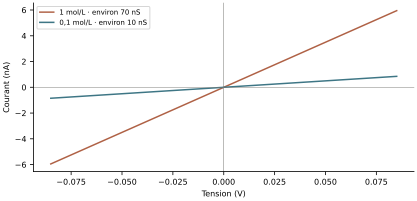
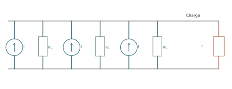
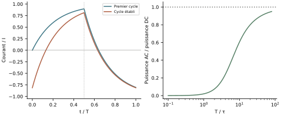

# Physique U — Concours PSI 2025 · Corrigé guidé

*Corrigé rédigé par IA, non officiel.*

**Rédaction** · GPT-6.2 Astra Ultra · vitesse non renseignée

Suivre l’unité de chaque flux avant d’introduire une charge élémentaire ou le nombre d’Avogadro. Le rapport du jury attire notamment l’attention sur le facteur deux de la dissociation, les dimensions physiques et l’unité nanosiemens.

## 1 — Énergie libre du mélange

### Q1 — Fractions molaires dans l’eau de mer

> [!INDICATION]
> La question demande la somme des fractions de deux espèces et non celle des paires NaCl.

#### Solution

La dissolution d’une mole de NaCl donne une mole de chaque ion. Le même nombre total de moles figure dans leurs deux fractions, donc $x_{\rm Na}=x_{\rm Cl}$. Dans 1 L, $n_s=30/(23+35,5)\simeq0,51$ mol de NaCl donnent environ 1,0 mol d’ions. L’eau représente environ 54–56 mol par litre suivant l’approximation de masse adoptée. La somme des fractions ioniques est donc $x\simeq1,8\times10^{-2}$, et chaque ion en représente environ la moitié.

### Q2 — État initial des réservoirs

> [!INDICATION]
> Former l’enthalpie libre d’un mélange par la somme des quantités de matière multipliées par les potentiels chimiques.

#### Solution

Dans le modèle idéal à deux constituants, $\mu_{\rm eau}=\mu^*(P,T)+RT\ln(1-x)$ et $\mu_s=\Psi(P,T)+RT\ln x$. Avec le volume molaire constant adopté par l’énoncé, posons $n_A=V_A/v_m$, $n_B=V_B/v_m$ et $g(x)=(1-x)\mu^*+x\Psi+RT[(1-x)\ln(1-x)+x\ln x]$. Alors $G_A=n_Ag(x)$ et $G_B=n_B\mu^*$. Le sel désigne ici une espèce effective qui compte l’ensemble des ions au sens de Q1.

### Q3 — État mélangé

> [!INDICATION]
> Changer à la fois le nombre total de moles et les fractions qui interviennent dans le logarithme.

#### Solution

On retrouve la même fonction molaire, cette fois à la composition finale, $G_M=(V_M/v_m)g(x_M)$. Ainsi l’eau contribue $V_M(1-x_M)[\mu^*+RT\ln(1-x_M)]/v_m$ et le soluté $V_M x_M[\Psi+RT\ln x_M]/v_m$.

### Q4 — Variation exacte dans le modèle idéal

> [!INDICATION]
> Conserver les potentiels de référence jusqu’à ce que leur compensation apparaisse explicitement.

#### Solution

La quantité de soluté est conservée, donc $x_M V_M=xV_A$, soit $x_M=\phi_A x$, avec $\phi_A=V_A/V_M$. Posons $H(y)=(1-y)\ln(1-y)+y\ln y$, son prolongement en zéro étant nul. Dans $G_M-G_A-G_B$ les termes de référence s’annulent par conservation des deux constituants. Il reste $\Delta G=(RTV_M/v_m)[H(\phi_Ax)-\phi_A H(x)]\leq0$. La convexité de $H$ sur $]0,1[$ fournit le signe.

### Q5 — Solution diluée

> [!INDICATION]
> Développer le logarithme du solvant et conserver intégralement le logarithme du soluté.

#### Solution

$H(y)=y\ln y-y+O(y^2)$. La différence annule les contributions en $x\ln x$ et les termes $-x$ sans logarithme. Il reste $\Delta G\simeq(RTV_A/v_m)x\ln\phi_A$, une quantité négative et linéaire en $x$ pour une proportion volumique des réservoirs fixée.

### Q6 — Analogie de la détente isotherme

> [!INDICATION]
> Relier le rapport des pressions à celui des volumes à température et quantité de gaz constantes.

#### Solution

Pour une quantité $n$ de gaz parfait, $\Delta G_{\rm gaz}=nRT\ln(P_f/P_i)=nRT\ln(V_A/V_M)$. Un soluté idéal très dilué a de même un potentiel chimique où intervient le logarithme de sa concentration. Ses $n=xV_A/v_m$ moles passent de l’espace accessible $V_A$ à $V_M$. La contribution dominante traduit le gain d’entropie de dilution.

### Q7 — Travail récupérable

> [!INDICATION]
> Convertir d’abord les moles d’ions de 1 L à 1 m³, puis diviser les joules par $3,6\times10^6$.

#### Solution

À température et pression fixées, le travail utile réversible maximal fourni à l’extérieur vaut $-\Delta G$. Pour des volumes égaux, environ $10^3$ mol d’ions par mètre cube d’eau salée, $T\simeq300$ K et $\ln2\simeq0,7$, on trouve $W_{\max}\simeq1,8\times10^6$ J, soit environ **0,49 kWh**. Le facteur deux de la dissociation a déjà été inclus en Q1.

### Q8 — Autonomie de la lampe

> [!INDICATION]
> Employer simultanément des kilowatts et des kilowattheures, ou des watts et des joules.

#### Solution

Avec une puissance de 9 W, soit 0,009 kW, $t\simeq0,49/0,009\simeq54$ h, environ deux jours et quart. Il s’agit d’une limite réversible pour les deux volumes donnés.

### Q9 — Borne au débouché de l’Amazone

> [!INDICATION]
> Multiplier l’énergie par mètre cube d’eau douce par son débit, puis comparer des puissances dans la même unité.

#### Solution

Chaque mètre cube d’eau douce est associé ici à un mètre cube d’eau salée. La puissance réversible correspondante est $2\times10^5\times1,8\times10^6\simeq3,6\times10^{11}$ W, environ 360 GW. Cela représente environ 400 fois 900 MW. Le débit du fleuve sert de débit d’eau douce, sans double comptage des volumes. Captage, conversion et mélange réel diminuent la puissance accessible.

### Q10 — Quantité d’eau salée utile

> [!INDICATION]
> L’accroissement de la quantité de soluté et la diminution de la dilution par ion agissent en sens opposés.

#### Solution

Pour $V_B$ fixé, $W_{\max}\propto V_A\ln(1+V_B/V_A)$. Sa dérivée en $V_A$ est proportionnelle à $\ln(1+u)-u/(1+u)>0$ pour $u=V_B/V_A>0$, comme on le vérifie en dérivant en $u$ à partir de zéro. Il faut donc un réservoir salé aussi grand que possible. Le gain tend vers une limite finie $RTxV_B/v_m$ lorsque $V_A\gg V_B$.

## 2.1 — Ions au voisinage de la paroi

### Q11 — Flux molaire diffusif

> [!INDICATION]
> Vérifier en premier lieu si la concentration est exprimée en moles ou en nombre de particules.

#### Solution

La loi de Fick s’écrit $\vec j_+^{(D)}=-D_+\nabla c_+$. Si $c_+$ est en $\mathrm{mol\,m^{-3}}$ et $D_+$ en $\mathrm{m^2/s}$, le flux est en $\mathrm{mol\,m^{-2}s^{-1}}$. Aucun nombre d’Avogadro n’intervient dans ce changement de représentation effectué à la fois pour la concentration et le flux.

### Q12 — Transport et conservation des cations

> [!INDICATION]
> Ajouter le flux de diffusion et le flux entraîné par le champ avant de prendre leur divergence.

#### Solution

Le flux total vaut $\vec j_+=-D_+\nabla c_+-\mu_+k_BT c_+\nabla\psi$, où $\psi=e\phi/(k_BT)$. Sans réaction, $\partial_t c_++\nabla\cdot\vec j_+=0$. Ainsi $\partial_t c_+=D_+\Delta c_++\mu_+k_BT\nabla\cdot(c_+\nabla\psi)$. Le second terme rend compte de la dérive dans le potentiel électrostatique.

### Q13 — Relation d’Einstein

> [!INDICATION]
> Le signe de la dérivée du facteur de Boltzmann doit permettre à la diffusion de compenser la dérive.

#### Solution

À l’équilibre thermodynamique, le flux net est nul. Avec $c_+=c_\infty e^{-\psi}$ on a $\nabla c_+=-c_+\nabla\psi$. Les contributions au flux se compensent pour $D_+=\mu_+k_BT$. Ici $\mu_+$ relie la vitesse à une **force**, suivant la définition qui a déjà extrait $e$ dans le flux électrique.

### Q14 — Répartition des anions

> [!INDICATION]
> Comparer la charge de l’anion et celle du cation dans l’énergie potentielle.

#### Solution

L’énergie d’un anion monovalent dans le potentiel est $-e\phi$. Ainsi $c_-=c_\infty e^{+\psi}$. Loin du mur le potentiel est nul et l’électroneutralité d’une solution de NaCl 1:1 impose $c_-=c_+=c_\infty$.

### Q15 — Densité de charge

> [!INDICATION]
> Pour passer d’une différence de concentrations molaires à une charge volumique, multiplier par la charge d’une mole d’ions monovalents.

#### Solution

Pour des concentrations en moles par mètre cube, $\rho_e=eN_A(c_+-c_-)=-2eN_Ac_\infty\sinh\psi$. Une paroi à potentiel positif attire donc un excès de contre-ions négatifs.

### Q16 — Équation de Poisson–Boltzmann

> [!INDICATION]
> Garder le signe de Poisson et celui de la différence entre les deux exponentielles.

#### Solution

Dans le vide $\Delta\phi=-\rho_e/\varepsilon_0$. Posons $\varepsilon=\varepsilon_0\varepsilon_r$. Dans le milieu homogène du sujet, $\Delta\phi=-\rho_e/\varepsilon$. En utilisant Q15, $\Delta\psi=\sinh\psi/\lambda_D^2$, avec $\lambda_D^2=\varepsilon k_BT/(2e^2N_A c_\infty)$. Les concentrations doivent être en unités SI dans cette expression numérique.

### Q17 — Symétrie de la paroi

> [!INDICATION]
> Nommer les deux directions d’invariance du potentiel avant de dériver celui-ci.

#### Solution

Pour une paroi plane infinie chargée uniformément et un bain homogène, les translations le long de la paroi et les rotations autour de sa normale laissent les conditions inchangées. Ainsi $\phi=\phi(z)$ et $\vec E=-\phi'(z)\vec e_z$. La solution est définie dans le liquide $z>0$. La symétrie ne relie pas deux milieux de nature différente de part et d’autre de la paroi.

### Q18 — Écrantage linéaire

> [!INDICATION]
> Retenir la solution qui reste bornée et tend vers le potentiel de référence du bain.

#### Solution

Lorsque $|\psi|\ll1$, $\sinh\psi\simeq\psi$. L’équation $\psi''=\psi/\lambda_D^2$ a deux exponentielles. La condition loin de la paroi supprime la croissance et celle à l’origine fixe $\psi=\psi_0e^{-z/\lambda_D}$. Ainsi $\phi(z)=\phi_0e^{-z/\lambda_D}$.

### Q19 — Neutralité intégrée

> [!INDICATION]
> Choisir une boîte de Gauss de section unité englobant la paroi et toute sa couche de compensation.

#### Solution

Par Gauss, $\partial_zE_z=\rho_e/\varepsilon$ dans le liquide. La discontinuité au mur donne $\varepsilon E_z(0^+)=\Sigma$ puisque le champ intérieur est nul. À grande distance $E_z\to0$. L’intégration donne $\int_0^\infty\rho_e\,dz=\varepsilon[0-E_z(0^+)]=-\Sigma$. La charge intégrée dans le liquide compense donc la charge de surface.

### Q20 — Potentiel de surface

> [!INDICATION]
> Contrôler que le signe du potentiel de surface est celui de la charge de la paroi.

#### Solution

Avec Q18, $\rho_e=-\varepsilon\phi_0 e^{-z/\lambda_D}/\lambda_D^2$. Son intégrale vaut $-\varepsilon\phi_0/\lambda_D$, d’où $\phi_0=\Sigma\lambda_D/\varepsilon$. Dans le cadre linéaire, la capacité différentielle par unité d’aire est $\varepsilon/\lambda_D$.

### Q21 — Épaisseur de Debye

> [!INDICATION]
> Une mole par litre correspond à mille moles par mètre cube.

#### Solution

L’argument de l’exponentielle établit que $\lambda_D$ est une longueur. Avec $c_\infty=500\ \mathrm{mol\,m^{-3}}$, $\varepsilon\simeq7,1\times10^{-10}$ F/m et $k_BT\simeq4,2\times10^{-21}$ J, on trouve $\lambda_D\simeq4,4\times10^{-10}$ m, soit environ 0,44 nm.

### Q22 — Effet de la concentration

> [!INDICATION]
> Si l’on maintient la charge fixe, le potentiel au mur varie lui aussi avec la concentration.

#### Solution

À $\Sigma$ fixée, $\lambda_D\propto1/\sqrt{c_\infty}$ et $|\phi_0|\propto\lambda_D$ dans l’approximation linéaire. Le potentiel du bain dilué part plus loin de zéro et décroît plus lentement en module. Les deux courbes ont la même pente initiale $-\Sigma/\varepsilon$. Pour l’eau salée de Q21, $0,44$ nm est très inférieur aux 25 nm du canal, d’où un faible recouvrement des deux couches. À cette échelle, les effets moléculaires limitent la précision du modèle continu.

### Q23 — Solution non linéaire

> [!INDICATION]
> Chercher une première intégrale en multipliant l’équation du second ordre par la dérivée de l’inconnue.

#### Solution

Multiplier $\psi''=\sinh\psi/\lambda_D^2$ par $\psi'$ et prendre $\psi,\psi'\to0$ à l’infini donne $(\psi')^2=2(\cosh\psi-1)/\lambda_D^2=4\sinh^2(\psi/2)/\lambda_D^2$. La branche dirigée vers zéro satisfait $\psi'=-2\sinh(\psi/2)/\lambda_D$, valable pour les deux signes de surface. Comme $d\ln|\tanh(\psi/4)|/d\psi=1/[2\sinh(\psi/2)]$, $\tanh(\psi(z)/4)=\tanh(\psi_0/4)e^{-z/\lambda_D}$. La solution nulle complète le cas où le logarithme n’est pas défini.

## 2.2 — Écoulement diffusio-osmotique

### Q24 — Force électrostatique volumique

> [!INDICATION]
> Une densité de charges multipliée par une force par unité de charge doit donner une force volumique.

#### Solution

La force de Coulomb par unité de volume vaut $\vec f_{\rm vol}=\rho_e\vec E=-\rho_e\nabla\phi$, en $\mathrm{N\,m^{-3}}$. Elle couple la distribution des charges du liquide au champ local.

### Q25 — Nombre de Reynolds

> [!INDICATION]
> Estimer séparément les valeurs de $\rho(\vec v\cdot\nabla)\vec v$ et de $\eta\Delta\vec v$.

#### Solution

Le rapport de l’inertie convective à la viscosité s’estime par $\mathrm{Re}=\rho v L/\eta$. La masse volumique est $\rho$, la vitesse caractéristique $v$, la longueur $L$ et la viscosité dynamique $\eta$. Le quotient est sans dimension.

### Q26 — Ordre de grandeur dans le canal

> [!INDICATION]
> Employer la pression osmotique en pascals et les deux longueurs en mètres.

#### Solution

$\delta\Pi=RT\delta c\simeq1,2\times10^6$ Pa. Avec $a=25$ nm et $L=100$ nm, $v\simeq a^2\delta\Pi/(8\eta L)\simeq1$ m/s dans l’estimation demandée. D’où $\mathrm{Re}_L\sim0,1$. Le régime est laminaire et dominé par les forces visqueuses. Si l’on compare sur la largeur, le nombre est encore plus petit. Cette vitesse de Poiseuille sert à évaluer un ordre de grandeur et ne remplace pas la vitesse diffusio-osmotique qui sera calculée.

### Q27 — Équation réduite

> [!INDICATION]
> L’inertie convective s’annule ici par la forme du champ, en plus de l’estimation de Reynolds.

#### Solution

En régime stationnaire et pour $\vec v=v(z)\vec e_x$, $\partial_t\vec v=0$ et $(\vec v\cdot\nabla)\vec v=v\partial_x\vec v=0$ dans cette approximation locale. L’incompressibilité est satisfaite. L’équation devient $\vec0=\eta v''\vec e_x-\nabla P-\rho_e\nabla\phi$. Les gradients du potentiel et de la pression peuvent conserver leurs composantes en $x$ et $z$.

### Q28 — Équilibre normal

> [!INDICATION]
> Le gradient de vitesse est transverse mais la force de viscosité correspondante reste tangentielle.

#### Solution

La viscosité de ce champ de vitesse n’a aucune composante suivant $z$. La projection normale donne $\partial_zP=-\rho_e\partial_z\phi$. Il s’agit de la compensation de la force électrostatique par un gradient de pression dans la double couche.

### Q29 — Charge locale en faible potentiel

> [!INDICATION]
> Substituer la longueur de Debye après avoir pris deux dérivées transversales.

#### Solution

À $x$ fixé, $\partial_z^2\phi\simeq\phi/\lambda_D(x)^2$. Avec Poisson, $\rho_e=-\varepsilon\phi/\lambda_D^2=-2eN_A c_\infty(x)\psi(x,z)$. Ainsi $K=-2eN_A$. On retrouve la linéarisation de Q15. Il faut conserver la permittivité de l’eau dans les deux étapes.

### Q30 — Surpression près du mur

> [!INDICATION]
> Identifier dans la somme des deux concentrations le terme qui survit quand les contributions du premier ordre se compensent.

#### Solution

En utilisant $\phi=(k_BT/e)\psi$, Q28 devient $\partial_zP=2k_BTN_Ac_\infty\psi\partial_z\psi$. Intégrer depuis le bain donne $P=P_\infty+k_BTN_Ac_\infty\psi^2$. En effet $c_++c_-=2c_\infty\cosh\psi\simeq2c_\infty+c_\infty\psi^2$. La surpression égale au premier ordre non nul $RT$ fois l’excès de concentration totale de particules dissoutes. C’est la contribution osmotique.

### Q31 — Forçage tangentiel

> [!INDICATION]
> Dériver les deux facteurs $c_\infty(x)$ et $\psi(x,z)^2$ dans la pression.

#### Solution

Suivant $x$, $\eta v''=\partial_xP+\rho_e\partial_x\phi$. En dérivant $P=P_0+RTc_\infty\psi^2$ on obtient $RT[\psi^2c_\infty'+2c_\infty\psi\partial_x\psi]$. Le dernier terme est annulé par $\rho_e\partial_x\phi=-2RTc_\infty\psi\partial_x\psi$. Il reste $\eta v''=RT\psi^2dc_\infty/dx$. Négliger d’emblée le champ tangentiel empêcherait cette compensation.

### Q32 — Condition d’adhérence

> [!INDICATION]
> Une condition sur la valeur au mur et une condition sur la dérivée au loin sont nécessaires pour intégrer deux fois.

#### Solution

Au mur fixe $v(0)=0$. Juste au-dessus, un cisaillement fini donne $v(z)\simeq z v'(0)$ dans le premier ordre régulier. L’autre condition est $v'(\infty)=0$, puisque la vitesse devient uniforme hors de la couche.

### Q33 — Vitesse de glissement apparente

> [!INDICATION]
> Intégrer d’abord depuis l’infini pour la dérivée, puis depuis le mur pour la vitesse.

#### Solution

À $x$ fixé, insérons $\psi=\psi_0e^{-z/\lambda_D}$. En posant $B=(RT/\eta)\psi_0^2dc_\infty/dx$, on a $v''=Be^{-2z/\lambda_D}$, d’où $v'=-B\lambda_D e^{-2z/\lambda_D}/2$ et $v=-B\lambda_D^2(1-e^{-2z/\lambda_D})/4$. Substituer $\lambda_D^2$ et $\psi_0=e\phi_0/(k_BT)$ donne **$v_\infty=-\varepsilon\phi_0^2(\partial_xc_\infty)/(8\eta c_\infty)$**. Les variations lentes en $x$ se lisent dans cette amplitude locale.

### Q34 — Sens du mouvement

> [!INDICATION]
> La mobilité de l’écoulement comporte le carré du potentiel de surface.

#### Solution

La concentration décroît de l’eau salée vers l’eau douce lorsque $x$ augmente. Ainsi $dc_\infty/dx<0$ et $v_\infty>0$. Le liquide entraîné par la double couche va ici **du plus concentré vers le moins concentré**, indépendamment du signe de $\phi_0$ dans ce modèle à diffusivités égales. La charge advectée, elle, peut changer de signe.

## 2.3 — Courant ionique diffusio-osmotique

### Q35 — Courant convectif de la double couche

> [!INDICATION]
> Décomposer la section en quatre bandes et estimer la largeur du domaine où charge et mouvement se recouvrent.

#### Solution

Le courant électrique transporté par l’écoulement est $\int_S\rho_e v\,dS$ en A, car $\mathrm{C\,m^{-3}}\times\mathrm{m/s}\times\mathrm{m^2}=\mathrm{C/s}$. Pour un pore carré, l’élément de section d’une bande proche d’une face vaut $a\,dz$. Les quatre faces donnent $I_{\rm DO}\simeq4a\int_0^\infty\rho_e v\,dz$. Il faut $\lambda_D\ll a$ pour remplacer la borne médiane par l’infini et négliger la contribution double des coins.

### Q36 — Longueurs de Bjerrum et de Gouy–Chapman

> [!INDICATION]
> Une affirmation dimensionnelle doit se vérifier à partir des grandeurs de l’expression.

#### Solution

Dans le milieu de permittivité $\varepsilon$, $e^2/(4\pi\varepsilon r)$ est une énergie. Ainsi $\ell_B=e^2/(4\pi\varepsilon k_BT)$ a la dimension d’une longueur. Pour $\ell_{GC}=e/(2\pi\Sigma\ell_B)$, le dénominateur hors facteur numérique a l’unité C/m. Le rapport est donc aussi une longueur. Si $\Sigma$ est prise algébriquement, les comparaisons d’échelles portent sur $|\ell_{GC}|$.

### Q37 — Énergie électrostatique et agitation

> [!INDICATION]
> Isoler la distance dans l’égalité entre énergie thermique et énergie de deux charges séparées.

#### Solution

À 300 K dans l’eau, $\ell_B\simeq(1,6\times10^{-19})^2/[4\pi(7,1\times10^{-10})(4,2\times10^{-21})]\simeq0,68$ nm. À cette distance, le module de l’énergie coulombienne entre deux charges élémentaires égale l’énergie thermique $k_BT$. La compétition compare l’interaction mutuelle et l’agitation.

### Q38 — Faible charge de surface

> [!INDICATION]
> Le terme d’ordre zéro du crochet se compense. Garder le terme cubique du sinus hyperbolique réciproque.

#### Solution

Posons $y=\lambda_D/\ell_{GC}$, petit en module. Le crochet de (13) vaut $1-\operatorname{arsinh}(y)/y\simeq y^2/6$. Ainsi $K_{\rm osm}\simeq[4a\Sigma k_BT/(2\pi\eta\ell_B)]\lambda_D^2/(6\ell_{GC}^2)$. À concentration fixée $\ell_{GC}^{-1}\propto\Sigma$, donc $K_{\rm osm}\propto\Sigma^3$. Sans charge de la membrane le courant de ce mécanisme s’annule.

### Q39 — Forte charge de surface

> [!INDICATION]
> Comparer la croissance logarithmique du numérateur à la croissance linéaire du dénominateur.

#### Solution

Pour $|y|\gg1$, $\operatorname{arsinh}(y)/y$ tend vers zéro comme $\ln(2|y|)/|y|$. Il reste $K_{\rm osm}\simeq4a\Sigma k_BT/(2\pi\eta\ell_B)$. Cette expression est algébrique en $\Sigma$. C’est le crochet qui tend vers 1, indépendamment de son signe.

### Q40 — Ordre de grandeur du courant d’un canal

> [!INDICATION]
> Conserver jusqu’au bout le signe du gradient et convertir toutes les dimensions du pore en mètres.

#### Solution

Avec un profil linéaire, $(dc_\infty/dx)/\langle c_\infty\rangle=(-c_s/L)/(c_s/2)=-2/L$. Pour $a=25$ nm, $L=100$ nm et $\Sigma=1\ \mathrm{C/m^2}$, $I_{\rm DO}\simeq-4a\Sigma k_BT/(\pi\eta\ell_BL)\simeq-2\times10^{-9}$ A. Le courant conventionnel est négatif pour une charge de paroi positive et un axe du salé vers le doux. Son module est de l’ordre du **nanoampère**. Avec cette charge, $|\ell_{GC}|\simeq0,04$ nm, petit devant les longueurs de Debye considérées.

### Q41 — Pores en parallèle par unité d’aire

> [!INDICATION]
> Compter les canaux que l’on place dans un même carré de membrane avant d’optimiser leur largeur.

#### Solution

Pour une aire totale $S_m\simeq Na^2$, le courant surfacique est $j_{\rm mem}=NI_{\rm DO}/S_m\simeq I_{\rm DO}/a^2$. Dans le modèle de Q39, à $L$ et $\Sigma$ fixés, $|I_{\rm DO}|\propto a$, donc $|j_{\rm mem}|\propto1/a$. Des pores plus étroits favorisent la densité de courant dans le domaine $a\gg\lambda_D$. Parois de largeur finie et interaction des pores réduisent cette extrapolation.

## 3.1 — Conductance interne

### Q42 — Deux pentes de conductance

> [!INDICATION]
> Choisir deux points de chaque droite de part et d’autre de l’origine et écrire l’unité « nS » pour le nanosiemens.

#### Solution

La figure 5 donne le courant en nA et la tension en V. Entre environ $-0,08$ et $+0,08$ V les croix passent d’environ $-5,5$ à $+5,4$ nA, soit $G_1\simeq70$ nS. Les ronds donnent environ $\pm1$ nA à $\pm0,10$ V, donc $G_2\simeq10$ nS. Le rapport $G_1/G_2\simeq7$ est moindre que le rapport de concentrations égal à 10. Le graphe manifeste une conduite accrue avec le sel mais une stricte proportionnalité n’est pas soutenue à la précision de lecture.

### Q43 — Courant électrique des cations

> [!INDICATION]
> Le flux du sujet compte des moles par unité de surface et de temps. Déterminer la charge d’une mole avant d’intégrer.

#### Solution

Définissons $\Delta V=V(0)-V(L)$ dans le sens positif de mesure du courant. Ainsi $E_x=\Delta V/L$. Le flux molaire positif vaut $e\mu_+c_s\Delta V/L$. Multiplier par $eN_A$ et par la section carrée donne $I_+=e^2N_A\mu_+c_s(a^2/L)\Delta V$.

### Q44 — Conductance totale du canal

> [!INDICATION]
> Distinguer le sens de déplacement d’un anion et le sens de son courant conventionnel.

#### Solution

Pour les anions $j_{-,x}^{(E)}=-e\mu_-c_s\Delta V/L$ et la charge d’une mole est $-eN_A$. Leur courant électrique est $I_-=e^2N_A\mu_-c_s(a^2/L)\Delta V$, dans le même sens que celui des cations. En sommant, $I=\Delta V/R_c$ avec $R_c=L/[e^2N_A c_s(\mu_++\mu_-)a^2]$.

### Q45 — Prédiction homogène et expérience

> [!INDICATION]
> Utiliser le modèle de section effectivement demandé, puis comparer la tendance autant que la valeur des deux mesures.

#### Solution

Pour $c_{s,1}=10^3\ \mathrm{mol/m^3}$, $a=3\times10^{-8}$ m, $L=10^{-6}$ m et $\mu_++\mu_-=10^{12}\ \mathrm{s/kg}$, le modèle donne $G_1\simeq1,4\times10^{-8}$ S, soit 14 nS, puis 1,4 nS pour $c_{s,2}$. Ces valeurs sont plus faibles que les lectures 70 et 10 nS et restent strictement proportionnelles à $c_s$. Les charges de surface modifient les porteurs près des parois. Le canal réel du graphe est aussi cylindrique, tandis que la formule demandée utilise la section carrée $a^2$. Un changement de préfacteur géométrique seul ne change pas la dépendance en concentration.

## 3.2 — Circuit équivalent

### Q46 — Trois cellules de Norton

> [!INDICATION]
> Un canal représente un générateur complet, donc le dessin comporte trois sources et trois résistances internes.

#### Solution

Relier deux rails communs aux électrodes. Pour chaque canal, brancher entre les rails une source de courant $I_{\rm DO}$ et sa résistance $R_c$ en parallèle. Dessiner trois exemplaires orientés dans le même sens et connecter la charge $r$ aux mêmes deux bornes. La somme des courants sources est trois fois celle d’un canal, et la résistance équivalente interne vaut $R_c/3$.

### Q47 — Équivalent de Thévenin

> [!INDICATION]
> Trouver la tension à vide et le courant de court-circuit pour contrôler le passage entre les deux représentations du générateur.

#### Solution

En orientant le courant disponible vers la charge, $NI_{\rm DO}=i+U/(R_c/N)$ et $U=ri$. Ainsi $i=NI_{\rm DO}/(1+Nr/R_c)=I_{\rm DO}R_c/(r+R_c/N)$. La tension à vide vaut $E=I_{\rm DO}R_c$ et la résistance série $R=R_c/N$. La polarité peut être choisie pour que $I_{\rm DO}$ désigne le module de Q40, comme dans la troisième partie.

### Q48 — Adaptation pour une puissance maximale

> [!INDICATION]
> Le courant diminue quand on augmente la résistance de charge. Optimiser le produit $ri^2$ complet.

#### Solution

En continu $Ei=Ri^2+ri^2$. La puissance utile est $P=rE^2/(R+r)^2$ et sa dérivée $P'=E^2(R-r)/(R+r)^3$. Elle est maximale pour $r=R$, où $P_{\max}=E^2/(4R)$. À ce point la moitié de la puissance fournie est dissipée dans la résistance interne.

### Q49 — Puissance rapportée à la surface

> [!INDICATION]
> Le nombre de canaux disparaît en divisant la puissance totale par $Na^2$.

#### Solution

Le modèle des pores indépendants donne $P_{\max}/S_m=I_{\rm DO}^2R_c/(4a^2)$. Avec $I_{\rm DO}=1$ nA imposé dans cette partie, $R_c\simeq1/(10\,\mathrm{nS})=10^8\ \Omega$ et $a=25$ nm, on trouve environ **$4\times10^4\ \mathrm{W/m^2}$**. Cette densité concerne le modèle idéal serré et adapté.

### Q50 — Surface d’une lampe

> [!INDICATION]
> Un mètre carré contient dix mille centimètres carrés.

#### Solution

Pour 9 W au point d’adaptation, $S_m\simeq9/(4\times10^4)=2,25\times10^{-4}\ \mathrm{m^2}$, soit environ **2,3 cm²** de membrane idéale. Le facteur mille indiqué ensuite dans le sujet ferait passer cet ordre de grandeur vers $0,23\ \mathrm{m^2}$.

### Q51 — Échelle d’une installation de 900 MW

> [!INDICATION]
> Distinguer la surface active déroulée de l’empreinte spatiale d’un module.

#### Solution

$S_m\simeq9\times10^8/(4\times10^4)=2,25\times10^4\ \mathrm{m^2}$, soit 2,25 hectares pour le modèle idéal. En appliquant le facteur pratique de mille cité dans le sujet, cela correspond à environ 22,5 km² de surface développée de membrane. Un rouleau peut en réduire l’emprise au sol sans changer cette surface.

## 3.3 — De la source continue à un courant alternatif

### Q52 — Tension du pont commuté

> [!INDICATION]
> Redessiner un circuit série par demi-période et conserver la même flèche pour la charge.

#### Solution

La flèche $U$ de la figure 6 donne la tension de gauche moins droite du dipôle et $i$ est dirigé vers la droite. Avec K1 et K4 fermés, la source alimente la charge dans le sens direct, donc $U=E-Ri$. Avec K2 et K3 fermés la source est renversée relativement à la charge et $U=-E-Ri$. La perte ohmique interne reste opposée au courant de la charge dans les deux expressions.

### Q53 — Équations sur chaque demi-période

> [!INDICATION]
> La commutation peut modifier la tension aux bornes d’une inductance sans saut instantané de son courant.

#### Solution

Le dipôle vérifie $U=ri+L\dot i$. Donc $L\dot i+(R+r)i=E$ dans la première phase et $L\dot i+(R+r)i=-E$ dans la seconde. Le courant de la bobine est continu aux commutations dans ce modèle. Ici $L$ est l’inductance.

### Q54 — Premier cycle avec courant initial fixé

> [!INDICATION]
> Résoudre vers la valeur limite de chaque phase et utiliser la fin de la première comme condition initiale de la seconde.

#### Solution

Notons $h=T/2$, $b=e^{-h/\tau}$, $I=E/(R+r)$ et $\tau=L/(R+r)$. Pour $0\leq t\leq h$, $i(t)=I+(i_0-I)e^{-t/\tau}$. Posons $i_h=I+(i_0-I)b$. Pour $h\leq t\leq T$, $i(t)=-I+(i_h+I)e^{-(t-h)/\tau}$. Si $i_0=0$, le courant monte jusqu’à $I(1-b)$, puis redescend, franchit zéro et termine à $-I(1-b)^2$. Sa pente change aux commutations.

### Q55 — Amplitude périodique

> [!INDICATION]
> La première demi-période parcourt exactement l’intervalle de la valeur opposée au maximum jusqu’au maximum.

#### Solution

La symétrie en régime périodique impose $i(0)=-i_{\max}$ et $i(h)=i_{\max}$. Donc $i_{\max}=I-(I+i_{\max})b$, soit $i_{\max}=I(1-b)/(1+b)=I\tanh[T/(4\tau)]$. La valeur est toujours inférieure à $I$ pour une demi-période finie.

### Q56 — Courant sur la première moitié du cycle établi

> [!INDICATION]
> Substituer la valeur périodique de $i_0$ dans la solution de Q54.

#### Solution

La condition précédente donne $i(t)=I-(I+i_{\max})e^{-t/\tau}=I[1-2e^{-t/\tau}/(1+b)]$ pour $0\leq t\leq T/2$. Sur la seconde demi-période $i(t+h)=-i(t)$. Sa moyenne algébrique sur un cycle est nulle.

### Q57 — Puissance moyenne fournie à la charge

> [!INDICATION]
> Utiliser le carré du courant instantané. Le carré de son courant moyen donnerait à tort zéro.

#### Solution

Par antisymétrie, $P_{AC}=r h^{-1}\int_0^h i(t)^2dt$. En posant $A=2/(1+b)$, la moyenne de $(1-Ae^{-t/\tau})^2$ vaut $1-2A\tau(1-b)/h+A^2\tau(1-b^2)/(2h)$. Après simplification, **$P_{AC}=rI^2[1-(4\tau/T)\tanh(T/(4\tau))]$**. L’énergie magnétique initiale et finale de la bobine est identique sur une période.

### Q58 — Commutations lentes et rapides

> [!INDICATION]
> Pour $T/\tau$ petit, le premier terme constant de la parenthèse s’annule. Poursuivre le développement.

#### Solution

Pour $T\gg\tau$, $\tanh[T/(4\tau)]\simeq1$, donc $P_{AC}\simeq rI^2(1-4\tau/T)$ à une correction exponentiellement petite près dans ce terme. Pour $T\ll\tau$, posons $z=T/(4\tau)$. Puisque $\tanh z/z=1-z^2/3+O(z^4)$, la première contribution non nulle est $P_{AC}\simeq rI^2T^2/(48\tau^2)$. Le courant quasi triangulaire devient de faible amplitude en commutant très vite.

### Q59 — Comparer avec le branchement direct

> [!INDICATION]
> Examiner l’effet de $L$ sur le temps de montée plutôt que sur la valeur idéale $I$ atteinte à long terme.

#### Solution

La charge directement reliée à la source recevrait $P_{DC}=rI^2$. Le rapport $P_{AC}/P_{DC}$ est compris entre zéro et un. À fréquence fixée, diminuer $L$ diminue $\tau$ et rapproche la puissance alternative de la valeur continue. Ce critère de puissance seule pousse donc vers une faible inductance. Le compromis réel doit aussi prendre en compte l’ondulation, la forme du courant, la commutation et l’adaptation au réseau.

### Q60 — Inductance à 50 Hz

> [!INDICATION]
> Vérifier si le calcul final emploie la résistance d’un canal ou celle d’une membrane entière avant d’évaluer l’inductance.

#### Solution

$T=20$ ms et $T\simeq10\tau$ imposent $\tau\simeq2$ ms. La résistance nominale de la lampe assimilée à une charge ohmique vaut $r=230^2/9\simeq5,9\times10^3\ \Omega$. En prenant explicitement $R\sim1/G_2\sim10^8\ \Omega$ comme demandé dans cette estimation, $L=\tau(R+r)\sim2\times10^5$ H. Cette valeur démesurée rend peu plausible le dimensionnement d’une bobine pratique sous cette hypothèse. Pour une véritable membrane à nombreux pores parallèles $R=R_c/N$, donc le modèle global peut donner une autre échelle. La commutation étudiée convertit le continu en alternatif périodique, dont la forme n’est pas sinusoïdale.

[Sujet officiel](https://ens-paris-saclay.fr/sites/default/files/CONCOURS/ANNALES_1C/1C_PSI/2025/Sujets/2025_PSI_Ep6_Physique_U_14022025_NB.pdf) · [Rapport du jury](https://ens-paris-saclay.fr/sites/default/files/CONCOURS/ANNALES_1C/1C_PSI/2025/Rapports/2025_PSI_Rapport_Physique_Ecrit_V2.pdf)
