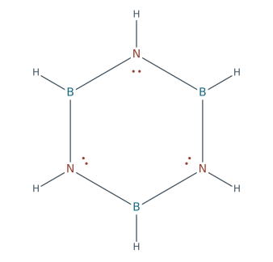
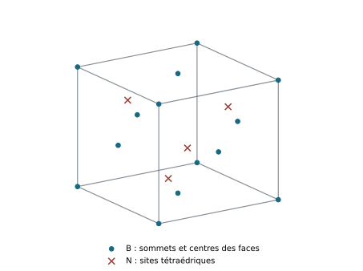

# Mines-Ponts MP — Chimie 2025 · Corrigé guidé

*Corrigé rédigé par IA, non officiel. Signalez toute erreur.*

## Présentation du sujet

L’épreuve de 90 minutes sans calculatrice comprend trois parties indépendantes. Vous pouvez répartir le temps en 25 minutes sur la structure, 35 sur le diagramme potentiel–pH, 20 sur l’oxydation et 10 sur les vérifications. Q1 à Q4 et Q16 à Q18 donnent des entrées proches du cours. Les six annexes sont regroupées sur la dernière page.

## I — Le nitrure de bore

### Question 1

> [!INDICATION]
> Repérez la colonne de chacun des trois éléments.

> [!INDICATION]
> Utilisez le nombre d’électrons de valence donné par le groupe principal.

#### Solution

Le bore est dans le groupe 13, donc il a **trois** électrons de valence. L’azote est dans le groupe 15, donc il en a **cinq**. L’hydrogène, dans le groupe 1, en a **un**.

> [!JURY]
> Le tableau périodique suffit pour répondre à cette question.

### Question 2

> [!INDICATION]
> Placez les atomes lourds en alternance.

> [!INDICATION]
> Comptez les électrons restant après les liaisons du squelette.

#### Solution

La molécule a $3\times3+3\times5+6\times1=30$ électrons de valence. On place six liaisons simples dans le cycle alterné B–N et une liaison à H sur chacun de ses six sommets. Les douze liaisons consomment 24 électrons. Les six électrons restants forment un doublet non liant sur chaque azote.

Dans cette écriture, l’azote respecte l’octet, le bore est entouré de six électrons et toutes les charges formelles sont nulles. On peut également écrire une forme avec trois doubles liaisons B=N alternées avec trois simples. Les octets sont alors complets et chaque azote porte $+1$, chaque bore $-1$.

### Question 3

> [!INDICATION]
> Comptez les domaines électroniques de chaque atome.

> [!INDICATION]
> Discutez l’effet d’un doublet engagé dans la délocalisation.

#### Solution

Dans la forme localisée de Q2, le bore est de type $\mathrm{AX_3}$ et son environnement est trigonal plan. Un comptage local des trois liaisons et du doublet de l’azote le classe en $\mathrm{AX_3E}$ et suggère une pyramide.

Dans la borazine réelle, le doublet de l’azote participe à la délocalisation avec les orbitales vacantes des bores. Les formes à liaisons doubles illustrent cette participation. L’environnement des azotes est alors lui aussi sensiblement trigonal plan.

### Question 4

> [!INDICATION]
> Comparez les positions des deux éléments dans la même période.

> [!INDICATION]
> Rappelez le sens de variation de l’électronégativité.

#### Solution

B et N appartiennent à la même période. Dans cette période, l’électronégativité croît avec $Z$. Comme $Z_{\mathrm N}> Z_{\mathrm B}$, l’azote est le plus électronégatif.

### Question 5

> [!INDICATION]
> Dessinez le cube à faces centrées avant de placer l’azote.

> [!INDICATION]
> Choisissez quatre sites tétraédriques alternés dans le cube.

#### Solution

Les disques de bore se placent aux huit sommets et aux centres des six faces. Pour l’azote, on occupe quatre des huit sites tétraédriques. En coordonnées fractionnaires, un choix cohérent est
$$
\left(\tfrac14,\tfrac14,\tfrac14\right),\quad
\left(\tfrac14,\tfrac34,\tfrac34\right),\quad
\left(\tfrac34,\tfrac14,\tfrac34\right),\quad
\left(\tfrac34,\tfrac34,\tfrac14\right).
$$
Les liaisons B–N sont principalement covalentes, avec une polarisation vers l’azote.

> [!JURY]
> Utilisez les symboles exigés et dessinez une maille cubique.

### Question 6

> [!INDICATION]
> Comptez les parts des atomes en bord de maille.

> [!INDICATION]
> Identifiez l’espèce des voisins à la plus petite distance.

#### Solution

La maille contient $8/8+6/2=4$ atomes de bore et quatre atomes d’azote, tous intérieurs pour ces derniers. La coordinence est le nombre de plus proches voisins d’un atome. Chaque bore a quatre voisins N. Chaque azote a quatre voisins B. Les deux coordinences valent donc quatre.

### Question 7

> [!INDICATION]
> Utilisez la diagonale qui relie un sommet à un site tétraédrique.

> [!INDICATION]
> Imposez le contact entre les deux rayons.

#### Solution

Du sommet au site tétraédrique $(1/4,1/4,1/4)$, la distance vaut $a\sqrt3/4$. Le contact imposé donne
$$
a=\frac{4(r_{\mathrm B}+r_{\mathrm N})}{\sqrt3}=\frac{600}{\sqrt3}\,\mathrm{pm}.
$$
L’approximation $\sqrt3\simeq7/4$ prescrite dans l’annexe donne $a\simeq343\,\mathrm{pm}$. Une valeur plus précise de la racine donne $346\,\mathrm{pm}$. La distance entre deux bores voisins est $a/\sqrt2$, soit environ $240\,\mathrm{pm}$. Elle est supérieure au diamètre d’un bore, ce qui est cohérent avec l’hypothèse.

### Question 8

> [!INDICATION]
> Calculez la masse des atomes contenus dans une maille.

> [!INDICATION]
> Divisez par le volume cubique en unités SI.

#### Solution

La maille cubique contient quatre motifs BN. Sa masse est $4(M_{\mathrm B}+M_{\mathrm N})/N_A$ et son volume vaut $a^3$. Ainsi
$$
\rho=\frac{4(M_{\mathrm B}+M_{\mathrm N})}{N_Aa^3}
\simeq4{,}1\times10^3\,\mathrm{kg\,m^{-3}}.
$$
Les masses molaires sont converties en kilogrammes par mole et le paramètre de maille en mètres. En utilisant $a=600/(7/4)\,\mathrm{pm}$ avant arrondi, on obtient $4{,}14\times10^3\,\mathrm{kg\,m^{-3}}$. La racine plus précise donnerait $4{,}01\times10^3\,\mathrm{kg\,m^{-3}}$ avec les mêmes données.

## II — Le carbure de zirconium

### Question 9

> [!INDICATION]
> Commencez par le corps pur et l’ion monoatomique.

> [!INDICATION]
> Pour les autres espèces, totalisez les nombres d’oxydation.

#### Solution

Le zirconium métallique a un nombre d’oxydation nul. Dans $\mathrm{Zr^{4+}}$, il vaut $+4$. Dans $\mathrm{ZrO_2}$, deux oxygènes à $-2$ imposent $+4$.

Dans $\mathrm{HZrO_3^-}$, le bilan s’écrit $1+n-6=-1$, d’où $n=+4$.

### Question 10

> [!INDICATION]
> Identifiez d’abord l’espèce stable aux faibles potentiels.

> [!INDICATION]
> Pour départager des espèces au même nombre d’oxydation, examinez les réactions avec les ions hydroxyde.

#### Solution

Le domaine A se situe aux potentiels les plus bas. Il correspond à $\mathrm{Zr(s)}$, l’espèce de plus faible nombre d’oxydation.

B et C relèvent du nombre d’oxydation $+4$. À faible pH, la forme cationique $\mathrm{Zr^{4+}}$ se trouve en B. Lorsque le pH augmente, la hausse de l’activité de $\mathrm{HO^-}$ favorise la formation de $\mathrm{ZrO_2(s)}$ par la réaction de constante $K_1$. C correspond au solide. La réaction de constante $K_2$ est trop peu favorable pour faire apparaître le zirconate à la concentration de tracé dans l’intervalle représenté, comme le vérifie Q13.

### Question 11

> [!INDICATION]
> Choisissez une frontière redox horizontale.

> [!INDICATION]
> Utilisez l’activité unitaire du solide dans Nernst.

#### Solution

À la frontière A–B, $\mathrm{Zr^{4+}+4e^-\rightleftharpoons Zr(s)}$. L’activité du solide est unitaire. En notant $c^\circ=1\,\mathrm{mol\,L^{-1}}$,
$$
E=-1{,}44+\frac{0{,}06}{4}\log_{10}(c_0/c^\circ).
$$
La lecture $E=-1{,}50\,\mathrm V$ donne $\log_{10}(c_0/c^\circ)=-4$, soit **$c_0=10^{-4}\,\mathrm{mol\,L^{-1}}$**.

### Question 12

> [!INDICATION]
> Équilibrez la demi-équation en eau et en protons.

> [!INDICATION]
> Ne conservez dans Nernst que les activités qui varient.

#### Solution

La demi-équation A–C est
$$
\mathrm{ZrO_2(s)+4H^+(aq)+4e^-\rightleftharpoons Zr(s)+2H_2O(\ell)}.
$$
Dans la relation de Nernst, l’eau et les deux solides ont une activité unitaire. Le terme dépendant du pH vaut $(0{,}06/4)\log_{10}(a_{\mathrm{H^+}}^4)$. Ainsi **$b=-0{,}06\,\mathrm{V}$ par unité de pH**.

> [!JURY]
> Les activités des solides purs valent un.

### Question 13

> [!INDICATION]
> Utilisez la réaction de l’annexe 4 telle qu’elle est écrite.

> [!INDICATION]
> Convertissez l’activité hydroxyde en pH et comparez à la fenêtre.

#### Solution

Pour $\mathrm{ZrO_2(s)+HO^-(aq)\rightleftharpoons HZrO_3^-(aq)}$, l’équilibre donne $K_2=a_{\mathrm{HZrO_3^-}}/a_{\mathrm{HO^-}}$. La frontière de tracé impose $a_{\mathrm{HZrO_3^-}}=10^{-4}$.

Comme $K_2=10^{-5}$, il faut formellement $a_{\mathrm{HO^-}}=10$, donc $\mathrm{pOH}=-1$ et **$\mathrm{pH}=15$** à $25\,^\circ\mathrm C$.

Ce pH est hors de la fenêtre 0 à 14. Il explique l’absence de $\mathrm{HZrO_3^-}$ dans ce diagramme. La valeur 15 est une extrapolation de la convention d’activité du tracé.

### Question 14

> [!INDICATION]
> Écrivez les réductions des deux couples.

> [!INDICATION]
> Imposez des pressions standard et identifiez les termes en pH.

#### Solution

Les demi-équations de réduction sont
$$
\begin{aligned}
\mathrm{2H^++2e^-}&\rightleftharpoons\mathrm{H_2(g)},\\
\mathrm{O_2(g)+4H^++4e^-}&\rightleftharpoons\mathrm{2H_2O(\ell)}.
\end{aligned}
$$
Aux pressions standard, l’application de Nernst donne en volts
$$
\begin{aligned}
E_{\mathrm{H^+/H_2}}&=-0{,}06\,\mathrm{pH},\\
E_{\mathrm{O_2/H_2O}}&=1{,}23-0{,}06\,\mathrm{pH}.
\end{aligned}
$$
L’eau est thermodynamiquement stable entre les deux droites.

### Question 15

> [!INDICATION]
> Comparez le domaine métallique à la limite basse de l’eau.

> [!INDICATION]
> Combinez les demi-équations pour chaque domaine du produit oxydé.

#### Solution

Sur la fenêtre du diagramme, la limite basse de stabilité de l’eau est toujours au-dessus de la frontière du zirconium métallique. Le métal est donc oxydable avec dégagement d’hydrogène.

En milieu acide, où domine $\mathrm{Zr^{4+}}$, le bilan est
$$
\mathrm{Zr(s)+4H^+(aq)\longrightarrow Zr^{4+}(aq)+2H_2(g)}.
$$
Dans le domaine de $\mathrm{ZrO_2}$, le bilan vaut
$$
\mathrm{Zr(s)+2H_2O(\ell)\longrightarrow ZrO_2(s)+2H_2(g)}.
$$
Si l’on prolonge le modèle dans le domaine fortement basique du zirconate, le bilan formel devient
$$
\mathrm{Zr(s)+2H_2O(\ell)+HO^-(aq)\longrightarrow HZrO_3^-(aq)+2H_2(g)}.
$$
Une couche d’oxyde peut ralentir la réaction par passivation. L’instabilité thermodynamique ne fixe pas la vitesse de corrosion.

> [!JURY]
> Les bilans finaux changent selon le pH et ne font pas apparaître d’électrons.

## III — Oxydation du carbure de zirconium

### Question 16

> [!INDICATION]
> Calculez les sommes des enthalpies de formation des deux côtés.

> [!INDICATION]
> Interprétez le signe de la différence.

#### Solution

La loi de Hess appliquée à la réaction écrite donne
$$
\Delta_rH^\circ=(-1100-400)-(-200+2\times0)=-1300\,\mathrm{kJ\,mol^{-1}}.
$$
L’enthalpie standard est négative. La réaction est **exothermique**.

### Question 17

> [!INDICATION]
> Pondérez chaque entropie molaire par le coefficient stœchiométrique.

> [!INDICATION]
> Vérifiez le signe par le bilan des moles gazeuses.

#### Solution

Les entropies molaires standard donnent
$$
\Delta_rS^\circ=(50+210)-(30+2\times200)=-170\,\mathrm{J\,mol^{-1}\,K^{-1}}.
$$
Le signe est cohérent avec la disparition nette d’une mole de gaz par mole d’avancement. La contribution gazeuse domine ici le bilan.

### Question 18

> [!INDICATION]
> Combinez enthalpie et entropie à la température donnée.

> [!INDICATION]
> Vérifiez l’unité de chaque terme avant la soustraction.

#### Solution

Dans l’approximation d’Ellingham, $\Delta_rH^\circ$ et $\Delta_rS^\circ$ sont prises constantes. À $300\,\mathrm K$,
$$
\begin{aligned}
\Delta_rG^\circ&=\Delta_rH^\circ-T\Delta_rS^\circ\\
&=-1300+51=-1249\,\mathrm{kJ\,mol^{-1}}.
\end{aligned}
$$

### Question 19

> [!INDICATION]
> Reliez l’enthalpie libre standard au logarithme népérien de la constante.

> [!INDICATION]
> Convertissez en puissance de dix en gardant les unités cohérentes.

#### Solution

La constante standard vérifie $\ln K^\circ=-\Delta_rG^\circ/(RT)$. Avec les données approchées, $\ln K^\circ\simeq520$ et $\log_{10}K^\circ\simeq226$. Par conséquent **$K^\circ$ est de l’ordre de $10^{226}$**. L’ordre de grandeur de l’exposant dépend des approximations numériques.

L’équilibre favorise très fortement les produits à 300 K. En présence d’une quantité suffisante de dioxygène et en l’absence d’obstacle cinétique, on peut traiter la conversion du carbure comme pratiquement totale.

### Question 20

> [!INDICATION]
> Appliquez la relation de Van ’t Hoff.

> [!INDICATION]
> Regardez le signe de l’enthalpie standard.

#### Solution

La relation de Van ’t Hoff donne
$$
\frac{\mathrm d\ln K^\circ}{\mathrm dT}=\frac{\Delta_rH^\circ}{RT^2}<0.
$$
Lorsque la température augmente, $K^\circ$ diminue. Le résultat est cohérent avec le caractère exothermique.

### Question 21

> [!INDICATION]
> Écrivez le quotient avec les pressions partielles réduites.

> [!INDICATION]
> Faites varier la pression à fractions molaires constantes.

#### Solution

Avec les solides purs et les gaz supposés parfaits,
$$
Q_r=\frac{p_{\mathrm{CO_2}}/p^\circ}{(p_{\mathrm{O_2}}/p^\circ)^2}.
$$
Lors d’une compression isotherme instantanée à composition inchangée, les pressions partielles sont proportionnelles à la pression totale. Le quotient est donc inversement proportionnel à cette pression. Si le système était à l’équilibre, la compression rend $Q_r<K^\circ$ et favorise la formation des produits. La constante d’équilibre est inchangée à température fixée.

> [!JURY]
> Comparez le quotient déplacé par la compression à la constante d’équilibre.

### Question 22

> [!INDICATION]
> Réunissez les tendances de pression et de température.

> [!INDICATION]
> Distinguez avantage thermodynamique et vitesse de réaction.

#### Solution

Du point de vue de l’équilibre, la réaction est favorisée par une température plus basse et une pression plus élevée, à composition gazeuse donnée. Un apport de dioxygène ou le retrait de dioxyde de carbone abaisse aussi le quotient réactionnel.

Le choix pratique doit tenir compte de la vitesse de réaction à basse température et du coût de la compression. Comme la constante est déjà très grande à 300 K, une haute pression n’est pas nécessairement avantageuse. Les données permettent de prévoir ces tendances, mais pas de fixer un optimum industriel chiffré.

## Bilan

Vérifiez le compte d’électrons avant d’attribuer les géométries. Dans le diagramme, lisez séparément l’effet du potentiel et du pH. Une variation de température modifie la constante d’équilibre, tandis qu’une compression à température fixe modifie le quotient.
