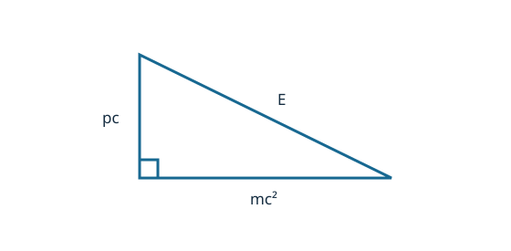
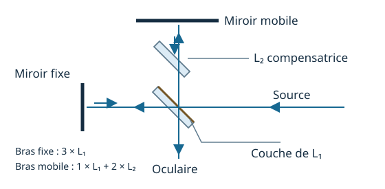
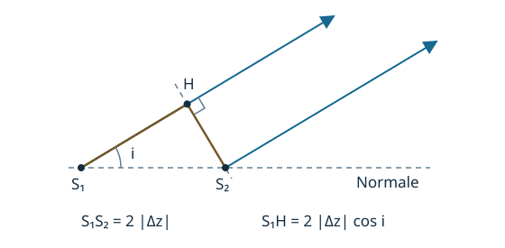

# Mines-Ponts MP — Physique 1 2025 · Corrigé guidé

*Corrigé rédigé par IA, non officiel. Signalez toute erreur.*

## Présentation du sujet

L’épreuve de trois heures, sans calculatrice, relie la quantité de mouvement relativiste au spectre de l’hydrogène, puis étudie le Michelson et la transmission quantique à travers une barrière. Les quatre parties se travaillent par blocs. Le sujet fournit la relation relativiste et l’équation de Klein–Gordon. Il demande de mobiliser les bilans, l’optique interférentielle et les méthodes de mécanique quantique du programme de MPSI et MP.

Lisez l’indication de la question avant de déplier sa solution. Le jury insiste sur les unités, les tracés optiques justifiés et la distinction entre état stationnaire et onde stationnaire.

## I — Impulsion de particules élémentaires

### Question 1

> [!INDICATION]
> Reconnaître l’égalité de Pythagore, puis vérifier l’unité de chacun des trois côtés.

#### Solution

La relation $E^2=(pc)^2+(mc^2)^2$ est celle de Pythagore. Le triangle est rectangle, de côtés adjacents à l'angle droit $pc$ et $mc^2$, et d'hypoténuse $E$.

L'impulsion s'exprime en $\mathrm{kg\,m\,s^{-1}}$. Le produit $pc$ s'exprime en $\mathrm{kg\,m^2\,s^{-2}}$, soit en joules.

### Question 2

> [!INDICATION]
> Annuler l’impulsion et choisir le signe compatible avec une énergie positive.

#### Solution

Pour $p=0$, la racine positive donne $E_0=m_pc^2=9{,}4\times10^2\ \mathrm{MeV}$ pour le proton, soit $1{,}5\times10^{-10}\ \mathrm J$.

### Question 3

> [!INDICATION]
> Remplacer l’énergie totale par la somme de l’énergie de repos et de l’énergie cinétique, puis classer les termes par ordre en énergie cinétique.

> [!PIEGE]
> Le jury attend une justification de la relation vectorielle et la même borne pour les deux masses. L’égalité marque le seuil de l’approximation à un pour cent.

#### Solution

En posant $E=E_0+E_c$ puis en retranchant $E_0^2$ de la relation relativiste, on obtient

$$
2E_0 E_c+E_c^2=p^2c^2.
$$

Le terme quadratique est négligeable devant le terme linéaire. Avec $E_0=mc^2$, il vient $E_c\simeq p^2/(2m)$. En l'identifiant à l'énergie cinétique classique $mv^2/2$, on obtient $p\simeq mv$. La relation vectorielle (3) de l’énoncé donne la direction et le sens de l’impulsion, ceux de la vitesse. En combinant cette information avec la norme déjà obtenue, on trouve $\vec p\simeq m\vec v$. Ainsi

$$
\frac{E_c}{E_0}\simeq\frac{v^2}{2c^2}<0{,}01
\quad\Longrightarrow\quad
v<\sqrt{0{,}02}\,c\simeq4{,}2\times10^7\ \mathrm{m\,s^{-1}}.
$$

Cette borne est la même pour le proton et l'électron, car le rapport des énergies est indépendant de la masse. La condition stricte exclut la borne elle-même.

### Question 4

> [!INDICATION]
> Mettre les deux termes du triangle relativiste au même dénominateur avant de prendre la racine.

#### Solution

Pour une particule massive, on injecte $p^2=m^2v^2/(1-v^2/c^2)$ dans la relation (1). En mettant au même dénominateur, les termes en $m^2v^2c^2$ se compensent.

$$
E^2=\frac{m^2c^4}{1-v^2/c^2}.
$$

Comme $E$ est positive, **$E=E_0/\sqrt{1-v^2/c^2}$**.

### Question 5

> [!INDICATION]
> Examiner la limite à masse non nulle. Pour calculer l’énergie d’une onde lumineuse, convertir d’abord les longueurs d’onde en micromètres.

#### Solution

La formule de Q4 divergerait lorsque $v$ atteint $c$ pour toute masse strictement positive. Un photon de vitesse $c$ et d'énergie finie a donc une masse nulle. On utilise alors la relation (1), qui donne $E=pc$, et la relation de De Broglie, qui donne $p=h/\lambda$. Comme $c=\lambda\nu$ dans le vide,

$$
E=\frac{hc}{\lambda}=h\nu.
$$

Avec $hc\simeq1{,}2\ \mathrm{eV\,\mu m}$, on trouve **$3{,}0\ \mathrm{eV}$ dans le bleu** et **$2{,}0\ \mathrm{eV}$ dans le rouge**.

## II — Le spectre d’émission des atomes d’hydrogène

### Question 6

> [!INDICATION]
> Écrire deux bilans distincts. Éliminer la vitesse de recul par le bilan vectoriel, puis comparer la perte d’énergie interne à l’énergie du photon.

> [!PIEGE]
> Comme le relève le jury, les deux niveaux désignent des énergies internes. Le symbole de la perte interne et celui de l’énergie du photon doivent rester distincts avant de négliger le recul.

#### Solution

Notons $\Delta E=E_i-E_f$ la perte d'énergie interne. Cette différence se partage entre l'énergie du photon et celle du recul. Les conservations de l'impulsion et de l'énergie s'écrivent

$$
\begin{aligned}
m\vec v+\vec p&=\vec 0,\\
E_i&=E_f+E+\tfrac12 mv^2.
\end{aligned}
$$

Avec $p=E/c$, la vitesse de recul a pour norme $v=E/(mc)$. On obtient donc

$$
\Delta E=E+\frac{E^2}{2mc^2}.
$$

En divisant par $mc^2$ et en choisissant la racine qui donne $E\ge0$, il vient

$$
\begin{aligned}
\boxed{E=mc^2\left(\sqrt{1+2\eta}-1\right)},\\
\eta&=\frac{\Delta E}{mc^2}.
\end{aligned}
$$

### Question 7

> [!INDICATION]
> Comparer directement l’énergie de recul à celle du photon et convertir la masse du proton en énergie de repos.

#### Solution

Pour un atome d'hydrogène, $mc^2\simeq m_pc^2\simeq9{,}4\times10^8\ \mathrm{eV}$. La part de recul rapportée à l'énergie du photon vaut $E/(2mc^2)$, de l'ordre de $10^{-9}$ à $10^{-8}$ pour quelques électronvolts. Le recul coûte donc une fraction négligeable de l'énergie libérée et **$E\simeq\Delta E$**. Le rapport $v/c=E/(mc^2)$ justifie aussi le modèle classique du recul.

### Question 8

> [!INDICATION]
> Utiliser une différence de niveaux. Pour majorer la longueur d’onde, rechercher le plus petit saut d’énergie et inverser. Pour la minorer, considérer la limite de la série.

#### Solution

La longueur d'onde est fixée par la différence d'énergie des deux niveaux. Les constantes fournies donnent $hc\simeq1{,}24\ \mathrm{eV\,\mu m}$ avant arrondi.

$$
\frac{hc}{\lambda}=\frac H2\left(\frac1{n_f^2}-\frac1{n_i^2}\right).
$$

Pour $n_f=1$, l'énergie minimale est atteinte pour $n_i=2$. Elle vaut $3H/8\simeq10\ \mathrm{eV}$. La plus grande longueur d'onde est donc $\lambda_{\max}=8hc/(3H)\simeq1{,}2\times10^2\ \mathrm{nm}$. Toutes les raies sont ultraviolettes.

Pour $n_f\ge2$, la plus grande énergie approchable est $H/8\simeq3{,}4\ \mathrm{eV}$, pour $n_f=2$ et $n_i\to\infty$. Ainsi $\lambda>\lambda_{\min}=8hc/H\simeq3{,}6\times10^2\ \mathrm{nm}$.

Ces raies s'étendent du proche ultraviolet au visible et à l'infrarouge. Pour $n_f\ge3$, la borne inférieure est déjà $18hc/H\simeq8{,}2\times10^2\ \mathrm{nm}$, dans l'infrarouge. Les raies visibles de Balmer ont donc **$n_f=2$**.

## III — Mesures interférométriques de longueurs d’onde

### III.A — L’interféromètre de Michelson

### Question 9

> [!INDICATION]
> La réflexion a lieu sur une seule face de la lame. Suivre les deux faisceaux de la source à l’oculaire et compter leurs traversées du verre.

> [!METHODE]
> Pour vérifier le choix de face, comparer les deux bilans de traversées. Le bras fixe cumule un passage à l’aller puis deux autour de la réflexion du retour.

#### Solution

La couche semi-réfléchissante est sur la face de $L_1$ **tournée vers la source et le miroir mobile**, du côté de $L_2$ dans la figure 2. À l'aller, la portion réfléchie vers le miroir mobile est ainsi déviée avant toute traversée du verre de $L_1$. Elle traverse deux fois $L_2$, puis une fois $L_1$ au retour vers l'oculaire. Dans le bras fixe, le faisceau traverse $L_1$ à l'aller et la traverse deux fois au retour, puisque la réflexion vers l'oculaire a lieu sur la face opposée au miroir fixe. Les deux trajets comportent donc trois traversées de verre de même épaisseur à la même incidence.

### Question 10

> [!INDICATION]
> Remplacer le miroir fixe par son image dans la séparatrice. Examiner ce que l’oculaire sélectionne lorsque l’image est à l’infini.

#### Solution

Le miroir mobile et l'image du miroir fixe dans la séparatrice sont parallèles. Le Michelson équivaut à une lame d'air à faces parallèles. Sa différence de marche dépend de l'inclinaison par rapport à la normale, donc les franges sont des **anneaux circulaires d'égale inclinaison** centrés sur l'axe optique, hors contact optique.

Pour une source étendue, ces anneaux sont localisés à l'infini. Avec un oculaire déréglé, ils deviennent flous et peuvent ne plus être distingués. Un faible déréglage peut laisser des anneaux visibles avec une perte de netteté et de contraste. Avec une source quasiment ponctuelle, la contrainte de localisation est moins stricte.

### Question 11

> [!INDICATION]
> Relier la variation d’ordre au déplacement du miroir. Inclure l’aller et le retour dans la variation de différence de marche.

#### Solution

Au centre, l'incidence est normale et la variation de différence de marche vaut $2\Delta z$, car la lumière parcourt deux fois le déplacement de l'un des miroirs. Deux minima successifs sont séparés par une variation de différence de marche d'une longueur d'onde. Ainsi **$N=2|\Delta z|/\lambda_0$** lorsque le déplacement est compté sur $N$ périodes complètes. Un simple comptage entre deux positions arbitraires comporte une ambiguïté éventuelle de l'ordre d'une frange.

### Question 12

> [!INDICATION]
> Construire les deux images virtuelles d’un même point source. Comparer leurs phases sur un front commun, puis imposer un écart d’ordre égal à un.

> [!PIEGE]
> Le jury demande que la comparaison des phases sur un même front d’onde soit explicitée. C’est elle qui fait apparaître le cosinus.

#### Solution

On ramène les deux bras au même axe en remplaçant le miroir fixe par son image dans la séparatrice. Les deux images virtuelles d'un même point source par ces miroirs parallèles sont espacées de $2|\Delta z|$ suivant la normale. Dans une direction d'observation faisant un angle $i$ avec cette normale, la différence de marche à l'infini est la projection de cette séparation sur la direction des rayons. Pour comparer les phases, on compare les trajets vers un même front d'onde perpendiculaire aux rayons.

On obtient $\delta(i)=2|\Delta z|\cos i$ au signe près. Après le déplacement maximal, la première frange de même nature que le centre correspond à une diminution d'une longueur d'onde de la différence de marche. Le terme de phase constant éventuel s'élimine par soustraction.

$$
\begin{aligned}
2|\Delta z_{\max}|(1-\cos\theta)&=\lambda_0,\\
\theta&=\arccos\!\left(1-\frac{\lambda_0}{2|\Delta z_{\max}|}\right).
\end{aligned}
$$

Aux petits angles, $\theta\simeq\sqrt{\lambda_0/|\Delta z_{\max}|}$.

### Question 13

> [!INDICATION]
> Commencer par la longueur d’onde et la couleur. Avec un comptage exact, la relation entre longueur d’onde et déplacement est linéaire.

> [!PIEGE]
> Le rapport du jury précise que « précision relative » vise ici l’incertitude relative sur la longueur d’onde. La calculer même si la raie est déjà identifiée.

#### Solution

La relation de Q11 donne $\lambda_0=2070/3156\ \mathrm{\mu m}\simeq0{,}66\ \mathrm{\mu m}$. La valeur correspond à **$\mathrm H_\alpha$**, la raie rouge. En supposant $N$ connu exactement et en reprenant le sens donné à l'incertitude sur $\Delta z$,

$$
\frac{u(\lambda_0)}{\lambda_0}=\frac{2}{1035}\simeq1{,}9\times10^{-3}.
$$

Cela représente $0{,}19\,\%$, soit environ $1{,}3\ \mathrm{nm}$ d'incertitude absolue. En prenant ce déplacement pour $\Delta z_{\max}$, on trouve $\theta\simeq\sqrt{2/N}=2{,}5\times10^{-2}\ \mathrm{rad}$, soit $1{,}4^\circ$. Ce petit angle valide l'approximation de Q12.

### III.B — Cohérence spectrale d’une source

### Question 14

> [!INDICATION]
> Les amplitudes issues de la même radiation interfèrent. Calculer les intensités maximale et minimale à partir de la formule d’interférence.

#### Solution

Les deux ondes obtenues par division d'amplitude de la même onde incidente sont mutuellement cohérentes. En choisissant l'origine de phase de façon que le port considéré soit brillant à $\delta=0$,

$$
I(\delta)=2I_0\left[1+\cos\left(\frac{2\pi\delta}{\lambda_0}\right)\right].
$$

Le contraste vaut $C=(I_{\max}-I_{\min})/(I_{\max}+I_{\min})$. Ici $I_{\max}=4I_0$ et $I_{\min}=0$, donc $C=1$. Un déphasage constant de réflexion décale les franges et laisse leur contraste inchangé.

### Question 15

> [!INDICATION]
> Additionner les intensités moyennes des deux radiations. Transformer la somme des cosinus en produit et distinguer la porteuse de son enveloppe.

> [!METHODE]
> Dans le protocole, distinguer la position du miroir de la différence de marche. Cette distinction fixe le facteur deux.

#### Solution

On conserve la convention de l'énoncé $I_0$ pour l'intensité totale dans **chaque** voie. Chaque composante fournit alors $I_0/2$ par voie. Les deux fréquences différentes donnent des intensités moyennes qui s'ajoutent, donc

$$
I=I_0\left[2+\cos(2\pi\delta/\lambda_1)+\cos(2\pi\delta/\lambda_2)\right].
$$

Posons $\bar\sigma=(1/\lambda_1+1/\lambda_2)/2$ et $\Delta\sigma=|1/\lambda_1-1/\lambda_2|$. La somme de cosinus donne

$$
I=2I_0\left[1+\cos(2\pi\delta\bar\sigma)\cos(\pi\delta\Delta\sigma)\right].
$$

Au premier ordre en $\Delta\lambda/\lambda_0$, on peut prendre $\bar\sigma\simeq1/\lambda_0$ et $\Delta\sigma\simeq\Delta\lambda/\lambda_0^2$. L’expression exacte en nombres d’onde reste valable à grande différence de marche.

Le contraste local, l'enveloppe variant lentement sur une frange, est

$$
C(\delta)=|\cos(\pi\delta\Delta\sigma)|.
$$

On translate le miroir et on repère deux extinctions successives du contraste. Elles sont séparées de $1/\Delta\sigma$ en différence de marche, soit $1/(2\Delta\sigma)$ en déplacement du miroir. Le nombre de franges de la porteuse entre ces minimums vaut $\bar\sigma/\Delta\sigma\simeq\lambda_0/\Delta\lambda$. On peut aussi diviser le déplacement entre deux extinctions par le déplacement pour une frange.

### Question 16

> [!INDICATION]
> Additionner les deux oscillations par leurs amplitudes complexes. Chercher leur opposition de phase et convertir la différence de marche en course réelle.

#### Solution

Soient $I_1$ et $I_2$ les intensités des deux composantes par voie. Le terme modulé est la somme de deux oscillations de poids $I_1$ et $I_2$ et de déphasage relatif $2\pi\delta\Delta\sigma$. La norme de leur somme complexe donne

$$
C(\delta)=\frac{\sqrt{I_1^2+I_2^2+2I_1I_2\cos(2\pi\delta\Delta\sigma)}}{I_1+I_2}.
$$

Les minima correspondent à l'opposition de phase, pour $\delta=(j+1/2)/\Delta\sigma$ avec $j\in\mathbb Z$. Le contraste minimal vaut $(I_1-I_2)/(I_1+I_2)$.

Pour $\mathrm H_\alpha$, la première anticoïncidence requiert $\delta\simeq\lambda_0^2/(2\Delta\lambda)\simeq15\ \mathrm{mm}$, soit environ $7{,}7\ \mathrm{mm}$ de course depuis le contact. La course de l'ordre de $1{,}0\ \mathrm{mm}$ utilisée dans le montage ne suffit donc pas à séparer les deux composantes par cette méthode.

### III.C — Les tubes à hydrogène

### Question 17

> [!INDICATION]
> Identifier une raie du graphe à l’aide de sa couleur attendue. Relier la présence de molécules dans le tube à la forme du fond spectral.

#### Solution

L'eau évacue la chaleur dissipée par la décharge et refroidit le tube. La graduation est en ångströms, avec $1\ \mathrm{\mathring A}=0{,}10\ \mathrm{nm}$. Ainsi la raie $\mathrm H_\beta$ apparaît vers $4{,}9\times10^3\ \mathrm{\mathring A}$, ce qui correspond bien à une raie visible vers $490\ \mathrm{nm}$. Le fond quasi continu est attribuable au dihydrogène moléculaire excité dans la décharge. Des transitions moléculaires vers un continuum dissociatif ainsi que des bandes non résolues peuvent contribuer à ce fond, distinct des raies fines de l'hydrogène atomique.

### Question 18

> [!INDICATION]
> La réaction citée donne deux produits émissifs. La lampe est adaptée si les domaines spectraux utiles sont séparés.

#### Solution

La molécule OH émet dans des bandes distinctes des raies visibles de l'hydrogène, avec une émission caractéristique dans l'ultraviolet. La décharge dans la vapeur d'eau produit les atomes H dont on veut mesurer les raies. Dans la fenêtre utilisée, l'émission de OH ne donne pas le fond quasi continu gênant du tube à dihydrogène.

### Question 19

> [!INDICATION]
> Comparer les corrections de masse du proton et du deutéron. On peut employer deux fois la masse du proton pour estimer celle du deutéron.

#### Solution

Pour une même transition, $\lambda=\lambda_\infty(1+m_e/m_N)$. Le noyau de deutérium a une masse proche de $2m_p$, donc la correction positive de masse finie est plus petite pour D. La raie se décale **vers le bleu**.

$$
\lambda_H-\lambda_D\simeq\lambda_\infty\frac{m_e}{2m_p}.
$$

À la précision du calcul, on remplace $\lambda_\infty$ par $\lambda_H$.

Sur la figure 4, $\mathrm H_\beta$ est vers $4{,}9\times10^3\ \mathrm{\mathring A}$.

Avec $m_ec^2=0{,}51\ \mathrm{MeV}$ et $m_pc^2=940\ \mathrm{MeV}$, la séparation vaut environ $0{,}13\ \mathrm{nm}$. Il faut une résolution en longueur d'onde de cet ordre ou plus fine, soit un pouvoir de résolution d'au moins $3{,}7\times10^3$.

## IV — L’équation de Klein–Gordon

### Question 20

> [!INDICATION]
> Examiner séparément la densité de probabilité, la phase et l’enveloppe d’un paquet. Exprimer la pulsation et le nombre d’onde à l’aide de l’énergie et de l’impulsion.

> [!PIEGE]
> Un état stationnaire garde la même densité de probabilité. L’onde plane peut néanmoins avoir une phase qui avance.

#### Solution

Le facteur temporel est $\exp(-iEt/\hbar)$ et $|\Psi(\vec r,t)|^2$ est indépendant du temps. L'état est stationnaire au sens quantique.

L'onde plane a le vecteur d'onde $\vec k=(p/\hbar)\vec e_x$, orienté vers les $x$ croissants. La condition de phase constante $Et-px=\mathrm{constante}$ donne $v_\varphi=E/p>0$. Pour un paquet étroit construit autour de cette onde, la différence de phase entre composantes voisines se propage à

$$
v_g=\frac{\mathrm d\omega}{\mathrm dk}
=\frac{1}{p'(E)}
$$

lorsque la dérivée existe et est non nulle. Sur la branche usuelle d'énergie positive pour une particule libre, $p'(E)>0$ et la propagation du paquet a aussi lieu vers les $x$ croissants. Une branche de dispersion différente peut inverser le sens de la vitesse de groupe, comme précisé en Q22.

### Question 21

> [!INDICATION]
> Sur l’onde plane, les dérivations deviennent des multiplications. Utiliser ensuite la formule de la vitesse de groupe de Q20.

#### Solution

L'onde plane a $\Delta\Psi=-p^2\Psi/\hbar^2$ et $i\hbar\partial_t\Psi=E\Psi$. Dans une zone de potentiel constant, l'équation de Schrödinger conduit à $E=V+p^2/(2m)$. Pour l'onde propagative de l'énoncé, $E>V$ et

$$
\begin{aligned}
p(E)&=\sqrt{2m(E-V)},\\
v_g&=p/m.
\end{aligned}
$$

L'énergie cinétique classique et l'absence de borne à la vitesse de groupe lorsque $E-V$ augmente caractérisent ici le modèle non relativiste.

### Question 22

> [!INDICATION]
> Dans un potentiel constant, appliquer l’opérateur temporel une fois avant de l’élever au carré. Examiner le signe de l’énergie décalée.

#### Solution

Pour un potentiel constant, l'opérateur $i\hbar\partial_t-V$ multiplie cette onde par $E-V$. En injectant aussi le laplacien de Q21 dans l'équation (5), on obtient

$$
(E-V)^2=p^2c^2+m^2c^4.
$$

Pour une branche propagative avec $|E-V|>mc^2$,

$$
\begin{aligned}
p(E)&=\frac1c\sqrt{(E-V)^2-m^2c^4},\\
v_g&=\frac{pc^2}{E-V}.
\end{aligned}
$$

La dispersion est relativiste. Sur la branche $E-V>mc^2$, $0<v_g<c$ et on retrouve la relation relativiste entre impulsion et vitesse. Sur la branche $E-V<-mc^2$, l'onde de nombre d'onde positif a une vitesse de groupe négative et de module inférieur à $c$. La propagation de la phase et celle du paquet sont donc à distinguer sur cette branche.

### Question 23

> [!INDICATION]
> Le signe de l’énergie cinétique formelle sous la barrière décide de la forme spatiale. Raccorder ensuite la fonction et sa dérivée aux deux bords.

#### Solution

Sous la barrière, $E<V_0$. La partie spatiale de l'onde est une combinaison des exponentielles réelle croissante et décroissante $A e^{\kappa x}+B e^{-\kappa x}$, avec $\kappa=\sqrt{2m(V_0-E)}/\hbar$. L'onde est évanescente. Les deux termes sont admissibles dans une région finie.

Pour calculer $R$ et $T$, on impose en $x=0$ et en $x=a$ la continuité de la partie spatiale $\psi$ et de sa dérivée $\psi'$. Ces conditions découlent de l'équation du second ordre avec potentiel fini.

Elles donnent quatre relations liant $R,T,A,B$.

L'égalité des potentiels à gauche et à droite garantit la même vitesse incidente et transmise. Le rapport des flux transmis et incident vaut donc $|T|^2$, probabilité de transmission. Une transmission non nulle malgré $E<V_0$ manifeste **l'effet tunnel**.

### Question 24

> [!INDICATION]
> Évaluer cette fois le signe du carré de l’impulsion. Le signe de la branche et le caractère oscillant sont deux questions différentes.

#### Solution

Dans la barrière, $\varepsilon=E-V_0<-mc^2$. Le signe importe pour la branche de dispersion, mais seul $\varepsilon^2$ détermine le carré de l'impulsion dans l'équation de Klein–Gordon.

$$
q^2=\frac{\varepsilon^2-m^2c^4}{c^2}>0.
$$

La partie spatiale est donc une superposition d'ondes oscillantes $A e^{iqx/\hbar}+B e^{-iqx/\hbar}$. La barrière est parcourue par des modes propagatifs de la branche négative, ce qui diffère du profil évanescent de Q23.

La condition Q24 note $\varepsilon=E-V_0$, alors que la figure 5 appelle $\varepsilon$ la hauteur positive $V_0-E$. Le carré employé dans la dispersion est indépendant de ce choix.

### Question 25

> [!INDICATION]
> Comparer la moyenne de deux nombres réciproques à un. Identifier ensuite les phases qui minimisent le dénominateur.

> [!METHODE]
> Dans le cas $p\ne q$, relier l’entier de la condition de résonance au nombre de demi-longueurs d’onde que contient la barrière. Traiter séparément le cas $p=q$.

#### Solution

Pour un mode incident propagatif, $p>0$ et on choisit $q>0$. L'inégalité arithmético-géométrique donne $\alpha=(p/q+q/p)/2\ge1$. Ainsi

$$
|T|^2=\frac{1}{1+(\alpha^2-1)\sin^2\varphi}\le1.
$$

Le maximum est **$1$**. Il est atteint aux résonances $qa/\hbar=n\pi$, par exemple en ajustant $a$ à un multiple entier de la demi-longueur d'onde sous la barrière. Si $p=q$, la transmission vaut $1$ pour toute largeur. C'est une possibilité de transmission totale à travers une barrière supercritique dans le modèle relativiste étudié.

## Bilan

- Vérifier les unités dès la mise en équation. En optique, convertir les longueurs d’onde dans une seule unité avant toute estimation.
- Avec plusieurs formes d’énergie, écrire le bilan du système complet avant de prendre une limite.
- Pour le Michelson, déplier les bras, tracer la projection géométrique et préciser comment on obtient la mesure à partir de la course du miroir.
- Pour une onde quantique, partir de la relation de dispersion, distinguer phase et enveloppe, puis raccorder les solutions entre domaines.
