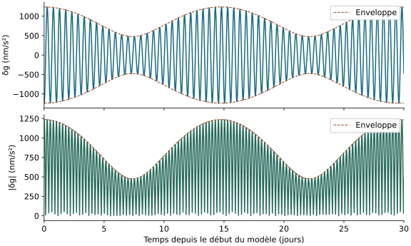
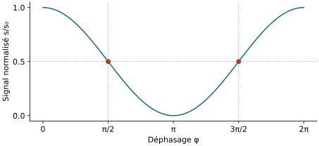

# Mines-Ponts MP — Physique 2 2025 · Corrigé guidé

*Corrigé rédigé par IA, non officiel. Signalez toute erreur.*

## Présentation du sujet

L’épreuve dure trois heures sans calculatrice. Sur un premier passage, consacrez par exemple 70 minutes aux marées et 90 minutes au gravimètre, puis gardez 20 minutes pour vérifier signes et ordres de grandeur. Q1 à Q5 et Q12 à Q16 permettent de démarrer dans chacune des parties. Prévoyez plus de temps pour le développement du champ de marée et le calcul des phases.

## I — Variation temporelle de la pesanteur

### Question 1

> [!INDICATION]
> Repérez la distance entre deux pics voisins.

> [!INDICATION]
> Comparez-la à la durée du motif à deux pics et à celle de la modulation lente.

#### Solution

On compte près de deux oscillations par jour. L’intervalle entre motifs voisins est d’environ $\tau_1=0{,}5\,\mathrm j$. Les maxima alternent souvent entre un niveau haut et un niveau plus bas. Le motif de deux maxima se répète sur $\tau_2\simeq1\,\mathrm j$.

L’amplitude évolue plus lentement. On lit deux groupes d’oscillations marquées autour des jours juliens 57130 et 57145, soit $\tau_3\simeq15\,\mathrm j$. Les deux premières durées suggèrent les composantes semi-diurne et diurne des marées, liées à la rotation terrestre. La troisième suggère un battement lié à l’évolution de l’orientation relative de la Lune et du Soleil.

> [!JURY]
> Une période est l’écart entre deux motifs comparables, pas leur date.

### Question 2

> [!INDICATION]
> Énoncez le principe d’inertie.

> [!INDICATION]
> Précisez le centre et la direction des axes des deux référentiels.

#### Solution

Dans un référentiel galiléen, un corps isolé est immobile ou en mouvement rectiligne uniforme. Le référentiel de Copernic est centré au barycentre du Système solaire et possède des axes de directions fixes par rapport aux étoiles lointaines. Le référentiel géocentrique est centré au centre de la Terre et garde des axes parallèles aux précédents.

### Question 3

> [!INDICATION]
> Comparez les axes des deux référentiels.

> [!INDICATION]
> Testez le mouvement de l’origine géocentrique.

#### Solution

Les axes des deux repères restent parallèles. Le référentiel géocentrique est en translation par rapport à celui de Copernic. Son origine suit une trajectoire quasi circulaire et possède une accélération non nulle. Deux référentiels galiléens ne pouvant être qu’en translation rectiligne uniforme l’un par rapport à l’autre, le référentiel géocentrique est non galiléen.

> [!PIEGE]
> L’origine géocentrique décrit une courbe alors que les axes gardent leur orientation.

### Question 4

> [!INDICATION]
> Choisissez une sphère centrée sur l’astre.

> [!INDICATION]
> Utilisez la symétrie pour calculer le flux.

#### Solution

Pour une surface fermée $\mathcal S$ orientée vers l’extérieur, le flux gravitationnel vérifie
$$
\iint_{\mathcal S}\vec{\mathcal G}\cdot\mathrm d\vec S=-4\pi Gm_{\mathrm{int}}.
$$
Par symétrie sphérique, le champ est radial et sa composante radiale est constante sur la sphère centrée en $A$ passant par $M$. Pour $AM>R_A$, celle-ci enferme toute la masse, d’où
$$
\vec{\mathcal G}_A(M)=-Gm_A\frac{\overrightarrow{AM}}{AM^3}.
$$

### Question 5

> [!INDICATION]
> Identifiez le jour, le mois sidéral et l’année.

> [!INDICATION]
> Pour la rotation, convertissez la durée en secondes.

#### Solution

La surface terrestre tourne en environ un jour, la Lune se déplace autour de la Terre en environ $27\,\mathrm j$ et le Soleil décrit sa révolution apparente annuelle en environ $365\,\mathrm j$. Ainsi
$$
\omega=2\pi/T_M\simeq7{,}3\times10^{-5}\,\mathrm{rad\,s^{-1}}.
$$

### Question 6

> [!INDICATION]
> Faites le bilan des forces appliquées à M.

> [!INDICATION]
> Distinguez l’accélération orbitale de T et l’accélération de M autour de l’axe terrestre.

#### Solution

Dans le référentiel géocentrique, le point $M$ décrit un cercle à la vitesse angulaire terrestre. Son accélération vaut $\vec\omega\times(\vec\omega\times\overrightarrow{TM})$. Il subit la réaction $\vec R=-m\vec g$ et les forces gravitationnelles de la Terre et de l’astre. Il subit aussi la force d’inertie d’entraînement $-m\vec{\mathcal G}_A(T)$, car le centre de la Terre accélère sous l’effet de l’astre. La translation des axes annule la force de Coriolis.

Le principe fondamental donne
$$
\begin{aligned}
\vec g&=\vec{\mathcal G}_T(M)+\vec\gamma_0+\vec\gamma_1,\\
\vec\gamma_0&=-\vec\omega\times(\vec\omega\times\overrightarrow{TM}),\\
\vec\gamma_1&=\vec{\mathcal G}_A(M)-\vec{\mathcal G}_A(T).
\end{aligned}
$$

> [!JURY]
> La force de l’astre sur la Terre intervient via l’accélération du repère, avec la masse du corps étudié dans le bilan.

### Question 7

> [!INDICATION]
> Identifiez la distance à l’axe de rotation.

> [!INDICATION]
> Comparez cette distance à différentes heures pour le même lieu.

#### Solution

Le terme $\vec\gamma_0$ est centrifuge. Il pointe à l’opposé de l’axe de rotation et sa norme vaut $\omega^2$ fois la distance à l’axe. Cette distance est constante pour un observateur fixé au sol. La norme de la pesanteur locale reçoit donc une correction permanente dépendant de la latitude. La composante centrifuge radiale réduit $g$. La rotation seule ne produit pas la modulation temporelle.

### Question 8

> [!INDICATION]
> Linéarisez la norme d’un grand vecteur auquel on ajoute une petite correction.

> [!INDICATION]
> Projetez sur la direction du champ principal, puis examinez le rôle de la moyenne.

#### Solution

L’intensité de référence est dominée par la gravité terrestre, dirigée selon $-\vec e_r$. À l’ordre un en champ de marée, et en négligeant la petite inclinaison centrifuge de la verticale, l’écart au champ de référence fixe est $\Delta g_A=-\vec e_r\cdot\vec\gamma_1$. Le signe moins vient de la direction du champ principal. Ainsi, pour la variation centrée utilisée dans l’introduction,
$$
\delta g_A=\Delta g_A-\langle\Delta g_A\rangle.
$$
La moyenne est constante et disparaît dans une comparaison des extrema ou des amplitudes périodiques. Dans la suite, on indiquera si elle est retirée.

### Question 9

> [!INDICATION]
> Exprimez la distance AM à partir de deux vecteurs.

> [!INDICATION]
> Développez l’inverse du cube de cette distance au premier ordre.

#### Solution

Posons $\vec r=\overrightarrow{TM}$ et $\vec D=\overrightarrow{TA}$. Le vecteur $\overrightarrow{AM}$ vaut $\vec r-\vec D$. À l’ordre un en $R_T/d_A$,
$$
\begin{aligned}
AM^2&=d_A^2+R_T^2-2\vec D\cdot\vec r,\\
AM^{-3}&\simeq d_A^{-3}\left(1+3\vec D\cdot\vec r/d_A^2\right).
\end{aligned}
$$
En retranchant le champ à l’origine et en négligeant le produit de deux corrections du premier ordre, on trouve
$$
\begin{aligned}
\vec\gamma_1&\simeq-\frac{Gm_A}{d_A^3}(\vec r+\mu\vec D),\\
\mu&=-3\frac{\vec r\cdot\vec D}{d_A^2}=-3\frac{R_T}{d_A}\cos\Psi_A.
\end{aligned}
$$
La projection vers le bas donne
$$
\Delta g_A=\frac{Gm_A R_T}{d_A^3}(1-3\cos^2\Psi_A).
$$
La variation centrée se déduit en remplaçant le facteur entre parenthèses par $-3(\cos^2\Psi_A-\langle\cos^2\Psi_A\rangle)$.

### Question 10

> [!INDICATION]
> Remplacez le cosinus de l’angle par un.

> [!INDICATION]
> Comparez les deux rapports masse sur distance au cube.

#### Solution

Quand $\vec r$ et $\vec D$ sont de même sens, l’astre se trouve au zénith. La correction à la référence fixe est négative et sa valeur absolue vaut $2Gm_AR_T/d_A^3$. On obtient
$$
\begin{aligned}
|\Delta g_L|&\simeq1{,}1\times10^{-6}\,\mathrm{m\,s^{-2}},\\
|\Delta g_S|&\simeq5{,}1\times10^{-7}\,\mathrm{m\,s^{-2}},\\
\kappa&=|\Delta g_L|/|\Delta g_S|\simeq2{,}2.
\end{aligned}
$$
La marée lunaire est plus forte malgré la masse supérieure du Soleil, car la distance intervient au cube. Les deux corrections ont l’ordre de grandeur du signal mesuré. La grandeur centrée demandée dans le préambule suit, au zénith, la formule
$$
\begin{aligned}
|\delta g_A|&=3K_A\big(1-\langle\cos^2\Psi_A\rangle\big),
\\
K_A&=\frac{Gm_A R_T}{d_A^3}.
\end{aligned}
$$
Dans le modèle équatorial de Q11, la moyenne sur de nombreux cycles vaut $1/2$. On obtient environ **$8{,}6\times10^{-7}\,\mathrm{m\,s^{-2}}$ pour la Lune** et **$3{,}8\times10^{-7}\,\mathrm{m\,s^{-2}}$ pour le Soleil**. Le rapport reste voisin de 2,2. Une moyenne à latitude quelconque requiert les angles réels sur l’intervalle retenu.

### Question 11

> [!INDICATION]
> Faites évoluer les angles de la Terre et des deux astres.

> [!INDICATION]
> Retirez la moyenne des deux termes en cosinus carré avant de prendre le module.

#### Solution

Pour un modèle simple, plaçons les deux astres et l’observateur dans le plan équatorial. Notons $K_A=Gm_A R_T/d_A^3$, $\omega_A=2\pi/T_A$ et $\Psi_A(t)=(\omega-\omega_A)t+\beta_A$. On retranche la moyenne du signal signé, puis on prend la valeur absolue. Pour une moyenne sur de nombreux cycles rapides, cela donne
$$
|\delta g(t)|\simeq
\frac32\left|K_L\cos(2\Psi_L(t))+K_S\cos(2\Psi_S(t))\right|.
$$
La phase initiale dépend de la date choisie. Les périodes rapides sont voisines du demi-jour. L’enveloppe croît quand les deux contributions se renforcent et décroît quand elles s’opposent. Deux renforcements sont séparés d’environ $[2|1/T_L-1/T_S|]^{-1}\simeq15\,\mathrm j$.

La figure 1 du sujet présente le signal signé. Il faut donc comparer ses amplitudes au panneau signé, ou prendre sa valeur absolue avant de comparer au second panneau. La modulation et l’échelle de quelques centaines à un millier de nanomètres par seconde carrée sont comparables. Le modèle équatorial omet le relief diurne et les inégalités entre deux maxima successifs, qui apparaissent quand les angles hors du plan équatorial sont pris en compte.

## II — Gravimètre à atomes froids

### Question 12

> [!INDICATION]
> Exprimez le moment du photon par sa longueur d’onde.

> [!INDICATION]
> Appliquez l’équipartition à une seule composante du mouvement.

#### Solution

La relation de De Broglie donne $p_\gamma=h/\lambda_0\simeq8{,}5\times10^{-28}\,\mathrm{kg\,m\,s^{-1}}$. Sur l’axe vertical, l’équipartition donne $\langle p^2\rangle/(2m)=k_BT_0/2$. Pour $T_0\simeq10^{-6}\,\mathrm K$,
$$
p_0=\sqrt{mk_BT_0}\simeq1{,}4\times10^{-27}\,\mathrm{kg\,m\,s^{-1}}.
$$
Les deux quantités ont le même ordre de grandeur. Le recul photonique est significatif par rapport à la dispersion thermique.

### Question 13

> [!INDICATION]
> Choisissez le signe de l’accélération le long de l’axe.

> [!INDICATION]
> Intégrez avec les moments juste après la première impulsion.

#### Solution

L’axe vertical est orienté vers le bas. Pendant chaque vol libre, l’accélération vaut $+g$. Après la première impulsion, l’intégration avec les deux vitesses initiales donne
$$
\begin{aligned}
d_{1,a}&=p_0\tau/m+g\tau^2/2,\\
d_{2,a}&=(p_0+p_\gamma)\tau/m+g\tau^2/2.
\end{aligned}
$$

### Question 14

> [!INDICATION]
> Calculez les deux moments juste après l’impulsion intermédiaire.

> [!INDICATION]
> Additionnez les déplacements des deux étapes pour chaque paquet.

#### Solution

Juste après l’impulsion à $\tau$, les moments sont $p_0+mg\tau+p_\gamma$ pour le paquet 1 et $p_0+mg\tau$ pour le paquet 2. En intégrant pendant la seconde phase,
$$
\begin{aligned}
d_{1,b}&=(p_0+p_\gamma)\tau/m+3g\tau^2/2,\\
d_{2,b}&=p_0\tau/m+3g\tau^2/2.
\end{aligned}
$$
Les deux sommes $d_{j,a}+d_{j,b}$ valent donc $z_0=(2p_0+p_\gamma)\tau/m+2g\tau^2$, en prenant l’origine au point de départ. Les deux centres s’y rejoignent à $2\tau$.

### Question 15

> [!INDICATION]
> Reliez la force au gradient du potentiel.

> [!INDICATION]
> Écrivez la conservation de l’énergie entre deux impulsions.

#### Solution

Comme la force vaut $+mg\vec e_z$, on a $V'(z)=-mg$. Le zéro choisi donne $V(z)=-mgz$. Entre deux impulsions, l’énergie mécanique se conserve,
$$
E=p(z)^2/(2m)-mgz.
$$
Pour la branche descendante, $p(z)=+\sqrt{2m(E+mgz)}$.

### Question 16

> [!INDICATION]
> Divisez l’équation par la forme produit.

> [!INDICATION]
> Expliquez pourquoi la constante commune est réelle pour un état physique.

#### Solution

On substitue la forme produit et on divise par $\phi(z)\zeta(t)$ là où ce produit est non nul. On obtient
$$
-\frac{\hbar^2}{2m}\frac{\phi''(z)}{\phi(z)}+V(z)
=i\hbar\frac{\zeta'(t)}{\zeta(t)}.
$$
Le membre de gauche dépend de $z$ et celui de droite de $t$. Ils sont donc égaux à une constante $E$. La séparation donne
$$
\begin{aligned}
-\frac{\hbar^2}{2m}\phi''+V\phi&=E\phi,\\
i\hbar\zeta'&=E\zeta.
\end{aligned}
$$
La constante est réelle, car l’opérateur énergie est hermitien pour les états physiques et ses valeurs propres sont réelles. On peut aussi le voir à partir de la conservation de la norme pour un état séparable normalisable. En absorbant la constante de $\zeta$ dans $\phi$, on trouve $\psi(z,t)=\phi(z)e^{-iEt/\hbar}$.

### Question 17

> [!INDICATION]
> Dérivez deux fois l’exponentielle d’action.

> [!INDICATION]
> Identifiez les coefficients des deux premiers ordres et le signe du moment.

#### Solution

En dérivant l’exponentielle d’action, on obtient $\phi''/\phi=i\sigma''/\hbar-\sigma'^2/\hbar^2$. L’équation stationnaire devient
$$
\frac{\hbar}{i}\sigma''+\sigma'^2=2m(E-V)=\hbar^2 k^2.
$$
Les ordres zéro et un donnent respectivement
$$
\begin{aligned}
\sigma_0'^2&=\hbar^2 k^2,\\
\sigma_0''+2\sigma_0'\sigma_1'&=0.
\end{aligned}
$$
En région permise loin d’un point de rebroussement, $\sigma_0'=\pm\hbar k$ et $\sigma_1'=-k'/(2k)$. Ainsi, après absorption des constantes d’intégration,
$$
\phi_\pm(z)=\frac{\Phi_0}{\sqrt{k(z)}}\exp\!\left(\pm i\int_0^z k(u)\,\mathrm du\right).
$$
Le signe positif correspond à une quantité de mouvement orientée vers le bas. C’est la branche de la chute étudiée. Pour un potentiel uniforme $V_0$, $k=\sqrt{2m(E-V_0)}/\hbar$ est constant. Alors $\psi(z,t)=A e^{i(kz-Et/\hbar)}$, une onde plane monochromatique de quantité de mouvement $+\hbar k$.

### Question 18

> [!INDICATION]
> Dérivez la longueur d’onde de De Broglie.

> [!INDICATION]
> Comparez au module du terme de correction proposé.

#### Solution

La relation de De Broglie est $\lambda_{\mathrm{dB}}=h/p$. Comme $p^2=2m(E-V)$, on a $p'=-mV'/p$. Il en résulte $\lambda_{\mathrm{dB}}'=hmV'/p^3$. La correction figurant dans l’énoncé vaut en module
$$
\frac{m\hbar|V'|}{4p^3}=\frac{1}{8\pi}\left|\frac{\mathrm d\lambda_{\mathrm{dB}}}{\mathrm dz}\right|.
$$
Elle doit être petite devant un, avec le reste indiqué dans le sujet lui aussi petit. La longueur d’onde varie alors peu sur l’échelle locale de propagation.

### Question 19

> [!INDICATION]
> Écrivez les moments au début de chaque étape.

> [!INDICATION]
> Multipliez les nombres d’onde par les distances, puis soustrayez par paquet.

#### Solution

Notons $A=p_0$, $B=p_0+p_\gamma$ et $J=mg\tau$. Dans l’approximation où le nombre d’onde est figé au début de chaque phase,
$$
\begin{aligned}
\hbar k_{1,a}&=A,& \hbar k_{2,a}&=B,\\
\hbar k_{1,b}&=B+J,& \hbar k_{2,b}&=A+J.
\end{aligned}
$$
Chaque phase est la différence des produits $k\,d$ du paquet 2 et du paquet 1. Avec les déplacements obtenus plus haut,
$$
\begin{aligned}
\varphi_a^0&=\frac{\tau}{m\hbar}\left[B^2-A^2+\tfrac12 J(B-A)\right],\\
\varphi_b^0&=\frac{\tau}{m\hbar}\left[A^2-B^2+\tfrac52 J(A-B)\right].
\end{aligned}
$$
La somme vaut $\varphi^0=-2p_\gamma g\tau^2/\hbar=\mu g$. Par suite $\mu=-4\pi\tau^2/\lambda_0\simeq-4{,}0\times10^4\,\mathrm{s^2\,m^{-1}}$. Le signe est celui de la convention « paquet 2 moins paquet 1 ».

> [!PIEGE]
> La seconde impulsion change les moments avant le second vol. N’oubliez pas le gain gravitationnel du premier vol.

### Question 20

> [!INDICATION]
> Additionnez les amplitudes complexes en M0.

> [!INDICATION]
> Calculez le module carré et normalisez par sa valeur maximale.

#### Solution

Dans le modèle d’interférence à deux contributions cohérentes de même module $a$, leur somme en $M_0$ a pour module carré
$$
a^2|1+e^{i\varphi}|^2=2a^2(1+\cos\varphi).
$$
Cette hypothèse d’amplitudes égales correspond au modèle idéal de séparation et de recombinaison. En normalisant par le signal maximal, on obtient $s=s_0f(\varphi)$ avec $f(\varphi)=(1+\cos\varphi)/2=\cos^2(\varphi/2)$. Pour des amplitudes différentes, il subsiste une modulation cosinus mais avec un contraste inférieur à un.

### Question 21

> [!INDICATION]
> Transformez la précision relative sur g en incertitude absolue de phase.

> [!INDICATION]
> Cherchez les points où la variation du signal pour une petite variation de phase est la plus grande.

#### Solution

Le déphasage du modèle a un module de l’ordre de $|\mu|g\simeq4\times10^5\,\mathrm{rad}$. Pour une incertitude relative $10^{-9}$ sur $g$, l’incertitude admissible sur la phase vaut environ $4\times10^{-4}\,\mathrm{rad}$, à supposer le coefficient $\mu$ connu. Une mesure fine suppose aussi de repérer la frange utilisée puisque le signal est périodique.

Une petite variation de phase modifie le signal de $s_0 f'(\varphi)\delta\varphi$. Pour un seuil de détection fixé, la meilleure sensibilité est atteinte là où $|f'|$ est maximal, soit $\varphi=\pi/2+n\pi$.

### Question 22

> [!INDICATION]
> Déterminez le moment à la distance déjà parcourue.

> [!INDICATION]
> Intégrez le nombre d’onde le long de chaque branche.

#### Solution

Au début de la phase $a$, soit $x>0$ la quantité de mouvement d’un paquet. Après un déplacement vertical $u$, elle vaut $\sqrt{x^2+2m^2gu}$. Le nombre d’onde est cette quantité divisée par $\hbar$. L’intégration jusqu’à la distance $y$ donne
$$
F(x,y)=\frac{(x^2+2m^2gy)^{3/2}-x^3}{3m^2g\hbar}.
$$
On lit $\nu=2m^2g$ et $K=(3m^2g\hbar)^{-1}$. Le déphasage spatial $\varphi_a$ est donc $F(p_0+p_\gamma,d_{2,a})-F(p_0,d_{1,a})$.

### Question 23

> [!INDICATION]
> Remplacez la distance par l’expression de la Q13.

> [!INDICATION]
> Comparez le changement du carré du moment au carré du moment initial.

#### Solution

Au premier vol, en utilisant les deux termes de $d_{1,a}$, le rapport est
$$
\frac{m^2g d_{1,a}}{p_0^2}=\frac{mg\tau}{p_0}+\frac12\left(\frac{mg\tau}{p_0}\right)^2.
$$
Avec $m\simeq1{,}45\times10^{-25}\,\mathrm{kg}$, on trouve $mg\tau/p_0\simeq50$ et un rapport de l’ordre de $1{,}3\times10^3$. Ce rapport mesure la variation du carré du moment à un facteur deux près. La variation du nombre d’onde pendant l’étape $a$ est donc importante. L’approximation de nombre d’onde constant n’est pas justifiée pour la phase de chaque paquet. Ce constat local ne détermine pas à lui seul l’erreur sur la différence totale de phase, qui peut comporter des compensations.

Pour le seul modèle de phase spatiale du sujet, on peut vérifier cette compensation. Sur un vol de durée $\tau$, de moment initial $x$, la différence entre la phase exacte et la phase figée vaut
$$
\int_0^\tau \frac{(x+mgt)mgt}{m\hbar}\,\mathrm dt
=\frac{\tau}{m\hbar}\left(\frac{xJ}{2}+\frac{J^2}{3}\right).
$$
Dans la différence entre les deux paquets, la correction est proportionnelle à l’écart de leurs moments initiaux. Cet écart change de signe entre les deux vols. Les corrections s’annulent donc dans la somme des deux déphasages spatiaux du modèle.

> [!PIEGE]
> Deux approximations sont en jeu. Figer le nombre d’onde sur une étape est plus restrictif que le laisser varier lentement à l’échelle d’une longueur d’onde.

## Bilan

- Dans un calcul de marée, projetez l’accélération sur la verticale choisie. Retranchez la moyenne du signal signé avant de prendre sa valeur absolue.
- Pour lire les battements, identifiez les deux périodes rapides et calculez leur différence de fréquence avant de comparer l’enveloppe au relevé.
- En interférométrie atomique, fixez le signe de chaque phase à partir du trajet suivi. Additionnez les contributions avant de juger l’effet d’une correction portant sur un seul vol.
