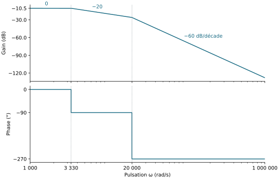
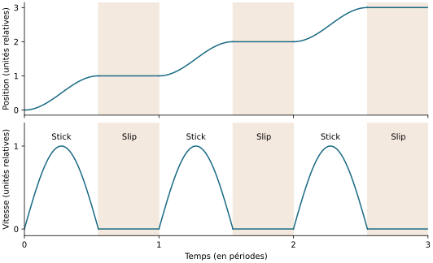
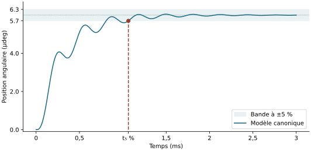

# Mines-Ponts MP — Sciences industrielles 2025 · Corrigé guidé

*Corrigé rédigé par IA, non officiel. Signalez toute erreur.*

## Présentation du sujet

L’épreuve dure trois heures sans calculatrice. Le goniomètre SmarGon permet de relier architecture fonctionnelle, mécanique et réponse d’un actionneur. Réservez par exemple 40 minutes à la chaîne et au choix des actionneurs, 100 minutes à la modélisation et à l’adhérence, 25 minutes aux lectures graphiques et 15 minutes à la relecture. Les Q1, Q9–Q12, Q14, Q17–Q18 et Q23 offrent des points d’entrée. Gardez le cahier des charges et le document-réponse à portée de main.

## 2 — Modélisation des chaînes fonctionnelles

### Question 1

> [!INDICATION]
> Repérez la chaîne que suit la puissance dans l’IBD.

> [!INDICATION]
> Associez une fonction à chaque transformation.

#### Solution

La puissance électrique de secteur ($230\,\mathrm V$, $50\,\mathrm{Hz}$) arrive à la **carte de conditionnement**, qui réalise la fonction **distribuer** sur ordre de la commande. Les deux **actionneurs piézoélectriques** assurent la fonction **convertir** en puissance mécanique de **translation**. La **structure terminale à barres** réalise la fonction **transmettre** et fournit la puissance mécanique de rotation. Le **support de l’échantillon** réalise la fonction **agir**. En sortie, l’échantillon est à l’orientation voulue. Les codeurs renvoient de l’information à la commande.

## 3 — Choix des actionneurs

### Question 2

> [!INDICATION]
> Séparez translation d’ensemble et rotation instantanée de 5 autour de C.

> [!INDICATION]
> Comparez les hauteurs de C et de E avant d’utiliser la loi entrée-sortie.

#### Solution

Pour le mouvement 1, les orientations des pièces restent inchangées. Le mécanisme est translaté vers $+\vec x$. Il faut donc entourer $\dot\lambda_2>0$ et $\dot\lambda_4>0$.

Pour le mouvement 2, on raisonne au voisinage de la position dessinée. En figure 4, $C$ et $E$ sont au même niveau. La rotation de 5 autour de $C$ produit donc en $E$ une vitesse instantanée verticale. Maintenir $x_E$ impose $\dot\lambda_4=0$.

Pour augmenter $\theta$, la figure 5 montre qu’il faut augmenter $\Delta\lambda$. Avec $\dot\lambda_4=0$, cela impose $\dot\lambda_2<0$.

### Question 3

> [!INDICATION]
> Fermez le contour OABC.

> [!INDICATION]
> Projetez la fermeture et éliminez l’angle de la bielle par la norme.

#### Solution

La fermeture $\overrightarrow{AB}=\overrightarrow{OC}+\overrightarrow{CB}-\overrightarrow{OA}$ donne
$$
\begin{aligned}
l_3\cos\alpha&=\Delta\lambda+b\cos\theta-c\sin\theta,\\
l_3\sin\alpha&=b\sin\theta+c\cos\theta-e.
\end{aligned}
$$
En additionnant les carrés, on élimine $\alpha$. Après développement,
$$
\begin{aligned}
A_1(\theta)&=2(b\cos\theta-c\sin\theta),\\
B_1(\theta)&=b^2+c^2+e^2-2e(b\sin\theta+c\cos\theta)-l_3^2.
\end{aligned}
$$

> [!JURY]
> Contrôlez le signe de chaque projection avant de prendre le carré.

### Question 4

> [!INDICATION]
> Lisez les abscisses aux deux angles extrêmes.

> [!INDICATION]
> Comparez les amplitudes utiles aux courses nominales.

#### Solution

La figure 5 donne $\Delta\lambda\simeq50\,\mathrm{mm}$ à $-90^\circ$ et $\Delta\lambda\simeq88\,\mathrm{mm}$ à $0^\circ$. La variation différentielle nécessaire est d’environ $38\,\mathrm{mm}$.

La translation seule exige une course de $90\,\mathrm{mm}$ sur chacun des deux actionneurs. Pour ces plages prises séparément, les **CLS 32, CLS 52 et CLS 92** conviennent. Les courses de $12$ et $54\,\mathrm{mm}$ ne suffisent pas en translation.

Cette sélection compare les courses aux deux amplitudes demandées. La vérification de toutes les combinaisons d’abscisse et d’angle demanderait de calculer l’enveloppe de chaque $\lambda_i$ sur ce domaine, à partir de la géométrie complète de $CE$. En particulier, si les deux réglages doivent être indépendants sur le domaine rectangulaire, au moins une des courses doit atteindre environ $90+38/2=109\,\mathrm{mm}$, car les amplitudes de variation des deux décalages d’orientation doivent totaliser au moins $38\,\mathrm{mm}$.

### Question 5

> [!INDICATION]
> Isolez la bielle seule.

> [!INDICATION]
> Choisissez un point qui annule le moment d’un des deux glisseurs.

#### Solution

On isole la bielle 3. Son poids est négligé. Les seuls efforts extérieurs sont deux glisseurs, en $A$ et $B$, dus aux pivots parfaits avec 2 et 5. L’équilibre des moments en $A$ impose que la résultante de 5 sur 3 soit colinéaire à $\overrightarrow{AB}$, donc à $\vec x_3$. La résultante de 2 sur 3 lui est opposée.

### Question 6

> [!INDICATION]
> Réduisez le bilan au point C.

> [!INDICATION]
> Utilisez le bras de levier du poids et celui de l’action de la bielle.

#### Solution

Sur le solide 5 agissent le glisseur du pivot avec 4 en $C$, le glisseur $-X_{53}\vec x_3$ de 3 en $B$ et le poids $-P\vec y$ appliqué en $G_5$.

Le théorème du moment statique en $C$, projeté sur $\vec z$, élimine la réaction de 4. Avec $\overrightarrow{CG_5}=d\vec x_5+(c/2)\vec y_5$,
$$
X_{53}[b\sin(\theta-\alpha)+c\cos(\theta-\alpha)]
=P[d\cos\theta-(c/2)\sin\theta].
$$
Hors singularité, on reporte dans le cadre
$$
X_{53}=\frac{P[d\cos\theta-(c/2)\sin\theta]}{b\sin(\theta-\alpha)+c\cos(\theta-\alpha)}.
$$

> [!JURY]
> Annoncez l’isolement, les actions extérieures et le point de réduction du moment.

### Question 7

> [!INDICATION]
> Éliminez l’action interne au point A.

> [!INDICATION]
> Projetez le bilan dans l’axe de la glissière.

#### Solution

Pour $\{2+3\}$, l’action mutuelle au pivot $A$ est intérieure. On retient le glisseur d’actionneur $F\vec x$, l’action $X_{53}\vec x_3$ en $B$ et la réaction de la glissière avec 1. Cette dernière n’a pas de résultante suivant $\vec x$.

Le théorème de la résultante statique projeté sur $\vec x$ donne $F=-X_{53}\cos\alpha$. En réutilisant Q6, la forme demandée est obtenue avec
$$
\begin{aligned}
A_2&=-d,\\
B_2&=c/2.
\end{aligned}
$$

### Question 8

> [!INDICATION]
> Identifiez le plus grand effort en valeur absolue.

> [!INDICATION]
> Retenez les références capables de fournir au moins ce niveau.

#### Solution

L’effort est négatif dans la convention choisie. La valeur maximale à fournir en norme est d’environ $6{,}4\,\mathrm N$ d’après la figure 6. Les références dont l’effort nominal atteint cette valeur sont **CLS 32, CLS 52 et CLS 92**. Elles passent le contrôle de course de Q4 pour les plages de translation et d’orientation vérifiées séparément. Si les deux réglages doivent être indépendants sur tout le rectangle, la borne de Q4 vaut environ $109\,\mathrm{mm}$. Elle écarte la CLS 32, de course $102\,\mathrm{mm}$. Pour décider si les CLS 52 et 92 suffisent sur ce domaine, il faut encore déterminer l’enveloppe des longueurs des deux actionneurs.

## 4 — Validation des exigences de stabilité et de précision

### Question 9

> [!INDICATION]
> Reliez les tensions par la maille.

> [!INDICATION]
> Décomposez le courant avant de substituer les relations de conversion.

#### Solution

La loi des mailles donne $u_m=e+Ri_R$. Au nœud, $i_R=C\dot e+i_M$. Avec $e=F/k_i$ et $i_M=k_i\dot\lambda$,
$$
u_m=\frac{F}{k_i}+\frac{RC}{k_i}\dot F+Rk_i\dot\lambda.
$$
Il faut inscrire $a_0=1/k_i$, $a_1=RC/k_i$ et $a_2=Rk_i$.

### Question 10

> [!INDICATION]
> Transformez l’équation avec des conditions initiales nulles.

> [!INDICATION]
> Isolez la relation directe et la contribution soustraite.

#### Solution

Avec les conditions initiales nulles, $U_m-a_2 V=(a_0+a_1p)F$. Le bloc 1 reçoit l’écart et produit $F$. Le bloc 2 renvoie la contribution de $V$ à soustraire. Les fonctions à inscrire sont
$$
\begin{aligned}
\text{bloc 1}&:\quad \frac{1}{a_0+a_1p}=\frac{k_i}{1+RCp},\\
\text{bloc 2}&:\quad a_2=Rk_i.
\end{aligned}
$$

### Question 11

> [!INDICATION]
> Isolez la masse équivalente.

> [!INDICATION]
> Projetez la résultante dans le sens de la translation.

#### Solution

On isole la masse équivalente $M_{\mathrm{eq}}$. Le théorème de la résultante dynamique projeté sur la direction de translation additionne l’effort moteur, le rappel et l’amortissement. Le poids et la réaction du guidage n’ont pas de composante utile. Ainsi
$$
M_{\mathrm{eq}}\ddot\lambda+\eta\dot\lambda+k\lambda=F.
$$

### Question 12

> [!INDICATION]
> Reliez la position à la vitesse en Laplace.

> [!INDICATION]
> Exprimez le rappel et l’amortissement par rapport à la vitesse.

#### Solution

Comme $\lambda(p)=V(p)/p$, la force de rappel et d’amortissement soustraite vaut $(\eta+k/p)V$. La force nette produit la vitesse par la dynamique inertielle. Dans le document-réponse, inscrire
$$
\begin{aligned}
\text{bloc 3}&:\quad \eta+k/p,\\
\text{bloc 4}&:\quad 1/(M_{\mathrm{eq}}p),\\
\text{bloc 5}&:\quad 1/p.
\end{aligned}
$$

### Question 13

> [!INDICATION]
> Exprimez F et V en fonction de la position.

> [!INDICATION]
> Substituez-les dans la relation électrique puis normalisez.

#### Solution

En Laplace, $F=(M_{\mathrm{eq}}p^2+\eta p+k)\lambda$ et $V=p\lambda$. Injecter ces expressions dans $U_m$ fournit un dénominateur égal à $(1+RCp)(M_{\mathrm{eq}}p^2+\eta p+k)+Rk_i^2p$ avant normalisation. Ainsi
$$
H(p)=\frac{k_i/k}{1+\dfrac{\eta+RCk+Rk_i^2}{k}p
+\dfrac{M_{\mathrm{eq}}+RC\eta}{k}p^2+\dfrac{RCM_{\mathrm{eq}}}{k}p^3}.
$$

### Question 14

> [!INDICATION]
> Lisez les deux coordonnées des points du plan complexe.

> [!INDICATION]
> Examinez le signe des parties réelles.

#### Solution

Par lecture de la figure 8, on trouve $p_1\simeq-3{,}4\times10^3\,\mathrm{s^{-1}}$ et $p_{2,3}\simeq-1{,}5\times10^3\pm1{,}9\times10^3\,i\,\mathrm{s^{-1}}$. Les trois parties réelles sont strictement négatives. Les modes libres décroissent et le modèle linéaire est stable. L’exigence 1.2.4 est vérifiée.

### Question 15

> [!INDICATION]
> Factorisez le dénominateur par ses trois pôles.

> [!INDICATION]
> Regroupez les deux facteurs conjugués et comparez les coefficients.

#### Solution

Le facteur associé au pôle réel, normalisé en zéro, vaut $1-p/p_1$. Le produit des deux facteurs conjugués vaut
$$
1-\frac{p_2+p_3}{p_2p_3}p+\frac{1}{p_2p_3}p^2.
$$
On lit donc
$$
\begin{aligned}
\tau&=-1/p_1,\\
\omega_0&=\sqrt{p_2p_3}=|p_2|,\\
\xi&=-\frac{p_2+p_3}{2\sqrt{p_2p_3}}.
\end{aligned}
$$
Le numérateur est le gain statique $H_0=k_i/k$.

### Question 16

> [!INDICATION]
> Examinez d’abord les possibilités de simplification exacte.

> [!INDICATION]
> Comparez ensuite les vitesses de décroissance.

#### Solution

Le numérateur constant ne permet aucune simplification exacte avec un pôle. Le pôle réel de la figure 8 décroît seulement un peu plus de deux fois plus vite que l’enveloppe des deux autres modes. Il n’y a donc pas de séparation nette permettant de le négliger dans une description générale du transitoire. Une approximation sur une bande restreinte demanderait de préciser cette bande et l’erreur admise. L’ordre est trois et la classe est zéro.

> [!JURY]
> Distinguez l’ordre, la classe et une éventuelle approximation par modes dominants.

### Question 17

> [!INDICATION]
> Transformez l’échelon.

> [!INDICATION]
> Vérifiez l’hypothèse permettant de prendre la limite finale.

#### Solution

La stabilité permet d’utiliser le théorème de la valeur finale. Pour $U_m=U_0/p$,
$$
\begin{aligned}
\lambda_{\mathrm{fin}}&=\lim_{p\to0}pH(p)\frac{U_0}{p}\\
&=H_0U_0=\frac{k_iU_0}{k}.
\end{aligned}
$$

### Question 18

> [!INDICATION]
> Employez les paramètres du paragraphe 4.2.

> [!INDICATION]
> Comparez le déplacement calculé au maximum admissible.

#### Solution

Avec $k_i=4\,\mathrm{N\,V^{-1}}$, $U_0=10\,\mathrm V$ et $k=16\,\mathrm{N\,\mu m^{-1}}$, la formule donne $\lambda_{\mathrm{fin}}=2{,}5\,\mathrm{\mu m}$. Le pas est inférieur à $3\,\mathrm{\mu m}$. L’exigence 1.2.1 a est vérifiée pour cet échelon.

### Question 19

> [!INDICATION]
> Séparez le gain statique, le pôle réel et le facteur d’ordre deux.

> [!INDICATION]
> Cumulez leurs contributions aux pentes et aux plateaux de phase.

#### Solution

Le jeu de paramètres est désormais celui spécifié pour l’étude fréquentielle. Le gain asymptotique part de $20\log_{10}(0{,}3)\simeq-10{,}46\,\mathrm{dB}$ en prenant $1\,\mathrm{\mu m\,V^{-1}}$ comme référence. La première cassure est à $1/\tau\simeq3{,}33\times10^3\,\mathrm{rad\,s^{-1}}$. La seconde est à $\omega_0=2\times10^4\,\mathrm{rad\,s^{-1}}$.

Les pentes successives sont $0$, $-20$ et $-60\,\mathrm{dB}$ par décade.

La phase asymptotique vaut successivement $0^\circ$, $-90^\circ$ et $-270^\circ$. La phase réelle évolue continûment autour des cassures.

### Question 20

> [!INDICATION]
> Lisez le sommet du gain sur la figure 11.

> [!INDICATION]
> Convertissez le gain en rapport d’amplitudes.

#### Solution

La figure 11 présente un maximum vers $\omega_R\simeq1{,}97\times10^4\,\mathrm{rad\,s^{-1}}$, pour un gain voisin de $-10\,\mathrm{dB}$. Pour une composante sinusoïdale d’entrée d’amplitude $10\,\mathrm V$, l’amplitude de déplacement vaut
$$
10\times10^{-10/20}\,\mathrm{\mu m}\simeq3{,}2\,\mathrm{\mu m}.
$$
Avec l’approximation fournie $\sqrt{10}\simeq3$, on trouve environ $3{,}3\,\mathrm{\mu m}$. Pour la dent de scie idéale de la figure 10, de période $T$ et croissant de 0 à $U_0$, le premier coefficient sinusoïdal vaut
$$
\frac{2}{T}\int_0^T\frac{U_0t}{T}\sin\!\left(\frac{2\pi t}{T}\right)\mathrm dt=-\frac{U_0}{\pi}.
$$
Le coefficient cosinusoïdal est nul. À la résonance du fondamental, l’amplitude du déplacement à cette fréquence est donc d’environ **$0{,}99\,\mathrm{\mu m}$** pour $U_0=10\,\mathrm V$, en prenant le gain $0{,}312\,\mathrm{\mu m\,V^{-1}}$. Le déplacement total dépend aussi de la composante moyenne et des autres harmoniques.

> [!JURY]
> Réservez le facteur vingt à la conversion d’un rapport d’amplitudes en décibels.

### Question 21

> [!INDICATION]
> Soustrayez les gains lus aux deux pulsations.

> [!INDICATION]
> Convertissez cet écart en facteur multiplicatif.

#### Solution

À $10^4\,\mathrm{rad\,s^{-1}}$, le gain vaut environ $-18\,\mathrm{dB}$. L’écart au maximum est d’environ $8\,\mathrm{dB}$. À amplitude d’entrée identique, le rapport des amplitudes vaut $10^{8/20}=100^{1/5}\simeq2{,}5$.

### Question 22

> [!INDICATION]
> Comparez à la fois la pulsation et le gain au cahier des charges.

> [!INDICATION]
> Précisez la zone où la conclusion s’applique.

#### Solution

À la résonance, $\omega_R>10^4\,\mathrm{rad\,s^{-1}}$. La sensibilité vaut environ $0{,}31\,\mathrm{\mu m\,V^{-1}}$, donc elle dépasse de peu le seuil de $0{,}3\,\mathrm{\mu m\,V^{-1}}$. L’exigence 1.2.2 d est satisfaite au voisinage de la résonance, pour le choix de pilotage demandé. Elle ne le serait pas à toute pulsation supérieure à $10^4\,\mathrm{rad\,s^{-1}}$.

### Question 23

> [!INDICATION]
> N’isolez que le coulisseau.

> [!INDICATION]
> Projetez la résultante des contacts et du poids.

#### Solution

Sur le coulisseau 2 agissent son poids et les contacts de 1 aux points $A$ et $B$. Sa translation est horizontale. Le théorème de la résultante dynamique donne
$$
\begin{aligned}
X_A+X_B&=m_2\ddot x &&\text{sur }\vec x,\\
Y_A+Y_B-m_2g&=0 &&\text{sur }\vec y.
\end{aligned}
$$

### Question 24

> [!INDICATION]
> Appliquez Coulomb aux deux contacts.

> [!INDICATION]
> Additionnez les efforts tangentiels à la limite de l’adhérence.

#### Solution

En adhérence, $\ddot x=\ddot\lambda$. Pour des normales positives, les limites de Coulomb sont $|X_A|\leq\mu_aY_A$ et $|X_B|\leq\mu_aY_B$. À la limite d’un glissement commun vers l’arrière de 2 relativement à 1, les deux actions tangentielles sur 2 sont orientées vers $+\vec x$ et saturent. On obtient
$$
\begin{aligned}
m_2\ddot x_{\max}&=\mu_a(Y_A+Y_B)=\mu_am_2g,\\
\ddot x_{\max}&=\mu_ag.
\end{aligned}
$$

### Question 25

> [!INDICATION]
> Reliez la limite d’adhérence à l’accélération demandée.

> [!INDICATION]
> Cherchez le coefficient minimal admissible.

#### Solution

La phase d’adhérence doit permettre au moins $10\,\mathrm{m\,s^{-2}}$. Avec $g=10\,\mathrm{m\,s^{-2}}$, il faut $\mu_a\ge1$. On adopte la valeur minimale $\mu_a=1$ pour la vérification suivante.

### Question 26

> [!INDICATION]
> Isolez le translator.

> [!INDICATION]
> Inversez le sens des actions de contact par rapport au bilan précédent.

#### Solution

On isole le translator 1. Il reçoit son poids, la réaction du guidage avec 0, les actions opposées aux contacts de Q23 et l’effort moteur. Le guidage parfait n’apporte pas de force selon $\vec x$. Le théorème de la résultante dynamique projeté sur $\vec x$ donne
$$
F_m-X_A-X_B=m_1\ddot\lambda.
$$

### Question 27

> [!INDICATION]
> Considérez l’instant limite où les accélérations sont égales.

> [!INDICATION]
> Éliminez les actions de contact puis comparez au seuil.

#### Solution

Juste à la limite de l’adhérence, les deux solides ont encore la même accélération, égale à $\mu_ag$. En ajoutant les deux équations horizontales,
$$
\begin{aligned}
F_{\min}&=(m_1+m_2)\mu_ag\\
&=0{,}4\times1\times10=4\,\mathrm N.
\end{aligned}
$$
Pour déclencher le glissement, on dépasse ce seuil. Le seuil est inférieur à la limite de $6\,\mathrm N$ fixée par l’exigence 1.2.2 c. Un effort entre $4$ et $6\,\mathrm N$ peut donc la satisfaire.

## 5 — Synthèse des performances

### Question 28

> [!INDICATION]
> Reliez les pentes de la position à la courbe de vitesse.

> [!INDICATION]
> Repérez les phases où le coulisseau est entraîné.

#### Solution

Sur le document-réponse, placer **stick** sous chaque montée de la position, là où la vitesse angulaire forme une bosse positive. Placer **slip** sous chaque palier où cette vitesse est pratiquement nulle. Le premier **stick** se termine vers $0{,}37\,\mathrm{ms}$. Le **slip** suivant se termine vers $0{,}55\,\mathrm{ms}$. Le motif se répète ensuite environ toutes les $0{,}32\,\mathrm{ms}$.

### Question 29

> [!INDICATION]
> Prenez deux points à la même phase de marches éloignées.

> [!INDICATION]
> Calculez une pente en convertissant les millisecondes.

#### Solution

Sur les dernières marches, on lit environ $0{,}030^\circ$ à $2{,}0\,\mathrm{ms}$ et $0{,}049^\circ$ à $2{,}95\,\mathrm{ms}$, à des phases comparables. La pente moyenne vaut environ $20^\circ\,\mathrm{s^{-1}}$ en régime établi. La simulation concorde avec l’exigence 1.2.2 a à la précision de lecture. La moyenne prise depuis le démarrage est plus faible, proche de $16^\circ\,\mathrm{s^{-1}}$, à cause des premières marches plus courtes.

> [!JURY]
> La pente moyenne de la position se lit plus directement que la moyenne des pics de vitesse.

### Question 30

> [!INDICATION]
> Lisez l’asymptote de position.

> [!INDICATION]
> Placez les deux limites à cinq pour cent et repérez la dernière entrée.

#### Solution

La valeur finale se lit à $\theta_\infty\simeq6{,}0\times10^{-6}\,{}^\circ=6{,}0\,\mathrm{\mu deg}$. Tracer la ligne à cette valeur puis les horizontales à $5{,}7$ et $6{,}3\,\mathrm{\mu deg}$. Le premier pic dans cette bande est suivi d’une nouvelle sortie par le bas. Tracer la verticale au dernier franchissement du seuil inférieur vers $1{,}1\,\mathrm{ms}$. À partir de là, la courbe reste dans la bande. C’est le temps de réponse à $5\,\%$.

> [!PIÈGE]
> Une première entrée suivie d’une sortie ne définit pas le temps de réponse à 5 %.

### Question 31

> [!INDICATION]
> Convertissez les angles en microdegrés.

> [!INDICATION]
> Écrivez les deux comparaisons avec les seuils du cahier des charges.

#### Solution

Le pas angulaire simulé vaut environ $6\,\mathrm{\mu deg}$, inférieur à $10\,\mathrm{\mu deg}$. Le temps de réponse à $5\,\%$ est d’environ $1{,}1\,\mathrm{ms}$, inférieur à $1{,}2\,\mathrm{ms}$. Les exigences 1.2.1 b et 1.2.1 c sont donc vérifiées sur cette simulation.

## Bilan

Pour comparer une performance au cahier des charges, indiquez la valeur obtenue et le seuil correspondant. Au passage d’un modèle à l’autre, vérifiez les conventions d’effort, le jeu de paramètres et les unités des axes.
