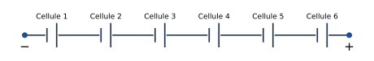
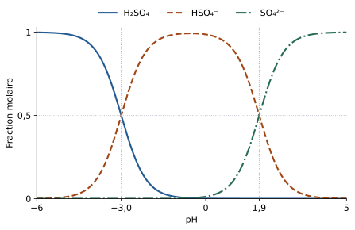
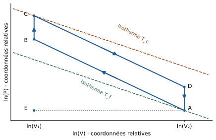

# Mines-Ponts MPI — Physique 2 2025 · Corrigé brut

*Corrigé rédigé par IA, non officiel. Signalez toute erreur.*

## Partie I — Batterie d’accumulateurs au plomb

### Question 1

Les deux potentiels standard de réduction valent $1{,}69\,\mathrm V$ pour $\mathrm{PbO_2/Pb^{2+}}$ et $-0{,}13\,\mathrm V$ pour $\mathrm{Pb^{2+}/Pb}$. Dans le domaine de fonctionnement acide de la batterie étudiée, l’électrode de $\mathrm{PbO_2}$ a le potentiel le plus élevé. C’est la borne positive et la cathode en décharge.

Les demi-équations écrites dans le sens de la décharge sont
$$
\begin{aligned}
\mathrm{PbO_2(s)+4H^+(aq)+2e^-}
&\longrightarrow \mathrm{Pb^{2+}(aq)+2H_2O(l)}
&&\text{à la cathode},\\
\mathrm{Pb(s)}
&\longrightarrow \mathrm{Pb^{2+}(aq)+2e^-}
&&\text{à l’anode}.
\end{aligned}
$$

### Question 2

Posons $h=[\mathrm H^+]/C^\circ$, $p=[\mathrm{Pb^{2+}}]/C^\circ$ et $a=(RT/F)\ln 10=0{,}059\,\mathrm V$. Pour les deux potentiels de **réduction**, la relation de Nernst donne
$$
\begin{aligned}
E_+&=1{,}69+\frac{a}{2}\log_{10}\!\left(\frac{h^4}{p}\right),\\
E_-&=-0{,}13+\frac{a}{2}\log_{10}p.
\end{aligned}
$$
L’eau liquide et les solides ont une activité prise égale à un. Les concentrations réduites rendent les logarithmes sans dimension. Par différence,
$$
\boxed{E=1{,}82\,\mathrm V-2a\,\mathrm{pH}-a\log_{10}p.}
$$
Lorsque $p=1$, on obtient $\mathrm{pH}=(1{,}82-1{,}90)/(2a)\simeq\mathbf{-0{,}68}$. Cela correspond à $[\mathrm H^+]\simeq4{,}8\,\mathrm{mol\,L^{-1}}$ dans l’approximation utilisée. Un pH négatif correspond ici à une activité hydrogène supérieure à un. À cette concentration, identifier l’activité à la concentration réduite est seulement une estimation.

### Question 3

Chaque accumulateur a une tension d’environ $2{,}0\,\mathrm V$ en tenant compte de la correction annoncée. Il faut donc **six accumulateurs en série** pour atteindre $12\,\mathrm V$. Chaque borne positive est raccordée à la borne négative suivante.



Le même courant traverse tous les éléments de la chaîne. La capacité de chaque cellule est donc **$Q=Q_t=65\,\mathrm{A\,h}$**, soit environ $2{,}3\times10^5\,\mathrm C$. Par Q1, deux moles d’électrons sont échangées par mole de chaque solide consommé dans une cellule. En utilisant la charge avant arrondi, on trouve pour toute la batterie
$$
\boxed{n_{\mathrm{Pb}}=n_{\mathrm{PbO_2}}=6\,\frac{Q}{2F}\simeq7{,}3\,\mathrm{mol}.}
$$

### Question 4

L’eau pure correspond à $c=0$, $d=1$, d’où $a=1$. Pour calibrer la pente de la loi affine, on l’extrapole jusqu’à l’acide pur. Les données donnent $d_{\rm pur}=\rho/\rho_0=1{,}8$ et $c_{\rm pur}=\rho/\mathcal M\simeq18\,\mathrm{mol\,L^{-1}}$. Par conséquent,
$$
\boxed{b=\frac{d_{\rm pur}-1}{c_{\rm pur}}\simeq4{,}4\times10^{-2}\,\mathrm{L\,mol^{-1}}.}
$$
Pour $d=1{,}3$, l’estimation est **$c\simeq6{,}9\,\mathrm{mol\,L^{-1}}$**. Elle indique un électrolyte concentré. L’étalonnage à partir des deux liquides purs repose sur l’extrapolation de la loi linéaire et ne constitue qu’un ordre de grandeur.

### Question 5

Les deux réactions avec l’eau sont
$$
\begin{aligned}
\mathrm{H_2SO_4+H_2O}&\rightleftharpoons \mathrm{HSO_4^-+H_3O^+},\\
\mathrm{HSO_4^-+H_2O}&\rightleftharpoons \mathrm{SO_4^{2-}+H_3O^+}.
\end{aligned}
$$
En assimilant les activités aux concentrations réduites, les constantes valent
$$
\begin{aligned}
K_{a1}&=\frac{[\mathrm{HSO_4^-}][\mathrm{H_3O^+}]}{[\mathrm{H_2SO_4}]C^\circ},\\
K_{a2}&=\frac{[\mathrm{SO_4^{2-}}][\mathrm{H_3O^+}]}{[\mathrm{HSO_4^-}]C^\circ}.
\end{aligned}
$$
L’axe horizontal indique le pH. Les courbes adjacentes se croisent aux pH $-3{,}0$ et $1{,}9$. En effet, deux formes adjacentes en proportions égales imposent $[\mathrm{H_3O^+}]/C^\circ=K_a$ pour le couple correspondant. L’axe vertical indique des fractions sans dimension de 0 à 1. Aux deux croisements les fractions égales sont très proches de $1/2$, car la troisième forme est alors présente en très faible quantité.

À bas pH, $\mathrm{H_2SO_4}$ prédomine. Entre les deux $pK_a$, $\mathrm{HSO_4^-}$ prédomine. À haut pH, $\mathrm{SO_4^{2-}}$ prédomine.



### Question 6

La méthode de densité donne $c\simeq6{,}9\,\mathrm{mol\,L^{-1}}$ par Q4, soit une concentration massique **exprimée en équivalent acide** de $c_m=\mathcal M c\simeq\mathbf{6{,}8\times10^2\,\mathrm{g\,L^{-1}}}$. À ce niveau de concentration, la loi affine et le modèle idéal d’activités fournissent des estimations.

Une autre estimation part du pH de Q2. Au pH $-0{,}68$, Q5 donne $\mathrm{HSO_4^-}$ très majoritaire. Dans le modèle des courbes de Q5, celui d’une solution d’acide seule, l’électroneutralité donne alors $c\simeq[\mathrm H^+]\simeq4{,}8\,\mathrm{mol\,L^{-1}}$, soit environ $4{,}7\times10^2\,\mathrm{g\,L^{-1}}$.

Si l’on conserve en plus la concentration de plomb dissous imposée en Q2, le bilan, dans le modèle d’espèces de l’énoncé et en négligeant $\mathrm{OH^-}$ en milieu très acide, devient
$$
c(x_2+2x_3)=[\mathrm H^+]+2[\mathrm{Pb^{2+}}].
$$
Ici $x_2+2x_3\simeq1$. On obtient **environ $6{,}8\,\mathrm{mol\,L^{-1}}$ de formes sulfatées totales**, ce qui concorde avec l’estimation par densité. Si l’on cherche la seule quantité formelle d’acide introduite, on retranche le sulfate apporté avec le plomb. Les deux définitions coïncident dans le modèle sans sel.

### Question 7

Posons $h=10^{-\mathrm{pH}}$. Les Q5 donnent $x_2=K_{a1}x_1/h$ et $x_3=K_{a2}x_2/h$. Leur somme vaut un. En posant $D=h^2+K_{a1}h+K_{a1}K_{a2}$,
$$
(x_1,x_2,x_3)
=\frac{1}{D}\bigl(h^2,K_{a1}h,K_{a1}K_{a2}\bigr).
$$
Le code reprend ces trois termes pour les pH du domaine chimique étudié.

```python
def Pred(pH):
    h = 10.0 ** (-pH)
    ka1 = 10.0 ** 3.0
    ka2 = 10.0 ** (-1.9)
    a = h * h
    b = ka1 * h
    c = ka1 * ka2
    total = a + b + c
    return a / total, b / total, c / total
```

## Partie II — Un moteur à essence turbocompressé

### II.A — Rendement du moteur

### Question 8

Notons $Q_c>0$ et $Q_f<0$ les transferts thermiques reçus par le fluide et $W<0$ le travail qu’il reçoit. Le rendement vaut $\eta=-W/Q_c$.

Sur un cycle, l’énergie interne est une fonction d’état et $\Delta U=0$. Le premier principe donne $W+Q_c+Q_f=0$, donc $\eta=1+Q_f/Q_c$. L’entropie est aussi une fonction d’état. Le second principe donne
$$
0=\frac{Q_c}{T_c}+\frac{Q_f}{T_f}+S_{\rm créée},
\qquad S_{\rm créée}\ge0.
$$
On en déduit **$\eta\le1-T_f/T_c$**, avec égalité pour un cycle réversible. Les températures sont exprimées en kelvins. Le rendement maximal dépend uniquement des températures des deux sources.

### Question 9

Le trajet de $100\,\mathrm{km}$ dure une heure. L’énergie utile est $P\Delta t$ et l’énergie fournie par le carburant vaut $qW_v$. Il vient
$$
\boxed{\eta_r=\frac{18\,000\times3600}{5{,}4\times3{,}6\times10^7}
\simeq0{,}33.}
$$
La Q8 impose $T_c\ge T_f/(1-\eta_r)\simeq\mathbf{4{,}5\times10^2\,\mathrm K}$ pour $T_f=300\,\mathrm K$. Cette borne est satisfaite par $T_c\simeq2{,}0\times10^3\,\mathrm K$.

### II.B — Thermodynamique des gaz

### Question 10

Les lois de Joule donnent $U=n u_m(T)$ et $H=n h_m(T)$ pour un gaz parfait de composition fixée. Ces fonctions dépendent donc de $T$ et de $n$.

Par définition, $H=U+PV=U+nRT$. En dérivant en $T$ à quantité de matière fixée, $C_P-C_V=nR$. Avec $C_P=\gamma C_V$,
$$
\boxed{\begin{aligned}
C_V&=\frac{nR}{\gamma-1},\\
C_P&=\frac{\gamma nR}{\gamma-1}.
\end{aligned}}
$$

### Question 11

À entropie molaire constante, l’équation (1) donne
$$
\ln(T/T_0)+(\gamma-1)\ln(V/V_0)=0.
$$
En utilisant $T/T_0=PV/(P_0V_0)$ à quantité de matière constante, puis en exponentiant, on obtient **$PV^\gamma=P_0V_0^\gamma$**.

### II.C — Cycle moteur à quatre temps

### Question 12

Une adiabatique réversible est isentropique. La Q11 donne $\ln P=-\gamma\ln V+\mathrm{constante}$ sur chacune des transformations AB et CD. Les deux segments sont donc parallèles et ont pour pente **$p_{\rm rv}=-\gamma$**.

### Question 13

Une isotherme vérifie $PV=nRT$ et s’écrit $\ln P=-\ln V+\ln(nRT)$. Sa pente $-1$ est moins forte en valeur absolue que celles de AB et CD.

Sur AB, la compression isentropique augmente $T$ puisque $TV^{\gamma-1}$ est constant. Sur BC, la pression augmente à volume constant, donc $T$ augmente. Sur CD et DA, la température baisse pour les raisons inverses.

Ainsi $A$ et $C$ sont les extrema de température du cycle, avec $T_A=T_f$ et $T_C=T_c$ dans le modèle du schéma demandé. On trace chaque isotherme par le point correspondant.



### Question 14

Les deux transformations AB et CD sont adiabatiques, donc $Q_{AB}=Q_{CD}=0$. Pour les isochores, le travail de pression est nul. Le premier principe et la première loi de Joule donnent
$$
\begin{aligned}
Q_{BC}&=C_V(T_C-T_B)>0,\\
Q_{DA}&=C_V(T_A-T_D)<0.
\end{aligned}
$$
Le transfert positif reçu de la source chaude est celui de BC. Par le bilan du cycle,
$$
\eta_{\rm rv}=1-\frac{T_D-T_A}{T_C-T_B}.
$$
La Q11 sous la forme $TV^{\gamma-1}=\mathrm{constante}$ donne $T_B=\alpha^{\gamma-1}T_A$ et $T_C=\alpha^{\gamma-1}T_D$. En éliminant les températures,
$$
\boxed{\eta_{\rm rv}=1-\alpha^{1-\gamma}.}
$$

### Question 15

On a $\gamma-1=0{,}4=2/5$, donc $\alpha^{\gamma-1}=9^{2/5}\simeq2{,}4$. Ainsi **$\eta_{\rm rv}\simeq0{,}58$**. Il dépasse le rendement réel de Q9, en cohérence avec les irréversibilités et pertes négligées. Il reste inférieur à la limite de Carnot $1-300/2000\simeq0{,}85$.

### Question 16

Pour une évolution adiabatique irréversible du système fermé, l’entropie augmente par création interne. En remplaçant $T$ par $PV/(nR)$ dans (1), entre deux points $i,f$ on trouve
$$
\Delta S=\frac{nR}{\gamma-1}
\left[\ln(P_f/P_i)+\gamma\ln(V_f/V_i)\right].
$$
Sur une droite de pente $p'$, on a donc $\Delta S=(nR/(\gamma-1))(p'+\gamma)\ln(V_f/V_i)>0$.

Pour AB′, le logarithme de volume est négatif, donc $p'_{\rm comp}<-\gamma$. Pour la détente C′D′, il est positif, donc $p'_{\rm det}>-\gamma$. **On a $p'_{\rm comp}<p_{\rm rv}<p'_{\rm det}$.** La phase D′A est la chute de pression à volume constant, distincte de la détente.

## Partie III — Principe d’un cinémomètre radar

### III.A — Transmission et réflexion d’une onde

### Question 17

Dans le vide sans charge ni courant, on applique, dans l’ordre du bloc ci-dessous, les équations de Maxwell–Gauss, de Maxwell–Thomson (flux magnétique), de Maxwell–Faraday et de Maxwell–Ampère.
$$
\begin{aligned}
\nabla\cdot\mathbf E&=0 & \nabla\cdot\mathbf B&=0,\\
\nabla\times\mathbf E&=-\partial_t\mathbf B &
\nabla\times\mathbf B&=\mu_0\varepsilon_0\partial_t\mathbf E .
\end{aligned}
$$
En prenant le rotationnel de l’équation de Maxwell–Faraday et en utilisant Maxwell–Ampère et l’identité donnée, on obtient
$$
\begin{aligned}
\Delta\mathbf E-\mu_0\varepsilon_0\partial_t^2\mathbf E&=0,\\
c&=\frac1{\sqrt{\mu_0\varepsilon_0}}.
\end{aligned}
$$
L’onde incidente impose $k^2=\omega^2/c^2$ et, pour la propagation selon $+z$, $k=\omega/c$. Ainsi **$\lambda_0=c/f$**.

### Question 18

La relation constitutive donne $[\gamma_0]=[j]/[E]$. Une densité de courant a pour dimension $i\,l^{-2}$. Par $\mathbf F=q\mathbf E$, le champ a pour dimension $m\,l\,t^{-3}i^{-1}$. Ainsi **$[\gamma_0]=m^{-1}l^{-3}t^3i^2$**, exprimé en $\mathrm{S\,m^{-1}}$ dans le SI.

Le paramètre $\tau$ est le temps de relaxation du courant. Sans excitation, le courant libre décroît en $e^{-t/\tau}$.

Dans le métal, Maxwell–Ampère comporte le courant de conduction en plus du courant de déplacement, et $\nabla\cdot\mathbf E=0$ puisque $\rho=0$. Il vient
$$
\Delta\mathbf E-\frac1{c^2}\partial_t^2\mathbf E=\mu_0\partial_t\mathbf j.
$$
Avec la convention temporelle $e^{i\omega t}$, $\mathbf j=\gamma_0\mathbf E/(1+i\omega\tau)$. Par substitution,
$$
\boxed{\bar k^{\,2}=\frac{\omega^2}{c^2}-\frac{i\mu_0\gamma_0\omega}{1+i\omega\tau}.}
$$

### Question 19

Pour $\bar k=2\pi/\lambda-i/\delta$, l’onde est proportionnelle à
$$
e^{-z/\delta}e^{i(\omega t-2\pi z/\lambda)}.
$$
**$\lambda$ est la période spatiale de phase**, donc la longueur d’onde dans le métal. **$\delta$ est la longueur d’atténuation de l’amplitude**, égale à la profondeur pour laquelle elle est divisée par $e$ à partir de la surface. L’intensité est alors divisée par $e^2$.

### Question 20

Introduisons $\omega_p=c\sqrt{\mu_0\gamma_0/\tau}$. On a $\tau^{-1}\simeq1{,}0\times10^{14}\,\mathrm{s^{-1}}$ et $\omega_p\simeq1{,}3\times10^{16}\,\mathrm{s^{-1}}$.

- **Basses fréquences.** Pour $\omega\tau\ll1$ et $\omega^2/c^2\ll\mu_0\gamma_0\omega$, le terme conducteur domine et $\bar k^2\simeq-i\mu_0\gamma_0\omega$. Les deux longueurs varient en $\omega^{-1/2}$.
- **Fréquences intermédiaires.** Pour $\omega\tau\gg1$ et $\omega^2/c^2\ll\mu_0\gamma_0/\tau$, soit $\omega\ll\omega_p$, le terme réel dominant est $-\mu_0\gamma_0/\tau$. Le premier terme imaginaire est $-i\mu_0\gamma_0/(\omega\tau^2)$.

  En posant $K=\sqrt{\mu_0\gamma_0/\tau}$, on trouve $\bar k\simeq K/(2\omega\tau)-iK$. La longueur d’onde augmente comme $\omega$, tandis que $\delta$ tend vers le plateau $1/K$ dans ce régime.
- **Hautes fréquences.** Pour $\omega\tau\gg1$ et $\omega^2/c^2\gg\mu_0\gamma_0/\tau$, soit $\omega\gg\omega_p$, le terme de déplacement domine.

  La partie réelle de $\bar k$ tend asymptotiquement vers $\omega/c$.

  Sa partie imaginaire vaut au premier ordre $-\mu_0\gamma_0 c/(2\omega^2\tau^2)$. Ainsi $\lambda$ décroît en $\omega^{-1}$ et $\delta$ augmente en $\omega^2$.

La transition entre les deux derniers régimes correspond au changement de signe du terme réel dominant de $\bar k^2$, proche de $\omega_p$.

### Question 21

À $f\simeq25\,\mathrm{GHz}$, $\omega\simeq1{,}6\times10^{11}\,\mathrm{s^{-1}}$. On a $\omega\tau\simeq1{,}6\times10^{-3}$ et $\omega/(\mu_0\gamma_0 c^2)\simeq9{,}6\times10^{-8}$. Les deux conditions du régime bas sont satisfaites.

La racine de partie réelle positive est $\bar k\simeq(1-i)/d$, avec $d=\sqrt{2/(\mu_0\gamma_0\omega)}$. D’où **$\delta\simeq d\simeq8{,}4\times10^{-7}\,\mathrm m$** et **$\lambda\simeq2\pi d\simeq5{,}3\times10^{-6}\,\mathrm m$**. Les deux droites asymptotiques ont une pente $-1/2$ et sont séparées de $\log_{10}(2\pi)\simeq0{,}80$ décade.

Une conductivité finie laisse pénétrer le champ sur une profondeur non nulle. L’acier n’est donc pas un conducteur parfait au sens strict. L’approximation de réflexion parfaite est toutefois adaptée ici, car $\delta/\lambda_0\simeq7{,}0\times10^{-5}$, pour $\lambda_0\simeq1{,}2\,\mathrm{cm}$. Une paroi d’épaisseur de l’ordre du millimètre traverse plus de mille profondeurs de peau. Elle est **opaque** à ces ondes.

### III.B — Réflexion métallique

### Question 22

Le matériau est assimilé à un conducteur parfait dans cette partie. Le champ intérieur est nul et les champs extérieurs sont tangents à la surface. La projection normale de $\mathbf E_{\rm II}-\mathbf E_{\rm I}=(\sigma/\varepsilon_0)\mathbf e_z$ donne **$\sigma=0$**. La projection tangentielle impose l’annulation de la somme des champs à $z=0$. Ainsi
$$
\boxed{\begin{aligned}
\underline{\mathbf E}_{\rm ref}&=-E_0e^{i(\omega t+kz)}\mathbf e_x,\\
k&=\omega/c.
\end{aligned}}
$$

### Question 23

Les deux ondes sont dans le vide. Avec $k,k'>0$ et des sens opposés, on a $k=\omega/c$ et $k'=\omega'/c$. À $z=-vt$, la condition tangentielle du modèle (3) s’écrit
$$
E_0e^{i(\omega+kv)t}+E'_0e^{i(\omega'-k'v)t}=0.
$$
À $t=0$, on lit $E'_0=-E_0$. L’identité à tout instant impose $\omega+kv=\omega'-k'v$. On obtient
$$
\boxed{\omega'=\omega\,\frac{1+v/c}{1-v/c}.}
$$
Pour un véhicule qui se rapproche, le décalage est vers les hautes fréquences.

### Question 24

La relation $\underline{\mathbf B}=\mathbf k\times\underline{\mathbf E}/\omega$ dans le vide donne une direction $\mathbf e_y$ pour l’onde incidente. Pour l’onde réfléchie, le vecteur d’onde et l’amplitude électrique changent tous deux de signe. Sur la surface, les deux champs magnétiques s’ajoutent donc.

En posant $\omega_i=\omega+kv$, la valeur totale extérieure vaut $(2E_0/c)e^{i\omega_i t}\mathbf e_y$. Le champ intérieur est nul et la normale vers le métal vaut $\mathbf e_z$. La relation de passage magnétique donne
$$
\boxed{\begin{aligned}
\underline{\mathbf i}_s(t)&=\frac{2E_0}{\mu_0c}e^{i\omega_i t}\mathbf e_x,\\
\omega_i&=\omega(1+v/c).
\end{aligned}}
$$
Le courant physique est la partie réelle. Il oscille à la pulsation vue sur la surface en mouvement.

### III.C — Effet Doppler et mesure de vitesse

### Question 25

Par Q23, le décalage relatif vaut $2v/(c-v)$ pour un véhicule en approche. Pour $v\ll c$, il vaut donc **$\Delta\simeq2v/c$**. Par exemple, à $100\,\mathrm{km\,h^{-1}}$ soit environ $28\,\mathrm{m\,s^{-1}}$, on trouve $\Delta\simeq\mathbf{1{,}9\times10^{-7}}$.

Au point fixe de mesure, les deux signaux ont les pulsations $\omega$ et $\omega'$. Leur produit comporte une composante à $|\omega'-\omega|$ et une autre à $\omega'+\omega$. Les phases fixes apportées par la position du récepteur ne changent pas ces fréquences.

Un filtre **passe-bas** doit satisfaire $|f'-f|<f_c\ll f'+f$, avec $f_c$ assez grand devant le battement maximal attendu.

À $25\,\mathrm{GHz}$, une vitesse de $100\,\mathrm{km\,h^{-1}}$ donne un battement d’environ $4{,}6\,\mathrm{kHz}$ pour une somme proche de $50\,\mathrm{GHz}$. Une coupure de l’ordre de $100\,\mathrm{kHz}$ convient pour les vitesses usuelles. La composante conservée a pour fréquence
$$
\boxed{f_1=|f'-f|\simeq\frac{2f}{c}|v|.}
$$
Elle est proportionnelle à la valeur absolue de la vitesse dans la direction de visée.
