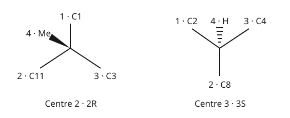
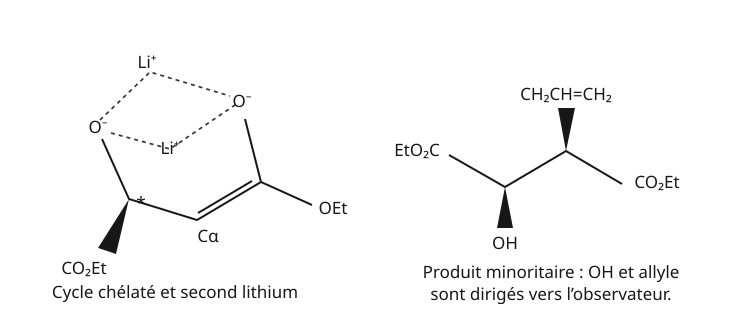
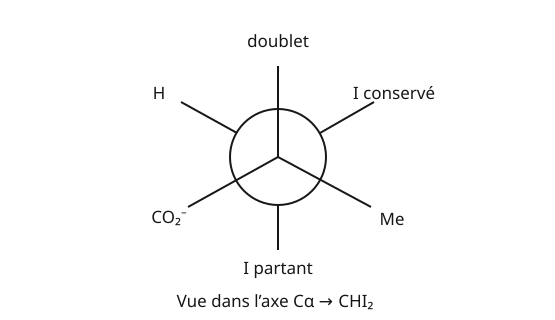
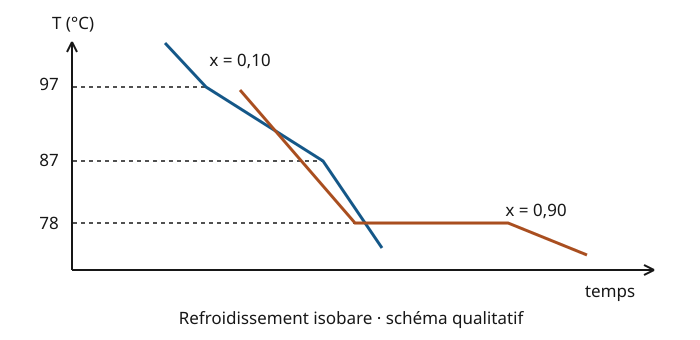
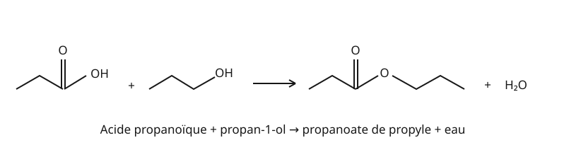

# Mines-Ponts PC — Chimie 2025 · Corrigé brut

*Corrigé rédigé par IA, non officiel. Signalez toute erreur.*

## Synthèse stéréosélective

### Question 1

Au centre 2, les quatre substituants commencent par C. Le carbone carbonylé C1 est prioritaire, avec trois occurrences d’O dans sa liste. Le méthyle est dernier. Entre C11 et C3, les premiers rangs sont à égalité. En développant les deux chemins, la branche de C11 atteint l’alcène substitué portant un méthyle, avec la liste $[C,C,C]$ au rang décisif, avant le chemin issu de C3. L’ordre est donc C1, C11, C3, Me. Le méthyle est dirigé vers l’observateur. Le sens antihoraire visible donne **2R** après inversion.

Au centre 3, l’ordre est C2, C8, C4, H, à partir des listes $[C,C,C]$, $[C,C,H]$ et $[C,H,H]$ pour les trois voisins carbonés. H est vers l’arrière. Le sens antihoraire donne **3S**.

### Question 2

L’oxygène carbonylé de $\mathrm{RCO_2H}$ capte un proton. Dans l’étape d’addition, le doublet de l’oxygène de l’éthanol se dirige vers le carbone acyle et le doublet pi de C=O rejoint O. L’intermédiaire est $\mathrm{RC(OH)_2(O^+HEt)}$.

Une prototropie donne $\mathrm{RC(OH)(OH_2^+)(OEt)}$. Dans l’étape d’élimination, le doublet de OH reforme le carbonyle, tandis que le doublet de la liaison au groupe $\mathrm{OH_2^+}$ part avec l’eau. La déprotonation de $\mathrm{RC(=OH^+)OEt}$ fournit l’ester et régénère le catalyseur acide.

### Question 3

L’éthanol est en excès. L’acide malique, $\mathrm{C_4H_6O_5}$, est limitant. Ses 6,7 g représentent $50\ \mathrm{mmol}$ avec $M=134\ \mathrm{g\,mol^{-1}}$. Pour le diester $\mathrm{C_8H_{14}O_5}$, $M=190\ \mathrm{g\,mol^{-1}}$ et la masse théorique est 9,50 g. Le rendement isolé est **$8{,}6/9{,}50\simeq91\,\%$**.

L’excès d’éthanol déplace les équilibres d’estérification vers les esters. Le reflux en présence d’acide accélère l’atteinte de l’équilibre en conservant l’éthanol dans le montage.

### Question 4

Le n-butyllithium déprotone la diisopropylamine. On obtient $\mathrm{(iPr)_2NLi}$ et du butane. La formation de la liaison C–H est très favorable à partir des pKa de l’annexe, environ 50 pour l’alcane contre 36 pour l’amine. Le LDA est une base forte encombrée. Le n-butyllithium, nucléophile, pourrait au contraire s’additionner aux carbonyles ester de 7.

### Question 5

Le premier équivalent déprotone OH et le deuxième le méthylène en alpha de l’ester de droite. Les pKa pertinents sont environ 17 et 25, tous deux inférieurs à celui de la diisopropylamine, proche de 36.

La forme à charges sur les oxygènes est $\mathrm{EtO_2C{-}CH(O^-){-}CH{=}C(O^-)OEt}$, accompagnée de **deux ions $\mathrm{Li^+}$**. Elle est en mésomérie avec la forme dont la seconde charge se trouve sur le carbone alpha de l’ester.

### Question 6

Après la double déprotonation, le doublet de la forme carbanionique de l’énolate attaque le carbone primaire du bromure d’allyle par l’arrière. Le doublet de C–Br rejoint Br dans cette substitution $\mathrm{S_N2}$. Une nouvelle liaison C–C installe $\mathrm{-CH_2CH{=}CH_2}$ sur le carbone alpha. Le traitement aqueux protonne l’alcoolate et donne $\mathrm{EtO_2C{-}CH(OH){-}CH(CH_2CH{=}CH_2){-}CO_2Et}$.

### Question 7

Dans le dianion, un lithium relie l’oxygène alcoolate et l’oxygène de l’énolate opposé, formant le cycle Li–O–C–C–C–O. Le second lithium accompagne le dianion et peut se coordonner aux deux oxygènes comme dans le modèle de l’énoncé. Le centre provenant de l’acide malique fixe la chiralité du chélate. Dans une conformation qui place le groupe $\mathrm{CO_2Et}$ latéral vers l’extérieur, le groupe ester latéral occupe une face du chélate. L’électrophile approche préférentiellement l’énolate par l’autre face, afin de limiter les contacts avec ce groupe. Dans la projection commune du schéma, la liaison allyle obtenue est hachurée, avec OH en coin plein.

Le diastéréoisomère minoritaire conserve la configuration du carbone porteur de OH. Seul le centre créé change de configuration. On le dessine en remplaçant la liaison hachurée vers l’allyle, dans 8, par un coin plein.

### Question 8

$\mathrm{LiAlH_4}$ en milieu anhydre, suivi d’une hydrolyse acide, réduit les deux esters en groupes $\mathrm{CH_2OH}$. L’hydrolyse libère également l’alcool secondaire. On obtient le triol 10. Dans ces conditions, l’alcène est conservé.

### Question 9

- 1,60–2,42 ppm, 3 H. Proton $H_c$ et deux protons $H_f$, dans la zone aliphatique allylique.
- 3,70–4,00 ppm, 5 H. Deux $H_a$, $H_b$ et deux $H_d$, portés par des carbones directement liés à un oxygène.
- 4,20 ppm, 1 H. $H_i$, proton de l’alcool, élargi par échange.
- 5,05 ppm et 5,06 ppm. Respectivement $H_{h'}$ et $H_h$, couplés à $H_g$ à 10,2 Hz en cis et 17,1 Hz en trans.
- 5,48 ppm, 1 H. $H_e$, porté par le carbone d’acétal lié à deux O et au phényle, avec absence de couplage vicinal résolu.
- 5,79 ppm, 1 H. $H_g$, dédoublé par chacun des H terminaux (17,1 et 10,2 Hz) et présentant une composante triplet par couplage aux deux $H_f$ (environ 7 Hz).
- 7,15–7,55 ppm, 5 H. Les protons du phényle.

### Question 10

NaH transforme l’alcool de 11 en alcoolate. Celui-ci attaque le bromure de benzyle $\mathrm{PhCH_2Br}$ dans une substitution $\mathrm{S_N2}$. Le produit 13 porte l’éther $\mathrm{OCH_2Ph}$ et conserve l’acétal.

### Question 11

Dans 14, le groupe allyle $\mathrm{-CH_2CH{=}CH_2}$ de 13 devient $\mathrm{-CH_2CH_2CH_2OH}$. Les groupes O-benzyle et acétal demeurent aux mêmes endroits et la configuration des centres existants est conservée. L’hydroboration place préférentiellement B sur le carbone terminal, moins encombré. L’oxydation alcaline remplace la liaison C–B par C–O. Le thiosulfate détruit par réduction l’excès de peroxyde après réaction.

### Question 12

Pour 14→16, utiliser le chlorure de tert-butyldiméthylsilyle $\mathrm{tBuMe_2SiCl}$ et une base, par exemple l’imidazole, pour protéger l’alcool terminal. Pour 16→18, l’hydrogénolyse sous $\mathrm{H_2}$ sur Pd/C retire le benzyle et régénère l’autre alcool. L’éther silylé est conservé.

### Question 13

Le groupe $\mathrm{-CH_2OH}$ de 18 devient $\mathrm{-CHO}$. C’est une **oxydation ménagée d’un alcool primaire en aldéhyde**.

## Synthèse du phosphonate

### Question 14

NaH déprotone le carbone central de 19, avec dégagement de dihydrogène. L’anion malonate attaque par C le carbone du triiodométhane avec départ d’un iodure. Le produit 20 est $\mathrm{(EtO_2C)_2C(CH_3)CH(I)_2}$, de formule $\mathrm{C_9H_{14}I_2O_4}$. C’est une C-alkylation.

### Question 15

L’intermédiaire est le sel dipotassique $\mathrm{2\,K^+ +(^{-}O_2C)_2C(CH_3)CH(I)_2}$. Pour chaque ester, un ion hydroxyde attaque le carbone acyle et la liaison pi se déplace vers O. Le doublet de l’oxyanion reforme C=O et la liaison vers l’éthoxy se rompt pour donner l’éthanolate. Celui-ci déprotone le carboxyle formé. Avec les pKa 4 et 17, le transfert est fortement favorable, de constante voisine de $10^{13}$. Le deuxième ester subit la même suite d’étapes.

### Question 16

L’ion malonate peut perdre $\mathrm{CO_2}$ par rupture d’une liaison entre le carbone central et l’un des carboxylates, donnant $\mathrm{^{-}O_2C{-}C^-(CH_3){-}CH(I)_2}$. À partir d’un conformère où le doublet du carbone alpha et une liaison C–I sont antipériplanaires, le doublet forme C=C et la liaison C–I libère $\mathrm{I^-}$.

Pour le conformère qui conduit à 22, dans une vue le long de la liaison en regardant du carbone alpha vers $\mathrm{CHI_2}$, plaçons le doublet à midi et l’iode sortant à six heures. Le carboxylate est d’un côté, à huit heures, et l’iode conservé de l’autre, à deux heures. Les deux groupes restants, Me et H, occupent respectivement quatre et dix heures. La formation de la double liaison met ainsi carboxylate et iode conservé sur des côtés opposés, d’où **E**, géométrie dessinée pour 22. L’acidification finale transforme le carboxylate en acide.

### Question 17

En A, l’iodure vinylique subit l’**addition oxydante** sur le palladium. Le nombre d’oxydation augmente de 2. En B, il y a **échange de ligand**, avec remplacement d’une phosphine par l’alcyne coordonné selon le cycle simplifié. Le nombre d’oxydation est inchangé. En D, l’**élimination réductrice** couple les fragments carbonés et diminue le nombre d’oxydation de 2, régénérant le catalyseur.

### Question 18

Une première méthode consiste à traiter l’alcool par l’acide bromhydrique. La protonation transforme le groupe OH en groupe partant eau, et l’ion bromure joue le rôle de nucléophile.

Une seconde méthode consiste à transformer OH en sulfonate, par exemple en tosylate, puis à substituer ce groupe partant par $\mathrm{Br^-}$. **Cette seconde voie est préférable ici.** Elle évite l’activation en milieu fortement acide, qui favorise les réarrangements ou des réactions concurrentes sur le système allylique.

## Synthèse de l’iodure vinylique

### Question 19

Une formule de Lewis est $\mathrm{O{=}Cl{-}O^-}$, avec deux doublets libres sur Cl, deux sur l’oxygène doublement lié et trois sur l’oxygène simplement lié. Une deuxième forme échange les rôles des deux O. Le nombre total d’électrons représentés vaut 20 et la charge globale vaut $-1$.

### Question 20

L’eau solubilise les sels, notamment le chlorite et le phosphate de sodium. Le tert-butanol favorise la dissolution du substrat organique et est miscible à l’eau. Le mélange assure le contact entre les partenaires dans le milieu réactionnel.

### Question 21

On protonne un oxygène de l’acétal. La liaison entre cet oxygène et le carbone benzylique d’acétal se rompt. On ouvre ainsi le cycle et obtient un oxocarbénium stabilisé par l’oxygène restant. L’eau s’additionne au carbone électrophile, et un transfert de proton donne l’hémiacétal.

L’oxygène alkoxy restant est protoné, puis un doublet de l’oxygène hydroxyle reforme le carbonyle pendant le départ du second alcool. La déprotonation donne le benzaldéhyde et régénère le catalyseur. Sur le substrat, les deux oxygènes du cycle sont devenus deux groupes OH, ceux du diol.

### Question 22

Pour obtenir 30, remplacez dans 29 le motif terminal $\mathrm{-CH_2OH}$ par $\mathrm{-CH_2O{-}SO_2C_6H_4CH_3}$, avec le méthyle en para. L’alcool secondaire, les autres fonctions et les stéréocentres restent identiques. Le chlorure de tosyle en quantité d’un équivalent privilégie l’alcool primaire, moins encombré.

### Question 23

Le borohydrure fournit un hydrure qui attaque le carbone primaire porteur de OTs par substitution nucléophile. Le tosylate part et $\mathrm{-CH_2OTs}$ devient $\mathrm{-CH_3}$. L’opération est une réduction du groupe oxygéné en alcane. NaH est usuellement une base et un mauvais nucléophile dans ce milieu. Il déprotonnerait notamment l’alcool secondaire encore libre, avec dégagement de dihydrogène, et ne convient pas à la substitution attendue.

## Pervaporation et membrane

### Question 24

La masse de la maille vaut $(96M_{\rm Si}+192M_{\rm O})/N_A=5760/N_A$ en grammes et son volume est $abc=5{,}2\times10^{-21}\ \mathrm{cm^3}$. En effet, $1\ \mathrm{pm}=10^{-10}\ \mathrm{cm}$. Ainsi
$$
\rho=\frac{96M_{\rm Si}+192M_{\rm O}}{N_Aabc}\simeq1{,}85\ \mathrm{g\,cm^{-3}}.
$$

### Question 25

Une fraction 0,45 du volume est poreuse. Le volume poreux par unité de masse vaut donc $V_p=0{,}45/\rho\simeq0{,}24\ \mathrm{cm^3\,g^{-1}}$.

### Question 26

Dans le modèle linéaire, la distance entre les noyaux extrêmes vaut $2(r_O+r_H)\simeq194\ \mathrm{pm}$. En incluant l’extension extérieure des deux hydrogènes dans ce même modèle géométrique, la dimension vaut $2r_O+4r_H\simeq256\ \mathrm{pm}$, soit environ $0{,}26\ \mathrm{nm}$. Ces rayons donnent un ordre de grandeur.

### Question 27

La chabazite présente des pores de $380\ \mathrm{pm}$, intermédiaires entre la dimension de l’eau et celle de l’éthanol ($470\ \mathrm{pm}$). Elle laisse donc passer préférentiellement l’eau dans le modèle de tamisage. Les trois autres diamètres maximaux sont supérieurs à la taille de l’éthanol et ne réalisent pas cette exclusion géométrique.

## Obtention d’éthanol absolu

### Question 28

La courbe 1, supérieure, est la courbe de **rosée**, qui donne la composition de la vapeur saturante. La courbe 2, inférieure, est celle d’**ébullition**, qui donne la composition du liquide saturé. En A, il n’y a qu’une phase vapeur. En C, il n’y a qu’une phase liquide. En B et D coexistent un liquide et une vapeur, dont les compositions se lisent aux extrémités de l’isotherme tracée entre les deux courbes.

Au minimum commun, le liquide homogène et la vapeur ont la même composition. Le mélange correspondant bout à température et composition constantes à pression imposée. C’est l’homoazéotrope.

### Question 29

Pour $x_{\rm EtOH}=0{,}10$, le refroidissement de la vapeur donne une rupture de pente à la rosée vers $97\ ^\circ\mathrm C$, puis une autre vers $86$ à $87\ ^\circ\mathrm C$ quand la dernière vapeur disparaît. Entre ces ruptures, le refroidissement est ralenti par la condensation. Pour la composition azéotropique $x_{\rm EtOH}\simeq0{,}90$, la transition se fait sur un palier voisin de $78\ ^\circ\mathrm C$.

### Question 30

Dans une mole de mélange, les masses sont $xM_{\rm EtOH}$ pour l’éthanol et $(1-x)M_{\rm eau}$ pour l’eau. Ainsi
$$
\omega_{\rm EtOH}=\frac{xM_{\rm EtOH}}{xM_{\rm EtOH}+(1-x)M_{\rm eau}}.
$$

### Question 31

Le minimum est proche de $x=0{,}90$. Avec les masses molaires 46 et 18 en grammes par mole, cela donne $\omega_{\rm EtOH}\simeq41{,}4/(41{,}4+1{,}8)\simeq0{,}958$. La précision de la figure conduit à **environ 95–96 % en masse**.

### Question 32

Le mélange industriel contient 10 à 25 % d’éthanol en masse et se trouve du côté riche en eau de l’azéotrope. Les vaporisations et condensations successives enrichissent le distillat en éthanol jusqu’à la composition azéotropique. La distillation fractionnée permet donc d’obtenir un produit à environ 95 % en masse. La spécification de 99,7 % en masse réclame une autre méthode de séparation.

### Question 33

La courbe ELV donne la composition massique de la vapeur qui équilibre un liquide de composition donnée. Elle s’apparente à la **courbe de rosée**, qui porte les compositions de la phase vapeur, avec un changement de variables et l’élimination de la température entre les deux branches.

### Question 34

L’abscisse d’eau vaut $1-0{,}25=0{,}75$. Sur la courbe ELV, l’ordonnée est environ 0,28. La première vapeur contient donc environ **72 % d’éthanol en masse**.

### Question 35

Après condensation, le nouveau liquide contient environ 28 % d’eau en masse. À cette abscisse, l’ELV donne une fraction massique d’eau proche de 0,14. La seconde vapeur contient donc **environ 86 % d’éthanol en masse**.

### Question 36

À l’azéotrope, $\omega'_{\rm eau}=\omega_{\rm eau}$. Le point cherché est l’intersection intérieure de l’ELV avec la diagonale. Elle est proche de 0,05 en eau, soit **environ 95 % d’éthanol en masse**.

### Question 37

À cette alimentation, le pervaporat contient environ 98 % d’eau en masse tandis que la première vapeur de distillation n’en contient qu’environ 28 %. Le flux extrait par la membrane est donc nettement plus riche en eau. La membrane laisse dans le rétentat la plus grande partie de l’éthanol.

### Question 38

Notons $D_i$, $D_r$, $D_p$ les débits et $w_i$, $w_r$, $w_p$ les fractions massiques d’eau. Les bilans stationnaires donnent
$$
\begin{aligned}
D_i&=D_r+D_p,\\
w_iD_i&=w_rD_r+w_pD_p.
\end{aligned}
$$
Donc $D_p=D_r(w_i-w_r)/(w_p-w_i)$ et $D_i=D_r(w_p-w_r)/(w_p-w_i)$. Avec les valeurs de la figure, **$D_p\simeq8{,}1\ \mathrm{kg\,h^{-1}}$** et **$D_i\simeq10{,}6\ \mathrm{kg\,h^{-1}}$**.

### Question 39

Avec 0,3 % d’eau dans le rétentat, sa teneur en éthanol est de **99,7 % en masse**. Elle atteint la spécification de l’éthanol absolu donnée dans l’énoncé. Le rétentat satisfait aussi un seuil de pureté de 95 %, ou peut être dilué si l’on souhaite ce titre précis.

## Déplacement d’un équilibre

### Question 40

L’acide propanoïque et le propan-1-ol donnent le propanoate de propyle et de l’eau dans un rapport 1:1:1:1.

### Question 41

Le bilan des enthalpies standard de formation donne $-480-290+490+280=0\ \mathrm{kJ\,mol^{-1}}$. Le bilan des entropies donne $260+70-160-160=10\ \mathrm{J\,mol^{-1}\,K^{-1}}$. Ainsi $\Delta_rG^\circ(298\,\mathrm K)=-2{,}98\ \mathrm{kJ\,mol^{-1}}$ et
$$
K^\circ=\exp\left(-\frac{\Delta_rG^\circ}{RT}\right)
=\exp\left(\frac{10}{R}\right)\simeq3{,}5
$$
avec $R=8\ \mathrm{J\,mol^{-1}\,K^{-1}}$, soit environ 4 selon l’approximation d’annexe.

### Question 42

Pour une solution liquide idéale, $Q_r=x_{\rm ester}x_{\rm eau}/(x_{\rm acide}x_{\rm alcool})$. Comme le nombre total de facteurs est identique au numérateur et au dénominateur, les quantités de matière peuvent remplacer les fractions dans ce rapport. En retirant de l’eau à quantités des autres espèces momentanément fixées, on abaisse $Q_r$ depuis $K^\circ$. Alors $RT\ln(Q_r/K^\circ)<0$ et l’évolution spontanée favorise la formation d’ester.

### Question 43

Avec $\alpha$ l’ordre partiel en catalyseur, la vitesse volumique nette de formation vaut
$$
v=[\mathrm{Cat}]^\alpha
\bigl(k_1[\mathrm{acide}][\mathrm{alcool}]
-k_{-1}[\mathrm{ester}][\mathrm{eau}]\bigr).
$$
Le catalyseur affecte les deux vitesses.

### Question 44

Les points sont compatibles avec une droite de pente positive passant par l’origine. Par exemple, la vitesse passe approximativement de $0{,}15$ à $0{,}30\ \mathrm{mol\,L^{-1}\,h^{-1}}$ quand la concentration en catalyseur augmente d’environ $0{,}10$ à $0{,}20\ \mathrm{mol\,L^{-1}}$. On retient **$\alpha\simeq1$**.

### Question 45

La pente de $\ln k_1$ en fonction de $1/T$ est $-E_a/R$. On obtient donc **$E_a=5700R\simeq46\ \mathrm{kJ\,mol^{-1}}$** avec la constante arrondie de l’énoncé.

### Question 46

Pour le mélange stœchiométrique initialement sans produits, chaque réactif vaut $n_0(1-X)$ et chaque produit $n_0X$. À volume constant, la relation entre la vitesse volumique et le taux de conversion est $v=(n_0/V)\,\mathrm dX/\mathrm dt$.

En substituant les concentrations et $\alpha=1$ dans la loi de vitesse, on obtient
$$
\frac{\mathrm dX}{\mathrm dt}=
\frac{n_0}{V}[\mathrm{Cat}]
\bigl(k_1(1-X)^2-k_{-1}X^2\bigr).
$$
C’est l’équation (1) pour le cas où l’eau produite demeure dans le milieu.

### Question 47

La stœchiométrie donne un débit net de formation d’eau $n_0\mathrm dX/\mathrm dt$. Le débit sortant est $a n_{\rm eau,rét}$, d’où
$$
\begin{aligned}
\frac{\mathrm dn_{\rm eau,rét}}{\mathrm dt}&=n_0\frac{\mathrm dX}{\mathrm dt}-a n_{\rm eau,rét},\\
\frac{\mathrm dY}{\mathrm dt}&=\frac{\mathrm dX}{\mathrm dt}-aY.
\end{aligned}
$$
Lorsque la membrane est active, la concentration en eau dans le terme inverse est $n_0Y/V$ et celle en ester est $n_0X/V$. Dans la version couplée cohérente de l’équation (1), le terme inverse contient donc $XY$ à la place de $X^2$. Veiller à exprimer les constantes cinétiques et le coefficient $a$ dans la même unité de temps.

### Question 48

Au début, $Y$ est très faible et $X$ et $Y$ progressent presque ensemble. La formation d’eau par estérification domine donc le faible flux à travers la membrane. À la fin, $X$ varie peu tandis que $Y$ diminue encore. La pervaporation l’emporte alors sur la vitesse de formation de l’eau et déshydrate le rétentat.

### Question 49

Les derniers points expérimentaux, vers 22 h, donnent un rendement voisin de **85 à 87 %**. À 30 h, la courbe ajustée se situe vers 88 %. Pour un système fermé sans membrane, initialement stœchiométrique et sans produits, $K^\circ=X_{\rm eq}^2/(1-X_{\rm eq})^2$.

La réaction étant athermique dans les données, $K^\circ$ varie peu entre 298 K et 50 °C dans le modèle. On attend environ $\sqrt{K^\circ}/(1+\sqrt{K^\circ})\simeq65\,\%$ de conversion à l’équilibre fermé. En retirant l’eau, la pervaporation dépasse cette limite du système fermé.
