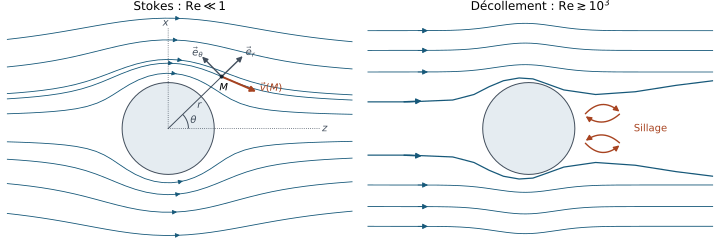

# Mines-Ponts PC — Physique 1 2025 · Corrigé brut

*Corrigé rédigé par IA, non officiel. Signalez toute erreur.*

## Présentation du sujet

Cette épreuve de trois heures sans calculatrice traite de la viscosité. Elle étudie la traînée de Stokes, le glissement aux parois dans un canal puis le transport microscopique de quantité de mouvement dans un gaz. La première partie est indépendante. Les applications numériques demandent un chiffre significatif.

## I — La formule de Stokes

### Question 1

Une variation de vitesse d’ordre $v$ sur une distance $L$ donne un terme convectif $\rho(\vec v\cdot\nabla)\vec v$ d’ordre $\rho v^2/L$. Il représente le changement de vitesse d’une particule fluide lorsqu’elle se déplace dans un champ non uniforme.

Le terme $\eta\Delta\vec v$ est d’ordre $\eta v/L^2$. Il représente la diffusion de quantité de mouvement sous l’effet de la viscosité. Le rapport des deux ordres de grandeur est
$$
\mathrm{Re}=\frac{\rho vL}{\eta}.
$$

### Question 2

À $\mathrm{Re}\ll1$, l’écoulement est régulier et les lignes de courant sont symétriques entre l’amont et l’aval. La vitesse s’annule sur la boule. En $M$, elle est tangente à la ligne de courant et orientée dans son sens.

À $\mathrm{Re}\gtrsim10^3$, dans le régime usuel avant la crise de traînée, l’écoulement se décolle et laisse un sillage turbulent en aval. En amont, les lignes de courant incidentes restent organisées.

### Question 3

Pour une boule et des Reynolds supérieurs à $10^3$ sur le plateau qui précède la crise de traînée, $C_z$ dépend peu de la vitesse. À masse volumique et section fixées, $|F_z|=C_z\rho Sv^2/2$ est alors approximativement proportionnelle à $v^2$.

### Question 4

On prend $S=\pi a^2$ et $L=d=2a$. La loi de Stokes donne
$$
\begin{aligned}
C_z &= \frac{6\pi\eta a v}{\rho v^2\pi a^2/2}
      = \frac{12\eta}{\rho va}\\
    &= \frac{24}{\mathrm{Re}}.
\end{aligned}
$$

### Question 5

La stationnarité annule la dérivée locale. Le faible Reynolds permet de négliger l’inertie convective devant la viscosité. À l’extérieur de la boule, en l’absence de pesanteur,
$$
-\nabla P+\eta\Delta\vec v=\vec 0.
$$
Comme $\nabla\cdot\vec v=0$, on peut aussi écrire $\nabla P=-\eta\operatorname{rot}(\operatorname{rot}\vec v)$.

### Question 6

En $r=a$, les deux facteurs radiaux valent respectivement $1-3/2+1/2$ et $1-3/4-1/4$. Ils s’annulent, donc $\vec v=\vec 0$ sur la boule dans son référentiel.

Lorsque $r\to\infty$, ces facteurs tendent chacun vers $1$. On retrouve $\vec v\to v_0(\cos\theta\,\vec e_r-\sin\theta\,\vec e_\theta)=v_0\vec e_z$.

### Question 7

L’indépendance en $\varphi$ et l’absence de composante azimutale de $\vec v$ laissent une seule composante du rotationnel. On calcule
$$
\begin{aligned}
\partial_r(rv_\theta) &= -v_0\sin\theta\left(1+\frac{a^3}{2r^3}\right),\\
\partial_\theta v_r &= -v_0\sin\theta\left(1-\frac{3a}{2r}+\frac{a^3}{2r^3}\right).
\end{aligned}
$$
Leur différence, divisée par $r$, donne
$$
\vec\omega=\operatorname{rot}\vec v
=-\frac{3v_0a}{2r^2}\sin\theta\,\vec e_\varphi .
$$
La constante positive de l’énoncé vaut $\alpha=3/2$.

### Question 8

On applique le rotationnel à $\vec\omega$ de Q7 puis on multiplie par $-\eta$,
$$
\begin{aligned}
\partial_rP&=\frac{3\eta a v_0}{r^3}\cos\theta,\\
\frac{1}{r}\partial_\theta P&=\frac{3\eta a v_0}{2r^3}\sin\theta.
\end{aligned}
$$
L’intégration radiale donne $P=-3\eta a v_0\cos\theta/(2r^2)+f(\theta,\varphi)$. La condition $P\to P_\infty$ fixe $f=P_\infty$. Cette expression vérifie aussi la relation angulaire. Ainsi $\beta=3\eta a v_0/2$ dans $P=P_\infty-\beta\cos\theta/r^2$.

### Question 9

L’action élémentaire est $-P\vec e_r\,dS$, où $dS=a^2\sin\theta\,d\theta\,d\varphi$. Les composantes transversales s’annulent par symétrie axiale. La contribution uniforme de $P_\infty$ s’annule également.

La projection $\vec e_r\cdot\vec e_z=\cos\theta$ donne
$$
\begin{aligned}
F_{p,z}
&=2\pi\beta\int_0^\pi\cos^2\theta\sin\theta\,d\theta\\
&=\frac{4\pi\beta}{3}
=2\pi\eta a v_0 .
\end{aligned}
$$
Donc $\vec F_p=2\pi\eta a v_0\vec e_z$.

### Question 10

En dérivant $v_\theta$ à la surface, on trouve $\partial_r v_\theta|_a=-3v_0\sin\theta/(2a)$. Par symétrie, la résultante est axiale. Comme $\vec e_\theta\cdot\vec e_z=-\sin\theta$,
$$
\begin{aligned}
F_{c,z}
&=\frac{3\eta av_0}{2}\,2\pi\int_0^\pi\sin^3\theta\,d\theta\\
&=4\pi\eta av_0 .
\end{aligned}
$$
L’intégrale vaut $4/3$, par le changement de variable $s=\cos\theta$. On a $\vec F_c=4\pi\eta av_0\vec e_z$.

### Question 11

La pression fournit un tiers de la traînée et le cisaillement les deux tiers. Dans le référentiel de la boule,
$$
\vec F=\vec F_p+\vec F_c=6\pi\eta av_0\vec e_z.
$$
Elle est dans le sens du fluide incident. Sous forme relative, $\vec F=-6\pi\eta a\,\vec v_{\mathrm{boule}/\mathrm{fluide},\infty}$, la loi de Stokes.

## II — Glissement d’un gaz à la surface d’un solide

### Question 12

Parmi les molécules qui heurtent la paroi, la fraction $1-\alpha$ conserve sa vitesse tangentielle $u_i$ et la fraction $\alpha$ repart avec une vitesse tangentielle moyenne nulle. Donc $u_r=(1-\alpha)u_i$.

La moitié des molécules de la couche subit ces chocs. L’autre moitié reste à $u_i$. Ainsi
$$
u_g=\frac{u_i+u_r}{2}=\left(1-\frac{\alpha}{2}\right)u_i .
$$

### Question 13

Au premier ordre, $u_i=u(\ell)\simeq u_g+\ell u'(0)$, où $u_g=u(0)$. Avec Q12,
$$
\frac{\alpha}{2}u_g=\left(1-\frac{\alpha}{2}\right)\ell u'(0).
$$
Pour $\alpha>0$, l’identification à $u_g=bu'(0)$ donne $b=(2/\alpha-1)\ell$. Le modèle donne $b=\ell$ pour des chocs tous diffusifs, car seule la moitié de la couche heurte la paroi. Pour $\alpha=0$, il impose $u'(0)=0$, soit le glissement total.

### Question 14

Pour $\vec u=u(z)\vec e_x$, le terme convectif vaut $u\,\partial_x\vec u=\vec 0$. Le terme instationnaire s’annule. La projection de Navier–Stokes suivant $x$ donne
$$
\begin{aligned}
\eta u''&=\partial_xP=-G,\\
G&=\frac{P_e-P_s}{L}.
\end{aligned}
$$

### Question 15

L’intégration donne $u_{ng}=-Gz^2/(2\eta)+Az+B$. L’annulation aux deux parois fixe $A=0$ et $B=Gh^2/(8\eta)$. En négligeant les bords latéraux puisque $w\gg h$,
$$
\begin{aligned}
u_{ng}(z)&=\frac{G}{2\eta}\left(\frac{h^2}{4}-z^2\right),\\
Q_{ng}&=w\int_{-h/2}^{h/2}u_{ng}(z)\,dz
=\frac{wGh^3}{12\eta}.
\end{aligned}
$$

### Question 16

La dérivée dans la condition de glissement est prise vers le fluide. Les conditions sont donc $u_g(-h/2)=bu_g'(-h/2)$ et $u_g(h/2)=-bu_g'(h/2)$. En appliquant ces relations à $-Gz^2/(2\eta)+Az+B$, leur différence donne $(h+2b)A=0$.

La vitesse de glissement aux deux parois vaut $bGh/(2\eta)$. Il suffit d’ajouter cette constante au profil de Q15,
$$
\begin{aligned}
u_g(z)&=\frac{G}{2\eta}\left(\frac{h^2}{4}-z^2+bh\right),\\
Q_g&=Q_{ng}+\frac{wGb h^2}{2\eta}
=Q_{ng}(1+6\xi),\qquad \xi=\frac bh .
\end{aligned}
$$
À gradient de pression fixé, le glissement augmente le débit. La correction relative croît quand le canal devient plus étroit à $b$ fixé.

## III — Approche microscopique de la viscosité

### Question 17

L’équipartition appliquée aux trois degrés de liberté de translation donne $m(\delta v)^2/2=3k_BT/2$. Avec $m=M_a/N_A$, on obtient
$$
\delta v=\sqrt{\frac{3N_Ak_BT}{M_a}}.
$$
Pour $M_a=29\times10^{-3}\,\mathrm{kg\,mol^{-1}}$ et $T\simeq300\,\mathrm K$, on trouve $\delta v\simeq5\times10^2\,\mathrm{m\,s^{-1}}$.

### Question 18

Pendant $\tau$, chaque tranche échange $N=nS\ell/6$ molécules. Parmi les six directions possibles, une seule traverse l’interface dans chaque sens.

Une molécule gagnée par A vient de B avec la vitesse $u_b\vec e_x-\delta v\vec e_z$. Une molécule perdue par A emporte la vitesse $u_a\vec e_x+\delta v\vec e_z$. Le bilan pour A est
$$
d\vec P_a=\frac{nmS\ell}{6}\big[(u_b-u_a)\vec e_x-2\delta v\vec e_z\big].
$$

### Question 19

Les échanges sont internes au système A+B, donc $d\vec P_b=-d\vec P_a$. Les forces moyennes pendant l’intervalle $\tau=\ell/\delta v$ sont
$$
\begin{aligned}
\vec F_{b\to a}
&=\frac{nmS\delta v}{6}(u_b-u_a)\vec e_x
 -\frac{nmS(\delta v)^2}{3}\vec e_z,\\
\vec F_{a\to b}&=-\vec F_{b\to a}.
\end{aligned}
$$
La force normale est compressive et correspond à la pression $p=nm(\delta v)^2/3=nk_BT$. La force tangentielle est un cisaillement visqueux. Elle entraîne la tranche la plus lente dans le sens du mouvement de la plus rapide.

### Question 20

Au premier ordre $u_b-u_a\simeq2\ell u'(z)$. La force tangentielle de B sur A vaut donc $S(nm\ell\delta v/3)u'(z)$. Par identification à la loi newtonienne $\eta S u'(z)$,
$$
\eta=\frac{nm\ell\delta v}{3}.
$$
À $P\simeq10^5\,\mathrm{Pa}$ et $T\simeq300\,\mathrm K$, le gaz parfait donne $n=P/(k_BT)\simeq2{,}4\times10^{25}\,\mathrm{m^{-3}}$. Une molécule a une masse $m\simeq4{,}8\times10^{-26}\,\mathrm{kg}$.

Avec $\ell\simeq60\,\mathrm{nm}$ et $\delta v\simeq500\,\mathrm{m\,s^{-1}}$, on obtient $\eta\simeq1\times10^{-5}\,\mathrm{Pa\,s}$. C’est le bon ordre de grandeur pour l’air, dont la viscosité mesurée à température ambiante est voisine de $1{,}8\times10^{-5}\,\mathrm{Pa\,s}$.

### Question 21

Une collision entre sphères dures a lieu si les centres passent à moins de $d$ l’un de l’autre. La section efficace vaut $\pi d^2$. Sur un trajet $\ell$, le cylindre balayé contient en moyenne $n\pi d^2\ell$ centres. L’ordre de grandeur d’une collision donne $\ell\sim1/(n\pi d^2)$. Le résultat cinétique usuel tenant compte des mouvements relatifs ajoute un facteur $1/\sqrt 2$.

Le facteur $n\ell$ est donc indépendant de $n$. À température fixée, la viscosité dynamique de ce modèle de gaz dilué est indépendante de la pression. La baisse de $n$ est compensée par une plus longue distance de transport entre collisions. À trop faible pression, le libre parcours peut devenir comparable à la taille de l’écoulement et limiter la description continue.

À masse et diamètre moléculaires fixes, $\eta\propto\delta v\propto T^{1/2}$.

### Question 22

La loi $\eta\propto T^{1/2}$ prévoit une droite de pente $1/2$ dans le repère logarithmique, quelles que soient les unités de référence. En lisant les deux extrémités de la figure 5 du sujet, on obtient
$$
p_{\mathrm{exp}}\simeq\frac{3{,}95-3{,}69}{1{,}61-1{,}18}
\simeq0{,}6 .
$$
Le modèle rend compte de la croissance et fournit un exposant du bon ordre. L’augmentation mesurée est toutefois un peu plus rapide, et les points présentent une légère courbure. La loi en racine carrée constitue donc une approximation sur l’intervalle exploré.
