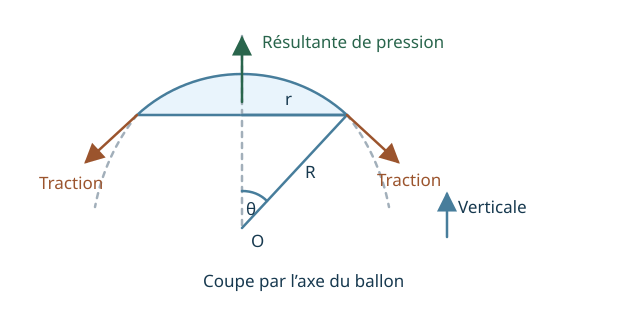

# Mines-Ponts PC — Physique 2 2025 · Corrigé brut

*Corrigé rédigé par IA, non officiel. Signalez toute erreur.*

## I — Ballon-sonde dans l’atmosphère

### I.A — Pesanteur et pression en altitude

### Question 1

La symétrie sphérique et le théorème de Gauss gravitationnel, appliqué à une sphère de rayon $R_T+z$, donnent $g(z)=GM_T/(R_T+z)^2$. Ainsi $g(z)/g_0=(1+z/R_T)^{-2}$.

Pour $u\ge0$, $1-(1+u)^{-2}\le2u$. Entre le sol et $h=14\,\mathrm{km}$, l’écart relatif est donc au plus $2h/R_T=28/6400\simeq0{,}0044$, soit **$0{,}44\,\%$**, inférieur à $0{,}5\,\%$.

### Question 2

Sur une colonne de section $S$, en prenant la pression nulle au sommet de l’atmosphère, $P(z)S=Sg\int_z^{+\infty}\rho(z')\,\mathrm dz'$. La dérivée donne $\mathrm dP=-\rho g\,\mathrm dz$. La loi des gaz parfaits locale donne $\rho=M_{\mathrm{air}}P/[RT_0(1-\alpha z)]$, où $T(z)=T_0(1-\alpha z)$.

$$
\frac{\mathrm dP}{P}=-\frac{1}{1-z/H_1}\frac{\mathrm dz}{H_0}.
$$

On a posé
$$
H_0=\frac{RT_0}{M_{\mathrm{air}}g},\; H_1=\frac1\alpha.
$$

Avec $T_0=300\,\mathrm K$ et $M_{\mathrm{air}}=0{,}029\,\mathrm{kg\,mol^{-1}}$, on obtient $H_0\simeq8{,}8\,\mathrm{km}$. Comme $T(h)=209\,\mathrm K$, $H_1=hT_0/[T_0-T(h)]\simeq46\,\mathrm{km}$.

### Question 3

L’intégration donne $\ln[P(z)/P_0]=(H_1/H_0)\ln(1-z/H_1)$. Donc $P(z)=P_0(1-z/H_1)^k$ où $k=H_1/H_0\simeq5{,}2$. Avec les approximations du formulaire, le facteur en altitude est $(210/300)^5\simeq0{,}15$. Avec les valeurs moins arrondies, il vaut environ $0{,}15$ également. On trouve **$P(h)\simeq0{,}15\,\mathrm{bar}$**.

### I.B — Stabilité d’une atmosphère sans vent

### Question 4

La résultante des pressions sur une parcelle de volume $V$ est $\rho_{\mathrm{air}}(z)gV\vec e_z$, c’est la poussée d’Archimède dans l’approximation d’une parcelle petite. Son poids est $-\rho_S(z)gV\vec e_z$. Leur somme vaut
$$
\vec F=gV[\rho_{\mathrm{air}}(z)-\rho_S(z)]\vec e_z.
$$

### Question 5

Avec $m=\rho_S(z)V$ constant, la seconde loi de Newton donne
$$
\ddot z=g\left[\frac{\rho_{\mathrm{air}}(z)}{\rho_S(z)}-1\right].
$$
À pression égale, pour le même gaz, la parcelle plus froide est plus dense. À la suite d’un déplacement vers le haut, son accélération est alors dirigée vers le bas. L’effet est restaurateur. Un tel comportement pour les petits déplacements décrit une stratification localement stable.

### Question 6

Posons $\eta=z-z_0$ et $\rho_0=\rho_{\mathrm{air}}(z_0)=\rho_S(z_0)$. Par définition des hauteurs relatives, $\rho_{\mathrm{air}}(z)\simeq\rho_0(1-\eta/h_{\mathrm{air}})$ et $\rho_S(z)\simeq\rho_0(1-\eta/h_S)$. Diviser ces deux expressions au premier ordre donne
$$
\frac{\rho_{\mathrm{air}}}{\rho_S}-1\simeq-\left(\frac1{h_{\mathrm{air}}}-\frac1{h_S}\right)\eta.
$$
Il vient $\ddot\eta+N^2\eta=0$, où $N^2=g(1/h_{\mathrm{air}}-1/h_S)$, toutes les hauteurs étant évaluées en $z_0$. En revenant à $z$, on a $\ddot z+N^2z=N^2z_0$.

### Question 7

La loi des gaz parfaits donne $\rho_{\mathrm{air}}(z)=\rho_{\mathrm{air}}(0)(1-\alpha z)^{k-1}$. Ainsi
$$
-\frac{\mathrm d}{\mathrm dz}\ln\rho_{\mathrm{air}}(z)
=\frac{(k-1)\alpha}{1-\alpha z}.
$$
On obtient $\displaystyle h_{\mathrm{air}}=\frac{T(z)/T_0}{(k-1)\alpha}$.

### Question 8

À masse fixée, $PV^\gamma=\mathrm{constante}$ implique $P/\rho^\gamma=P_0/\rho_0^\gamma$ pour une évolution adiabatique réversible. Comme la pression de la parcelle suit $P(z)$, $\mathrm d\ln\rho_S=\mathrm d\ln P/\gamma$. La dérivée logarithmique du profil de pression donne
$$
-\frac{\mathrm d}{\mathrm dz}\ln\rho_S(z)=\frac{k\alpha}{\gamma(1-\alpha z)}.
$$
Donc $\displaystyle h_S=\frac{\gamma}{k\alpha}\frac{T(z)}{T_0}$.

### Question 9

On trouve
$$
N^2=\frac{g\alpha}{1-\alpha z_0}\left(k-1-\frac{k}{\gamma_{\mathrm{air}}}\right).
$$
Avec $k=5$ et $\gamma_{\mathrm{air}}=7/5$, le terme entre parenthèses vaut $4-25/7=3/7>0$. Le déplacement vertical de faible amplitude est oscillatoire dans le modèle linéarisé. Cette atmosphère sans vent est **stable**.

### I.C — Forces exercées sur un ballon

### Question 10

Pour $F_v\propto \rho_{\mathrm{air}}^a v^b R^c$, les dimensions en masse et temps imposent $a=1$ et $b=2$. L’homogénéité en longueur donne $-3a+b+c=1$, soit $c=2$. Ainsi
$$
F_v=K\rho_{\mathrm{air}}v^2R^2,
$$
où $K$ est sans dimension. Dans une convention aérodynamique usuelle, $K=\pi C_D/2$. L’analyse dimensionnelle ne fournit pas ce coefficient.

### Question 11

Pour obtenir le rapport en fonction des seules variables demandées, on assimile le poids à celui du gaz, en négligeant enveloppe et charge. À pression et température communes, $\rho_{\mathrm{He}}=d\rho_{\mathrm{air}}$. Le poids vaut alors $\Pi=(4\pi/3)R^3d\rho_{\mathrm{air}}g$.

$$
x=\frac{3K}{4\pi}\frac{v^2}{d g R},
\; R_c=\frac{3K}{4\pi}\frac{v^2}{d g}.
$$
Le vent exerce une force supérieure au poids si $R<R_c$. Pour $v\simeq33\,\mathrm{m\,s^{-1}}$, $d\simeq0{,}14$ et un coefficient $K$ d’ordre unité, $R_c$ est de l’ordre de $2\times10^2\,\mathrm m$, à un facteur aérodynamique près.

Une enveloppe ou une charge appréciable augmente le poids et diminue le rapport $x$ à rayon fixé.

### Question 12

À la limite d’ascension quasi statique, $m_{\mathrm{env+instr}}\le V\rho_{\mathrm{air}}(P_{\min},T_{\min})-m_{\mathrm{H_2}}$. Le manomètre et le thermomètre donnent les conditions de l’air extérieur à l’altitude maximale, avec $T_{\min}=255\,\mathrm K$. La masse d’air déplacée vaut
$$
V\frac{M_{\mathrm{air}}P_{\min}}{RT_{\min}}\simeq1{,}9\,\mathrm{kg}.
$$
Pour un ballon **rigide et fermé** gonflé au sol, la quantité de gaz reste celle du remplissage. À $P_0=1\,\mathrm{bar}$ et $T_0=300\,\mathrm K$, $m_{\mathrm{H_2}}=VM_{\mathrm{H_2}}P_0/(RT_0)\simeq0{,}32\,\mathrm{kg}$. La masse maximale cherchée est donc **$1{,}6\,\mathrm{kg}$** dans le modèle à enceinte fermée de l’énoncé.

### I.D — Ballons à enveloppe élastique

### Question 13

La traction exercée sur la calotte par le bas est tangente et sa composante verticale vaut $-\xi\sin\theta\,\mathrm d\ell$. En intégrant le long du cercle de longueur $2\pi r$,
$$
\vec f=-2\pi r\xi\sin\theta\,\vec e_z
=-2\pi R\xi\sin^2\theta\,\vec e_z.
$$
Pour les pressions, la projection orthogonale de la calotte est le disque de rayon $r$. L’intégrale de la composante verticale de la normale vaut donc $\pi r^2$. En tenant les pressions uniformes à l’échelle de la calotte, on a $\vec F_p=(P_i-P_e)\pi r^2\vec e_z$.

### Question 14

La membrane est de masse négligeable, donc $(P_i-P_e)\pi r^2=2\pi r\xi\sin\theta$. Pour un cercle de rayon non nul, la relation $r=R\sin\theta$ donne
$$
\boxed{P_i=P_e+\frac{2\xi}{R}.}
$$
Il s’agit du saut de pression pour la membrane sphérique unique du modèle.

### Question 15

Au sol, $P_1-P_0=1{,}0\times10^5\,\mathrm{Pa}$. Ainsi
$$
\xi=\frac{(P_1-P_0)R_1}{2}=1{,}0\times10^5\,\mathrm{N\,m^{-1}}.
$$
Le paramètre sans dimension $\beta=2\xi/(P_0R_1)$ vaut 1.

### Question 16

Comme $V$ est proportionnel à $R^3$, la loi de Laplace donne $P_i=P_1x^{3\gamma_{\mathrm{He}}}$, avec $x=R_1/R$.

La valeur initiale vérifie $P_1=P_0(1+\beta)$. Le saut de pression s’écrit $P_i=P_e+2\xi x/R_1$. En divisant par $P_0$ et en notant $\delta(z)=P_e(z)/P_0$,
$$
\psi(x)=(1+\beta)x^{3\gamma_{\mathrm{He}}}-\beta x
=\delta(z).
$$
Avec $\beta=1$ et $3\gamma_{\mathrm{He}}=5$, $\psi(x)=2x^5-x$. La branche où $\psi$ est positive satisfait $x>2^{-1/4}$. Sur cette branche, $\psi'(x)=10x^4-1>0$.

Comme $\psi(1)=1$ et $0<\delta(z)<1$ en altitude, $x<1$. Ainsi $R>R_1$.

### Question 17

À $3$, $9$ et $15\,\mathrm{km}$, les traits de lecture sur la courbe de droite de la figure 4 donnent respectivement $\delta\simeq0{,}67$, $0{,}29$ et $0{,}11$.

Le report horizontal sur $\psi$, à gauche de la figure 4, donne environ $x=0{,}96$, $0{,}90$ et $0{,}87$. Avec $R=R_1/x$, il vient
$$
R(3\,\mathrm{km})\simeq2{,}1\,\mathrm m,\quad
R(9\,\mathrm{km})\simeq2{,}2\,\mathrm m,\quad
R(15\,\mathrm{km})\simeq2{,}3\,\mathrm m.
$$
À $15\,\mathrm{km}$, il s’agit du prolongement du profil retenu par l’énoncé pour la figure.

## II — Mesures météorologiques dans l’atmosphère

### II.A — Mesures de température

### Question 18

Notons $L=\ln(G/G^\ast)$. Pour une résistance de quelques kiloohms, $|L|$ est de l’ordre de $8$ à $10$.

Le rapport du terme cubique au terme linéaire vaut $CL^2/B$, de l’ordre de $0{,}02$ à $0{,}04$. Le terme cubique est donc une petite correction sur cette gamme. On utilise
$$
\frac{T^\ast}{T}\simeq A-B\ln(G/G^\ast).
$$
L’approximation suppose que $CL^2/B$ reste petit sur la gamme considérée.

### Question 19

Pour un conducteur cylindrique homogène, $G=\gamma_{\mathrm{el}}s/\ell$. La calibration approchée donne
$$
G\simeq G^\ast\exp(A/B)\exp[-T^\ast/(BT)].
$$
Pour une géométrie fixe, la conductivité varie donc comme $\exp[-\mathcal E/(k_BT)]$ avec $\mathcal E=k_BT^\ast/B$. Numériquement, $\mathcal E\simeq6{,}1\times10^{-20}\,\mathrm J$, soit **$0{,}38\,\mathrm{eV}$**.

### Question 20

Pour un champ constant, $m\dot{\vec v}=q\vec E-m\vec v/\tau$. La vitesse rejoint exponentiellement $\vec v_\infty=(q\tau/m)\vec E$ avec le temps caractéristique $\tau$. Le courant est alors
$$
\vec j=n_q q\vec v_\infty=\frac{n_q q^2\tau}{m}\vec E.
$$
Ainsi $\gamma_{\mathrm{el}}=n_q q^2\tau/m$. Le carré de $q$ explique le signe positif de la conductivité.

### Question 21

Dans le modèle à deux niveaux de l’énoncé, à un facteur de dégénérescence indépendant de $T$ près, $n_q/n_0\propto\exp[-E/(k_BT)]$. Si la bande de valence reste presque pleine et si $\tau$ est indépendante de $T$, la conductivité est proportionnelle à $n_q$ et possède la même énergie d’activation. On identifie **$E\simeq0{,}38\,\mathrm{eV}$** dans ce modèle. Cette identification utilise l’hypothèse imposée sur les populations, sans modèle de bandes détaillé.

### II.B — Mesures de l’humidité relative

### Question 22

Loin des bords, les armatures sont modélisées par des plans infinis. Les translations parallèles aux plans laissent leur distribution de charges invariante. Tout plan vertical passant par le point d’observation et contenant la normale $\vec e_z$ est un plan de symétrie de la distribution. L’intersection de deux tels plans impose $\vec E=E(z)\vec e_z$. Dans le vide entre les armatures, $\nabla\cdot\vec E=0$, donc $\mathrm dE/\mathrm dz=0$. Le champ est **uniforme et normal aux armatures**.

### Question 23

Pour une nappe unique de densité surfacique $\sigma$, une boîte de Gauss dont les deux bases de section $S_G$ sont à égale distance du plan donne $2ES_G=\sigma S_G/\varepsilon_0$. Le flux latéral est nul et le champ est dirigé vers l’extérieur si $\sigma>0$. Chaque nappe donne donc un champ de norme $|\sigma|/(2\varepsilon_0)$.

Dans la superposition des deux nappes de charges opposées, les champs s’ajoutent entre elles et se compensent à l’extérieur. Avec $\vec e_z$ orienté de l’armature positive vers la négative,
$$
\vec E=\frac{\sigma_0}{\varepsilon_0}\,\vec e_z.
$$

### Question 24

Avec $U_0=V_+-V_-$, la relation $\vec E=-\nabla V$ donne $U_0=Ee=\sigma_0e/\varepsilon_0$. La charge de l’armature positive est $Q_0=\sigma_0 S$. Par définition,
$$
C_0=\frac{Q_0}{U_0}=\frac{\varepsilon_0 S}{e}.
$$

### Question 25

Les $n_pSe$ molécules donnent un moment dipolaire total $\vec p_{\mathrm{tot}}=n_pSe\,p_m\vec e_z$. Deux nappes opposées de module de charge surfacique $\sigma$, séparées de $e$, donnent aussi $\vec p_{\mathrm{tot}}=\sigma Se\vec e_z$.

En identifiant, $\sigma=n_p p_m$. La face située du côté $+\vec e_z$ porte $+\sigma$ et l’autre $-\sigma$. Leur champ s’oppose au champ des armatures.

### Question 26

L’énergie d’interaction est minimale lorsque les dipôles sont orientés dans le sens de $\vec E$. À très basse température, $p_m$ tend vers $p_{\mathrm{H_2O}}$. À très haute température, les orientations deviennent presque équiprobables et la moyenne de la projection tend vers zéro. La transition est progressive. Son ordre de grandeur correspond à $k_BT_c\sim p_{\mathrm{H_2O}}E$, donc $T_c\sim p_{\mathrm{H_2O}}E/k_B$.

### Question 27

Le moment dipolaire s’exprime en $\mathrm{C\,m}$. D’après Gauss, $\varepsilon_0E$ a l’unité d’une charge surfacique, $\mathrm{C\,m^{-2}}$. La relation $p_m=\alpha\varepsilon_0E$ impose donc que **$\alpha$ s’exprime en $\mathrm{m^3}$**.

### Question 28

L’effet des nappes de polarisation est de retrancher $\sigma/\varepsilon_0$ au champ créé par les charges libres. Ainsi
$$
\varepsilon_0 E=\sigma_0-\sigma,\;
\sigma=n_p\alpha\varepsilon_0 E.
$$
Il vient $\sigma_0=(1+n_p\alpha)\varepsilon_0E$. Avec $U_0=Ee$ et $Q_0=\sigma_0S$, on obtient
$$
\boxed{C=(1+n_p\alpha)C_0,\; \varepsilon_r=1+n_p\alpha.}
$$
Le produit $n_p\alpha$ est sans dimension.

### II.C — Mesures de position et de vitesse

### Question 29

Posons $r=R_T+h$. La force de gravitation impose $v^2/r=GM_T/r^2$. Le mouvement est circulaire uniforme, avec $v=2\pi r/T$. On obtient
$$
\boxed{\frac{T^2}{(R_T+h)^3}=\frac{4\pi^2}{GM_T}.}
$$
C’est la **troisième loi de Kepler** pour des orbites circulaires autour de la Terre.

### Question 30

L’orbite géostationnaire correspond à une période d’environ $24\,\mathrm h$ et à un rayon orbital $R_T+36\,000\,\mathrm{km}$. Par Q29, le rayon GPS est ce rayon multiplié par $(12/24)^{2/3}\simeq0{,}63$. Ainsi
$$
h_{\mathrm{GPS}}\simeq0{,}63(6400+36\,000)-6400\simeq2{,}0\times10^4\,\mathrm{km}.
$$

### Question 31

Pour un électron de charge $-e$,
$$
m_e\dot{\vec v}=-e(\vec E+\vec v\times\vec B).
$$
Pour l’onde plane, $B=E/v_\varphi$ avec $v_\varphi\simeq c$. Le terme magnétique est au plus d’ordre $v/c$ par rapport au terme électrique. Au premier ordre, on l’omet et la dérivation harmonique fournit $i\omega m_e\vec v=-e\vec E$. Le courant électronique complexe s’écrit donc
$$
\vec j_e=-e n_e\vec v=-i\,\frac{n_e e^2}{m_e\omega}\vec E.
$$
Ici $\vec v$ désigne la vitesse oscillante locale, au premier ordre dans le champ.

### Question 32

La mobilité inertielle des ions est beaucoup plus faible que celle des électrons. Dans un plasma quasi neutre à ions lourds, leur contribution au courant oscillant est donc négligeable. Comme le modèle d’onde est transverse, $\nabla\cdot\vec E=0$. Le rotationnel de Maxwell–Faraday combiné à Maxwell–Ampère donne
$$
\Delta\vec E-\frac1{c^2}\frac{\partial^2\vec E}{\partial t^2}
=\mu_0\frac{\partial\vec j_e}{\partial t}.
$$
En régime harmonique, le membre de droite vaut $\mu_0n_e e^2\vec E/m_e$, d’où
$$
\boxed{k^2c^2=\omega^2-\omega_p^2,\;
\omega_p=\sqrt{\frac{n_e e^2}{\varepsilon_0m_e}}.}
$$

### Question 33

Pour $f>f_p$, $v_\varphi=c/\sqrt{1-(f_p/f)^2}>c$. L’erreur relative en prenant $c$ pour approximation de $v_\varphi$ vaut
$$
\frac{v_\varphi-c}{v_\varphi}
=1-\sqrt{1-(f_p/f)^2}\simeq\frac12(f_p/f)^2.
$$
Avec $f_p=8{,}9\,\mathrm{MHz}$, elle vaut $2{,}8\times10^{-5}$ à $1{,}2\,\mathrm{GHz}$ et $1{,}5\times10^{-5}$ à $1{,}6\,\mathrm{GHz}$.

Les vitesses valent donc environ $c(1+2{,}8\times10^{-5})$ et $c(1+1{,}5\times10^{-5})$. Une vitesse de phase supérieure à $c$ ne correspond pas à une transmission d’information supraluminique.

### Question 34

En dérivant la relation de dispersion, $v_g=\mathrm d\omega/\mathrm dk=c\sqrt{1-(f_p/f)^2}$. Pour un parcours vertical d’épaisseur $L=700\,\mathrm{km}$,
$$
\Delta t=L\left(\frac1{v_g}-\frac1c\right)
\simeq \frac{L}{2c}(f_p/f)^2.
$$
On obtient $\Delta t\simeq6{,}4\times10^{-8}\,\mathrm s$ à $1{,}2\,\mathrm{GHz}$ et $3{,}6\times10^{-8}\,\mathrm s$ à $1{,}6\,\mathrm{GHz}$. La distance estimée en multipliant le temps par $c$ est surestimée de $c\Delta t$, environ **19 m et 11 m** respectivement. Une interprétation fondée sur le suivi de la phase ferait apparaître une avance plutôt qu’un retard, avec le même module au premier ordre.

### Question 35

Au premier ordre, les deux pseudodistances peuvent s’écrire $D_1=D+A/f_1^2$ et $D_2=D+A/f_2^2$. Le coefficient $A$ représente la quantité intégrée d’électrons le long du trajet commun et peut varier. Multiplier chaque mesure par $f_i^2$, puis faire la différence, élimine $A$.
$$
\boxed{D=\frac{f_2^2D_2-f_1^2D_1}{f_2^2-f_1^2}.}
$$
Deux fréquences permettent ainsi de corriger le retard ionosphérique dominant à partir des mesures elles-mêmes.

FIN
