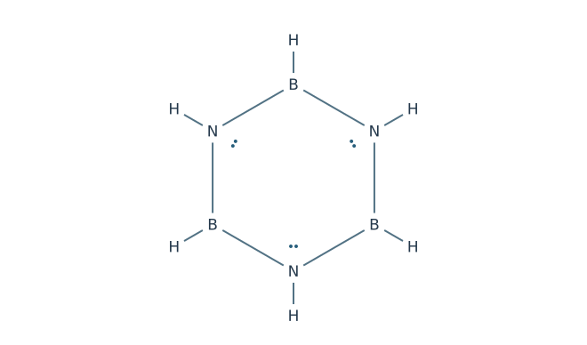
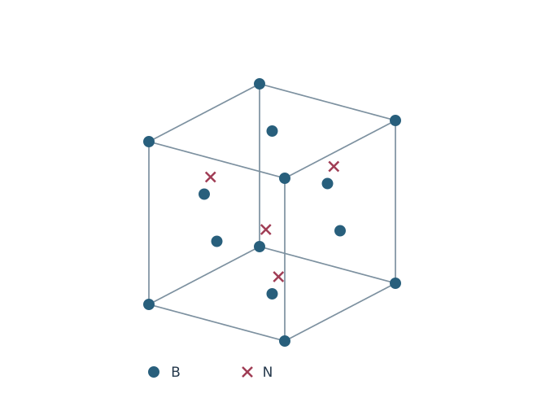

# Mines-Ponts PSI — Chimie 2025 · Corrigé brut

*Corrigé rédigé par IA, non officiel. Signalez toute erreur.*

## I — Le nitrure de bore

### Question 1

Le bore appartient au groupe 13 et a 3 électrons de valence. L’azote appartient au groupe 15 et en a 5. L’hydrogène a un électron de valence.

### Question 2

Le cycle alterne trois B et trois N. Chaque atome du cycle porte un H. Dans la représentation sans charges formelles, on place six liaisons simples B–N, six liaisons avec H et un doublet non liant sur chacun des trois N. Les 30 électrons de valence sont ainsi répartis en quinze doublets. Chaque B a six électrons autour de lui et peut accepter de la densité électronique provenant de ses voisins N.

### Question 3

Autour du bore, les trois doublets liants et l’absence de doublet non liant donnent une géométrie trigonale plane de type $\mathrm{AX_3}$. Autour de l’azote, le schéma de Lewis à doublet localisé conduit formellement à $\mathrm{AX_3E}$, donc à une géométrie pyramidale trigonale dans cette application du modèle VSEPR. Dans la borazine réelle, le doublet est conjugué avec les orbitales vacantes des atomes de bore. Les environnements des azotes sont alors eux aussi trigonaux plans. Les formes mésomères avec des liaisons B=N rendent compte de cette délocalisation.

### Question 4

B et N sont dans la même période. L’azote est à droite du bore. La charge nucléaire effective augmente sur cette portion de la période et les électrons de liaison sont davantage attirés par N. L’azote est donc le plus électronégatif.

### Question 5

Le bore occupe les sommets et centres de faces d’une maille cubique. Les quatre sites tétraédriques occupés par N ont pour coordonnées réduites
$$
(1/4,1/4,1/4),\quad(1/4,3/4,3/4),\quad
(3/4,1/4,3/4),\quad(3/4,3/4,1/4).
$$
Les liaisons B–N sont des liaisons principalement covalentes polarisées vers N. Le réseau s’étend dans les trois directions.

### Question 6

Les sommets appartiennent à huit mailles et les centres de faces à deux. Il y a donc $8/8+6/2=4$ atomes de B. Les quatre sites N sont entièrement intérieurs, soit quatre motifs BN par maille.

La coordinence est le nombre de plus proches voisins d’un atome. Chaque N occupe le centre d’un tétraèdre de quatre B. Réciproquement, chaque B a quatre N à la même distance, en tenant compte des mailles voisines. Les deux coordinences valent 4.

### Question 7

Entre B en $(0,0,0)$ et N en $(1/4,1/4,1/4)$, la distance vaut $a\sqrt3/4$. Le contact donne
$$
a=\frac{4(r_{\rm B}+r_{\rm N})}{\sqrt3}
 =\frac{600}{\sqrt3}\,\mathrm{pm}.
$$
L’approximation $\sqrt3\simeq7/4$ prescrite dans l’annexe donne $a\simeq343\,\mathrm{pm}$. Une valeur plus précise de la racine donne $346\,\mathrm{pm}$. La distance B–B minimale vaut $a/\sqrt2$, supérieure à $2r_{\rm B}$.

### Question 8

La masse d’une maille est $4(M_{\rm B}+M_{\rm N})/N_{\rm A}$. Ainsi
$$
\rho=\frac{4(M_{\rm B}+M_{\rm N})}{N_{\rm A}a^3}
=\frac{0{,}10\,\mathrm{kg\,mol^{-1}}}{(6\times10^{23}\,\mathrm{mol^{-1}})a^3}.
$$
On a utilisé $M_{\rm B}+M_{\rm N}=25\times10^{-3}\,\mathrm{kg\,mol^{-1}}$. Avec $a=600/(7/4)\,\mathrm{pm}$ conservé avant arrondi, $\rho\simeq4{,}14\times10^3\,\mathrm{kg\,m^{-3}}$. La racine plus précise donne $4{,}01\times10^3\,\mathrm{kg\,m^{-3}}$ avec les mêmes données.

## II — Le carbure de zirconium

### Question 9

Dans $\mathrm{Zr(s)}$, le nombre d’oxydation de Zr est 0. Il vaut $+\mathrm{IV}$ dans $\mathrm{Zr^{4+}}$ et dans $\mathrm{ZrO_2}$.

Dans $\mathrm{HZrO_3^-}$, le bilan $1+x-6=-1$ donne aussi $+\mathrm{IV}$.

### Question 10

Le domaine A, de potentiels plus faibles, est celui de $\mathrm{Zr(s)}$. B et C correspondent au degré $+\mathrm{IV}$. La frontière verticale marque un équilibre sans transfert d’électrons. Le domaine B à faible pH correspond à $\mathrm{Zr^{4+}}$ et C, à pH plus élevé sur le diagramme représenté, à $\mathrm{ZrO_2(s)}$. L’espèce $\mathrm{HZrO_3^-}$ est favorisée seulement à pH encore plus basique, comme le montre Q13.

### Question 11

Sur A–B, considérons $\mathrm{Zr^{4+}}+4e^-\rightleftharpoons\mathrm{Zr(s)}$. Le potentiel lu vaut $-1{,}50\,\mathrm V$. La loi de Nernst donne
$$
-1{,}50=-1{,}44+\frac{0{,}06}{4}\log_{10}(c_0/c^\circ).
$$
Donc $\log_{10}(c_0/c^\circ)=-4$ et $c_0=10^{-4}\,\mathrm{mol\,L^{-1}}$. On retrouve ce résultat en appliquant $K_1=1/[a(\mathrm{Zr^{4+}})a(\mathrm{HO^-})^4]$ à la frontière verticale de pH 1,25.

### Question 12

La demi-équation de réduction est
$$
\mathrm{ZrO_2(s)+4H^++4e^-\rightleftharpoons Zr(s)+2H_2O}.
$$
Les solides purs et l’eau liquide ont une activité unité. Le terme de Nernst lié au pH vaut $(0{,}06/4)\log_{10}(a_{\mathrm{H^+}}^4)=-0{,}06\,\mathrm{pH}$. Donc $b=-0{,}060\,\mathrm V$ par unité de pH.

### Question 13

À l’équilibre $\mathrm{ZrO_2(s)+HO^-\rightleftharpoons HZrO_3^-}$, on a $K_2=a(\mathrm{HZrO_3^-})/a(\mathrm{HO^-})$. Avec $a(\mathrm{HZrO_3^-})=10^{-4}$ et $K_2=10^{-5}$, il faudrait $a(\mathrm{HO^-})=10$.

À 298 K, $\mathrm{pH}=14+\log_{10}a(\mathrm{HO^-})=15$. Cette valeur formelle dépasse le domaine tracé, ce qui explique l’absence de $\mathrm{HZrO_3^-}$.

### Question 14

Les demi-équations sont
$$
\begin{aligned}
\mathrm{2H^++2e^-}&\rightleftharpoons\mathrm{H_2(g)},\\
\mathrm{O_2(g)+4H^++4e^-}&\rightleftharpoons\mathrm{2H_2O}.
\end{aligned}
$$
Aux pressions standard, la loi de Nernst à 298 K donne
$$
\begin{aligned}
E_{\mathrm{H^+/H_2}}&=-0{,}060\,\mathrm{pH},\\
E_{\mathrm{O_2/H_2O}}&=1{,}23-0{,}060\,\mathrm{pH},
\end{aligned}
$$
avec $E$ en volts.

### Question 15

Le domaine A se situe sous la droite $\mathrm{H^+/H_2}$ sur toute la plage tracée. Il n’y a pas de domaine commun à l’eau et au zirconium métallique. L’eau ou les ions $\mathrm{H^+}$ peuvent être réduits, tandis que le métal s’oxyde. Les bilans suivant le domaine du produit oxydé sont
$$
\begin{aligned}
\mathrm{Zr(s)+4H^+}&\longrightarrow\mathrm{Zr^{4+}+2H_2(g)},\\
\mathrm{Zr(s)+2H_2O}&\longrightarrow\mathrm{ZrO_2(s)+2H_2(g)}.
\end{aligned}
$$
En eau aérée, le dioxygène dissous peut aussi jouer le rôle d’oxydant. On peut écrire
$$
\begin{aligned}
\mathrm{Zr(s)+O_2+4H^+}&\longrightarrow\mathrm{Zr^{4+}+2H_2O},\\
\mathrm{Zr(s)+O_2}&\longrightarrow\mathrm{ZrO_2(s)}.
\end{aligned}
$$
La conclusion est thermodynamique. La formation d’une couche d’oxyde peut ralentir la corrosion.

## III — Oxydation du carbure de zirconium

### Question 16

La loi de Hess donne, par mole d’avancement,
$$
\Delta_rH^\circ=-1100-400-(-200)-2(0)
=-1300\,\mathrm{kJ\,mol^{-1}}.
$$
La réaction est exothermique.

### Question 17

$$
\Delta_rS^\circ=50+210-30-2(200)
=-170\,\mathrm{J\,mol^{-1}\,K^{-1}}.
$$
On consomme deux moles de gaz pour en former une. Cette diminution du nombre de particules gazeuses est cohérente avec la diminution d’entropie.

### Question 18

Dans l’approximation d’Ellingham, les deux grandeurs précédentes sont indépendantes de la température. À 300 K,
$$
\begin{aligned}
\Delta_rG^\circ&=\Delta_rH^\circ-T\Delta_rS^\circ\\
&=-1300+51=-1249\,\mathrm{kJ\,mol^{-1}}.
\end{aligned}
$$

### Question 19

$$
\ln K^\circ=-\frac{\Delta_rG^\circ}{RT}
\simeq \frac{1{,}249\times10^6}{8\times300}
\simeq520.
$$
Ainsi $\log_{10}K^\circ\simeq226$ et $K^\circ\simeq10^{226}$, à l’échelle des approximations de l’énoncé. L’équilibre est très fortement déplacé vers les produits. On peut alors considérer l’oxydation comme totale pour le réactif limitant, sous réserve que la réaction soit cinétiquement accessible.

### Question 20

La relation de Van’t Hoff donne $\mathrm d\ln K^\circ/\mathrm dT=\Delta_rH^\circ/(RT^2)<0$. La constante d’équilibre diminue quand la température augmente.

### Question 21

Avec deux solides purs et des gaz idéaux, le quotient de réaction vaut
$$
Q_r=\frac{p_{\mathrm{CO_2}}/p^\circ}{(p_{\mathrm{O_2}}/p^\circ)^2}
=\frac{y_{\mathrm{CO_2}}}{y_{\mathrm{O_2}}^2}\frac{p^\circ}{P}.
$$
À composition instantanément fixée, une compression augmente $P$ et abaisse $Q_r$. Si le système était à l’équilibre, la compression donne $Q_r<K^\circ$ et provoque une évolution vers les produits. Une hausse de pression par ajout de gaz inerte à volume constant laisserait les pressions partielles des réactifs et produits inchangées.

### Question 22

Une température basse et une pression élevée favorisent l’oxydation à l’équilibre. Augmenter la pression partielle de dioxygène ou évacuer le dioxyde de carbone abaisse également $Q_r$. En pratique, on cherche une température qui permette une vitesse suffisante, puisque l’équilibre seul ne fixe pas la durée d’oxydation.
