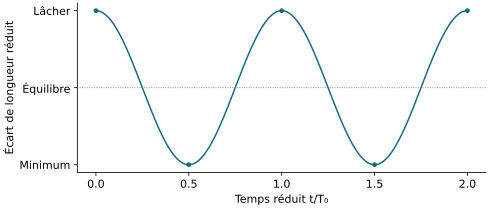
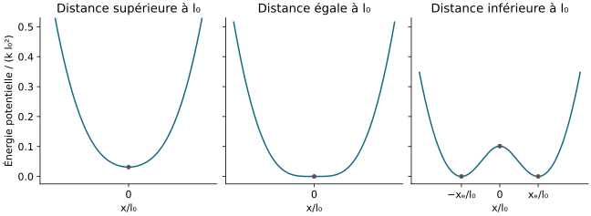
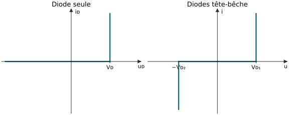
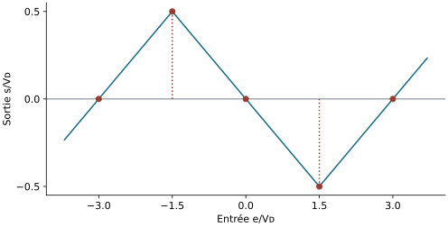

# Mines-Ponts PSI — Physique 2 2025 · Corrigé brut

*Corrigé rédigé par IA, non officiel. Signalez toute erreur.*

## Présentation du sujet

L’épreuve de quatre heures sans calculatrice relie un oscillateur mécanique à un circuit analogique. La première partie étudie le rôle de la masse du ressort et celui de la géométrie. La seconde construit l’équivalent électrique, puis examine les effets des courants d’entrée.

## I — Oscillateur mécanique

### Question 1

L’axe étant dirigé vers le bas, la force élastique projetée est $-k(l-l_0)$. Comme elle vaut $-\mathrm dE_{p,k}/\mathrm dl$, l’intégration depuis $l_0$ donne
$$
E_{p,k}=\frac12k(l-l_0)^2.
$$

### Question 2

Le poids a pour projection $+mg$. L’origine en $O$, où $l=0$, donne $E_{p,p}=-mgl$ par intégration de $-\mathrm dE_{p,p}/\mathrm dl=mg$.

### Question 3

L’énergie mécanique est la somme des trois contributions,
$$
E_m=\frac12m\dot l^2+\frac12k(l-l_0)^2-mgl.
$$
Elle est conservée en l’absence de frottement.

### Question 4

La deuxième loi de Newton projetée sur l’axe vertical donne
$$
m\ddot l=mg-k(l-l_0).
$$
La force est nulle à la longueur d’équilibre $l_e=l_0+mg/k$.

### Question 5

En posant $\omega_0=\sqrt{k/m}$, on a $\ddot{(l-l_e)}+\omega_0^2(l-l_e)=0$. Les conditions initiales donnent
$$
l(t)=l_e+(L-l_e)\cos(\omega_0t).
$$
La longueur minimale vaut $l_e-|L-l_e|$. Pour qu’elle reste strictement positive, il faut $0<L<2(l_0+mg/k)$. À l’égalité, la masse atteint le support.

L’oscillation est harmonique, sauf pour $L=l_e$, où le point reste à l’équilibre. La période vaut $T_0=2\pi\sqrt{m/k}=2{,}00\,\mathrm s$ avec les données.

### Question 6

L’élément de masse vaut $\mathrm dm=(m_r/l)\mathrm dz$. On intègre l’énergie potentielle élémentaire $-gz\,\mathrm dm$ de zéro à $l$. Le résultat est $E_{p,p}^{(r)}=-m_rgl/2$. Il correspond au poids du ressort appliqué au milieu.

### Question 7

Le profil linéaire des vitesses entre l’extrémité fixe et celle de vitesse $\dot l$ donne $v(z)=(z/l)\dot l$. L’énergie cinétique du ressort vaut
$$
E_c^{(r)}=\int_0^l\frac12\left(\frac zl\dot l\right)^2\frac{m_r}{l}\,\mathrm dz
=\frac16m_r\dot l^2.
$$

### Question 8

En additionnant les contributions,
$$
E_m=\frac12(m+m_r/3)\dot l^2+\frac12k(l-l_0)^2-(m+m_r/2)gl.
$$

### Question 9

La dérivée temporelle de l’énergie est nulle. Sur les intervalles où $\dot l\ne0$, la division par $\dot l$ donne
$$
(m+m_r/3)\ddot l+k(l-l_0)-(m+m_r/2)g=0.
$$
L’équation s’étend par continuité aux points de rebroussement. La solution constante d’équilibre correspond au minimum du potentiel. Le ressort ajoute $m_r/3$ à la masse inertielle et $m_r/2$ à la masse intervenant dans le terme de pesanteur.

### Question 10

La nouvelle longueur d’équilibre est $l_{e1}=l_0+(m+m_r/2)g/k$. Avec $\omega_1=\sqrt{k/(m+m_r/3)}$,
$$
l(t)=l_{e1}+(L-l_{e1})\cos(\omega_1t).
$$
Le mouvement est harmonique si l’amplitude est non nulle et tant que le support n’est pas atteint. La période vaut
$$
T_1=T_0\sqrt{1+\frac{m_r}{3m}}
\simeq T_0\left(1+\frac{m_r}{6m}\right)
=2{,}04\,\mathrm s.
$$

### Question 11

En rapportant l’écart à $T_0$, il faut $\sqrt{1+m_r/(3m)}-1\leq0{,}01$. D’où
$$
m_r\leq3m[(1{,}01)^2-1].
$$
La limite est environ $18{,}1\,\mathrm g$, ou $18\,\mathrm g$ au premier ordre. Les $36\,\mathrm g$ de Q10 dépassent cette limite.

### Question 12

Le mouvement est horizontal et la pesanteur garde l’énergie potentielle nulle choisie en $O'$. D’après Pythagore, la longueur du ressort vaut $\sqrt{x^2+l_c^2}$. Ainsi
$$
E_{p,P}(x)=\frac12k(\sqrt{x^2+l_c^2}-l_0)^2.
$$

### Question 13

Pour $l_c>0$, la dérivée vaut $kx(1-l_0/\sqrt{x^2+l_c^2})$. Les équilibres sont les zéros de cette expression.

- Si $l_c>l_0$, seul $x_e=0$ existe. C’est un minimum strict, de valeur $k(l_c-l_0)^2/2$, donc un équilibre stable.
- Si $l_c=l_0$, seul $x_e=0$ existe encore. Le minimum strict a une valeur nulle et un comportement quartique près de zéro. L’équilibre est stable malgré une courbure nulle.
- Si $l_c<l_0$, $x_e=0$ est un maximum local instable. Les deux minima stables de valeur nulle sont $x_e=\pm\sqrt{l_0^2-l_c^2}$. Le maximum vaut $k(l_0-l_c)^2/2$.

### Question 14

Lorsque $l_c<l_0$, le maximum local sépare les deux minima. La différence entre son énergie et celle du fond d’un puits est la hauteur de la barrière,
$$
U_b=\frac12k(l_0-l_c)^2.
$$

### Question 15

Les forces de pesanteur et de guidage n’ont pas de composante horizontale. La force du ressort projetée selon $\vec u_x$ est l’opposé de la dérivée du potentiel. D’où
$$
m\ddot x=-\frac{\mathrm dE_{p,P}}{\mathrm dx}
=-kx\left(1-\frac{l_0}{\sqrt{x^2+l_c^2}}\right).
$$
La dérivée elle-même est donc l’opposé de la composante de la force suivant $\vec u_x$.

### Question 16

Avec $F(x)=-kx(1-l_0/\sqrt{x^2+l_c^2})$ la composante horizontale, le système est $\dot u_0=u_1$ et $\dot u_1=F(u_0)/m$. Le pas d’Euler explicite évalue les deux dérivées au temps $t_n$,
$$
\begin{aligned}
u_{0,n+1}&=u_{0,n}+\Delta t\,u_{1,n},\\
u_{1,n+1}&=u_{1,n}+\Delta t\,F(u_{0,n})/m.
\end{aligned}
$$
On initialise $u_{0,0}=x(0)$ et $u_{1,0}=\dot x(0)$.

### Question 17

Dans le cas A, la position varie approximativement entre $-2$ et $2\,\mathrm m$ avec une période de $3{,}5\,\mathrm s$. Elle traverse le sommet de la barrière et visite les deux puits. La vitesse a deux extrema de même signe pendant une traversée, au voisinage des deux minima de potentiel. Son module est plus petit au sommet de la barrière car l’énergie cinétique y diminue. Le mouvement périodique est anharmonique.

Dans le cas B, la position reste dans le puits droit et varie d’environ $0{,}960$ à $1{,}000\,\mathrm m$. La période est voisine de $2{,}0\,\mathrm s$. La position et la vitesse sont presque sinusoïdales et en quadrature, comme pour un mouvement harmonique de faible amplitude.

### Question 18

Dans le puits droit, $x_e=\sqrt{l_0^2-l_c^2}$. Pour des oscillations de faible amplitude, la moyenne est proche de $x_e$ et la raideur locale est $E_{p,P}''(x_e)=k x_e^2/l_0^2$. On obtient
$$
\begin{aligned}
\langle x\rangle&\simeq\sqrt{l_0^2-l_c^2}\simeq0{,}980\,\mathrm m,\\
T_2&=\frac{T_0}{\sqrt{1-l_c^2/l_0^2}}\simeq2{,}04\,\mathrm s.
\end{aligned}
$$
La figure 3 donne environ $0{,}98\,\mathrm m$ et $2{,}0$ à $2{,}1\,\mathrm s$. L’accord est cohérent avec la faible amplitude du cas B.

### Question 19

Le cas A exige une énergie initiale strictement supérieure à la hauteur de la barrière. Avec une vitesse initiale nulle, cela donne
$$
|\sqrt{X_0^2+l_c^2}-l_0|>l_0-l_c.
$$
La branche correspondant à $\sqrt{X_0^2+l_c^2}<l_c$ est impossible. Il reste $\sqrt{X_0^2+l_c^2}>2l_0-l_c$, soit $X_0>2\sqrt{l_0(l_0-l_c)}\simeq1{,}79\,\mathrm m$. À l’égalité, la trajectoire se rapproche du sommet instable sans le franchir en temps fini.

### Question 20

La dérivée du potentiel est impaire. Le développement limité valable pour $|x|\ll l_c$ donne
$$
\frac{\mathrm dE_{p,P}}{\mathrm dx}=
k\left(1-\frac{l_0}{l_c}\right)x+\frac{kl_0}{2l_c^3}x^3+O(x^5).
$$
Ainsi $\alpha_m$ a le signe de $l_c-l_0$ et $\beta_m>0$. À $l_c=l_0$ le premier terme est nul. Le modèle cubique n’est pas exact à grande amplitude car le terme de rappel exact redevient asymptotiquement linéaire. L’équation approchée est $m\ddot x+\alpha_m x+\beta_m x^3=0$.

## II — Oscillateur électrique

### Question 21

Notons $z$ la sortie de A1. Les nœuds inverseurs sont à la masse virtuelle et aucun courant n’entre dans les ALI idéaux. A1 donne $\dot z=-x/(R_1C_1)$, A2 inverse $z$ et A3 donne $\dot x=z/(R_2C_2)$. D’où
$$
\ddot x+\frac{x}{R_1R_2C_1C_2}=0.
$$
Le circuit correspond à un oscillateur harmonique non amorti, comme le ressort vertical dans le modèle linéaire.

### Question 22

La résistance parallèle ajoute $-z/R_0$ au bilan du nœud A1. On a $C_1\dot z=-x/R_1-z/R_0$. La relation de A3 reste inchangée. Il vient
$$
\ddot x+\frac{\dot x}{R_0 C_1}+\frac{x}{R_1R_2C_1C_2}=0.
$$
Le terme positif en vitesse correspond à un frottement visqueux. Selon la valeur de $R_0$, la réponse libre peut être oscillante amortie ou apériodique.

### Question 23

Pour la diode seule, le blocage donne $i_d=0$ si $u_d<V_D$. La conduction donne une demi-droite verticale $u_d=V_D$, $i_d\geq0$. Le point seuil est commun aux deux branches.

Pour le dipôle, la diode 1 voit $u$ et la diode 2 voit $-u$. À l’intérieur de l’intervalle $(-V_{D2},V_{D1})$, les deux sont bloquées.

Pour $i>0$, la diode 1 conduit et impose $u=V_{D1}$, tandis que la diode 2 est bloquée. Pour $i<0$, la diode 2 conduit et impose $u=-V_{D2}$, tandis que la diode 1 est bloquée. Il n’existe pas de point de fonctionnement au-delà des deux tensions idéales de blocage.

### Question 24

Posons $a=R_5/(R_4+R_5)$ et $r=R_6/R_3$. Les deux entrées de A4 sont à la tension $ae$. Dans la zone centrale sans courant dans les diodes, la loi des nœuds donne $(e-ae)/R_3=(ae-s)/R_6$. Cela impose $ae-s=r(1-a)e$. La limite de cette zone est donc $E_D=V_D/[r(1-a)]$.

Pour $e>E_D$, la diode 1 conduit de l’entrée inverseuse vers la sortie. Elle bloque l’écart à $+V_D$. Pour $e<-E_D$, la diode 2 conduit en sens inverse et bloque l’écart à $-V_D$. Les trois expressions sont
$$
s(e)=
\begin{cases}
ae+V_D,& e<-E_D,\\
[a-r(1-a)]e,& |e|\leq E_D,\\
ae-V_D,& e>E_D.
\end{cases}
$$
Les valeurs coïncident aux raccords. Le courant dans chaque diode passante a le signe requis car le courant excédentaire au-delà de celui dans $R_6$ croît en module à partir du seuil.

### Question 25

Ici $a=1/3$, $r=1$ et $E_D=3V_D/2$. La pente vaut $-1/3$ au milieu et $+1/3$ de part et d’autre.

Le maximum local est $(-3V_D/2,+V_D/2)$, le minimum $(3V_D/2,-V_D/2)$. Les zéros sont aux abscisses $-3V_D$, $0$ et $3V_D$.

### Question 26

La courbe réelle est presque impaire, avec une pente centrale négative et deux pentes extérieures positives. Les transitions sont arrondies. Les diodes réelles commencent à conduire progressivement et leur tension directe varie avec le courant. Des écarts entre les diodes ou des offsets peuvent aussi perturber la symétrie.

Les zéros non nuls ont un module d’environ $1{,}8\,\mathrm V$. En identifiant à $3V_D$, on estime $V_D\simeq0{,}60\,\mathrm V$.

Avec cette estimation, le modèle idéal place les extrema vers $e=\pm0{,}90\,\mathrm V$ et leur donne un module de $0{,}30\,\mathrm V$. Le relevé donne plutôt $0{,}8\,\mathrm V$ et $0{,}24\,\mathrm V$ en module.

### Question 27

Près de zéro, la figure donne une pente d’environ $-0{,}33$, sans unité. On peut la lire avec les ordonnées proches de $\mp0{,}16\,\mathrm V$ aux entrées $\pm0{,}5\,\mathrm V$. En imposant au modèle le zéro positif $e_*\simeq1{,}8\,\mathrm V$, on obtient
$$
\alpha_e\simeq-0{,}33,\qquad
\beta_e=-\alpha_e/e_*^2\simeq0{,}10\,\mathrm{V^{-2}}.
$$
Il s’agit d’un ajustement approximatif à deux critères. Le polynôme lisse les changements de pente et ne reproduit pas exactement les extrema.

### Question 28

À l’entrée de A1, le signal est maintenant $s=h(x)$, et l’entrée de A4 est $e=x$. La relation de A3 reste $\dot x=z/(R_2C_2)$. Le modèle cubique donne
$$
\ddot x+\frac{\alpha_e x+\beta_e x^3}{R_1R_2C_1C_2}=0.
$$
C’est l’équation de Duffing non amortie après identification des coefficients.

Pour reproduire le cas $l_c>l_0$, il faut une pente centrale positive. Avec $R_3=R_4=R_6=1\,\mathrm{k\Omega}$, elle vaut $(R_5-R_4)/(R_5+R_4)$. Il faut donc $R_5>1\,\mathrm{k\Omega}$. La pente extérieure est supérieure à la pente centrale, ce qui permet un raidissement cubique dans une approximation qui inclut les coudes. Au voisinage strict de zéro, le modèle à seuil idéal reste affine.

### Question 29

On mesure $z$ en sortie de A1 avec une entrée de mesure à haute impédance. Cette tension vaut $R_2 C_2\dot x$ dans le modèle idéal. Pour préparer les conditions initiales, on ouvre momentanément la boucle et on précharge les condensateurs avec des sources continues et des commutateurs. On impose à leurs bornes les tensions correspondant à $x(0)$ et $z(0)=R_2C_2\dot x(0)$, en respectant les polarités. Puis on ferme la boucle.

### Question 30

L’entrée non inverseuse est à la masse, donc son générateur de courant se décharge dans cette liaison. Le courant $I_{p-}$ représenté entre dans le nœud inverseur depuis la source de polarisation. Le bilan est
$$
C_1\dot z=-s/R_1-I_{p-}.
$$
Avec $z(0)=0$ et $s(t)=S_0\sin(\omega t)$, l’intégration donne
$$
z(t)=\frac{S_0}{\omega R_1 C_1}[\cos(\omega t)-1]
-\frac{I_{p-}}{C_1}t.
$$
Le terme linéaire traduit la dérive de l’intégrateur. Dans le circuit bouclé, les offsets sont intégrés et altèrent les oscillations. À terme les sorties peuvent atteindre les saturations et le modèle linéaire des ALI cesse de s’appliquer.

### Question 31

La résistance en parallèle conduit à
$$
C_1\dot z+\frac z{R_7}=-s/R_1-I_{p-}.
$$
En régime établi, $z$ est une sinusoïde de pulsation $\omega$, déphasée, à laquelle s’ajoute le décalage constant $-R_7 I_{p-}$. L’homogène décroît exponentiellement. Les résistances $R_7$ et $R_8$ donnent un gain fini en continu aux deux étages. Elles empêchent qu’un courant constant fasse indéfiniment dériver la tension des condensateurs. Elles modifient aussi l’amortissement du circuit bouclé.

### Question 32

C et D commencent par traverser les deux puits. L’amplitude décroît et la vitesse finit par tendre vers zéro. Le système perd assez d’énergie pour ne plus franchir la barrière, puis oscille de façon amortie autour d’un minimum. C converge vers environ $+1{,}8\,\mathrm V$. D converge vers environ $-1{,}8\,\mathrm V$.

Le circuit présente deux états d’équilibre attractifs. Des conditions initiales proches conduisent ici à des états finaux opposés parce qu’elles se trouvent dans des bassins d’attraction différents. Cela caractérise une bistabilité et une sensibilité de l’état final près d’une frontière de bassins.

### Question 33

Posons $a=1/(R_7C_1)$, $b=1/(R_8C_2)$ et $B=R_2C_2$. On modélise le courant de polarisation de A3 par $I_{3-}$, orienté comme celui de A1. En gardant A2 et A4 idéaux, les relations sont
$$
\begin{aligned}
\dot z+az&=-h(x)/(R_1C_1)-I_{p-}/C_1,\\
\dot x+bx&=z/B-I_{3-}/C_2.
\end{aligned}
$$
En éliminant $z$,
$$
\ddot x+(a+b)\dot x+abx+\frac{\alpha_e x+\beta_e x^3}{R_1R_2C_1C_2}
=-\frac{I_{p-}}{BC_1}-\frac{aI_{3-}}{C_2}.
$$
Les résistances ajoutent un amortissement et un rappel linéaire. Les courants de polarisation ajoutent un biais constant qui déséquilibre les deux puits. Pour les mêmes capacités, des oscillations quasi conservatrices sur $T\simeq100\,\mathrm s$ demandent donc $R_B>R_A$, avec $(a+b)T\ll1$ et $ab$ petit devant l’échelle du coefficient linéaire de Duffing.

Avec $C_1=C_2=10\,\mathrm{\mu F}$, cette condition demande $R_B\gg2\times10^7\,\Omega$ dans ce modèle. Les courants d’entrée et les offsets doivent rester assez faibles pour que le membre constant soit négligeable. Il faut maintenir les ALI loin de la saturation, garder des diodes et des résistances bien appariées pour préserver l’imparité de la caractéristique, et exploiter une gamme de tension où l’ajustement cubique reste pertinent. Les cas E et F franchissent encore la barrière et G reste dans le puits droit sur la durée mesurée.

## Bilan

La forme du potentiel distingue les mouvements confinés d’un côté des passages entre les deux puits. Les résistances en parallèle suppriment la dérive libre des intégrateurs mais ajoutent un amortissement. La comparaison des régimes mécaniques et électriques doit tenir compte de la durée d’observation et des offsets.
