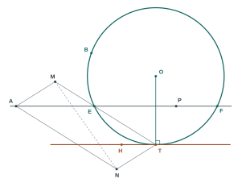
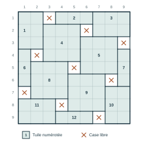

# Olympiades internationales de mathématiques — Lycée — Mathématiques 2025 · Corrigé guidé

*Corrigé rédigé par IA, non officiel. Signalez toute erreur.*

## Présentation du sujet

Chaque journée dure 4 h 30 et comporte trois problèmes indépendants, tous sur 7 points. Le premier jour passe d’un dénombrement sur un triangle à une tangence, puis à l’arithmétique d’une fonction. Commencer le problème 1 en dessinant les six points du cas minimal. Pour le problème 2, une figure sur laquelle la droite des centres et la bissectrice se distinguent prépare le choix du repère.

Le deuxième jour demande de caractériser les départs d’une suite de diviseurs, de comparer deux stratégies de jeu, puis de minimiser un nombre de rectangles. Dans les problèmes 4 et 6, il faut réserver du temps à la réciproque ou à la construction. Dans le jeu, traiter aussi la valeur frontière, pour laquelle les stratégies peuvent empêcher une victoire.

## Mardi 15 juillet 2025

### Problème 1 — Les droites ensoleillées

> [!INDICATION]
> Translatez le point $(1,1)$ à l’origine. Combien de points du réseau sont sur le bord du triangle ? Combien une droite qui ne contient aucun côté peut-elle en couvrir ?

> [!INDICATION]
> Si un côté entier est couvert par une droite, retirez cette droite et tous les points de ce côté. Comparez le triangle restant au précédent.

> [!INDICATION]
> Pour le triangle à six points, listez les paires de points dont la direction n’est ni horizontale, ni verticale, ni parallèle à la pente $-1$.

#### Solution

Une translation par $(-1,-1)$ ramène la figure à l’ensemble $S_n$ des points à coordonnées entières $i,j\geq0$ tels que $i+j\leq n-1$. Elle préserve les directions, donc le nombre de droites ensoleillées.

**Retirer un côté.** Les trois côtés comptent $3n-3$ points distincts, après avoir décompté les sommets comptés deux fois. Une droite autre que celles des trois côtés rencontre le bord en au plus deux points, par convexité. Si $n\geq4$, alors $3n-3>2n$. L’une des $n$ droites doit donc porter un côté. Cette droite n’est pas ensoleillée. Retirons-la ainsi que les points de ce côté. Si le côté était $i+j=n-1$, il reste $S_{n-1}$. Si le côté était $i=0$ ou $j=0$, il reste un translaté de $S_{n-1}$. Les $n-1$ autres droites sont encore distinctes, couvrent ces points et gardent le même nombre $k$ de droites ensoleillées. En répétant, on ramène toute valeur possible de $k$ au cas $n=3$.

**Les six points de $S_3$.** Dans ce triangle, toute droite contenant trois points est un côté. En effet, les trois points extrêmes et les trois milieux sont tous sur le bord. Si l’une des trois droites couvre un côté, les trois points restants forment un translaté de $S_2$. Chacune de leurs trois paires est horizontale, verticale ou de pente $-1$. Deux droites ensoleillées ne peuvent donc couvrir à elles seules ces trois points, ce qui exclut $k=2$ dans ce cas.

Si aucune droite ne porte de côté, chacune couvre exactement deux points, sans chevauchement. Les seules paires de direction ensoleillée sont celles jointes par
$$
i=j,\qquad i+2j=2,\qquad 2i+j=2.
$$
Elles relient respectivement $(0,0)$ à $(1,1)$, $(2,0)$ à $(0,1)$, et $(1,0)$ à $(0,2)$. On vérifie la liste en remarquant que deux sommets, deux milieux, ou un sommet et un milieu adjacent ont toujours une direction de côté. Dès qu’on utilise deux des trois paires ensoleillées, la paire restante impose la troisième. Ici encore $k=2$ est impossible. Ainsi seules les valeurs $0,1,3$ peuvent convenir.

**Les réaliser.** Sur $S_3$, les trois horizontales $j=0$, $j=1$ et $j=2$ donnent $k=0$. Les horizontales $j=0$ et $j=1$ et la droite $j=i+2$ donnent $k=1$. Les trois droites de la liste ci-dessus donnent $k=3$. Pour passer à $S_n$, ajoutons, si $n>3$, les droites $i+j=3,4,\ldots,n-1$. Elles couvrent tous les nouveaux points, sont distinctes des trois droites de départ et n’ajoutent aucune direction ensoleillée. **Pour tout $n\geq3$, les valeurs sont donc $\boxed{k\in\{0,1,3\}}$.**

> [!METHODE]
> Le même dessin peut remplir deux rôles. Au départ de la descente, trois points sur un côté imposent une direction. À la remontée, il faut encore donner des droites distinctes qui couvrent la couche ajoutée.

### Problème 2 — Une tangente au cercle de $B,E,F$

> [!INDICATION]
> Les points $M$ et $P$ sont sur la médiatrice de $AC$. Que donne la réflexion qui échange $A$ et $C$ ? Appliquez le même raisonnement à $A,D$, puis comparez les angles à la base du triangle $PCD$.

> [!INDICATION]
> Prenez $A$ pour origine et $AP$ comme axe horizontal. Essayez comme point de tangence le point $T$ dont le vecteur position est $M+N$. Quelle symétrie échange $T$ et $B$ ?

> [!INDICATION]
> Pour vérifier que la tangente en $T$ passe par $H$, utilisez le centre $K$ du cercle circonscrit à $PMN$. L’identité vectorielle $H=P+M+N-2K$ ramène la question à la position de $K$.

#### Solution

Écrivons $r=AM=MC$, $R=AN=ND$, $d=MN$, $S=R+r$ et $U=R-r>0$. La non-colinéarité de $A,M,N$ donne $U<d<S$.

**Un repère adapté.** Les points $M$ et $P$ sont équidistants de $A,C$. Ils sont distincts, car $MD=d+R>r$. La réflexion d’axe $MP$ échange donc $A$ et $C$. De même, $N$ et $P$ sont sur la médiatrice de $AD$ et sont distincts, car $NC=d+r>R$. On en déduit
$$
\angle MAP=\angle MCP=\angle NDP=\angle NAP.
$$
Les deux angles du milieu sont les angles à la base du triangle isocèle $PCD$ puisque les points $C,M,N,D$ se suivent dans cet ordre. Ce triangle est non dégénéré. En effet, si $P$ était sur $MN$, l’axe $MP$ fixerait $C$ et ne pourrait l’échanger avec $A$. Ses angles à la base sont donc aigus. Les demi-droites distinctes $AM,AN$ font un même angle aigu avec $AP$, qui est ainsi la bissectrice intérieure.

Prenons $A$ pour origine, $AP$ pour axe horizontal orienté vers $P$, et choisissons le demi-plan de $M$ comme côté positif des ordonnées. Si $c$ et $s$ sont le cosinus et le sinus du demi-angle $MAN$, on a $c,s>0$. Désignons aussi un point par son vecteur position. Alors
$$
M=(rc,rs),\quad N=(Rc,-Rs),\quad P=(p,0),\quad
N-M=(Uc,-Ss).
$$
En particulier $d^2=U^2c^2+S^2s^2=S^2-4rRc^2$. Le cercle de centre $M$ passant par l’origine recoupe l’axe horizontal en $E=(2rc,0)$, et celui de centre $N$ en $F=(2Rc,0)$.

**Le point de tangence.** Posons $T=M+N=(Sc,-Us)$. Réfléchissons $A$ par rapport à $MN$, ce qui donne l’autre intersection $B$ des cercles. La réflexion par rapport à la médiatrice de $MN$ envoie ensuite $B$ sur $T$, car les deux réflexions successives sont le demi-tour de centre le milieu de $MN$. Cherchons le centre du cercle passant par $E,F,T$. La médiatrice de $EF$ a pour équation $x=Sc$. Sur cette droite, posons
$$
O=(Sc,y),\qquad y=\frac{U(c^2-s^2)}{2s}.
$$
Alors $OE^2=U^2c^2+y^2=(y+Us)^2=OT^2$ et $OE=OF$. En outre,
$$
2O\mathbin{\cdot}(N-M)=2SUc^2-2Ssy=SU=R^2-r^2=|N|^2-|M|^2.
$$
Ainsi $OM=ON$, et $O$ appartient à la médiatrice de $MN$. Comme celle-ci échange $B$ et $T$, on a $OB=OT$. Le cercle de centre $O$ est bien celui de $B,E,F$. En effet $E\ne F$ et $B$ ne se trouve pas sur leur droite. Sinon, la droite $AB$ serait horizontale alors qu’elle est perpendiculaire à $MN$, dont la composante horizontale vaut $Uc>0$. Le rayon $OT$ est vertical et non nul ($y+Us=U/(2s)>0$), donc la tangente en $T$ est horizontale.

**La hauteur de $H$.** La position de $P$ se lit sur la médiatrice de $CD$. Le milieu de $CD$ est le milieu de $MN$ translaté de $\tfrac{U}{2d}(N-M)$, car $C=M-\tfrac{r}{d}(N-M)$ et $D=N+\tfrac{R}{d}(N-M)$. En projetant $P$ et ce milieu sur le vecteur $N-M$, on trouve
$$
2pUc=(M+N)\mathbin{\cdot}(N-M)+Ud=U(S+d),\qquad 2pc=S+d.
$$
Prenons $K=(S/(2c),0)$. On a $2K\mathbin{\cdot}(N-M)=SU$, donc $KM=KN$. De plus, en élevant $2pc-S=d$ au carré et en utilisant $d^2=S^2-4rRc^2$, on obtient $p^2-pS/c+rR=0$. Par suite
$$
KP^2=p^2-pS/c+S^2/(4c^2)=S^2/(4c^2)-rR=KM^2.
$$
La dernière égalité vient de $|M|^2=r^2$ et $2K\mathbin{\cdot}M=rS$. Le point $K$ est donc le centre du cercle de $P,M,N$.

L’orthocentre de ce triangle a pour vecteur $H=P+M+N-2K$. En effet, le vecteur $P+N-2K$ est perpendiculaire à $P-N$ puisque $|P-K|^2=|N-K|^2$, ce qui vérifie la hauteur issue de $M$. La permutation des sommets vérifie les autres hauteurs. Ainsi $H-T=P-2K=(p-S/c,0)$. **La parallèle à $AP$ passant par $H$ est donc la tangente en $T$ au cercle de $B,E,F$.**

> [!METHODE]
> Le choix de l’axe décide ici de la simplicité du calcul. Une fois $AP$ horizontal, la tangence cherchée se vérifie par deux égalités de coordonnées, d’abord l’abscisse de $O$ et $T$, puis l’ordonnée de $H$ et $T$.

### Problème 3 — Fonctions balaises

> [!INDICATION]
> Prendre d’abord les deux arguments égaux. Si un nombre premier $p$ divise une valeur de $f$, examiner ensuite la relation avec $b=p$, puis avec $a=p$. Que peut-on dire de $f(x)-x$ modulo $p$ ?

> [!INDICATION]
> Si $f$ diffère de l’identité en $t$, poser $d=|f(t)-t|$. Chercher la valeur de $f(2d-1)$ en utilisant le fait que $d$ et $2d-1$ sont premiers entre eux.

> [!INDICATION]
> Une fois les facteurs premiers possibles déterminés, essayer $b=5$ et factoriser $5^n-1$ par différences de carrés. Pour construire un exemple extrémal, examiner les quatrièmes puissances des entiers impairs modulo $16$.

#### Solution

**Les nombres premiers qui divisent une valeur de la fonction.** Soit $f$ une fonction balaise. En prenant $a=b=x$, on obtient $f(x)\mid x^x$ puisque $f(x)$ divise sa propre puissance $f(x)^{f(x)}$. En particulier, tout facteur premier de $f(x)$ divise $x$, et $f(1)=1$.

Fixons un premier $p$ qui divise $f(a)$ pour au moins un $a$. Avec ce $a$ et $b=p$, la relation donne $f(p)^{f(a)}\equiv p^a\equiv0\pmod p$. Ainsi $p\mid f(p)$. Comme $f(p)\mid p^p$, il existe un entier $k\ge1$ tel que $f(p)=p^k$. Appliquons à présent la relation avec $a=p$ et $b=x$. En réduisant modulo $p$, on obtient
$$
x^p\equiv f(x)^{p^k}\pmod p.
$$
Le petit théorème de Fermat donne $u^p\equiv u\pmod p$ pour tout entier $u$, y compris les multiples de $p$. En l’appliquant une fois à gauche et $k$ fois à droite, on trouve **$x\equiv f(x)\pmod p$ pour tout $x\ge1$**.

Si $f$ est l’identité, on a déjà $f(n)\le4n$. Sinon, choisissons $t$ tel que $d=|f(t)-t|>0$. Tout premier divisant une valeur de $f$ divise $d$, d’après la congruence précédente. Considérons $m=2d-1$, qui est positif même si $d=1$. Un facteur premier de $f(m)$ devrait diviser à la fois $d$ et $m$, ce qui est impossible puisque $2d-m=1$. Donc $f(m)=1$. Pour tout premier $p$ divisant une valeur de $f$, la même congruence donne alors $p\mid m-1=2d-2$. Comme $p\mid d$, on conclut que $p\mid2$. Toutes les valeurs de $f$ sont donc des puissances de $2$, en incluant $1=2^0$. Si aucun premier ne divise une valeur de $f$, cette conclusion vaut également.

**La borne.** Pour $n$ impair, $f(n)$ est une puissance de $2$ qui divise l’entier impair $n^n$, donc $f(n)=1$. En particulier $f(5)=1$. En choisissant $a=n$ et $b=5$, on en déduit $f(n)\mid 5^n-1$.

Écrivons $n=2^r u$ avec $u$ impair et $r\ge0$, puis posons $X=5^u$. Comme $X-1=4(1+5+\cdots+5^{u-1})$ et que la somme entre parenthèses contient un nombre impair de termes impairs, $X-1$ est divisible par $4$ mais pas par $8$. La factorisation
$$
5^n-1=(X-1)\prod_{j=0}^{r-1}\bigl(X^{2^j}+1\bigr)
$$
ajoute exactement $r$ facteurs de $2$ puisque chacun des termes $X^{2^j}+1$ vaut $2$ modulo $4$, car $X\equiv1\pmod4$. Pour $r=0$, le produit vide vaut $1$. La plus grande puissance de $2$ qui divise $5^n-1$ est donc $2^{r+2}$. Ainsi $f(n)\le2^{r+2}=4\cdot2^r\le4n$.

**Un exemple qui atteint la borne.** Définissons $g(4)=16$, $g(n)=2$ pour les autres entiers pairs et $g(n)=1$ pour les entiers impairs. Vérifions que $g(a)\mid b^a-g(b)^{g(a)}$ pour tout couple $(a,b)$.

- Si $a$ est impair, le diviseur vaut $1$.
- Si $a$ est pair et différent de $4$, le diviseur vaut $2$. Or $b$ et $g(b)$ ont la même parité, donc $b^a$ et $g(b)^2$ aussi.
- Si $a=4$ et $b$ est pair, $b^4$ et $g(b)^{16}$ sont tous deux multiples de $16$. Si $a=4$ et $b$ est impair, alors $g(b)=1$. En écrivant $b=2h+1$, on a $b^2=1+4h(h+1)\equiv1\pmod8$. Par conséquent $b^2=1+8s$ pour un entier $s$, et $b^4=(1+8s)^2\equiv1\pmod{16}$.

La fonction $g$ est balaise et vérifie $g(4)/4=4$. Aucune constante strictement plus petite ne convient. **La plus petite constante cherchée est $\boxed{4}$.**

> [!PIEGE]
> La congruence modulo un premier est valable pour tout argument dès que ce premier divise une seule valeur de la fonction. Conserver ces deux quantificateurs dans cet ordre est indispensable pour restreindre tous les facteurs premiers à la fois.

## Mercredi 16 juillet 2025

### Problème 4 — Somme des trois plus grands diviseurs stricts

> [!INDICATION]
> Si $t$ est un terme, les trois plus grands diviseurs stricts sont $t/d_1,t/d_2,t/d_3$, où $d_1<d_2<d_3$ sont les trois plus petits diviseurs de $t$ strictement supérieurs à $1$. Que se passe-t-il si $t$ est impair ?

> [!INDICATION]
> Supposons $t$ pair mais non multiple de $3$. Le terme suivant est inférieur à $t$. Montrez qu’il reste premier à $3$, en séparant les cas où $4$ divise $t$ et où $t$ est seulement divisible par $2$.

> [!INDICATION]
> Pour un multiple de $6$, le troisième dénominateur est $4$, $5$ ou $6$. Suivez l’exposant de $2$ jusqu’au premier terme fixe, puis reconstituez la valeur de départ.

#### Solution

Notons $u$ le terme suivant $t$. Si $d_1<d_2<d_3$ sont les plus petits diviseurs de $t$ strictement supérieurs à $1$ (éventuellement $d_3=t$), alors $u=t/d_1+t/d_2+t/d_3$.

**Tous les termes sont divisibles par $6$.** Si $t$ est impair, $u$ est impair, comme somme de trois impairs, et
$$
u\leq t\left(\frac13+\frac15+\frac17\right)<t.
$$
À partir de là, les termes formeraient une suite infinie strictement décroissante d’entiers positifs. Ainsi tous les termes sont pairs.

Supposons que $t$ ne soit pas divisible par $3$. Alors $d_1=2$, $d_2\geq4$ et $d_3\geq5$, donc $u\leq t(1/2+1/4+1/5)<t$. Vérifions que $3$ ne divise pas $u$ non plus.

- Si $4\mid t$, les deux premiers quotients ont pour somme $t/2+t/4=3t/4$, multiple de $3$. Le troisième divise $t$ et ne peut être divisible par $3$. Leur somme ne l’est donc pas.
- Si $t$ n’est pas divisible par $4$, écrivons $t=2v$ avec $v$ impair. L’existence de trois diviseurs stricts impose $v>1$. Son plus petit facteur premier $p$ est au moins $5$, et $d_2=p$ puisque tout diviseur pair de $t$ autre que $2$ est au moins $2p$. Or $t/2$ est impair, $t/p$ est pair et le terme suivant $u$ doit être pair. Il faut donc que $t/d_3$ soit impair, soit que $d_3$ soit pair. Le premier diviseur pair disponible est $2p$, donc $d_3=2p$. Il vient $u=t/2+3t/(2p)$, non divisible par $3$.

Un seul terme non multiple de $3$ entraînerait donc lui aussi une descente infinie. Chaque terme est bien multiple de $6$.

**Évolution d’un multiple de $6$.** Les deux premiers dénominateurs sont $2,3$. Si $4\mid t$, le troisième est $4$, d’où $u=13t/12$. Si $4\nmid t$ mais $5\mid t$, le troisième est $5$. On aurait alors $u=31t/30$ impair, puisque $t$ contient un seul facteur $2$. Ce cas est exclu. Enfin, si $4\nmid t$ et $5\nmid t$, le troisième dénominateur est $6$ et $u=t$.

Chaque opération $t\mapsto13t/12$ diminue de deux l’exposant du facteur $2$. Elle ne peut donc se poursuivre indéfiniment. Après $m\geq0$ telles opérations consécutives, la suite arrive au seul cas restant, un point fixe $6K$ avec $K$ impair et non divisible par $5$. Ainsi $13^m a_1=12^m\cdot6K$. Puisque $13$ ne divise pas $6\cdot12$, on a $13^m\mid K$. En posant $s=K/13^m$, on obtient la forme nécessaire ci-dessous.

**Réciproque.** Pour tout entier $m\geq0$ et tout $s\geq1$ premier à $10$, prenons $a_1=6\cdot12^m s$. Pour $j=0,\ldots,m$, le terme $a_{j+1}$ vaut $6\cdot12^{m-j}13^j s$. En effet, tant que $j<m$, il est divisible par $4$ et l’étape suivante le multiplie par $13/12$. Pour $j=m$, on arrive à $6\cdot13^m s$, non divisible par $4$ ni par $5$, qui reste fixe. Chaque terme est un multiple de $6$ et possède au moins les trois diviseurs stricts $1,2,3$. Les valeurs possibles sont exactement
$$
\boxed{a_1=6\cdot12^m s,\qquad m\geq0,\quad s\geq1,\quad \gcd(s,10)=1.}
$$

> [!PIEGE]
> Le diviseur $1$ est strict pour tout $t>1$. Dans l’écriture $t/d$, il correspond à $d=t$. Il faut conserver cette possibilité pour que le raisonnement couvre aussi les petits termes.

### Problème 5 — Le jeu de l’inékoalaté

> [!INDICATION]
> Regroupez les tours par paires. Si Baptiste peut assurer que la somme des deux nombres de chaque paire vaut exactement $c$, après $k$ paires Anna retrouve la somme $kc$. Cherchez la plus grande valeur de $c$ pour laquelle deux nombres positifs ou nuls de somme $c$ coûtent toujours au plus $2$ en somme de carrés.

> [!INDICATION]
> Avec la valeur de $c$ trouvée, essayez de répondre au nombre $a$ d’Anna par $c-a$. Si les $k-1$ paires précédentes ont cette somme, quelle est la plus grande valeur qu’Anna puisse encore choisir ? Comparez ensuite $kc$ à $\lambda(2k+1)$.

> [!INDICATION]
> Inversez le point de vue. Si Anna ne joue que des zéros pendant $k$ paires, seuls les $k$ nombres de Baptiste contribuent à la somme. L’inégalité de Cauchy-Schwarz la majore à partir du budget de carrés de Baptiste. Au prochain tour impair, comparez ce qu’Anna peut encore ajouter avec $\sqrt{2k+2}$.

#### Solution

**Anna peut forcer la victoire lorsque $\lambda>1/\sqrt2$. Baptiste le peut lorsque $0<\lambda<1/\sqrt2$. À l’égalité, chacun peut empêcher l’autre de gagner.**

Posons $c=\sqrt2$. Une paire se compose d’un coup d’Anna suivi de la réponse de Baptiste. Le nombre zéro est autorisé par les règles, tant que les coups précédents n’ont pas déjà dépassé le plafond du joueur qui doit jouer.

**La réponse de Baptiste.** Supposons $2\lambda\le c$. À tout coup $a$ d’Anna, Baptiste répond par $b=c-a$. Vérifions par récurrence qu’il pourra le faire chaque fois qu’Anna aura pu jouer. Avant la première paire, la somme des coups et celle de leurs carrés sont nulles. Après $k-1$ paires jouées selon cette règle, la somme des coups est $(k-1)c$ et la somme des carrés est au plus $2(k-1)$. Au tour $2k-1$, tout choix légal d’Anna satisfait donc

$$
0\le a\le\lambda(2k-1)-(k-1)c
=\lambda+(k-1)(2\lambda-c)\le\lambda\le c/2.
$$

Ainsi $b=c-a$ est positif ou nul. Comme $a+b=c$ et $ab\ge0$, on a $a^2+b^2=(a+b)^2-2ab\le c^2=2$. La somme des carrés au tour $2k$ est donc au plus $2k$, ce qui rend la réponse de Baptiste légale et établit les deux propriétés pour la paire suivante.

Lorsque $2\lambda<c$, choisissons un entier $k>\lambda/(c-2\lambda)$. Si Anna a pu jouer jusqu’à la fin de la $k$-ième paire, la somme vaut alors $kc>\lambda(2k+1)$. Au tour suivant, la somme antérieure dépasse déjà le plafond d’Anna. Jouer zéro ne la réduirait pas. Elle perd donc au plus tard à ce tour. À l’égalité $2\lambda=c$, la même règle garantit toujours à Baptiste une réponse légale.

**Les coups d’Anna.** Supposons maintenant $2\lambda\ge c$. Anna commence par zéro. Tant qu’elle ne joue que des zéros, notons $b_1,\ldots,b_k$ les réponses de Baptiste après $k$ paires complètes. La règle de son dernier tour impose $\sum_{i=1}^k b_i^2\le 2k$. Par Cauchy-Schwarz,

$$
\sum_{i=1}^k b_i\le\sqrt{k\sum_{i=1}^k b_i^2}\le kc\le 2k\lambda<\lambda(2k+1).
$$

Au tour impair suivant, Anna peut donc encore jouer zéro. Cette stratégie lui évite la défaite, y compris quand $2\lambda=c$. Avec la stratégie défensive de Baptiste déjà établie, cela règle le cas d’égalité. Aucun des deux joueurs ne peut imposer une victoire à un adversaire qui se défend ainsi.

Reste à transformer l’attente d’Anna en victoire lorsque $2\lambda>c$. Posons $d=2\lambda-c>0$ et fixons un entier $k>\max(1,4/d^2)$. Alors $kd>2\sqrt{k}\ge\sqrt{2k+2}$. Anna joue zéro durant ses $k$ premiers tours. Si Baptiste a toujours pu répondre, au tour $2k+1$ Anna joue le nombre fixé d’avance $x=\lambda+kd$. La somme antérieure est au plus $kc$, donc la nouvelle somme est au plus

$$
kc+x=kc+\lambda+k(2\lambda-c)=\lambda(2k+1).
$$

Ce coup est légal et son carré, à lui seul, dépasse $2k+2$. Baptiste ne peut plus jouer au tour $2k+2$. Les trois possibilités pour $\lambda$ sont ainsi couvertes.

> [!METHODE]
> Une stratégie gagnante doit produire un coup légal contre chaque réponse légale de l’adversaire et provoquer un blocage en temps fini. Au seuil, empêcher son propre blocage suffit seulement à empêcher la victoire adverse.

### Problème 6 — Le quadrillage à une case libre par ligne et par colonne

> [!INDICATION]
> Pour la construction, essayez un quadrillage dont les numéros de lignes et de colonnes sont pris modulo $45^2+1$. Enlevez ensuite la ligne et la colonne numérotées $0$. Comment faire pour qu’aucune tuile ne puisse être coupée à la fois par la ligne et par la colonne supprimées ?

> [!INDICATION]
> Pour la minoration, appelez « trou » une case libre. Autorisez un chemin montant vers le nord ou l’est le long des bords des tuiles et, dans un trou, une traversée de sa diagonale sud-ouest–nord-est. Choisissez un chemin traversant ainsi le plus grand nombre possible de trous.

> [!INDICATION]
> Au-dessus du chemin, reliez chaque trou aux tuiles qui le bordent à l’ouest et au nord. Au-dessous, utilisez les côtés sud et est. Un trou traversé par le chemin compte une fois dans chaque région. Combien de tuiles compte une chaîne comportant $q$ trous ?

#### Solution

Posons $k=45$ et $n=k^2=2025$. Il y a $n$ trous puisque chaque ligne en contient un. Nous montrons que le minimum est **$n+2k-3=2\,112$**.

**Minoration.** Partons d’un placement quelconque de $T$ tuiles. En considérant les trous comme des carrés supplémentaires, on obtient une partition du plateau en rectangles. Un chemin ira du coin sud-ouest au coin nord-est, en suivant les bords de cette partition vers le nord ou l’est. Il peut aussi passer par l’intérieur d’un trou en parcourant sa diagonale du coin sud-ouest au coin nord-est.

Tout sommet de la partition peut être relié ainsi aux deux coins du plateau, même sans diagonale. En effet, en un sommet intérieur, au moins un bord part vers le sud ou l’ouest, et au moins un vers le nord ou l’est. Cela se vérifie aussi bien à une jonction en T qu’à un croisement. Sur le pourtour, on peut suivre le bord. En remontant ou en redescendant de sommet en sommet, la somme des coordonnées varie strictement, jusqu’au coin voulu. En particulier, chacun des trous peut être traversé par un chemin complet.

Choisissons un chemin $P$ utilisant le maximum $m$ de diagonales, avec $m\geq1$. Chaque tuile a son intérieur d’un seul côté de $P$, puisque $P$ suit ses bords. Les trous dont la diagonale n’a pas servi sont eux aussi d’un seul côté. Appelons *haut* le côté nord-ouest et *bas* le côté sud-est. Pour traiter uniformément le bord, ajoutons à l’extérieur une bande rectangulaire d’une case de largeur le long de chacun des quatre côtés. Les bandes nord et ouest appartiennent au haut, les deux autres au bas.

Dans le haut, associons à chaque trou de cette région, ainsi qu’à chaque trou traversé, la tuile immédiatement à l’ouest et la tuile immédiatement au nord du trou. Ces deux voisines sont bien des tuiles, car deux trous n’occupent jamais la même ligne ni la même colonne. Elles sont du côté haut. En effet, en partant de l’intérieur de la partie haute du trou, se déplacer vers l’ouest ou le nord ne fait pas passer du côté bas d’un chemin qui ne va que vers le nord ou l’est. Dans le bas, associons de même aux trous de la région et aux trous traversés leurs voisines du sud et de l’est.

Examinons les associations du haut. Orientons-les de la tuile ouest vers le trou, puis du trou vers la tuile nord. Une tuile a au plus un trou immédiatement à l’est, tous les emplacements candidats étant dans la même colonne. Elle a au plus un trou immédiatement au sud, tous les emplacements candidats étant dans la même ligne. Ainsi, elle a au plus une flèche entrante et une sortante. Chaque trou, lui, possède les deux. Entre deux trous successifs, le premier est juste au sud de la tuile intermédiaire, le second juste à l’est. Le second est donc strictement plus au nord et plus à l’est que le premier. Il n’y a pas de cycle. Les associations forment des chaînes alternées, aux deux extrémités desquelles se trouvent des tuiles. La même démonstration vaut dans le bas en orientant les liens de la tuile sud vers le trou, puis du trou vers la tuile est.

**Chaque chaîne contient au plus $m$ trous.** Une bande extérieure ne touche que le trou de sa ligne ou colonne de bord, donc elle ne peut pas se trouver entre deux trous. Dans une chaîne haute, on peut aller du coin nord-est d’un trou au coin sud-ouest du suivant en longeant vers l’est le bord inférieur de leur tuile intermédiaire puis, vers le nord, son bord droit. Pour une chaîne basse, le trajet suit le bord gauche puis le bord supérieur de la tuile intermédiaire. On peut donc traverser successivement les diagonales de tous les trous de cette chaîne. Les prolongements jusqu’aux coins du plateau ont été justifiés plus haut. On obtiendrait un chemin meilleur que $P$ si la chaîne contenait plus de $m$ trous.

Au total, les chaînes comptent $n+m$ occurrences de trous. Chacun des $m$ trous traversés figure deux fois et chacun des autres une fois. Il faut donc au moins $(n+m)/m$ chaînes. Une chaîne de $q$ trous utilise $q+1$ tuiles. Les tuiles des différentes chaînes sont distinctes, y compris entre chaînes hautes et basses, car leurs intérieurs sont de côtés différents. Certaines tuiles peuvent n’avoir été comptées dans aucune chaîne. Avec les quatre bandes ajoutées, on obtient

$$
\begin{aligned}
T+4 &\geq n+m+\frac{n+m}{m}\\
    &= n+1+m+\frac{n}{m}\\
    &\geq n+1+2\sqrt n .
\end{aligned}
$$

La dernière inégalité résulte de $(m-\sqrt n)^2\geq0$. Il faut donc au moins $n+2k-3$ tuiles.

**Construction atteignant la borne.** Écrivons $N=k^2+1$ et travaillons d’abord avec des indices de lignes et de colonnes pris modulo $N$. Les indices consécutifs peuvent alors passer de $N-1$ à $0$. Pour chaque résidu $t$, traçons un carré $Q_t$ qui occupe les $k$ lignes $t+1,\ldots,t+k$ et les $k$ colonnes $kt,\ldots,kt+k-1$.

Une case $(r,c)$ appartient à $Q_t$ si $r=t+i$ et $c=kt+j$ modulo $N$, avec $1\leq i\leq k$ et $0\leq j<k$. Pour un tel couple on a $kr-c\equiv ki-j\pmod N$. Or, à $i$ fixé, les entiers $ki-j$ parcourent, en ordre décroissant, l’intervalle de $(i-1)k+1$ à $ik$. Lorsque $i$ varie, chacun des entiers de $1$ à $k^2$ apparaît donc une seule fois. Si $kr-c$ est non nul modulo $N$, son résidu détermine un unique couple $(i,j)$, puis un unique carré avec $t=r-i$. Si ce résidu est nul, la case reste libre. Ainsi les carrés sont disjoints et les trous sont exactement les cases $(r,kr)$. Comme $k$ et $N$ sont premiers entre eux, ces trous occupent toutes les colonnes une fois chacun.

Supprimons la ligne $0$ et la colonne $0$ et remettons les indices restants dans l’ordre usuel $1,\ldots,N-1$. Le trou $(0,0)$ est le seul supprimé et chaque ligne et colonne restante conserve son trou. Que deviennent les $N$ carrés ? La suppression d’une ligne scinde un intervalle cyclique de $k$ lignes en deux intervalles ordinaires non vides exactement lorsque $0$ se trouve strictement entre ses deux extrémités. Il y a **$k-2$** carrés dans ce cas, un pour chaque position intérieure possible de $0$, puisque les débuts des intervalles de lignes sont tous distincts. Il en va de même pour les colonnes, car les débuts $kt$ sont aussi tous distincts. Aucun carré ne rencontre à la fois la ligne et la colonne supprimées, car il contiendrait alors le trou $(0,0)$. Aucun carré ne disparaît puisque $k\geq2$. Chaque scission ajoute donc une tuile et toutes les pièces obtenues sont des rectangles du plateau ordinaire.

Le nombre de tuiles de cette construction vaut exactement

$$
N+2(k-2)=2026+2\times43=\boxed{2\,112}.
$$

> [!METHODE]
> Dans le comptage des chaînes, une tuile a un seul côté du chemin, alors qu’un trou traversé donne une occurrence de chaque côté. Cette différence de multiplicité explique le terme supplémentaire $m$.

## Bilan

Pour les droites et les diviseurs, une descente n’est valable qu’après avoir prouvé que la propriété nécessaire se transmet. Dans le problème 3, la substitution d’un seul argument premier produit une contrainte simultanée sur toutes les valeurs de la fonction. Dans le jeu, regrouper deux coups permet de comparer directement les budgets des deux joueurs. Pour le pavage, on prouve d’abord qu’aucune disposition ne peut descendre sous la borne, puis on dénombre les pièces d’un placement qui l’atteint.
