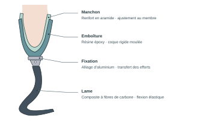

# Olympiades nationales de la chimie — Lycée — Épreuve collaborative 2025 · Corrigé brut

*Corrigé rédigé par IA, non officiel. Signalez toute erreur.*

## Et c’est le temps qui court

### 1.

**Le manchon** s’interpose entre la peau et la coque : sa partie souple épouse la forme du membre, limite les frottements et répartit les appuis. Le renfort polymère de l’échantillon est une aramide. **L’emboîture** est une coque rigide moulée en résine thermodurcissable. Elle maintient la forme de l’ensemble sous charge. **La fixation**, métallique, assure une jonction démontable qui transmet les efforts. **La lame** travaille comme un ressort en flexion : les fibres de carbone, retenues par une matrice, permettent une pièce légère qui restitue une partie de l’énergie emmagasinée à l’appui.

### 2.

**Manchon.** Le spectre IR comporte notamment une bande vers $3\,300\ \mathrm{cm}^{-1}$ et une bande intense près de $1\,650\ \mathrm{cm}^{-1}$, compatibles avec N–H et C=O d’une amide. Les bandes du domaine $1\,400$–$1\,600\ \mathrm{cm}^{-1}$ et la faible signature des C–H aliphatiques appuient l’hypothèse d’une polyamide aromatique. L’osmométrie fournit un second critère. La proportionnalité de $\Pi$ à $C_m$ est vérifiée sur les quatre points. Par exemple,
$$
M_n=\frac{RT C_m}{\Pi}
=\frac{8{,}31\times298\times10}{0{,}694}
\simeq 3{,}57\times10^4\ \mathrm{g\,mol^{-1}}.
$$
Avec $M_0=238\ \mathrm{g\,mol^{-1}}$ pour l’aramide, le degré moyen de polymérisation vaut $M_n/M_0\simeq150$ : **le grade correspondant dans le dossier est le Kevlar 29**. Les propriétés du textile et de son éventuelle doublure ne sont pas celles d’un bloc de fibre pure. Pour un usage de course qui sollicite particulièrement le renfort, le grade 49 proposé au tableau porte la résistance de 1 500 à 2 000 MPa et le module de 30 à 40 GPa. Un renfort plus rigide ne remplace pas une interface cutanée souple ; il faut conserver l’ajustement et l’amortissement.

**Fixation.** Dans les 10 mL dosés par la soude, la première équivalence neutralise l’acidité initiale. À pH 1, la quantité initiale d’ions oxonium vaut environ $0{,}10\times0{,}010=1{,}0\times10^{-3}$ mol, cohérente avec 10,0 mL de soude. Les 10,5 mL supplémentaires correspondent à trois ions hydroxyde par ion aluminium. Avec les valeurs du dossier, la masse d’aluminium dans le litre de solution vaut
$$
m_{\rm Al}=27\times\frac{1{,}00}{0{,}010}\times
\frac{0{,}10(0{,}0205-0{,}0100)}{3}\simeq0{,}945\ \mathrm g.
$$
L’aluminium représente donc environ **95 %** de l’alliage. L’EDTA fixe un ion divalent par ligand : la quantité **totale** de magnésium et de zinc dans le litre est $(1/0{,}010)\times0{,}0020\times0{,}0085=1{,}7\times10^{-3}$ mol. Pour le 5083 du tableau, 4 % de Mg et une teneur négligeable en Zn donnent $0{,}040/24\simeq1{,}67\times10^{-3}$ mol. Le 6061 en donnerait à peine $0{,}008/24\simeq3{,}3\times10^{-4}$ mol. Le 7075 contient davantage de zinc mais 90 % d’aluminium, en désaccord avec le premier dosage. **Le 5083 est la meilleure identification parmi les références.** Le dosage B seul ne sépare pas Mg et Zn ; un bilan à trois métaux exclusivement ne serait pas justifié puisque le sujet signale aussi d’autres constituants possibles. La résistance à la corrosion convient à une pièce exposée à l’humidité. Une rupture éventuelle demande en plus un examen de l’assemblage et des sollicitations en fatigue.

**Emboîture.** Le déplacement de la ligne de base vers $70\,{}^\circ\mathrm C$ est caractéristique d’une transition vitreuse. Un réseau déjà fortement réticulé est cohérent avec une **résine polyépoxyde**. Il demeure stable sous les efforts à température d’usage, inférieure à cette transition, et sa mise en forme doit se faire avant le durcissement définitif. Parmi les grades du tableau, **A2 est un candidat pour la coque sportive** : module de 4 GPa et résistance à la traction de 100 MPa, contre 3 GPa et 60 MPa pour A1. Pour la pièce d’origine, le dossier indique aussi une forte réticulation. La référence A2 présente un pic de réorganisation plus marqué, dont l’aire renseigne sur la réticulation, et un degré moyen de polymérisation supérieur à celui de A1. Ces indices font de **A2 le grade d’origine le plus plausible**. Une transition vers 70 °C à elle seule ne sépare pas les deux références. L’aire mesurée sur l’échantillon et son thermogramme complet permettraient de consolider l’attribution.

**Lame.** La différence entre masse réelle et masse apparente est celle de l’eau déplacée. L’échantillon de 1,00 g déplace $1{,}00-0{,}44=0{,}56$ g d’eau, donc environ $0{,}56\ \mathrm{cm^3}$. On obtient
$$
\rho=\rho_{\rm eau}\frac{m_1}{m_1-m_2}
  \simeq1{,}8\ \mathrm{g\,cm^{-3}}.
$$
C’est compatible avec la **référence à fibres de carbone**, loin des fibres de verre (2,6), de l’aluminium (2,7) et du bois (moins de 1). Cette densité constitue un indice de composition et ne donne pas à elle seule la nature de la matrice ni la fraction exacte de fibres. Pour vérifier l’écart avec les autres métaux, le modèle de maille cubique centrée du dossier compte $8/8+1=2$ atomes du métal principal. En négligeant les corrections d’alliage comme indiqué, $\rho=2M/(N_Aa^3)$ donne, avec $M$ en kg/mol et $a$ en mètres, environ $4{,}36\times10^3\ \mathrm{kg\,m^{-3}}$ pour le matériau à base de titane et $7{,}87\times10^3\ \mathrm{kg\,m^{-3}}$ pour l’acier. Tous deux seraient sensiblement plus lourds à volume égal.

Les courbes de traction du document 9 situent les contraintes maximales visibles vers 0,39 GPa pour l’acier doux, 0,55 GPa pour le 7075 et 2,8 GPa pour les fibres de carbone recyclées. Le module se lit sur la pente initiale et non au maximum : pour l’aluminium il est de l’ordre de 70 à 80 GPa, pour l’acier de l’ordre de $2\times10^2$ GPa et pour les fibres représentées de l’ordre de $10^2$ GPa (courbe légèrement non linéaire). Les fibres de verre ont une résistance tabulée élevée, 3,5 GPa, mais elles sont plus denses et leur module tabulé est de 70 GPa. Le carbone offre donc un bon compromis de rigidité, de résistance et de masse, malgré son prix. Les propriétés d’une fibre isolée ne valent pas directement pour la lame assemblée : l’orientation des fibres, le collage, la géométrie et le vieillissement comptent.

**Proposition à l’athlète.** Conserver le principe d’une lame composite carbone et d’une coque rigide ajustée. Adapter le renfort du manchon à la course tout en maintenant le confort. Avant de modifier l’alliage ou de rigidifier la lame, localiser la rupture et examiner les interfaces. Les essais du dossier identifient des familles de matériaux mais n’établissent pas, à eux seuls, la cause de la casse.
