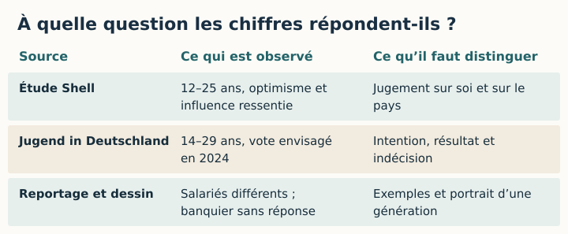

# X-ENS · MP-MPI-PC-PSI · Allemand 2025 — Corrigé guidé

*Corrigé rédigé par IA, non officiel. Signalez toute erreur.*

**Rédaction** · GPT-6.2 Astra Ultra · vitesse non renseignée

**Révision (tour 1)** · GPT-6.2 Astra Ultra · vitesse non renseignée

[Sujet commun](https://www.polytechnique.edu/admission-cycle-ingenieur/sites/admission/files/content/Allemand%20sujet.pdf) · [Fascicule PSI](https://www.ens.psl.eu/sites/default/files/2025_psi_ep5_allemand_14022025_nb.pdf) · [Rapport du jury](https://www.polytechnique.edu/admission-cycle-ingenieur/sites/admission/files/content/Ecrits_MP%2C%20MPI%2C%20PC%20et%20PSI_allemand%20OK.pdf) · [Rapport PSI](https://www.ens.psl.eu/sites/default/files/2025_psi_rapport_allemand_ecrit.pdf)

## Préparer la composition

Le document de la *Frankfurter Rundschau* porte sur l’étude Shell des 12–25 ans. La dépêche d’avril reproduite par la *taz* commente l’enquête *Jugend in Deutschland* auprès des 14–29 ans. Les 22 % répondent à une intention de vote hypothétique. Les 25 % du premier article concernent le classement politique de jeunes hommes. La case finale de Tom Fishburne ne révèle pas pourquoi les jeunes s’en vont. Elle fait voir l’échec du représentant de banque qui s’adresse à eux en énumérant des réseaux sociaux sans écouter de réponse.

Pour discuter Posener, distinguer trois propositions : une transmission accrue de patrimoine, sa distribution entre jeunes et l’explication individuelle d’un vote. La première ne prouve pas les deux autres. On peut accorder du poids au souci de préserver ce qui a été construit tout en examinant ce que l’argument de « l’héritier » laisse dans l’ombre.

## A · Synthèse des documents 1 à 4

### Zwischen Zuversicht und Kontrollverlust: Wer spricht für die junge Generation?

In Tom Fishburnes Zeichnung möchte ein Bankvertreter zwei junge Menschen kennenlernen. Noch ehe sie etwas sagen können, zählt er die digitalen Plattformen auf, über die seine Bank sie vielleicht erreichen könnte. Am Schluss ist er allein. Eine ähnliche Schwierigkeit begegnet den Beiträgen über die Generation Z: Wer zu wissen glaubt, wie eine ganze Altersgruppe denkt, kann leicht überhören, was ihre Mitglieder tatsächlich beschäftigt. Zwei Jugendstudien und eine Reportage aus der Arbeitswelt zeichnen ein Bild, in dem persönliche Zuversicht, politische Unsicherheit und unterschiedliche Vorstellungen von einem guten Berufsleben nebeneinander bestehen.

Christine Dankbar hebt in der Frankfurter Rundschau hervor, dass die meisten der für die Shell-Studie befragten Zwölf- bis Fünfundzwanzigjährigen trotz Pandemie, Krieg und wirtschaftlicher Schwierigkeiten optimistisch in die Zukunft blicken. Familie und persönliche Beziehungen geben ihnen Halt. Viele möchten sich auch für andere engagieren. Allerdings ist die Erwartung, selbst etwas bewirken zu können, verbreiteter als das Vertrauen darauf, dass die Mitmenschen dieses Anliegen teilen. Etwa die Hälfte empfindet einen Kontrollverlust. Die von der taz wiedergegebene Untersuchung unter Vierzehn- bis Neunundzwanzigjährigen stellt ebenfalls einen Unterschied zwischen der eigenen Lage und der Bewertung der gesellschaftlichen Verhältnisse fest. Die persönliche Bilanz fällt insgesamt noch leicht positiv aus, hat sich aber gegenüber früheren Befragungen verschlechtert. Hohe Mieten erschweren zudem gerade jenen den Auszug aus dem Elternhaus, denen vorgehalten wird, sie wollten gar nicht selbstständig werden.

Politisch führt diese Unsicherheit zu unterschiedlichen Reaktionen. Dankbar beschreibt Jugendliche, die Russlands Verantwortung für den Krieg gegen die Ukraine anerkennen, über Waffenlieferungen aber keineswegs einer Meinung sind. Das Vertrauen in die Europäische Union ist größer geworden, während Parteien weniger Vertrauen genießen. Auch in der zweiten Studie lehnt eine Mehrheit die Behauptung ab, Deutschland wäre ohne die EU besser dran. Zugleich stieg dort der Anteil derjenigen, die bei einer gedachten Bundestagswahl die AfD wählen würden, von neun Prozent im Jahr 2022 auf zweiundzwanzig Prozent 2024. Ein Viertel wusste noch nicht, wem es seine Stimme geben würde. Weder lässt sich die gesamte Altersgruppe politisch rechts verorten, noch lässt sich die wachsende Unterstützung für die Partei mit dem Hinweis auf europafreundliche Einstellungen übergehen. Die beiden Studien erfassen zudem unterschiedliche Altersgruppen und stellen nicht dieselben Fragen.

Wie leicht aus Unterschieden ein vermeintlicher Generationengegensatz entsteht, zeigt die Reportage von Oliver Bemelmann und Sina Groß. Die Mainzer Werkstudentin Lea Poos möchte höchstens fünfunddreißig Stunden arbeiten. Ihr Arbeitgeber sieht in flexiblen Zeiten und einem angenehmen Arbeitsumfeld eine Voraussetzung für gute Leistung. Der Hotelier Frank Darstein fragt dagegen, wer nachts Gäste betreut oder unverzichtbare Dienste übernimmt, wenn alle ihre Zeit frei einteilen möchten. Allerdings akzeptiert auch sein junger Mitarbeiter Julian Daske eine vierzigstündige Arbeitswoche und gelegentliche Mehrarbeit. Hier verläuft die Trennlinie ebenso zwischen Tätigkeiten und Betrieben wie zwischen Geburtsjahrgängen. Selbst der Wunsch nach mehr Freizeit bedeutet bei Poos weder mangelnden Ehrgeiz noch fehlende Anerkennung für die Leistungen Älterer.

Damit stellt sich erneut die Frage, unter welchen Bedingungen junge Menschen gehört werden. Die von der taz befragten Forscher verweisen auf die Reichweite der AfD auf TikTok und den Rückstand anderer Parteien. Fishburnes Bankvertreter kennt die Namen der Plattformen durchaus. Was ihm fehlt, ist ein Gespräch, in dem er von den anderen überhaupt etwas erfahren könnte. Dankbar sieht ein ähnliches Problem bei den politischen Entscheidungen einer alternden Gesellschaft. Die geburtenstarken Jahrgänge räumen zwar Arbeitsplätze, bestimmen als große Wählergruppe aber weiterhin die Mehrheiten mit. Eine Senkung des Wahlalters auf sechzehn oder sogar vierzehn Jahre soll deshalb die Beteiligung erweitern.

Der gemeinsame Befund ist weniger ein festes Jugendprofil als eine Lücke zwischen vorhandener Bereitschaft und erfahrener Mitsprache. Wie junge Menschen diese Lücke füllen, hängt von ihren Lebensbedingungen, ihrem Betrieb und den politischen Angeboten ab. Ob eine Bank Kunden gewinnen, ein Unternehmen Personal halten oder eine Partei Vertrauen aufbauen will, entscheidet sich daher auch daran, ob aus der Ansprache eine tatsächliche Antwortmöglichkeit wird.

*620 mots hors titre, par unités séparées par des espaces.*

## B · Texte d’opinion

Alan Posener beschreibt junge Deutsche als künftige Erben, die bereits so ängstlich über ihren Besitz wachten wie früher die Alten. An seiner Beobachtung gefällt mir, dass sie mit der bequemen Vorstellung aufräumt, Jugend sei von Natur aus fortschrittlich. Wer jung ist, kann niedrige Steuern, ein vertrautes Elternhaus und eine sichere Rente ebenso wichtig finden wie seine Großeltern. Fragwürdig wird die These dort, wo aus der Höhe künftiger Erbschaften eine Erklärung für die politische Haltung einer ganzen Generation entsteht.

Jeden Sommer können zwei Auszubildende nebeneinander an derselben Hotelrezeption stehen. Der eine weiß, dass ihm seine Eltern später eine Wohnung übertragen werden. Die andere überweist bereits einen Teil ihres Lohns an ihre Mutter, weil deren Miete gestiegen ist. Beide können sich bei einer Befragung über Wohnkosten besorgt zeigen. Der erste fürchtet möglicherweise die Kosten eines Umbaus, die zweite fragt sich, ob sie ohne Hilfe jemals eine eigene Wohnung bezahlen kann. Selbst wenn die vererbte Summe insgesamt stark steigt, sagt das nichts darüber aus, von welcher dieser beiden Erfahrungen die Antworten geprägt sind. Vermögen wird innerhalb von Familien übertragen. Ein Generationendurchschnitt kann diese Grenze nicht durchlässig machen.

Ebenso wenig lässt sich aus einer guten Ausbildung auf die Sicherheit aller Berufswege schließen. Posener verweist auf gestiegene Reallöhne von Berufseinsteigern mit Hochschulabschluss. Wer keinen solchen Abschluss hat oder trotz eines ordentlichen Gehalts in seiner Stadt keine bezahlbare Wohnung findet, wird durch diesen statistischen Vergleich kaum beruhigt. Dabei ist der scheinbare Widerspruch zwischen persönlicher Zuversicht und gesellschaftlicher Sorge durchaus vernünftig. Ich kann mit meinem Arbeitsplatz zufrieden sein und zugleich befürchten, dass das Krankenhaus in meiner Gegend Personal verliert. Die Sorge gilt in diesem Fall einer Einrichtung, auf die auch andere angewiesen sind. Wer sie sofort als Verteidigung eines persönlichen Privilegs deutet, unterstellt ein Motiv, das erst belegt werden müsste.

Ernst nehmen sollte man dagegen Poseners Hinweis auf die politische Wirkung von Verlustängsten. Wer in einer aufgeheizten Debatte nur die Kosten einer neuen Heizung vor Augen hat, wird einem Versprechen, alles könne beim Alten bleiben, womöglich gern glauben. Die Forderung nach Ehrlichkeit am Ende seines Beitrags überzeugt mich deshalb, wenn sie in beide Richtungen gilt. Die Regierung muss erklären, was ein Umbau kostet, wem geholfen wird und welche Alternativen bestehen. Wer jede Veränderung ablehnt, sollte sagen müssen, was das Festhalten am Bestehenden kostet und wer die Rechnung bezahlt.

Die wachsende Zustimmung zur AfD ist ein politisches Problem, das man weder verkleinern noch durch ein Psychogramm aller jungen Menschen erklären sollte. Ein Vergleich zwischen Gemeinden mit ähnlicher Altersstruktur und sehr unterschiedlichen Wohnungsmärkten könnte dazu mehr beitragen als ein Bild vom angeblich typischen Erben. Eine erklärte Wahlabsicht ersetzt keine Untersuchung darüber, welche Erfahrung bei einem bestimmten Wähler den Ausschlag gibt. Und wer noch unentschlossen ist, verdient eine Antwort auf seine Sachfragen, keine Diagnose seines vermeintlich hohen inneren Alters. Interessant wäre es, die beiden Auszubildenden gemeinsam über eine konkrete Wohnungs- oder Verkehrsfrage ihrer Gemeinde beraten zu lassen. Vielleicht suchen sie denselben verlässlichen Bus für die Frühschicht, obwohl sie über Eigentum und Steuern entgegengesetzt denken. Eine Politik, die solche Unterschiede und solche Bündnisse sichtbar macht, wäre ehrlicher als die Wahl zwischen zwei Etiketten, dem rebellischen Jugendlichen von gestern und dem vorzeitig gealterten Erben von heute.

*524 mots, selon le même décompte.*
