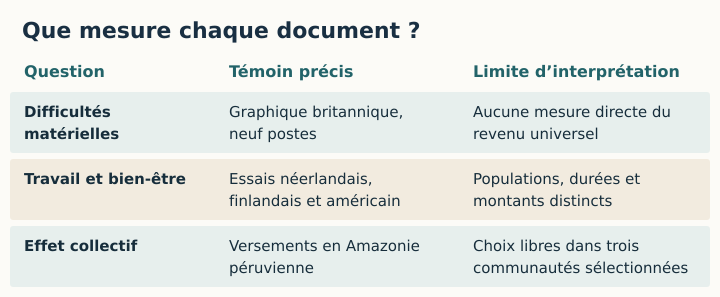

# X-ENS · MP-MPI-PC-PSI · Anglais 2025 — Corrigé guidé

*Corrigé rédigé par IA, non officiel. Signalez toute erreur.*

**Rédaction** · GPT-6.2 Astra Ultra · vitesse non renseignée

**Révision (tour 1)** · GPT-6.2 Astra Ultra · vitesse non renseignée

[Sujet commun](https://www.polytechnique.edu/admission-cycle-ingenieur/sites/admission/files/content/Anglais%20sujet.pdf) · [Fascicule PSI](https://www.ens.psl.eu/sites/default/files/2025_psi_ep5_anglais_14022025_nb.pdf) · [Rapport du jury](https://www.polytechnique.edu/admission-cycle-ingenieur/sites/admission/files/content/Ecrits_MP%2C%20MPI%2C%20PC%20et%20PSI_anglais%20OK.pdf)

## Préparer la composition

La synthèse fait dialoguer les documents 1 à 4. Le graphique de l’Institute for Fiscal Studies mesure la part des adultes britanniques d’âge actif qui n’ont pas les moyens de s’offrir chacun des neuf postes. Pour le chauffage, la barre passe d’un peu plus de 4 % en 2019–2020 à environ 11 % en 2022–2023. Ne pas y lire une mesure du chômage ou des effets d’un revenu universel. Le programme péruvien sélectionne trois communautés mais laisse les bénéficiaires choisir l’usage de l’argent. Les trois expériences d’emploi ne portent ni sur les mêmes personnes ni sur le même montant. Aucun résultat local ne vaut à lui seul prévision nationale.

Le texte d’opinion répond directement à Chris Talgo. Il concède le coût, discute le mauvais indicateur utilisé pour la Finlande et éprouve le lien moral supposé entre salaire, dignité et liberté. L’exemple de l’aide à un proche permet de proposer un raisonnement personnel sans reprendre toute la synthèse. La distinction entre montant brut dépensé et redistribution nette doit rester compatible avec le coût d’opportunité budgétaire.

## A · Synthèse des documents 1 à 4

### What an income floor can change, from pay packets to rainforests

The introduction of an unconditional income is often discussed as a response to a future without jobs. Yet the July 2024 chart from the Institute for Fiscal Studies records a more immediate problem. Across all nine categories surveyed, a greater share of working-age adults in the UK could not afford the item concerned in 2022–23 than in 2019–20. The articles by Donna Ferguson and Graeme Green in The Guardian and by Alexander Plum and Kabir Dasgupta in The Conversation examine what a regular payment might change for people facing insecurity. Their evidence turns on what recipients are free to do with the money and on what counts as success.

Ferguson traces the underlying claim to Thomas Paine, who argued that private landownership deprived everyone of a common inheritance. A similar argument now concerns the human knowledge on which artificial intelligence draws. Those who helped produce that resource may lose their earnings while the companies that exploit it collect the gains. Predictions range from new supervisory jobs to firms which scarcely employ people. The British estimates Ferguson cites concern tasks exposed to change, with extensive job losses a worst-case scenario. Even before such changes occur, the IFS chart shows a rise from just over four to roughly eleven per cent in the proportion unable to keep their home warm enough. Plum and Dasgupta describe a comparable burden of rising costs on low-income New Zealanders.

Greater security might change which jobs people accept. Ferguson reports that Dutch benefit recipients receiving unconditional support found more stable, better-paid work instead of taking the first insecure position available. Some advocates also foresee more care, creativity and voluntary activity. However, Plum and Dasgupta describe two different outcomes. Unemployed Finnish recipients experienced less distress and greater satisfaction, with only a small gain in employment. In Texas and Illinois, low-income adults who received a thousand dollars a month for three years worked slightly fewer hours than a comparison group receiving fifty dollars. Leisure increased, with no significant improvement in job quality or training. The size and duration of transfers, as well as the recipients' circumstances, complicate comparisons across these trials.

Green’s reporting from the Peruvian Amazon brings another measure of success into view. The need to meet a medical or school bill can make forest clearance or work in an illicit industry hard to resist. A British charity and two Indigenous women's organisations developed a pilot providing two pounds a day to 188 people in three communities already interested in conservation. No purchase or environmental service was required. Participants have met household needs, while some have bought seeds or restored trees near water sources. Where earlier initiatives had aroused suspicion, discretion over spending helped put decisions in local hands. Time spent restoring a spring is valuable to the community without necessarily appearing as an increase in paid employment.

How far such arrangements could extend depends partly on who pays. A New Zealand estimate cited by Plum and Dasgupta put the annual gross cost of payments at the jobseeker rate above forty billion New Zealand dollars, although simpler administration might offset part of the expense. Tighter benefit conditions point away from immediate adoption there. Ferguson reports a more speculative possibility in which largely automated firms distribute part of their proceeds. In Peru, organisers argue that climate finance could reach forest communities more directly, but a wider fund would require considerably more money.

These proposals share a commitment to leaving choices with recipients. Their objectives range from cushioning displacement to meeting everyday costs and maintaining forests. Evidence of better wellbeing or conservation can therefore coexist with a limited employment effect. It remains much harder to infer from a pilot how a permanent system would be funded or how its costs and gains would be distributed.

*625 mots hors titre, par unités séparées par des espaces.*

## B · Texte d’opinion

Chris Talgo is right about one attraction of work. A reliable colleague or a problem solved with one's own hands can give a working day a value no cheque can reproduce. He goes much further, however, when he concludes that an unconditional income rewards idleness and undermines dignity. I would support a modest income floor alongside public services, provided its financing is made explicit. Its strongest justification is that it could give people a more effective say in the conditions under which they work and care for others.

Consider a woman who cuts her hours to accompany a parent to hospital. When a paid care worker makes the same journey it counts as employment. When the daughter makes it, a labour survey may register one fewer hour of work. The journey still has to happen, and someone still does it. A system which makes her prove she is constantly available for paid employment can make the task harder without creating an extra nurse or a healthier parent. She might use a small guaranteed payment to take the afternoon off and keep the job whose satisfactions Talgo describes. There is no reason to treat her choice as a moral failing.

An income floor would also change an employer's calculation. A delivery rider paid by the trip may earn well at busy times and spend unpaid hours waiting at others. Regular income independent of the platform could allow that rider to refuse a shift that fails to cover the cost of travel. Talgo calls the weakening of incentives a danger. Here it is a specific incentive that would weaken, the pressure to take work on terms one cannot negotiate. Some employers would have to offer more predictable shifts. Others might reduce hiring. Both effects deserve investigation, and neither can be inferred from a claim about human nature.

The Finnish example shows why the test matters. Two thousand recipients cannot be expected to move the unemployment rate of a whole country appreciably. Comparing that national rate before and after the experiment answers a different question from comparing eligible people who received a payment with similar people who did not. Equally, advocates cannot pay a national bill with evidence that some trial participants felt better. A flat grant generous enough to live on would be expensive. Replacing disability benefits or housing assistance with the same grant for everyone could leave people with unusually high costs worse off. I would retain those benefits, publish the tax changes that would recover the grant from higher earners and measure who gains after tax and housing costs.

The point of a trial should be to test these possibilities and their costs against a realistic alternative. A community can count hours worked, rent arrears, time spent caring and people's ability to leave an unsafe job. It can also ask what else the same public money could buy. If a grant crowded out accessible transport or home care, the loss would matter to the daughter taking her parent to hospital. Talgo is entitled to demand a budget. He has given us no reason to assume that this daughter, the rider or their neighbours would cease to have purposes of their own once they had a little more room to act on them.

*542 mots, selon le même décompte.*
