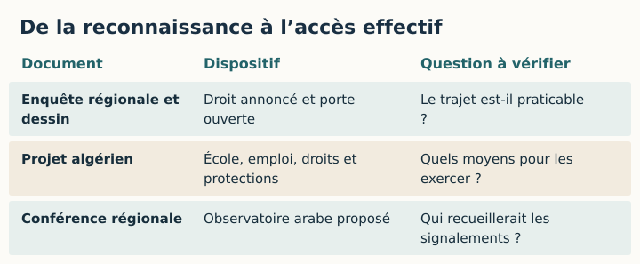

# X-ENS · MP-MPI-PC-PSI · Arabe 2025 — Corrigé guidé

*Corrigé rédigé par IA, non officiel. Signalez toute erreur.*

**Rédaction** · GPT-6.2 Astra Ultra · vitesse non renseignée

**Révision (tour 1)** · GPT-6.2 Astra Ultra · vitesse non renseignée

[Sujet commun](https://www.polytechnique.edu/admission-cycle-ingenieur/sites/admission/files/content/Arabe%20sujet.pdf) · [Fascicule PSI](https://www.ens.psl.eu/sites/default/files/2025_psi_ep5_arabe_14022025_nb.pdf) · [Rapport du jury](https://www.polytechnique.edu/admission-cycle-ingenieur/sites/admission/files/content/Ecrits_MP%2C%20MPI%2C%20PC%20et%20PSI_arabe%20OK.pdf) · [Rapport PSI](https://www.ens.psl.eu/sites/default/files/2025_psi_rapport_arabe_ecrit.pdf)

## Préparer la composition

La synthèse rapproche le tour d’horizon de *Noon Post*, le projet de loi algérien examiné en octobre 2024, les recommandations du congrès et le dessin marocain. La porte effectivement ouverte du dessin donne sur des marches. Le mot d’accueil est donc contredit par l’accès matériel. Le seuil algérien d’au moins 1 % de postes relève du projet discuté. L’observatoire arabe est une proposition du congrès.

Dans la partie B, l’article de *Hespress* rapporte des prises de position distinctes. Mounir Khairallah défend un terme qui rende sensible l’action sociale des obstacles ; le représentant des droits humains insiste sur la précision juridique, l’accès aux services et le choix des intéressés. Il faut discuter leur opposition aux dénominations flatteuses en exposant un exemple personnel argumenté. Les comptes ci-dessous suivent les unités séparées par des espaces : les prépositions ou conjonctions soudées en arabe ne deviennent pas des mots distincts.

## A · Synthèse des documents 1 à 4

### أبواب مفتوحة على درج: متى يصير الإدماج حقا قابلا للاستعمال؟

في الرسم المنشور في المغرب سنة ٢٠١٩ يطل رجل مبتسم من نافذة ويمد ذراعيه مرحبا برجل يجلس على كرسي متحرك. يؤكد له أن الأبواب مفتوحة، وهي فعلا مفتوحة، إلا أن الباب يؤدي مباشرة إلى درج. يلخص التناقض بين الكلام والمكان مسألة تعرضها مقالة نون بوست عن البلدان العربية ويعود إليها تحقيق عن مشروع قانون جزائري وتقرير عن مؤتمر لحقوق الأشخاص ذوي الإعاقة. فالأمر لا يتعلق بمجرد الاعتراف بأن لهذه الفئة حقوقا، بل بالشروط التي تسمح باستعمالها وبالجهة التي تراقب تحققها عندما تتعارض صورة المؤسسة عن نفسها مع تجربة من يقصدها.

تبيّن مقالة نون بوست أن الشفقة كثيرا ما ترافقها معاملة تضع الأشخاص المعنيين على هامش الحياة الاجتماعية. وقد زادت الحروب والأزمات عدد من يحتاجون إلى الرعاية والتأهيل في مناطق تفتقر أصلا إلى الخدمات. كما تختلف التقديرات العددية باختلاف الجهات التي تجمعها، مما يعقد تحديد حجم الاحتياجات. وتعطي المقالة مثالا من تونس على ارتفاع البطالة بين الأشخاص ذوي الإعاقة، وتنقل عن ناشطة مصرية نقدها لمحدودية ما توفره المؤسسات. ويشدد التحقيق الجزائري على وجه آخر للمشكلة نفسها، إذ قد يفتح باب مدرسة أمام طفل ثم يعجز عن متابعة الدروس لعدم وجود وسائل تعليم ملائمة أو أشخاص مؤهلين لمرافقته. عندئذ تضطر الأسرة إلى تعويض خدمة يفترض أن تكون عامة، فيصير ما تحصل عليه رهنا بوقتها ومواردها.

وتظهر هذه الآلية أيضا عند الانتقال من المدرسة إلى العمل. فالتشريعات التي تقر حقا في التوظيف لا تمنع أن يقلل صاحب العمل من قيمة أداء العامل أو يحصره في مهمات لا تتناسب مع مؤهلاته. وفي الجزائر تشير التقديرات الواردة في التحقيق إلى تسجيل نحو مليون ومئة وثمانية عشر ألف شخص سنة ٢٠٢٤. ويتصل مشروع القانون المطروح آنذاك أمام اللجنة البرلمانية بالمادة الدستورية التي تضمن إدماج الفئات المعنية في الحياة الاجتماعية. ومن إجراءاته المقترحة توحيد سلم تقييم الإعاقة، وتيسير الحصول على السكن الاجتماعي، وإقرار التمدرس الإجباري للأطفال المعنيين وتخصيص نسبة دنيا قدرها واحد في المئة من مناصب العمل للعمال المعترف بقدرتهم على العمل ضمن هذه الفئة. ويعرض المشروع كذلك حقوقا ثقافية ورياضية وأحكاما لحماية الأشخاص من الاعتداء.

غير أن ممثلي الجمعيات الذين استمعت إليهم اللجنة يردون النقاش إلى مسار الشخص بين المرافق. فوجود مقعد دراسي لا يغني عن المرافقة المدرسية، ووجود علاج لا يكفي إذا تعذر الوصول إلى المركز الصحي أو إلى الدعم النفسي. ومن مطالبهم تطوير المرافقة المنزلية، وتحديث الوسائل التعليمية، وتسهيل الإجراءات الإدارية، ومنها رقمنة بطاقة الإعاقة. ويعترضون أيضا على ورود عبارة «الأشخاص ذوو الاحتياجات الخاصة» في تسمية المشروع بدلا من المصطلح المرتبط بالاتفاقية الدولية. ومثلما يلفت الرسم المغربي النظر إلى الدرج الذي يغيب عن خطاب الترحيب، تكشف هذه الملاحظات ما لا يظهر عند قراءة قائمة التدابير وحدها. فالسؤال عند باب المؤسسة هو ما يستطيع الشخص فعله فعلا بعد دخوله، بل ما إذا كان يستطيع الدخول أصلا.

ويصل المشاركون في المؤتمر المعروض في الوثيقة الثالثة بين هذا العمل المحلي والتعاون على المستوى العربي. تجمع مداخلاتهم بين الرعاية الصحية والتعليم والضمان الاجتماعي وفرص العمل، وتبحث دور مراكز الرعاية والأسر والتقنيات المساعدة في إتاحة الحركة والتواصل باستقلال. وهم يدعون إلى تهيئة المرافق وتطوير الخدمات الرقمية وتوعية المجتمع، وإلى إنشاء مرصد عربي يرصد أوضاع الأشخاص ذوي الإعاقة ويتلقى الشكاوى المتعلقة بالعنف والإساءة. فالرقم المسجل لدى الإدارة يعطي صورة عن عدد الملفات، أما الشكوى فتكشف وضعا قد لا يظهر في ذلك الرقم، ومنها حرمان شخص مسجل أصلا من خدمة مضمونة له. ويظل المرصد اقتراحا طرحه المشاركون، فلا يمكن عد مجرد الدعوة إليه دليلا على أن الرقابة أصبحت فعالة.

تتقاطع التجارب المعروضة في الانتقال من الرعاية التي تمنحها جهة تتكلم باسم الآخرين إلى مشاركة يكون فيها لأصحاب الحق رأي في تحديد العوائق وتقييم الحلول. وإذا كانت النصوص القانونية والإحصاءات ضرورية لتوزيع المسؤوليات والموارد، فإن الجمعيات والتقارير الميدانية تضيف إليها معرفة مصدرها استعمال المدرسة والعمل والمرفق الصحي في الحياة اليومية. ويبين الرسم ما يترتب على إغفال هذه المعرفة: يستطيع المسؤول أن يصدق تماما أنه رحب بزائره فيما يبقى الزائر، الذي لم ينقصه الترحيب، خارج الباب.

*613 mots hors titre, par unités séparées par des espaces.*

## B · Texte d’opinion

حين يرفض بعض الأشخاص ذوي الإعاقة أن يسميهم الإعلام «أصحاب الهمم»، لا أرى في اعتراضهم خلافا لغويا يمكن تأجيله إلى أن تحل المشكلات الحقيقية. فمن يملك تسمية المشكلة يوجه النظر أيضا نحو الطرف الذي ينتظر منه حلها. وأوافق الرأي الذي ينقله مقال هسبريس عن أن إسناد البطولة إلى إنسان لمجرد وضعه قد يعفي المؤسسة من مساءلة نفسها. غير أن استبدال عبارة بأخرى لن يكفي ما لم يترتب عليه حق في الكلام والاختيار والاعتراض، بما في ذلك الاعتراض على الصفة التي يختارها الآخرون بحسن نية.

لنتصور طالبة كفيفة مقبلة على امتحان جامعي. حاجتها إلى قراءة الأسئلة هي حاجة زملائها أنفسهم. الاختلاف أن النسخة الورقية التي يستطيعون قراءتها لا تتيح لها ذلك. فإذا تلقت قبل الامتحان نسخة رقمية قابلة للقراءة بأداة صوتية أمكنها أن تناقش المسألة العلمية مثلهم. وإذا لم تتلق النسخة إلا بعد نصف الوقت فلن يعيد إليها الثناء على شجاعتها الدقائق التي خسرتها. هنا يقنعني تمييز الباحث منير خير الله بين الحاجة المشتركة وطريق الاستجابة لها. والقول إن الجامعة أقامت عائقا يمكن أن يقود إلى تكليف مصلحة معينة بإزالته وإلى تحديد أجل لذلك. أما القول إن الطالبة أظهرت همة استثنائية فلا يرتب على أحد التزاما يمكن التحقق من الوفاء به.

ومع ذلك فإن اختيار الاسم ينبغي ألا ينقلب إلى امتحان لغوي جديد يفرض على الشخص قبل سماع طلبه. قد يفضل إنسان عبارة «الأشخاص ذوو الإعاقة» لأنها تثبت أنه شخص كامل الحقوق قبل وصف حالته. وقد يختار آخر عبارة «الأشخاص المعاقون» ليشدد على ما يفعله مجتمع غير مهيأ بأفراده. كما أن عبارة «في وضعية إعاقة» تفيد في شرح الفرق بين شارع يستطيع الشخص عبوره وشارع يمنعه من الوصول إلى العمل. لا يحل أحد هذه التعابير محل الإفادة التي يقدمها صاحب التجربة عما يحتاج إليه في ذلك المكان. وأميز هنا بين وثيقة قانونية تقتضي مصطلحات مستقرة حتى لا يسقط حق عند تغيير لفظ، ومقابلة صحافية يمكن فيها ببساطة أن يسأل الصحافي ضيفه كيف يرغب في أن يقدم إلى القراء.

ويصح في رأيي ما يشدد عليه ممثل المنظمة المغربية لحقوق الإنسان بشأن مسؤولية الإعلام والفاعل العمومي. لكن الخبر الأكثر دقة قد يظل ناقصا إذا لم ينقل إلا كلام الخبير عن أشخاص غائبين. في مثال الامتحان أسأل الطالبة نفسها إن كانت الأداة الصوتية تلائم طبيعة الأسئلة، إذ قد يتضمن الاختبار رسما لا يصفه البرنامج. وأسأل الجامعة من جرب الملف مسبقا ومن يملك تصحيح الزمن الضائع إذا فشل الترتيب. ويحق للطالبة بعد إعلان النتيجة أن تعرف كيف عولج اعتراضها، فقد تتكرر المشكلة مع طالب آخر في الفصل التالي. عندئذ تتحول الدقة من صفة جميلة في مقال إلى سلسلة قرارات يعرف القارئ كيف يحاسب أصحابها. وليس مطلوبا في المقابل أن تعرض الطالبة حياتها الشخصية أو أن تمثل جميع المكفوفين كي تعد شكواها جديرة بالبحث.

الاحترام إذن أن يظل المرء قادرا على وصف نفسه، وعلى مطالبة المؤسسة بشيء آخر غير تعديل لافتتها. قد تكون كلمة تشجيع في علاقة شخصية عزيزة على من يسمعها، ولكن جعلها اسما إلزاميا لجماعة كاملة يحمل من لا يشعر بالشجاعة اليوم عبء أن يكون بطلا أيضا. أفضّل أن تتعهد الجامعة لطلابها جميعا بامتحان يمكنهم قراءته، وأن تنشر طريقة الاعتراض عند تعذر ذلك، ثم أن تترك لكل طالب حرية الكلام عن نجاحه أو تعبه بالعبارة التي يلتمسها لنفسه. بذلك تصبح اللغة أداة لضمان المشاركة ويزول عن الإنسان واجب إرضاء الصورة المطمئنة التي صنعها له سواه.

*521 mots, selon le même décompte.*
