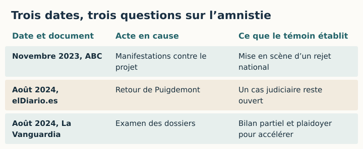

# X-ENS · MP-MPI-PC-PSI · Espagnol 2025 — Corrigé guidé

*Corrigé rédigé par IA, non officiel. Signalez toute erreur.*

**Rédaction** · GPT-6.2 Astra Ultra · vitesse non renseignée

**Révision (tour 1)** · GPT-6.2 Astra Ultra · vitesse non renseignée

[Sujet commun](https://www.polytechnique.edu/admission-cycle-ingenieur/sites/admission/files/content/Espagnol%20sujet.pdf) · [Fascicule PSI](https://www.ens.psl.eu/sites/default/files/2025_psi_ep5_espagnol_14022025_nb.pdf) · [Rapport du jury](https://www.polytechnique.edu/admission-cycle-ingenieur/sites/admission/files/content/Ecrits_MP%2C%20MPI%20et%20PC_espagnol%20OK_0.pdf)

## Préparer la composition

Placer les documents sur une ligne du temps : mobilisation de novembre 2023, défense de la proposition en janvier 2024, loi votée le 30 mai et entrée en vigueur le 11 juin, retour de Puigdemont le 8 août puis bilan du 19 août. La couverture d’*ABC* fait parler une foule à travers le titre et la juxtaposition de sept villes ; son chiffre de plus d’un million est celui du journal. Les quelque 200 cas déjà examinés ne correspondent pas à 200 amnisties accordées. Distinguer la décision législative et son application individuelle.

Dans le texte d’opinion, répondre à l’éditorial de septembre sur la Diada, qui appartient à la partie B. L’affaiblissement de la majorité indépendantiste ne prouve pas la résolution du désaccord. La copie peut approuver l’ouverture d’Illa et demander par quels services, quelles procédures et quels débats publics elle se vérifiera.

## A · Synthèse des documents 1 à 4

### Una ley para cerrar una crisis, varias disputas sobre su alcance

Una multitud llena el centro de Madrid en la portada de ABC del 13 de noviembre de 2023. Bajo la fotografía principal, otras seis ciudades aportan imágenes de manifestantes y banderas al mismo rechazo de la futura amnistía. Meses después, el editorial de La Vanguardia del 19 de agosto de 2024 reprocha a las autoridades competentes la lentitud con que aplican la ley ya aprobada. Entre ambas posiciones se plantea una cuestión que atraviesa también el análisis de Omar G. Encarnación y la crónica de elDiario.es sobre Carles Puigdemont: ¿en qué condiciones puede una medida de excepción contribuir a normalizar la vida política?

El desacuerdo afecta primero al origen de la iniciativa. Tras indultar en 2021 a nueve dirigentes separatistas, Pedro Sánchez había descartado una amnistía general. La necesidad de obtener apoyo parlamentario de los partidos independentistas le hizo cambiar de posición. Para sus críticos, el pacto compromete la igualdad ante la ley y beneficia precisamente a quienes hicieron posible el referéndum ilegal de 2017. ABC presenta las concentraciones en varias capitales como respuesta española a unas concesiones al independentismo y cifra en más de un millón los participantes. La acumulación de fotografías hace visible la amplitud territorial de la protesta; un titular común atribuye a esas concentraciones una misma voz.

Sin negar el cálculo político del Gobierno, Encarnación separa las circunstancias de la negociación de sus posibles resultados. Recuerda que la amnistía de 1977 facilitó acuerdos que cristalizaron en la Constitución de 1978, aunque también dificultó que se hiciera justicia a las víctimas de la dictadura. El precedente sudafricano muestra asimismo que una democracia puede aceptar un coste judicial a cambio de otra salida a un conflicto. Según el autor, el beneficio principal de la medida catalana recaería en quienes quieren dejar atrás la crisis, incluidos ciudadanos que rechazan la conducta de Puigdemont. Esa tesis no presupone que los beneficiarios se hayan arrepentido ni que Junts haya renunciado a otra consulta unilateral. La Vanguardia comparte la expectativa de normalización y señala los efectos apaciguadores de los indultos anteriores.

Una vez aprobada la norma el 30 de mayo y vigente desde el 11 de junio, el conflicto pasó también a los expedientes. El editorial recuerda que las decisiones debían adoptarse en dos meses. De los 486 posibles beneficiarios calculados por la Fiscalía, los datos provisionales reunidos por Alerta Solidària permitían identificar unos doscientos casos revisados. Solo alrededor de un centenar habían obtenido la aplicación inmediata de la ley. Aproximadamente la mitad de estos últimos correspondían a agentes de policía o de la Guardia Civil. El reparto matiza la imagen de un favor reservado a dirigentes separatistas; el carácter incompleto de las cifras impide, sin embargo, convertirlas en un balance definitivo.

El regreso de Puigdemont el 8 de agosto, tras siete años fuera de España, condensó esa distancia entre aprobación y aplicación. En Barcelona denunció que la ley no hubiese puesto fin a la orden de detención que seguía pesando sobre él por malversación. La crónica de Sandra Vicente y Arturo Puente distingue su caso del de otros dirigentes sin causas pendientes tras el archivo del procedimiento relacionado con Tsunami. Su aparición coincidió con el debate de investidura del socialista Salvador Illa, en una legislatura en la que el independentismo había perdido la mayoría. Puigdemont anunció que iría al Parlament, pero desapareció sin entrar en la cámara. El episodio reabrió la controversia sobre la actuación de las autoridades catalanas y españolas.

La disputa abarca, por tanto, decisiones diferentes. La mayoría parlamentaria pudo aprobar una salida política que parte de la ciudadanía juzga ilegítima. Su aplicación exige resolver situaciones individuales que no son equivalentes. Y las expectativas de reconciliación, defendidas con argumentos históricos y sociales, siguen dependiendo de lo que ciudadanos y jueces perciban en sus efectos concretos.

*626 mots hors titre, par unités séparées par des espaces.*

## B · Texte d’opinion

El País celebra que Salvador Illa haya hablado en la Diada tanto a los independentistas como a quienes llegaron ayer a Cataluña. Comparto la idea de que un presidente de la Generalitat tiene que poder dirigirse a todos sin exigir que declaren primero su posición sobre la independencia. Me parece, sin embargo, prematuro considerar la pacificación un hecho consumado. La prueba de la sensatez institucional será la capacidad de mantener abiertas las instituciones precisamente el día en que una decisión del Gobierno vuelva a dividir a sus destinatarios.

El editorial lee con atención los símbolos: el busto de Tarradellas, las alusiones a dos monasterios, el recuerdo de tragedias ocurridas un 11 de septiembre fuera de Cataluña. Todos tienen un mérito que no conviene despreciar. Un niño cuyos padres nacieron en otro continente puede aprender en la escuela la historia de la Diada sin que esa celebración tenga que imponerle una genealogía ni una opinión. Ahora bien, también debe poder escuchar por qué otro ciudadano considera insuficiente el marco autonómico. Si la previsibilidad consiste en que ambos conocen las reglas con las que se va a discutir, constituye un progreso. Si exige apartar indefinidamente la cuestión que los separa, aplaza el problema.

La insistencia de Illa en los servicios públicos me parece más prometedora aún que la elección de los símbolos. Imaginemos una familia que cambia de municipio porque no puede pagar el alquiler. Pierde la proximidad de su centro de salud y su hija necesita plaza en otra escuela. Una oficina que haga comprensibles los criterios de admisión y permita recurrir una decisión produce una experiencia concreta de pertenencia. Pero esa familia querrá saber también por qué hay tan pocas plazas o viviendas a su alcance. Decidir cuánto suelo se destina al alquiler asequible o cómo se reparten los recursos entre municipios es una auténtica decisión política. Descalificar todo conflicto como una instrumentalización partidista haría más difícil exigir cuentas por esas prioridades.

La pérdida de la mayoría parlamentaria independentista autoriza una alternancia; no convierte a quienes la perdieron en extranjeros dentro de la comunidad. A la inversa, una concentración multitudinaria no autoriza a hablar en nombre de todos los vecinos que se quedaron en casa. La Diada pertenecerá a todos si las instituciones preservan ambos derechos, manifestarse y discrepar de las consignas sin que se ponga en duda la condición de catalán de nadie. Para ello ayudan más los compromisos verificables que las declaraciones de concordia. Publicar plazos de acceso a los servicios, escuchar reclamaciones en el Parlament y explicar el destino de los presupuestos son formas de reconocer al adversario como ciudadano con derecho a una respuesta.

Illa ha elegido un tono que reduce el coste de sentarse a hablar. Conviene reconocer ese paso sin otorgarle por adelantado los resultados que promete. Cuando llegue un desacuerdo serio, la pregunta será si el presidente sigue escuchando a quienes ponen en cuestión sus decisiones, incluidas las que él considera indispensables. Unas instituciones previsibles pueden sostener debates muy vivos. Su mejor logro sería que nadie tuviera que callar sobre el futuro político de Cataluña para conseguir ser oído sobre la escuela de su hija.

*522 mots, selon le même décompte.*
