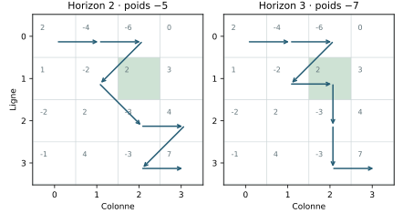
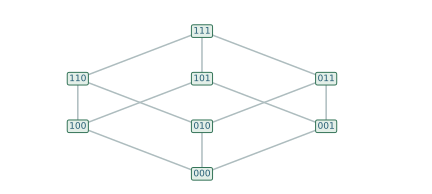

# X-ENS MP–PC–PSI · Informatique B 2025 · Corrigé brut

*Corrigé rédigé par IA, non officiel. Signalez toute erreur.*

**Rédaction** · GPT-6.2 Astra Ultra · vitesse non renseignée · 24 novembre 2026

**Révision (tour 2)** · modèle exact non renseigné (famille Claude) · effort non renseigné · vitesse non renseignée · 28 novembre 2026

## I · Sauts et chemins

### Question 1 · Poids d’un chemin

Additionner toutes les valeurs visitées, même celles des extrémités. Pour $m$ cases, la boucle fait $m$ accès et additions, en temps $\Theta(m)$ et en espace auxiliaire constant. Le chemin vide a un poids nul.

```python
def poids(T, chemin):
    total = 0
    for i, j in chemin:
        total += T[i][j]  # La case initiale est comprise.
    return total
```

### Question 2 · Composer des sauts

Les deux accumulateurs contiennent la case atteinte après le préfixe déjà lu. La liste des sauts peut être vide. Les paramètres initiaux et la liste restent disponibles dans leur état d’origine.

```python
def appliquer_sauts(i, j, sauts):
    ligne, colonne = i, j
    for di, dj in sauts:
        ligne += di
        colonne += dj
    return ligne, colonne
```

### Question 3 · Contrôler les sauts du chemin

Avant chaque comparaison, ajouter à la liste locale des sauts les possibilités offertes par la case courante. Vérifier que la différence de coordonnées jusqu’à la case suivante figure dans cette liste. Les bonus persistent. Un chemin de zéro ou une case vérifie la condition sur toutes ses arêtes.

```python
def sauts_corrects(sauts, bonus, chemin):
    autorises = sauts[:]
    for k in range(len(chemin) - 1):
        i, j = chemin[k]
        if (i, j) in bonus:
            autorises = autorises + bonus[(i, j)]
        u, v = chemin[k + 1]
        if (u - i, v - j) not in autorises:
            return False
    return True
```

### Question 4 · Vérifier la positivité lexicographique

Un saut est interdit pour $\Delta i<0$ ou pour $\Delta i=0$ et $\Delta j\leq0$. Tester aussi les listes des bonus, même ceux dont la position initiale paraît inaccessible. À chaque saut accepté, le couple de coordonnées augmente strictement dans l’ordre lexicographique. Dans une grille finie, il ne peut donc pas revenir sur une case déjà visitée.

```python
def sauts_bien_formes(sauts, bonus):
    def positifs(liste):
        for di, dj in liste:
            if di < 0 or (di == 0 and dj <= 0):
                return False
        return True

    if not positifs(sauts):
        return False
    for case in bonus:  # En Python, ce parcours énumère les clés.
        if not positifs(bonus[case]):
            return False
    return True
```

## II · Recherche exhaustive

### Question 5 · Plus long parcours

La stricte croissance lexicographique borne le nombre de cases du chemin par $N^2$, donc le nombre de sauts par $N^2-1$. Comme $L$ sert ensuite d’horizon, on retient $L=N^2-1$ sauts, soit $N^2$ cases. La borne est atteinte avec les deux sauts $(0,1)$ et $(1,-(N-1))$ : une fois la dernière colonne atteinte, le second saut mène à la première colonne de la ligne suivante. Pour $N=1$, le chemin se réduit à sa case initiale. Un horizon $N^2$ convient également pour la recherche intégrale, car seul le but peut arrêter avec succès une branche avant l’horizon.

### Question 6 · Recherche exhaustive bornée

En cohérence avec la partie III, un segment s’arrête lorsqu’il atteint l’arrivée ou lorsqu’il a consommé l’horizon. Une impasse avant ces deux événements échoue. La formule « au plus » autorise donc les arrivées précoces. Autoriser en plus l’arrêt volontaire sur toute case rendrait possible un préfixe avantageux qui refuse toujours de payer la case d’arrivée. Les comparaisons entre successeurs portent sur leur coût, puisque la pénalité courante est commune à tous. En cas d’égalité le premier saut dans l’ordre de présentation est conservé.

L’appel sans successeur admissible utilise le marqueur interne Python `None`. On évite ainsi toute addition d’une pénalité négative à la valeur entière `INFINI`. Par induction sur l’horizon, chaque candidat explore exactement un premier saut possible suivi de sa meilleure continuation admissible. La sélection minimale est exhaustive. La récursion est portée par la fonction interne `chercher`, qui ajoute aux paramètres de l’énoncé l’horizon restant et la liste des sauts acquis sur la branche.

Soit $A$ le nombre total d’entrées de sauts disponibles, en ajoutant toutes les listes, et $H=\min(\text{horizon},N^2)$. L’arbre contient au plus $S_H=1+A+\dots+A^H$ appels. À chacun on peut tester $A$ directions et copier des listes de sauts. Chaque amélioration reconstruit une route d’au plus $H$ éléments. Une borne simple est $O((1+A)(1+H)S_H)$ dans ce code. À branchement fixé supérieur à un, la recherche est exponentielle en l’horizon dans le pire cas. La profondeur de pile ne dépasse pas $H+1$.

```python
def trouve_complet_rec(T, sauts, bonus, sauts_max, i, j):
    N = len(T)

    def chercher(i, j, h, disponibles):
        if (i, j) == (N - 1, N - 1) or h == 0:
            return T[i][j], []
        if (i, j) in bonus:
            disponibles = disponibles + bonus[(i, j)]
        meilleur = None
        for di, dj in disponibles:
            u, v = i + di, j + dj
            if 0 <= u < N and 0 <= v < N:
                suite = chercher(u, v, h - 1, disponibles)
                if suite is not None:
                    cout, route = suite
                    if meilleur is None or cout < meilleur[0]:
                        meilleur = cout, [(di, dj)] + route
        if meilleur is None:
            return None  # Impasse avant l’arrivée et avant l’horizon.
        return T[i][j] + meilleur[0], meilleur[1]

    sortie = chercher(i, j, sauts_max, sauts)
    if sortie is None:
        return INFINI, []
    return sortie

def trouve_complet(T, sauts, bonus, sauts_max):
    return trouve_complet_rec(T, sauts, bonus, sauts_max, 0, 0)
```

### Question 7 · Mémoïsation

Numéroter les $b$ bonus. Pour un problème fixé, mémoriser le meilleur coût et le premier saut par quadruplet $(i,j,h,c)$, où $h$ est l’horizon restant et $c$ le masque des bonus déjà pris. Les sauts initiaux sont fixes ; le masque fait retrouver l’ensemble courant. Si l’on mémorise directement les arguments de la version à listes, une représentation canonique des sauts disponibles remplace le masque. Ni la seule case ni la seule paire case/horizon ne suffit. Stocker aussi les échecs.

Il y a au plus $N^2(H+1)2^b$ états. Avec transitions de masque préparées et au plus $A$ sauts, la résolution prend $O(N^2(H+1)2^b(1+A))$ opérations et $O(N^2(H+1)2^b)$ cases mémoire, hors préparation et stockage des listes disponibles. Une seule reconstruction finale coûte $O(H)$. Mémoriser une liste de route complète par état peut ajouter un facteur $H$ de copie ou d’espace.

## III · Recherche gloutonne

### Question 8 · Tracer les horizons 2 et 3

Notons $d=(0,1)$, $g=(1,-1)$, $r=(1,1)$ et $v=(1,0)$, activé en $(1,2)$. En départageant les égalités dans l’ordre du sujet, pour $k=2$ les blocs sont $(d,d)$, $(g,r)$, $(d,g)$ et $(d)$. Les cases sont $(0,0),(0,1),(0,2),(1,1),(2,2),(2,3),(3,2),(3,3)$, de poids $-5$. La seule égalité est en $(2,2)$ : le bloc $(g,d)$, par $(3,1)$, coûte autant que $(d,g)$ et donne aussi $-5$. Le chemin optimal a le poids $-7$.

Pour $k=3$, les blocs sont $(d,d,g)$, $(d,v,v)$ et $(d)$. La route visite $(1,2)$, puis $(2,2),(3,2),(3,3)$ : son poids est $-7$, optimal. Pour $k=4$, les blocs commencent par $(d,d,g,r)$, puis le meilleur achèvement est $(r)$, soit le chemin de la figure (b), de poids $-6$. Passer de l’horizon 3 à 4 a donc détérioré le résultat sur la même grille.



### Question 9 · Recherche gloutonne

Le calcul exhaustif voit les bonus pris dans son exploration locale. Après sélection, rejouer les sauts permet de transmettre au prochain bloc uniquement les bonus vraiment acquis. Ajouter la pénalité à chaque arrivée et compter le départ une seule fois. Un bloc vide hors de l’arrivée signifie échec, y compris pour $k=0$. Sur une grille d’une seule case, la boucle ne s’exécute pas et l’unique pénalité est renvoyée.

```python
def trouve_glouton(T, sauts, bonus, k):
    N = len(T)
    i, j = 0, 0
    total = T[0][0]
    route = []
    disponibles = sauts[:]
    while (i, j) != (N - 1, N - 1):
        valeur, bloc = trouve_complet_rec(
            T, disponibles, bonus, k, i, j)
        if len(bloc) == 0:
            return INFINI, []
        for di, dj in bloc:
            # Le prochain bloc héritera de tous les bonus traversés.
            if (i, j) in bonus:
                disponibles = disponibles + bonus[(i, j)]
            i, j = i + di, j + dj
            route.append((di, dj))
            total += T[i][j]  # Ne recompte pas la jonction.
    return total, route
```

## IV · Programmation dynamique

### Question 10 · Numéroter un masque binaire

Maintenir la puissance de deux qui correspond au bit courant. On calcule $\sum_{a=0}^{b-1}\mathbf 1_{\{m_a\}}2^a$ en une lecture. Ainsi `[True, False, True]` donne 5 et le masque vide donne 0.

```python
def code_bonus(masque_bonus):
    code, place = 0, 1
    for actif in masque_bonus:
        if actif:
            code += place
        place *= 2
    return code
```

### Question 11 · Équation de Bellman

Soit $p=(i,j)$, $t=(N-1,N-1)$ et $M$ l’ensemble des bonus de code $\langle b_0\dots b_{n-1}\rangle$, reçu **avant** activation en $p$. Noter $V(p,M)$ la valeur `poids_opt[i][j][code]`. Poser $M'=M\cup\{k\}$ si $p$ est le bonus $k$, sinon $M'=M$. Avec les notations de l’énoncé, les déplacements possibles sont $D(M')=\Gamma\cup\bigcup_{k\in M'}\Delta_k$. Pour tout $M$, $V(t,M)=T[t]$. Ailleurs,

$$
V(p,M)=T[p]+\min_{d\in D(M'),\ p+d\text{ dans la grille}} V(p+d,M').
$$

En l’absence de successeur menant au but, définir $V=+\infty$. Le chemin optimal se décompose en sa première arête et un suffixe optimal dans le nouvel état. Réciproquement, chaque suffixe admissible se préfixe par cette arête. Cette double implication justifie la récurrence, même avec pénalités négatives, car la grille des états est acyclique.

### Question 12 · Énumérer les masques par niveaux

La file part du masque plein. Le second champ donne le premier indice encore autorisé à retirer. Chaque suite de suppressions est strictement croissante ; un masque donné est donc produit une seule fois, par la liste triée de ses indices faux. La lecture en largeur ordonne les masques par nombre croissant de bits faux, donc selon une extension de l’inclusion décroissante. La tête avance par indice pour économiser les décalages de `pop(0)`. Le coût, copies des masques comprises, est $O((1+b)2^b)$, de même que la taille du résultat. Avec zéro bonus, la liste contient le seul masque vide.

```python
def combinaisons_bonus(nb_bonus):
    total = [True for k in range(nb_bonus)]
    file = [(total, 0)]
    resultat = []
    tete = 0
    while tete < len(file):
        masque, premier = file[tete]
        tete += 1
        resultat.append(masque)
        for k in range(nb_bonus):
            if k >= premier:
                suivant = masque[:]
                suivant[k] = False
                file.append((suivant, k + 1))
    return resultat
```



### Question 13 · Union des sauts accessibles

Ajouter d’abord les sauts communs, puis les listes des seuls bonus actifs. Un dictionnaire de présence conserve une seule occurrence de chaque couple sans modifier les entrées. Sous les hypothèses du sujet, le coût est linéaire dans le nombre de bits et le nombre total d’entrées effectivement lues.

```python
def trouver_sauts_possibles(sauts, bonus_au_rang, masque_bonus):
    resultat = []
    vu = {}
    def ajouter(liste):
        for saut in liste:
            if saut not in vu:
                vu[saut] = True
                resultat.append(saut)
    ajouter(sauts)
    for k in range(len(masque_bonus)):
        if masque_bonus[k]:
            ajouter(bonus_au_rang[k])
    return resultat
```

### Question 14 · Compléter la programmation dynamique

Dans l’ordre des sept blancs du **squelette imprimé**, placer (1) `2 ** nb_bonus`, (2) `0`, (3) `trouver_sauts_possibles(sauts, bonus_au_rang, bonus_actifs)`, (4) et (5) `N-1, -1, -1`, (6) `poids_opt_dest`, (7) `(delta_i, delta_j, code_bonus_dest)`. La dernière ligne ajoute exactement une fois la pénalité de la case, y compris celle d’arrivée. Le triplet conserve le déplacement et le masque au prochain état.

Les sept réponses suffisent pour la question. Le squelette a toutefois une limite. Le sujet définit `INFINI` comme un entier. Une impasse garde le coût `INFINI`, puis reçoit sa pénalité : si elle est négative, le coût passe sous `INFINI` et une case amont peut enregistrer un saut vers cette impasse. Tant que `INFINI` dépasse largement tout poids de chemin, le poids optimal et le chemin reconstruit à la question 15 restent justes ; seules les valeurs des états sans issue sont faussées. La variante ci-dessous supprime ce défaut : elle initialise directement l’arrivée à sa pénalité, conserve le triplet nul pour les échecs, et n’ajoute la pénalité que si un successeur atteint vraiment le but. Elle utilise les deux fonctions auxiliaires supposées fournies dans l’énoncé.

Les masques extérieurs sont parcourus en inclusion décroissante. Un successeur avec un masque plus grand est déjà prêt ; si le masque est le même, le successeur est strictement ultérieur en ordre lexicographique et a donc été calculé plus tôt dans les boucles descendantes. Les deux tableaux contiennent $N^2 2^b$ cases chacun. Avec $A$ entrées de saut au total, le coût est $O(2^b[(1+b+A)+N^2(1+A)])$ en supposant `ajouter_bonus` en temps constant (numéro et puissance de deux accessibles). Une fonction auxiliaire qui recopierait systématiquement un masque ajouterait $O(b)$ par état. La création et le stockage des masques ajoutent $O((1+b)2^b)$ en mémoire. La borne en temps vaut pour le programme ci-dessous, dont les tests d’indices sont des comparaisons constantes. Le squelette imprimé teste `i_dest in range(N)` et `j_dest in range(N)` : selon les conventions du sujet, chaque test coûte $O(N)$, donc chaque saut examiné coûte $O(N)$ et la fonction du sujet est en $O(2^b[(1+b+A)+N^2(1+AN)])$, soit $O(2^b\,N^3A)$ dès que $A\geq1$, puisque $b\leq N^2$.

```python
def trouve_dynamique(T, sauts, bonus):
    N = len(T)
    n = len(bonus)
    nb = 2 ** n
    poids_opt = [[[INFINI for c in range(nb)]
                  for j in range(N)] for i in range(N)]
    saut_opt = [[[(0, 0, 0) for c in range(nb)]
                 for j in range(N)] for i in range(N)]
    par_rang, rang = ranger_bonus(bonus)
    for masque in combinaisons_bonus(n):
        c = code_bonus(masque)
        poids_opt[N - 1][N - 1][c] = T[N - 1][N - 1]
        possibles = trouver_sauts_possibles(sauts, par_rang, masque)
        for i in range(N - 1, -1, -1):
            for j in range(N - 1, -1, -1):
                if (i, j) == (N - 1, N - 1):
                    continue
                dest = ajouter_bonus(bonus, rang, i, j, masque, c)
                choix = possibles
                if (i, j) in bonus:
                    choix = possibles + bonus[(i, j)]
                meilleur = None
                for di, dj in choix:
                    u, v = i + di, j + dj
                    if not (0 <= u < N and 0 <= v < N):
                        continue
                    if ((u, v) != (N - 1, N - 1)
                        and saut_opt[u][v][dest] == (0, 0, 0)):
                        continue  # Le successeur ne rejoint pas l’arrivée.
                    cout = poids_opt[u][v][dest]
                    if meilleur is None or cout < meilleur:
                        meilleur = cout
                        saut_opt[i][j][c] = (di, dj, dest)
                if meilleur is not None:
                    poids_opt[i][j][c] = T[i][j] + meilleur
    return poids_opt, saut_opt
```

### Question 15 · Reconstruire la suite de cases

Le résultat demandé ici est **un chemin de cases**. Commencer par $(0,0)$, même lorsque $N=1$, puis lire la direction et le nouveau code dans le même triplet. Une direction nulle hors de l’arrivée signale l’absence de solution. Sinon les coordonnées croissent strictement dans l’ordre lexicographique et la reconstruction prend autant d’étapes que le chemin a de sauts, au plus $N^2-1$.

```python
def solution_dynamique(saut_opt, N):
    i, j, code = 0, 0, 0
    chemin = [(0, 0)]
    while (i, j) != (N - 1, N - 1):
        di, dj, destination = saut_opt[i][j][code]
        if di == 0 and dj == 0:
            return []
        i, j, code = i + di, j + dj, destination
        chemin.append((i, j))
    return chemin
```
