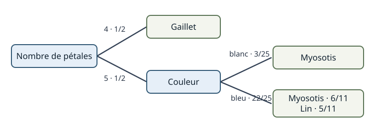
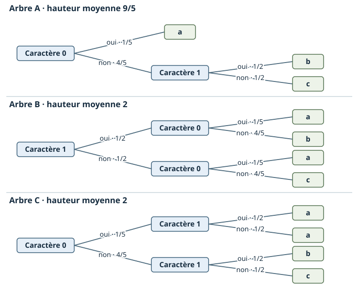

# X-ENS MP-MPI — Informatique A 2025 · Corrigé guidé

*Corrigé rédigé par IA, non officiel. Signalez toute erreur.*

**Rédaction** · GPT-6.2 Sol · effort non renseigné · vitesse non renseignée

**Révision (tour 1)** · modèle non renseigné · effort non renseigné · vitesse non renseignée

**Révision (tour 2)** · GPT-6.2 Astra Ultra · vitesse non renseignée · 24 novembre 2026

**Révision (tour 3)** · GPT-6.2 Astra Ultra · vitesse non renseignée · 26 novembre 2026

## Présentation du sujet

Cette épreuve MP–MPI de quatre heures suit la construction d’arbres d’identification à partir d’observations. Le code est en OCaml. La partie V ne dépend que de la partie I et peut être abordée séparément.

Les questions Q1–Q7 sur le conditionnement et les listes, puis Q21 et Q24 en logique, offrent des points d’entrée. Réservez davantage de temps à l’énumération de Q10 et aux invariants, à la récursion et à l’élagage de Q17–Q20.

## Partie I — Description probabiliste des plantes

La loi des observations est un mélange sur les espèces. Une observation met à jour les poids par la règle de Bayes.

### Question 1

> [!INDICATION]
> Additionnez les contributions des espèces pouvant avoir des fleurs blanches, puis rapportez chacune au total.

#### Solution

Les masses des fleurs blanches provenant du gaillet, du myosotis et du lin valent respectivement $0{,}5\times1$, $0{,}3\times0{,}2$ et $0{,}2\times0$. Leur somme donne **$0{,}56$**. On divise chacune de ces masses par $0{,}56$. Sachant que la fleur est blanche, les probabilités des espèces gaillet, myosotis et lin sont respectivement **$25/28$, $3/28$ et $0$**.

### Question 2

> [!INDICATION]
> Sommez la loi de départ sur les coordonnées laissées libres.

> [!INDICATION]
> Utilisez la normalisation de chaque distribution qui disparaît de la formule.

#### Solution

En sommant la loi sur les valeurs de tous les caractères, les distributions $s_j$ ont chacune une masse de 1. On obtient $\mathbb P_\sigma(S=s)=\sigma(s)$.

En conservant uniquement la contrainte $C_i=v$, le même calcul donne $\mathbb P_\sigma(S=s,C_i=v)=\sigma(s)s_i(v)$. En sommant sur $s$, puis en formant séparément le quotient conditionnel, on trouve
$$
\begin{aligned}
\mathbb P_\sigma(C_i=v)&=\sum_{r\in\mathcal S}\sigma(r)r_i(v),\\
\mathbb P_\sigma(C_i=v\mid S=s)&=s_i(v)\qquad\text{si }\sigma(s)>0.
\end{aligned}
$$

### Question 3

> [!INDICATION]
> Écrivez la probabilité jointe puis divisez par la masse de l’événement observé.

> [!INDICATION]
> Interprétez les facteurs du numérateur et le rôle du dénominateur.

#### Solution

Notons $p=\mathbb P_\sigma(C_i=v)$. Le conditionnement est défini exactement si $p>0$. Avec Q2,
**$\mathbb P_\sigma(S=s\mid C_i=v)=\dfrac{\sigma(s)s_i(v)}p$.**
L’observation multiplie le poids de chaque espèce par la vraisemblance de la valeur observée. La division par $p$ ramène la masse totale à 1.

### Question 4

> [!INDICATION]
> L’indépendance donnée par le modèle s’applique à espèce fixée.

> [!INDICATION]
> Calculez le poids normalisé après deux observations et comparez avec la mise à jour composée.

#### Solution

Pour deux caractères distincts, la loi du sujet donne le poids $\sigma(s)s_i(v)s_j(v')$ sous les deux contraintes et à espèce fixée. Notons $Z=\sum_r\sigma(r)r_i(v)r_j(v')$, qui est la probabilité des deux contraintes.

Si $Z>0$, alors $p=\mathbb P_\sigma(C_i=v)>0$ et le membre de gauche vaut $\sigma(s)s_i(v)s_j(v')/Z$. Par Q3, l’état après la première observation a le poids $\sigma(s)s_i(v)/p$. Le second conditionnement a pour probabilité $Z/p$, et donc
$$
\begin{aligned}
\mathbb P_{\sigma[i:=v]}(S=s\mid C_j=v')
&=\frac{(\sigma(s)s_i(v)/p)s_j(v')}{Z/p}\\
&=\frac{\sigma(s)s_i(v)s_j(v')}Z.
\end{aligned}
$$
Si la première mise à jour est définie, la deuxième l’est exactement lorsque $Z>0$.

> [!JURY]
> Le rapport insiste sur l’indépendance conditionnelle à l’espèce. Elle ne permet pas de multiplier les probabilités marginales des caractères.

### Question 5

> [!INDICATION]
> Une clé non stockée représente un poids nul.

> [!INDICATION]
> Lors de la pondération, que faut-il faire des poids qui deviennent nuls ?

#### Solution

Une valeur absente de la liste a un poids nul. La somme pondérée peut accumuler des termes réels quelconques. Pour reconstruire une mesure, la pondération doit être non négative sur son support. Les masses obtenues égales à zéro sont omises.

```ocaml
let proba_de x mesure =
  let rec cherche = function
    | [] -> 0.
    | (y, poids) :: suite ->
        if x = y then poids else cherche suite
  in
  cherche mesure

let somme_ponderee mesure f =
  List.fold_left (fun acc (x, poids) -> acc +. poids *. f x) 0. mesure

let repondere mesure f =
  let rec parcours = function
    | [] -> []
    | (x, poids) :: suite ->
        let nouveau = poids *. f x in
        if nouveau < 0. then invalid_arg "repondere"
        else if nouveau = 0. then parcours suite
        else (x, nouveau) :: parcours suite
  in
  parcours mesure
```

Les éléments de sortie proviennent de la liste sans doublon d’entrée, donc la pondération ne crée aucun doublon.

> [!JURY]
> Le rapport souligne les invariants des mesures. Les valeurs absentes ont un poids nul et les couples de poids nul ne sont jamais stockés.

### Question 6

> [!INDICATION]
> Accédez à la distribution de l’espèce pour l’indice demandé, puis moyennez par rapport à l’état.

#### Solution

La distribution de l’espèce est rangée à l’indice du caractère. La probabilité dans l’état est la moyenne de celles des espèces, conformément à Q2.

```ocaml
let proba_espece s i v =
  proba_de v s.mesures.(i)

let proba_etat sigma i v =
  somme_ponderee sigma (fun s -> proba_espece s i v)
```

### Question 7

> [!INDICATION]
> Calculez d’abord la probabilité de l’observation et distinguez son annulation.

#### Solution

On vérifie la masse de l’événement avant de calculer la distribution de Q3.

```ocaml
let reponse sigma i v =
  let p = proba_etat sigma i v in
  if p = 0. then invalid_arg "observation impossible";
  repondere sigma (fun s -> proba_espece s i v /. p)
```

L’expression OCaml retourne ainsi les espèces de poids strictement positif dans l’état mis à jour.

## Partie II — Arbre optimal

Une racine fixe les poids de toutes les branches. Les choix de sous-arbres se combinent par produit cartésien.

### Question 8

> [!INDICATION]
> Étudiez les deux racines et les états de chacune de leurs branches.

> [!INDICATION]
> Relisez séparément les conditions portant sur les feuilles et sur les nœuds dans la définition.

#### Solution

Le nombre de pétales vaut quatre ou cinq avec probabilité $1/2$ dans chaque cas. À quatre pétales, l’espèce est le gaillet. À cinq pétales, les poids du myosotis et du lin sont $3/5$ et $2/5$.

Si la racine teste la couleur, les deux branches restent mixtes. Dans la branche bleue, de masse $0{,}44$, il est nécessaire de tester le nombre de pétales. Quatre est impossible et cinq donne le mélange de l’énoncé, avec **$p=5/11$** pour le lin. Dans la branche blanche, de masse $0{,}56$, quatre conduit au gaillet avec **$q=25/28$** et cinq au myosotis avec probabilité $3/28$. C’est l’arbre dessiné, de hauteur moyenne **2**.

Si la racine teste le nombre de pétales, il faut tester la couleur dans la branche cinq. Elle donne bleu avec probabilité $22/25$, avec les poids $5/11$ et $6/11$ pour le lin et le myosotis, puis blanc avec probabilité $3/25$, donnant le myosotis seul.

Dans la branche quatre, on peut s’arrêter au gaillet. On peut aussi tester la couleur, auquel cas blanc mène au même gaillet avec probabilité 1 et bleu est impossible. La définition autorise à la fois la feuille et ce nœud au gaillet. L’autre branche et toutes ses feuilles sont imposées, car le dernier caractère y est consommé. Les hauteurs des deux arbres de racine nombre de pétales valent donc respectivement **$3/2$ et $2$**. Le premier est l’unique optimum.

> [!PIEGE]
> Une feuille de hauteur zéro est autorisée en état certain, mais les contraintes des nœuds ne l’imposent pas. Une question supplémentaire a un coût strictement positif.



### Question 9

> [!INDICATION]
> Pour chaque choix dans la première liste, associez tous les choix des listes restantes.

> [!INDICATION]
> Quel est le produit cartésien quand il n’y a aucune liste, ou quand l’une est vide ?

#### Solution

Chaque suffixe fournit une liste de choix, précédés successivement de chacun des choix de la case courante. Au bout du tableau, il existe un choix vide. Une case vide annule le produit.

```ocaml
let choix_possibles listes =
  let n = Array.length listes in
  let rec choix_depuis i =
    if i = n then [[]]
    else
      let suites = choix_depuis (i + 1) in
      List.concat_map
        (fun x -> List.map (fun suite -> x :: suite) suites)
        listes.(i)
  in
  List.map Array.of_list (choix_depuis 0)
```

### Question 10

> [!INDICATION]
> Pour chaque racine, construisez une liste de possibilités par valeur observée.

> [!INDICATION]
> Combinez les listes des enfants avec Q9 et vérifiez quand une feuille est autorisée.

#### Solution

Pour chaque racine autorisée, on calcule les possibilités de chaque enfant et on prend leur produit cartésien. Une valeur impossible a un seul choix, de poids zéro. Lorsque l’état est un Dirac, la feuille est autorisée en plus des nœuds. Quand la liste des caractères est vide, seule la feuille est autorisée.

```ocaml
let sans_caractere i cs =
  List.filter (fun j -> j <> i) cs

let etat_dirac = function
  | [_] -> true
  | _ -> false

let enumere sigma0 =
  let rec arbres sigma cs =
    let noeuds =
      List.concat_map
        (fun i ->
          let restants = sans_caractere i cs in
          let options =
            Array.init num.(i) (fun v ->
              let p = proba_etat sigma i v in
              if p = 0. then [(0., Impossible)]
              else
                List.map (fun t -> (p, t))
                  (arbres (reponse sigma i v) restants))
          in
          List.map
            (fun enfants -> Noeud {caractere = i; enfants})
            (choix_possibles options))
        cs
    in
    if cs = [] || etat_dirac sigma then Feuille sigma :: noeuds
    else noeuds
  in
  arbres sigma0 caracteres
```

Chaque appel sur une branche possible retire un caractère. La récurrence sur leur nombre prouve la terminaison et l’exhaustivité, puisque toute racine et toute combinaison de sous-arbres admissibles sont parcourues.

> [!METHODE]
> À une racine fixée, l’énumération des enfants indépendants est un produit cartésien de listes. La concaténation seule perdrait les combinaisons.

### Question 11

> [!INDICATION]
> Conservez dans un accumulateur le meilleur élément et le score déjà calculé.

> [!INDICATION]
> Pour l’arbre optimal, évaluez la moyenne des hauteurs des enfants selon les poids.

#### Solution

L’accumulateur garde le meilleur élément du préfixe déjà parcouru et sa valeur. En cas d’égalité, il conserve le premier minimiseur. La hauteur est définie récursivement sur l’arbre.

```ocaml
let argmin l f =
  match l with
  | [] -> invalid_arg "argmin"
  | x :: suite ->
      let meilleur, _ =
        List.fold_left
          (fun ((_, score) as courant) y ->
            let valeur = f y in
            if valeur < score then (y, valeur) else courant)
          (x, f x) suite
      in
      meilleur

let rec hauteur = function
  | Impossible | Feuille _ -> 0.
  | Noeud noeud ->
      let total = ref 1. in
      for v = 0 to Array.length noeud.enfants - 1 do
        let p, t = noeud.enfants.(v) in
        total := !total +. p *. hauteur t
      done;
      !total

let arbre_optimal sigma =
  argmin (enumere sigma) hauteur
```

La liste énumérée est non vide pour un état valide. Par Q10, le minimum est pris sur l’ensemble des arbres admissibles.

## Partie III — Algorithme glouton

L’entropie mesure l’incertitude dans un état. Minimiser ce score local peut conduire à un arbre plus haut en moyenne.

### Question 12

> [!INDICATION]
> Repérez les conditions d’annulation des termes de l’entropie.

> [!INDICATION]
> Appliquez Jensen au logarithme avec les poids du support et choisissez les arguments réciproques.

#### Solution

Si $k=0$, il n’existe aucune distribution de masse 1, donc ni minimum ni maximum. Pour $k\ge1$, chaque terme $-p\ln p$ est positif ou nul. Le **minimum est 0**, atteint exactement pour les Dirac.

Si le support a cardinal $r$, appliquons Jensen au logarithme avec les poids $p_x>0$ du support et les arguments $1/p_x$.
$$
\begin{aligned}
H(\mu)&=\sum_x p_x\ln(1/p_x)\\
&\le \ln\!\left(\sum_x p_x(1/p_x)\right)=\ln r\le\ln k.
\end{aligned}
$$
La distribution uniforme atteint **le maximum $\ln k$**. L’égalité impose à la fois $r=k$ et des arguments égaux, donc la distribution uniforme est la seule qui l’atteint.

### Question 13

> [!INDICATION]
> Calculez la contribution de chaque observation possible.

> [!INDICATION]
> Une observation de poids zéro doit-elle déclencher un appel à reponse ?

#### Solution

On ne conditionne que sur les valeurs de probabilité strictement positive. Le poids de tout élément présent dans un état est strictement positif.

```ocaml
let entropie sigma =
  List.fold_left (fun h (_, p) -> h -. p *. log p) 0. sigma

let score_caractere sigma i =
  let score = ref 0. in
  for v = 0 to num.(i) - 1 do
    let p = proba_etat sigma i v in
    if p > 0. then
      score := !score +. p *. entropie (reponse sigma i v)
  done;
  !score
```

> [!JURY]
> Selon le rapport, une contribution de probabilité nulle est ignorée avant le calcul de l’état mis à jour.

### Question 14

> [!INDICATION]
> Réutilisez argmin sur les caractères encore disponibles et retirez la racine choisie avant les appels récursifs.

#### Solution

On choisit la racine en minimisant son score d’entropie, puis on construit indépendamment les sous-arbres. Un état certain permet de s’arrêter.

```ocaml
let glouton sigma0 =
  let rec construit sigma cs =
    if cs = [] || etat_dirac sigma then Feuille sigma
    else
      let i = argmin cs (score_caractere sigma) in
      let restants = sans_caractere i cs in
      let enfants = Array.init num.(i) (fun v ->
        let p = proba_etat sigma i v in
        if p = 0. then (0., Impossible)
        else (p, construit (reponse sigma i v) restants))
      in
      Noeud {caractere = i; enfants}
  in
  construit sigma0 caracteres
```

À chaque appel récursif le nombre de caractères disponibles diminue. Les enfants impossibles ou associés à un état mis à jour satisfont les conditions du sujet.

### Question 15

> [!INDICATION]
> Déterminez l’état de chaque branche en fonction du caractère de racine.

> [!INDICATION]
> Calculez la hauteur en comptant le coût des questions encore posées.

#### Solution

Les arbres A et B s’arrêtent dès qu’une espèce est certaine. Les probabilités indiquées sur chaque branche sont conditionnelles au nœud de départ. Les lettres désignent les Dirac correspondants.



Les hauteurs moyennes de A et B valent $1+4/5=9/5$ et $1+1=2$. Au sens littéral de la définition, il existe aussi un troisième arbre, C. À partir de A, la branche oui peut tester le caractère 1 avant de rendre $a$ dans ses deux enfants, avec deux probabilités $1/2$.

Ce troisième arbre a également une hauteur moyenne de 2. **L’arbre A, de hauteur $9/5$, est optimal.**

### Question 16

> [!INDICATION]
> Déterminez d’abord les deux distributions conditionnelles de chaque caractère.

> [!INDICATION]
> Comparez les scores d’entropie, puis les hauteurs trouvées en Q15.

#### Solution

Avec le caractère 0, la branche de masse $1/5$ est certaine et celle de masse $4/5$ a deux espèces équiprobables. Ainsi $H_0(\sigma_0)=\frac45\ln2$.

Avec le caractère 1, chaque branche a une distribution de poids $1/5$ et $4/5$. Il vient
$$
\begin{aligned}
H_1(\sigma_0)
&=-\tfrac15\ln(\tfrac15)-\tfrac45\ln(\tfrac45)\\
&=\ln5-\tfrac85\ln2<\tfrac45\ln2.
\end{aligned}
$$
La dernière inégalité utilise la borne donnée sur $\ln5$. **L’algorithme glouton choisit le caractère 1 et renvoie un arbre de hauteur 2, supérieure à l’optimum $9/5$.**

## Partie IV — Optimisation de l’algorithme naïf

L’oracle optimise les sous-arbres. Le score partiel permet ensuite d’abandonner une racine trop coûteuse avant de finir sa construction.

### Question 17

> [!INDICATION]
> Identifiez tous les arguments effectivement transmis à l’oracle.

> [!INDICATION]
> La fonction de la figure propose-t-elle une feuille dans tous les cas permis par la définition ?

#### Solution

On suppose que $C$ est une liste finie sans doublon d’indices compris entre 0 et $N-1$, et que $\sigma$ est un état valide, de masse 1, avec des distributions d’espèces conformes à `num`.

Si $C$ est non vide, **l’état passé directement à la fonction fournie doit être non Dirac**. En effet, elle ne renvoie une feuille directement que si $C$ est vide. Avec un état de Dirac et des caractères restants, une feuille de hauteur zéro serait optimale, tandis que le code impose un nœud de hauteur au moins 1.

Pour chaque $i\in C$ et chaque $v$ de probabilité strictement positive, l’appel à l’oracle sur $\sigma[i:=v]$ et $C\setminus\{i\}$ doit terminer et retourner un arbre admissible optimal avec sa hauteur moyenne exacte. Cela comprend les états de Dirac qui apparaissent dans ces appels. L’oracle n’est jamais appelé sur une observation de probabilité nulle. Les comparaisons de scores sont interprétées sur les hauteurs mathématiques, dans le modèle de calcul du sujet.

### Question 18

> [!INDICATION]
> Séparez les racines déjà testées de celles qui restent.

> [!INDICATION]
> Pour une racine fixée, pourquoi peut-on optimiser les enfants séparément ?

#### Solution

Quand $C$ est vide, la feuille retournée est admissible et c’est le seul arbre possible. Sinon, notons $T$ l’ensemble des racines déjà testées. Au début de chaque boucle, `caracteres_a_tester` contient les racines qui restent. Si $T$ est vide, le meilleur arbre vaut `None` et le meilleur score vaut l’infini. Dans l’autre cas, **la meilleure solution mémorisée minimise la hauteur parmi tous les arbres de racine dans $T$**, et le score mémorisé est sa hauteur.

Pour une nouvelle racine, les poids de branches sont fixés. Pour chaque branche de poids positif, l’oracle fournit le meilleur sous-arbre admissible. La somme pondérée est minimale pour cette racine, puisque chaque poids est positif ou nul et chaque sous-problème indépendant des autres choix. Les branches de poids nul sont impossibles. La comparaison avec le meilleur mémorisé maintient donc l’invariant.

À chaque tour, on supprime une racine de la liste restante, et tous les appels à l’oracle terminent par Q17. À la sortie, toutes les racines ont été testées. Comme l’état d’entrée est non Dirac lorsque $C$ est non vide, aucune feuille ne pouvait concurrencer les nœuds. L’arbre mémorisé existe et est optimal.

> [!JURY]
> Le rapport attend un invariant relatif à toutes les racines déjà examinées, avec un cas particulier pour la collection encore vide.

### Question 19

> [!INDICATION]
> Quelle fonction fournir en argument pour fermer la récursion ?

> [!INDICATION]
> Interceptez les cas dont la feuille est optimale et utilisez la longueur de la liste comme variant.

#### Solution

La fonction est définie sur les états valides et les listes de caractères admissibles de Q17. Elle termine et retourne un arbre admissible de hauteur minimale accompagné de sa hauteur.

```ocaml
let rec arbre_optimal sigma cs =
  if cs = [] || etat_dirac sigma then (Feuille sigma, 0.)
  else arbre_optimal_avec_oracle arbre_optimal sigma cs
```

Si le test initial est vrai, la hauteur zéro est minimale. Sinon, les appels à l’oracle portent sur une liste strictement plus courte. Une récurrence sur sa longueur établit leur terminaison et leur optimalité. Les hypothèses de Q17 sont ainsi réunies, et Q18 donne la conclusion pour l’appel courant.

### Question 20

> [!INDICATION]
> Le score partiel d’une racine est une borne inférieure de son score final.

> [!INDICATION]
> Appliquez le test d’admissibilité à la somme du score courant et de la contribution de l’enfant.

#### Solution

On considère un seuil inclusif. Pour une racine, le score courant part de 1 et les contributions restantes sont non négatives. Un prédicat d’admissibilité indique si un score tient dans le seuil. On combine ce prédicat avec le meilleur score déjà obtenu parmi les autres racines.

Pour un enfant de poids strictement positif, on teste l’admissibilité de la somme pondérée incluant sa hauteur. L’ensemble des hauteurs admises est fermé vers le bas. Si une hauteur $h$ est admise, toute hauteur comprise entre 0 et $h$ l’est aussi. Cette propriété se conserve en ajoutant au coût courant la hauteur de l’enfant multipliée par son poids positif. Si aucun sous-arbre admissible n’existe, même la contribution minimale de cet enfant ne permet pas de poursuivre cette racine.

```ocaml
let arbre_optimal_opt sigma cs limite =
  let inverse l = List.fold_left (fun acc x -> x :: acc) [] l in
  let rec optimiser sigma cs admissible =
    if not (admissible 0.) then None
    else if cs = [] || etat_dirac sigma then Some (Feuille sigma, 0.)
    else
      let rec essayer meilleur = function
        | [] -> meilleur
        | i :: suite ->
            let admissible_locale score =
              admissible score &&
              (match meilleur with
               | None -> true
               | Some (_, borne) -> score <= borne)
            in
            let restants = sans_caractere i cs in
            let rec enfants v cout acc =
              if not (admissible_locale cout) then None
              else if v = num.(i) then
                let e = Array.of_list (inverse acc) in
                Some (Noeud {caractere = i; enfants = e}, cout)
              else
                let p = proba_etat sigma i v in
                if p = 0. then enfants (v + 1) cout ((0., Impossible) :: acc)
                else
                  let ajout h = cout +. p *. h in
                  let admissible_enfant h = admissible_locale (ajout h) in
                  match optimiser (reponse sigma i v) restants admissible_enfant with
                  | None -> None
                  | Some (t, h) ->
                      enfants (v + 1) (ajout h) ((p, t) :: acc)
            in
            match enfants 0 1. [] with
            | None -> essayer meilleur suite
            | Some _ as candidat -> essayer candidat suite
      in
      essayer None cs
  in
  optimiser sigma cs (fun score -> score <= limite)
```

Les branches impossibles conservent une contribution nulle. Une feuille de hauteur zéro est admise au seuil zéro. Le test de l’enfant et la mise à jour de la hauteur utilisent la même opération `ajout`, ce qui préserve l’inclusion de l’égalité pour les scores calculés en flottants.

> [!METHODE]
> Une branche impossible a une contribution nulle. Pour une branche possible, utilisez la même somme pondérée pour tester le seuil et actualiser le score.

## Partie V — Observations complexes et formules logiques

La satisfaction est d’abord définie pour un modèle déterministe. Les clauses réduisent l’évaluation aux seuls caractères mentionnés.

### Question 21

> [!INDICATION]
> Les probabilités agrègent les poids des modèles déterministes satisfaisants.

> [!INDICATION]
> Pour le sens réciproque, concentrez tout le poids sur un seul modèle.

#### Solution

Si les deux formules sont satisfaites par les mêmes modèles déterministes, elles donnent la même somme de poids pour toute famille de distributions. Donc leurs probabilités de satisfaction sont égales.

Réciproquement, fixons un modèle déterministe $(v_0,\ldots,v_{N-1})$. Dans le modèle probabiliste composé des Dirac en ces valeurs, le seul modèle de poids non nul est celui fixé, avec poids 1. Pour chacune des deux formules, la probabilité vaut donc 1 ou 0 selon sa satisfaction par ce modèle. L’égalité des probabilités impose l’égalité de ces deux valeurs. Cela vaut pour chaque modèle déterministe.

### Question 22

> [!INDICATION]
> Comptez les vecteurs de valeurs avant d’évaluer la formule.

> [!INDICATION]
> Chiffrez séparément la satisfaction booléenne et le produit des masses.

#### Solution

On énumère les $\prod_i |V_i|\le K^N$ modèles déterministes par choix successifs des coordonnées. À chaque modèle, on évalue le résultat booléen en parcourant la formule. Pour un atome, une recherche linéaire dans sa liste coûte au plus sa taille, d’où $O(|\phi|)$ pour toute la formule.

Pour un modèle satisfaisant, on multiplie les $N$ poids. Avec les listes de la représentation, chaque recherche de poids coûte $O(K)$. En incluant la génération, une borne est donc **$O(K^N(|\phi|+NK))$**.

Avec une préparation en $O(NK)$ de tableaux denses de poids, chaque lecture devient constante. Le même parcours a alors un coût **$O(NK+K^N(|\phi|+N))$**. Cette variante ne change pas le caractère exponentiel de l’énumération.

### Question 23

> [!INDICATION]
> Ignorez les coordonnées qui ne figurent pas dans la clause et calculez la masse autorisée par chaque atome.

#### Solution

Pour chaque atome $c_i\in V$ de la clause, on calcule $m_i=\sum_{v\in V}d_i(v)$ à l’aide de la distribution de l’indice $i$. On retourne le produit de ces masses. Les caractères mentionnés sont distincts, donc leurs contraintes sont indépendantes. Les autres coordonnées ont masse totale 1 et n’interviennent pas. La clause vide a une probabilité de 1, et un atome d’ensemble vide annule le produit.

Chaque recherche dans une distribution coûte $O(K)$ et le nombre total de valeurs énumérées est au plus $|\phi|$. Le coût est **$O(K|\phi|)$**, indépendant de $N$.

### Question 24

> [!INDICATION]
> Que faut-il faire lorsque les deux clauses contraignent le même caractère ?

#### Solution

Pour chaque caractère présent dans une seule clause, on recopie son atome. Pour un caractère présent dans les deux, on remplace les contraintes $c_i\in V$ et $c_i\in W$ par l’atome $c_i\in V\cap W$. Une intersection vide est conservée comme contrainte impossible.

Le résultat est une clause, car chaque caractère n’y figure qu’une fois. Pour tout modèle déterministe, il satisfait cette clause exactement lorsqu’il satisfait les deux clauses initiales. Q21 étend l’équivalence au sens probabiliste.

### Question 25

> [!INDICATION]
> Traitez séparément atome, disjonction et conjonction.

> [!INDICATION]
> Une conjonction de disjonctions se développe en choisissant une clause dans chaque disjonction.

#### Solution

Construisons une liste de clauses par récurrence sur la formule.

- Pour un atome, la liste contient la clause formée de cet atome seul.
- Pour une disjonction, on concatène les listes des termes. Une disjonction vide donne la liste vide.
- Pour une conjonction, on choisit une clause dans la liste de chaque terme et on les combine par Q24. La conjonction vide donne une liste constituée de la clause vide. Si la conjonction comporte un terme dont la liste est vide, aucun choix n’est possible.

Dans le dernier cas, un modèle vérifie la conjonction si et seulement s’il vérifie au moins une clause de chaque liste, donc au moins une des combinaisons produites. La construction préserve la satisfaction, puis l’équivalence voulue découle de Q21.

### Question 26

> [!INDICATION]
> Les événements associés aux clauses peuvent se recouvrir.

> [!INDICATION]
> Utilisez les intersections de clauses pour corriger les doubles comptages.

#### Solution

On calcule la liste de clauses de Q25. Si elle est vide, la probabilité cherchée est zéro. Les autres clauses peuvent se recouvrir. Par exemple, les deux occurrences de $A$ dans $A\lor A$ décrivent le même événement de probabilité $p$. La somme simple donnerait $2p$, tandis que la soustraction de leur intersection redonne $p$. Sinon, on applique la formule d’inclusion-exclusion à leurs événements de satisfaction. Pour chaque sous-famille non vide, on fusionne ses clauses par Q24 puis on évalue cette clause par Q23. On ajoute le résultat si la cardinalité de la sous-famille est impaire et on le soustrait sinon.

Soit $L=|\phi|$. Les listes de clauses se construisent par sommes et produits de nombres de choix et contiennent au plus $2^L$ clauses. Cette borne suit par récurrence en utilisant $1+\sum_j|\phi_j|\le L$ pour chaque nœud composé. Chaque clause intermédiaire porte sur des caractères déjà mentionnés dans $\phi$ et ses ensembles sont formés à partir des listes initiales ou de leurs intersections.

La transformation et le coût de fusion des clauses peuvent donc être bornés en fonction de $L$ et de $K$ uniquement. L’inclusion-exclusion examine au plus $2^{2^L}$ sous-familles, et Q23 évalue chacune des clauses sans parcourir les caractères absents de la formule. **Le temps total est borné par une fonction de $L$ et $K$, indépendante de $N$.**

> [!JURY]
> Le rapport propose de calculer les probabilités des intersections après mise sous forme disjonctive. Le coût peut être très grand, même s’il ne dépend pas du nombre total de caractères.

Une seconde méthode évite d’énumérer les sous-familles de clauses. Relevons les $d$ indices de caractères qui apparaissent dans les atomes de $\phi$. On énumère les affectations de ces seuls caractères. À chaque affectation satisfaisante, on ajoute le produit des $d$ probabilités correspondantes. Les caractères absents totalisent chacun une masse de 1. Les affectations énumérées sont incompatibles, même si plusieurs clauses de la formule sont vraies pour la même affectation.

Après remplacement des indices initiaux par des positions locales, l’évaluation de $\phi$ prend $O(1+|\phi|)$ opérations par affectation, en parcourant les listes de valeurs de ses atomes. On peut effectuer le remplacement en $O((1+|\phi|)^2)$ par recherche dans la liste locale, sans tableau de longueur $N$. L’énumération pondérée des supports prend alors $O((1+|\phi|)^2+(1+|\phi|)\max(1,K)^d)$ opérations lorsque l’accès aux distributions des caractères est direct. Comme $d\le |\phi|$, cette borne répond à la question. Si $d=0$, il existe une affectation vide, de poids 1.

## Bilan

- Vérifiez les masses positives avant de conditionner et les invariants avant de retourner une mesure.
- Pour un arbre, distinguez admissibilité et optimalité. Dans une preuve de boucle, caractérisez les racines déjà traitées et le meilleur score mémorisé.
- Une disjonction de clauses peut avoir des recouvrements. Calculez les intersections avant d’additionner les probabilités.
