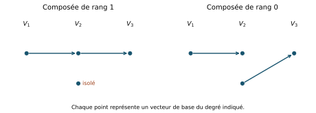
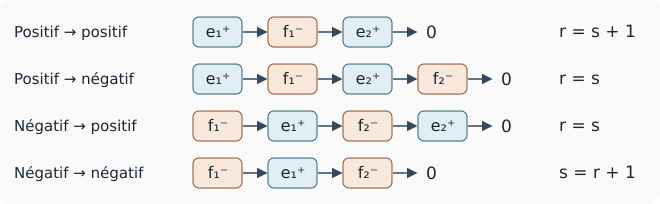

# X-ENS MP-MPI — Mathématiques A 2025 · Corrigé guidé

*Corrigé rédigé par IA, non officiel. Signalez toute erreur.*

**Attribution archivée** · « IA (GPT-6.2 Sol), relue et révisée par IA »

**Révision (tour 2)** · GPT-6.2 Astra Ultra · vitesse non renseignée · 24 novembre 2026

**Révision (tour 3)** · GPT-6.2 Astra Ultra · vitesse non renseignée · 26 novembre 2026

## Présentation du sujet

L’épreuve commune aux filières MP et MPI dure quatre heures, sans calculatrice. Le sujet démontre la décomposition des nilpotents en chaînes de Jordan, puis étudie des couples d’applications linéaires. Les 18 numéros du sujet donnent 41 réponses élémentaires. Les titres suivent les repères du sujet.

- **I.** Utiliser la restriction à un sous-espace stable et les noyaux des puissances comme invariants.
- **II.** Étudier le décalage des exposants sur les polynômes de Laurent.
- **III.** Prolonger une application linéaire compatible avec un endomorphisme nilpotent.
- **IV.** Construire des supplémentaires stables, puis démontrer l’existence et l’unicité des tailles des blocs.
- **V.** Tenir compte des espaces propres d’un second endomorphisme et dénombrer les blocs dans un exemple.
- **VI.** Classer les couples de matrices rectangulaires à l’aide d’une écriture par blocs.

Les outils de MP et MPI sont les polynômes d’endomorphisme, les idéaux de polynômes et la réduction. Le jury décrit un sujet très long. Les questions 1°–5°, 6° a)–d) et 11° offrent des points d’entrée. Précisez la question et le résultat utilisés chaque fois que vous réemployez un résultat intermédiaire.

## Partie I — Questions préliminaires

L’invariant des noyaux sera retrouvé au moment de l’unicité.

### Question 1

> [!INDICATION]
> Cherchez un polynôme scindé à racines simples qui annule aussi l’endomorphisme induit.

#### Solution

Soient $\lambda_1,\ldots,\lambda_d$ les valeurs propres distinctes de $h$. Le polynôme $P=\prod_{i=1}^d(X-\lambda_i)$ annule $h$ puisque $h$ est diagonalisable.

La stabilité de $W$ donne $P(h_W)=P(h)|_W=0$, car la restriction commute avec les puissances et les combinaisons linéaires. Le polynôme annulateur est scindé à racines simples. Le critère de diagonalisation s’applique à $h_W$. Le cas $W=\{0\}$ est immédiat.

> [!JURY]
> Le jury cite le polynôme minimal comme voie rapide. Pour la preuve par un annulateur, la stabilité justifie la restriction des puissances.

### Question 2a

> [!INDICATION]
> Suivez les noyaux des puissances par le changement de base.

#### Solution

Si $M'=SMS^{-1}$, alors $M'^j=SM^jS^{-1}$ pour tout $j\geq0$. Ainsi $\ker M'^j=S(\ker M^j)$, y compris pour $j=0$ où les deux noyaux sont nuls.

Les trois dimensions qui définissent $\delta_k$ sont conservées, donc $\boxed{\delta_k(M')=\delta_k(M)}$.

### Question 2b

> [!INDICATION]
> Comptez les vecteurs de la base canonique tués par chaque puissance du décalage.

#### Solution

Dans la base canonique, $J_re_i=e_{i+1}$ pour $i<r$ et $J_re_r=0$. On a donc $\dim\ker J_r^j=\min(j,r)$ pour $j\geq0$.

Les accroissements successifs valent $1$ jusqu’au rang $j=r$, puis $0$.

Leur différence $\delta_k(J_r)$ vaut **$1$ pour $k=r$, et $0$ sinon**.

### Question 2c

> [!INDICATION]
> Écrivez la condition d’appartenance au noyau sur les deux composantes.

#### Solution

Le vecteur $(x_1,x_2)$ appartient à $\ker M$ si et seulement si $x_i\in\ker M_i$ pour $i=1,2$. Le noyau est donc la somme directe de ces deux noyaux placés dans leurs facteurs. Les puissances de $M$ sont diagonales par blocs de puissances correspondantes, y compris pour la puissance zéro. On applique l’égalité des dimensions à chacune des trois puissances de la définition et on obtient $\delta_k(M)=\delta_k(M_1)+\delta_k(M_2)$.

## Partie II — Algèbre linéaire sur les polynômes de Laurent

La projection conserve uniquement les exposants négatifs. La surjectivité du décalage sera utilisée pour construire le prolongement.

### Question 3a

> [!INDICATION]
> Comparez le produit par $X$ de $F$ et celui de sa partie strictement négative.

#### Solution

Le polynôme $F-\Pi(F)$ appartient à $\mathbb C[X]$, donc $X(F-\Pi(F))$ aussi et sa projection par $\Pi$ est nulle. Il en résulte $\widehat{\xi}(\Pi(F))=\Pi(X\Pi(F))=\Pi(XF)=\widehat{\xi}(F)$.

### Question 3b

> [!INDICATION]
> Commencez par un monôme $P=X^k$, en utilisant 3° a) pour supprimer une projection intermédiaire.

#### Solution

Pour $F\in D$, on a $\xi^0(F)=F=\Pi(F)$. Si $\xi^k(F)=\Pi(X^kF)$, la question 3° a) donne
$$
\begin{aligned}
\xi^{k+1}(F)&=\widehat{\xi}(\Pi(X^kF))\\
&=\widehat{\xi}(X^kF)\\
&=\Pi(X^{k+1}F).
\end{aligned}
$$
Par récurrence, cette identité vaut pour tout $k\geq0$. Une combinaison linéaire en $k$ donne $\boxed{P(\xi)(F)=\Pi(PF)}$.

> [!JURY]
> Le jury demande d’écrire la récurrence sur les itérés de $\xi$ qui permet de traiter les monômes avant le polynôme entier.

### Question 4

> [!INDICATION]
> Cherchez un antécédent en décalant les exposants et repérez les termes effacés par la projection.

#### Solution

Par 3° b), $\xi^n(F)=\Pi(X^nF)$. Pour $G\in D$, l’élément $X^{-n}G$ de $D$ a pour image $G$.

Sur la base $(X^{-j})_{j\geq1}$, $\xi^n$ tue exactement les termes d’indices $1\leq j\leq n$ et envoie les autres sur des monômes négatifs distincts.

Ainsi $\xi^n$ est surjectif et **$(X^{-1},\ldots,X^{-n})$ est une base de son noyau**, vide si $n=0$.

### Question 5

> [!INDICATION]
> Appliquez successivement $\xi$ au générateur proposé, dans l’ordre du sujet.

#### Solution

Les itérés de $X^{-r}$ sont $X^{k-r}$ pour $0\leq k<r$, puis $0$, d’après 3° b). Tout sous-espace stable contenant le générateur contient ces itérés. Leur espace engendré est stable et ces monômes distincts sont libres. Dans cette base ordonnée, chaque élément est envoyé sur le suivant et le dernier sur zéro. La matrice est **$J_r$**, avec les $1$ sous la diagonale.

## Partie III — Prolongements compatibles

Définissez une valeur au nouveau vecteur qui soit compatible avec les relations imposées par les autres vecteurs.

### Question 6a

> [!INDICATION]
> Pour la stabilité par multiplication, faites intervenir la stabilité de $W$ par les polynômes de $u$.

#### Solution

L’application $P\mapsto P(u)v$ est linéaire, donc $I$ est un sous-espace vectoriel. Pour $P\in I$ et $Q\in\mathbb C[X]$, on a $(QP)(u)v=Q(u)(P(u)v)$.

Comme $W$ est stable par $u$, il l’est par $Q(u)$ et ce vecteur appartient à $W$.

Ainsi $I$ est un idéal de $\mathbb C[X]$.

> [!JURY]
> Le jury relève des confusions dans le calcul de $(QP)(u)$. Il s’agit de composer les deux endomorphismes $Q(u)$ et $P(u)$.

### Question 6b

> [!INDICATION]
> Utilisez un exposant de nilpotence et examinez les diviseurs d’une puissance de $X$.

#### Solution

Il existe $n$ tel que $u^n=0$, donc $X^n\in I$.

L’idéal non nul $I$ est engendré par un polynôme unitaire qui divise $X^n$, donc par $X^r$ pour un $r\leq n$.

Comme $v\notin W$, on a $1\notin I$ et $r\geq1$. **Ainsi $I=(X^r)$.**

### Question 6c

> [!INDICATION]
> Écrivez $W'$ comme une somme et vérifiez la stabilité sur chacun de ses termes.

#### Solution

L’ensemble $W'=W+\{P(u)v:P\in\mathbb C[X]\}$ est la somme de deux sous-espaces et contient $W$ et $v$. Le second sous-espace est stable car $u(P(u)v)=(XP)(u)v$. Il en résulte que $W'$ est stable et contient strictement $W$.

### Question 6d

> [!INDICATION]
> Appliquez le résultat sur les puissances de $\xi$ à la valeur $G_v$.

#### Solution

On a $u^r(v)\in W$ par 6° b), donc $G_v=\varphi(u^r(v))\in D$. La question 4° donne la surjectivité de $\xi^r$, d’où un antécédent $F_v\in D$. On peut notamment prendre $F_v=X^{-r}G_v$.

### Question 6e

> [!INDICATION]
> Factorisez $P$ à l’aide de 6° b), puis appliquez la compatibilité à un polynôme de l’endomorphisme induit.

#### Solution

Si $P(u)v=w\in W$, on a $P\in I$, donc $P=X^rQ$ par 6° b). L’identité $\xi\varphi=\varphi u_W$ s’itère et donne $Q(\xi)\varphi=\varphi Q(u_W)$ par linéarité. Par 6° d),
$$
\begin{aligned}
P(\xi)F_v&=Q(\xi)\varphi(u^r(v))\\
&=\varphi(Q(u_W)u^r(v))\\
&=\varphi(w).
\end{aligned}
$$

> [!JURY]
> Le jury identifie l’appartenance de $P$ à l’idéal et le passage de la compatibilité à tout polynôme de l’endomorphisme comme les deux points de la preuve.

### Question 6f

> [!INDICATION]
> Soustrayez deux décompositions, puis appliquez la règle obtenue en 6° e). Pour la compatibilité, multipliez le polynôme par $X$.

> [!INDICATION]
> Pour vérifier le prolongement sur $W$, choisissez la décomposition la plus simple d’un vecteur de $W$.

#### Solution

Si $P(u)v+w=P_1(u)v+w_1$, alors $(P-P_1)(u)v=w_1-w$. La question 6° e) donne $(P-P_1)(\xi)F_v=\varphi(w_1)-\varphi(w)$. La définition de $\varphi'$ est donc indépendante du choix.

En prenant $P=0$, on retrouve $\varphi$ sur $W$. Pour $x=P(u)v+w$, on a $u(x)=(XP)(u)v+u_W(w)$ et
$$
\varphi'(u(x))=\xi P(\xi)F_v+\varphi(u_W(w))=\xi\varphi'(x).
$$
Avec la linéarité admise, il s’agit bien d’un prolongement compatible.

### Question 7

> [!INDICATION]
> Mesurez par un entier le chemin qui reste à parcourir entre $W$ et $V$.

#### Solution

Si $W=V$, il n’y a rien à prolonger. Sinon, en choisissant $v\notin W$, les questions 6° c) et 6° f) donnent un prolongement compatible sur un espace $W'$ de dimension strictement plus grande. L’endomorphisme de $V$ reste nilpotent et les hypothèses sont conservées.

Une récurrence sur $\dim V-\dim W$ donne un prolongement compatible $\psi$ sur $V$.

## Partie IV — Théorème de décomposition pour les endomorphismes nilpotents

Cherchez une chaîne de longueur maximale, puis un supplémentaire stable sur lequel recommencer.

### Question 8a

> [!INDICATION]
> Dans une relation linéaire, repérez le premier coefficient non nul et appliquez une puissance adaptée de $u$.

#### Solution

Si $\sum_{i=0}^{n-1}c_i u^i(v_0)=0$ et $j$ est le plus petit indice tel que $c_j\ne0$, l’application de $u^{n-1-j}$ donne $c_j u^{n-1}(v_0)=0$, contradiction. La chaîne est libre.

Son espace engendré $W$ contient $v_0$ et est stable, car $u^n(v_0)=0$. Dans cette base ordonnée, la matrice de $u_W$ est **$J_n$**.

### Question 8b

> [!INDICATION]
> Associez les deux chaînes qui ont la même matrice dans leurs bases ordonnées.

#### Solution

Définissons $\varphi$ sur la base de 8° a) par $\varphi(u^j(v_0))=X^{j-n}$ pour $0\leq j<n$, puis prolongeons par linéarité. Les images forment la base de $D_n$ de 5°, donc $\varphi$ est injective. Les deux chaînes sont décalées de la même façon et leur dernier terme est envoyé sur zéro. Ainsi $\xi\varphi=\varphi u_W$.

### Question 8c

> [!INDICATION]
> Itérez la compatibilité du prolongement puis utilisez la nilpotence.

#### Solution

L’égalité $\xi\psi=\psi u$ donne $\xi^n\psi=\psi u^n=0$. Par conséquent $\operatorname{Im}\psi\subset\ker\xi^n$.

### Question 8d

> [!INDICATION]
> Comparez $\psi(W)$ au noyau trouvé en 4° et utilisez la compatibilité sur $\ker\psi$.

> [!INDICATION]
> Pour décomposer $x$, trouvez d’abord $w\in W$ qui a la même image par $\psi$.

#### Solution

Par 8° b), $\psi|_W=\varphi$ est un isomorphisme de $W$ sur $D_n=\ker\xi^n$ d’après 4°.

Par 8° c), tout $x\in V$ a donc la même image par $\psi$ qu’un unique $w\in W$. Alors $x-w\in\ker\psi$ et $W\cap\ker\psi=\{0\}$.

Enfin $\psi(ux)=\xi\psi(x)=0$ si $x\in\ker\psi$. **Le noyau est bien un supplémentaire stable de $W$.**

### Question 9

> [!INDICATION]
> Raisonnez par récurrence sur la dimension et appliquez 8° à un vecteur de longueur maximale.

#### Solution

Par récurrence forte sur $\dim V$, la dimension nulle donne la base vide et aucun bloc. En dimension positive, soit $n$ l’indice de nilpotence et choisissons $v_0$ comme en 8°.

Les questions 8° a) et 8° d) donnent un bloc $J_n$ sur $W$ et un supplémentaire stable $K$. La restriction à $K$ est nilpotente et $\dim K<\dim V$. Par récurrence sa matrice est une somme de blocs de Jordan.

Chaque bloc a une taille au plus $n$ puisque $u_K^n=0$. La concaténation de la base de $W$ et de la base obtenue sur $K$, avec les tailles classées dans l’ordre décroissant, donne la forme voulue.

### Question 10

> [!INDICATION]
> Utilisez un invariant qui distingue la taille d’un bloc et s’additionne sur les blocs.

#### Solution

Par 2° b) et 2° c), $\delta_k$ de la matrice diagonale par blocs est le nombre de blocs de taille $k$. Par 2° a), cette quantité est indépendante de la base. Les tailles avec multiplicité et leur nombre total $s=\sum_{k\geq1}\delta_k$ sont donc déterminés par $u$.

## Partie V — Version « graduée » du théorème de décomposition

Le supplémentaire doit maintenant respecter les deux endomorphismes. La moyenne de projecteurs fournit cette stabilité.

### Question 11a

> [!INDICATION]
> Utilisez l’ordre fini de $h$ pour trouver un polynôme annulateur adapté.

#### Solution

Le polynôme $X^N-1$ annule $h$.

Il est scindé sur $\mathbb C$ et ses $N$ racines $\zeta^j$ pour $0\leq j<N$ sont distinctes. Donc **$h$ est diagonalisable**, avec valeurs propres parmi ces racines.

### Question 11b

> [!INDICATION]
> Appliquez la relation $hu=\zeta uh$ à un vecteur propre de $h$.

#### Solution

Pour $v\in V_j$, on calcule $h(uv)=\zeta u(hv)=\zeta^{j+1}uv$. Ainsi $u(V_j)\subset V_{j+1}$, où $V_N=V_0$ puisque $\zeta^N=1$.

### Question 11c

> [!INDICATION]
> Traitez les puissances négatives grâce à la conjugaison par $h^{-1}$, puis conjuguez un produit de facteurs $u$.

#### Solution

La relation de départ donne par récurrence $h^k u h^{-k}=\zeta^ku$ pour $k\geq0$. On a $h^{-1}uh=\zeta^{-1}u$ en conjuguant la relation par $h^{-1}$ et le même raisonnement vaut pour $k<0$.

La conjugaison préservant les produits et l’identité, $\boxed{hu^\ell h^{-1}=\zeta^\ell u^\ell}$ pour tout $\ell\geq0$.

### Question 12a

> [!INDICATION]
> Décomposez un vecteur sur les deux sous-espaces stables.

#### Solution

Pour $x=w+w'$ avec $w\in W$ et $w'\in W'$, on a $u(w)\in W$ et $u(w')\in W'$.

Ainsi $pu(x)=u(w)=up(x)$, donc $pu=up$.

### Question 12b

> [!INDICATION]
> Montrez que $h^k$ et son inverse préservent $W$ avant d’examiner chaque terme de la moyenne.

#### Solution

Comme $W$ est stable par $h$ et $h^{-1}=h^{N-1}$, il est stable par toutes les puissances entières de $h$.

L’image de chaque $h^kph^{-k}$ est incluse dans $W$.

Pour $w\in W$, $h^{-k}w\in W$ et $p$ l’y fixe, donc $h^kph^{-k}w=w$.

La moyenne $\bar p$ a son image dans $W$ et fixe $W$ point par point.

### Question 12c

> [!INDICATION]
> Appliquez une seconde fois la moyenne à un vecteur de son image.

#### Solution

Par 12° b), l’image de $\bar p$ est incluse dans $W$ et contient $W$ puisque chaque $w$ est sa propre image.

Pour $x\in V$, $\bar p(x)\in W$, donc $\bar p^2(x)=\bar p(x)$. **C’est le projecteur d’image $W$ associé à son noyau.**

### Question 12d

> [!INDICATION]
> Pour $u$, suivez les deux facteurs scalaires de 11° c). Pour $h$, examinez un décalage des indices de sommation.

> [!INDICATION]
> Pour la commutation avec $h$, vérifiez aussi le dernier terme de la somme à l’aide de $h^N$.

#### Solution

Pour $p_k=h^kph^{-k}$, les questions 11° c) et 12° a) donnent
$$
\begin{aligned}
p_ku&=\zeta^{-k}h^k p u h^{-k}\\
&=\zeta^{-k}h^k u p h^{-k}\\
&=u p_k .
\end{aligned}
$$
La moyenne commute donc avec $u$. En outre $hp_kh^{-1}=p_{k+1}$ et $p_N=p_0$ puisque $h^N=\mathrm{id}_V$.

La conjugaison par $h$ permute les termes de la moyenne, donc $\bar p$ commute aussi avec $h$.

### Question 12e

> [!INDICATION]
> Utilisez la décomposition d’un projecteur et faites agir les deux endomorphismes sur son noyau.

#### Solution

Par 12° c), $V=W\oplus\ker\bar p$. Si $\bar p(x)=0$, alors $\bar p(ux)=u\bar p(x)=0$ et $\bar p(hx)=h\bar p(x)=0$, par 12° d).

Le supplémentaire $\ker\bar p$ est stable par $u$ et $h$.

### Question 13a

> [!INDICATION]
> Décomposez un vecteur dont l’image par $u^{n-1}$ est non nulle suivant les espaces propres de $h$.

#### Solution

Par 11° a), $V=\bigoplus_{j=0}^{N-1}V_j$. Choisissons $x$ tel que $u^{n-1}x\ne0$, puis écrivons $x=\sum_j x_j$ avec $x_j\in V_j$.

Au moins un $u^{n-1}x_j$ est non nul par linéarité. Le vecteur $v=x_j$ correspondant convient.

### Question 13b

> [!INDICATION]
> Faites partir la chaîne maximale d’un vecteur propre et obtenez un supplémentaire stable pour les deux endomorphismes.

> [!INDICATION]
> Pour la récurrence, vérifiez que les relations entre $u$ et $h$ passent à leurs restrictions.

#### Solution

On raisonne par récurrence forte sur $\dim V$, avec la base vide en dimension nulle. Soit $n$ l’indice de nilpotence en dimension positive et $v\in V_a$ comme en 13° a).

Par 8° a), la chaîne $(u^jv)_{0\leq j<n}$ est libre et engendre un espace $W$ stable par $u$, avec matrice $J_n$.

Par 11° b), $u^jv\in V_{(a+j)\bmod N}$, donc $W$ est stable par $h$ et la matrice de $h_W$ est $D_{n,a}$.

La question 8° d) fournit un supplémentaire stable par $u$ et la question 12° e) permet d’en choisir un, $K$, stable par $u$ et par $h$.

Sur $K$, on a encore $h_K^N=\mathrm{id}_K$, $u_K$ nilpotent et $h_Ku_Kh_K^{-1}=\zeta u_K$, car $h^{-1}=h^{N-1}$ préserve aussi $K$.

Comme $\dim K<\dim V$, la récurrence donne la forme voulue sur $K$. La réunion des deux bases donne simultanément les blocs $(J_r,D_{r,a})$.

> [!JURY]
> Le jury attend la forme des deux matrices dans la chaîne choisie, puis la justification du supplémentaire stable qui permet la récurrence.

### Question 14a

> [!INDICATION]
> Identifiez l’espace propre auquel aboutit le dernier espace de la chaîne.

#### Solution

Par 11° b), $u(V_3)\subset V_0$. Or $V_0=\ker(h-\mathrm{id}_V)=\{0\}$ par hypothèse. Donc **$u_3=0$**.

### Question 14b

> [!INDICATION]
> Listez les segments consécutifs contenus dans les degrés disponibles et réalisez chacun sur sa propre chaîne.

#### Solution

Comme $V_0=0$, un bloc commence dans un degré $a\in\{1,2,3\}$ et doit satisfaire $a+r-1\leq3$. Sinon un des vecteurs de sa base serait de degré $0$. Les six types sont
$$
(r,a)\in\{(1,1),(1,2),(1,3),(2,1),(2,2),(3,1)\}.
$$
Pour chacun, prenons $V=\mathbb C^r$, $u=J_r$ et $h=D_{r,a}$. Les poids de $h$ sont non nuls et leurs quatrièmes puissances valent un, sans poids égal à un. Sur deux vecteurs successifs, le quotient des poids est $\zeta$.

On vérifie alors $hu=\zeta uh$, y compris sur le dernier vecteur qui est tué par $u$. Ces couples réalisent les six types.

### Question 14c

> [!INDICATION]
> Comptez les contributions d’une chaîne aux dimensions et aux trois rangs, en commençant par la composition.

> [!INDICATION]
> Une chaîne de longueur trois agit à la fois sur les deux applications et sur leur composée.

#### Solution

Soit $b_{ij}$ le nombre de blocs dont les degrés vont de $i$ à $j$, pour $1\leq i\leq j\leq3$. Un bloc compte une dimension dans chaque degré qu’il traverse.

Il donne une unité au rang de $u_1$ s’il traverse $1,2$, une au rang de $u_2$ s’il traverse $2,3$, et une au rang de $u_2u_1$ s’il traverse les trois degrés. Les contributions s’additionnent car les blocs ont des images dans des sous-espaces en somme directe. Ainsi
$$
\begin{aligned}
r_{21}&=b_{13},&
r_1&=b_{12}+b_{13},&
r_2&=b_{23}+b_{13},\\
d_1&=b_{11}+b_{12}+b_{13},&
d_2&=b_{12}+b_{22}+b_{23}+b_{13},&
d_3&=b_{13}+b_{23}+b_{33}.
\end{aligned}
$$
On en déduit les six multiplicités
$$
\begin{aligned}
b_{13}&=r_{21},&
b_{12}&=r_1-r_{21},&
b_{23}&=r_2-r_{21},\\
b_{11}&=d_1-r_1,&
b_{22}&=d_2-r_1-r_2+r_{21},&
b_{33}&=d_3-r_2 .
\end{aligned}
$$

On peut vérifier la formule de $b_{22}$ directement dans $V_2$. Le sous-espace des vecteurs qui s’arrêtent au degré 2 est $\ker u_2$. Ceux qui proviennent du degré 1 forment $\ker u_2\cap\operatorname{im}u_1$, de dimension $r_1-r_{21}$ par le théorème du rang appliqué à la restriction de $u_2$ à $\operatorname{im}u_1$. La dimension du quotient vaut donc $d_2-r_2-(r_1-r_{21})=b_{22}$.

L’exemple suivant isole l’information portée par $r_{21}$. Prenons $(d_1,d_2,d_3)=(1,2,1)$ et $u_1(t)=(t,0)$. Si $u_2(x,y)=x$, la composée est de rang un. On a une chaîne $[1,3]$ et un vecteur isolé en degré 2. Si $u_2(x,y)=y$, la composée est nulle. On a alors les chaînes $[1,2]$ et $[2,3]$. Dans les deux exemples, $r_1=r_2=1$.

## Partie VI — Classification des couples de matrices rectangulaires

Construisez un seul couple d’endomorphismes sur la somme des deux espaces. Les deux espaces propres de l’involution retrouvent les espaces de départ.

### Question 15

> [!INDICATION]
> Interprétez $P$ et $Q$ comme des changements de coordonnées, puis utilisez les deux espaces propres de $H$.

#### Solution

Si (i) est vérifiée, prenons $P$ et $Q$ envoyant les anciennes coordonnées sur les nouvelles dans $\mathbb C^m$ et $\mathbb C^n$.

Calculer les nouvelles coordonnées des images donne $A'=QAP^{-1}$ et $B'=PBQ^{-1}$. Réciproquement, tous les $P,Q$ inversibles sont réalisables comme changements de coordonnées. En prenant les applications de matrices $A,B$ dans les bases de départ, ces formules donnent (i) à partir de (ii).

Si (ii) est vérifiée, la matrice $R=\operatorname{diag}(P,Q)$ vérifie
$$
R M_{A,B}R^{-1}=
\begin{pmatrix}0&PBQ^{-1}\\ QAP^{-1}&0\end{pmatrix}
=M_{A',B'},\qquad RHR^{-1}=H.
$$
Enfin, sous (iii), $RH=HR$, donc $R$ stabilise les espaces propres de $H$ associés à $1$ et $-1$.

Puisque $R$ est inversible, ses deux restrictions sont inversibles. Ainsi $R=\operatorname{diag}(P,Q)$ et les deux blocs de l’égalité de conjugaison donnent (ii).

### Question 16a

> [!INDICATION]
> Faites le calcul matriciel sur les deux composantes puis utilisez la conjugaison d’un polynôme.

#### Solution

On a **$H^2=I_{m+n}$**. Multiplier par $H$ à droite change le signe de la seconde colonne de blocs, puis le multiplier à gauche change le signe de la seconde ligne de blocs. Seuls les blocs hors diagonale de $M$ sont éventuellement non nuls, donc $HMH^{-1}=-M$. La conjugaison préserve les puissances et les combinaisons linéaires, d’où $\boxed{HP(M)H^{-1}=P(-M)}$.

### Question 16b

> [!INDICATION]
> Comparez les polynômes caractéristiques de $M$ et de $-M$.

#### Solution

Par 16° a), $M$ et $-M$ sont semblables. Avec $p=m+n$, on a
$$
\chi_{-M}(X)=\det(XI_p+M)=(-1)^p\chi_M(-X).
$$
Un facteur $(X-\lambda)^k$ de $\chi_M(X)$ devient un facteur $(X+\lambda)^k$ de $\chi_M(-X)$, avec le même ordre exact.

Comme $\chi_{-M}=\chi_M$, **$\lambda$ et $-\lambda$ ont la même multiplicité algébrique.**

### Question 16c

> [!INDICATION]
> Appliquez Cayley–Hamilton aux deux facteurs premiers entre eux et examinez les facteurs non nuls par paires.

#### Solution

Les polynômes $X^r$ et $Q$ sont premiers entre eux car $Q(0)\ne0$. Leur produit annule $M$ par Cayley–Hamilton. Le lemme de décomposition des noyaux donne $\mathbb C^{m+n}=\ker M^r\oplus\ker Q(M)$.

Pour $r=0$, on a $\ker M^0=\{0\}$ et $Q(M)=0$, ce qui donne la même décomposition.

D’après 16° b), les racines non nulles de $\chi_M$ se regroupent en paires $\lambda,-\lambda$ de mêmes multiplicités.

Ainsi $Q$ est un produit de facteurs $(X^2-\lambda^2)^k$ et $Q(-X)=Q(X)$, y compris si $Q=1$.

Par 16° a), $HM^rH^{-1}=(-1)^r M^r$ et $HQ(M)H^{-1}=Q(M)$. Ces identités montrent que **les deux noyaux sont stables par $H$.**

### Question 17

> [!INDICATION]
> Appliquez la décomposition graduée à l’involution $H$, puis rangez d’abord les vecteurs de signe positif dans chaque chaîne.

#### Solution

Sous l’hypothèse de nilpotence de $M$, les deux identités de 16° a) montrent que le couple $(M,H)$ satisfait les hypothèses de 13° b) avec $N=2$ et $\zeta=-1$. Chaque chaîne de Jordan alterne donc les signes de $H$.

Dans une chaîne donnée, notons $e_i$ les vecteurs positifs dans leur ordre d’apparition et $f_i$ les vecteurs négatifs dans leur ordre d’apparition. Dans la base $(e_1,\ldots,e_r,f_1,\ldots,f_s)$, les matrices sont
$$
\begin{pmatrix}0_r&B_0\\A_0&0_s\end{pmatrix}
\qquad\text{et}\qquad
\operatorname{diag}(I_r,-I_s).
$$
L’alternance donne $|r-s|\leq1$. L’opérateur envoie chaque vecteur de la chaîne sur le suivant et le dernier sur zéro. On obtient les quatre cas demandés.

- Si la chaîne commence et finit par un signe positif, $r=s+1$.

On a $A_0=(I_s\ \ 0)$ et $B_0=\binom{0}{I_s}$, puisque $e_i$ est suivi de $f_i$ et $f_i$ de $e_{i+1}$.
- Si elle commence par un signe positif et finit par un signe négatif, $r=s$. Alors $A_0=I_r$ et $B_0=J_r$.
- Si elle commence par un signe négatif et finit par un signe positif, $r=s$. Alors $A_0=J_r$ et $B_0=I_r$.
- Si elle commence et finit par un signe négatif, $s=r+1$. On a $A_0=\binom{0}{I_r}$ et $B_0=(I_r\ \ 0)$.

Les tailles nulles correspondent aux chaînes d’un seul vecteur. La réunion des bases des chaînes donne la similitude simultanée demandée.

### Question 18a

> [!INDICATION]
> Lisez séparément la condition $M(x,y)=0$ sur chacun des axes.

#### Solution

Puisque $M(x,0)=(0,Ax)$ et $M(0,y)=(By,0)$, l’injectivité de $M$ donne l’injectivité de $A$ et de $B$.

Il en résulte $m\leq n$ et $n\leq m$. Donc **$m=n$ et $A,B$ sont inversibles**.

### Question 18b

> [!INDICATION]
> Étudiez la restriction de $M^2$ à l’espace propre positif de $H$, puis transportez sa base de l’autre côté par $M$.

> [!INDICATION]
> Une fois la base de $E_+$ choisie, calculez l’image par $M$ de chacun de ses vecteurs, puis l’image de ceux qui en résultent.

#### Solution

Soient $E_+$ et $E_-$ les espaces propres de $H$ pour $1$ et $-1$.

Par 16° a), $M$ échange les signes et, par inversibilité et 18° a), induit un isomorphisme $E_+\to E_-$. Soit $T=M^2|_{E_+}$, un endomorphisme inversible. Dans les coordonnées initiales, $T$ est représenté par $BA$.

Le polynôme caractéristique de $T$ se scinde sur $\mathbb C$ en facteurs $(X-\lambda)^{m_\lambda}$, où chaque $\lambda$ est non nul.

Par Cayley–Hamilton et le lemme de décomposition des noyaux, $E_+$ est somme directe des sous-espaces $\ker(T-\lambda\mathrm{id})^{m_\lambda}$. Sur chacun, $T-\lambda\mathrm{id}$ est nilpotent, donc 9° donne des chaînes où $T$ a pour blocs $\lambda I_r+J_r$.

Prenons les vecteurs $e_1,\ldots,e_r$ d’une de ces chaînes et posons $f_i=M e_i$. Leurs images, réunies pour toutes les chaînes, forment une base de $E_-$.

Sur la base $(e_1,\ldots,e_r,f_1,\ldots,f_r)$ de l’espace associé, $Me_i=f_i$ et $Mf_i=M^2e_i=Te_i$.

Comme $E_+$ et $E_-$ portent respectivement les signes $1$ et $-1$ pour $H$, les blocs sont
$$
\boxed{\begin{pmatrix}0_r&\lambda I_r+J_r\\ I_r&0_r\end{pmatrix}}
\qquad\text{et}\qquad
\operatorname{diag}(I_r,-I_r).
$$
La concaténation des bases fournit simultanément les blocs de taille paire annoncés.

## Bilan

- Pour dénombrer des blocs à partir de noyaux d’itérés, comparez les accroissements successifs de leurs dimensions.
- Pour prolonger une application définie sur des générateurs, vérifiez les relations entre les générateurs avant de définir son image.
- Dans une récurrence de réduction, vérifiez la stabilité du supplémentaire pour chacun des endomorphismes et la conservation de leurs relations.
- Pour classer des couples de matrices agissant dans des sens opposés, organisez les bases par espace propre de l’involution et suivez le sens de chaque flèche.
