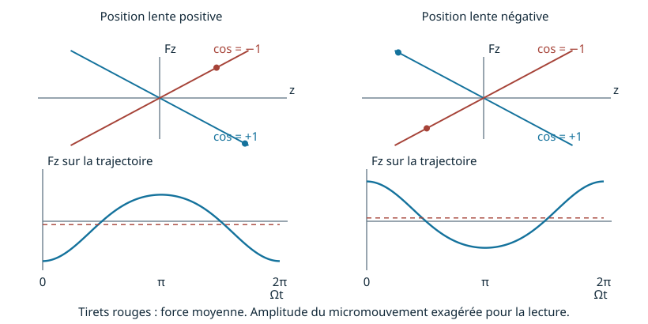
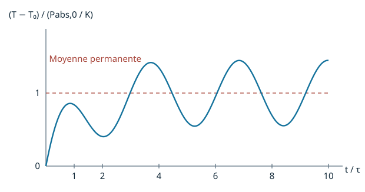
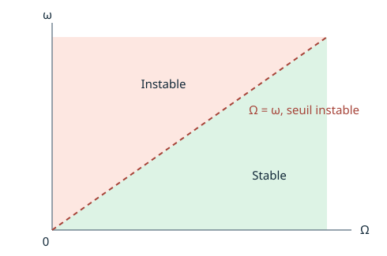

# X-ENS MP — Physique 2025 · Corrigé guidé

*Corrigé rédigé par IA, non officiel. Signalez toute erreur.*

**Rédaction** · GPT-6.2 Sol · effort non renseigné · vitesse non renseignée

**Révision** · modèle non renseigné · effort non renseigné · vitesse non renseignée

**Révision (tour 2)** · GPT-6.2 Astra Ultra · vitesse non renseignée

## Présentation du sujet

Cette épreuve de quatre heures, sans calculatrice, étudie la lévitation d’une particule chargée. Le champ périodique induit un mouvement rapide de faible amplitude et un rappel à une échelle lente. Le sujet étudie ensuite les perturbations thermiques et la rotation. Il s’achève sur une analogie mécanique dans un repère en rotation, qui peut être traitée indépendamment.

- En partie 1, garder les signes du potentiel, de la force et de la charge séparés.
- En parties 2 et 3, contrôler l’homogénéité et les ordres de grandeur. Les bilans de puissance et de moment servent de point de départ.
- En partie 4, chercher la stabilité de toutes les petites perturbations et examiner les modes au seuil.

## Partie 1 — Le piège électrique

### Question 1

> [!INDICATION]
> Comparer les coefficients radiaux par rotation. Utiliser ensuite l’équation du potentiel dans une région sans charge.

#### Solution

Une rotation de quart de tour autour de $Oz$ échange les contributions en $x^2$ et $y^2$, donc $\alpha=\beta$.

Dans le vide au voisinage de $O$, le potentiel satisfait l’équation de Laplace. Le laplacien de l’expression donnée est $2\eta V(1+\alpha+\beta)/l_0^2$. Pour une tension non nulle, $1+\alpha+\beta=0$. Ainsi **$\alpha=\beta=-1/2$**.

### Question 2

> [!INDICATION]
> Calculer la force au centre puis comparer les courbures de l’énergie potentielle selon deux axes.

#### Solution

La force électrique s’annule en $O$, ce qui en fait un point d’équilibre électrique. L’énergie potentielle $-eV_{\rm el}$ a toutefois des courbures de signes opposés suivant $Oz$ et une direction radiale, pour toute tension non nulle. C’est un point selle. Quel que soit le signe de la tension, il existe une direction dans laquelle la force éloigne une particule déplacée de $O$. À tension nulle, aucun rappel électrique n’existe. Si l’on ajoute le poids, il n’est pas compensé au centre par le champ électrique nul.

### Question 3

> [!INDICATION]
> Multiplier l’opposé du gradient par la charge. Identifier le facteur de chaque coordonnée à celui de l’équation demandée.

#### Solution

On considère ici la force électrique seule conformément à la forme homogène demandée. Pour les coefficients $a_x=a_y=-1/2$ et $a_z=1$, la composante de la force est $(-e)(-\partial_i V_{\rm el})=2e\eta V(t)a_i r_i/l_0^2$. La deuxième loi de Newton donne

$$
\begin{aligned}
\ddot r_i-2a_i\omega^2\cos(\Omega t)r_i&=0,\\
\omega^2&=\frac{e\eta V_0}{ml_0^2}.
\end{aligned}
$$

Ainsi $q_i=-4a_i\omega^2/\Omega^2$, soit **$(n_x,n_y,n_z)=(2,2,-4)$**. Avec $V_0<0$, le symbole $\omega^2$ est ici le coefficient signé défini par l’énoncé. La comparaison de fréquences se fait avec $\sqrt{|\omega^2|}$.

### Question 4

> [!INDICATION]
> Moyenner après substitution. Une grandeur lente varie peu pendant une période rapide, tandis que le produit de deux signaux rapides peut conserver une moyenne.

> [!PIEGE]
> Une moyenne nulle ne signifie pas que le signal s’annule. Le couplage entre le champ et le micromouvement fournit la composante constante.

#### Solution

Substituons $r_i=R_i+\xi_i$ dans (2) et moyennons sur une période rapide. Par hypothèse, $\langle\ddot\xi_i\rangle=0$. Au premier ordre de séparation des échelles, $R_i$ est quasi constant pendant une période et $\langle R_i\cos(\Omega t)\rangle\simeq R_i\langle\cos(\Omega t)\rangle=0$.

Le terme $\xi_i\cos(\Omega t)$ ne se moyenne pas en produit de moyennes, car les deux facteurs oscillent à la même pulsation. On obtient, à l’ordre retenu,

$$
\boxed{\langle\ddot R_i\rangle+\frac{q_i\Omega^2}{2}\langle\xi_i\cos(\Omega t)\rangle=0.}
$$

### Question 5

> [!INDICATION]
> Écrire les deux fonctions trigonométriques à la pulsation autorisée. Isoler cette composante dans l’équation et comparer les amplitudes.

> [!JURY]
> Le rapport demande une comparaison des modules quand les grandeurs sont algébriques. La séparation des fréquences seule ne compare pas les dérivées.

#### Solution

**a.** À $R_i$ figée sur une période, la forme sans composante constante et sans harmonique supérieure est $\xi_i=A_i\cos(\Omega t)+B_i\sin(\Omega t)$, avec des amplitudes susceptibles d’évoluer lentement.

**b.** Dans l’équation du mouvement, $\xi_i\cos(\Omega t)$ ne donne qu’une composante constante et des harmoniques à $2\Omega$. La composante constante est déjà prise en compte en Q4. En projetant sur la pulsation $\Omega$, on trouve

$$
\begin{aligned}
\ddot\xi_i&=-\frac{q_i\Omega^2}{2}R_i\cos(\Omega t),\\
\xi_i&=\frac{q_i}{2}R_i\cos(\Omega t).
\end{aligned}
$$

On a utilisé $\ddot\xi_i=-\Omega^2\xi_i$ à amplitudes figées. Une constante d’intégration relèverait de la variable lente, et une dérive linéaire serait incompatible avec la périodicité.

**c.** Le module de $\xi_i$ est au plus $|q_i||R_i|/2$ à cet ordre. Puisque $|q_i|\ll1$, le micromouvement a une faible amplitude devant l’échelle du mouvement lent.

### Question 6

> [!INDICATION]
> Calculer la moyenne du carré du cosinus dans le terme de couplage. Lire ensuite la pulsation dans l’équation lente.

#### Solution

Par Q5, $\langle\xi_i\cos(\Omega t)\rangle\simeq q_iR_i/4$ puisque la moyenne de $\cos^2$ vaut $1/2$.

En assimilant $\langle\ddot R_i\rangle$ à $\ddot R_i$ à l’échelle lente, on obtient $\ddot R_i+(q_i^2\Omega^2/8)R_i=0$. C’est le mouvement sous le potentiel effectif $U_{\rm eff}=m\omega_i^2R_i^2/2$, où

$$
\boxed{\omega_i=\frac{|q_i|\Omega}{2\sqrt2}\ll\Omega.}
$$

La fréquence en hertz vaut $\omega_i/(2\pi)$.

La précision de la séparation des temps peut être contrôlée sur une période de modulation. Posons $v=\Omega t/2$. L’équation de Q3 devient $z''+2q_z\cos(2v)z=0$. On intègre deux solutions ayant pour données $(z,z')=(1,0)$ puis $(0,1)$ de $v=0$ à $v=\pi$. La matrice $M$ formée des deux colonnes finales a déterminant un, car l’équation ne contient pas de dérivée première. Si ses multiplicateurs sont $e^{\pm i\pi\beta}$, alors $\beta=\arccos[\mathrm{tr}(M)/2]/\pi$ et $\omega_{\rm lente}=\beta\Omega/2$. Pour $|q_z|=0{,}1$ et $0{,}3$, on trouve $\beta\simeq0{,}07085$ et $0{,}21606$. La loi de Q6, $\beta\simeq|q_z|/\sqrt2$, sous-estime ces valeurs de respectivement environ 0,2 % et 1,8 %.

### Question 7

> [!INDICATION]
> Comparer la position réelle pendant les phases centripète et centrifuge. Faire ce raisonnement dans les deux demi-axes.

#### Solution

Pour $V_0<0$, $q_z>0$ et la force s’écrit $F_z=-m q_z\Omega^2 z\cos(\Omega t)/2$. À position fixée, sa moyenne temporelle est nulle. Mais la particule ne reste pas à position fixée. D’après Q5, $z\simeq z_0[1+(q_z/2)\cos(\Omega t)]$ sur une période où la position lente vaut environ $z_0$.

Si $z_0$ désigne la position réelle à $t=0$, la position lente initiale vaut $z_0/(1+q_z/2)$ au même ordre dans l’expression de la trajectoire.

Quand $\cos(\Omega t)>0$, la force est dirigée vers $O$ et le module de $z$ est plus grand. Quand $\cos(\Omega t)<0$, elle pointe vers l’extérieur mais le module de $z$ est plus petit.

Pour $z_0>0$, la phase de rappel donne une force négative plus intense. Pour $z_0<0$, elle donne une force positive plus intense. Dans les deux cas,

$$
\langle F_z\rangle=-\frac{m q_z^2\Omega^2}{8}z_0.
$$

### Question 8

> [!INDICATION]
> Exprimer la raideur effective en fonction du paramètre et relier une raideur faible à la réponse aux perturbations.

#### Solution

La raideur effective vaut $m q_i^2\Omega^2/8$. Si $|q_i|$ est trop petit à pulsation donnée, cette raideur et la profondeur du confinement diminuent. Une perturbation de force donnée déplace alors fortement la position moyenne et l’agitation accroît les excursions. Il faut donc une raideur suffisante dans toutes les directions, en restant dans un régime où le confinement dynamique est stable.

### Question 9

> [!INDICATION]
> Inverser la relation du paramètre axial et convertir la fréquence en pulsation avant de calculer.

#### Solution

Avec $|q_z|=4e\eta|V_0|/(ml_0^2\Omega^2)$, on obtient

$$
\lvert V_0\rvert=\lvert q_z\rvert\frac{ml_0^2\Omega^2}{4e\eta}.
$$

Le facteur numérique vaut environ $12\ \mathrm V$.

Pour $|q_z|$ entre $0{,}1$ et $0{,}3$, **$|V_0|$ est compris entre environ $1{,}2$ et $3{,}7\ \mathrm V$**.

Le signe change la phase de la modulation.

### Question 10

> [!INDICATION]
> Examinez quelles réflexions conservent le fil et l’anneau. Testez ces mêmes transformations dans l’expression proposée.

#### Solution

Le fil spécifie une direction selon $Ox$ et rompt l’invariance de révolution. L’expression est paire séparément en $y$ et en $z$, et respecte donc les réflexions dans les plans $Oxz$ et $Oxy$.

Elle est impaire en $x$, ce qui autorise ici une différence entre les deux côtés de l’anneau selon $Ox$, puisqu’un seul côté porte le fil.

### Question 11

> [!INDICATION]
> Calculez le laplacien des contributions séparées. Les degrés restants sont différents et ne peuvent se compenser.

#### Solution

Le potentiel est harmonique dans le vide, au sens de l’équation de Laplace. Le laplacien de la partie quadratique est proportionnel à $a_x+a_y+a_z$. Celui de la partie cubique est proportionnel à $x(b_x+b_y+b_z)$, car $\Delta(x^3/3)=2x$, $\Delta(xy^2)=2x$ et $\Delta(xz^2)=2x$. Le terme constant et celui en $x$ doivent s’annuler indépendamment. Ainsi

$$
\boxed{\begin{aligned}
a_x+a_y+a_z&=0,\\
b_x+b_y+b_z&=0.
\end{aligned}}
$$

## Partie 2 — Quelques perturbations externes

### Question 12

> [!INDICATION]
> Appliquer l’équipartition au terme en position d’un seul oscillateur et reprendre la pulsation effective de Q6.

#### Solution

Dans la direction $x$, l’équipartition donne $m\omega_x^2\langle (x-\langle x\rangle)^2\rangle/2=k_BT/2$. Ainsi l’écart-type de la position lente vaut $\sigma_x=\sqrt{k_BT/m}/\omega_x$. Q6 donne $\omega_x\simeq4{,}4\times10^2\ \mathrm{rad\,s^{-1}}$. Avec les données,

$$
\boxed{\sigma_x\simeq1{,}0\times10^{-4}\ \mathrm m\simeq100\ \mathrm{\mu m}.}
$$

### Question 13

> [!INDICATION]
> Comparer l’écart-type thermique à la longueur qui borne le domaine du développement au centre.

#### Solution

L’excursion thermique typique est de l’ordre du rayon de l’anneau. Elle ne vérifie donc pas l’hypothèse $|x|\ll l_0$ qui sous-tend le confinement harmonique près du centre. Ces paramètres ne permettent pas un bon confinement au voisinage du centre.

### Question 14

> [!INDICATION]
> Ajouter le poids à la force effective, avec l’axe vertical orienté vers le haut.

#### Solution

Avec $Oz$ orienté vers le haut, le poids a pour composante $-mg$. À l’équilibre lent, $-m\omega_z^2 z_0-mg=0$. Ainsi **$z_0=-g/\omega_z^2\simeq-2{,}5\times10^{-7}\ \mathrm m$**, soit environ un quart de micromètre sous $O$.

### Question 15

> [!INDICATION]
> Remplacer la densité moléculaire par son expression pour un gaz parfait. Comparer le libre parcours au diamètre.

> [!METHODE]
> Convertir un hectopascal en cent pascals avant de former le rapport des deux longueurs.

#### Solution

Le gaz parfait vérifie $n=P/(k_BT)$, soit environ $2{,}4\times10^{22}\ \mathrm{m^{-3}}$ pour $P=100\ \mathrm{Pa}$. En introduisant cette expression dans (6),

$$
\ell^*=\frac{k_BT}{\sqrt2\pi a^2P}\simeq9\times10^{-4}\ \mathrm m.
$$

Avec $d=10^{-7}\ \mathrm m$, $\mathrm{Kn}\simeq9\times10^3\gg1$. La particule est dans le **régime libre**.

### Question 16

> [!INDICATION]
> Ne garder que les trois degrés de liberté de translation. Convertir le nombre de nucléons en masse moléculaire.

#### Solution

La masse d’une molécule de diazote est proche de $28m_p$, la masse électronique étant négligeable ici. Les trois degrés de liberté de translation portent chacun une énergie moyenne $k_BT/2$, indépendamment des degrés de liberté internes. Ainsi

$$
v_{\rm qm}=\sqrt{\frac{3k_BT}{28m_p}}\simeq5\times10^2\ \mathrm{m\,s^{-1}}.
$$

### Question 17

> [!INDICATION]
> Appliquer la loi de Newton pour le flux thermique. Fixer le signe par une particule plus chaude que l’extérieur.

#### Solution

Pour une surface isotherme, la loi de transfert de Newton donne la puissance sortant de la particule **$\Phi=hS(T-T_0)$**. Le signe est positif si la particule est plus chaude que le gaz.

### Question 18

> [!INDICATION]
> Écrire le premier principe avec la puissance absorbée et la puissance perdue. Identifier la capacité thermique totale.

#### Solution

Posons $C_{\rm th}=mc_m$ et $K=hS$. Le premier principe, appliqué à la particule sans travail mécanique, donne

$$
\boxed{C_{\rm th}\dot T=P_{\rm abs,0}[1+\cos(\omega_m t)]-K(T-T_0).}
$$

### Question 19

> [!INDICATION]
> Séparer l’excitation constante de l’excitation sinusoïdale et ajouter un régime libre ajusté à l’état initial.

#### Solution

Avec $\tau=C_{\rm th}/K$ et $\chi=\omega_m\tau$, la solution particulière constante est $T_0+P_{\rm abs,0}/K$.

La réponse complexe à l’excitation harmonique est obtenue en divisant $P_{\rm abs,0}$ par $K(1+i\chi)$. Sa partie réelle s’ajoute à la contribution constante.

Le transitoire est proportionnel à $e^{-t/\tau}$ et son coefficient est fixé par $T(0)=T_0$. On obtient les trois contributions

$$
\begin{aligned}
T(t)={}&T_0+\frac{P_{\rm abs,0}}K\\
&+\frac{P_{\rm abs,0}}{K(1+\chi^2)}
[\cos(\omega_m t)+\chi\sin(\omega_m t)]\\
&-\frac{P_{\rm abs,0}}K\left(1+\frac1{1+\chi^2}\right)e^{-t/\tau}.
\end{aligned}
$$

### Question 20

> [!INDICATION]
> Utiliser la pente à l’origine, la température moyenne en régime permanent et l’échelle de décroissance du transitoire.

> [!JURY]
> Le graphe doit identifier ses axes et ses échelles. Ici on peut représenter la température et le temps en variables réduites.

#### Solution

La courbe part de $T_0$ avec pente $2P_{\rm abs,0}/C_{\rm th}>0$. Pour $\omega_m>0$, le transitoire décroît sur l’échelle $\tau$. Il reste une oscillation de période $2\pi/\omega_m$ autour de $T_0+P_{\rm abs,0}/K$.

Son amplitude vaut $P_{\rm abs,0}/[K\sqrt{1+\chi^2}]$ et son retard de phase sur le laser vaut $\arctan\chi$.

### Question 21

> [!INDICATION]
> Identifier le coefficient de la dérivée après mise sous la forme normalisée. Exprimer la surface en fonction du diamètre.

#### Solution

La surface de la sphère est $S=\pi d^2\simeq3{,}1\times10^{-14}\ \mathrm{m^2}$. La capacité thermique est $C_{\rm th}=10^{-15}\ \mathrm{J\,K^{-1}}$. Ainsi

$$
\boxed{\tau=\frac{mc_m}{h\pi d^2}\simeq3\times10^{-4}\ \mathrm s.}
$$

### Question 22

> [!INDICATION]
> Exprimer le module de la réponse permanente en fonction de la fréquence. Chercher une transformation qui permette un ajustement linéaire.

#### Solution

Après le transitoire, l’amplitude $A(\omega_m)$ vaut $P_{\rm abs,0}/\sqrt{K^2+C_{\rm th}^2\omega_m^2}$. On peut ajuster l’inverse du carré de l’amplitude en fonction de $\omega_m^2$.

$$
\frac{1}{A(\omega_m)^2}
=\frac{K^2}{P_{\rm abs,0}^2}+\frac{C_{\rm th}^2}{P_{\rm abs,0}^2}\omega_m^2.
$$

Le rapport pente sur ordonnée à l’origine vaut $(C_{\rm th}/K)^2$. Comme $K=hS$ est connu, cet ajustement donne $C_{\rm th}$ même sans calibration séparée de la puissance. La pulsation de coupure à laquelle l’amplitude chute d’un facteur $\sqrt2$ donne aussi $C_{\rm th}=K/\omega_c$.

Une mesure de phase fournit un contrôle indépendant de l’ajustement d’amplitude. Le retard de la température sur la modulation vérifie $\tan\phi=\omega_m C_{\rm th}/K$. À la pulsation de coupure, le retard est de $45^\circ$. Avec $\tau\simeq3{,}2\times10^{-4}\ \mathrm s$, on attend $f_c=1/(2\pi\tau)\simeq500\ \mathrm{Hz}$. L’utilisation de la phase nécessite de retrancher le retard propre de la chaîne de détection.

## Partie 3 — Rotation de la particule

### Question 23

> [!INDICATION]
> Reprendre les données en unités SI et vérifier que le résultat a la dimension d’une fréquence.

#### Solution

On substitue $P=10^2\ \mathrm{Pa}$, $d=10^{-7}\ \mathrm m$, $m=2\times10^{-18}\ \mathrm{kg}$ et la vitesse de Q16 dans l’expression donnée. Le rapport $Pd^2/(mv_{\rm qm})$ est homogène à une fréquence. On trouve **$\gamma\simeq1{,}3\times10^4\ \mathrm{s^{-1}}$**.

### Question 24

> [!INDICATION]
> Identifier le coefficient de frottement dans la forme standard de l’oscillateur amorti.

#### Solution

Le bilan des moments donne $\ddot\phi+\gamma\dot\phi+\omega_\phi^2\phi=0$ pour le petit écart angulaire. Dans cette convention, le coefficient de $\dot\phi$ est $\omega_\phi/Q$. Donc **$Q=\omega_\phi/\gamma\simeq5$**, sans dimension.

### Question 25

> [!INDICATION]
> Écrire l’équation du moment cinétique autour de l’axe. La vitesse limite correspond à l’équilibre des couples.

#### Solution

Sans rappel, la vitesse angulaire vérifie $I\,\mathrm d\dot\phi/\mathrm dt=C_l-I\gamma\dot\phi$. À partir du repos, elle croît vers $C_l/(I\gamma)$, qui est la vitesse limite. Pour la sphère, $I=md^2/10\simeq2\times10^{-33}\ \mathrm{kg\,m^2}$. On obtient

$$
\boxed{\omega_{\max}=\frac{C_l}{I\gamma}\simeq4\times10^9\ \mathrm{rad\,s^{-1}}.}
$$

### Question 26

> [!INDICATION]
> Calculer la force sur les deux positions relatives au centre du piège. Exploiter la linéarité spatiale du champ.

#### Solution

Notons $\vec r=\overrightarrow{OC}$, $\vec\delta=\overrightarrow{CP_1}$, $D=\operatorname{diag}(-1,-1,2)$ dans la base du piège et $\kappa(t)=e\eta V(t)/l_0^2$.

D’après le gradient du potentiel quadratique de Q1, la force sur une charge $-e$ située en $\vec R$ est $\kappa(t)D\vec R$.

Les positions des deux charges sont $\vec r+\vec\delta$ et $\vec r-\vec\delta$. La somme des forces est donc $2\kappa(t)D\vec r$ par linéarité, les termes en $\vec\delta$ s’annulant. Le théorème du centre d’inertie donne $m\ddot{\vec r}=2\kappa(t)D\vec r$. On retrouve les équations de Q3 avec la charge doublée.

### Question 27

> [!INDICATION]
> Écrire les bras de levier par rapport à O. Développer et identifier les contributions qui changent de signe.

> [!METHODE]
> Le calcul composante par composante fixe le signe du moment et montre que sa projection sur l’axe vertical est nulle.

#### Solution

**a.** Pour $\epsilon_1=1$ et $\epsilon_2=-1$, le moment par rapport à $O$ de la force sur $P_i$ est

$$
\vec\Gamma_{O,i}=\kappa(t)(\vec r+\epsilon_i\vec\delta)\wedge D(\vec r+\epsilon_i\vec\delta).
$$

Si $(X_i,Y_i,Z_i)$ désignent les composantes de $\overrightarrow{OP_i}$ dans le repère du piège, le produit vectoriel vaut $3\kappa(t)(Y_iZ_i\vec u_x-X_iZ_i\vec u_y)$.

**b.** Les termes croisés changent de signe entre les deux charges et s’annulent. Il reste

$$
\boxed{\vec\Gamma_O=2\kappa(t)\vec r\wedge D\vec r
+2\kappa(t)\vec\delta\wedge D\vec\delta.}
$$

### Question 28

> [!INDICATION]
> Utiliser la décomposition du moment cinétique d’un solide en mouvement de son centre et rotation autour de ce centre.

#### Solution

Le couple autour du centre d’inertie est le second terme, **$\vec\Gamma_C=2\kappa(t)\vec\delta\wedge D\vec\delta$**. Le premier vaut $\overrightarrow{OC}\wedge\sum_i\vec F_i$. C’est le moment de la résultante extérieure appliquée au centre d’inertie, associé à la variation de son moment cinétique orbital autour de $O$.

### Question 29

> [!INDICATION]
> Remplacer le vecteur de séparation par le diamètre fois le vecteur unitaire. Contrôler les signes du produit vectoriel.

#### Solution

On a $\vec\delta=(d/2)\vec v$. Au premier ordre, $\vec v$ a pour composantes $(\phi_1,-\phi_2,1)$ dans le repère du piège. Le produit $\vec v\wedge D\vec v$ a donc pour composantes $(-3\phi_2,-3\phi_1,0)$. Ainsi

$$
\vec\Gamma_C=-\frac{3d^2\kappa(t)}2(\phi_2\vec u_x+\phi_1\vec u_y).
$$

Avec la correspondance d’axes admise par l’énoncé, les deux angles vérifient, pour chacun des indices 1 et 2

$$
\boxed{\ddot\phi_j+\frac{3d^2 e\eta V_0}{2Il_0^2}\cos(\Omega t)\phi_j=0.}
$$

### Question 30

> [!INDICATION]
> Mettre les deux équations sous la forme de Q3. Simplifier le rapport masse-diamètre sur moment d’inertie.

#### Solution

Posons $\omega_r^2=e\eta V_0d^2/(Il_0^2)$. En utilisant le moment d’inertie de la sphère, on a $\omega_r^2=10\omega^2$, avec la même convention de coefficient signé si $V_0<0$. Chaque équation a la forme (2) avec

$$
\boxed{q_{\phi_1}=q_{\phi_2}=3\omega_r^2/\Omega^2.}
$$

### Question 31

> [!INDICATION]
> Appliquer la dynamique effective au mouvement angulaire, puis comparer les coefficients de modulation pour chaque mouvement.

#### Solution

**a.** Si $|q_{\phi_j}|\ll1$, Q4–Q6 s’appliquent à ces équations. Les angles lents se comportent comme des oscillateurs de pulsation effective $|q_{\phi_j}|\Omega/(2\sqrt2)$. Le couple moyen est dirigé vers l’orientation d’équilibre.

**b.** Pour une seule charge, Q3 donne $|q_z|=4|\omega^2|/\Omega^2$. Pour le centre d’inertie à deux charges, Q26 double ce coefficient. D’autre part $|q_{\phi_j}|=30|\omega^2|/\Omega^2$ par Q30. Les facteurs communs de Q6 se simplifient dans le rapport des fréquences du système à deux charges. On obtient

$$
\boxed{\frac{f_z^{(2)}}{f_\phi^{(2)}}=\frac{8}{30}=\frac4{15}.}
$$

Si l’on conserve au numérateur la fréquence de référence de Q6 pour une seule charge, le rapport correspondant est $2/15$.

## Partie 4 — Une analogie mécanique

### Question 32

> [!INDICATION]
> Distinguer les termes d’entraînement et de Coriolis, puis utiliser l’origine fixe et la rotation uniforme.

#### Solution

Posons $\vec\Omega=\Omega\vec u_z$. La force d’inertie de Coriolis est $-2m\vec\Omega\wedge\vec v$, où $\vec v$ est la vitesse relative dans $R$.

L’accélération d’entraînement est $\vec\Omega\wedge(\vec\Omega\wedge\vec r)$, donc sa force d’inertie est l’opposée multipliée par $m$. Il n’y a ni terme d’Euler, car $\vec\Omega$ est constant, ni terme dû à l’accélération de l’origine, qui est fixe.

### Question 33

> [!INDICATION]
> Projeter les forces dans le plan avec les conventions de signes de Q32. Les termes gyroscopiques couplent les deux coordonnées.

#### Solution

Au premier ordre en pente, la dynamique horizontale utilise la force issue du potentiel gravitationnel donné $U(x,y)$. Ses composantes valent $-m\omega^2x$ et $+m\omega^2y$. Le terme centrifuge vaut $m\Omega^2(x\vec u_x+y\vec u_y)$ et le terme de Coriolis a pour composantes $(2m\Omega\dot y,-2m\Omega\dot x)$. On en déduit

$$
\boxed{\begin{aligned}
\ddot x-2\Omega\dot y+(\omega^2-\Omega^2)x&=0,\\
\ddot y+2\Omega\dot x-(\omega^2+\Omega^2)y&=0.
\end{aligned}}
$$

### Question 34

> [!INDICATION]
> Le mode exponentiel conduit à un système homogène. Déterminer ses racines et examiner à part le cas de racine nulle multiple.

> [!PIEGE]
> Le jury distingue stabilité et retour vers l’équilibre. Des oscillations bornées sont compatibles avec la stabilité. Une racine multiple peut demander un contrôle de la croissance polynomiale.

#### Solution

L’ansatz exponentiel conduit au système homogène

$$
\begin{pmatrix}
r^2+\omega^2-\Omega^2&-2\Omega r\\
2\Omega r&r^2-\omega^2-\Omega^2
\end{pmatrix}
\begin{pmatrix}x_0\\y_0\end{pmatrix}=0.
$$

Une solution non triviale exige un déterminant nul. Son expression est $(r^2+\Omega^2)^2-\omega^4$. On obtient $r^2=-\Omega^2\pm\omega^2$.

Pour $0\le\Omega<\omega$, avec $\omega>0$, il existe une racine réelle positive, donc une perturbation exponentiellement croissante. Pour $\Omega>\omega>0$, les quatre racines sont imaginaires pures et distinctes. Les solutions sont des combinaisons de modes oscillants, donc bornées.

À $\Omega=\omega>0$, la racine nulle est double et ne garantit pas la stabilité. Par exemple, $x(t)=at$ et $y(t)=a/\Omega$ résolvent Q33 pour tout réel $a$, avec une dérive si $a\ne0$.

Le domaine stable est donc **$\Omega>\omega>0$**, et le seuil est exclu. Dans le prolongement dégénéré $\omega=0$, la surface n’offre aucun rappel et une dérive libre est possible dans le repère du laboratoire. Si l’on autorise une rotation signée, le diagramme est symétrique par rapport à $\Omega=0$.

## Bilan

- Une force périodique de moyenne nulle à position fixée peut avoir un effet moyen sur une trajectoire qui suit la modulation.
- Séparer les contributions constante, périodique et transitoire d’un bilan thermique linéaire.
- Distinguer le moment orbital du centre d’inertie et le moment des forces autour de ce centre.
- Un diagramme de stabilité exige d’étudier aussi les modes sur la frontière.
