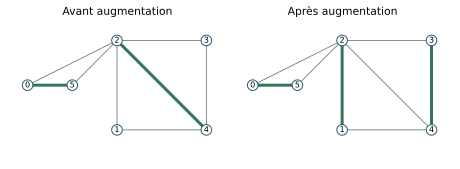
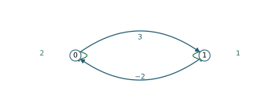
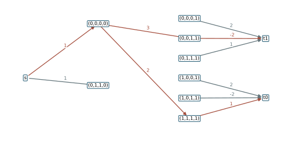

# X-ENS MPI · Informatique C 2025 · Corrigé guidé

*Corrigé rédigé par IA, non officiel. Signalez toute erreur.*

**Rédaction** · GPT-6.2 Astra Ultra · vitesse non renseignée · 24 novembre 2026

**Révision (tour 2)** · modèle exact non renseigné (famille Claude) · effort non renseigné · vitesse non renseignée · 28 novembre 2026

## Présentation du sujet

Le sujet porte sur les couplages dans les graphes non orientés. La partie I (OCaml, 21 questions) construit l’algorithme d’Edmonds : chemins d’augmentation, contraction des bourgeons, recherche dans une forêt alternée, puis itération jusqu’à un couplage de cardinal maximum. La partie II (C, 10 questions) implémente le déterminant sans division de Mahajan et Vinay, par programmation dynamique sur un graphe en couches, en $O(n^4)$. La partie III (C, 2 questions) en déduit un test probabiliste d’existence d’un couplage parfait, par la matrice de Tutte et le lemme de Schwartz-Zippel.

Les questions de programmation dominent ; les preuves demandées (Q8, Q12, Q16, Q27) sont courtes mais exigent des invariants énoncés proprement. Les cinq questions les plus lourdes au barème publié par le rapport 2025 sont Q11, Q16, Q19, Q30 et Q33 ; les questions de compréhension (Q3, Q5 à Q7, Q22 à Q26) se traitent vite et ne doivent pas être laissées. Un chemin d’augmentation part et arrive sur des sommets non couverts. Dans la partie II, distinguer les coefficients de la matrice, les poids des chemins et la parité avant la dernière fermeture. Dans la partie III, un déterminant non nul est un certificat, tandis qu’un zéro peut dépendre du tirage.

## I · Algorithme d’Edmonds

### Question 1 · Différence de listes

> [!INDICATION]
> Parcourir seulement la première liste par récursion.

#### Solution

Un élément de la première liste est conservé exactement lorsqu’il est absent de la seconde. L’ordre et les multiplicités des éléments conservés sont préservés.

```ocaml
let rec del xs ys =
  match xs with
  | [] -> []
  | x :: suite when List.mem x ys -> del suite ys
  | x :: suite -> x :: del suite ys
```

> [!JURY]
> Le préambule fixe la liste des fonctions de bibliothèque autorisées. Le rapport 2025 signale des points retirés pour `List.filter`, `List.iter` ou `List.fold_left`, et demande des noms de variables explicites, ainsi que des commentaires pour un code de plus d’une page.

### Question 2 · Clés d’une liste d’association

> [!INDICATION]
> La clé est le premier champ de chaque paire.

#### Solution

Projeter la première composante préserve l’ordre de représentation et demande un seul parcours.

```ocaml
let keys associations = List.map (fun (cle, _) -> cle) associations
```

### Question 3 · Reconnaître un couplage sur le dessin

> [!INDICATION]
> Vérifier d’abord l’existence de chaque arête, puis l’unicité de chaque extrémité.

#### Solution

(1) échoue car $\{1,2\}$ n’est pas une arête du graphe. (2) est un couplage : $\{1,3\}$ et $\{0,5\}$ existent et sont disjointes. (3) échoue car $0$ appartient à deux arêtes. Le croisement des deux diagonales du dessin ne représente pas un sommet supplémentaire.

### Question 4 · Liste des sommets couverts

> [!INDICATION]
> La précondition de couplage garantit déjà l’absence de doublons.

#### Solution

Chaque arête fournit ses deux extrémités. Le temps est linéaire dans le nombre d’arêtes et aucune déduplication n’est nécessaire.

```ocaml
let rec couverts = function
  | [] -> []
  | (a,b) :: reste -> a :: b :: couverts reste
```

> [!PIEGE]
> Un couplage n’a pas de sommet répété : appeler `join` pour retirer des doublons est inutile et risque de dégrader la complexité, ce que le rapport 2025 a pénalisé.

### Question 5 · Autre couplage de cardinal maximum

> [!INDICATION]
> Une borne absolue se lit sur le nombre de sommets.

#### Solution

Choisir $\{0,5\},\{1,2\},\{3,4\}$. Ces trois arêtes couvrent les six sommets. Un couplage à quatre arêtes demanderait huit sommets distincts. Le sujet emploie « maximal » au sens de **cardinal maximum** tout au long de l’épreuve.

### Question 6 · Augmenter le couplage du graphe (1)

> [!INDICATION]
> Les deux extrémités à libérer sont 1 et 3.

#### Solution

Le chemin $(1,2,4,3)$ alterne une arête libre, l’arête couplée $\{2,4\}$ et une arête libre. Remplacer $\{2,4\}$ par $\{1,2\}$ et $\{3,4\}$, en conservant $\{0,5\}$. On retrouve le couplage parfait de Q5.



### Question 7 · Augmentation en un seul pas

> [!INDICATION]
> Une arête entre deux sommets découverts est déjà un chemin augmentant.

#### Solution

Dans le dessin de droite, le couplage contient $\{0,2\},\{4,6\},\{5,7\}$. Les sommets 1 et 9 sont tous deux libres et sont adjacents. Le chemin $(1,9)$ donne le couplage $\{\{0,2\},\{1,9\},\{4,6\},\{5,7\}\}$.

### Question 8 · Effet de la différence symétrique

> [!INDICATION]
> Compter séparément les incidences des deux extrémités et de chaque sommet intérieur.

#### Solution

Les deux arêtes extrêmes du chemin (éventuellement la même) sont hors du couplage, car leurs extrémités sont libres. Sur un chemin alternant et élémentaire, chaque sommet intérieur touche une arête couplée et une arête libre du chemin. La bascule les échange ; aucune arête couplée extérieure ne touche ce sommet. Chacune des deux extrémités reçoit une unique arête, et les sommets hors du chemin gardent leurs incidences. C’est bien un couplage. La première et la dernière arête sont hors du couplage et les arêtes alternent : le chemin a donc un nombre impair $2q+1$ d’arêtes, dont $q$ dans le couplage et $q+1$ en dehors. On en retire $q$ et on en ajoute $q+1$ : le cardinal augmente exactement de un. Le cas $q=0$ couvre Q7.

> [!PIEGE]
> Un chemin d’augmentation peut n’avoir qu’une arête, hors du couplage (Q7). Une preuve qui suppose une arête couplée sur le chemin est incomplète. Le rapport 2025 note aussi que la seconde moitié de la question (le cardinal augmente) est souvent oubliée.

### Question 9 · Séparer les arêtes alternées

> [!INDICATION]
> La première arête n’est pas couplée ; la suivante l’est.

#### Solution

Le premier résultat contient les arêtes du couplage et le second les arêtes libres du chemin. Avancer d’un **sommet** à chaque étape afin de conserver le point commun de deux arêtes consécutives. La fonction auxiliaire normalise les extrémités par ordre croissant.

```ocaml
let arete a b = if a < b then (a,b) else (b,a)

let separer chemin =
  let rec visiter dedans internes externes = function
    | a :: (b :: _ as suite) ->
        let e = arete a b in
        if dedans then visiter false (e :: internes) externes suite
        else visiter true internes (e :: externes) suite
    | _ -> (List.rev internes, List.rev externes)
  in visiter false [] [] chemin
```

> [!JURY]
> Erreurs relevées par le rapport 2025 : arêtes non ordonnées en (min, max), chemin traité comme une liste d’arêtes, rôles de `lstin` et `lstout` échangés, arêtes perdues parce qu’un sommet intérieur appartient à deux arêtes. Un test sur un chemin à deux ou trois sommets les révèle.

### Question 10 · Calculer le couplage augmenté

> [!INDICATION]
> La liste des arêtes retirées et celle des arêtes ajoutées ne jouent pas le même rôle.

#### Solution

Retirer les arêtes internes à l’ancien couplage, puis former l’union avec celles qui viennent d’entrer. Les lignes utilisent les fonctions ensemblistes du sujet.

```ocaml
let augmente cpl chemin =
  let (internes, externes) = separer chemin in
  join (del cpl internes) externes
```

### Question 11 · Contracter un ensemble de sommets

> [!INDICATION]
> Construire aussi la liste d’adjacence du nouveau sommet.

#### Solution

Pour un sommet avalé, ajouter à la liste de $w$ ses voisins extérieurs et éliminer les répétitions avec la fonction fournie `join`. Pour un sommet extérieur, remplacer tous ses voisins avalés par $w$ une seule fois, avec `renomme`. Les arêtes intérieures ne créent aucune boucle en $w$. Si tout le graphe est contracté, il reste $w$ isolé.

```ocaml
let contracteG graphe bourgeon w =
  let rec construire voisins_w = function
    | [] -> [(w, voisins_w)]
    | (u, voisins) :: suite ->
        if List.mem u bourgeon then
          construire (join voisins_w (del voisins bourgeon)) suite
        else
          (u, renomme voisins bourgeon w) :: construire voisins_w suite
  in construire [] graphe
```

### Question 12 · Validité de la contraction du couplage

> [!INDICATION]
> Combien de sommets du cycle peuvent encore être appariés à l’extérieur ?

#### Solution

Sur le bourgeon à $2m+1$ sommets, les $m$ arêtes couplées internes couvrent exactement $2m$ sommets distincts. Seule la base peut être incidente à une arête du couplage qui sort du bourgeon. Le nouveau sommet $w$ est donc incident à au plus une arête du couplage contracté. À chaque sommet extérieur, les incidences sont conservées avec éventuellement un voisin renommé ; chaque sommet reste incident à au plus une arête. Toutes les arêtes retenues existent dans le graphe contracté.

> [!JURY]
> Le point décisif, d’après le rapport 2025 : au plus une arête du couplage relie le bourgeon à l’extérieur. Une vérification directe de la définition est plus sûre qu’un raisonnement par l’absurde.

### Question 13 · Contracter les paires du couplage

> [!INDICATION]
> Après renommage, une boucle correspond à une arête avalée.

#### Solution

Renommer par $w$ chaque extrémité intérieure, éliminer les paires égales puis remettre les extrémités en ordre. La preuve de Q12 assure l’absence de doublons entre deux arêtes traversantes.

```ocaml
let contracteC cpl bourgeon w =
  let image u = if List.mem u bourgeon then w else u in
  let rec transformer = function
    | [] -> []
    | (a,b) :: suite ->
        let u, v = image a, image b in
        if u = v then transformer suite
        else arete u v :: transformer suite
  in transformer cpl
```

### Question 14 · Retrouver une étiquette dans une forêt

> [!INDICATION]
> Après l’échec dans les enfants d’une racine, explorer les arbres frères.

#### Solution

La branche fructueuse ajoute l’étiquette de son parent en tête de la liste renvoyée. La racine et le sommet cherché sont inclus, même quand ils coïncident. Un parcours infructueux renvoie `None`. Chaque nœud est visité au plus une fois.

```ocaml
type arbre = N of int * foret
and foret = arbre list

let rec find foret v =
  match foret with
  | [] -> None
  | N (u, enfants) :: suivants ->
      if u = v then Some [u]
      else match find enfants v with
        | Some chemin -> Some (u :: chemin)
        | None -> find suivants v
```

> [!JURY]
> Le rapport 2025 relève l’oubli du constructeur `N`, une syntaxe `None`/`Some` mal maîtrisée, l’oubli du sommet cherché dans le chemin, et l’arrêt de la recherche après le premier arbre alors qu’il faut poursuivre dans les suivants.

### Question 15 · Ajouter un enfant aux occurrences de u

> [!INDICATION]
> Recopier aussi les descendants des nœuds qui correspondent au test.

#### Solution

Chaque arbre garde sa racine et une copie de tous ses anciens enfants. Si son étiquette vaut $u$, il reçoit en plus une feuille d’étiquette $v$. Effectuer la récursion sur les seuls enfants d’origine traite correctement le cas $u=v$.

```ocaml
let rec extend foret u v =
  let modifier (N (a, enfants)) =
    let copies = extend enfants u v in
    if a = u then N (a, N (v, []) :: copies) else N (a, copies)
  in List.map modifier foret
```

### Question 16 · Pourquoi relier deux arbres donne un chemin augmentant

> [!INDICATION]
> Établir l’invariant de la forêt depuis les racines découvertes.

#### Solution

Au départ les racines sont les sommets non couverts, toutes distinctes. Une extension accroche un voisin nouveau $v$ à un sommet pair $u$ par une arête libre, puis son partenaire $z$ par l’arête couplée. L’arête libre est bien hors du couplage : si $u$ est une racine il est libre ; sinon son partenaire est déjà son parent. De plus $z$ est nouveau : tout sommet couvert déjà dans la forêt y figure avec son partenaire, donc la présence antérieure de $z$ impliquerait celle de $v$. Ces propriétés garantissent l’unicité de chaque sommet dans la forêt et l’alternance de tout chemin issu d’une racine.

Deux arbres distincts ont donc des chemins racine–sommet disjoints. Leurs extrémités paires, si elles sont autres que les racines, sont atteintes par une arête couplée. L’arête $uv$ qui joint les deux arbres est nécessairement libre car tout partenaire d’un nœud couvert appartient au même arbre. Concaténer le premier chemin, $uv$ et le second chemin en sens inverse donne un chemin élémentaire alternant, de longueur positive, entre deux racines libres.

> [!JURY]
> Le rapport 2025 attend deux propriétés : tout chemin d’un nœud à sa racine est alternant et se termine à la racine par une arête hors du couplage ; un sommet figure au plus une fois dans la forêt. La seconde, qui donne le caractère élémentaire, est souvent oubliée.

### Question 17 · Ligne 15 de la figure 1

> [!INDICATION]
> La longueur de la liste des sommets est égale à la profondeur augmentée de un.

#### Solution

Une longueur de liste paire signale une profondeur impaire. Ce voisin n’apporte ni jonction entre deux sommets pairs ni nouveau sommet. Continuer avec les autres voisins.

```ocaml
aux_voisins u tl
```

### Question 18 · Lignes 17 et 18

> [!INDICATION]
> Les chemins fournis par find sont tous deux dirigés depuis leur racine.

#### Solution

Les deux arbres sont distincts et l’arête $uv$ est implicite entre le dernier élément de $cu$ et le premier élément du renversé de $cv$. Construire le résultat optionnel ; l’opérateur OCaml de concaténation est `@`.

```ocaml
Some (cu @ List.rev cv)
```

> [!PIEGE]
> Deux oublis pénalisés d’après le rapport 2025 : le constructeur `Some` et le renversement de `cv`.

### Question 19 · Extraire le bourgeon

> [!INDICATION]
> La base est le dernier ancêtre commun des deux sommets.

#### Solution

Retirer le préfixe commun tout en mémorisant son dernier sommet $b$. Les deux suffixes disjoints décrivent les branches de $b$ vers $u$ et vers $v$. Avec l’arête supplémentaire $uv$, leur union avec $b$ est le bourgeon ; la représentation demandée ne prescrit aucun ordre. Si un chemin est préfixe de l’autre, le suffixe vide ne supprime pas la base. L’ancêtre de divergence est pair : un nœud impair n’a qu’un enfant, son partenaire. La longueur du cycle est donc impaire.

```ocaml
let extrait cu cv =
  let rec descend base xs ys =
    match xs, ys with
    | a :: suite_a, b :: suite_b when a = b ->
        descend a suite_a suite_b
    | _ -> base :: (xs @ ys)
  in
  match cu, cv with
  | racine :: us, _ :: vs -> descend racine us vs
  | _ -> []  (* Appel exclu pour les chemins de la figure 1. *)
```

> [!PIEGE]
> Les deux chemins peuvent partager bien plus que la racine : la base du bourgeon est leur dernier sommet commun, et la racine de l’arbre n’appartient pas forcément au bourgeon. Le rapport 2025 signale cette confusion comme une erreur lourdement pénalisée et conseille de faire un dessin.

### Question 20 · Lignes 24 à 26

> [!INDICATION]
> La recherche récursive travaille sur des noms contractés.

#### Solution

Si elle échoue, l’équivalence de contraction admise prouve qu’aucune augmentation n’est possible dans le graphe courant. En cas de succès, appliquer la fonction fournie `gonfle` au graphe et au bourgeon d’origine pour ramener le chemin dans ce graphe.

```ocaml
(match recherche ng nc with
 | None -> None
 | Some ch -> Some (gonfle graphe bourgeon ch nv))
```

### Question 21 · Itération d’Edmonds

> [!INDICATION]
> Le lemme de Berge fournit la condition d’arrêt exacte.

#### Solution

Le couplage vide est valide. Chaque succès de la recherche ajoute exactement une arête par Q8. Il ne peut donc y avoir plus de $\lfloor |V|/2\rfloor$ augmentations. À l’arrêt, l’absence de chemin augmentant implique la cardinalité maximum par le lemme de Berge.

```ocaml
let edmonds graphe =
  let rec iterer cpl =
    match recherche graphe cpl with
    | None -> cpl
    | Some chemin -> iterer (augmente cpl chemin)
  in iterer []
```

## II · Déterminant de Mahajan–Vinay

### Question 22 · Index d’une matrice linéarisée

> [!INDICATION]
> Chaque ligne occupe n cases contiguës et les indices commencent à zéro.

#### Solution

La première case de la ligne $i$ est à l’offset $in$. Ajouter $j$ donne l’adresse demandée. La seconde fonction modifie le tableau passé par pointeur.

```c
int read_sqmatrix(int n, int *A, int i, int j) {
    return A[i*n + j];
}
void write_sqmatrix(int n, int *A, int i, int j, int val) {
    A[i*n + j] = val;
}
```

### Question 23 · Graphe pondéré d’une matrice

> [!INDICATION]
> La ligne indique l’origine de l’arc, la colonne sa destination.

#### Solution

Les sommets 0 et 1 portent des boucles de poids respectifs 2 et 1. L’arc $0\to1$ pèse 3 et l’arc $1\to0$ pèse $-2$. Aucun arc de la matrice n’est nul.



### Question 24 · Marche de tête 1 et de longueur 3

> [!INDICATION]
> Partir du plus petit sommet qui sera visité et le retrouver seulement à la fin.

#### Solution

La marche $1\to3\to2\to1$ utilise trois arcs du dessin. Les sommets intermédiaires sont strictement supérieurs à 1. La tête n’est reprise qu’à la fin.

### Question 25 · Lister les marches puis les suites

> [!INDICATION]
> Une boucle peut répéter un sommet intérieur, mais la tête d’une marche ne doit jamais être intérieure.

#### Solution

Les marches admissibles de longueur au plus 3 sont les suivantes.

| Longueur | Marche | Poids |
|---|---|---:|
| 1 | $2\to2$ | $5$ |
| 2 | $1\to2\to1$ | $1\cdot3=3$ |
| 3 | $0\to1\to2\to0$ | $2\cdot1\cdot2=4$ |
| 3 | $1\to2\to2\to1$ | $1\cdot5\cdot3=15$ |

Pour une suite, la longueur totale doit être exactement 3 et les têtes doivent croître strictement. Il y a les deux marches de longueur 3 prises seules (poids 4 et 15), puis la marche $1\to2\to1$ suivie de $2\to2$ (poids 15). Trois fois la boucle serait interdite à cause de sa tête répétée. La somme signée vaut $4+15-15=4$.

### Question 26 · Cinq arcs à ajouter sur la figure

> [!INDICATION]
> Vérifier tour à tour les arcs d’initialisation, d’extension, de changement de tête et de sortie.

#### Solution

En notant $\langle p,h,u,i\rangle$ les quadruplets de la planche comme dans le sujet (parenthèses sur la figure), il manque exactement :

| Origine | Destination | Poids |
|---|---|---:|
| $s$ | $\langle 0,0,0,0\rangle$ | $1$ |
| $\langle 0,0,0,0\rangle$ | $\langle 0,0,1,1\rangle$ | $3$ |
| $\langle 0,0,0,0\rangle$ | $\langle 1,1,1,1\rangle$ | $2$ |
| $\langle 0,0,1,1\rangle$ | $t_1$ | $-2$ |
| $\langle 1,1,1,1\rangle$ | $t_0$ | $1$ |

En particulier, le troisième arc ferme la boucle en 0 puis commence à la tête 1. Les chemins de poids $2$ vers $t_0$ et $-6$ vers $t_1$ donnent bien $2-(-6)=8$, le déterminant de la matrice de Q23.



### Question 27 · D’une suite positive à un chemin vers t₀

> [!INDICATION]
> Distinguer la continuation d’une marche et sa fermeture sur sa tête.

#### Solution

Dans $C=h,u_1,\dots,u_m,h$, chaque $u_j$ est strictement supérieur à $h$, et chaque arc utilisé a un coefficient non nul. Les transitions de type (2) relient donc successivement $\langle p,h,h,i\rangle$ à $\langle p,h,u_1,i+1\rangle$, puis jusqu’à $\langle p,h,u_m,i+m\rangle$, sans modifier $p$. Ces $m$ arcs partent des couches $i,\dots,i+m-1$, toutes au plus égales à $n-2$ puisque $i\leq n-1-m$ : la condition « couche de départ $<n-1$ » des arcs de type (2) est remplie. Pour une boucle ($m=0$), ce segment ne comporte aucun arc.

Pour une suite à $k$ marches, partir de $s$ par l’arc de type (1) vers sa première tête, avec $p=n\bmod2$. Entre marches successives, l’arc final $u_m\to h$ existe et la tête suivante est strictement supérieure : la transition (3) ferme la marche, change de tête et inverse la parité. Elle part d’une couche au plus égale à $n-2$, car la marche suivante a encore au moins un arc à parcourir. Après $n-1$ arcs consommés, il reste exactement la fermeture de la dernière marche par (4), qui inverse une dernière fois la parité. L’indice de la sortie est $(n+k)\bmod2$, donc 0 pour une suite positive. Le produit des poids est conservé, l’unique arc supplémentaire depuis $s$ ayant poids 1.

### Question 28 · Sommes de chemins par couche

> [!INDICATION]
> L’arrivée sur une tête et l’arrivée strictement au-dessus de cette tête correspondent à deux types d’arcs disjoints.

#### Solution

Écrire $F_i(p,h,v)=F_A(\langle p,h,v,i\rangle)$. Pour $i\geq1$ et $v>h$,

$$
F_i(p,h,v)=\sum_{w=h}^{n-1}F_{i-1}(p,h,w)A_{wv}.
$$

Pour $v=h$, le prédécesseur doit fermer sa marche de tête $h'<h$ avant de repartir sur la nouvelle tête :

$$
F_i(p,h,h)=\sum_{h'=0}^{h-1}\sum_{w=h'}^{n-1}F_{i-1}(1-p,h',w)A_{wh'}.
$$

Le cas $w=h'$ est indispensable pour fermer une boucle de longueur 1 : la règle (3) du sujet autorise $u=h$. Le rapport du jury écrit cette seconde somme avec $w>h'$, ce qui semble être une coquille. Les coefficients nuls peuvent rester dans les sommes. On additionne des produits, car chaque chemin s’obtient de façon unique en ajoutant son dernier arc à un chemin de la couche précédente.

> [!PIEGE]
> Deux formules, selon que $v=h$ ou $v>h$. Les poids se multiplient le long d’un chemin et s’additionnent entre chemins. Le rapport 2025 note qu’une formule unique à fonctions indicatrices est généralement fausse.

### Question 29 · Initialiser la couche zéro

> [!INDICATION]
> Une seule parité peut être atteinte depuis la source.

#### Solution

La fonction `create` fournit une table nulle. Les seuls arcs de la source ont poids 1 et conduisent aux sommets $\langle n\bmod2,h,h,0\rangle$. La création en $O(n^3)$ domine les $n$ écritures.

```c
Fourtable *initialise(int n) {
    Fourtable *t = create(n);
    for (int h = 0; h < n; ++h)
        write(t, 1, n % 2, h, h, 0);
    return t;
}
```

> [!JURY]
> Erreurs relevées par le rapport 2025 : oubli de la parité $n \bmod 2$, mise à 1 de trop de cases de la couche 0 par une double boucle sur $(h,u)$ au lieu des seuls sommets $(h,h)$, ordre des paramètres de `write`.

### Question 30 · Remplir la table sans construire le graphe

> [!INDICATION]
> Au début d’une tête h, un accumulateur contient déjà la somme des fermetures depuis les têtes inférieures.

#### Solution

Traiter les couches croissantes. Pour $v>h$, effectuer directement la première somme de Q28. Pour $v=h$, la seconde somme se met à jour d’une tête à la suivante en ajoutant les fermetures de la tête qui vient d’être traitée. Le calcul de tous les $v>h$ demande $O(n^3)$ par couche et par parité. Les mises à jour des fermetures y ajoutent $O(n^2)$. Les deux parités et les $n$ couches donnent $O(n^4)$, avec la table $O(n^3)$ du sujet.

```c
Fourtable *remplit(int n, int *A) {
    Fourtable *t = initialise(n);
    for (int i = 1; i < n; ++i) {
        for (int p = 0; p < 2; ++p) {
            int fermetures = 0;
            for (int h = 0; h < n; ++h) {
                write(t, fermetures, p, h, h, i);
                for (int v = h + 1; v < n; ++v) {
                    int somme = 0;
                    for (int w = h; w < n; ++w)
                        somme += read(t,p,h,w,i-1)
                               * read_sqmatrix(n,A,w,v);
                    write(t,somme,p,h,v,i);
                }
                /* Les têtes suivantes pourront venir de h. */
                for (int w = h; w < n; ++w)
                    fermetures += read(t,1-p,h,w,i-1)
                                * read_sqmatrix(n,A,w,h);
            }
        }
    }
    return t;
}
```

> [!METHODE]
> Quand une somme ne diffère de la précédente que par quelques termes, la tenir à jour dans un accumulateur plutôt que la recalculer : ici la somme sur $h'<h$ gagne un facteur $n$.

> [!JURY]
> La justification de complexité compte dans la note et a parfois été oubliée. Le rapport 2025 relève aussi un ordre de boucles invalide, une somme écrasée au lieu d’être accumulée, et une boucle qui repart de la couche 0 déjà initialisée.

### Question 31 · Fermer la dernière marche et calculer le déterminant

> [!INDICATION]
> La parité de la couche terminale est celle d’avant l’ultime fermeture.

#### Solution

Le poids vers $t_0$ provient de $p=1$, et celui vers $t_1$ de $p=0$. Multiplier par $A_{vh}$ pour fermer la marche, puis soustraire les contributions vers $t_1$. Les $O(n^2)$ termes terminaux et la libération de la table s’ajoutent au coût $O(n^4)$ du remplissage. Pour $n=1$, on retrouve $A_{00}$. Les calculs en C des parties II et III supposent que coefficients et intermédiaires sont représentables par un `int`, comme dans le modèle arithmétique de l’épreuve.

```c
int determinant(int n, int *A) {
    Fourtable *t = remplit(n, A);
    int resultat = 0;
    for (int h = 0; h < n; ++h)
        for (int v = h; v < n; ++v) {
            int difference = read(t,1,h,v,n-1) - read(t,0,h,v,n-1);
            resultat += difference * read_sqmatrix(n,A,v,h);
        }
    free(t);
    return resultat;
}
```

> [!JURY]
> Erreurs courantes d’après le rapport 2025 : oubli des poids de la matrice à la fermeture, oubli du signe des suites, oubli de `free`.

## III · Test probabiliste des couplages parfaits

### Question 32 · Évaluer la matrice de Tutte

> [!INDICATION]
> Une variable symbolique appartient à une paire non ordonnée, donc ne doit être tirée qu’une fois.

#### Solution

Pour $i<j$, effectuer un tirage uniforme sur $\{0,\ldots,n^2\}$ lorsque l’arête existe, mettre son opposé dans la case symétrique et mettre zéro partout ailleurs. Les tirages pour les arêtes distinctes sont indépendants. Le tableau local préserve la matrice d’adjacence reçue. La construction en $O(n^2)$ précède le calcul du déterminant en $O(n^4)$.

```c
void remplir_tutte(int n, int *A, int *T) {
    for (int i = 0; i < n; ++i) {
        T[i*n+i] = 0;
        for (int j = i + 1; j < n; ++j) {
            int x = A[i*n+j] ? rand_range(n*n) : 0;
            T[i*n+j] = x;
            T[j*n+i] = -x;
        }
    }
}

int tirage_tutte(int n, int *A) {
    int T[n*n];
    remplir_tutte(n, A, T);
    return determinant(n, T);
}
```

> [!JURY]
> La matrice de Tutte est antisymétrique : un seul tirage par arête, son opposé dans la case symétrique. Le rapport 2025 pénalise deux tirages indépendants, la modification du tableau `A` reçu et l’oubli de renvoyer le déterminant.

### Question 33 · Borner strictement l’erreur du test

> [!INDICATION]
> Le lemme de Schwartz–Zippel utilise le degré total et le cardinal de l’ensemble de tirage, pas le nombre de variables.

#### Solution

Si le graphe n’a aucun couplage parfait, le polynôme de Tutte est identiquement nul et chaque essai renvoie zéro. Sinon, c’est un polynôme non nul de degré total au plus $n$ par la formule des permutations. Pour $n\geq2$, la probabilité d’un zéro accidentel est au plus $n/(n^2+1)<1/n$. Avec $r$ essais indépendants, la probabilité d’une réponse fausse est donc strictement inférieure à $n^{-r}$. Un seul essai non nul certifie la réponse positive. Pour $n$ impair, répondre immédiatement faux.

Prendre $b=\lfloor\log_2 n\rfloor\geq1$ et $r=\max(1,\lceil p/b\rceil)$ essais, chacun étant un appel à `tirage_tutte`. Comme $n\geq2^b$, on a $n^{-r}\leq2^{-br}\leq2^{-p}$ : la probabilité d’erreur est strictement inférieure à $2^{-p}$. L’erreur n’est possible que dans un sens : la réponse « vrai » est toujours exacte.

Chaque essai coûte $O(n^4)$ par Q32, le calcul de $b$ coûte $O(\log n)$. Comme $b\geq\frac12\log_2 n$, on a $r\leq1+p/b\leq1+2p/\log_2 n$, d’où un temps $O\big(n^4(1+p/\log_2 n)\big)$, soit $O(pn^4/\log_2 n)$ dès que $p\geq\log_2 n$. Pour $p<\log_2 n$, un seul essai suffit et coûte $O(n^4)$ : la borne de l’énoncé se lit alors à un essai près. Une élimination de Gauss sans fraction (algorithme de Bareiss), en $O(n^3)$, donnerait la borne pour tout $p\geq1$, mais elle est hors programme et n’est pas attendue ici.

```c
bool parfait(int n, int *A, int p) {
    if (n % 2 != 0) return false;   /* nombre impair de sommets */
    int bits = 0;                   /* partie entière de log2(n) */
    for (int v = n; v > 1; v /= 2) ++bits;
    /* n est pair et non nul, donc n >= 2 et bits >= 1. */
    int repetitions = p/bits + (p%bits != 0);
    if (repetitions == 0) repetitions = 1;
    for (int r = 0; r < repetitions; ++r)
        if (tirage_tutte(n, A) != 0) return true;
    return false;
}
```

> [!METHODE]
> Amplification : un test à erreur unilatérale bornée par $q<1$ sur un essai, répété $r$ fois de façon indépendante, a une erreur au plus $q^r$. On choisit $r$ d’après la précision voulue.

> [!JURY]
> La note se partage entre le code, la justification de l’erreur et la complexité. Le rapport 2025 relève des confusions sur l’origine de l’aléa (ici les tirages, non le graphe) et signale des boucles sans condition d’arrêt correcte et des fonctions qui renvoient la négation du résultat.

## Bilan

- Lemme de Berge : un couplage est de cardinal maximum si et seulement s’il n’admet aucun chemin d’augmentation ; l’algorithme en découle par itération, avec au plus $\lfloor |V|/2\rfloor$ augmentations.
- Une forêt alternée enracinée aux sommets libres donne un chemin d’augmentation dès que deux sommets pairs d’arbres distincts sont voisins ; dans un même arbre, on contracte le bourgeon et on recommence.
- Le déterminant s’écrit comme une somme signée de suites de marches fermées ; un graphe en couches et une programmation dynamique le calculent sans division en $O(n^4)$.
- Un test d’identité polynomiale se ramène à des évaluations aléatoires : Schwartz-Zippel borne l’erreur d’un essai, la répétition indépendante la rend exponentiellement petite, et l’erreur est unilatérale.
- En OCaml comme en C, tester le code sur des entrées à un ou deux éléments, et relire le préambule pour les fonctions autorisées.
