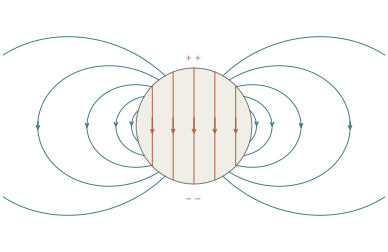
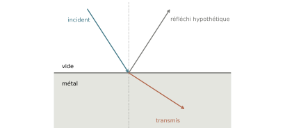
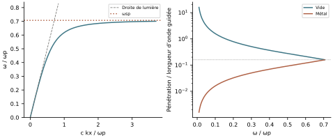
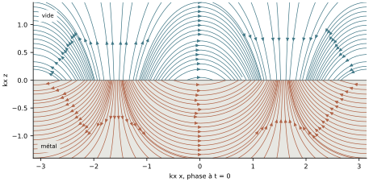

# Physique MPI — Concours MPI 2025 · Corrigé guidé

*Corrigé rédigé par IA, non officiel.*

**Rédaction** · GPT-6.2 Astra Ultra · vitesse non renseignée

Le sujet demande des réponses courtes et réserve un développement complet à la question 29. Les signes des champs sont fixés par le déplacement des électrons et par le choix explicite de la convention harmonique.

## I — Plasmons de surface localisés

### Question 1 — Deux faces de la plaque

> [!INDICATION]
> Utiliser deux fois la symétrie d’un plan puis additionner les champs dans chacune des trois régions.

#### Solution

Un plan uniforme porte de chaque côté un champ normal de module $|\sigma|/(2\varepsilon_0)$. Par superposition, loin des bords les deux champs s’annulent à l’extérieur et s’ajoutent à l’intérieur. Le champ intérieur va de la face positive vers la négative et vaut $|\sigma|/\varepsilon_0$.

### Question 2 — Charge découverte

> [!INDICATION]
> Assimiler la tranche découverte à un petit prisme de base $A$.

#### Solution

Une translation électronique de module $x$ découvre sur une aire $A$ une charge ionique $NeAx$, compensée sur la face opposée. Le module de la charge surfacique est $\sigma=Nex$. Pour un déplacement vectoriel $\vec u$, la polarisation associée est $\vec P=-Ne\vec u$ et la charge d’une face de normale sortante $\vec n$ est $\vec P\cdot\vec n$.

### Question 3 — Oscillation de plaque

> [!INDICATION]
> Tester le signe obtenu en déplaçant le nuage électronique vers la face négative du dessin.

#### Solution

Le champ intérieur vaut $\vec E=Ne\vec u/\varepsilon_0$, parallèle au déplacement des électrons. Leur charge est négative : $m\ddot{\vec u}=-e\vec E$. Ainsi $\ddot{\vec u}+\omega_p^2\vec u=0$ avec $\omega_p=\sqrt{Ne^2/(m\varepsilon_0)}$. La force est de rappel.

### Question 4 — Champ intérieur d’une sphère pleine

> [!INDICATION]
> Sur la surface de Gauss, le module du champ est uniforme et le flux sort par la sphère entière.

#### Solution

Les rotations autour du centre imposent $\vec E=E(r)\vec e_r$. Sur une sphère de Gauss intérieure, $4\pi r^2E=\rho(4\pi r^3/3)/\varepsilon_0$. Donc $\vec E=\rho\vec r/(3\varepsilon_0)$ pour $r<R$.

### Question 5 — Décaler les deux centres

> [!INDICATION]
> Écrire les deux rayons vecteurs à partir de leurs centres respectifs.

#### Solution

Si les ions sont centrés en O et les électrons en $\vec u$, la superposition dans la région commune donne $\vec E=Ne[\vec r-(\vec r-\vec u)]/(3\varepsilon_0)=Ne\vec u/(3\varepsilon_0)$. Le champ est uniforme au premier ordre en petit déplacement.

### Question 6 — Résonance sphérique

> [!INDICATION]
> Comparer le coefficient de rappel à celui de la plaque.

#### Solution

$m\ddot{\vec u}=-Ne^2\vec u/(3\varepsilon_0)$ donne $\omega_s=\omega_p/\sqrt3$. À densité électronique fixée, le rayon de la bille n’apparaît pas dans cette approximation quasistatique.

### Question 7 — Champ juste au pôle supérieur

> [!INDICATION]
> Partir de la valeur intérieure et lui ajouter le saut de la composante normale en franchissant la couche.

#### Solution

Au pôle S, prenons $\vec n$ vers le haut et $\vec u=-u\vec n$. La couche découverte porte $\sigma=Neu>0$. À l’intérieur $\vec E_{\rm int}=-\sigma\vec n/(3\varepsilon_0)$. Le saut normal de Gauss est $E_{\rm ext,n}-E_{\rm int,n}=\sigma/\varepsilon_0$, d’où $\vec E_{\rm ext}=2\sigma\vec n/(3\varepsilon_0)=-2\vec E_{\rm int}$. Pour la plaque les deux plans se compensent exactement à l’extérieur. Ce n’est plus la géométrie sphérique.

### Question 8 — Champ lointain

> [!INDICATION]
> Repérer le premier moment électrique non nul de la distribution neutre.

#### Solution

La charge totale est nulle mais les centres des charges opposées sont distincts. On obtient un champ de dipôle électrique de moment $\vec p=-Ne(4\pi R^3/3)\vec u$, orienté des charges négatives vers les positives. Son champ décroît en $r^{-3}$.

### Question 9 — Tracer les lignes du champ

> [!INDICATION]
> Placer une flèche sur chaque famille de lignes du dessin, y compris au voisinage des pôles.

#### Solution

Dans la sphère, le champ uniforme se dirige du pôle positif supérieur vers le pôle négatif inférieur. À l’extérieur les lignes partent de la région positive, contournent la sphère et rejoignent la région négative. À grande distance elles ont la forme dipolaire. Le champ normal saute à la surface, tandis que sa composante tangentielle y reste continue.

### Question 10 — Limite quasistatique

> [!INDICATION]
> Comparer un temps de propagation à l’inverse de la pulsation.

#### Solution

Le temps de traversée lumineuse $d/c$ doit être petit devant le temps de variation du champ. Un critère de faible déphasage est $\omega d/c\ll1$ ; en ordre de grandeur, la bille doit être petite devant la longueur d’onde du rayonnement. La validité dépend de la taille de la bille et de la fréquence, distinctes de l’amplitude de déplacement des charges.

### Question 11 — Bille de 20 nm

> [!INDICATION]
> Employer la longueur d’onde optique correspondant à la pulsation, puis faire le rapport des deux longueurs.

#### Solution

Une longueur d’onde dans l’UV proche est de l’ordre de 200–400 nm. Le diamètre de 20 nm en représente environ 5 à 10 %. À la résonance de la sphère, $\omega_s<\omega_p$, donc la longueur d’onde est encore plus grande. L’approximation quasistatique est raisonnable en première approche. Elle n’assure pas une précision arbitraire.

### Question 12 — Cylindre infini, déplacement transverse

> [!INDICATION]
> Le flux sort par la surface latérale. Le facteur géométrique remplaçant 3 dans la sphère est ici 2.

#### Solution

Pour une charge uniforme, les symétries imposent un champ radial transverse et indépendant de la coordonnée axiale. Gauss sur un cylindre de rayon $r$ et de hauteur $h$ donne $E=\rho r/(2\varepsilon_0)$ à l’intérieur. Superposer les deux cylindres translatés donne $\vec E_{\rm int}=Ne\vec u/(2\varepsilon_0)$ puis $\omega_c=\omega_p/\sqrt2$. Au bord, avec $\vec P=-Ne\vec u$, $\vec E_{\rm ext}=\vec E_{\rm int}+(\vec P\cdot\vec n)\vec n/\varepsilon_0$. Au pôle positif le champ extérieur et le champ intérieur sont opposés et de même module.

### Question 13 — Tige longue, déplacement axial

> [!INDICATION]
> Appliquer le modèle de l’énoncé à la charge de l’extrémité opposée, à distance $L$.

#### Solution

Chaque extrémité porte $|Q|\simeq Nex\pi R^2$. Dans l’approximation ponctuelle expressément proposée, le champ dû à l’autre extrémité vaut $|Q|/(4\pi\varepsilon_0L^2)$. La force électronique est de rappel et $m\ddot x=-Ne^2R^2 x/(4\varepsilon_0L^2)$. Ainsi $\omega_l\simeq\omega_pR/(2L)$ pour $L\gg R$.

### Question 14 — Taille et rapport d’aspect

> [!INDICATION]
> Le texte donne des longueurs d’onde dans le vide et non directement des pulsations.

#### Solution

Pour les formes étudiées, agrandir toutes les dimensions dans la même proportion conserve la pulsation quasistatique. Pour une tige, le modèle axial prévoit $\lambda_l=2\pi c/\omega_l\propto L/R$. Passer de 8 à 18 multiplierait la longueur d’onde par 2,25. L’expérience donne $1\,300/800\simeq1,63$. Le déplacement vers les grandes longueurs d’onde est confirmé, mais le modèle des deux extrémités ponctuelles ne prédit pas quantitativement le rapport observé.

### Question 15 — Pourquoi des nanotiges d’or ?

> [!INDICATION]
> Examiner quelle résonance permet un déplacement spectral important à matériau fixé.

#### Solution

Le mode longitudinal d’une tige allongée a une fréquence de rappel abaissée, réglable par le rapport d’aspect. Les mesures de Q14 situent ainsi sa résonance dans le proche infrarouge recherché. Le mode de la sphère reste fixé à $\omega_p/\sqrt3$ dans ce modèle et ne bénéficie pas du même réglage de forme.

### Question 16 — Polarisation de l’excitation

> [!INDICATION]
> C’est la force électrique qui déplace les électrons, tandis que l’énoncé demande le sens de propagation.

#### Solution

Pour exciter le mode axial, le **champ électrique** du laser doit avoir une composante parallèle à la tige. Une onde transverse peut remplir au mieux cette condition si sa direction de propagation est perpendiculaire à la tige et si sa polarisation électrique est axiale. Une propagation parallèle impose un champ électrique transverse à l’axe.

## II — Propagation près d’une surface plane

### Question 17 — Conductivité du plasma

> [!INDICATION]
> Annoncer sa convention temporelle avant de diviser par le facteur imaginaire.

#### Solution

Adoptons pour toute la suite $e^{i(\vec k\cdot\vec r-\omega t)}$. L’équation sans collisions $-i\omega m\vec v=-e\vec E$ donne $\vec j=-Ne\vec v=iNe^2\vec E/(m\omega)$. Ainsi $\gamma=i\varepsilon_0\omega_p^2/\omega$. La conductivité est purement imaginaire dans ce modèle.

### Question 18 — Onde transverse dans le volume

> [!INDICATION]
> Comparer le signe du terme plasma à la dispersion d’un milieu où la densité d’électrons tend vers zéro.

#### Solution

Maxwell–Faraday donne $\vec B=\vec k\times\vec E/\omega$. Maxwell–Ampère donne $i\vec k\times\vec B=\mu_0(\gamma-i\omega\varepsilon_0)\vec E$. Avec $\vec k\cdot\vec E=0$, $c^2k^2=\omega^2-\omega_p^2$. La branche propagative du volume a une coupure à $\omega_p$, et la limite $N=0$ restitue la dispersion du vide.

### Question 19 — Polarisation dans le plan d’incidence

> [!INDICATION]
> Écrire les relations de structure dans la base adaptée à l’interface.

#### Solution

Dans chaque milieu $\vec k$ et $\vec E$ sont perpendiculaires à $\vec B$ dirigé suivant $y$. Ils ont donc leurs composantes selon $x$ et $z$. La transversalité impose $\vec k\cdot\vec E=0$, avec le produit algébrique des amplitudes, y compris pour les vecteurs complexes. Ni $\vec k$ ni $\vec E$ ne doivent en général être alignés sur un axe.

### Question 20 — Relier les composantes électriques

> [!INDICATION]
> Garder l’indice de milieu de $k_z$ lorsqu’on applique le résultat des deux côtés.

#### Solution

Pour chacun des deux milieux, $k_xE_x+k_zE_z=0$. Donc $E_z=-(k_x/k_z)E_x$ pour $k_z\ne0$. Le signe utilise la transversalité et non une condition de raccord au plan.

### Question 21 — Composante magnétique

> [!INDICATION]
> Contrôler le signe par $\vec e_z\times\vec e_x=\vec e_y$.

#### Solution

Le produit vectoriel donne $B_y=(k_zE_x-k_xE_z)/\omega$. Avec Q20, $B_y=(k_x^2+k_z^2)E_x/(\omega k_z)$ dans chacun des milieux.

### Question 22 — Utiliser les dispersions

> [!INDICATION]
> Substituer la somme des carrés des composantes, sans remplacer $k_z$ seul par le module de $\vec k$.

#### Solution

Dans le vide $B_{y1}=\omega E_{x1}/(c^2k_{z1})$. Dans le métal $B_{y2}=(\omega^2-\omega_p^2)E_{x2}/(\omega c^2k_{z2})=\epsilon\omega E_{x2}/(c^2k_{z2})$, avec $\epsilon=1-\omega_p^2/\omega^2$.

### Question 23 — Accord de phase tangentielle

> [!INDICATION]
> Une égalité en un seul point ou un seul instant ne suffirait pas à égaler les fréquences spatiales et temporelles.

#### Solution

À $z=0$, le champ électrique tangentiel non nul est continu pour **tout** $x$ et **tout** $t$. Les facteurs $e^{i(k_{xj}x-\omega_jt)}$ doivent donc coïncider. $k_{x1}=k_{x2}=k_x$ et $\omega_1=\omega_2=\omega$. La composante normale $k_z$ peut différer.

### Question 24 — Accumuler une charge à la surface

> [!INDICATION]
> Orienter la normale du métal vers le vide avant le bilan.

#### Solution

Les électrons de conduction ne traversent pas du métal vers le vide. Sur une petite boîte qui chevauche la surface, le courant normal venant du métal alimente la charge de la couche, le courant de conduction dans le vide étant nul. Sans courant de feuille indépendant dans ce modèle, $\partial_t\sigma=j_{z2}(0^-)$. Des nœuds locaux peuvent avoir une charge instantanée nulle.

### Question 25 — Amplitude de charge

> [!INDICATION]
> Utiliser la même convention harmonique pour $\gamma$ et pour la dérivée de la charge.

#### Solution

$-i\omega\sigma=\gamma E_{z2}$. Par Q17, $\sigma=-\varepsilon_0(\omega_p^2/\omega^2)E_{z2}$. Les deux facteurs de phase du courant et de sa dérivée déterminent ce signe.

### Question 26 — Saut normal du champ

> [!INDICATION]
> Le champ figurant dans la charge de Q25 est celui du côté métal.

#### Solution

La loi de Gauss fournit $E_{z1}-E_{z2}=\sigma/\varepsilon_0$ en passant du métal au vide. On en déduit $E_{z1}/E_{z2}=1-\omega_p^2/\omega^2=\epsilon$. Il s’agit d’un rapport d’amplitudes complexes, qui peut être négatif.

### Question 27 — Rapport des nombres d’onde normaux

> [!INDICATION]
> Dans $E_z$, la composante normale du vecteur d’onde intervient au dénominateur.

#### Solution

À l’interface $E_{x1}=E_{x2}$. Comme $k_x$ est commun, Q20 donne $E_{z1}/E_{z2}=k_{z2}/k_{z1}$. On trouve donc $k_{z2}=\epsilon k_{z1}$ pour les solutions étudiées.

### Question 28 — Contrôle magnétique indépendant

> [!INDICATION]
> Annuler seulement les amplitudes et facteurs qui sont réellement communs aux deux milieux à l’interface.

#### Solution

Égaler les expressions de $B_y$ de Q22 en utilisant la continuité de $E_x$ donne immédiatement $1/k_{z1}=\epsilon/k_{z2}$. Le raccord magnétique conduit donc au même rapport $k_{z2}/k_{z1}=\epsilon$.

### Question 29 — Élimination détaillée

> [!INDICATION]
> Éliminer d’abord la composante normale dans le métal, puis la fréquence. Factoriser avant de diviser.

#### Solution

Les trois relations sont $k_x^2+k_{z1}^2=\omega^2/c^2$, $k_x^2+k_{z2}^2=\epsilon\omega^2/c^2$ et $k_{z2}=\epsilon k_{z1}$. Dans la seconde, substituons successivement la troisième à gauche et la première à droite. Il vient $k_x^2+\epsilon^2k_{z1}^2=\epsilon k_x^2+\epsilon k_{z1}^2$, donc $(1-\epsilon)k_x^2=\epsilon(1-\epsilon)k_{z1}^2$. Pour un plasma de densité non nulle et une fréquence finie, $\epsilon\ne1$. En dehors de la dégénérescence $\epsilon=0$, **$k_{z1}^2=k_x^2/\epsilon$**. Enfin $k_{z2}^2=\epsilon^2k_{z1}^2=\epsilon k_x^2$. Le signe des racines se fixe par le sens physique de propagation ou de décroissance.

### Question 30 — Transmission sans réflexion

> [!INDICATION]
> En réflexion, la composante parallèle se conserve et la composante normale change de signe.

#### Solution

L’onde incidente a pour vecteur $(k_x,0,k_{z1})$ avec $k_{z1}<0$. La réflexion géométrique donnerait $(k_x,0,-k_{z1})$, et la transmission $(k_x,0,k_{z2})$. Le produit scalaire réfléchi–transmis vaut $k_x^2-k_{z1}k_{z2}=k_x^2-\epsilon k_{z1}^2=0$. La réflexion hypothétique et la transmission sont donc orthogonales. Pour $0<\epsilon<1$ le métal a un indice inférieur à celui du vide ; le rayon transmis s’écarte de la normale. Le raccord à une onde par milieu est l’analogue de l’incidence de Brewster en polarisation TM.

### Question 31 — Évanescence de part et d’autre

> [!INDICATION]
> Vérifier chaque signe dans l’exponentielle en tenant compte du demi-espace considéré.

#### Solution

Le mode est une onde de surface évanescente transversalement. Avec la convention de Q17, posons $k_{z1}=+i\kappa_1$, $k_{z2}=-i\kappa_2$, où les deux $\kappa_j$ sont positifs. Les amplitudes varient comme $e^{-\kappa_1z}$ pour $z>0$ et $e^{\kappa_2z}$ pour $z<0$. Elles décroissent vers les deux infinis, tandis que la phase se propage en $x$.

### Question 32 — Nécessité d’une permittivité négative

> [!INDICATION]
> Une décroissance transversale exige un carré du nombre d’onde normal négatif.

#### Solution

$k_{z1}^2$ est négatif et $k_x^2$ positif dans Q29, donc $\epsilon<0$, soit $\omega<\omega_p$. La condition de positivité de $k_x^2$ issue de la dispersion complète resserre encore cette borne en Q33.

### Question 33 — Bande d’existence du plasmon

> [!INDICATION]
> Vérifier le signe du dénominateur avant de prendre une racine carrée réelle.

#### Solution

En substituant $k_{z1}^2=k_x^2/\epsilon$ dans la dispersion du vide, $k_x^2=(\omega/c)^2\epsilon/(1+\epsilon)$. Avec $\epsilon<0$, $k_x^2>0$ exige $\epsilon<-1$. On trouve donc $0<\omega<\omega_{sp}=\omega_p/\sqrt2$. À la borne supérieure, $k_x$ diverge dans le modèle local idéal.

### Question 34 — Dispersion et vitesse de groupe

> [!INDICATION]
> Choisir la racine qui part de l’origine et vérifier la pente initiale en utilisant la droite de lumière.

#### Solution

Posons $x=ck_x/\omega_p$. La branche de surface vérifie $\omega^2/\omega_p^2=(1+2x^2-\sqrt{1+4x^4})/2$. Elle part de l’origine avec $\omega\sim ck_x$ et s’infléchit vers l’asymptote horizontale $\omega_{sp}$. La pente $v_g=d\omega/dk_x$ tend donc vers $c$ à basse fréquence et vers zéro près de la résonance.

### Question 35 — Profondeurs de pénétration

> [!INDICATION]
> Comparer d’abord chaque longueur au même $1/k_x$, puis faire tendre la fréquence vers chacune des bornes.

#### Solution

Posons $u=|\epsilon|>1$. Q29 donne $\delta_1=1/\kappa_1=\sqrt u/k_x$ dans le vide et $\delta_2=1/\kappa_2=1/(k_x\sqrt u)$ dans le métal. Donc $\delta_1/\delta_2=u$. Rapportées à la longueur d’onde guidée $\lambda_x=2\pi/k_x$, elles valent $\sqrt u/(2\pi)$ et $1/(2\pi\sqrt u)$. À basse fréquence, $\delta_1\sim c\omega_p/\omega^2\gg\lambda_x$ et $\delta_2\sim c/\omega_p\ll\lambda_x$. Quand $\omega\to\omega_{sp}$, $u\to1$ et les deux profondeurs valent asymptotiquement $\lambda_x/(2\pi)$, toutes trois tendant vers zéro. La longueur d’onde dans le vide à cette même fréquence reste finie.

### Question 36 — Champs électriques réels

> [!INDICATION]
> Le passage à la partie réelle transforme le facteur imaginaire en une composante en quadrature.

#### Solution

Prenons une amplitude tangentielle réelle $E_0$ à l’interface et $\Phi=k_xx-\omega t$. Dans le vide, $E_{x1}=E_0e^{-\kappa_1z}\cos\Phi$ et $E_{z1}=-(k_x/\kappa_1)E_0e^{-\kappa_1z}\sin\Phi$. Dans le métal, $E_{x2}=E_0e^{\kappa_2z}\cos\Phi$ et $E_{z2}=+(k_x/\kappa_2)E_0e^{\kappa_2z}\sin\Phi$. Dans les deux cas $E_y=0$. À $z=0$ ces expressions vérifient $E_{z1}/E_{z2}=-\kappa_2/\kappa_1=\epsilon$ aux points où le rapport est défini.

### Question 37 — Direction et dessin des lignes

> [!INDICATION]
> Tracer en premier les positions où le champ est horizontal puis celles où il est vertical. Les exponentielles d’atténuation se compensent dans le quotient.

#### Solution

La pente $dz/dx=E_z/E_x$ égale $-(k_x/\kappa_1)\tan\Phi$ dans le vide et $+(k_x/\kappa_2)\tan\Phi$ dans le métal. Elle dépend de $x,t$ mais pas de $z$ dans chacun des demi-espaces. À temps fixé, des branches s’intègrent en $z=C+\ln|\cos\Phi|/\kappa_1$ dans le vide et $z=C'-\ln|\cos\Phi|/\kappa_2$ dans le métal. Des lignes verticales sont possibles quand $\cos\Phi=0$. Les flèches suivent le signe de $E_x$, s’inversent d’une demi-longueur d’onde à la suivante et changent d’inclinaison de part et d’autre des charges d’interface.

[Sujet officiel](https://www.polytechnique.edu/admission-cycle-ingenieur/sites/admission/files/content/Physique%20MPI.pdf) · [Rapport du jury](https://www.polytechnique.edu/admission-cycle-ingenieur/sites/admission/files/content/Ecrits_MPI_Physique%20OK.pdf)
