# X-ENS PC — Chimie A 2025 · Corrigé partiel guidé

*Corrigé rédigé par IA, non officiel.*

**Rédaction** · GPT-6.2 Astra Ultra · vitesse non renseignée

**Révision (tour 1)** · GPT-6.2 Astra Ultra · vitesse non renseignée

**Couverture.** 45 questions intégralement traitées, 3 partiellement et 18 hors couverture. Les Q1, 7, 8, 17 et 26 à 66 sont entièrement traitées. La Q17 identifie le noyau indole. Les Q12, 18 et 19 couvrent les contraintes de conformation, l’excès énantiomérique et les principes de distinction des stéréoisomères. Les autres questions de construction des alcaloïdes restent hors couverture.

## I — Notions indépendantes de chimie organique

### Question 1

> [!INDICATION]
> Écrire les formes limites où le doublet de l’azote exocyclique est délocalisé dans le cycle. Comparer la densité électronique sur l’azote pyridinique.

#### Solution

Le doublet du groupe diméthylamino en para est conjugué avec le système aromatique. Sa donation mésomère déplace de la densité électronique vers les positions ortho et para. Une forme limite quinonoïde porte une charge positive sur l’azote exocyclique, engagé dans une double liaison avec le cycle, et une charge négative sur l’azote du cycle. Le dessin représente la contribution de cette forme à l’hybride. Le doublet disponible sur l’azote pyridinique rend celui-ci plus nucléophile que l’azote de la pyridine non substituée. Une charge formelle d’une forme limite ne signifie pas que la molécule en solution porte deux charges entières localisées.

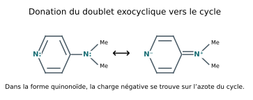

### Question 7

> [!INDICATION]
> Repérer les quatre atomes d’oxygène liés au phosphore, puis attribuer les doublets aux oxygènes.

#### Solution

L’acide diphénylphosphorique s’écrit $(\mathrm{PhO})_2\mathrm P(=O)OH$. Le phosphore central a deux liaisons simples vers les oxygènes des phénoxy, une vers l’oxygène du OH et une liaison formellement double vers le quatrième oxygène. Dans cette formule de Lewis, chaque oxygène porte deux doublets libres. Une écriture à charges séparées $\mathrm{P^+{-}O^-}$ représente aussi la polarisation de la liaison phosphoryle. Les quatre directions autour de P donnent une géométrie localement tétraédrique, de type $AX_4$.

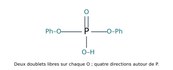

### Question 8

> [!INDICATION]
> Le signe de rotation mesuré et le descripteur de configuration sont des informations différentes.

#### Solution

Le symbole $(\pm)$ indique un racémate, mélange équimolaire des deux énantiomères. Dans les mêmes conditions, leurs pouvoirs rotatoires sont opposés et se compensent. On ne peut déduire du signe de rotation lequel est de configuration $R$ ou $S$.

### Question 12 — Géométrie locale des cycles à six, partie générale

> [!INDICATION]
> Une forme chaise suppose des liaisons assez libres pour adopter une série d’angles dièdres alternés.

#### Solution

Dans le cyclohexane saturé, six centres tétraédriques permettent la conformation chaise. Un atome trigonal et ses trois liaisons sont localement coplanaires. Une double liaison, une conjugaison ou une arête partagée avec un cycle rigide restreignent les angles dièdres et peuvent aplatir un cycle à six. L’application aux atomes précis du composé intermédiaire reste hors couverture.

### Question 17 — Reconnaître le noyau 1H-indole

> [!INDICATION]
> Le préfixe 1H situe le proton sur le N pyrrolique. Retirer la chaîne nommée comme substituant pour isoler le noyau.

#### Solution

Le noyau **1H-indole** est un benzène fusionné à un pyrrole par une liaison C–C commune. Sa formule est C₈H₇N ; le N du cycle à cinq porte H. Le doublet de ce N participe au système aromatique de dix électrons π. Dans « indol-3-yl », le point d’attache se trouve au carbone 3 du cycle à cinq, à deux liaisons du N par C2. Une écriture structurale compacte de l’indole libre est `c1ccc2[nH]ccc2c1`.

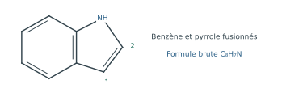

### Question 18 — éléments de réponse

> [!INDICATION]
> Ramener l’excès à la différence de populations dans un mélange de 100 molécules.

#### Solution

Un mélange 80 % $R$, 20 % $S$ présente un excès énantiomérique de $80-20=60\,\%$ en faveur de $R$. Pour une catalyse asymétrique générique, les chemins qui conduisent aux deux énantiomères passent dans un environnement chiral par des états de transition diastéréoisomères. Leurs énergies libres d’activation peuvent différer. La proportion 80:20 caractérise la sélectivité et ne renseigne pas sur le rendement total. La réponse se limite ici à la lecture de cette proportion.

### Question 19 — Séparer des stéréoisomères, principe général

> [!INDICATION]
> Identifier la relation stéréochimique avant de discuter la nature de la phase stationnaire.

#### Solution

Deux énantiomères ont les mêmes propriétés de partage dans un environnement achiral. Une phase stationnaire chirale peut former avec eux des associations transitoires diastéréoisomères, donc de stabilités et de temps de rétention différents. Deux diastéréoisomères peuvent en revanche déjà présenter des rétentions différentes sur phase achirale. Cette discussion couvre le principe de la discrimination ; elle ne détermine pas une méthode de résolution pour l’intermédiaire de la synthèse.

## II.1 — Enthalpie de la conversion du quadricyclane

### Question 26

> [!INDICATION]
> Établir un parcours entre deux solides en utilisant les énergies de liaison seulement pour les molécules gazeuses.

#### Solution

Notons $D_s=D(\mathrm{C{-}C})$ et $D_d=D(\mathrm{C{=}C})$, positifs pour une dissociation. QC possède dix liaisons C–C simples. NBD en possède six simples et deux doubles. Les huit liaisons C–H sont communes. La différence des énergies pour aller des molécules gazeuses aux mêmes atomes vaut donc $10D_s-(6D_s+2D_d)$. En ajoutant la sublimation de QC au départ et la condensation de NBD à l’arrivée, le caractère de fonction d’état de l’enthalpie donne
$$\Delta_rH^\circ=\Delta_{\rm sub}H^\circ(\mathrm{QC})-\Delta_{\rm sub}H^\circ(\mathrm{NBD})+4D_s-2D_d.$$

### Question 27

> [!INDICATION]
> Utiliser les constantes de dissociation avec leur signe positif et le sens QC vers NBD.

#### Solution

Avec le terme de sublimation négligé, $4(350)-2(620)=+160\ \mathrm{kJ\,mol^{-1}}$. Le modèle des énergies de liaison moyennes prévoit une réaction endothermique dans ce sens. Cette valeur est une prévision du modèle.

### Question 28

> [!INDICATION]
> Quelle grandeur intégrée un calorimètre mesure-t-il lorsque la transformation est quantitative ?

#### Solution

Une calorimétrie différentielle à balayage peut séparer le signal thermique de la conversion de la ligne de base. On intègre le flux thermique excédentaire au cours du temps et on divise la chaleur obtenue par la quantité de matière convertie. À pression constante, l’effet thermique correspond à la variation d’enthalpie. Il faut tenir compte de la ligne de base et d’une éventuelle transition de phase qui se superposerait au signal.

### Question 29

> [!INDICATION]
> Comparer le signe et la valeur, puis rechercher dans les structures les contraintes ignorées par le calcul.

#### Solution

L’expérience donne $-113\pm1\ \mathrm{kJ\,mol^{-1}}$. Le modèle de Q27 surestime l’enthalpie de réaction d’environ $273\ \mathrm{kJ\,mol^{-1}}$ et en inverse le signe. Les liaisons C–C du quadricyclane sont très contraintes dans une cage à petits cycles. Angles et orientations orbitalaires s’écartent fortement de ceux des hydrocarbures utilisés pour tabuler une énergie moyenne. Une grande partie de cette tension est relâchée dans l’isomérisation. Le résidu de 273 kJ/mol comprend toutes les approximations du modèle ; il ne constitue pas une mesure absolue de l’énergie de tension du seul QC.

## II.2 — Orbitales et cycloaddition photochimique

### Question 30

> [!INDICATION]
> Suivre les pointillés depuis les orbitales de fragment sur la figure 13 avant de remplir les niveaux.

#### Solution

Chaque fragment $\mathrm{CH_2}$ apporte six électrons de valence, soit douze pour l’éthène. Les OM1 à OM6 reçoivent chacune deux électrons de spins opposés. Les niveaux 7 à 12 sont vacants. L’OM4 est la combinaison stabilisée des deux orbitales de fragment $c$, et l’OM5 la combinaison déstabilisée des deux orbitales $b$. Sur des fragments orientés en miroir, les lobes qui se recouvrent s’ajoutent pour OM4 et se retranchent pour OM5. Dans cette dernière, le changement de phase entre fragments engendre un nœud supplémentaire. Les OM6 et OM7 associent les deux orbitales $d$, perpendiculaires au plan de la molécule. L’OM6 est la combinaison latérale en phase ($\pi$, HO) et l’OM7 la combinaison latérale en opposition ($\pi^*$, BV). Le signe global de chaque orbitale peut être inversé.

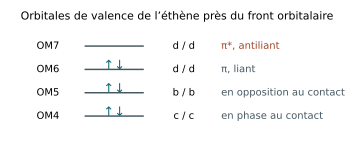

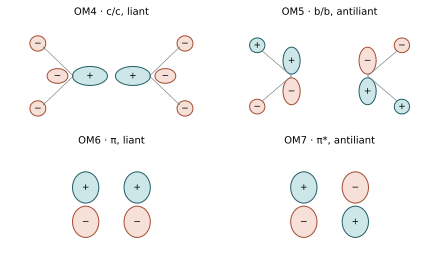

### Question 31

> [!INDICATION]
> Le plan contenant les six atomes fournit un critère de symétrie qui distingue les orbitales π des orbitales du squelette.

#### Solution

Dans OM6 et OM7, le plan de l’éthène est nodal. Les lobes placés de part et d’autre de ce plan proviennent des orbitales $p$ perpendiculaires portées par les carbones. L’OM6 présente le même signe au-dessus des deux carbones. L’OM7 présente des signes opposés et un second plan nodal entre les carbones. Ce sont les deux OM du système $\pi$. L’occupation fondamentale est $(\pi)^2(\pi^*)^0$.

### Question 32

> [!INDICATION]
> Faire face aux deux extrémités de la HO et de la BV de deux éthènes dans la géométrie suprafaciale.

#### Solution

Dans les deux molécules à l’état fondamental, la HO est $\pi$ et la BV est $\pi^*$. Si l’on superpose les lobes de même signe à une extrémité, les lobes de l’autre extrémité se trouvent en opposition de phase. Les deux recouvrements signés se compensent par symétrie. La cycloaddition concertée thermique suprafaciale sur chaque alcène est donc interdite par la symétrie orbitalaire de cet état. La conclusion vise cette géométrie et ce chemin concerté.

### Question 33

> [!INDICATION]
> Conserver deux électrons dans le système π après la promotion.

#### Solution

L’absorption promeut un électron de $\pi$ vers $\pi^*$. La configuration du système devient $(\pi)^1(\pi^*)^1$. On place une flèche sur chaque niveau et on conserve leurs énergies respectives dans ce modèle orbitalaire. La transition optique directe depuis l’état fondamental singulet conserve le spin total ; les deux électrons célibataires doivent alors être couplés en singulet. Le seul dessin de deux occupations simples ne suffit pas à fixer la multiplicité.

### Question 34

> [!INDICATION]
> Distinguer l’ordre de la liaison π de l’ordre total de la liaison carbone–carbone.

#### Solution

Dans l’état excité, l’ordre $\pi$ est $(n_{\rm liants}-n_{\rm antiliants})/2=(1-1)/2=0$. La liaison $\sigma$ reste occupée et l’ordre total C–C vaut 1. Une représentation de Lewis correspondante est $\mathrm{{}^\bullet CH_2{-}CH_2{}^\bullet}$, avec un électron célibataire sur chaque carbone. Cette écriture localisée rend compte du comptage. L’état électronique réel est décrit par les orbitales de Q33.

### Question 35

> [!INDICATION]
> Dans le modèle demandé, les deux partenaires possèdent chacun deux orbitales simplement occupées. Examiner le signe du recouvrement aux deux extrémités.

#### Solution

Notons A et B les deux fragments excités. Le couplage de $\pi_A$ avec $\pi_B$ et celui de $\pi_A^*$ avec $\pi_B^*$ rapprochent chacun deux orbitales simplement occupées de même énergie. Pour $\pi/\pi$, le signe est identique aux deux contacts. Pour $\pi^*/\pi^*$, le changement de signe sur B accompagne celui sur A : les produits des signes aux deux contacts sont de nouveau identiques. Chaque paire peut donc donner une combinaison stabilisée occupée par deux électrons de spins convenablement couplés. Les termes croisés $\pi_A/\pi_B^*$ et $\pi_A^*/\pi_B$ se compensent en géométrie symétrique et les niveaux concernés sont en outre séparés en énergie.

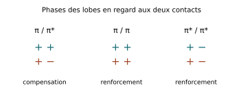

### Question 36

> [!INDICATION]
> Comparer le résultat de Q35 à l’annulation du recouvrement trouvée en Q32.

#### Solution

L’excitation rend disponibles des occupations pour lesquelles les contacts aux deux extrémités sont simultanément liants. Une fermeture suprafaciale photochimique devient ainsi compatible avec la symétrie ; le changement d’occupation ouvre un chemin qui était défavorisé à l’état fondamental. La construction de Q35 suit le modèle des deux éthènes excités demandé par l’énoncé. En photochimie réelle une réaction peut aussi partir d’un alcène excité interagissant avec un partenaire fondamental ; le modèle ne détermine pas le détail temporel de la formation des deux liaisons.

### Question 37

> [!INDICATION]
> Utiliser l’écart énergétique d’un éthène, puis convertir les électronvolts en joules par photon.

#### Solution

L’énergie de promotion vaut $1{,}4-(-10{,}5)=11{,}9\ \mathrm{eV}$, soit $1{,}90\times10^{-18}\ \mathrm J$ par photon. Ainsi $\lambda=hc/\Delta E\simeq1{,}04\times10^{-7}\ \mathrm m=104\ \mathrm{nm}$. Il s’agit de l’ultraviolet lointain, dans le domaine de l’UV du vide. La valeur se rapporte au modèle orbitalaire de l’éthène isolé. Le composé substitué du suivi calorimétrique absorbe à une autre longueur d’onde.

## II.3 — Mesure électrochimique

### Question 38

> [!INDICATION]
> L’électrode qui fixe l’échelle des potentiels et celle qui ferme le circuit du courant ont des fonctions différentes.

#### Solution

Un potentiostat règle le potentiel de l’électrode de travail relativement à la référence, qui ne débite pratiquement aucun courant. Il mesure le courant entre l’électrode de travail et la contre-électrode. Les trois électrodes plongent dans une solution contenant un électrolyte support, qui limite la migration. Dans les conditions de transport reproductibles utilisées pour comparer les paliers, on fait varier le potentiel de travail et on enregistre $i(E)$. Les potentiels du sujet sont rapportés au couple ferrocénium/ferrocène dans le dichlorométhane.

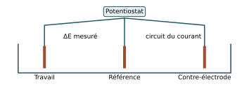

### Question 39

> [!INDICATION]
> Situer les deux vagues avec les potentiels standard. Distinguer la hauteur d’une marche et la hauteur totale après la seconde.

#### Solution

Le courant limite d’une oxydation à un électron est proportionnel à la concentration de son réducteur à transport de matière fixé. QC s’oxyde à un potentiel inférieur, voisin de $0{,}56\ \mathrm V$ contre Fc⁺/Fc, NBD à un potentiel voisin de $1{,}17\ \mathrm V$. Le premier palier mesure QC. La différence entre le second palier et le premier mesure NBD. À coefficients de diffusion égaux, le second palier total est proportionnel à $[\mathrm{QC}]+[\mathrm{NBD}]$, constante dans l’isomérisation idéale.

### Question 40

> [!INDICATION]
> Prendre pour unité le courant limite obtenu si tout le soluté est oxydé.

#### Solution

Au départ, une seule marche de hauteur $i_0$ apparaît autour du potentiel de QC. À la demi-réaction, deux marches de hauteur $i_0/2$ donnent les paliers $i_0/2$ puis $i_0$. À la fin, la première marche disparaît et une seule marche de hauteur $i_0$ se place au potentiel de NBD. Le faisceau tracé suppose que l’oxydation utilisée comme sonde ne déclenche encore aucune conversion chimique annexe.

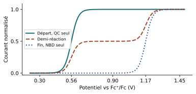

### Question 41

> [!INDICATION]
> Écrire qui donne l’électron dans la réaction encadrée de la figure 14.

#### Solution

La réaction homogène encadrée est $\mathrm{QC+NBD^+\rightarrow QC^++NBD}$. QC cède l’électron ; le potentiel standard de l’accepteur NBD⁺ est le plus élevé. Pour un électron, $\log_{10}K^\circ=(1{,}17-0{,}56)/0{,}059\simeq10{,}34$, d’où $K^\circ\simeq2\times10^{10}$ à 298 K. Dans les conditions standards l’équilibre favorise très fortement les produits. Le réactif QC⁺ régénéré peut s’isomériser à son tour.

### Question 42

> [!INDICATION]
> Suivre le nombre de molécules de QC consommées par électron retiré à l’électrode.

#### Solution

L’oxydation à l’électrode amorce la conversion QC⁺ vers NBD⁺. L’échange de Q41 crée ensuite une nouvelle molécule de QC⁺ en transformant un QC neutre du milieu en NBD neutre sur l’ensemble d’un tour. Plusieurs QC peuvent ainsi disparaître pour un seul électron initialement retiré. La vague de QC devient plus faible que celle calculée pour la concentration initiale et la contribution de NBD s’accroît à potentiel plus élevé. Sur un tracé comparatif, placer la courbe réelle sous le palier idéal de QC et faire apparaître une marche supplémentaire autour de l’oxydation du NBD déjà formé. La forme exacte et l’ampleur de la déformation dépendent de la durée du balayage et des étapes chimiques, dont les constantes ne sont pas fournies.

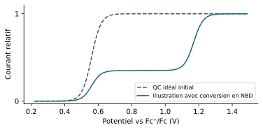

### Question 43

> [!INDICATION]
> Une sonde cinétique doit-elle modifier les concentrations qu’elle mesure ?

#### Solution

Dans le modèle sans cascade, l’intensité renseigne sur la composition au moment du prélèvement. Ici l’acquisition crée une espèce qui accélère elle-même l’isomérisation, et le courant ne compte plus un électron par QC consommé. Convertir directement le premier palier en concentration sous-estimerait le QC initial du prélèvement. Sans modèle et étalonnage de la cascade, cette mesure ne permet pas un suivi fidèle de la seule réaction thermique.

### Question 44

> [!INDICATION]
> Choisir un signal qui distingue une double liaison d’une cage saturée sans initier l’oxydation.

#### Solution

Une RMN du proton peut mesurer l’intégrale d’un signal vinylique résolu du NBD et celle d’un signal caractéristique de QC. On rapporte chaque aire au nombre de protons correspondants et à une référence constante. La température et les conditions d’acquisition quantitative doivent rester identiques. La présence de deux doubles liaisons dans NBD donne un critère absent dans le squelette du QC.

## II.3 — Énergie libre d’activation

### Question 45

> [!INDICATION]
> Écrire les logarithmes des deux lois et distinguer leurs paramètres.

#### Solution

La loi d’Arrhenius s’écrit $k=A\exp[-E_a/(RT)]$. $E_a$ est l’énergie d’activation molaire, $A$ le facteur préexponentiel (en $\mathrm{s^{-1}}$ à l’ordre 1). La relation d’Eyring s’écrit $k=(k_BT/h)\exp(\Delta S^\ddagger/R)\exp[-\Delta H^\ddagger/(RT)]$ sous les hypothèses du document. La pente de $\ln(k/T)$ en fonction de $1/T$ donne l’enthalpie d’activation. L’ordonnée à l’origine contient l’entropie d’activation, qui renseigne sur la variation du nombre de configurations accessibles au passage à l’état de transition.

### Question 46

> [!INDICATION]
> Le coefficient directeur porte un signe négatif. Les unités du logarithme sont celles adoptées pour le graphe du sujet.

#### Solution

La pente $-(1{,}25\pm0{,}04)\times10^4\ \mathrm K$ donne $\Delta H^\ddagger=(104\pm3)\ \mathrm{kJ\,mol^{-1}}$. L’ordonnée $21\pm1$ vérifie $b=\ln(k_B/h)+\Delta S^\ddagger/R$ avec la convention d’unités du sujet. Ainsi $\Delta S^\ddagger\simeq8{,}31(21-23{,}8)=(-23\pm8)\ \mathrm{J\,mol^{-1}\,K^{-1}}$. Le signe négatif est compatible avec un ensemble d’états de transition plus contraint que l’état initial. Il ne permet pas à lui seul de reconstruire une géométrie.

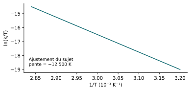

## II.3 — Évolution d’un calorimètre fermé

### Question 47

> [!INDICATION]
> Raisonner par unité de volume et distinguer la chaleur libérée par la réaction et celle absorbée par la solution.

#### Solution

Le calorimètre est idéalement adiabatique, la pression est constante et les capacités thermiques sont supposées constantes. Pour un volume $V$, l’avancement depuis le départ est $Vc(t)$. La variation d’enthalpie vaut $V K[T(t)-T_i]+Vc(t)\Delta_rH^\circ=0$. Dans le modèle du sujet qui assimile le volume de toluène au volume de la solution, sa masse est $\rho_{\rm Tol}V$ et celle des solutés est $Mc_0V$. Les deux isomères ont la même capacité massique $C$. On obtient
$$K=\rho_{\rm Tol}C_{\rm Tol}+Mc_0C,\qquad T(t)=T_i-\frac{\Delta_rH^\circ}{K}c(t).$$
$K$ est une capacité thermique volumique, ici $1{,}97\times10^6\ \mathrm{J\,m^{-3}\,K^{-1}}$. Les concentrations de ce calcul sont en mol/m³. L’exothermicité fait croître $T$.

### Question 48

> [!INDICATION]
> Éliminer la concentration à l’aide du bilan enthalpique avant de substituer la loi d’Eyring.

#### Solution

Posons $A=(k_B/h)\exp(\Delta S^\ddagger/R)$, $B=\Delta H^\ddagger/R$ et $T_\infty=T_i-c_0\Delta_rH^\circ/K$. La loi d’ordre 1 est $\dot c=k(T)(c_0-c)$ avec $k(T)=ATe^{-B/T}$. Comme $\dot T=-(\Delta_rH^\circ/K)\dot c$ et $-(\Delta_rH^\circ/K)(c_0-c)=T_\infty-T$, il vient $\dot T=ATe^{-B/T}(T_\infty-T)$. Pour la forme imprimée $\alpha T e^{-\beta/T}(T+\gamma)$, $\alpha=-A$, $\beta=B$ et $\gamma=-T_\infty$. Le membre de droite est positif depuis $T_i$ jusqu’à $T_\infty$.

### Question 49

> [!INDICATION]
> Quelle est la plus grande quantité de produit que le mélange initial permette de former ?

#### Solution

En fin de conversion complète, $c=c_0$. Il vient directement $\Delta T_\infty=-c_0\Delta_rH^\circ/K$. Pour le **dérivé** QC1, le code emploie $-88{,}5\ \mathrm{kJ\,mol^{-1}}$, voisin des $-89$ arrondis de l’annexe. À $c_0=1{,}1\ \mathrm{mol\,L^{-1}}$, l’élévation idéale est d’environ $49{,}5\ \mathrm K$ et la température finale d’environ $343\ \mathrm K$ pour un départ à $293\ \mathrm K$. L’enthalpie de $-113\ \mathrm{kJ\,mol^{-1}}$ concerne l’isomère non substitué.

### Question 50

> [!INDICATION]
> Lire la puissance de dix qui multiplie l’axe du temps et expliquer la pente par le produit de deux facteurs.

#### Solution

La température monte lentement au début, puis la pente augmente fortement et un plateau voisin de $342$ à $343\ \mathrm K$ apparaît vers $1{,}5\times10^6\ \mathrm s$, soit environ 17 jours. Au début l’échauffement accélère $k(T)$. Vers la fin, l’épuisement du réactif domine et $T_\infty-T$ tend vers zéro. Un calorimètre réel perd de la chaleur pendant une durée aussi longue. La hausse et le plateau adiabatiques sont donc difficiles à observer tels quels.

## II.3 — Bilans du réacteur continu

### Question 51

> [!INDICATION]
> Convertir le diamètre et le débit avant de diviser le volume du cylindre par le débit volumique.

#### Solution

Pour un réacteur rempli, $\tau=V/D_v=\pi(d/2)^2L/D_v$. Ici $V=\pi(0{,}05\ \mathrm{cm})^2(1\ \mathrm{cm})=7{,}85\times10^{-3}\ \mathrm{mL}$. À $5\ \mathrm{mL\,h^{-1}}$, $\tau=1{,}57\times10^{-3}\ \mathrm h=5{,}65\ \mathrm s$.

### Question 52

> [!INDICATION]
> Dans un réacteur parfaitement agité, la concentration dans le réacteur est celle de la sortie.

#### Solution

Notons $c_e$ la concentration de QC1 à l’entrée et $X=(c_e-c_{\rm sortie})/c_e$. À débit volumique constant, $[\mathrm{QC1}]=c_e(1-X)$ dans la cuve. Pour une réaction d’ordre 1, la vitesse volumique de disparition positive est $v=k(T)c_e(1-X)$.

### Question 53

> [!INDICATION]
> Écrire le débit de matière entrant, le débit sortant et la consommation dans le volume de la cuve.

#### Solution

Au régime permanent, l’accumulation de QC1 est nulle : $D_vc_e-D_vc_e(1-X)-Vv=0$. Diviser par $D_v$ donne $c_e-v\tau=c_e(1-X)$, ou encore $v\tau=c_eX$. Les deux membres de cette seconde égalité sont des concentrations.

### Question 54

> [!INDICATION]
> La matière n’a le temps de se transformer que si le temps de passage est comparable au temps cinétique.

#### Solution

Les Q52 et 53 donnent $k\tau(1-X)=X$, soit $X_{\rm cin}=k\tau/(1+k\tau)$. Avec Eyring, $k=ATe^{-B/T}$ selon Q48, donc $X_{\rm cin}(T)=\tau ATe^{-B/T}/(1+\tau ATe^{-B/T})$. Le paramètre sans dimension $k\tau$ contrôle la conversion. Quand il est petit, $X\simeq k\tau$.

### Question 55

> [!INDICATION]
> À stationnarité, la chaleur reçue par le flux sortant est égale à la chaleur dégagée par la conversion de ce flux.

#### Solution

Par unité de temps le bilan adiabatique s’écrit $D_v K(T-T_e)+D_v c_e X\Delta_rH^\circ=0$. Ainsi $X_{\rm therm}=K(T_e-T)/(c_e\Delta_rH^\circ)$. La droite passe par $(T_e,0)$ et atteint $X=1$ à $T=T_e-c_e\Delta_rH^\circ/K$. La pente est positive puisque l’enthalpie de réaction est négative.

### Question 56

> [!INDICATION]
> Les deux fonctions de calcul doivent aussi accepter un tableau de températures. NumPy réalise ces opérations terme à terme.

#### Solution

Les définitions du script utilisent la température absolue en kelvins, les énergies en J/mol et la concentration en mol/m³. Les lignes demandées, placées à l’intérieur des fonctions pour les deux premières, sont :
```python
    return kB*T/h * np.exp(DSact/R - DHact/(R*T))  # 26
    return tau*k(T) / (1 + tau*k(T))                # 30
y1 = Xcin(T)                                       # 38
y2 = Xtherm(T)                                     # 39
```
Dans les lignes de paramètres, les paramètres $\Delta H^\ddagger$ et $\Delta S^\ddagger$ sont remplacés par leurs valeurs **algébriques** de Q46, et $K$ et $\tau$ par les valeurs de Q47 et Q51. Les deux fonctions appliquées au tableau doivent conserver le même ordre de températures.

### Question 57

> [!INDICATION]
> Une solution stationnaire est une intersection des deux courbes à une conversion située entre zéro et un.

#### Solution

La droite thermique parcourt l’intervalle physique entre 293 et environ 343 K. Dans cet intervalle, la conversion cinétique est presque nulle sur la figure 17 ; la forte montée de cette courbe se produit bien au-delà. L’unique intersection accessible est donc très proche de $(293\ \mathrm K,0)$. Avec l’ajustement central de Q46, $k(293)\simeq1{,}1\times10^{-7}\ \mathrm{s^{-1}}$. Il vient $k\tau\simeq6\times10^{-7}$ et l’élévation de température prédite est de l’ordre de $3\times10^{-5}\ \mathrm K$. Aucune hausse sensible n’est attendue dans ces conditions.

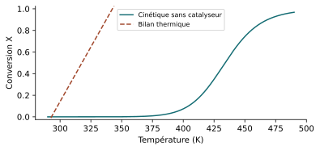

### Question 58

> [!INDICATION]
> Distinguer la limite thermodynamique et le temps nécessaire pour s’en approcher.

#### Solution

Un temps de passage plus long augmente $k\tau$ à température donnée, donc la fraction ayant réagi. Une solution plus concentrée en photo-isomère stocke plus d’énergie par volume et augmente la hausse adiabatique limite, même si la capacité thermique du soluté augmente aussi. Ces deux paramètres interviennent à des endroits distincts dans Q54 et Q55. Leur effet sur la température réelle doit être déterminé avec les deux bilans simultanément.

## II.3 — Catalyse et restitution de chaleur

### Question 59

> [!INDICATION]
> Pour former le cation du métal de transition, retirer en premier les électrons de la couche de plus grand nombre quantique principal.

#### Solution

Avec 27 électrons, le cobalt libre a pour configuration fondamentale $[\mathrm{Ar}]\,3d^7 4s^2$. Le cation $\mathrm{Co^{2+}}$ a perdu les deux électrons $4s$ et possède la configuration $[\mathrm{Ar}]\,3d^7$. La configuration de l’ion libre ne détermine pas à elle seule la répartition des spins dans un champ de ligands particulier.

### Question 60

> [!INDICATION]
> Imaginer les deux parcours catalysé et non catalysé entre les mêmes états extrêmes du calorimètre.

#### Solution

À composition et conversion finales identiques dans le même système adiabatique, l’enthalpie libérée est la même. Le catalyseur modifie les barrières et non l’enthalpie de réaction. La hausse **limite** de Q49 est donc identique, si la capacité thermique supplémentaire du support est négligeable dans le modèle. La montée est plus rapide. Dans une expérience réelle de durée finie, des pertes thermiques moins importantes pendant la réaction peuvent augmenter la température effectivement observée.

### Question 61

> [!INDICATION]
> Écrire la production et les deux consommations de l’intermédiaire avant de poser qu’il est quasi stationnaire.

#### Solution

Notons $C$ le catalyseur libre, $I$ l’intermédiaire et $k_1,k_{-1},k_2$ les constantes de $C+\mathrm{QC}\rightleftharpoons I\rightarrow C+\mathrm{NBD}$. Après le bref transitoire, $d[I]/dt\simeq k_1[C][\mathrm{QC}]-(k_{-1}+k_2)[I]=0$. La vitesse de formation vaut alors
$$v=k_2[I]\simeq\frac{k_1 k_2}{k_{-1}+k_2}[C][\mathrm{QC}].$$
Si la concentration connue est celle de tous les sites accessibles, on utilise $C_T=[C]+[I]$ et l’on obtient $v=k_1k_2C_T[\mathrm{QC}]/(k_{-1}+k_2+k_1[\mathrm{QC}])$. Dans la modélisation de surface, les concentrations de sites s’entendent dans une même convention.

### Question 62

> [!INDICATION]
> Comparer les barrières à partir de I pour les deux issues de I. Une hauteur de niveau par rapport à QC + C ne suffit pas.

#### Solution

Les barrières de retour et de progression depuis I valent respectivement $90{,}8-18{,}8=72{,}0$ et $38{,}9-18{,}8=20{,}1\ \mathrm{kJ\,mol^{-1}}$. L’accès à I depuis les réactifs demande $90{,}8\ \mathrm{kJ\,mol^{-1}}$. À facteurs préexponentiels comparables, l’intermédiaire passe donc beaucoup plus facilement vers NBD qu’il ne revient vers QC, $k_2\gg k_{-1}$. Dans l’expression en catalyseur libre, $v\simeq k_1[C][\mathrm{QC}]$. Assimiler $[C]$ à $C_T$ suppose en plus une faible occupation des sites par I.

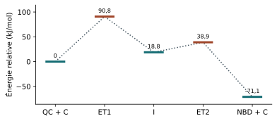

### Question 63

> [!INDICATION]
> Ne pas confondre le niveau d’énergie d’un intermédiaire et la barrière permettant d’y accéder.

#### Solution

Les niveaux de la figure 20, rapportés à I₁, sont 0 (I₁), 12,0 (I₂), 66,6 (I₃), 86,8 kJ/mol (I₄). La figure regroupe les deux orientations les plus basses, I₁ et I₂, avec les substituants sur les deux positions proches indiquées. Pour I₁, $R_1$ est le groupe méthoxyphényle, $R_2$ le groupe cyano, $R_3=R_4=\mathrm H$. Dans le scénario où la stabilité des intermédiaires reflète la voie préférée, le cycle s’écrit $C+\mathrm{QC1}\rightarrow I_1\rightarrow C+\mathrm{NBD1}$. Il revient au même centre de cobalt après libération du produit. I₂ reste une possibilité supérieure de 12 kJ/mol. Les seules énergies des quatre intermédiaires ne fixent pas les proportions en flux si les barrières d’accès diffèrent.

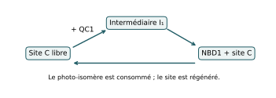

### Question 64

> [!INDICATION]
> Lire les températures comme des élévations par rapport à l’entrée. Comparer ensuite les points à la ligne à concentration identique.

#### Solution

Dans la figure 21, l’élévation augmente avec la concentration en QC1. La courbe théorique s’incurve vers le bas. Si la conversion est forte, le modèle donne $\Delta T\simeq -c_e\Delta_rH^\circ/(\rho C_{\rm Tol}+c_eMC)$ : la quantité de chaleur par volume croît, mais la capacité thermique de la solution augmente également. Les indications expérimentales vont d’environ 6 à 63 °C d’élévation. Les points sont généralement sous la courbe, surtout aux concentrations élevées, avec une dispersion entre mesures voisines. Pertes au milieu extérieur, conversion incomplète ou capacités thermiques approximatives sont des explications possibles. Le graphique seul ne distingue pas leurs contributions.

### Question 65

> [!INDICATION]
> Conserver la droite thermique et déplacer la courbe issue de la cinétique, à bilan enthalpique inchangé.

#### Solution

La droite $X_{\rm therm}(T)$ demeure celle de Q55. À température fixée, le catalyseur accélère la réaction : la courbe de conversion cinétique est donc plus haute et sa zone de forte conversion se déplace vers les températures plus basses. Pour rendre compte des hausses importantes de la figure 21, l’intersection pertinente se trouve à conversion élevée, vers le haut de la droite thermique, proche de la température adiabatique de sortie. Le tracé est qualitatif ; les données de l’énoncé n’imposent pas une nouvelle courbe cinétique numérique unique.

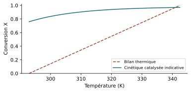

### Question 66

> [!INDICATION]
> Séparer l’énergie absorbée lors de la charge et l’action du catalyseur lors de la restitution.

#### Solution

L’irradiation de NBD1 produit le photo-isomère QC1, d’enthalpie supérieure. L’énergie reçue se trouve stockée dans le changement de structure moléculaire. En l’absence de catalyseur, la réaction de retour est lente à température ordinaire sur l’échelle du temps de séjour. Le passage au contact du catalyseur rend le retour vers NBD1 suffisamment rapide pour que la chaleur soit restituée dans le réacteur ouvert. La commande porte sur la vitesse et le moment de restitution. Le catalyseur est régénéré et l’énergie libérée provient du cycle photochimique.
