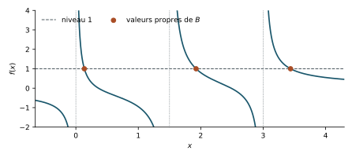
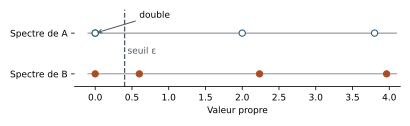

# X-ENS PC — Mathématiques 2025 · Corrigé brut

*Corrigé rédigé par IA, non officiel. Signalez toute erreur.*

**Rédaction** · GPT-6.2 Astra Ultra · vitesse non renseignée

**Révision (tour 2)** · modèle exact non renseigné (famille Claude) · effort non renseigné · vitesse non renseignée · 28 novembre 2026

Une perturbation de rang un modifie le déterminant par un facteur scalaire. Pour une matrice symétrique, ce même facteur permet de situer les valeurs propres de la matrice perturbée.

## Partie I — Matrices de rang un

### Question 1

Le produit d’une colonne de taille $n$ et d’une ligne de taille $n$ appartient à $M_n(\mathbb R)$. Pour tout $x$, $Mx=u(v^Tx)\in\mathbb Ru$. De plus $Mv=\|v\|^2u\ne0$. L’image est donc exactement la droite $\mathbb Ru$ et le rang vaut 1.

### Question 2

Pour $e=(1,\ldots,1)^T\ne0$, on a $J=ee^T$, puisque chaque coefficient est $1\cdot1$. La question 1 donne $\operatorname{rg}J=1$.

### Question 3

Comme $K$ est de rang 1, elle n’est pas nulle : elle a une colonne non nulle $u$. L’image de $K$, engendrée par ses colonnes, est une droite qui contient $u\ne0$, donc c’est $\mathbb Ru$ et toutes les colonnes de $K$ sont proportionnelles à $u$. Écrivons la $j$-ième colonne $v_ju$ et posons $v=(v_1,\ldots,v_n)^T$. Le coefficient correspondant à la colonne choisie vaut 1, donc $v\ne0$. Les colonnes du produit $uv^T$ étant les $v_ju$, on obtient $K=uv^T$.

### Question 4

Si $uv^T=xy^T$, leurs images donnent $\mathbb Ru=\mathbb Rx$. Comme ces vecteurs sont non nuls, $u=\lambda x$ avec $\lambda\ne0$. Pour tout $j$, la comparaison des colonnes donne $\lambda v_jx=y_jx$, donc $v_j=y_j/\lambda$. Réciproquement, $u=\lambda x$ et $v=y/\lambda$ impliquent immédiatement $uv^T=xy^T$.

### Question 5a

Le coefficient $(i,i)$ de $K$ est $u_iv_i$. Ainsi $\operatorname{Tr}K=\sum_{i=1}^n u_iv_i=v^Tu=\langle v,u\rangle$.

### Question 5b

On a $K^2=(uv^T)(uv^T)=u(v^Tu)v^T=(\operatorname{Tr}K)K$.

### Question 5c

Posons $t=\operatorname{Tr}K$. Si $t\ne0$, la question 5b fournit le polynôme annulateur $X(X-t)$, scindé à racines simples. Ainsi $K$ est diagonalisable sur $\mathbb R$. Si $t=0$, alors $K^2=0$, donc toute valeur propre vaut 0. Une matrice diagonalisable dont toutes les valeurs propres sont nulles est la matrice nulle, ce qui contredirait le rang 1. Ces deux implications établissent l’équivalence.

### Question 6

Soit $P$ un projecteur orthogonal de rang 1 et $y$ un vecteur unitaire engendrant son image. Pour tout $x$, $Px=cy$ et $x-Px$ est orthogonal à $y$. On en tire $c=y^Tx$, donc $P=yy^T$. Réciproquement, pour $\|y\|=1$, la matrice $yy^T$ est de rang 1 par la question 1, symétrique, et $(yy^T)^2=y(y^Ty)y^T=yy^T$. C’est donc un projecteur orthogonal de rang 1.

## Partie II — Déterminant et inverse après perturbation

### Question 7

Le produit des deux derniers facteurs est $\begin{pmatrix}I_n&u\\-v^T&1\end{pmatrix}$, car le premier bloc diagonal devient $I_n+uv^T-uv^T$. En multipliant à gauche par le premier facteur, on obtient
$$\begin{pmatrix}I_n&0\\v^T&1\end{pmatrix}\begin{pmatrix}I_n&u\\-v^T&1\end{pmatrix}=\begin{pmatrix}I_n&u\\0&1+v^Tu\end{pmatrix}.$$

### Question 8

Dans le produit initial, les deux facteurs extérieurs sont triangulaires par blocs avec blocs diagonaux $I_n$ et 1, donc ont déterminant 1. Le facteur du milieu est triangulaire supérieur par blocs et a pour déterminant $\det(I_n+uv^T)$. La matrice obtenue en 7 est elle aussi triangulaire par blocs, son déterminant vaut $1+v^Tu$. La multiplicativité donne l’égalité demandée.

### Question 9

L’inversibilité de $A$ permet d’écrire $A+uv^T=A(I_n+A^{-1}uv^T)$. En appliquant 8 au couple $(A^{-1}u,v)$ puis en utilisant la multiplicativité,
$$\det(A+uv^T)=\det A\,(1+v^TA^{-1}u).$$

### Question 10

Puisque $\det A\ne0$, le déterminant obtenu en 9 est non nul exactement lorsque $1+v^TA^{-1}u\ne0$. Cette condition équivaut à l’inversibilité de $A+uv^T$.

### Question 11

Posons $s=v^TA^{-1}u$ et $D=A^{-1}-A^{-1}uv^TA^{-1}/(1+s)$. La question 10 autorise la division. Le produit donne
$$(A+uv^T)D=I_n+uv^TA^{-1}-\frac{uv^TA^{-1}+u(v^TA^{-1}u)v^TA^{-1}}{1+s}=I_n.$$
Les matrices étant carrées, $D$ est l’inverse demandé.

### Question 12

Non. En toute dimension $n\ge1$, prenons $C=\operatorname{diag}(0,1,\ldots,1)$ et $u=v=e_1$. On a $\det C=0$ tandis que $C+uv^T=I_n$ a déterminant 1. En dimension 1 cela donne simplement $C=(0)$.

## Partie III — Spectre d’une perturbation symétrique

### Question 13

On a $B^T=A^T+(uu^T)^T=A+uu^T=B$. Ainsi $B\in S_n(\mathbb R)$.

### Question 14

Pour tout $j$, $(\sum_{k=1}^n v_kv_k^T)v_j=\sum_k v_k\langle v_k,v_j\rangle=v_j$. La somme agit comme $I_n$ sur une base, donc elle est égale à $I_n$.

### Question 15a

Appliquons 14 à la base orthonormale propre $(w_k)$. Comme $Aw_k=\lambda_k w_k$, on obtient
$$A=AI_n=\sum_{k=1}^n\lambda_k w_kw_k^T.$$

### Question 15b

Si $x$ est distinct des $\lambda_k$, les scalaires $x-\lambda_k$ sont tous non nuls. La matrice $xI_n-A$ est inversible et son inverse agit sur $w_k$ par multiplication par $1/(x-\lambda_k)$. Puisque c’est aussi l’action sur cette base de la somme ci-dessous,
$$(xI_n-A)^{-1}=\sum_{k=1}^n\frac{w_kw_k^T}{x-\lambda_k}.$$

### Question 16a

Le théorème spectral donne $\dim E=m$. L’application $w\mapsto u^Tw$ de $E$ dans $\mathbb R$ a un rang au plus égal à 1 et un noyau $E\cap u^\perp$. Le théorème du rang fournit $\dim(E\cap u^\perp)\ge m-1$.

### Question 16b

Pour $w\in E\cap u^\perp$, on a $Bw=Aw+u(u^Tw)=\lambda w$. Le sous-espace propre de $B$ associé à $\lambda$ contient donc $E\cap u^\perp$ et a dimension au moins $m-1\ge1$. Comme $B$ est symétrique, cela donne une multiplicité algébrique au moins égale à $m-1$.

### Question 17

Hors du spectre de $A$, la question 9 appliquée à $xI_n-A$ et aux vecteurs $-u,u$ donne $\chi_B(x)=\chi_A(x)(1-u^T(xI_n-A)^{-1}u)$. En insérant 15b,
$$\chi_B(x)=\chi_A(x)\left(1-\sum_{k=1}^n\frac{\langle w_k,u\rangle^2}{x-\lambda_k}\right).$$

### Question 18a

L’identité de Parseval donne $\sum_k\langle w_k,u\rangle^2=\|u\|^2=1$. Au moins un coefficient est non nul, donc $J\ne\varnothing$.

### Question 18b

Si $\ell\notin J$, $u^Tw_\ell=0$. On en déduit $Bw_\ell=Aw_\ell=\lambda_\ell w_\ell$. Comme $w_\ell\ne0$, $\lambda_\ell$ est valeur propre de $B$.

### Question 18c

Si $J=\{j\}$, la décomposition $u=\sum_k\langle w_k,u\rangle w_k$ se réduit à $u=\langle w_j,u\rangle w_j$. Comme $\|u\|=\|w_j\|=1$, on a $\langle w_j,u\rangle=\pm1$, donc $u=\pm w_j$ et $uu^T=w_jw_j^T$. Ainsi $Bw_j=(\lambda_j+1)w_j$, tandis que $Bw_k=\lambda_k w_k$ pour $k\ne j$. Toute la base est propre pour $B$. Son spectre avec multiplicités remplace une occurrence de $\lambda_j$ par $\lambda_j+1$, même si cette dernière valeur coïncide avec une autre valeur propre. L’ordre de la liste peut changer.

### Question 19a

Posons $c_k=\langle w_k,u\rangle^2>0$. La fonction rationnelle $f(x)=\sum_k c_k/(x-\lambda_k)$ est de classe $C^\infty$ sur $\mathbb R\setminus\{\lambda_1,\ldots,\lambda_n\}$. Sur ce domaine, $f'(x)=-\sum_k c_k/(x-\lambda_k)^2<0$.

### Question 19b

Soit $\ell\in\{1,\ldots,n-1\}$. Quand $x\to\lambda_\ell^+$, le terme $c_\ell/(x-\lambda_\ell)$ tend vers $+\infty$ et les autres ont une limite finie, donc $f(x)\to+\infty$. Quand $x\to\lambda_{\ell+1}^-$, le terme $c_{\ell+1}/(x-\lambda_{\ell+1})$ tend vers $-\infty$ et les autres ont une limite finie, donc $f(x)\to-\infty$. Par 19a, $f$ est continue et strictement décroissante sur l’intervalle $]\lambda_\ell,\lambda_{\ell+1}[$. Le théorème de la bijection montre que $f$ réalise une bijection de cet intervalle sur $\mathbb R$ : l’équation $f(x)=1$ y a une unique solution. Sur $]\lambda_n,+\infty[$, on a de même $f(x)\to+\infty$ quand $x\to\lambda_n^+$, et $f(x)\to0$ quand $x\to+\infty$ car chaque terme tend vers 0. La fonction $f$, continue et strictement décroissante, réalise une bijection de $]\lambda_n,+\infty[$ sur $]0,+\infty[$, qui contient 1 : l’équation a encore une unique solution.

### Question 19c

Les $n$ solutions de 19b sont distinctes et évitent les $\lambda_k$. Par 17, elles annulent $\chi_B$. Ce polynôme étant de degré $n$, elles en constituent toutes les racines et sont simples. En les ordonnant on obtient $\lambda_1<\mu_1<\lambda_2<\mu_2<\cdots<\lambda_n<\mu_n$.

## Partie IV — Polynôme caractéristique moyen

### Question 20

La formule de transfert donne $\mathbb E[\langle U,w\rangle^2]=n^{-1}\sum_{j=1}^n\langle u_j,w\rangle^2=\|w\|^2/n$, car $(u_j)$ est une base orthonormale.

### Question 21

Pour $x$ fixé, la variable $\chi_B(x)$ prend au plus $n$ valeurs finies et est intégrable. Soit $x\notin\{\lambda_k\}$. Chaque $u_j$ est unitaire, donc la question 17 s’applique à $A+u_ju_j^T$ et donne $\chi_B(x)=\chi_A(x)\bigl(1-\sum_{k}\langle w_k,U\rangle^2/(x-\lambda_k)\bigr)$. Par linéarité de l’espérance et par la question 20 appliquée à $w=w_k$, de norme 1,
$$\mathbb E[\chi_B(x)]=\chi_A(x)\left(1-\frac1n\sum_{k=1}^n\frac1{x-\lambda_k}\right).$$
En dérivant $\chi_A(x)=\prod_k(x-\lambda_k)$ par la règle du produit, on a $\chi'_A(x)=\chi_A(x)\sum_k1/(x-\lambda_k)$, y compris en présence de valeurs propres répétées puisque $x$ les évite. On obtient $\mathbb E[\chi_B(x)]=\chi_A(x)-\chi'_A(x)/n$.

### Question 22

La fonction $x\mapsto\mathbb E[\chi_B(x)]=n^{-1}\sum_j\chi_{A+u_ju_j^T}(x)$ est polynomiale. La différence avec $\chi_A-\chi'_A/n$ est nulle hors d’un ensemble fini par 21, donc identiquement nulle. En $x=\lambda_k$ on trouve $\mathbb E[\chi_B(\lambda_k)]=-\chi'_A(\lambda_k)/n$.

### Question 23

Le polynôme $\chi_A-\chi'_A/n$ est unitaire de degré $n$, car $\chi'_A$ a degré $n-1$. Il est donc non nul et possède au plus $n$ racines réelles. Tout réel en dehors de cet ensemble vérifie $\mathbb E[\chi_B(x)]\ne0$.

## Partie V — Passage d’un seuil spectral

### Question 24

Comme $0<\varepsilon<\lambda_{m+1}$, aucune valeur propre de $A$ ne vaut $\varepsilon$. Les valeurs propres $\lambda_k-\varepsilon$ de $C=A-\varepsilon I_n$ sont donc toutes non nulles et $C$ est inversible.

### Question 25

Écrivons $s=u^TC^{-1}u<-1$. La question 9 donne $\det(B-\varepsilon I_n)=\det C(1+s)$. Les deux facteurs sont non nuls par 24 et $1+s<0$, donc $B-\varepsilon I_n$ est inversible.

### Question 26

Par 11, $(B-\varepsilon I_n)^{-1}-C^{-1}=-C^{-1}uu^TC^{-1}/(1+s)$. La matrice $C^{-1}$ est symétrique et $z=C^{-1}u\ne0$ puisque $u$ est unitaire. La trace du numérateur $zz^T$ vaut $\|z\|^2>0$. Comme $1+s<0$,
$$\operatorname{Tr}(B-\varepsilon I_n)^{-1}-\operatorname{Tr}C^{-1}=-\frac{\|z\|^2}{1+s}>0.$$

### Question 27

Par entrelacement, $\mu_k=\lambda_k=0$ pour $k<m$. Pour $k>m$, on a $\mu_k\ge\lambda_k\ge\lambda_{m+1}>\varepsilon$, donc $1/(\mu_k-\varepsilon)\le1/(\lambda_k-\varepsilon)$. Supposons $\mu_m<\varepsilon$. Alors $0=\lambda_m\le\mu_m<\varepsilon$ et la fonction $x\mapsto1/(x-\varepsilon)$, décroissante aussi sur $]-\infty,\varepsilon[$, donne la même inégalité à l’indice $m$. En additionnant, on obtiendrait
$$\sum_{k=1}^n\frac1{\mu_k-\varepsilon}\le\sum_{k=1}^n\frac1{\lambda_k-\varepsilon},$$
contrairement à 26, les deux sommes étant les traces des inverses par diagonalisation orthogonale. Le cas $\mu_m=\varepsilon$ est exclu par 25. Ainsi $\mu_m>\varepsilon$.

