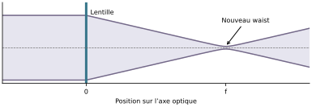
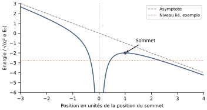
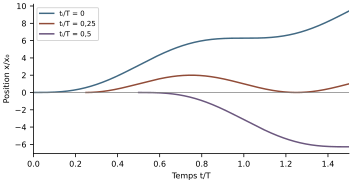
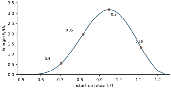
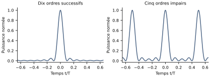
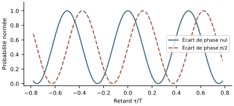

# X-ENS PC 2025 — Physique B · Corrigé brut

*Corrigé rédigé par IA, non officiel. Signalez toute erreur.*

**Rédaction** · GPT-6.2 Astra Ultra · vitesse non renseignée

**Révision (tour 2)** · modèle exact non renseigné (famille Claude) · effort non renseigné · vitesse non renseignée · 28 novembre 2026

**Production et caractérisation d’impulsions laser attosecondes.** La notation $q^2=e^2/(4\pi\varepsilon_0)$ des questions atomiques désigne une constante coulombienne. Dans les questions spectrales, $q$ désigne le rang entier d’une harmonique.

## Échelles atomiques et focalisation

### Question 1 — Temps de révolution de Bohr

Le mouvement circulaire vérifie $mv^2/r=q^2/r^2$, et l'état fondamental de Bohr impose $mvr=\hbar$. On obtient $v=q^2/\hbar$ et $r=\hbar^2/(mq^2)$. Ainsi $T_e=2\pi r/v=2\pi\hbar^3/[m(q^2)^2]$, en accord avec la valeur fournie $1{,}5\times10^{-16}\ \mathrm s$.

### Question 2 — Domaine spectral

La longueur d'onde $800\ \mathrm{nm}=0{,}8\ \mu\mathrm m$ se situe dans le proche infrarouge, immédiatement au-delà du rouge visible.

### Question 3 — Période et premier ordre assez rapide

$T=\lambda/c=2{,}67\times10^{-15}\ \mathrm s$, soit environ $3\ \mathrm{fs}$ à un chiffre significatif. Il faut $T/n<T_e$, soit $n>17{,}8$ en gardant les chiffres intermédiaires. Le plus petit entier est **18**. Si seules les harmoniques impaires sont émises, comme on l'établira, le premier ordre présent satisfaisant cette condition est 19.

### Question 4 — Longueur de Rayleigh

$z_R=\pi w_0^2/\lambda=\pi(4\times10^{-3})^2/(8\times10^{-7})\simeq63\ \mathrm m$, soit $6\times10^{1}\ \mathrm m$ à un chiffre significatif. Pour $|z|\le1\ \mathrm m$, $w/w_0=\sqrt{1+(z/z_R)^2}\simeq1+z^2/(2z_R^2)$. La variation relative du rayon est au plus $1{,}3\times10^{-4}$ environ, soit $1\times10^{-4}$ à un chiffre. Le faisceau peut être considéré comme cylindrique sur cette longueur.

### Question 5 — Conditions de Gauss

Le faisceau est centré sur l'axe de la lentille et sa divergence incidente vaut $\lambda/(\pi w_0)\simeq6\times10^{-5}\ \mathrm{rad}$. Après la lentille, un rayon typique situé à $w_0$ de l'axe est dévié de $w_0/f=4\times10^{-3}\ \mathrm{rad}\ll1$. Les rayons qui portent l'essentiel de l'énergie restent paraxiaux.

### Question 6 — Waist du faisceau focalisé

Le faisceau converge vers un nouveau waist voisin du foyer, puis diverge. Pour $f\ll z_R$, l'angle de convergence $w_0/f$ est la divergence du nouveau faisceau $\lambda/(\pi w'_0)$. D'où $w'_0\simeq\lambda f/(\pi w_0)\simeq6\times10^{-5}\ \mathrm m$. La nouvelle longueur de Rayleigh est de l'ordre de $1{,}6\ \mathrm{cm}$.

### Question 7 — Puissance surfacique au foyer

La puissance de l'impulsion est de l'ordre de $E_L/T_L=2{,}5\times10^{10}\ \mathrm W$. Sur l'aire $\pi w_0'^2$ elle donne $P_L\sim E_L/(T_L\pi w_0'^2)\simeq2\times10^{18}\ \mathrm{W\,m^{-2}}$. Un calcul strictement axial du maximum pour le profil spatial gaussien introduit un facteur 2, et la forme temporelle intervient aussi quant au maximum exact.

### Question 8 — Amplitude du champ

Pour une onde localement plane, $B=E/c$ et $\langle\Pi\rangle=E_0^2/(2\mu_0 c)$ pour une amplitude crête sinusoïdale. Ainsi $E_0\sim\sqrt{2\mu_0 c P_L}$, à un facteur d'ordre un selon la convention de moyenne du profil.

### Question 9 — Comparaison solaire

Le flux solaire au sommet de l'atmosphère est de l'ordre de $10^3\ \mathrm{W\,m^{-2}}$ ($1{,}4\ \mathrm{kW\,m^{-2}}$ plus précisément). Le flux variant comme le carré de l'amplitude, $E_0\sim700\sqrt{P_L/(10^3\ \mathrm{W\,m^{-2}})}\sim3\times10^{10}\ \mathrm{V\,m^{-1}}$. L'expression de la question 8 donne $4\times10^{10}\ \mathrm{V\,m^{-1}}$ : l'écart vient de ce qu'une amplitude de $700\ \mathrm{V\,m^{-1}}$ correspond, par cette même formule, à $650\ \mathrm{W\,m^{-2}}$ et non à $10^3$. Les deux estimations s'accordent sur l'ordre de grandeur, quelques $10^{10}\ \mathrm{V\,m^{-1}}$.

### Question 10 — Champ atomique

Une taille atomique vaut approximativement $a\sim10^{-10}\ \mathrm m$. Une énergie d'ionisation de $10\ \mathrm{eV}$ équivaut au travail d'un champ de l'ordre de $I_P/(ea)\sim10^{11}\ \mathrm{V\,m^{-1}}$ sur cette distance. Le champ focalisé et le champ atomique sont comparables à un facteur de quelques unités près. Cela rend plausible une déformation importante du potentiel.

## Ionisation et recombinaison

### Question 11 — Potentiel coulombien incliné

Le potentiel électrostatique du laser, dont le champ pointe vers $-x$, vaut $E_0x$ à une constante près. Pour l'électron,
$$V(x)=-\frac{q^2}{|x|}-eE_0x.$$
Il tend vers $-\infty$ des deux côtés de l'origine. À grande distance son asymptote oblique est $-eE_0x$, donc il monte vers $+\infty$ à gauche et descend vers $-\infty$ à droite. À droite un maximum sépare le puits coulombien de la région d'échappement.

### Question 12 — Disparition classique de la barrière

Pour $x>0$, $V'(x)=q^2/x^2-eE_0$. Le sommet est en $x_s=\sqrt{q^2/(eE_0)}$ et $V(x_s)=-2\sqrt{q^2eE_0}$. L'électron d'énergie $-I_P$ passe classiquement au-dessus de la barrière si $-I_P>V(x_s)$, soit $E_0>E_{\rm sat}=I_P^2/(4e q^2)$. L'égalité est le cas limite où l'énergie coïncide avec le sommet.

### Question 13 — Échappement sous le seuil

L'effet tunnel permet à une fonction d'onde d'avoir une amplitude transmise au-delà d'une barrière de largeur finie, même si l'énergie est inférieure à son sommet.

### Question 14 — Équation de Newton

Le champ du laser donne une force $+eE_0\sin\omega t$ et l'attraction nucléaire ramène vers zéro. Pour $x>0$, $m\ddot x=-q^2/x^2+eE_0\sin\omega t$. Pour $x<0$, $m\ddot x=+q^2/x^2+eE_0\sin\omega t$. La singularité ponctuelle en zéro signale la limite du modèle classique.

### Question 15 — Symétrie de demi-période

Notons $F_C(x)$ la force coulombienne impaire. Puisque $F_C(-x)=-F_C(x)$ et $\sin[\omega(t+T/2)]=-\sin\omega t$, la fonction $y(t)=-x(t+T/2)$ satisfait la même équation que $x$. La solution forcée sélectionnée qui respecte la symétrie de l'atome et du champ doit donc vérifier $x(t+T/2)=-x(t)$. L'invariance seule relie deux solutions possibles. L'identification suppose cette réponse symétrique ou l'unicité de la réponse périodique retenue, ce que le modèle non linéaire sans dissipation ne démontre pas en général.

### Question 16 — Harmoniques permises

La composante complexe $c_ne^{in\omega t}$ est multipliée par $(-1)^n$ après une demi-période. La condition $(-1)^nc_n=-c_n$ annule le terme continu et tous les coefficients pairs. Il reste les rangs impairs, quelle que soit la parité ordinaire du signal autour de $t=0$.

### Question 17 — Mouvement libéré du noyau

Posons $a_0=eE_0/m$ et $x_0=a_0/\omega^2$. De $\ddot x=a_0\sin\omega t$ on tire $\dot x=-(a_0/\omega)\cos\omega t+v_d$ puis $x=-x_0\sin\omega t+v_dt+x_c$. Les deux constantes fixent la dérive et l'origine de position.

### Question 18 — Énergie pondéromotrice

La périodicité du mouvement impose $v_d=0$. Avec $\langle\cos^2\omega t\rangle=1/2$, l'énergie cinétique moyenne est $U_P=e^2E_0^2/(4m\omega^2)$.

### Question 19 — Départ sans vitesse

Avec $u=\omega t$ et $u_i=\omega t_i$, les conditions $x(t_i)=\dot x(t_i)=0$ donnent
$$\dot x=\frac{a_0}{\omega}(\cos u_i-\cos u),\qquad \frac{x}{x_0}=(u-u_i)\cos u_i-\sin u+\sin u_i.$$
Les deux conditions initiales se retrouvent en remplaçant $u$ par $u_i$.

### Question 20 — Trois trajectoires imposées

Pour $t_i=0$, $x/x_0=u-\sin u$ croît, avec tangente horizontale à chaque période entière. Pour $t_i=T/4$, $x/x_0=1-\sin u$ oscille entre 0 et 2 et retrouve zéro à $5T/4$. Pour $t_i=T/2$, $x/x_0=-(u-\pi)-\sin u$ décroît. Chaque courbe commence à son propre instant $t_i$, où la vitesse s'annule.

### Question 21 — Premier retour

Pour $u_r=\omega t_r>u_i$ le premier retour non trivial satisfait $(u_r-u_i)\cos u_i-\sin u_r+\sin u_i=0$. La solution évidente $u_r=u_i$ représente l'instant de départ et doit être écartée.

### Question 22 — Photon de recombinaison

La libération d'une énergie $I_P+E_c(t_r)$ correspond à un photon de pulsation $\omega_\gamma=[I_P+E_c(t_r)]/\hbar$. Le terme $I_P$ vient du retour à l'état lié.

### Question 23 — Lecture de la figure 1

L'énergie au retour dépend du carré de la pente $dx/dt$ au passage par zéro. Des quatre courbes, le trait plein $t_i=0{,}30T$ a la plus grande pente en valeur absolue. La courbe pointillée $t_i=0{,}40T$ a la plus faible. La hauteur maximale de la trajectoire n'est pas le critère de comparaison.

### Question 24 — Énergie au retour

En reprenant la vitesse de la question 19, $E_c(t_r)=m\dot x(t_r)^2/2=2U_P[\cos(\omega t_i)-\cos(\omega t_r)]^2$.

### Question 25 — Courbe paramétrée des retours

La courbe s'obtient en faisant varier $t_i$, en résolvant la question 21 pour le premier retour puis en évaluant la question 24. Dans l'ordre croissant de $t_r/T$, les triplets $(t_i/T,t_r/T,E_c/U_P)$ sont approximativement $(0{,}40;0{,}704;0{,}55)$, $(0{,}35;0{,}817;1{,}97)$, $(0{,}30;0{,}950;3{,}17)$ et $(0{,}26;1{,}115;1{,}32)$. Quand $t_i/T$ passe de $1/2$ vers $1/4$, le premier retour se déplace du voisinage de $T/2$ à $5T/4$. Les deux extrémités ont une énergie limite nulle.

### Question 26 — Peigne et coupure

Les pics sont espacés de deux fréquences laser, aux ordres impairs : c'est la sélection établie à la question 16, le rayonnement suivant le mouvement de l'électron. Après la décroissance initiale, une série de pics d'ordres supérieurs forme un plateau approximatif, suivi d'une coupure rapide vers les rangs 29 à 33 sur cette mesure. Les ordres 19 et supérieurs satisfont la condition de la question 3. Le plus grand photon possible correspond au maximum du graphe de retour, $E_{c,\max}\simeq3{,}17U_P$. La loi de coupure est donc $n_{\max}\simeq(I_P+3{,}17U_P)/(\hbar\omega)$, avec les pics effectivement permis situés aux entiers impairs.

## Durée et phases des impulsions

### Question 27 — Puissance d’une superposition

Pour le signal complexe $A(t)=\sum_q A_qe^{i(q\omega t+\phi_q)}$, la puissance d'enveloppe est proportionnelle à
$$|A(t)|^2=\sum_q A_q^2+2\sum_{q<q'}A_qA_{q'}\cos[(q'-q)\omega t+\phi_{q'}-\phi_q].$$
Le produit avec le conjugué élimine toute phase commune. Cette intensité est l'enveloppe optique mesurée après élimination des oscillations de porteuse aux fréquences sommes.

### Question 28 — Pics de N harmoniques successives

Pour des amplitudes $A$ et phases identiques, la série géométrique donne $I(t)\propto A^2[\sin(N\omega t/2)/\sin(\omega t/2)]^2$. La valeur limite est $N^2 A^2$ aux instants $t=kT$. De part et d'autre, les premiers zéros sont à $kT\pm T/N$. La demi-largeur jusqu'au premier zéro vaut donc $T/N$. Si « demi-largeur » désigne celle à mi-hauteur, $[\sin x/x]^2=1/2$ donne $x\simeq1{,}392$, donc une demi-largeur $0{,}443T/N$ pour $N\gg1$. Les pics sont séparés de $T$. C'est la fonction d'interférences à $N$ ondes d'un réseau, le temps jouant le rôle de l'angle.

### Question 29 — Phases en progression arithmétique

Pour $\phi_q=\phi_n+(q-n)\delta$, le terme de rang $q$ contient $q(\omega t+\delta)$ plus une phase commune. L'intensité de la question 28 devient $I_0(t+\delta/\omega)$. Les pics sont donc décalés de $-\delta/\omega$, modulo $T$, sans changement de forme.

### Question 30 — Énergie d’un photon harmonique

$E_q=\hbar q\omega=qh\nu$. Une absorption qui ionise l'atome laisse à l'électron une énergie cinétique $q\hbar\omega-I_P$ en négligeant le recul.

### Question 31 — Deux amplitudes à la même énergie

En décomposant les cosinus en exponentielles, le produit contient à la fréquence $(q+1)\omega$ le terme
$$\frac14e^{i(q+1)\omega t}\left[e^{i(\phi_q+\omega\tau)}+e^{i(\phi_{q+2}-\omega\tau)}\right].$$
Le premier chemin absorbe un photon harmonique $q$ et un photon sonde. Le second absorbe un photon $q+2$ et émet un photon sonde. Les deux donnent le même état final d'énergie cinétique $(q+1)\hbar\omega-I_P$.

### Question 32 — Interférence à deux photons

Le carré du module vaut à une constante près $P(\tau)\propto1+\cos[2\omega\tau-(\phi_{q+2}-\phi_q)]$. La probabilité oscille entre zéro et le double de sa moyenne pour les amplitudes égales admises. Deux maxima consécutifs sont séparés par $\pi/\omega=T/2$. Les alternatives quantiques indiscernables s'ajoutent en amplitude avant le calcul de la probabilité.

### Question 33 — Lecture de la carte RABITT

Les lignes impaires 17 à 23 sont brillantes et pratiquement indépendantes du retard ; la ligne 25, plus faible, laisse voir une légère modulation. Elles correspondent aux photons harmoniques absorbés directement, seuls présents sur la figure 3. Les bandes intermédiaires paires proviennent des deux transitions de la question 31. Leurs maxima se répètent environ tous les $1{,}3\ \mathrm{fs}$, soit environ 22 à 23 oscillations sur la trentaine de femtosecondes représentée. On retrouve $T\simeq2{,}6$ à $2{,}7\ \mathrm{fs}$, compatible avec $800\ \mathrm{nm}$.

### Question 34 — Test de l’alignement des phases

Pour le canal intermédiaire, le maximum est à $2\omega\tau=\phi_{q+2}-\phi_q\pmod{2\pi}$. Si la différence est indépendante de $q$, les maxima des différentes bandes paires doivent s'aligner verticalement à la même abscisse de retard, à un multiple de $T/2$ près. Un glissement systématique entre bandes signe une différence de phase dépendant du rang.

### Question 35 — Durée d’une impulsion

Les ordres visibles 17, 19, 21, 23 et 25 constituent environ $N=5$ harmoniques impaires séparées de $2\omega$. Si leurs phases ont un incrément constant et que leurs amplitudes sont comparables, les pics se répètent toutes les $T/2$. En remplaçant $T$ par $T/2$ dans la question 28, la demi-largeur jusqu'au premier zéro vaut $T/(2N)\simeq0{,}27\ \mathrm{fs}$. La largeur totale à mi-hauteur est d'environ $0{,}886\,T/(2N)\simeq0{,}24\ \mathrm{fs}$, soit **quelques centaines d'attosecondes** (à un chiffre significatif, $3\times10^{-16}\ \mathrm s$ jusqu'au premier zéro et $2\times10^{-16}\ \mathrm s$ à mi-hauteur). Les amplitudes réelles et la bande effectivement transmise modifient le chiffre précis.

## Spectromètre magnétique

### Question 36 — Rayon cyclotron

Dans un champ uniforme transverse, la force magnétique est perpendiculaire à la vitesse. Elle conserve donc $v_\perp$ et joue le rôle de force centripète. $ev_\perp B=mv_\perp^2/r$ donne $r=mv_\perp/(eB)$.

### Question 37 — Moment cinétique de giration

Au centre du cercle, le rayon et la quantité de mouvement sont perpendiculaires, donc $J=mrv_\perp=eBr^2$. Ce $J$ décrit la giration autour du centre instantané.

### Question 38 — Hélice

La composante $v_\parallel=v\cos\theta$ est uniforme, tandis que $v_\perp=v\sin\theta$ détermine la giration. Le rayon est $r=mv\sin\theta/(eB)$. Il tend vers zéro pour une entrée parallèle au champ et vers le résultat circulaire pour une entrée perpendiculaire.

### Question 39 — Variation axiale du champ

Sur la figure 5, un même tube de lignes s'élargit de l'entrée à la sortie puis devient pratiquement cylindrique. La conservation du flux magnétique implique que la norme de $B$ diminue le long du tube puis se stabilise vers $B_f<B_i$ dans la partie droite.

### Question 40 — Redressement des trajectoires

La force magnétique ne travaille pas, donc $v$ est constant. L'invariant admis vaut $J=eBr^2=m^2v^2\sin^2\theta/(eB)$. Il en résulte
$$\sin^2\theta_f=(B_f/B_i)\sin^2\theta_i.$$
Lorsque le champ décroît, le mouvement se rapproche de la direction de la ligne de champ. Le cercle de giration s'élargit pourtant : $J=eBr^2$ constant donne $r_f=r_i\sqrt{B_i/B_f}$.

### Question 41 — Incertitude due à l’angle final

Dans la longue portion uniforme, $\Delta t\simeq L/(v\cos\theta_f)$. Estimer $v$ par $L/\Delta t$ donne $v_{\rm mes}=v\cos\theta_f$, donc un biais par défaut. En valeur relative par rapport à la vitesse vraie,
$$\frac{v-v_{\rm mes}}{v}=1-\sqrt{1-(B_f/B_i)\sin^2\theta_i}\le1-\sqrt{1-B_f/B_i}\simeq\frac{B_f}{2B_i}.$$
Cette borne correspond au cas d'une vitesse initiale presque transverse, pour $B_f/B_i\ll1$. Une normalisation par la vitesse mesurée donne la même borne au premier ordre.

[Sujet officiel](https://www.polytechnique.edu/admission-cycle-ingenieur/sites/admission/files/content/Physique%20B%20PC.pdf) · [Rapport du jury](https://www.polytechnique.edu/admission-cycle-ingenieur/sites/admission/files/content/Ecrits_PC_Physique_B%20OK.pdf)
