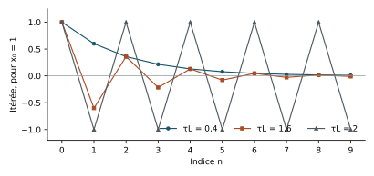
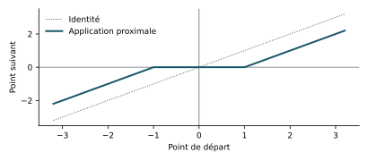
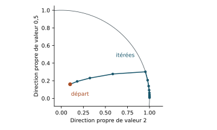

# X-ENS PSI — Mathématiques 2025 · Corrigé brut

*Corrigé rédigé par IA, non officiel. Signalez toute erreur.*

**Rédaction** · GPT-6.2 Astra Ultra · vitesse non renseignée

**Révision (tour 2)** · modèle exact non renseigné (famille Claude) · effort non renseigné · vitesse non renseignée · 28 novembre 2026

Les trois premières parties étudient la descente explicite sur la droite. La quatrième remplace le pas explicite par une minimisation et la dernière projette les itérées sur la boule unité.

## Partie I — Préliminaires

### Question 1a

Soit $K=\{x\mid f(x)\le f(0)\}$. La continuité de $f$ rend $K=f^{-1}(]-\infty,f(0)])$ fermé. Par définition des limites en $\pm\infty$ (avec le seuil $f(0)$), il existe $A<0$ tel que $f(x)>f(0)$ pour tout $x<A$, et $B>0$ tel que $f(x)>f(0)$ pour tout $x>B$. Avec $R=\max(-A,B)>0$, $|x|>R$ implique $f(x)>f(0)$. Ainsi $K\subset[-R,R]$ est borné. Il contient 0.

### Question 1b

Le fermé borné non vide $K$ est compact dans $\mathbb R$. La fonction continue $f$ y atteint son minimum en $x_*$. Pour $x\notin K$, on a $f(x)>f(0)\ge f(x_*)$. Ainsi $x_*$ minimise $f$ sur toute la droite.

### Question 2a

Posons $d=x-y$, $h=f'(x)-f'(y)$. La convexité donne $dh\ge0$ par croissance de $f'$. Par l’hypothèse de Lipschitz, $|h|\le L|d|$. En multipliant par $|h|$, on obtient $h^2\le L|d||h|=Ldh$.

### Question 2b

Comme $\widetilde x-\widetilde y=d-\tau h$, on a $(d-\tau h)^2=d^2-2\tau dh+\tau^2h^2\le d^2-\tau(2-\tau L)dh$, d’après 2a. C’est l’inégalité souhaitée.

### Question 2c

Puisque $f'(x_*)=0$, on a $\widetilde x_*=x_*$. Pour $x=x_n$ et $y=x_*$, le produit $dh$ est positif ou nul par convexité, et $\tau(2-\tau L)\ge0$. La question 2b implique donc $|x_{n+1}-x_*|^2\le|x_n-x_*|^2$. La suite des distances décroît.

## Partie II — Convergence rapide, sous des hypothèses fortes

### Question 3a

Pour $f(x)=Lx^2/2$, on a $f'(x)=Lx$, donc $x_{n+1}=(1-\tau L)x_n$. Par récurrence $x_n=(1-\tau L)^nx_0$.

### Question 3b

Si $x_0\ne0$, la convergence vers 0 équivaut à $|1-\tau L|<1$, soit $0<\tau<2/L$. Pour $\tau=2/L$, les termes valent alternativement $x_0$ et $-x_0$. Pour $\tau>2/L$, leur module croît sans borne.

### Question 4

La convexité de $g(x)=f(x)-\alpha x^2/2$ entraîne la croissance de $g'(x)=f'(x)-\alpha x$. Pour $x>y$, on a donc $\alpha(x-y)\le f'(x)-f'(y)\le L(x-y)$. En divisant par $x-y>0$, on obtient $\alpha\le L$.

### Question 5

Si $x\ge0$, alors $f'(t)\ge f'(0)+\alpha t$ sur $[0,x]$. Si $x<0$, on a au contraire $f'(t)\le f'(0)+\alpha t$ pour $t\in[x,0]$ et $\int_0^x=-\int_x^0$. Dans les deux cas,
$$f(x)\ge f(0)+f'(0)x+\alpha x^2/2.$$
Comme $\alpha>0$, cette borne tend vers $+\infty$ aux deux extrémités de la droite. Les questions 1a et 1b donnent l’existence d’un minimiseur.

### Question 6

La croissance de $g'$ s’écrit $(g'(x)-g'(y))(x-y)\ge0$ pour tous $x,y$. En remplaçant $g'$ par $f'-\alpha\operatorname{id}$ et en réarrangeant, on trouve $(f'(x)-f'(y))(x-y)\ge\alpha|x-y|^2$.

### Question 7

La somme $f=g+\alpha x^2/2$ est convexe. On peut donc appliquer 2b. Puisque $\tau(2-\tau L)\ge0$, en minorant $dh$ dans le terme soustrait par la question 6 on obtient $|\widetilde x-\widetilde y|^2\le(1-\alpha\tau(2-\tau L))|x-y|^2$.

### Question 8

Posons $\rho=\sqrt{1-\alpha\tau(2-L\tau)}$. Pour $0<\tau<2/L$, $\tau(2-L\tau)>0$ et $\tau(2-L\tau)=(1-(1-L\tau)^2)/L\le1/L$. Avec $\alpha\le L$, on a $0\le\rho<1$. En prenant $y=x_*$ dans 7 puis en itérant, $|x_n-x_*|\le\rho^n|x_0-x_*|$ pour $n\ge1$ et l’inégalité est une égalité à l’indice 0. Si $\rho=0$, le premier pas atteint déjà le minimiseur.

## Partie III — Convergence lente, sous des hypothèses faibles

### Question 9

Pour $x>0$, $f'(x)=x^2$, et pour $x<0$, $f'(x)=0$. En 0 les deux quotients différentiels tendent vers 0, donc $f'(0)=0$. Cette dérivée continue et croissante sur $\mathbb R$ donne $f\in C^1(\mathbb R)$ convexe. La valeur minimale est 0 et l’ensemble des minimiseurs est $]-\infty,0]$.

### Question 10a

Si $0<x_n<1/\tau$, alors $f'(x_n)=x_n^2$ et $x_{n+1}=x_n(1-\tau x_n)$. Le facteur appartient à $]0,1[$, donc $0<x_{n+1}<x_n<1/\tau$. Une récurrence à partir de $x_0$ prouve la formule et la stricte décroissance positive.

### Question 10b

Décroissante et minorée par 0, la suite converge vers $\ell\ge0$. La continuité de $x\mapsto x(1-\tau x)$ donne $\ell=\ell(1-\tau\ell)$, d’où $\tau\ell^2=0$. Comme $\tau>0$, $\ell=0$.

### Question 10c

D’après 10a, $0<x_n<1/\tau$ et $x_{n+1}=x_n(1-\tau x_n)>0$, donc les inverses existent et
$$\frac1{x_{n+1}}-\frac1{x_n}=\frac{1-(1-\tau x_n)}{x_n(1-\tau x_n)}=\frac{\tau}{1-\tau x_n},$$
ce qui est l’égalité demandée. Comme $0<1-\tau x_n<1$, on a $\tau/(1-\tau x_n)\ge\tau$. En sommant ces inégalités pour les indices $0$ à $n-1$, la somme télescopique donne $1/x_n\ge1/x_0+n\tau=(1+n\tau x_0)/x_0$. Les deux membres sont strictement positifs ; en passant aux inverses, $x_n\le x_0/(1+n\tau x_0)$.

### Question 11

Si $x_0\le0$, $f'(x_0)=0$ et la suite est constante en $x_0$, minimiseur. Si $0<x_0<1/\tau$, 10b donne $x_n\to0$. Si $x_0\ge1/\tau$, le premier terme suivant est $x_1=x_0(1-\tau x_0)\le0$, donc la suite reste ensuite en $x_1$, qui est un minimiseur. Ces trois cas couvrent tous les réels.

### Question 12a

Pour $0<t\le1$, la convexité donne $[f(x+t(y-x))-f(x)]/t\le f(y)-f(x)$. Lorsque $t\downarrow0$, le membre de gauche tend vers $f'(x)(y-x)$ par dérivabilité. Ainsi $f(y)\ge f(x)+f'(x)(y-x)$.

### Question 12b

Le théorème fondamental de l’analyse donne
$$f(y)-f(x)-f'(x)(y-x)=\int_0^1[f'(x+t(y-x))-f'(x)](y-x)\,dt.$$
Le module de l’intégrande est au plus $Lt|y-x|^2$. En intégrant, le reste est majoré par $L|y-x|^2/2$.

### Question 12c

Dans 12b, prenons $x=x_n$ et $y=x_{n+1}$, de sorte que $y-x=-\tau f'(x_n)$. Il vient
$$f(x_{n+1})\le f(x_n)-\frac{\tau}{2}(2-\tau L)|f'(x_n)|^2.$$
Comme $0<\tau<2/L$, le terme soustrait est positif ou nul. La suite des valeurs décroît.

### Question 13

Par minimalité, $f(x)-f(x_*)\ge0$. En appliquant 12a avec $y=x_*$, on trouve $f(x)-f(x_*)\le f'(x)(x-x_*)\le|f'(x)||x-x_*|$.

### Question 14

Posons $a_n=f(x_n)-f(x_*)$. Par 13 et 2c, $0\le a_n\le |x_0-x_*|\,|f'(x_n)|$. Si $x_0\ne x_*$, on peut diviser par $|x_0-x_*|>0$. L’inégalité de 12c fournit
$$f(x_{n+1})\le f(x_n)-\frac{\tau(2-\tau L)}{2|x_0-x_*|^2}a_n^2.$$

### Question 15

La suite positive ou nulle décroît puisque $a_{n+1}\le a_n-ca_n^2\le a_n$. Dès qu’un terme est nul, tous les suivants le sont. Tant que $a_{k+1}>0$, on a
$$\frac1{a_{k+1}}-\frac1{a_k}=\frac{a_k-a_{k+1}}{a_ka_{k+1}}\ge c\frac{a_k}{a_{k+1}}\ge c.$$
Pour un indice $n$ tel que $a_n>0$, la somme donne $1/a_n\ge1/a_0+nc$, donc $a_n\le a_0/(1+nca_0)$. La même borne est immédiate si $a_n=0$.

### Question 16

Si $x_0=x_*$, les itérées sont constantes et $a_n=0$. Sinon, posons $c=\tau(2-\tau L)/(2|x_0-x_*|^2)>0$. La question 14 donne $a_{n+1}\le a_n-ca_n^2$. Comme $a_n\ge0$, la question 15 fournit $0\le a_n\le a_0/(1+nca_0)$. Cette borne tend vers zéro si $a_0>0$, et la conclusion est immédiate si $a_0=0$. Ainsi $f(x_n)\to f(x_*)$.

### Question 17

En sommant 12c de $i=0$ à $n-1$, on trouve
$$\frac{\tau(2-\tau L)}2\sum_{i=0}^{n-1}|f'(x_i)|^2\le f(x_0)-f(x_n)\le f(x_0)-f(x_*).$$
Le coefficient étant strictement positif, la série des $|f'(x_i)|^2$, à termes positifs, a ses sommes partielles majorées. Elle converge, donc $|f'(x_n)|^2\to0$ et $f'(x_n)\to0$.

### Question 18a

La question 2c donne $|x_n|\le |x_*|+|x_0-x_*|$. La suite est bornée dans $\mathbb R$, donc admet par Bolzano–Weierstrass une sous-suite $x_{\varphi(n)}\to x_{**}$.

### Question 18b

La question 17 impose $f'(x_{\varphi(n)})\to0$. D’autre part, $f'$ est continue, donc ce membre tend vers $f'(x_{**})$. Ainsi $f'(x_{**})=0$.

### Question 18c

Par 12a en $x_{**}$, pour tout $y$, $f(y)\ge f(x_{**})+f'(x_{**})(y-x_{**})=f(x_{**})$. Ainsi $x_{**}$ minimise $f$. D’après 2c, la suite $|x_n-x_{**}|$ décroît et possède une limite positive ou nulle. La sous-suite $|x_{\varphi(n)}-x_{**}|$ tend vers zéro, donc cette limite vaut zéro et $x_n\to x_{**}$.

## Partie IV — Descente de gradient proximale

### Question 19

Pour $a=x_0$, posons $F_a(x)=|x-a|^2/2+\tau f(x)$. Elle est continue et minorée par $|x-a|^2/2+\tau f(x_*)$, donc tend vers $+\infty$ aux deux extrémités. Les questions 1a et 1b donnent un minimiseur. Pour l’unicité, soient $x_1\ne x_2$ deux minimiseurs de $F_a$, de valeur commune $m$, et $z=(x_1+x_2)/2$. Avec $u=x_1-a$ et $v=x_2-a$, l’identité $\tfrac12u^2+\tfrac12v^2-\left(\tfrac{u+v}2\right)^2=\tfrac14(u-v)^2>0$ donne $|z-a|^2<\tfrac12|x_1-a|^2+\tfrac12|x_2-a|^2$. La convexité de $f$ donne $f(z)\le\tfrac12f(x_1)+\tfrac12f(x_2)$. Comme $\tau>0$, en additionnant, $F_a(z)<\tfrac12F_a(x_1)+\tfrac12F_a(x_2)=m$, ce qui contredit la minimalité de $m$. Le minimiseur est donc unique ; on le note $p_f(a)$.

### Question 20

Si $a$ minimise $f$, alors $F_a(x)\ge\tau f(a)=F_a(a)$, donc $p_f(a)=a$. Réciproquement, supposons $p_f(a)=a$ et fixons un minimiseur $x_*$. Pour $0<t\le1$, posons $z_t=(1-t)a+tx_*$. Par minimalité de $a$ pour $F_a$ et convexité de $f$,
$$\tau f(a)\le F_a(z_t)\le t^2|x_*-a|^2/2+\tau[(1-t)f(a)+tf(x_*)].$$
En divisant par $t$ après soustraction, on obtient $\tau(f(a)-f(x_*))\le t|x_*-a|^2/2$. La limite en $0^+$ donne $f(a)\le f(x_*)$, donc $a$ minimise $f$.

### Question 21

Si $f\in C^1$, alors $F_{x_0}$ est dérivable. En son minimiseur $x_1=p_f(x_0)$, $F'_{x_0}(x_1)=x_1-x_0+\tau f'(x_1)=0$. Ainsi $x_1=x_0-\tau f'(x_1)$, égalité implicite puisque la dérivée est évaluée au nouveau point.

### Question 22a

Fixons le point de départ $x$. Pour $z<0$, $F_x'(z)=z-x-\tau$, et pour $z>0$, $F_x'(z)=z-x+\tau$. La fonction $F_x$ est continue sur $\mathbb R$ et dérivable hors de 0 ; il suffit donc d’étudier le signe de sa dérivée sur chaque demi-droite. Si $x>\tau$, la dérivée est strictement négative sur $]-\infty,0[$ (car $z-x-\tau<0$) et sur $]0,x-\tau[$, puis strictement positive sur $]x-\tau,+\infty[$ : $F_x$ décroît strictement jusqu’à $x-\tau$ puis croît strictement. Si $x<-\tau$, elle s’annule en $z=x+\tau<0$ et passe du signe négatif au signe positif. Si $-\tau\le x\le\tau$, la dérivée est négative à gauche de 0 et positive à droite, avec une limite unilatérale éventuellement nulle au raccord. Ainsi
$$p_f(x)=\begin{cases}x-\tau,&x\ge\tau,\\x+\tau,&x\le-\tau,\\0,&|x|<\tau.\end{cases}$$

### Question 22b

D’après 22a, $|x_{n+1}|=\max(|x_n|-\tau,0)$ et le signe est conservé tant que l’itérée est non nulle. Par récurrence $|x_n|=\max(|x_0|-n\tau,0)$. La suite atteint donc zéro après au plus $\lceil|x_0|/\tau\rceil$ pas et y reste.

### Question 23

La minimalité de $x_1$ pour $F_{x_0}$ donne $|x_1-x_0|^2/2+\tau f(x_1)\le\tau f(x_0)$. À chaque pas, on obtient de même $|x_n-x_{n-1}|^2/2\le\tau(f(x_{n-1})-f(x_n))$. En sommant,
$$\frac12\sum_{M<n\le N}|x_n-x_{n-1}|^2\le\tau(f(x_M)-f(x_N)).$$
Pour $M=0$, le membre de droite est au plus $\tau(f(x_0)-f(x_*))$. La série des carrés des pas converge, donc $|x_{n+1}-x_n|\to0$.

### Question 24

Pour $N>M$, par l’inégalité triangulaire puis Cauchy–Schwarz,
$$|x_N-x_M|\le\sum_{k=M+1}^N|x_k-x_{k-1}|\le\sqrt{N-M}\left(\sum_{k=M+1}^N|x_k-x_{k-1}|^2\right)^{1/2}.$$
En appliquant 23, on trouve $|x_N-x_M|\le\sqrt{2\tau|N-M|}\sqrt{|f(x_M)-f(x_N)|}$. L’autre ordre s’obtient par symétrie et le cas $N=M$ est immédiat.

### Question 25

Par définition, $\widetilde x=p_f(x)$ minimise $F_x$. Pour $t,v\in\mathbb R$,
$$\tau f(\widetilde x)+|\widetilde x-x|^2/2\le\tau f(\widetilde x+tv)+|\widetilde x+tv-x|^2/2.$$
Écrivons de même pour $\widetilde y=p_f(y)$ et le déplacement $-tv$. En additionnant et en multipliant par 2,
$$\begin{aligned}
2\tau[ f(\widetilde x)+f(\widetilde y)-f(\widetilde x+tv)-f(\widetilde y-tv)]\le {}&
 |\widetilde x+tv-x|^2-|\widetilde x-x|^2\\
 &+|\widetilde y-tv-y|^2-|\widetilde y-y|^2 .
\end{aligned}$$

### Question 26

En posant $a=\widetilde x-x$ et $b=\widetilde y-y$, le membre de droite de 25 est $(a+tv)^2-a^2+(b-tv)^2-b^2=2tv(a-b)+2t^2v^2$. Pour $v$ fixé et $t\to0$, on trouve donc $2tv(\widetilde x-x+y-\widetilde y)+o(t)$.

### Question 27

Prenons $v=\widetilde y-\widetilde x$. Pour $0\le t\le1$, les points perturbés correspondent aux combinaisons de $\widetilde x,\widetilde y$ de coefficients $(1-t,t)$ et $(t,1-t)$. En additionnant les deux inégalités de convexité, leur somme de valeurs est au plus $f(\widetilde x)+f(\widetilde y)$. Le membre de gauche de 25 est ainsi positif ou nul. Son membre de droite est donc aussi positif ou nul. Après division par $2t$ pour $t>0$ et limite en $0^+$, il vient $(\widetilde y-\widetilde x)(\widetilde x-x+y-\widetilde y)\ge0$, soit $|\widetilde x-\widetilde y|^2\le(x-y)(\widetilde x-\widetilde y)$.

### Question 28

La question 27 donne $|\widetilde x-\widetilde y|^2\le |x-y||\widetilde x-\widetilde y|$. Si les images diffèrent on divise par leur distance, et si elles sont égales l’inégalité est immédiate. Ainsi $p_f$ est 1-lipschitzienne. Comme $p_f(x_*)=x_*$ par 20, on en déduit $|x_{n+1}-x_*|\le |x_n-x_*|$.

### Question 29

Comme $\varphi(n)\to+\infty$, la question 23 donne $x_{\varphi(n)+1}-x_{\varphi(n)}\to0$. Ainsi $x_{\varphi(n)+1}\to x_{**}$. D’autre part, $x_{\varphi(n)+1}=p_f(x_{\varphi(n)})\to p_f(x_{**})$ car $p_f$ est continue par 28. L’unicité de la limite donne $p_f(x_{**})=x_{**}$.

### Question 30

Le critère de 20 donne que $x_{**}$ minimise $f$. Par 28, $|x_n-x_{**}|$ décroît. Elle admet une sous-suite tendant vers 0, donc sa limite vaut 0. On a bien $x_n\to x_{**}$.

## Partie V — Optimisation sur la boule unité

### Question 31

La boule $C$ est non vide, fermée et bornée dans $\mathbb R^d$, donc compacte. La fonction $f\in C^1$ y est continue et atteint son minimum en un point $x_*\in C$.

### Question 32

Si $\|x_*\|<1$, fixons $h\in\mathbb R^d$. Pour $|t|$ suffisamment petit, $x_*+th\in C$. La fonction $t\mapsto f(x_*+th)$ admet un minimum en 0 et possède pour dérivée en 0 $\langle\nabla f(x_*),h\rangle$ par le développement $f(x_*+th)=f(x_*)+t\langle\nabla f(x_*),h\rangle+o(t)$. Cette dérivée s’annule pour tout $h$, donc $\nabla f(x_*)=0$.

### Question 33a

Si $v=x-y$ avec $\|x\|=\|y\|=1$, alors $\|x-y\|^2=2(1-\langle x,y\rangle)>0$ puisque $x\ne y$. Ainsi $\langle x,v\rangle=1-\langle x,y\rangle>0$ et $\langle y,v\rangle=\langle x,y\rangle-1<0$.

### Question 33b

Posons $h=\nabla f(x_*)$. Si $h=0$, la condition demandée est satisfaite avec $\lambda=0$. Si elle échoue, on a donc $h\ne0$ et $h/\|h\|\ne-x_*$. Appliquons 33a aux vecteurs unitaires $h/\|h\|$ et $-x_*$. Leur différence $v=h/\|h\|+x_*$ vérifie $\langle v,h\rangle>0$ et $\langle v,x_*\rangle>0$. Pour $t>0$ assez petit,
$$\|x_*-tv\|^2=1-2t\langle v,x_*\rangle+t^2\|v\|^2<1,$$
et $f(x_*-tv)=f(x_*)-t\langle h,v\rangle+o(t)<f(x_*)$. Cela contredit la minimalité sur $C$. Ainsi $h=-\lambda x_*$ pour un $\lambda\ge0$.

### Question 34

Comme $M=M^T$, pour $h\in\mathbb R^d$,
$$f(x+h)-f(x)=-\langle h,Mx\rangle-\tfrac12\langle h,Mh\rangle.$$
Le dernier terme est $O(\|h\|^2)$. La partie linéaire en $h$ est donc $\langle-Mx,h\rangle$, ce qui donne $\nabla f(x)=-Mx$.

### Question 35

La matrice $M$ est symétrique réelle : par le théorème spectral, il existe une base orthonormée $(e_1,\dots,e_d)$ de vecteurs propres, $Me_i=\lambda_ie_i$. Écrivons $x=\sum_i\alpha_ie_i$, de sorte que $Mx=\sum_i\lambda_i\alpha_ie_i$. Comme $\lambda_i=\langle e_i,Me_i\rangle\ge0$, toutes les valeurs propres sont positives ou nulles, et leur maximum $\lambda_{\max}$ est strictement positif puisque $M\ne0$. Sur $C$, $\langle x,Mx\rangle=\sum_i\lambda_i\alpha_i^2\le\lambda_{\max}\|x\|^2\le\lambda_{\max}$. L’égalité vaut exactement pour les vecteurs unitaires de l’espace propre de $\lambda_{\max}$. Ce sont les minimiseurs de $f$ et le minimum vaut $-\lambda_{\max}/2$.

### Question 36a

Posons $T=I_d+\tau M$. Ses valeurs propres $1+\tau\lambda_i$ sont au moins 1, donc $\|Tz\|\ge\|z\|$ pour tout $z$. Si $\|x_0\|\ge1$, $x_1=Tx_0/\|Tx_0\|$ est unitaire, même en cas d’égalité au seuil. Sur la sphère, l’itération est toujours $x_{n+1}=Tx_n/\|Tx_n\|$. Une récurrence, où le facteur de normalisation précédent se simplifie, donne
$$x_n=\frac{T^nx_0}{\|T^nx_0\|}\quad(n\ge1).$$

### Question 36b

Posons $\lambda=\max\{\lambda_i\mid \alpha_i\ne0\}$ et $x'_0=\sum_{\lambda_i=\lambda}\alpha_i e_i\ne0$. Alors
$$\frac{T^nx_0}{(1+\tau\lambda)^n}=x'_0+\sum_{\lambda_i<\lambda}\alpha_i\left(\frac{1+\tau\lambda_i}{1+\tau\lambda}\right)^n e_i\longrightarrow x'_0.$$
Les rapports présents dans la somme sont strictement inférieurs à 1. Par continuité de la normalisation hors de 0, $x_n\to x'_0/\|x'_0\|$. Cela inclut $\lambda=0$, où le vecteur initial est dans le noyau et sa direction est fixe.

### Question 37

Si $\|x_0\|<1$ et $Mx_0=0$, alors $Tx_0=x_0$ et la suite reste constante, y compris pour $x_0=0$. Sinon, une composante initiale correspond à $\lambda_i>0$. La norme $\|T^nx_0\|$ tend alors vers l’infini. Il existe un premier $N\ge1$ tel que $\|T^Nx_0\|\ge1$. Jusqu’au rang $N-1$, on a $x_n=T^nx_0$, puis $x_N=T^Nx_0/\|T^Nx_0\|$ est sur la sphère. La question 36 s’applique ensuite. Les coefficients dominants ont tous été multipliés par le même facteur positif, donc la limite est encore $x'_0/\|x'_0\|$.

### Question 38

Choisissons un vecteur propre unitaire $e$ de $M$ pour $\lambda_{\max}>0$ et posons $H=e^\perp$, hyperplan de $\mathbb R^d$. Si $x_0\notin H$, sa projection sur l’espace propre maximal est non nulle. Les questions 36 et 37 donnent comme limite la normalisation de cette projection, pour toute norme initiale. Ce vecteur est un minimiseur par 35. La continuité entraîne $f(x_n)\to-\lambda_{\max}/2=\min_C f$.
