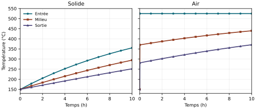
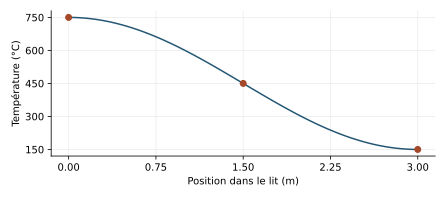
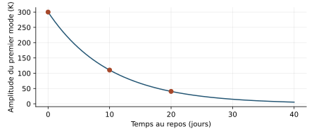
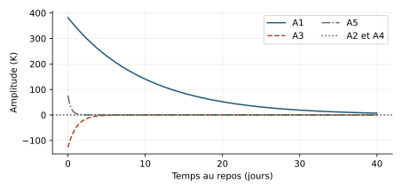
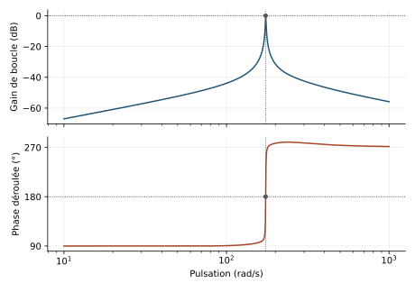
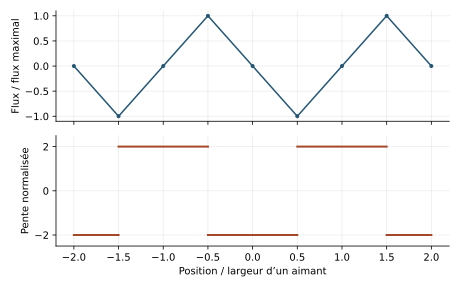

# X-ENS PSI — Modélisation 2025 · Corrigé guidé

*Corrigé rédigé par IA, non officiel. Signalez toute erreur.*

**Rédaction** · GPT-6.2 Astra Ultra · vitesse non renseignée · 24 novembre 2026

**Révision** · GPT-6.2 Astra Ultra · vitesse non renseignée · 26 novembre 2026

## Repères pour résoudre le sujet

Les Q1 à Q31 suivent l’énergie dans un lit de roches, depuis les pertes par les parois jusqu’au rendement d’un cycle de charge-décharge. Les Q32 à Q53 portent sur la conversion de chaleur en électricité par un moteur Stirling et une génératrice linéaire. Les indices chauds et froids du moteur désignent des chambres, tandis que les indices du lit distinguent le solide et le fluide. Les rapports de température thermodynamiques exigent des kelvins.

## Autodécharge dans les parois

### Question 1 · Résistance de paroi

**Indication.** Additionner les six surfaces soumises au même écart de température.

#### Solution

Dans l’approximation de parois planes, $A=2(HB+HL+BL)=26{,}18\ \mathrm{m^2}$. Les parois conduisent en parallèle. La loi de Fourier donne $G=\lambda_i A/e$, d’où $R_{\rm th}=G^{-1}=0{,}127\ \mathrm{K\,W^{-1}}$.

### Question 2 · Pertes à pleine charge

**Indication.** Le flux sortant doit être positif lorsque le stockage est plus chaud que l’ambiance.

#### Solution

$\phi=(T-T_{\rm amb})/R_{\rm th}$. Pour $750\ ^\circ\mathrm C$ à l’intérieur et $20\ ^\circ\mathrm C$ à l’extérieur, la perte vaut $730/0{,}1273=5{,}73\ \mathrm{kW}$. Un écart thermique a la même valeur numérique en kelvins et degrés Celsius.

### Question 3 · Autodécharge

**Indication.** Distinguer la température de son écart à l’ambiante avant de chercher la durée de demi-décharge.

#### Solution

Pour le garnissage massif de cette sous-partie, $V=8{,}67\ \mathrm{m^3}$ et $C=\rho_s c_sV=31{,}21\ \mathrm{MJ\,K^{-1}}$. Le premier principe donne $C\dot T=-\phi$, soit $T=T_{\rm amb}+(T_1-T_{\rm amb})e^{-t/\tau}$ avec $\tau=R_{\rm th}C=3{,}97\,10^6\ \mathrm s=46{,}0$ jours. La moitié de l’écart initial correspond à $385\ ^\circ\mathrm C$ après $\tau\ln 2=31{,}9$ jours. Si « 50 % de la température initiale » désigne $375\ ^\circ\mathrm C$ sur l’échelle de l’énoncé, on trouve $t=\tau\ln(730/355)=33{,}2$ jours. Si le pourcentage portait sur la température thermodynamique absolue, $T_1/2=511{,}575$ K donnerait environ $55{,}5$ jours. Pour l’énergie utile, la référence pertinente reste l’ambiante et le temps de demi-charge est de $31{,}9$ jours.

### Question 4 · Durée utile

**Indication.** Comparer la constante de temps à un jour, puis à une saison.

#### Solution

Sur une journée, la fraction d’écart initial conservée vaut $e^{-1/46}\simeq98\ \%$. Après trois mois elle tombe à environ $14\ \%$. Pour retarder cette décroissance, augmenter l’épaisseur de l’isolant ou réduire sa conductivité, réduire le rapport surface extérieure/volume à capacité volumique donnée, ou augmenter $\rho_s c_s$.

## Transfert dans le lit poreux

### Question 5 · Deux bilans locaux

**Indication.** Introduire l’aire réelle d’échange entre grains et gaz dans une tranche avant de diviser le bilan.

#### Solution

Soit $a_v$ la surface d’interface air-roche par unité de volume total, en $\mathrm{m^{-1}}$. Dans la tranche $S\,dx$, la puissance allant des roches vers l’air vaut $ha_v S\,dx(T_s-T_f)$. Les capacités par volume total sont $(1-\varepsilon)\rho_sc_s$ et $\varepsilon\rho_fc_f$. Les sections longitudinales de conduction du modèle sont $(1-\varepsilon)S$ et $\varepsilon S$. Le transport d’enthalpie de l’air ajoute $(\dot m_fc_f/S)\partial_x T_f$ au membre de gauche de son bilan volumique. En divisant ces bilans par $a_v$, on obtient

$$
C_1\partial_tT_s=C_2\partial_{xx}T_s-h(T_s-T_f),\qquad
C_3(\partial_tT_f+u\partial_xT_f)=C_4\partial_{xx}T_f+h(T_s-T_f),
$$

avec $C_1=(1-\varepsilon)\rho_sc_s/a_v$, $C_2=(1-\varepsilon)\lambda_s/a_v$, $C_3=\varepsilon\rho_fc_f/a_v$, $C_4=\varepsilon\lambda_f/a_v$ et $u=\dot m_f/(\varepsilon\rho_f S)$. L’aire spécifique dépend de la géométrie des grains. La porosité seule ne la détermine pas. Si $h$ est redéfini comme coefficient volumique, l’aire spécifique y est déjà incluse.

### Question 6 · Vitesse interstitielle

**Indication.** Exprimer la masse dans les pores et le débit à travers une section.

#### Solution

$m_f=\rho_f\varepsilon SL$ et $\dot m_f=\rho_f\varepsilon Su$. Leur rapport donne $C_5=u=\dot m_fL/m_f$, en mètres par seconde. C’est la vitesse de la dérivée matérielle du fluide.

### Question 7 · Données aux bords

**Indication.** Distinguer la température initiale des deux milieux de l’air imposé à l’entrée pendant la charge.

#### Solution

Initialement $U_{i,0}=V_{i,0}=T_0$ à l’intérieur. L’injection impose $V_{0,j}=T_1$ dès son démarrage, y compris au coin si l’on prend la valeur à droite de l’échelon. Le sujet ne fixe pas la température de sortie. On ferme le modèle par un flux conductif nul à la sortie et aux deux extrémités du solide. L’air sortant continue d’emporter son enthalpie. Pour les tableaux du sujet,
```python
U[:, 0] = T0
V[:, 0] = T0
V[0, :] = T1
```

### Question 8 · Pas d’Euler

**Indication.** Former d’abord l’itération sur un point intérieur. La vitesse positive fixe le sens amont.

#### Solution

Posons $r_s=C_2\delta t/(C_1\delta x^2)$, $r_f=C_4\delta t/(C_3\delta x^2)$, $b_s=h\delta t/C_1$, $b_f=h\delta t/C_3$ et $c=C_5\delta t/\delta x$. Avec $\Delta_d W_i=W_{i+1}-2W_i+W_{i-1}$, un schéma explicite diffusif centré et advectif amont s’écrit, à partir de la seule colonne $j$,

$$
U_i^{j+1}=U_i^j+r_s\Delta_d U_i^j-b_s(U_i^j-V_i^j),\qquad
V_i^{j+1}=V_i^j+r_f\Delta_d V_i^j-c(V_i^j-V_{i-1}^j)+b_f(U_i^j-V_i^j).
$$

Les termes d’échange se compensent lorsqu’on additionne les deux bilans pondérés par leurs capacités.

### Question 9 · Simulation de dix heures

**Indication.** Vérifier les nombres sans dimension avant d’exécuter des millions de pas. Les indices fictifs du solide se déduisent du flux nul.

#### Solution

Avec $\delta x=0{,}003$ m et $\delta t=0{,}01$ s, $r_f\simeq8{,}80$ et $c\simeq0{,}577$. Le schéma explicite de Q8 est instable à ce pas. Le code subdivise chaque intervalle de sortie afin de satisfaire $2r_f+c+b_f\le1$ et $2r_s+b_s\le1$. Il conserve uniquement le profil courant et restitue les profils successifs. La réflexion aux bords impose le flux conductif nul. L’advection de sortie prend sa valeur amont.
```python
import math
import numpy as np

def profils(L, nx, duree, pas_sortie, T0, T1, C1, C2, C3, C4, C5, h):
    dx = L / (nx - 1)
    ds, df = C2 / C1, C4 / C3
    ks, kf = h / C1, h / C3
    frequence = max(2 * ds / dx**2 + ks,
                    2 * df / dx**2 + C5 / dx + kf)
    u = np.full(nx, float(T0))
    v = u.copy()
    v[0] = T1
    t = 0.0
    yield t, u.copy(), v.copy()
    for j in range(1, math.ceil(duree / pas_sortie) + 1):
        cible = min(j * pas_sortie, duree)
        n = max(1, math.ceil((cible - t) * frequence))
        dt = (cible - t) / n
        for _ in range(n):
            lu = np.diff(np.pad(u, 1, mode="reflect"), n=2) / dx**2
            lv = np.diff(np.pad(v, 1, mode="reflect"), n=2) / dx**2
            suivant = u + dt * (ds * lu - ks * (u - v))
            v[1:] += dt * (df * lv[1:] - C5 * np.diff(v) / dx
                            + kf * (u[1:] - v[1:]))
            u = suivant
        t = cible
        yield t, u.copy(), v.copy()
```
L’appel proposé pour dix heures est
```python
sorties = profils(3, 1001, 36000, 60, 150, 525,
                  1352250, .020, 480, 3.800, .173, 30)
for temps, solide, air in sorties:
    print(temps, air[-1])
```
Au maillage de l’énoncé, chaque sortie espacée de 60 s exige 109 020 sous-pas, soit 65 412 000 pour dix heures. Avec les conditions aux bords de Q7, le schéma donne alors, à $x=0$, $1{,}5$ et $3$ m, des températures de roche de $355{,}4$, $294{,}6$ et $251{,}8\ ^\circ\mathrm C$. L’air entre à $525\ ^\circ\mathrm C$ et sort à $370{,}9\ ^\circ\mathrm C$. Les deux températures locales restent distinctes dans ce modèle à deux phases. Un maillage plus grossier ou un traitement implicite de la diffusion réduit le coût après vérification de la précision.



### Question 10 · Mémoire et convergence

**Indication.** Compter les deux tableaux. Diminuer le pas d’espace durcit aussi la contrainte sur le pas de temps.

#### Solution

$1001\times3\,600\,000$ valeurs par tableau, soit $2\times1001\times3\,600\,000\times8=57\,657\,600\,000$ octets, environ $57{,}7$ Go ou $53{,}7$ Gio de RAM avant les temporaires. Les niveaux successifs de Q9 utilisent $O(n_x)$ cases. La précision dépend du maillage, du pas temporel, de l’ordre des dérivées discrètes et du traitement des bords. Un raffinement spatial requiert $\delta t=O(\delta x^2)$ pour la diffusion explicite. Comparer les solutions sur des maillages successifs permet de contrôler l’erreur.

## Énergie stockée et thermocline

### Question 11 · Énergie sensible

**Indication.** Choisir la même référence thermique pour les différents états de charge.

#### Solution

$E=C(T-T_{\rm amb})$, avec $C=\rho_s c_sHBL$. À $750\ ^\circ\mathrm C$, $E=2{,}28\,10^{10}\ \mathrm J=6{,}33\ \mathrm{MWh}$. L’approximation $S\simeq3\ \mathrm{m^2}$ donne $6{,}57\ \mathrm{MWh}$. Si la porosité est explicitement prise en compte, remplacer le volume du lit par celui des roches.

### Question 12 · Puissance de l’air

**Indication.** Former le débit massique avant d’utiliser la capacité massique.

#### Solution

$\dot m=\rho_fD=0{,}60\ \mathrm{kg\,s^{-1}}$. La puissance portée par l’air au-dessus de l’ambiance vaut $P=\rho_fD c_f(T_1-T_{\rm amb})=438\ \mathrm{kW}$. La puissance effectivement reçue par le lit tient aussi compte de la température de sortie.

### Question 13 · Déplacement de la thermocline

**Indication.** Identifier le côté par lequel entre le fluide et suivre le front sur les relevés.

#### Solution

En charge, le lit initialement froid se réchauffe d’abord en $x=0$. Derrière le front, la température se rapproche de $T_1$. Le front progresse vers $L$ et s’élargit sous l’effet des échanges et de la diffusion. En décharge, l’admission froide est à droite. La zone froide s’étend vers la gauche et la température de l’air restitué en $x=0$ chute lorsque le front y arrive. La figure 4 permet de suivre un même niveau de température. En charge, l’isotherme de $450\ ^\circ\mathrm C$ passe d’environ $0{,}3$ m à 1 h à environ $1{,}4$ m à 4 h. En décharge, elle se déplace dans l’autre sens. Le profil de départ conserve le gradient laissé par la charge. Cette figure emploie une température chaude voisine de $750\ ^\circ\mathrm C$, alors que le code de Q9 fixe explicitement son admission à $525\ ^\circ\mathrm C$.

### Question 14 · Air sortant en charge

**Indication.** Faire le bilan des puissances des deux flux d’air avant et après le passage de la thermocline.

#### Solution

La puissance sortante $\rho_fD c_f(T_{\rm sortie}-T_{\rm amb})$ reste faible tant que l’extrémité aval est froide. Elle augmente lorsque le front l’atteint. L’air de charge évacué n’est pas valorisé dans le périmètre étudié. À débit et température d’entrée fixés, limiter $T_{\rm sortie}$ laisse davantage de puissance dans le lit.

### Question 15 · Borne supérieure

**Indication.** Examiner ce qui pourrait chauffer un grain déjà aussi chaud que le fluide et ses voisins.

#### Solution

En charge passive à partir d’un lit plus froid, sans production interne de chaleur, $T_s$ ne peut dépasser la température maximale initiale ou imposée. Au premier maximum potentiel, la conduction et l’échange avec l’air ne peuvent plus accroître la température. Ici la borne supérieure est $T_1$.

### Question 16 · Front idéal

**Indication.** Intégrer l’énergie sur chacun des deux tronçons du lit.

#### Solution

Pour un front situé à $x_0$, $E=\rho_sc_s S[(T_1-T_{\rm amb})x_0+(T_0-T_{\rm amb})(L-x_0)]$. La pente en $x_0$ vaut $\rho_sc_sS(T_1-T_0)>0$. L’origine reste la température ambiante.

### Question 17 · Talon de charge

**Indication.** Distinguer l’énergie référencée à l’ambiante et celle que le cycle décrit peut restituer.

#### Solution

Le minimum est atteint pour $x_0=0$. Alors $E_{\min}=C(T_0-T_{\rm amb})=4{,}06\ \mathrm{GJ}=1{,}13\ \mathrm{MWh}$. L’air de décharge entre à $T_0=150\ ^\circ\mathrm C$ et ne peut extraire ce talon lorsque tout le lit est à cette température. Un usage à température inférieure pourrait en valoriser une partie.

## Diffusion interne au repos

### Question 18 · Diffusivité

**Indication.** Vérifier les unités avant d’introduire la longueur du stockage.

#### Solution

$\alpha=\lambda_s/(\rho_s c_s)=1{,}06\,10^{-6}\ \mathrm{m^2\,s^{-1}}$. La longueur fixe une durée de diffusion par $L^2/\alpha$, tandis que la diffusivité est propre au matériau.

### Question 19 · Premier cosinus

**Indication.** Évaluer le profil aux deux extrémités et au centre.

#### Solution

$A_0=(T_1+T_0)/2=450\ ^\circ\mathrm C$, $A_1(0)=(T_1-T_0)/2=300\ \mathrm K$. Le profil $450+300\cos(\pi x/L)$ décroît de 750 à 150 avec tangentes horizontales aux extrémités et passe par 450 à $1{,}5$ m. Le domaine physique contient une demi-période. La période du prolongement vaut $2L=6$ m.



### Question 20 · Mode constant

**Indication.** Relier la moyenne à l’intégrale de l’équation de la chaleur.

#### Solution

$A_0=L^{-1}\int_0^LT\,dx$. Comme $d\int T\,dx/dt=\alpha[T_x(L)-T_x(0)]=0$ aux parois adiabatiques, cette moyenne reste constante. L’énergie sensible mesurée depuis l’ambiante vaut $C(A_0-T_{\rm amb})$.

### Question 21 · Équation du premier mode

**Indication.** La dérivée spatiale seconde multiplie le cosinus par une constante négative.

#### Solution

À $x=0$, $\partial_tT=\dot A_1$ et $\partial_{xx}T=-\omega_0^2A_1$. Ainsi $\dot A_1+\alpha\omega_0^2 A_1=0$, avec $\omega_0=\pi/L$ en radians par mètre.

### Question 22 · Décroissance du contraste

**Indication.** La valeur initiale et la valeur après une constante de temps graduent le tracé.

#### Solution

$A_1(t)=300e^{-t/\tau_1}\ \mathrm K$, $\tau_1=L^2/(\alpha\pi^2)=8{,}64\,10^5\ \mathrm s\simeq10{,}0$ jours. La courbe passe de 300 à 110 K en dix jours, puis à 40,6 K en vingt jours, et tend vers zéro.



### Question 23 · Série de cosinus

**Indication.** Vérifier les conditions de flux aux bords terme à terme.

#### Solution

Chaque $\cos(n\pi x/L)$ a une dérivée nulle aux deux extrémités. Ces fonctions constituent la base de Fourier associée au prolongement pair de période $2L$. La dépendance en $x$ est fixée, tandis que chaque amplitude porte sa propre dépendance temporelle. Après substitution, $\sum_{n\ge1}[\dot A_n+\alpha(n\omega_0)^2A_n]\cos(n\omega_0x)=0$.

### Question 24 · Projection orthogonale

**Indication.** L’identité produit-somme ramène le calcul à l’intégrale d’un cosinus sur un nombre entier de demi-périodes.

#### Solution

Pour $n\ne m$, le produit vaut la demi-somme des cosinus de fréquences $(n-m)\pi/L$ et $(n+m)\pi/L$. Leurs intégrales sont nulles sur $[0,L]$. Pour $n=m\ge1$, l’intégrale de $\cos^2(n\pi x/L)$ vaut $L/2$. Le mode constant a pour norme carrée $L$. La projection de Q23 donne $\dot A_n=-\alpha(n\omega_0)^2A_n$, donc $A_n=A_n(0)\exp(-n^2t/\tau_1)$.

### Question 25 · Échelon de température

**Indication.** Utiliser la norme des cosinus sur la demi-période pour normaliser la projection.

#### Solution

La moyenne est $450\ ^\circ\mathrm C$, température finale uniforme. Pour $n\ge1$,

$$
A_n(0)=\frac{2}{L}\int_0^LT(x,0)\cos(n\pi x/L)\,dx
=\frac{2(T_1-T_0)}{n\pi}\sin(n\pi/2).
$$

Les coefficients pairs sont nuls. L’extension paire écarte les sinus. L’intégration sur $[0,L]$ requiert les facteurs $1/L$ pour la moyenne et $2/L$ pour les cosinus. Le jury signale une coquille dans les formules imprimées. Au point de saut, la série converge vers la demi-somme.

### Question 26 · Cinq premières amplitudes

**Indication.** Les modes pairs restent nuls. Comparer les constantes de temps des modes impairs.

#### Solution

À $t=0$, les amplitudes $A_1$ à $A_5$ valent respectivement $382$, $0$, $-127$, $0$ et $76{,}4$ K. Les constantes de temps des trois modes non nuls valent $10{,}0$, $1{,}11$ et $0{,}400$ jours. Le troisième mode rejoint zéro par valeurs négatives. Ces valeurs concernent le profil en échelon de Q25.



### Question 27 · Temps d’uniformisation

**Indication.** Annoncer la référence choisie pour le pourcentage et repérer le mode qui disparaît en dernier.

#### Solution

Le premier mode domine à temps long. Sa réduction à 1 % de sa propre amplitude prend $\tau_1\ln100\simeq46$ jours. Une autre tolérance absolue donne $t\simeq\tau_1\ln(|A_1(0)|/\Delta T_{\rm tol})$, par exemple $\Delta T_{\rm tol}=4{,}5$ K conduit à $44{,}4$ jours. Les cycles de quelques heures sont courts devant ces durées. Sur plusieurs semaines la thermocline s’efface, à une échelle comparable à celle de l’autodécharge par les parois.

## Rendement du cycle

### Question 28 · Charge à puissance constante

**Indication.** Suivre l’air sortant quand le front thermique atteint l’extrémité aval.

#### Solution

Au début, la sortie est froide et presque toute la puissance thermique entrante augmente l’énergie des roches. La courbe d’énergie monte rapidement. Lorsque le front atteint la sortie, $T_{\rm sortie}$ croît. À débit constant, la puissance nette $\dot m c_f(T_{\rm entrée}-T_{\rm sortie})$ diminue. La pente de l’énergie décroît et la charge s’approche d’un plafond. Sur la figure 5a, l’axe gauche place l’énergie vers 40 % après 3 h et près de 80 % après 6 h. Sur l’axe droit, la sortie reste proche de $220\ ^\circ\mathrm C$ pendant les premières heures et dépasse $300\ ^\circ\mathrm C$ en fin d’essai.

### Question 29 · Pertes et énergie

**Indication.** Éliminer le temps à l’aide du profil exponentiel décroissant de la fraction encore disponible.

#### Solution

Posons $z=E/\widehat E$. Les profils empiriques imposent $e^{-t/\tau}=1-z$, donc $T_{\rm sortie}=T_{\rm amb}+(\widehat T-T_{\rm amb})/(1-z)$. Pour les pertes par air sortant, Q12 donne $P_{\rm pertes}=P_0/(1-z)$ avec $P_0=\rho_fD c_f(\widehat T-T_{\rm amb})$. Le jury précise que Q12 était le renvoi approprié. La lecture littérale de Q2 fournit la même forme avec $P_0=(\widehat T-T_{\rm amb})/R_{\rm th}$ si l’on assimile la température de paroi à celle de sortie. C’est alors un modèle de conduction différent. Pour l’air, diminuer la température de sortie par un lit mieux dimensionné ou arrêter avant le passage complet du front évite les rejets de fin de charge. Pour les parois, augmenter $R_{\rm th}$ réduit directement les pertes.

### Question 30 · Intégrale des pertes

**Indication.** Le profil de perte est une puissance instantanée, qui doit être intégrée entre les deux instants.

#### Solution

$P_{\rm pertes}=P_0e^{t/\tau}$. L’intégration donne $E_{\rm pertes}=\tau P_0(e^{t_c/\tau}-1)$. Comme $e^{t_c/\tau}=1/(1-E_c/\widehat E)$, on obtient $E_{\rm pertes}=\tau P_0 E_c/(\widehat E-E_c)$ pour $0\le E_c<\widehat E$. Les unités sont des joules si $P_0$ est en watts et $\tau$ en secondes.

### Question 31 · Rendement du cycle

**Indication.** Former séparément l’énergie injectée et celle qui peut être restituée, puis analyser les deux limites.

#### Solution

Pour $E_c>0$, $\eta=(E_c-E_{\rm pertes})/(E_c+E_{\rm pertes})=(\widehat E-E_c-\tau P_0)/(\widehat E-E_c+\tau P_0)$. La limite à charge nulle vaut $(\widehat E-\tau P_0)/(\widehat E+\tau P_0)$. Au point nul lui-même, le rapport est indéfini. La limite formelle à pleine charge vaut $-1$ si $P_0>0$. Le modèle a alors dépassé son domaine physique : il prévoit une température de sortie sans borne et une énergie récupérée négative dès $E_c>\widehat E-\tau P_0$. Le rendement réel dépend aussi des pertes de paroi, de la ventilation et de l’asymétrie charge-décharge. Une conduite arrêtant la charge avant la montée de la température aval et un front plus net améliorent la récupération.

## Moteur Stirling à double effet

### Question 32 · Bilan du piston

**Indication.** Projeter sur l’axe positif vers la droite et donner à chaque face sa normale.

#### Solution

Le piston 3 reçoit $+p_f S$ à gauche, $-p_m S$ sur la face opposée et la force algébrique $F_{\rm gen}$. Le guidage idéal ne travaille pas suivant $x_0$. Le bilan est $m_3\ddot x_3=S(p_f-p_m)+F_{\rm gen}$. Chaque terme du membre de droite a l’unité d’une force.

### Question 33 · Bilan du déplaceur

**Indication.** Séparer le fond du logement interne de la face annulaire à droite.

#### Solution

La chambre chaude pousse vers la droite sur $S$, la chambre froide vers la gauche sur $S-S_{\rm int}$ et la chambre B vers la gauche sur $S_{\rm int}$. Ainsi $m_1\ddot x_1=p_c S-p_f(S-S_{\rm int})-p_bS_{\rm int}$. Si toutes les pressions coïncident, la résultante est nulle.

### Question 34 · Masse de gaz

**Indication.** La température diffère d’une chambre à l’autre. Appliquer la loi des gaz parfaits avant de sommer les masses.

#### Solution

En négligeant la masse dans le régénérateur, $m=m_c+m_f=p_cV_c/(rT_c)+p_fV_f/(rT_f)$. Les températures sont absolues et $r$ est la constante massique du gaz. Le système de travail est fermé, donc cette somme est constante.

### Question 35 · Pression commune

**Indication.** Comparer l’écart de pression nécessaire à l’écoulement à la pression moyenne.

#### Solution

Si les pertes de charge des conduits, échangeurs et régénérateur sont négligeables et que l’égalisation acoustique est rapide à l’échelle du cycle, on peut prendre $p_c(t)=p_f(t)=p(t)$. Les échangeurs maintiennent néanmoins des températures différentes.

### Question 36 · Pression et déplacements

**Indication.** Lire sur la figure 7 les variations de volume quand on déplace un seul mobile vers la droite.

#### Solution

$V_c=V_0+Sx_1$, $V_f=V_0+Sx_3-(S-S_{\rm int})x_1$. Avec les températures des chambres maintenues, Q34 donne $p=mr/(V_c/T_c+V_f/T_f)$. Posons $D_0=V_0(1/T_c+1/T_f)$. On obtient

$$
p=\frac{p_0}{1+k_1x_1+k_3x_3},\qquad p_0=\frac{mr}{D_0},\quad k_1=\frac{S/T_c-(S-S_{\rm int})/T_f}{D_0},\quad k_3=\frac{S/T_f}{D_0}.
$$

Les deux coefficients $k_i$ sont des inverses de longueur.

### Question 37 · Petits déplacements

**Indication.** Identifier le seul terme sans dimension à développer.

#### Solution

Avec $q=k_1x_1+k_3x_3$ petit, $(1+q)^{-1}=1-q+O(q^2)$, donc $p-p_0\simeq-p_0(k_1x_1+k_3x_3)$. Le signe traduit une baisse de pression lorsque le dénominateur augmente.

### Question 38 · Ressorts gazeux

**Indication.** Un déplacement positif rapproche la paroi mobile du fond de chacune des chambres fermées.

#### Solution

$V_b=V_{b0}-S_{\rm int}x_1$. Pour une transformation adiabatique réversible d’un gaz parfait, $p_bV_b^\gamma=p_{b0}V_{b0}^\gamma$. Au premier ordre, $p_b\simeq p_{b0}(1+B_1 x_1)$ avec $B_1=\gamma S_{\rm int}/V_{b0}$. De même $V_m=V_{m0}-Sx_3$ et $p_m\simeq p_{m0}(1+\gamma Sx_3/V_{m0})$. L’augmentation de pression s’oppose au déplacement dans les bilans de Q32–33.

### Question 39 · Deux moteurs en opposition

**Indication.** Écrire l’équation du second déplaceur dans son axe local, orienté en miroir.

#### Solution

Dans l’axe local du second moteur, le déplacement du piston partagé est $-x_3$. Son déplaceur $y_2$ obéit donc à $m_1\ddot y_2=K_{11}y_2-K_{13}x_3+D_{11}\dot y_2-D_{13}\dot x_3$. Sur le mode symétrique, les conditions initiales en miroir donnent $y_2=-x_1$ par unicité. Une force de ce déplaceur écrite dans l’axe du premier vaut alors $-K_{31}y_2=K_{31}x_1$ et s’ajoute à celle du premier. Avec les coefficients du piston commun tels que regroupés dans le modèle du sujet,

$$
m_1\ddot x_1=K_{11}x_1+K_{13}x_3+D_{11}\dot x_1+D_{13}\dot x_3,\qquad
m_3\ddot x_3=2K_{31}x_1+K_{33}x_3+D_{33}\dot x_3+F_{\rm gen}.
$$

La masse et l’effort électromagnétique du piston commun interviennent une fois. Un mode initial dissymétrique ne se réduit pas d’emblée à ces deux coordonnées.

### Question 40 · Fonction de transfert

**Indication.** Éliminer le premier déplacement avant de normaliser le dénominateur par son terme constant.

#### Solution

À conditions initiales nulles, posons $A=m_1p^2-D_{11}p-K_{11}$ et $B=m_3p^2-D_{33}p-K_{33}$. Les équations donnent $AX_1=(K_{13}+D_{13}p)X_3$ et $BX_3=2K_{31}X_1+F_{\rm gen}$. Ainsi $H=A/[AB-2K_{31}(K_{13}+D_{13}p)]$. Pour $d_0=K_{11}K_{33}-2K_{31}K_{13}\ne0$ et $K_{11}\ne0$,

$$
\begin{aligned}
K_{\rm stir}&=-K_{11}/d_0,&a_1&=D_{11}/K_{11},&a_2&=-m_1/K_{11},\\
b_1&=(D_{11}K_{33}+D_{33}K_{11}-2K_{31}D_{13})/d_0,\\
b_2&=(D_{11}D_{33}-m_1K_{33}-m_3K_{11})/d_0,\\
b_3&=-(m_1D_{33}+m_3D_{11})/d_0,&b_4&=m_1m_3/d_0.
\end{aligned}
$$

Le numérateur normalisé est $1+a_1p+a_2p^2$. Le carré manquant dans l’énoncé est signalé par le jury.

## Oscillation et régulation

### Question 41 · Pôles et conversion

**Indication.** Les pôles gouvernent la réponse libre. Lire le signe de leur partie réelle.

#### Solution

La figure 8 donne deux pôles à partie réelle positive. La dynamique libre linéaire est instable. On peut convertir l’énergie des oscillations en choisissant une charge électrique qui ajuste la force de la génératrice et amène le mode utile près de la limite de stabilité, à sa résonance. Une amplitude finie exige en pratique une régulation ou une limitation non linéaire.

### Question 42 · Condition d’oscillation

**Indication.** Partir du dénominateur de la boucle fermée pour fixer le signe de la condition.

#### Solution

Pour le retour négatif du schéma, la caractéristique est $1+C(p)H_{\rm stir}(p)=0$. À la pulsation visée, $C(j\omega_*)H_{\rm stir}(j\omega_*)=-1$, donc module unité et phase égale à $180^\circ$ modulo $360^\circ$. Pour une oscillation libre durable, la paire conjuguée est sur l’axe imaginaire, simple, et les autres pôles doivent être stables. Une seule mesure locale de gain ne démontre pas cette dernière propriété.

### Question 43 · Correcteur et lecture du Bode

**Indication.** Un dérivateur positif ajoute un quart de tour et une pente de vingt décibels par décade.

#### Solution

$C(p)=\beta p$ applique, pour la consigne nulle et le retour négatif, une force $F_{\rm gen}=-\beta\dot x_3$. C’est un frein visqueux réglable en $\mathrm{N\,s\,m^{-1}}$. On cherche $\arg H(j\omega_*)=90^\circ$ sur la phase déroulée de la figure 9. La transition très raide se lit vers $1{,}75\,10^2\ \mathrm{rad\,s^{-1}}$, le gain près du sommet vaut environ $-63$ à $-65$ dB. Ainsi $\beta=1/(\omega_*|H(j\omega_*)|)$ est de l’ordre de 8 à $10\ \mathrm{N\,s\,m^{-1}}$. Une numérisation des courbes donne environ 174 rad/s, -64.2 dB et 9.4 N·s/m. L’épaisseur du pic limite la précision expérimentale de cette lecture. Le gain en boucle ouverte est $G_H+20\log_{10}(\beta\omega)$ et la phase est $\varphi_H+90^\circ$. Les courbes passent par $(\omega_*,0\ \mathrm{dB})$ et $(\omega_*,180^\circ)$.



### Question 44 · Réponse impulsionnelle

**Indication.** Mesurer sur plusieurs périodes, puis regarder si l’enveloppe reste constante.

#### Solution

La figure 10 porte environ 28 oscillations en une seconde, soit $T\simeq36$ ms et $\omega\simeq175\ \mathrm{rad\,s^{-1}}$, en accord avec la résonance visée. L’enveloppe décroît légèrement. Le réglage obtenu est donc faiblement amorti, compatible avec une lecture approximative du gain critique. La limite d’entretien idéale aurait une amplitude constante après le transitoire.

## Génératrice linéaire triphasée

### Question 45 · Flux embrassé

**Indication.** Dérouler la surface de la spire. Compter avec leurs signes les portions sous chaque pôle.

#### Solution

La bande embrassée a pour surface $\pi da$ et $\widehat\phi=\widehat B\,\pi da$. Avec l’orientation correspondant au coefficient de Q47, les flux en $-a/2,0,a/2$ valent respectivement $+\widehat\phi,0,-\widehat\phi$. Quand le mobile avance, l’aire gagnée par un pôle est perdue par l’autre : le profil est linéaire par morceaux, de période $2a$, avec extrema aux demi-entiers impairs de $a$ et zéros aux multiples de $a$.



### Question 46 · Dérivée et coefficients

**Indication.** Dériver chaque harmonique et regrouper selon le cosinus et le sinus.

#### Solution

La dérivée a pour coefficient constant $\alpha_0=0$ puisqu’un signal périodique retrouve sa valeur après une période. Pour $n\ge1$, $\alpha_n=n\omega_0 B_n$ et $\beta_n=-n\omega_0 A_n$. Ces relations valent ici par morceaux, ou au sens des coefficients de Fourier.

### Question 47 · Fondamental du flux

**Indication.** Le flux est impair et sa dérivée est un créneau pair. Projeter ce créneau sur les cosinus.

#### Solution

Pour $|x|<a/2$, $\phi'=-2\widehat\phi/a$ et pour $a/2<|x|<a$, $\phi'=+2\widehat\phi/a$, avec prolongement de période $2a$. Le créneau a moyenne nulle et $\beta_n=0$. L’intégration sur $[0,a]$ donne $\alpha_n=-8\widehat\phi\sin(n\pi/2)/(an\pi)$. Par Q46, $B_n=-8\widehat\phi\sin(n\pi/2)/(n^2\pi^2)$ et $A_n=0$. En particulier $b_1=-8\widehat\phi/\pi^2$. La convention positive imposée ensuite dans le sujet revient à inverser la référence du flux.

### Question 48 · Tensions de phase

**Indication.** Le flux total s’additionne en série. Distinguer un décalage de longueur de son angle électrique.

#### Solution

Les connexions font s’ajouter les flux, donc $\Phi_1=KN\phi$. Avec l’origine et la référence de tension choisies pour une fém en cosinus, $\widehat e=k_ev$, $k_e=8KN\widehat\phi/(\pi a)$, $\omega=\pi v/a$ et $e_1=\widehat e\cos(\omega t)$. La loi de Faraday est $e=-d\Phi/dt$ pour les orientations associées ; une inversion des deux bornes modifie le signe annoncé. Pour un décalage spatial $\Delta x$, écrire $e_j=\widehat e\cos(\omega t-\pi\Delta x/a)$, en tenant aussi compte du sens de bobinage. Pour des bobinages de même polarité, les déports $a/3,2a/3$ donnent explicitement $e_2=\widehat e\cos(\omega t-\pi/3)$ et $e_3=\widehat e\cos(\omega t-2\pi/3)$. En notation triphasée équilibrée usuelle, un choix cohérent des polarités et de l’ordre donne les phases $0,2\pi/3,4\pi/3$.

### Question 49 · Effort d’une phase

**Indication.** Pour la puissance convertie utiliser $e_1i_1$. Son produit de cosinus contient une composante constante.

#### Solution

Posons $\theta=\omega t$, $i_1=\widehat I\cos(\theta+\psi)$ et $v>0$. La puissance mécanique convertie vaut $P_m=e_1i_1$. La force de freinage comptée en valeur algébrique dans le sens de conversion vaut

$$
F_1=\frac{P_m}{v}=\frac{k_e\widehat I}{2}[\cos\psi+\cos(2\theta+\psi)].
$$

La moyenne est $k_e\widehat I\cos\psi/2$. À amplitude de courant donnée, elle est maximale pour $\psi=0$ modulo $2\pi$. L’effort de réaction de la génératrice sur le piston porte le signe opposé dans l’équation mécanique.

### Question 50 · Somme des trois forces

**Indication.** Additionner les termes à pulsation double en utilisant trois racines cubiques de l’unité.

#### Solution

Pour la phase $j$ de décalage $\delta_j$, le terme variable est proportionnel à $\cos(2\theta+\psi-2\delta_j)$. Les doubles angles sont espacés de $2\pi/3$ modulo $2\pi$, pour les déports géométriques de Q48 comme pour la convention triphasée usuelle. Leur somme est nulle. Il reste à chaque instant $F_{\rm frein}=(3/2)k_e\widehat I\cos\psi$, égal à sa moyenne. Un angle dans le cosinus doit être sans dimension. Les déphasages imprimés sous forme de longueurs sont une coquille relevée par le jury.

### Question 51 · Schéma électrique

**Indication.** Suivre le courant depuis la source interne jusqu’à la charge pour écrire la loi des mailles.

#### Solution

La fém $e$ représente la conversion du mouvement en tension à vide. $R$ est la résistance de l’enroulement et $L_c$ son inductance. La charge $Z_{\rm ch}$ reçoit le courant $i$ et la tension de borne (notée $v$ sur la figure 14). En régime sinusoïdal, $\underline E=(R+j\omega L_c+Z_{\rm ch})\underline I$ et $\underline V=Z_{\rm ch}\underline I$. Ici la lettre de tension ne désigne pas la vitesse mécanique.

### Question 52 · Accord de la charge

**Indication.** Faire disparaître la partie imaginaire de l’impédance totale à la pulsation de fonctionnement.

#### Solution

Pour mettre le courant en phase avec la fém, $X_{\rm ch}=-\omega L_c$ et $R+R_{\rm ch}>0$. Une capacité série de valeur $1/(\omega^2L_c)$ réalise cet accord à la pulsation considérée. La question fixe le déphasage donnant la force maximale à courant donné. La valeur résistive détermine ensuite l’intensité et le freinage.

### Question 53 · Amortissement électrique

**Indication.** Injecter le courant de crête obtenu de la maille accordée dans la somme triphasée.

#### Solution

L’accord donne $\widehat I=k_ev/(R+R_{\rm ch})$ en amplitudes de crête et $\cos\psi=1$. La force de freinage en grandeur vaut

$$
F_{\rm frein}=\beta v,\qquad \beta=\frac{3k_e^2}{2(R+R_{\rm ch})}.
$$

L’effort appliqué au piston est $F_{\rm gen}=-\beta\dot x_3$, ce qui réalise le terme dérivateur de Q43 en retour négatif. La charge résistive ajuste le coefficient ; la compensation réactive est valable près de la fréquence de réglage. La puissance convertie $F_{\rm frein}v$ est non négative.
