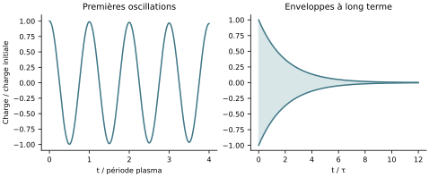
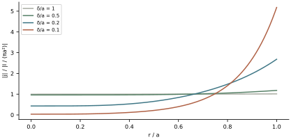
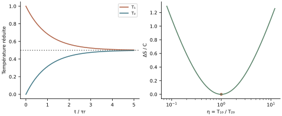
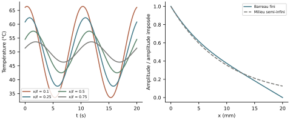
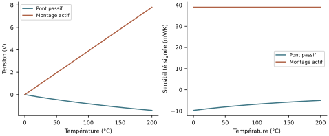

# Physique XSR — Concours PSI 2025 · Corrigé brut

*Corrigé rédigé par IA, non officiel.*

**Rédaction** · GPT-6.2 Astra Ultra · vitesse non renseignée

**Révision (tour 2)** · modèle exact non renseigné (famille Claude) · effort non renseigné · vitesse non renseignée · 28 novembre 2026

## I.A — Modèle de Drude en courant continu

### Q1 — Quels porteurs circulent ?

Les ions du métal occupent des sites du réseau et vibrent autour de ces sites. Les électrons de conduction peuvent traverser l’échantillon. Même si les noyaux étaient libres, à charge et champ du même ordre leur accélération serait beaucoup plus faible. Le proton est déjà environ $1,9\times10^3$ fois plus lourd qu’un électron et un ion métallique pèse plusieurs dizaines de masses de proton. Le blocage du réseau et la mobilité électronique expliquent ensemble le transport de charge.

### Q2 — Mobilité positive

Avec la charge $-e$ et le frottement $-m\vec v/\tau$, le modèle de Drude donne $m\dot{\vec v}=-e\vec E-m\vec v/\tau$. Au bout de quelques temps de relaxation sous champ constant, $\vec v=-\mu\vec E$ avec $\mu=e\tau/m>0$ en $\mathrm{m^2/(V\,s)}$. La vitesse de dérive est opposée au champ.

### Q3 — Loi d’Ohm locale

Le courant conventionnel suit $\vec j=-ne\vec v=(ne^2\tau/m)\vec E$. Ainsi $\gamma_0=ne^2\tau/m$. Les deux signes moins ont des origines distinctes, la charge portée et la direction de dérive.

### Q4 — Résistance du cylindre

Posons $A_s=\pi a^2$ et orientons $I$ de 1 vers 2, le long des $x$ croissants. En régime continu uniforme $V_1-V_2=\ell E_x$ et $I=A_s\gamma_0 E_x$. La résistance positive vaut $R_{\rm el}=\ell/(\gamma_0A_s)$. Pour les valeurs du barreau en cuivre, on trouve environ $1,1\times10^{-4}\ \Omega$.

## I.B — Transport variable et propagation

### Q5 — Conductivité complexe

Pour la convention $e^{i\omega t}$, $(1+i\omega\tau)\vec v=-(e\tau/m)\vec E$. En multipliant par $-ne$ on obtient $\gamma(\omega)=\gamma_0/(1+i\omega\tau)$. Le courant tend à suivre le champ à basse fréquence et accuse un retard à haute fréquence.

### Q6 — Oscillations de la charge volumique

La continuité donne $i\omega\rho+\nabla\cdot\vec j=0$, la loi de Gauss $\nabla\cdot\vec E=\rho/\varepsilon_0$. Pour des coefficients uniformes, $i\omega(1+i\omega\tau)\rho+\gamma_0\rho/\varepsilon_0=0$. Dans le temps, $\ddot\rho+\dot\rho/\tau+\omega_p^2\rho=0$, avec $\omega_p=\sqrt{ne^2/(m\varepsilon_0)}$. La force de rappel est d’origine électrique.

### Q7 — Ordres de grandeur du cuivre

Le paramètre de maille d’un métal est de quelques dixièmes de nanomètre, $3\times10^{-10}$ m en ordre de grandeur. Une maille cubique contenant quelques atomes, le volume par atome est $d^3$ avec $d\sim2\times10^{-10}$ m. Un électron par volume atomique donne $n\sim d^{-3}\sim10^{29}\ \mathrm{m^{-3}}$. Avec $m=m_e$ et $\gamma_0=6\times10^7\ \mathrm{S\,m^{-1}}$, $\tau=m\gamma_0/(ne^2)\sim2\times10^{-14}$ s et $\omega_p\sim2\times10^{16}\ \mathrm{rad\,s^{-1}}$. Le choix de la structure cristalline modifierait le facteur numérique.

### Q8 — Amortissement et neutralité du volume

Le coefficient canonique de $\dot\rho$ est $\omega_p/Q$. Donc $Q=\omega_p\tau$, de l’ordre de plusieurs centaines. En posant $\Omega=\sqrt{\omega_p^2-1/(4\tau^2)}$, les conditions initiales imposent $\rho=\rho_0e^{-t/(2\tau)}[\cos(\Omega t)+\sin(\Omega t)/(2\tau\Omega)]$. Le tracé démarre horizontalement puis oscille sous les enveloppes d’une exponentielle décroissante. Pour un signal de période grande devant $\tau$, ces transitoires internes s’éteignent bien avant une variation notable de l’excitation. Le volume du métal est alors pratiquement neutre, sans interdire les charges de surface nécessaires aux conditions aux limites.

### Q9 — Dépendance spatiale du courant

Lorsque $\partial_t\rho$ est négligeable, $\nabla\cdot\vec j=0$. Pour le courant purement axial imposé ici, cela donne $\partial_xj_x=0$. Le barreau, ses contacts supposés uniformes et l’excitation présentent une symétrie de rotation autour de l’axe. Ainsi $\partial_\theta j_x=0$. Un gradient radial de l’amplitude reste possible et apparaît avec l’effet de peau.

### Q10 — Diffusion du courant

Le rapport des amplitudes du courant de déplacement et du courant de conduction est $\varepsilon_0\omega/\gamma_0=\omega\tau/Q^2\ll1$. Ainsi $\nabla\times\vec B\simeq\mu_0\vec j$. En prenant le rotationnel de $\nabla\times\vec E=-\partial_t\vec B$, l’identité du double rotationnel et $\nabla\cdot\vec E\simeq0$ donnent $\Delta\vec E=\mu_0\partial_t\vec j$. Comme $\vec j\simeq\gamma_0\vec E$, $\Delta j_x=\mu_0\gamma_0\partial_tj_x$. C’est une équation de diffusion avec $D_m=1/(\mu_0\gamma_0)$, en $\mathrm{m^2/s}$.

### Q11 — Résistance et profondeur de peau

La figure 2 montre que le courant total se concentre près du bord lorsque la pulsation croît. Utilisons la longueur du sujet $\delta=1/\sqrt{\mu_0\gamma_0\omega}$ et un profil uniforme dans la seule couronne active de largeur $d_s=\min(a,\delta)$. Alors $R_{\rm eff}\simeq\ell/[\gamma_0\pi(2a d_s-d_s^2)]$. Si $\delta\geq a$, on retrouve $R_{\rm el}$. Si $\delta\ll a$, $R_{\rm eff}\simeq\ell/(2\pi a\gamma_0\delta)\propto\sqrt\omega$. Le modèle en marche fixe un préfacteur approximatif. Avec l’équation (3) et le $\delta$ de l’énoncé, la profondeur exponentielle d’un milieu plan est $\sqrt2\,\delta$ ; la planche ci-dessous est calculée ainsi et donne 5,2 au bord pour $\delta=a/10$. La figure 2 du sujet y atteint 7,2 : elle correspond à une profondeur exponentielle égale à $\delta$. Les deux tracés conduisent à la même conclusion qualitative.

### Q12 — Chute de potentiel d’un tronçon

Avec $I$ orienté vers $+x$, $V(x,t)-V(x+dx,t)=\mathcal R\,dx\,I(x,t)+O(dx^2)$. À la limite $\partial_xV=-\mathcal R I$. Le signe traduit une perte de potentiel dans le sens du courant.

### Q13 — Ligne résistive et capacitive

La charge du condensateur de longueur $dx$ augmente du courant entrant moins le courant sortant. Donc $\partial_xI=-\Gamma\partial_tV$. Dériver le résultat de Q12 en $x$ donne $\partial_tV=D\partial_x^2V$, $D=1/(\mathcal R\Gamma)$ en $\mathrm{m^2/s}$. En effet $[\mathcal R\Gamma]=\mathrm{s/m^2}$.

### Q14 — Ligne inductive et capacitive sans pertes

Le bilan des nœuds reste le même. La chute de tension vérifie désormais $\partial_xV=-\Lambda\partial_tI$. Par dérivation et élimination, $\partial_x^2V=\Lambda\Gamma\partial_t^2V$ et $\partial_x^2I=\Lambda\Gamma\partial_t^2I$. Les deux ondes se propagent à $c=1/\sqrt{\Lambda\Gamma}$.

### Q15 — Nombres d’onde des deux lignes

Dans la convention $e^{i(\omega t-kx)}$, la ligne RC donne $k^2=-i\omega/D$. Pour la solution dirigée et décroissante vers $+x$, $k=(1-i)\sqrt{\omega/(2D)}$. Pour la ligne LC, $k=\pm\omega\sqrt{\Lambda\Gamma}$, le signe positif correspondant à la propagation vers la droite.

### Q16 — Atténuation et dispersion

Dans la ligne RC, les parties réelle et imaginaire de $k$ sont toutes deux non nulles. Après une distance $x$, la phase retarde de $x\sqrt{\omega/(2D)}$ et le module est multiplié par $e^{-x\sqrt{\omega/(2D)}}$. Le déphasage dépend non linéairement de la fréquence, d’où dispersion. La résistance dissipe par effet Joule. Il s’agit d’une onde de diffusion atténuée, avec progression de phase. Pour la ligne LC idéale $k$ est réel et linéaire en $\omega$ : célérité constante, sans dispersion ni dissipation dans ce modèle.

## I.C — Transferts de chaleur

### Q17 — Modéliser un thermostat

Un thermostat échange une quantité finie de chaleur sans variation sensible de sa température. Une capacité thermique $C_k$ assez grande pour que $|Q_k|/C_k$ soit négligeable à la précision voulue, ou une régulation externe, l’autorise sur la durée considérée. Réservoir homogène et réservoir à température fixe sont deux hypothèses différentes.

### Q18 — Loi de Fourier en réponse linéaire

Près de l’équilibre local, on développe le flux de chaleur au premier ordre en la force qui le produit, ici le gradient thermique. Pour un milieu isotrope $\vec j_Q=-\lambda\nabla T$ avec $\lambda>0$ en $\mathrm{W\,m^{-1}K^{-1}}$. Le signe fait passer la chaleur du chaud vers le froid. La densité de flux s’exprime en $\mathrm{W/m^2}$.

### Q19 — Comparaison des conductivités

La loi de Wiedemann–Franz donne $\lambda=L_0\gamma_0T$, $L_0=(\pi^2/3)(k_B/e)^2\simeq2,5\times10^{-8}\ \mathrm{W\,\Omega\,K^{-2}}$. À température comparable un métal meilleur conducteur électrique conduit aussi mieux la chaleur par ses électrons mobiles. À 300 K pour le cuivre, la formule donne environ $4,5\times10^2\ \mathrm{W\,m^{-1}K^{-1}}$, du même ordre que les $3\times10^2$ fournis. À température variable, le facteur $T$ ne se lit pas seul : si les collisions avec les vibrations du réseau entraînent $\gamma_0\propto1/T$ sur un intervalle, le produit varie peu.

### Q20 — Le cas du diamant

Le diamant pur est un isolant électrique. Les électrons ne fournissent donc pas l’essentiel du flux thermique comme dans le mécanisme métallique. Les vibrations du réseau cristallin, ou phonons, transportent efficacement l’énergie dans ce solide. La valeur de $\lambda$ annoncée n’entre pas en contradiction avec la loi métallique.

### Q21 — Bilan d’énergie thermique

Pour la tranche $A_s dx$, l’accumulation $\rho_m c A_s dx\,\partial_tT$ égale la différence des flux conductifs aux deux bases. Les côtés sont calorifugés et aucune source volumique n’est considérée. Pour $\lambda$ uniforme, $\partial_tT=D_T\partial_x^2T$ avec $D_T=\lambda/(\rho_m c)$, où $\rho_m$ est la masse volumique.

### Q22 — Profil stationnaire

En régime permanent $\partial_x^2T=0$. Les deux valeurs de bord fixent $T(x)=T_1+(T_2-T_1)x/\ell$. Un profil linéaire entraîne un flux axial uniforme.

### Q23 — Résistance thermique

En orientant la puissance transportée $\Phi$ de 1 vers 2, $\Phi=-\lambda A_s\partial_xT=(T_1-T_2)/R_{\rm th}$. Donc $R_{\rm th}=\ell/(\lambda\pi a^2)$ en K/W. Avec le cuivre tabulé et les dimensions du barreau, cela donne environ 21 K/W.

### Q24 — Échelles de temps des réservoirs

Le temps d’homogénéisation interne de chaque réservoir doit être court devant le temps de variation sensible de sa température moyenne en raison de l’échange à travers le barreau. Avec les désignations de la question, on demande $\tau_{\rm therm}\ll\tau_{\rm ech}$ : chaque réservoir s’homogénéise plus vite que le barreau ne lui apporte ou ne lui retire de la chaleur. Comme l’approximation quasi stationnaire exige de son côté que $\tau_{\rm ech}$, temps de diffusion dans le barreau, soit court devant le temps de relaxation $R_{\rm th}C/2$ des deux masses (Q28), la hiérarchie complète est $\tau_{\rm therm}\ll\tau_{\rm ech}\ll R_{\rm th}C/2$.

### Q25 — Bilan des deux solides finis

Avec $C_{\rm th}=C$, $C\dot T_1=-(T_1-T_2)/R_{\rm th}$ et $C\dot T_2=(T_1-T_2)/R_{\rm th}$. On peut appeler $\tau_0=R_{\rm th}C$ le temps d’une équation individuelle. La différence des températures, seule grandeur non constante, relaxe en $\tau_r=\tau_0/2$. Le facteur deux vient du déplacement simultané des deux températures.

### Q26 — Températures en fonction du temps

La somme $T_1+T_2$ est constante. En posant $\bar T=(T_{10}+T_{20})/2$ et $\Delta_0=T_{10}-T_{20}$, on a $\dot\Delta=-\Delta/\tau_r$, puis $T_1=\bar T+(\Delta_0/2)e^{-t/\tau_r}$ et $T_2=\bar T-(\Delta_0/2)e^{-t/\tau_r}$. L’ensemble est calorifugé.

### Q27 — Tracer la thermalisation

Si $T_{10}>T_{20}$, la température chaude décroît et la froide croît vers la même moyenne. Les pentes initiales sont opposées et les courbes sont symétriques autour de $\bar T$. Elles ne se croisent pas. Le flux s’annule asymptotiquement. Pour l’ordre inverse des températures, les deux courbes échangent leur rôle.

### Q28 — Valider le régime quasi stationnaire

La diffusion le long du barreau prend $\tau_{\rm th}\sim\ell^2/D_T=\rho_m c\ell^2/\lambda$. Exiger $\tau_{\rm th}\ll\tau_r=R_{\rm th}C/2$ revient à $c\ll\lambda R_{\rm th}C/(2\rho_m\ell^2)$, ou $\rho_m c A_s\ell\ll C/2$. Le facteur deux dépend du temps choisi pour comparer les ordres de grandeur. Le critère physique est la petite capacité totale du barreau devant celles des réservoirs.

### Q29 — Variation d’entropie

À capacité constante et avec des températures absolues en kelvins, $\Delta S_k=C\ln(T_f/T_i)$. Le barreau stockant très peu d’énergie, sa variation d’entropie est négligeable ici. À l’équilibre, $\Delta S=C\ln[\bar T^2/(T_{10}T_{20})]=C\ln[(1+\eta)^2/(4\eta)]$, $\eta=T_{10}/T_{20}>0$. L’échange d’entropie avec l’extérieur est nul.

### Q30 — Entropie créée et irréversibilité

La dérivée de $\Delta S/C$ est $(\eta-1)/[\eta(1+\eta)]$. La courbe décroît jusqu’au minimum nul en 1, puis remonte. Elle diverge logarithmiquement aux deux extrémités et est invariante par $\eta\mapsto1/\eta$. Au voisinage de l’équilibre, $\Delta S/C\simeq(\eta-1)^2/4$. Le transfert à travers un gradient fini crée de l’entropie dans le barreau. Les interfaces idéales sont à température continue et les réservoirs sont supposés homogènes.

### Q31 — Entropie échangée par la tranche

Le flux d’entropie entrant en $x$ vaut $\Phi(x)/T(x)$ et le flux sortant vaut $\Phi(x+dx)/T(x+dx)$. Donc $\delta S_e=-\partial_x(\Phi/T)\,dx\,dt$. Avec $\partial_x\Phi\simeq0$ et $\Phi=-\lambda A_s\partial_xT$, il vient $\delta S_e=-\lambda A_s(\partial_xT)^2dx\,dt/T^2$. Ainsi $f(T)=-\lambda A_s/T^2$. La quasi-stationnarité annule la dérivée du flux et conserve le terme en carré du gradient.

### Q32 — Création locale d’entropie

À faible capacité du barreau, l’accumulation d’entropie dans la tranche est négligeable à l’ordre considéré. Ainsi $\delta S_c\simeq-\delta S_e$. Pour l’entropie créée cumulée par unité de volume, $\partial_t s_v=\lambda(\partial_xT)^2/T^2\geq0$. Elle augmente tant qu’il existe un gradient. La vitesse de création s’annule à l’équilibre. L’intégrale de cette production sur le volume et la relaxation restitue la variation positive de Q29.

### Q33 — Onde thermique dans le platine

La figure 4 montre une oscillation de période 10 s autour de 50 °C. En s’éloignant du bord forcé, l’amplitude diminue et le maximum est retardé. Le flux oscille autour de zéro, la moyenne étant nulle puisque les deux extrémités ont la même température moyenne. Il s’atténue et se retarde comme la température. En un point donné, $-\lambda\pi a^2\partial_xT$ est en avance d’un huitième de période, 1,25 s, sur la température. La courbe 4(b) vaut environ $-0,7$ W à $t=0$ en $\ell/10$ : elle correspond au flux compté vers les $x$ décroissants. Avec $D_T\simeq80/(2,1\times10^4\times130)=2,9\times10^{-5}\ \mathrm{m^2/s}$ et $\omega=2\pi\times0,1\ \mathrm{s^{-1}}$, une longueur est $\sqrt{D_T/\omega}\simeq6,8$ mm. La solution semi-infinie donne la profondeur exponentielle $\delta_T=\sqrt{2D_T/\omega}\simeq9,7$ mm. Sur la figure, les amplitudes valent environ 15, 10, 5 et 2 K en $x=2$, 5, 10 et 15 mm. Une décroissance $e^{-x/L}$ donne $L\simeq8/\ln3\simeq7,3$ mm entre 2 et 10 mm et $13/\ln7,5\simeq6,5$ mm sur l’ensemble des sondes, soit $L\approx7$ mm. Cette valeur coïncide avec la longueur dimensionnelle $\sqrt{D_T/\omega}\simeq6,8$ mm : l’expression proposée est compatible avec la figure. Les retards des maxima, environ 0,5 s à 2 mm et 2,3 s à 10 mm, redonnent la même longueur par $x/(\omega L)$, et l’amplitude du flux en $\ell/10$, 0,77 W, s’accorde avec $\lambda\pi a^2\sqrt2\times15\ \mathrm K/L$. La longueur lue est en revanche plus courte, d’un facteur proche de $\sqrt2$, que la profondeur $\delta_T$ de la solution exacte. Le caractère fini du barreau n’explique pas cet écart : la solution exacte avec $T(\ell)$ imposée donne 16 K et 7,5 K à 2 et 10 mm, comme le montre la planche ci-dessous.

### Q34 — Uniformité sur une section

Dans un barreau réel, les hétérogénéités transversales se redistribuent en $t_r\sim a^2/D_T$. Pour une excitation lente à cette échelle, $\omega a^2/D_T\ll1$, ou $a\ll\sqrt{D_T/\omega}$. Dans le platine de rayon 1 mm, cela donne $\omega\ll3\times10^1\ \mathrm{s^{-1}}$ en ordre de grandeur. Dans l’idéal strict du sujet, contacts uniformes et paroi latérale isolée peuvent aussi imposer un champ unidimensionnel par symétrie des données.

## I.D — Couplages thermoélectriques

### Q35 — Conductivité thermique à courant nul

Pour $\vec j=0$, l’équation (9) impose $\nabla V=-\alpha\nabla T$. L’équation (8) donne alors $\vec j_Q=-(\lambda-T\alpha^2\gamma)\nabla T$, donc $\kappa(T)=\lambda-T\alpha^2\gamma$. Ce coefficient vaut pour un conducteur ouvert. La positivité de la dissipation de Q38 impose $\kappa\geq0$.

### Q36 — Tension à circuit ouvert

Pour un coefficient $\alpha$ constant sur l’intervalle, l’intégration de $dV=-\alpha dT$ donne $V(0)-V(\ell)=-\alpha[T(0)-T(\ell)]$. Ainsi $\beta=\alpha$, en V/K. Si $\alpha$ varie avec $T$, il faut conserver l’intégrale.

### Q37 — Entropie transportée par charge

Remplaçons $-\gamma\nabla V$ par $\vec j+\alpha\gamma\nabla T$ dans (8). Il vient $\vec j_Q=T\alpha\vec j-\kappa\nabla T$, puis $\vec j_s=\vec j_Q/T=\alpha\vec j-(\kappa/T)\nabla T$. Le terme $\alpha\vec j$ est un flux d’entropie entraîné par le courant. $\alpha$ mesure donc une entropie transportée par unité de charge, en J/(K·C), équivalente à V/K.

### Q38 — Production d’entropie

Dans (12), remplacer $\vec j_s$ par son expression de Q37 et $-\nabla V$ par $\vec j/\gamma+\alpha\nabla T$. Les deux termes en $\vec j\cdot\nabla T$ se compensent exactement. On obtient $\partial_ts_c=\kappa|\nabla T|^2/T^2+|\vec j|^2/(T\gamma)\geq0$. Le premier terme vient de la conduction thermique irréversible, le second de la dissipation Joule. Les termes couplés de transport thermoélectrique sont réversibles dans ce cadre linéaire. Le dispositif complet garde les deux dissipations. Dans la terminologie thermodynamique usuelle l’effet Thomson est le chauffage ou refroidissement distribué d’un matériau parcouru par un courant dans un gradient thermique.

### Q39 — Mesure de f.é.m.

L’impédance d’entrée du voltmètre est très grande devant la résistance interne de la jonction. Pour une f.é.m. finie, le courant dans les fils est donc négligeable. La chute ohmique parasite est faible et la mesure approche la tension en circuit ouvert.

### Q40 — Coefficient de la jonction

Sur la figure 5 le matériau 1 va de A à B, le matériau 2 de C à A et de B à D. En allant de C vers D, additionnons $V_C-V_A=-\alpha_2(T_C-T_A)$, $V_A-V_B=-\alpha_1(T_A-T_B)$ et $V_B-V_D=-\alpha_2(T_B-T_D)$. Pour $T_C=T_D$, $V_C-V_D=(\alpha_2-\alpha_1)(T_A-T_B)$. Avec la **polarité de la figure 5**, $S_{12}=\alpha_2-\alpha_1$.

### Q41 — Étalonner un matériau

Former la jonction avec le matériau inconnu en position 1 et une référence d’$\alpha_{\rm réf}$ connue en position 2. Maintenir C et D à la même température. Imposer plusieurs petits écarts connus $T_A-T_B$, relever $V_C-V_D$, puis ajuster la pente $S$. Ainsi $\alpha_0=\alpha_{\rm réf}-S$ autour de la température d’étude. Une mesure à deux matériaux renseigne directement sur une différence de coefficients. Inverser le gradient aide à identifier un décalage constant du voltmètre.

## II.A — Mesure avec du platine

### Q42 — Linéariser la résistance de platine

$\rho_0=\rho(0\,°\mathrm C)$, valeur à la référence Celsius. Comparons les termes de même dimension par $|B|\theta/A$. Il vaut environ 1,5 % à 100 °C, et 13 % à 850 °C. À 850 °C le terme quadratique vaut environ $-0,42$ dans $\rho/\rho_0$, contre $1+A\theta\simeq4,32$. L’écart à la loi exacte est donc proche de 11 % relativement à cette dernière à l’extrémité haute. L’approximation affine est surtout pertinente en bas de gamme ou à précision modérée. Utilisons-la dans la suite, comme demandé.

### Q43 — Sensibilité de la thermorésistance

À géométrie fixée et dans l’approximation affine, $d\rho/d\theta=\rho_0A$ et $dR/d\theta=R_0A$. Une sensibilité absolue élevée demande donc $|A|$ grand à $\rho_0$ ou $R_0$ fixé, avec une plage d’utilisation où la courbure reste acceptable. Le modèle ne donne pas un maximum numérique de $A$. Dans le métal échauffé les vibrations du réseau augmentent les collisions des électrons, diminuent leur temps de relaxation et accroissent la résistivité.

### Q44 — Résistance de référence et variation

Si la géométrie est prise constante, $R_0=\rho_0\ell/S$ et $R'=R-R_0=R_0A\theta$. En Q45 et Q48, le symbole $R'$ désigne cette variation par rapport à 0 °C.

### Q45 — Pont de Wheatstone et sens de U

Notons $P$ et $N$ les nœuds centraux haut et bas du générateur, avec $V_P-V_N=E$. À droite le diviseur donne $V_d-V_N=E/2$, à gauche $V_g-V_N=E(R_0+R')/(2R_0+R')$. La flèche $U$ de la figure 6 va de gauche à droite. Donc $U=V_d-V_g=-ER'/[2(2R_0+R')]=-EA\theta/[2(2+A\theta)]$. La tension s’annule à 0 °C et est négative pour $\theta>0$ avec les bornes fournies.

### Q46 — Sensibilité du montage passif

La dérivée vaut $\sigma_\theta=-EA/(2+A\theta)^2$. Le signal est non linéaire et sa sensibilité en valeur absolue décroît avec $\theta$. Il faut inverser ou étalonner la loi. Le signal différentiel est faible pour les petits écarts, avec $|\sigma_0|=EA/4\simeq9,8$ mV/K pour $E=10$ V. La mesure dépend en outre de la stabilité de l’alimentation. La tension est bornée en module par $E/2$ : à 850 °C elle n’atteint que $0,31\,E$ et la sensibilité est tombée à environ 1,4 mV/K, sept fois moins qu’à 0 °C.

### Q47 — Rôle du deuxième amplificateur

L’entrée non inverseuse de l’ALI 2 est à la masse. En fonctionnement linéaire idéal, son entrée inverseuse est donc au potentiel nul et ne reçoit aucun courant. Le courant $I$, fléché vers le nœud sommateur, traverse la résistance de contre-réaction $R$ vers la sortie. Alors $I=(0-V_s)/R$ et $V_s=-RI$. Le deuxième ALI est un convertisseur courant–tension inverseur, de transimpédance $-R$.

### Q48 — Linéarisation active

Dans la figure 7, le rail inférieur du pont est le nœud sommateur à potentiel nul, et l’ALI 1 impose ce même potentiel au rail supérieur. Le nœud médian gauche est à $E$. Notons $V_b$ la sortie de l’ALI 1 au milieu de la branche droite. La loi au rail supérieur donne $E/R_0+V_b/(R_0+R')=0$, soit $V_b=-E(1+R'/R_0)$. Les deux résistances du bas alimentent le nœud sommateur et $I=(E+V_b)/R_0=-ER'/R_0^2$. Par Q47, **$V_s=RE R'/R_0^2=(R/R_0)EA\theta$**. Le rail inférieur et l’entrée non inverseuse de l’ALI 1 sont lus comme reliés à la ligne de sommation sur ce montage.

### Q49 — Gain, sensibilité et limites

La pente $\widetilde\sigma_\theta=(R/R_0)EA$ est constante pour le modèle linéaire de résistivité. Prendre $R=R_0$ et $E=10$ V donne $0,039\ \mathrm{V/K}$, soit **39 mV/K**. Augmenter $R$ accroît le gain sans augmenter directement le courant d’excitation du pont, mais risque la saturation de sortie. Augmenter $E$ accroît la sensibilité et l’auto-échauffement du platine. Il faut aussi vérifier l’excursion de sortie de l’ALI 1. La linéarité annoncée vaut dans la plage réelle des deux amplificateurs et du capteur.

## II.B — Mesure par jonction thermoélectrique

### Q50 — Thermocouple et température de référence

La borne supérieure du voltmètre de la figure 8 est reliée par le cuivre à A, l’inférieure à B. Aux deux transitions cuivre–matériau, $T_A=T_B=T_{\rm ref}$. Pour des bornes de voltmètre isothermes, les intégrales sur les fils de cuivre se compensent. De A vers la jonction chaude et de celle-ci vers B, $dV=-\alpha_i(T)dT$ conduit à $V_A-V_B=\int_{T_{\rm ref}}^{T_{\rm mes}}(\alpha_1-\alpha_2)\,dT$. Une différence $\alpha_1-\alpha_2$ constante sur la plage garantit une proportionnalité exacte à l’écart de température. Localement, on peut prendre sa valeur à la référence.

### Q51 — Réaliser la référence

Plonger les deux jonctions de référence dans un bain homogène d’eau pure et de glace fondante à pression atmosphérique normale. Tant que les deux phases coexistent à l’équilibre, la température reste proche de 0 °C et les deux contacts sont isothermes. Une référence instrumentée avec compensation de soudure froide constitue une autre réalisation à condition d’en connaître la température.

### Q52 — Lire les pentes expérimentales

Les sensibilités sont des pentes locales $dV/dT$, en µV/K. Sur la figure 9, entre environ 250 et 750 °C, la croissance est la plus forte pour E, environ 70–80 µV/K, puis J, environ 50–60, et K, environ 40. Les types S et B donnent des pentes beaucoup plus modestes, de l’ordre de 10 µV/K et variables selon la plage. B est très peu sensible près de 0 °C. Le montage actif à résistance fourni par Q49 produit 39 000 µV/K, plusieurs centaines à quelques milliers de fois plus par kelvin. Cette comparaison porte sur un capteur **avec alimentation et gain** face à une f.é.m. thermocouple mesurée directement. Les valeurs lues restent des ordres de grandeur.

### Q53 — Thermocouples au platine

Les courbes B et S s’étendent jusqu’à des températures supérieures à celles des courbes en métaux de base représentées ici. Les alliages à base de platine sont chimiquement peu réactifs et résistent à l’oxydation dans les atmosphères appropriées. Cela favorise la stabilité à haute température. Leur faible tension demande une chaîne de lecture plus sensible, la courbure exige un étalonnage et le métal précieux coûte cher. La très faible pente de B aux basses températures y limite tout particulièrement la résolution.

### Q54 — Usages du couplage thermoélectrique

Un générateur Seebeck placé entre une source chaude et une source froide peut alimenter un capteur à partir de chaleur dissipée, par exemple sur un circuit de refroidissement de centre de données. Il faut une différence durable de température et des échangeurs capables d’entretenir le flux. Dans l’autre sens, un courant dans un module Peltier peut pomper la chaleur d’une petite charge vers un dissipateur, pour stabiliser la température d’un composant optique. Le refroidissement d’un côté exige l’évacuation de la chaleur de l’autre et de la puissance électrique dissipée.

[Sujet officiel](https://ens-paris-saclay.fr/sites/default/files/CONCOURS/ANNALES_1C/1C_PSI/2025/Sujets/2025_PSI_Ep4_Physique_XSR_14022025_NB.pdf) · [Rapport du jury](https://ens-paris-saclay.fr/sites/default/files/CONCOURS/ANNALES_1C/1C_PSI/2025/Rapports/2025_PSI_Rapport_Physique_XSR_Ecrit.pdf)
