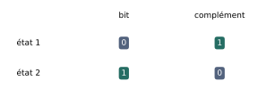

# X-ENS · PSI · Sciences industrielles 2025 — corrigé guidé

*Corrigé rédigé par IA, non officiel. Signalez toute erreur.*

**Rédaction** · GPT-6.2 Astra Ultra · vitesse non renseignée · 25 novembre 2026

**Couverture partielle.** La première proposition de la question 26 est traitée comme un exercice de logique binaire. La seconde proposition et les questions 1 à 25 et 27 à 54 sont hors couverture.

## Question 26 · Information d’un bit et de son complément

**Indication.** Combien de mots distincts la paire peut-elle prendre lorsque le second bit est déterminé par le premier ?

### Démarche

Faire d’abord la table de valeurs d’une négation. Pour le premier état, seule la ligne 01 est possible. Pour le second, seule la ligne 10 est possible. Le nombre de configurations idéales reste deux, de sorte qu’une machine qui doit reconnaître trois positions distinctes aurait besoin d’une information indépendante supplémentaire.

### Solution

Pour un bit logique $x$, le couple $(x,\bar x)$ vaut $(0,1)$ si $x=0$, et $(1,0)$ si $x=1$. L’ensemble des lectures idéales possibles possède donc deux éléments. Une lecture du premier bit distinguait déjà ces deux états. Ajouter son complément fournit une représentation redondante de la même information et laisse la résolution inchangée.

Par exemple, sur une petite carte de jeu qui a un côté clair et un côté sombre, les deux inscriptions « clair » et « sombre » sont opposées. Ajouter la seconde inscription à la première ne crée aucune catégorie intermédiaire. Le mot *précision* de la question s’entend ici au sens du nombre d’états distinguables.

