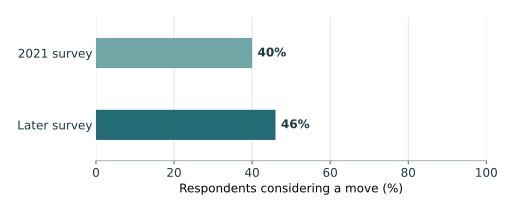
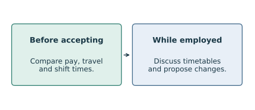

# École polytechnique FUI-FF, session 2 — Anglais 2025 · Corrigé brut

*Corrigé rédigé par IA, non officiel.*

**Rédaction** · modèle exact non renseigné (famille GPT-6) · effort non renseigné · vitesse non renseignée

**Révision** · GPT-6.2 Astra Ultra · vitesse non renseignée

## Reading comprehension

### 1. Financial pressures on millennials

Hurst links several setbacks across a generation’s working life. Many graduates sought their first position just as banks failed and recruitment slowed. Later, the pandemic disrupted careers that had barely recovered. Tuition debt continued to absorb earnings while buying a home became prohibitively expensive. Against that background, someone who doubts that extra effort will bring financial security may reasonably place greater value on free time. (Hurst, lines 32–39.)

### 2. Why repeated departures concern employers

From a supervisor’s perspective, frequent departures can look like broken commitments. A colleague who leaves takes experience and relationships away. Someone else must cover unfinished assignments, recruit a successor and teach that person how the organisation works. Those who stay may lose confidence in their team. Hurst acknowledges these practical costs through the testimony of a hiring specialist, while questioning whether loyalty can be demanded regardless of working conditions. (Hurst, lines 18–26.)

### 3. The author’s criticism of business practices

Hurst objects to managers who judge success mainly by the next set of financial results. He describes firms reducing what customers receive while collecting additional charges. His technology industry example extends that criticism to pay. A European employee’s transfer to America brought him eighty per cent more pay for unchanged duties, yet his immigration status weakened his bargaining power and helped the firm pay him less than a locally recruited colleague. (Hurst, lines 26–31 and 46–52.)

### 4. A possible second wave of resignations

The expression predicts another period of unusually widespread voluntary departures. America experienced the earlier wave after pandemic restrictions disrupted working routines. This time Hurst wonders whether European employees might take the lead, particularly when firms withdraw the option of working remotely. Among 31,000 respondents across thirty-one countries, forty-six per cent wanted a change within twelve months; the 2021 comparison stood at forty per cent. Their answers measure intentions, though, and an unhappy employee may lack the savings or permission needed to resign. (Hurst, lines 8–17 and 58–62.)

## Essay

Imagine two vacancies at a hospital. One offers slightly higher pay, while the other publishes shifts six weeks ahead. A nurse who shares childcare with a neighbour might prefer the second offer. Looking at jobs through the eyes of a buyer captures something valuable here. It also leaves much of / what happens inside that hospital unexplained.

The comparison helps because an applicant can ask quite specific questions before signing. Will a supervisor teach me how to use unfamiliar equipment? Can colleagues exchange a Saturday shift without losing income? An advertisement promising flexibility reveals less than a conversation with somebody already / on the ward. If several applicants decline offers after hearing the same answer, the hospital has a reason to reconsider its policy. Individual choices can make a neglected feature of a job visible to management.

Yet a purchase usually leaves the buyer free to walk away once the transaction is / over. Employment involves obligations that outlast a disappointing afternoon. The nurse who notices that handovers are rushed can suggest a new timetable, test it alongside colleagues and learn why the previous arrangement existed. Colleagues who disagree can still design a better routine together. Treating each disappointment as a reason to / browse vacancies misses the power a worker has to change an institution from within.

Moreover, the freedom to compare offers depends on who is doing the comparing. A nurse with savings and several nearby hospitals faces a different decision from a cleaner who relies on the last evening bus. Both / may value predictable shifts equally. Only one may be able to turn down an unsuitable offer. Assuming that everyone who stays must be satisfied would give management a misleading picture of its own performance. A confidential staff consultation could reveal grievances that resignation figures hide.

I would therefore use the / consumer comparison at the moment of recruitment and ask a different question after the contract begins. What opportunities do people have to improve the place where they already earn their living? An employer might publish schedules earlier, invite staff to review them after a trial period and explain which suggestions / it adopted. A worker who chooses to stay under those conditions has exercised judgment just as surely as someone who leaves. Loyalty becomes easier to understand when people can help decide what they are being asked to support.

*Word count: 388.*

