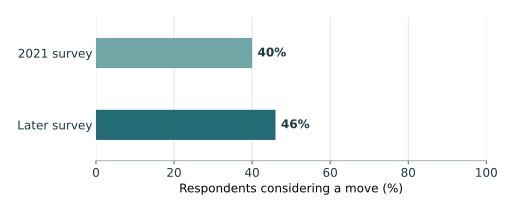
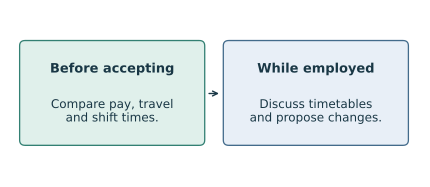

# École polytechnique FUI-FF, session 2 — Anglais 2025 · Corrigé guidé

*Corrigé rédigé par IA, non officiel.*

**Rédaction** · modèle exact non renseigné (famille GPT-6) · effort non renseigné · vitesse non renseignée

**Révision** · GPT-6.2 Astra Ultra · vitesse non renseignée

**Révision** · GPT-6.2 Astra Ultra · vitesse non renseignée

**Révision (tour 3)** · GPT-6.2 Astra Ultra · vitesse non renseignée

Le sujet propose une tribune d’Alexander Hurst, adaptée de *The Guardian* du 6 janvier 2025. L’épreuve dure deux heures. Chaque réponse de compréhension demande au moins 50 mots. Pour l’essai, la plage admise va de 360 à 440 mots. Les barres marquent chaque groupe de cinquante mots.

## Reading comprehension

### 1. Financial pressures on millennials

> [!INDICATION]
> Lignes 32 à 36, Hurst juxtapose la sortie des études au moment de la crise financière et le choc de la pandémie dix ans plus tard. Le détail du café permet de distinguer le coût d’un achat ponctuel de celui d’un emprunt immobilier.

> [!PIEGE]
> Une difficulté d’accès au logement a des conséquences même chez une personne qui possède déjà un emploi.

#### Sample answer

People of Hurst’s generation finished their education as the financial crash unfolded. Roughly a decade afterwards Covid delivered another shock. Loan repayments weigh on earnings, and property costs have moved beyond what many can afford. Buying an occasional coffee or paying for an outing is still possible, while obtaining a mortgage looks remote. That gap helps explain why workers might seek more control over their time. (Hurst, lines 32–39.)

### 2. Why repeated departures concern employers

> [!INDICATION]
> Partez du point de vue de la hiérarchie, puis suivez un départ à l’échelle du collectif. Distinguez le recrutement, la formation et la confiance des collègues.

> [!PIEGE]
> Un départ peut avoir un coût pour l’équipe même s’il améliore la vie du salarié.

#### Sample answer

A French manager whom Hurst knows reads younger employees’ readiness to leave as evidence of weak commitment. Vanessa Forslev, who advises firms on personnel matters and belongs to that generation herself, explains what happens to a team. Work is disrupted, a successor needs costly instruction, and colleagues lose heart. Hurst takes these complaints seriously while defending a worker’s decision to leave an unsuitable position. (Hurst, lines 1–7 and 18–26.)

### 3. The author’s criticism of business practices

> [!INDICATION]
> Rapprochez les pratiques envers les clients de la politique salariale. Précisez pourquoi le salarié transféré a moins de possibilités de négociation.

> [!PIEGE]
> Le chiffre de 80 % mesure la hausse personnelle du salarié après sa mutation. Il restait moins payé qu’une personne recrutée localement.

#### Sample answer

Hurst objects to managers who judge success mainly by the next set of financial results. He describes firms reducing what customers receive while collecting additional charges. His technology industry example extends that criticism to pay. A European employee’s transfer to America brought him eighty per cent more pay for unchanged duties, yet his immigration status weakened his bargaining power and helped the firm pay him less than a locally recruited colleague. (Hurst, lines 26–31 and 46–52.)

### 4. A possible second wave of resignations

> [!INDICATION]
> Situez la première vague aux États-Unis. En Europe, la seconde est une hypothèse de l’auteur. Un sondage sur les intentions laisse ouverte la possibilité matérielle de partir.

> [!PIEGE]
> Les 31 000 personnes interrogées dans 31 pays forment un échantillon de salariés. Le texte ne dit pas que tous sont millennials. Les intentions passent de 40 % à 46 %, soit six points. Forslev parle du coût des départs, tandis que la chasseuse de têtes Edwards-Dashti évoque les possibilités de mobilité interne.

#### Sample answer

The expression predicts another period of unusually widespread voluntary departures. America experienced the earlier wave after pandemic restrictions disrupted working routines. This time Hurst wonders whether European employees might take the lead, particularly when firms withdraw the option of working remotely. Among 31,000 respondents across thirty-one countries, forty-six per cent wanted a change within twelve months; the 2021 comparison stood at forty per cent. Their answers measure intentions, though, and an unhappy employee may lack the savings or permission needed to resign. (Hurst, lines 8–17 and 58–62.)

Le sondage rapporté par Hurst gagne six points de pourcentage. Cette comparaison porte sur l’intention de partir. Le témoignage sur la rémunération a une autre base : l’employé compare son salaire européen à celui qu’il obtient aux États-Unis, puis sa nouvelle offre à celle d’une recrue locale.

## Essay

> [!INDICATION]
> La comparaison avec un consommateur éclaire le choix entre deux offres. Éprouvez-la ensuite dans une situation où partir a un coût, puis dans une situation où les salariés peuvent obtenir un changement collectif.

> [!INDICATION]
> Un seul exemple suivi sur plusieurs paragraphes permet de changer de point de vue. Le service hospitalier ci-dessous est une situation hypothétique inventée pour la discussion.

#### Sample essay

Imagine two vacancies at a hospital. One offers slightly higher pay, while the other publishes shifts six weeks ahead. A nurse who shares childcare with a neighbour might prefer the second offer. Looking at jobs through the eyes of a buyer captures something valuable here. It also leaves much of / what happens inside that hospital unexplained.

The comparison helps because an applicant can ask quite specific questions before signing. Will a supervisor teach me how to use unfamiliar equipment? Can colleagues exchange a Saturday shift without losing income? An advertisement promising flexibility reveals less than a conversation with somebody already / on the ward. If several applicants decline offers after hearing the same answer, the hospital has a reason to reconsider its policy. Individual choices can make a neglected feature of a job visible to management.

Yet a purchase usually leaves the buyer free to walk away once the transaction is / over. Employment involves obligations that outlast a disappointing afternoon. The nurse who notices that handovers are rushed can suggest a new timetable, test it alongside colleagues and learn why the previous arrangement existed. Colleagues who disagree can still design a better routine together. Treating each disappointment as a reason to / browse vacancies misses the power a worker has to change an institution from within.

Moreover, the freedom to compare offers depends on who is doing the comparing. A nurse with savings and several nearby hospitals faces a different decision from a cleaner who relies on the last evening bus. Both / may value predictable shifts equally. Only one may be able to turn down an unsuitable offer. Assuming that everyone who stays must be satisfied would give management a misleading picture of its own performance. A confidential staff consultation could reveal grievances that resignation figures hide.

I would therefore use the / consumer comparison at the moment of recruitment and ask a different question after the contract begins. What opportunities do people have to improve the place where they already earn their living? An employer might publish schedules earlier, invite staff to review them after a trial period and explain which suggestions / it adopted. A worker who chooses to stay under those conditions has exercised judgment just as surely as someone who leaves. Loyalty becomes easier to understand when people can help decide what they are being asked to support.

*Word count: 388.*

## Relecture

Les quatre réponses comptent respectivement 66, 64, 71 et 82 mots hors références. Les renvois de lignes identifient les idées reprises dans la tribune. L’essai construit son propre exemple. Dans la copie, vérifiez le sujet et le verbe de chaque phrase et distinguez les constats (*reports*, *found*) des hypothèses (*might*, *could*).
