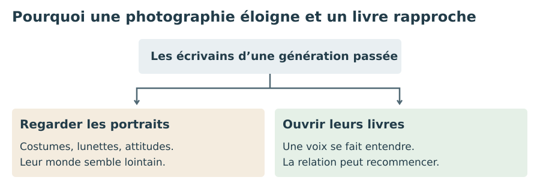
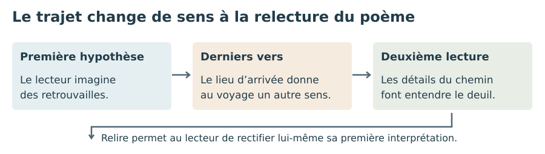

# École polytechnique FUI-FF, session 2 — Français 2025 · Corrigé brut

*Corrigé rédigé par IA, non officiel.*

**Rédaction** · modèle exact non renseigné (famille GPT-6) · effort non renseigné · vitesse non renseignée

**Révision** · modèle exact non renseigné (famille GPT-6) · effort non renseigné · vitesse non renseignée

**Révision** · GPT-6.2 Astra Ultra · vitesse non renseignée

**Révision (tour 3)** · GPT-6.2 Astra Ultra · vitesse non renseignée

La formation francophone du concours universitaire international propose une épreuve de deux heures. La garde interdit les dictionnaires et traducteurs électroniques. Jean-Michel Maulpoix prononce la conférence dont est tiré le texte le 6 novembre 2020 à l’Alliance française d’Aoste. Les trois réponses de compréhension sont suivies d’un bref essai libre sans limite de mots imposée.

## A1 · Formuler la thèse

Selon Jean-Michel Maulpoix, la lecture reste une forme de compagnie dans une société où les images et les écrans ont pris une place considérable. Il situe cette inquiétude dans l’histoire de sa génération, qui a vu se développer la télévision puis l’informatique. Devant les photographies de Proust, de Gide et de Valéry, leurs vêtements et leurs lunettes lui font éprouver la distance entre deux époques. Leurs livres lui permettent pourtant d’entrer encore en relation avec eux. Quand il ouvre le livre, le lecteur physiquement seul peut ainsi sortir de son isolement.

## A2 · Choisir une phrase et justifier son choix

Je choisirais la phrase « Car la lecture, pour commencer, est une compagnie. » Elle donne un sens aux deux moments de l’extrait. Devant le portrait des écrivains, Maulpoix éprouve la distance qui le sépare de leur époque. La lecture lui permet de renouer avec eux. Dans le dernier paragraphe, cette rencontre s’élargit aux personnages et aux voix qu’un livre fait exister pour chacun. Le mot « compagnie » exprime bien ce qu’ont en commun ces expériences.

## A3 · Interpréter la fidélité prêtée au livre

Maulpoix prête au livre une conduite humaine pour exprimer sa fidélité. On peut interrompre une lecture et, longtemps après, retrouver un récit ou reprendre le cours d’une pensée. Après avoir rappelé les qualités pratiques que Victor Hugo attribuait au livre, Maulpoix ajoute un qualificatif personnel, « fidèle ». Le verbe « trahir » transforme l’objet en interlocuteur. Le livre reste disponible quand on le referme, comme un ami auquel on peut revenir. Maulpoix introduit pourtant une condition. Si le lecteur perd le désir d’ouvrir le volume, la conversation silencieuse s’interrompt. Ce serait donc un contresens de comprendre cette formule comme une garantie que tout ce qu’on lit est vrai.

## B · Essai personnel sur la lecture aujourd’hui

Quand je lis sur mon téléphone, le même écran peut me rendre un texte accessible et m’empêcher de le finir. Il m’est arrivé de retrouver en quelques secondes un poème dont je ne connaissais que le premier vers, puis de répondre à un message avant d’avoir lu le dernier. Ce qui fait pour moi le prix de la lecture aujourd’hui, c’est la possibilité d’accorder à une voix assez de temps pour qu’elle déplace ma première impression.

Je pense à *Demain, dès l’aube*, de Victor Hugo. À la première lecture, j’attendais des retrouvailles. Le mot « tombe », dans les derniers vers, m’a obligé à reprendre le chemin depuis le début. Le bouquet que le voyageur s’apprête à déposer prend alors le sens d’un geste de mémoire. À la seconde lecture, les mêmes mots faisaient entendre le deuil que je n’avais pas perçu. Personne ne m’avait interrompu pour corriger mon erreur. Le poème me laissait revenir sur ce que j’avais cru comprendre. Je retrouve rarement cette liberté dans une conversation où je prépare déjà ma réponse pendant que l’autre parle.

Cette expérience peut commencer par une vidéo, un prêt de bibliothèque ou un fichier reçu d’un ami. Un livre audio m’a même aidé à entrer dans un roman dont les premières pages m’avaient découragé. Le soir où j’en ai ensuite parlé avec ma sœur, nous ne nous souvenions pas du tout du même personnage. Son récit a attiré mon attention sur une scène que j’avais traversée trop vite. La lecture m’avait apporté une compagnie dans la solitude, puis une raison de chercher celle de quelqu’un d’autre.

Je ne crois donc pas que le livre exige de quitter la société des écrans. Il exige parfois que je ferme une application ou que je garde le livre ouvert quelques minutes de plus. Dans une journée où beaucoup de paroles me demandent une réaction immédiate, pouvoir relire avant de répondre est déjà une liberté.
