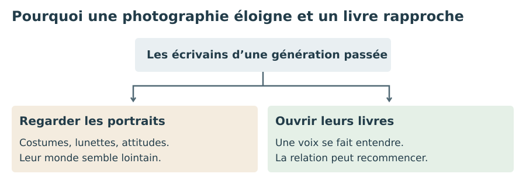
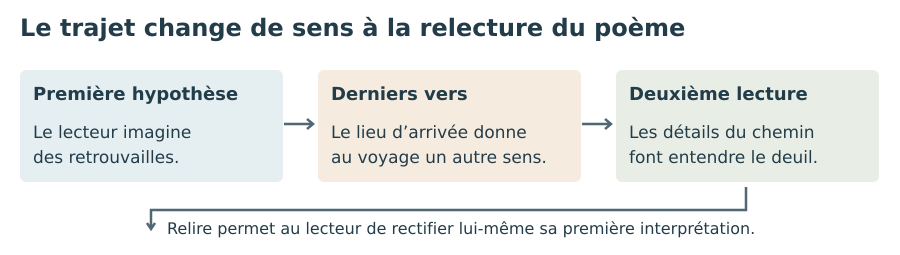

# École polytechnique FUI-FF, session 2 — Français 2025 · Corrigé guidé

*Corrigé rédigé par IA, non officiel.*

**Rédaction** · Modèle : OpenAI Codex (famille GPT-6) · Effort de raisonnement : non renseigné · Mode de vitesse : non renseigné.

**Révision** · Modèle : OpenAI Codex (famille GPT-6) · Effort de raisonnement : non renseigné · Mode de vitesse : non renseigné.

La formation francophone du concours universitaire international propose une épreuve de deux heures. Le texte est un extrait d’une conférence de Jean-Michel Maulpoix donnée à Aoste en 2020. Les trois réponses de compréhension sont suivies d’un bref essai libre sans limite de mots imposée.

La première partie vérifie la lecture de l’extrait. Dans la seconde, le candidat soutient son propre point de vue. [Sujet officiel de la session](https://www.polytechnique.edu/admission-cycle-ingenieur/sites/admission/files/content/FUI-FF%202%202025%20Fran%C3%A7ais.pdf)

## A1 · Formuler la thèse

> [!INDICATION]
> Comparer les deux expériences de l’auteur devant une photographie et devant le livre de celui qu’elle représente. Que se passe-t-il ensuite quand le lecteur est seul ?

Selon Jean-Michel Maulpoix, la lecture reste une forme de compagnie dans une société où les images et les écrans ont pris une place considérable. Un écrivain ancien peut paraître étranger sur une photographie, alors que son livre permet encore d’entendre sa voix et de partager une pensée. Quand il ouvre le livre, le lecteur physiquement seul peut ainsi sortir de son isolement.

## A2 · Choisir une phrase et justifier son choix

> [!INDICATION]
> Choisir une phrase effectivement présente dans l’extrait et qui explique les deux paragraphes. Ajouter une raison précise à ce choix personnel.

Je choisirais la phrase « Car la lecture, pour commencer, est une compagnie. » Elle donne un sens aux deux moments de l’extrait. Devant le portrait des écrivains, Maulpoix éprouve la distance qui le sépare de leur époque. La lecture lui permet de renouer avec eux. Dans le dernier paragraphe, cette rencontre s’élargit aux personnages et aux voix qu’un livre fait exister pour chacun. Le mot « compagnie » exprime bien ce qu’ont en commun ces expériences.

## A3 · Interpréter la fidélité prêtée au livre

> [!INDICATION]
> Qui peut d’ordinaire trahir quelqu’un ? Chercher l’attitude opposée, puis la condition qui dépend du lecteur.

Maulpoix prête au livre une conduite humaine pour exprimer sa fidélité. On peut interrompre une lecture et, longtemps après, retrouver un récit ou reprendre le cours d’une pensée. Le livre reste à la disposition du lecteur. La réserve de l’auteur est importante. Si l’on n’a plus envie de l’ouvrir, l’expérience s’interrompt. Ce serait donc un contresens de comprendre cette formule comme une garantie que tout ce qu’on lit est vrai.

> [!PIEGE]
> La formule attribue au livre une qualité morale. Dans la réponse, préciser le sens concret de cette personnification et conserver la nuance sur le désir de lire.

## B · Essai personnel sur la lecture aujourd’hui

> [!INDICATION]
> Choisir une situation vécue ou plausible dans laquelle lire change une façon de penser ou d’agir. Un exemple développé permettra de préciser son avis sur la place de la lecture aujourd’hui.

Quand je lis sur mon téléphone, le même écran peut me rendre un texte accessible et m’empêcher de le finir. Il m’est arrivé de retrouver en quelques secondes un poème dont je ne connaissais que le premier vers, puis de répondre à un message avant d’avoir lu le dernier. Ce qui fait pour moi le prix de la lecture aujourd’hui, c’est la possibilité d’accorder à une voix assez de temps pour qu’elle déplace ma première impression.

Je pense à *Demain, dès l’aube*, de Victor Hugo. À la première lecture, j’attendais des retrouvailles. La destination du voyage, révélée à la fin, m’a obligé à reprendre le chemin depuis le premier vers. À la seconde lecture, les mêmes mots faisaient entendre le deuil que je n’avais pas perçu. Personne ne m’avait interrompu pour corriger mon erreur. Le poème me laissait revenir sur ce que j’avais cru comprendre. Je retrouve rarement cette liberté dans une conversation où je prépare déjà ma réponse pendant que l’autre parle.

Cette expérience peut commencer par une vidéo, un prêt de bibliothèque ou un fichier reçu d’un ami. Un livre audio m’a même aidé à entrer dans un roman dont les premières pages m’avaient découragé. Le soir où j’en ai ensuite parlé avec ma sœur, nous ne nous souvenions pas du tout du même personnage. Son récit a attiré mon attention sur une scène que j’avais traversée trop vite. La lecture m’avait apporté une compagnie dans la solitude, puis une raison de chercher celle de quelqu’un d’autre.

Je ne crois donc pas que le livre exige de quitter la société des écrans. Il exige parfois que je ferme une application ou que je garde le livre ouvert quelques minutes de plus. Dans une journée où beaucoup de paroles me demandent une réaction immédiate, pouvoir relire avant de répondre est déjà une liberté.

> [!METHODE]
> L’essai propose une position, lui donne un appui précis dans un poème et la confronte à des usages numériques et sociaux. Un autre choix de lecture peut soutenir une autre réponse personnelle.
