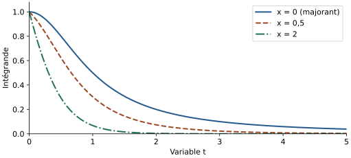
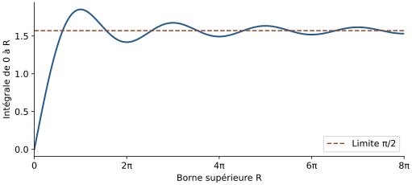
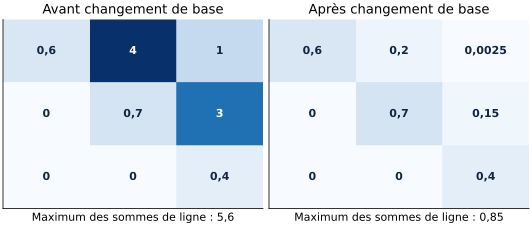
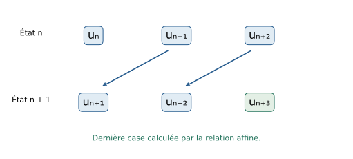
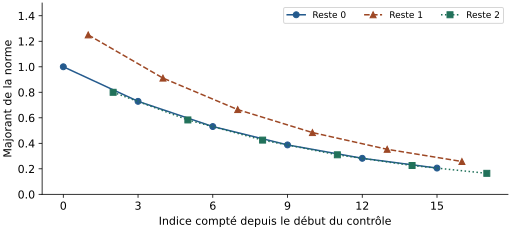

# École polytechnique FUI-FF, session 2 — Mathématiques 2025 · Corrigé brut

*Corrigé rédigé par IA, non officiel.*

**Rédaction** · modèle exact non renseigné (famille GPT-6) · effort non renseigné · vitesse non renseignée

**Révision (tour 1)** · GPT-6.2 Astra Ultra · vitesse non renseignée · 24 novembre 2026

**Révision (tour 2)** · GPT-6.2 Astra Ultra · vitesse non renseignée · 26 novembre 2026

## I · Deux représentations de l’intégrale de Dirichlet

### I.1a · Convergence de l’intégrale de Laplace

L’intégrande est continue sur $[0,+\infty[$, positive, et majorée par $1/(1+t^2)$ pour tout $x\geq0$. Ce majorant a pour intégrale $\pi/2$, par la primitive $\arctan t$. L’intégrale définissant $f(x)$ est donc absolument convergente, même pour $x=0$.

### I.1b · Régularité et comportement à l’origine

Sur tout segment $[a,b]\subset]0,+\infty[$, les dérivées d’ordres $j=0,1,2$ par rapport à $x$ sont $(-t)^j e^{-xt}/(1+t^2)$. Leur module est majoré par $t^j e^{-at}/(1+t^2)$, intégrable sur la demi-droite. Le théorème de dérivation sous l’intégrale donne $f\in C^2(]0,+\infty[)$ et permet de calculer ses deux dérivées. À l’origine, $e^{-xt}\to1$ et le majorant de I.1a est intégrable, donc $f(x)\to f(0)=\pi/2$ par convergence dominée.

### I.1c · Identifier le second membre

Pour $x>0$, l’addition des intégrandes compense le dénominateur : $f(x)+f''(x)=\int_0^\infty e^{-xt}\,\mathrm dt=1/x$. L’équation est donc $y''+y=1/x$ sur la demi-droite ouverte.

### I.2a · Traiter une intégrale oscillante

Sur $[0,1]$, il n’y a pas de singularité pour $x>0$ et $\sin t/t\to1$ si $x=0$. Pour $R>T>0$, l’intégration par parties donne
$$\int_T^R \frac{\sin t}{t+x}\,\mathrm dt=\left[-\frac{\cos t}{t+x}\right]_T^R-\int_T^R\frac{\cos t}{(t+x)^2}\,\mathrm dt.$$
Le terme de bord en $R$ tend vers zéro et l’intégrale restante converge absolument. Ceci justifie l’existence de $g(x)$ pour tout $x\geq0$, sans majorer $|\sin t|/(t+x)$ par une fonction intégrable à l’infini.

La même intégration par parties fournit une borne uniforme sur la queue. En faisant tendre $R$ vers l’infini, on obtient
$$\left|\int_T^\infty\frac{\sin t}{t+x}\,\mathrm dt\right|\le\frac1{T+x}+\int_T^\infty\frac{\mathrm dt}{(t+x)^2}=\frac2{T+x}\le\frac2T.$$
Elle vaut pour tout $x\ge0$ et tout $T>0$.

La distinction entre convergence et convergence absolue est effective. Sur $[2k\pi+\pi/6,2k\pi+5\pi/6]$, on a $|\sin t|\ge1/2$. Pour $x\ge0$ fixé, l’intégrale du module sur cet intervalle est donc au moins $\pi/[3(2k\pi+5\pi/6+x)]$. La série de ces minorants diverge, tandis que la borne de queue ci-dessus établit la convergence de l’intégrale signée.

### I.2b · Déplacer la borne inférieure

Pour $x>0$, définissons $C(x)=\int_x^\infty \cos u/u\,\mathrm du$ et $S(x)=\int_x^\infty \sin u/u\,\mathrm du$. Les deux queues convergent par intégration par parties. En posant $u=t+x$ et en développant $\sin(u-x)$, on obtient $g(x)=\cos x\,S(x)-\sin x\,C(x)$. Les intégrandes étant lisses pour $u>0$, $S'(x)=-\sin x/x$ et $C'(x)=-\cos x/x$. Ainsi $g$ est en particulier de classe $C^2$ sur $]0,+\infty[$.

### I.2c · Faire apparaître la même équation

La question imprimée nomme $f$, déjà étudiée en I.1c. Le calcul sur $g$, nécessaire à la question suivante, donne $g'=-\sin x\,S(x)-\cos x\,C(x)$ : les termes en $1/x$ se compensent à cette première dérivation. À la deuxième, ils donnent $(\sin^2x+\cos^2x)/x$. Donc $g''=-g+1/x$. Les deux fonctions satisfont bien $y''+y=1/x$.

### I.3 · Utiliser la condition à l’infini

La convergence dominée donne $f(x)\to0$ quand $x\to\infty$. Pour $g$, l’intégration par parties à partir de zéro pour $x>0$ donne $g(x)=1/x-\int_0^\infty\cos t/(t+x)^2\,\mathrm dt$, donc $|g(x)|\leq2/x$. La différence $f-g=A\cos x+B\sin x$ tend vers zéro. Évaluer successivement en $2n\pi$ et $2n\pi+\pi/2$ impose $A=B=0$. Ainsi $f=g$ pour tout $x>0$.

### I.4 · Passer à la limite en zéro pour g

Comme $\sin u/u$ se prolonge continûment à l’origine, $S(x)\to S(0)=g(0)$. Pour $0<x<1$, $|C(x)|\leq\log(1/x)+|C(1)|$. Ainsi $|\sin x\,C(x)|\leq x(\log(1/x)+|C(1)|)\to0$, tandis que $\cos x\,S(x)\to S(0)$. L’expression de I.2b prouve la continuité à droite de $g$ en zéro.

### I.5 · Valeur de l’intégrale de Dirichlet

Les deux fonctions coïncident sur $]0,+\infty[$ et sont continues en zéro. Par suite $\displaystyle\int_0^\infty\frac{\sin t}{t}\,\mathrm dt=g(0)=f(0)=\pi/2$.

## II · Normes de matrices

### II.1 · Reconnaître une norme transportée

L’homogénéité et l’inégalité triangulaire de $x\mapsto\|Ax\|_\infty$ viennent de la linéarité de $A$. La séparation équivaut à $\ker A=\{0\}$. Comme $A$ est carrée, la condition nécessaire et suffisante est son inversibilité.

### II.2a · Atteindre le maximum

La boule unité fermée de $\mathbb C^d$ est compacte et $x\mapsto\|Ax\|_\infty$ est continue. Le supremum est donc un maximum. Pour $A\ne0$, ce maximum est positif, et un maximiseur de norme strictement inférieure à 1 pourrait être dilaté, contradiction. Pour $A=0$, tout vecteur de norme 1 convient. La fonction ainsi obtenue sur les matrices est homogène et sous-additive, par application des propriétés de la norme vectorielle puis passage au supremum. Si sa valeur est nulle, $A$ annule tous les vecteurs de la base canonique et donc $A=0$. Notons $\|A\|_{\mathrm{op}}$ cette norme subordonnée.

### II.2b · Sous-multiplicativité

La définition et l’homogénéité donnent $\|Ay\|_\infty\leq\|A\|_{\mathrm{op}}\|y\|_\infty$ pour tout $y$, y compris $y=0$. Appliquer cette relation à $y=Bx$ puis à $B$ et $x$ donne $\|ABx\|_\infty\leq\|A\|_{\mathrm{op}}\|B\|_{\mathrm{op}}\|x\|_\infty$. Prendre le supremum sur la boule unité.

### II.3 · Formule des sommes de lignes

Pour $\|x\|_\infty\leq1$, chaque composante $(Ax)_i$ est majorée en module par $\sum_j |a_{ij}|$. Choisir une ligne $i_0$ qui maximise cette somme. Pour $a_{i_0j}\ne0$, poser $x_j=\overline{a_{i_0j}}/|a_{i_0j}|$, et prendre $x_j=1$ sinon. Les contributions de cette ligne ont toutes la même phase et leur somme est la somme de leurs modules. Ainsi $\|A\|_{\mathrm{op}}=\max_i\sum_j|a_{ij}|$. La conjugaison est indispensable pour des coefficients complexes.

## II · Rayon spectral et puissances

### II.4a · Changer l’échelle des vecteurs de base

Tous les $\alpha_j$ doivent être non nuls pour former une base. Avec $D=\operatorname{diag}(\alpha_1,\ldots,\alpha_d)$, la matrice cherchée est $M'=D^{-1}MD$. Son coefficient en ligne $i$, colonne $j$ est donc $m'_{ij}=m_{ij}\alpha_j/\alpha_i$.

### II.4b · Réduire les coefficients hors diagonale

Posons $K=\max_{i<j}|m_{ij}|$ lorsque cet ensemble est non vide. Choisir $0<r<1$ tel que $Kr<\varepsilon$, puis $\alpha_i=r^{i-1}$. Pour $j>i$, $|m'_{ij}|=r^{j-i}|m_{ij}|\leq Kr<\varepsilon$. La diagonale est inchangée et les zéros sous la diagonale le restent. Pour $d=1$, il n’y a rien à réduire.

### II.5 · Une norme adaptée à une matrice triangulaire

Si $d>1$, appliquer la question précédente avec la borne $\varepsilon/d$ pour chaque coefficient hors diagonale. Chaque somme de ligne de $D^{-1}TD$ est alors au plus $\sigma(T)+(d-1)\varepsilon/d\leq\sigma(T)+\varepsilon$, car les valeurs propres de $T$ sont ses coefficients diagonaux. Pour $d=1$, la norme usuelle suffit. Dans le cas général poser $N(x)=\|D^{-1}x\|_\infty$ ; c’est une norme par II.1 et $N(Tx)\leq(\sigma(T)+\varepsilon)N(x)$.

### II.6a · Majorer les puissances

Il existe $m,M>0$ tels que $m\|x\|_\infty\leq N(x)\leq M\|x\|_\infty$. En itérant II.5, on obtient $\|T^nx\|_\infty\leq (M/m)(\sigma(T)+\varepsilon)^n\|x\|_\infty$. Prendre le supremum donne la borne demandée avec $C=M/m$ indépendant de $n$.

### II.6b · Prendre les racines n-ièmes

Pour un vecteur propre unitaire de valeur propre de module maximal, $\|T^n\|_{\mathrm{op}}\geq\sigma(T)^n$. D’autre part, pour tout $\varepsilon>0$, II.6a implique $\limsup_n\|T^n\|_{\mathrm{op}}^{1/n}\leq\sigma(T)+\varepsilon$, car $C^{1/n}\to1$. Faire tendre $\varepsilon$ vers zéro. L’encadrement reste valable lorsque le rayon spectral est nul.

### II.6c · Passer à une matrice quelconque

Sur $\mathbb C$, écrire $A=PTP^{-1}$ avec $T$ triangulaire supérieure. Par sous-multiplicativité, $\|A^n\|_{\mathrm{op}}\leq K\|T^n\|_{\mathrm{op}}$ et $\|T^n\|_{\mathrm{op}}\leq K\|A^n\|_{\mathrm{op}}$, où $K=\|P\|_{\mathrm{op}}\|P^{-1}\|_{\mathrm{op}}$. Les racines n-ièmes de ces facteurs fixes tendent vers 1. Par II.6b, la limite pour $A$ vaut $\sigma(T)=\sigma(A)$.

### II.6d · Critère de stabilité

Si $\sigma(A)<1$, choisir $r$ entre $\sigma(A)$ et 1. Pour $n$ assez grand, $\|A^n\|_{\mathrm{op}}^{1/n}\leq r$ et donc $A^n\to0$. Inversement, si $A^n\to0$, pour tout vecteur propre non nul $v$, $A^nv=\lambda^nv\to0$, donc $|\lambda|<1$. Le spectre étant fini, $\sigma(A)<1$. La seule convergence de la racine n-ième vers 1 ne permettrait pas, à elle seule, de décider la réciproque.

## II · Application aux suites récurrentes

### II.7 · Écrire la récurrence sous forme vectorielle

La matrice compagnon $A$ a des 1 juste au-dessus de la diagonale, des zéros ailleurs sur les $d-1$ premières lignes, et pour dernière ligne $(a_0,\ldots,a_{d-1})$. Avec $B=(0,\ldots,0,b)^T$, on a $U_{n+1}=AU_n+B$ : les premières composantes décalent les termes existants, la dernière calcule $u_{n+d}$. Les $d$ données $u_0,\ldots,u_{d-1}$ suffisent ; si $u_d$ est aussi fourni comme dans la phrase d’introduction, il doit vérifier la récurrence en $n=0$.

### II.8 · Polynôme caractéristique

En développant $XI_d-A$ suivant la dernière ligne, le cofacteur de la colonne $j$ (indices de 1 à $d$) vaut $X^{j-1}$ : les $j-1$ premières positions fournissent les facteurs $X$ et les $d-j$ suivantes les facteurs $-1$, compensés par le signe du cofacteur. Le déterminant vaut donc $(X-a_{d-1})X^{d-1}-\sum_{j=1}^{d-1}a_{j-1}X^{j-1}=P(X)$. Cela couvre aussi le cas $d=1$.

### II.9 · Récurrence homogène à coefficients constants

Pour $b=0$, $U_n=A^nU_0$. Les racines de $P$ étant strictement dans le disque unité, II.8 donne $\sigma(A)<1$ et II.6d donne $A^n\to0$. En particulier la première coordonnée $u_n$ tend vers zéro.

### II.10 · Ajouter un terme constant

Puisque $P(1)=1-\sum_i a_i\ne0$, la suite constante de valeur $\ell=b/P(1)$ est une solution particulière. Poser $w_n=u_n-\ell$. Cette suite vérifie la récurrence homogène de II.9, donc $w_n\to0$ et $u_n\to b/(1-\sum_i a_i)$.

### II.11 · Construire une contraction sur plusieurs pas

Notons $A_n$ la matrice compagnon de dernière ligne $(b_0(n),\ldots,b_{d-1}(n))$. Alors $V_{n+1}=A_nV_n$ et $A_n\to A$. Fixons $r=\sigma(A)+\varepsilon$. Par II.6c, il existe $q\geq1$ avec $\|A^q\|_{\mathrm{op}}^{1/q}<r$, donc une **marge strictement positive** $r^q-\|A^q\|_{\mathrm{op}}$. Pour ce $q$ fixé, $A_{n+q-1}\cdots A_n\to A^q$ par continuité du produit d’un nombre fini de matrices. Pour tout $n$ au-delà d’un même $n_0$, la norme du produit est ainsi au plus $r^q$. En l’appliquant à $V_n$, on obtient exactement $\|V_{n+q}\|_\infty\leq r^q\|V_n\|_\infty$.

La norme de la matrice limite ne garantit pas une contraction en un seul pas dans la norme initiale. Pour la récurrence $v_{n+2}=0$, la matrice compagnon est $A=\left(\begin{smallmatrix}0&1\\0&0\end{smallmatrix}\right)$. On a $\sigma(A)=0$, $\|A\|_{\mathrm{op}}=1$ et $A^2=0$. À l’indice initial, le vecteur $(0,1)^T$ conserve sa norme après un pas. Le choix $q=2$ donne ici un produit de norme nulle à chaque indice.

### II.12 · Maîtriser les indices intermédiaires

Choisir $0<\varepsilon<1-\sigma(A)$ et poser $r=\sigma(A)+\varepsilon<1$. Pour chaque reste $j\in\{0,\ldots,q-1\}$, itérer II.11 à partir de $n_0+j$ donne $\|V_{n_0+j+kq}\|_\infty\leq r^{kq}\|V_{n_0+j}\|_\infty\to0$. Il n’y a qu’un nombre fini de restes, donc toute la suite $V_n$ tend vers zéro, et sa première composante $v_n$ aussi.

On peut rendre la vitesse uniforme en posant $C=\max_{0\le j<q}r^{-j}\|V_{n_0+j}\|_\infty$. Pour $n=n_0+j+kq$, la borne précédente donne $\|V_n\|_\infty\le C r^{n-n_0}$. Ainsi même les indices intermédiaires bénéficient d’une majoration géométrique.

