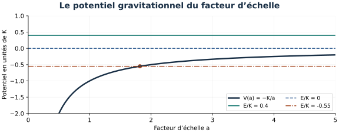
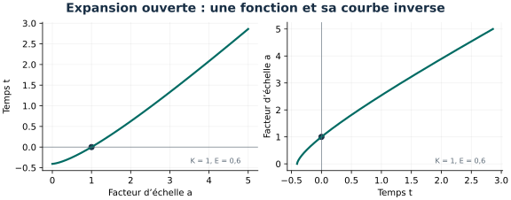
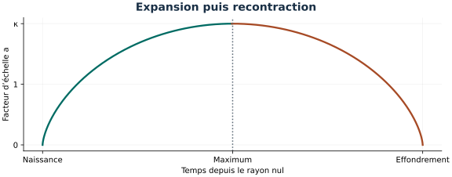
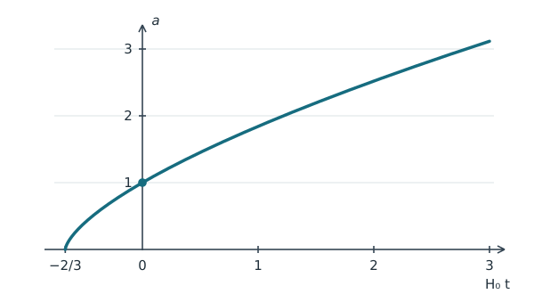
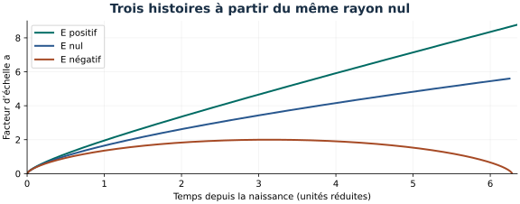
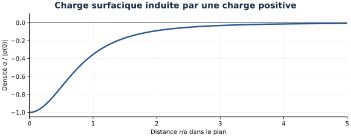
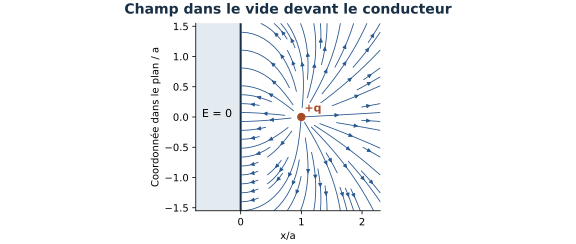

# École polytechnique, FUI-FF session 2 — Physique 2025 · Corrigé brut

*Corrigé rédigé par IA, non officiel. Signalez toute erreur.*

**Rédaction** · modèle exact non renseigné (famille GPT-6) · effort non renseigné · vitesse non renseignée

**Révision** · modèle exact non renseigné (famille GPT-6) · effort non renseigné · vitesse non renseignée

**Révision (tour 2)** · GPT-6.2 Astra Ultra · vitesse non renseignée

**Révision (tour 3)** · GPT-6.2 Astra Ultra · vitesse non renseignée · 26 novembre 2026

Épreuve de printemps de la formation francophone, trois heures sans calculatrice. Les estimations suivent la précision demandée dans le sujet.

## Problème — Cosmologie newtonienne

### Question 1

L’homogénéité donne $M=(4\pi/3)\rho(t)R(t)^3=(4\pi/3)\rho_0 R_0^3$. Ainsi $\rho(t)=\rho_0/a^3$. Puisque $R(0)=R_0$ et $\dot R(0)=H_0R_0$, on a $a(0)=1$ et $\dot a(0)=H_0$.

### Question 2

La symétrie sphérique permet de remplacer, pour le champ à la surface, la boule par sa masse $M$ au centre. La seule force sur le grain donne $m\ddot R=-GMm/R^2$, soit $\ddot R=-GM/R^2$. La vitesse radiale initiale est positive, l’accélération est dirigée vers le centre.

### Question 3

Comme $\ddot R=R_0\ddot a$ et $R=R_0a$, on obtient $\ddot a=-GM/(R_0^3a^2)=-(4\pi G/3)\rho_0/a^2$. En reportant $\rho_0=\rho(t)a^3$,
$$\boxed{\ddot a=-\tfrac{4\pi G}{3}\rho(t)a}.$$

### Question 4

Notons $K=4\pi G\rho_0/3>0$. L’équation $\ddot a=-K/a^2$ donne $d(\dot a^2/2-K/a)/dt=0$. Donc
$$\tfrac12\dot a^2+V(a)=E,\qquad V(a)=-K/a,\qquad E=\tfrac12H_0^2-K.$$
$E$ s’exprime en $\mathrm{s^{-2}}$ car $a$ est sans dimension. Sur $a>0$, le potentiel croît de $-\infty$ à $0^-$, avec $V'(a)=K/a^2$. Dans l’analogie unidimensionnelle, le domaine autorisé est $V(a)\le E$. Une égalité à $a$ fini signale une vitesse nulle.

## Expansion à énergie positive

### Question 5.a

Pour $E>0$, $E-V(a)=E+K/a>0$ à tout rayon fini. La branche initialement croissante le reste. L’expansion ralentit sous l’effet de $\ddot a<0$, mais $\dot a$ reste supérieure à $\sqrt{2E}$. Le rayon tend vers l’infini.

### Question 5.b

Posons $\kappa=K/E$, sans dimension. Sur la branche croissante, $dt=\sqrt{a/(a+\kappa)}\,da/\sqrt{2E}$. En notant
$$F(a)=\sqrt{a(a+\kappa)}-\kappa\,\operatorname{arsinh}\sqrt{a/\kappa},$$
on a $F(0)=0$ et $F'(a)=\sqrt{a/(a+\kappa)}$. L’origine temporelle $a(0)=1$ donne
$$\boxed{t(a)=\big[F(a)-F(1)\big]/\sqrt{2E}}.$$

### Question 5.c

À grand $a$, $\dot a=\sqrt{2(E+K/a)}\longrightarrow\sqrt{2E}$. Ainsi $a(t)\sim\sqrt{2E}\,t$ et $t(a)\sim a/\sqrt{2E}$. La gravitation décélère encore la poussière mais son accélération s’annule asymptotiquement. L’expansion devient presque inertielle.

### Question 5.d

Comme l’intégrande est positif et se comporte en $\sqrt{a/\kappa}$ au voisinage de zéro, le temps rétrograde jusqu’à ce point est fini. La date vaut
$$t_*=-\frac{F(1)}{\sqrt{2E}}=\frac{\kappa\operatorname{arsinh}(1/\sqrt\kappa)-\sqrt{1+\kappa}}{\sqrt{2E}}<0.$$
C’est la date à laquelle la boule aurait eu un rayon nul et une densité infinie en extrapolant le modèle vers le passé.

### Question 5.e

Pour $a\to0^+$, $dt/da\sim\sqrt{a}/\sqrt{2E\kappa}$, d’où
$$t-t_*\sim\frac{2a^{3/2}}{3\sqrt{2E\kappa}},\qquad
\boxed{a(t)\sim\big[\tfrac32\sqrt{2E\kappa}\,(t-t_*)\big]^{2/3}}.$$
La puissance $3/2$ imprimée dans le sujet convient à $t-t_*$ en fonction de $a$. Pour $a$ en fonction du temps, l’exposant est $2/3$. Une puissance $3/2$ donnerait $\dot a\to0$ et contredirait la loi d’énergie. Le graphe de $t(a)$ part de $(0,t_*)$ avec une tangente horizontale, passe par $(1,0)$, puis sa pente croît vers $1/\sqrt{2E}$. La courbe inverse a une tangente verticale à la naissance et une pente positive décroissant vers $\sqrt{2E}$.

## Solution à énergie négative

### Question 6.a

Avec $E=-|E|$, on a $\dot a^2/2=K/a-|E|\ge0$. Ainsi $a\le\kappa=K/|E|=4\pi G\rho_0/(3|E|)$. À $a=1$, $H_0^2/2=K-|E|>0$, donc $\kappa>1$.

### Question 6.b

Depuis $a(0)=1$, le rayon croît jusqu’à $a=\kappa$ avec une vitesse qui diminue et s’annule. Là, $\ddot a=-K/\kappa^2<0$. Il s’agit d’un maximum suivi d’une contraction, puis d’un effondrement jusqu’à $a=0$ en temps fini. L’allure temporelle est symétrique de part et d’autre du maximum.

### Question 6.c

On a $dt/da=\sqrt{a/(\kappa-a)}/\sqrt{2|E|}$. Une primitive valant zéro à l’origine est
$$B(a)=\kappa\arcsin\sqrt{a/\kappa}-\sqrt{a(\kappa-a)}.$$
Elle s’obtient aussi par $a=\kappa\sin^2u$. Sur la branche croissante,
$$t(a)=\frac{B(a)-B(1)}{\sqrt{2|E|}},\quad t'_*=-\frac{B(1)}{\sqrt{2|E|}}<0,\quad
t_{\max}=\frac{\kappa\pi/2-B(1)}{\sqrt{2|E|}}>0.$$
En effet $B(\kappa)=\kappa\pi/2$. Par conséquent $\sqrt{2|E|}(t_{\max}-t'_*)=\kappa\pi/2$.

### Question 6.d

À la descente, $dt/da=-B'(a)/\sqrt{2|E|}$, donc
$$t(a)=t_{\max}+\frac{B(\kappa)-B(a)}{\sqrt{2|E|}}.$$
Le rayon s’annule à $t_c=t_{\max}+\kappa\pi/(2\sqrt{2|E|})$. Ainsi $t_c-t_{\max}=t_{\max}-t'_*$. La densité diverge à $t_c$ et l’équation devient singulière. Le modèle de poussière newtonienne ne fournit pas d’évolution régulière au-delà de cet effondrement.

### Question 6.e

Entre $t'_*$ et $t_c$, la courbe de $a$ est une arche concave vers le bas, symétrique autour de $t_{\max}$. Elle passe par $(0,1)$ sur la partie montante et atteint $(t_{\max},\kappa)$ avec tangente horizontale. Les deux tangentes aux extrémités sont verticales, avec $a$ proportionnel à la puissance $2/3$ du temps qui sépare de la singularité.

Une paramétrisation contrôle la quadrature et sa symétrie. Pour $E<0$, posons $a=\kappa(1-\cos\eta)/2$ avec $0\leq\eta\leq2\pi$. On obtient $\sqrt{2|E|}(t-t'_*)=\kappa(\eta-\sin\eta)/2$. Le maximum correspond à $\eta=\pi$ et le retour à zéro à $2\pi$. Pour $E>0$, les formules correspondantes sont $a=\kappa(\cosh\eta-1)/2$ et $\sqrt{2E}(t-t_*)=\kappa(\sinh\eta-\eta)/2$. Dans les deux cas, $a$ est quadratique en $\eta$ et le temps écoulé cubique au voisinage de zéro, ce qui contrôle indépendamment la puissance $2/3$.

## Solution critique

### Question 7.a

$E=0$ impose $H_0^2=2K=8\pi G\rho_0/3$. À $H_0$ donné, la densité critique est donc **$\rho_{\mathrm c}=3H_0^2/(8\pi G)$**.

### Question 7.b

À l’énergie critique, $\dot a=\sqrt{2K/a}=H_0/\sqrt a$. L’intégration donne $(2/3)(a^{3/2}-1)=H_0t$, soit
$$a(t)=\big(1+\tfrac32H_0t\big)^{2/3}.$$

### Question 7.c

Le facteur d’échelle s’annule à **$t''_*=-2/(3H_0)$**. Il s’écrit $a(t)=[(3H_0/2)(t-t''_*)]^{2/3}$ sur $t\ge t''_*$.

### Question 7.d

La courbe part de $(t''_*,0)$ avec tangente verticale et passe par $(0,1)$ avec pente $H_0$. Elle reste croissante et concave, et tend vers l’infini avec une pente qui tend vers zéro. Sa forme est une puissance $2/3$.

### Question 7.e

On a
$$\rho(t)=\frac{\rho_0}{(1+3H_0t/2)^2}=\frac1{6\pi G(t-t''_*)^2}.$$
À durée écoulée depuis l’origine singulière fixée, la poussière du modèle critique possède une densité déterminée par cette seule durée et par $G$. La donnée initiale fixe la position de la date $t''_*$ par rapport à l’origine $t=0$.

## Comparaison et interprétation cosmologique

### Question 8

Notons $s$ le temps écoulé depuis l’origine de chaque solution et comparons à $K$ fixé. Près de $s=0$, toutes ont la même loi dominante $a\sim[(3/2)\sqrt{2K}\,s]^{2/3}$. Puis la solution ouverte tend vers une croissance linéaire, la solution critique poursuit sa loi en $s^{2/3}$ et la solution liée se retourne et s’effondre. Pour un même $a$ en expansion, $\dot a=\sqrt{2(K/a+E)}$ croît avec $E$ : les courbes se rangent dans cet ordre dès la phase montante.

### Question 9

L’homologie donne $\mathbf v(\mathbf r,t)=H(t)\mathbf r$ avec $H(t)=\dot a/a$. Ainsi **$H_0=H(0)$** est le taux d’expansion à la date de référence. À $H_0$ fixé, une densité en dessous de $\rho_{\mathrm c}$ donne $E>0$ et une expansion sans retour à vitesse limite non nulle. La densité critique donne $E=0$ et une expansion sans retour dont la vitesse tend vers zéro. Au-dessus de $\rho_{\mathrm c}$, $E<0$ et l’expansion se termine par une recontraction. Les trois dates étoilées décrivent, dans chaque scénario, l’origine singulière du modèle. Les valeurs opposées de ces dates sont ses âges à $t=0$.

### Question 10

Une seconde d’arc vaut $\pi/(180\times3600)\simeq4{,}85\times10^{-6}\ \mathrm{rad}$. Avec $D=1{,}5\times10^8\ \mathrm{km}$, $1\ \mathrm{pc}=D/\tan(1'')\simeq3{,}1\times10^{13}\ \mathrm{km}$. L’année-lumière vaut $cT_a\simeq9{,}46\times10^{12}\ \mathrm{km}$, d’où **$1\ \mathrm{pc}\simeq3{,}26$ années-lumière**.

### Question 11

$1\ \mathrm{Mpc}\simeq3{,}09\times10^{19}\ \mathrm{km}$, donc $H_0\simeq70/(3{,}09\times10^{19})=2{,}27\times10^{-18}\ \mathrm{s^{-1}}$. On en déduit
$$\rho_{\mathrm c}=\frac{3H_0^2}{8\pi G}\simeq9{,}2\times10^{-27}\ \mathrm{kg\,m^{-3}}.$$
En unités de masse du proton, cela équivaut à **environ 5 à 6 protons par mètre cube**. Ce quotient donne une équivalence de masse volumique.

### Question 12

À l’instant de référence, $-t''_*=2/(3H_0)\simeq2{,}9\times10^{17}\ \mathrm s$, soit **environ $9{,}3$ milliards d’années**. Cette estimation repose sur un univers critique constitué exclusivement de poussière gravitant selon le modèle du sujet. La relation adoptée pour son âge porte cette hypothèse.

## Exercice — Charge induite par influence

### Question A

En électrostatique, un conducteur parfait à l’équilibre est équipotentiel, avec $\mathbf E=\mathbf0$ dans son volume. Ainsi $\rho_{\rm charge}=\varepsilon_0\boldsymbol\nabla\cdot\mathbf E=0$ à tout point intérieur. Une charge induite peut en revanche résider sur la frontière $x=0$, où le champ normal peut être discontinu.

### Question B

Prenons une boîte de section $dS$ et d’épaisseur tendant vers zéro, coiffant le point considéré. Son fond dans le métal a un flux nul. Le flux latéral s’annule avec l’épaisseur et le flux du couvercle vaut $\mathbf E(0^+)\cdot\mathbf n\,dS$. La charge enfermée est $\sigma dS$. Le théorème de Gauss donne $\mathbf E(0^+)\cdot\mathbf n=\sigma/\varepsilon_0$. Ici $\mathbf n=\mathbf e_x$ pointe du conducteur vers le vide. La composante tangentielle est nulle par équipotentialité.

### Question C

Notons $r$ la distance au point du plan situé à la verticale de $q$. Les deux charges sont à distance $\sqrt{a^2+r^2}$ du point de surface. La charge réelle et la charge image donnent toutes deux une composante orientée vers $x<0$. Par conséquent
$$E_x(0^+,r)=-\frac{2qa}{4\pi\varepsilon_0(a^2+r^2)^{3/2}},\qquad
\boxed{\sigma(r)=-\frac{qa}{2\pi(a^2+r^2)^{3/2}}}.$$
La distribution est circulaire et négative, minimale à $r=0$ avec $\sigma(0)=-q/(2\pi a^2)$. Elle remonte vers zéro comme $-qa/(2\pi r^3)$ au loin.

Un contrôle local de la normalisation consiste à intégrer la densité jusqu’à un rayon $R$. On obtient $Q(R)=-q[1-a/\sqrt{a^2+R^2}]$. La moitié de la valeur absolue de la charge induite est donc contenue dans le disque $R=\sqrt3\,a$. Cela relie la largeur spatiale de la distribution à la hauteur de la charge au-dessus du plan.

### Question D

La charge totale vaut
$$Q_{\rm ind}=2\pi\int_0^\infty\sigma(r)r\,dr=-qa\int_0^\infty\frac{r\,dr}{(a^2+r^2)^{3/2}}=-q.$$
La paire fictive $q,-q$ donne un potentiel nul sur tout le plan, avec le bon comportement à grande distance. L’unicité de la solution électrostatique dans $x>0$ explique qu’elle y reproduise exactement le champ de la charge réelle et de la distribution induite. Les lignes partent de $q$ et atteignent le plan perpendiculairement. L’image représente la distribution vue de l’extérieur. Le champ physique à l’intérieur du conducteur est nul.

