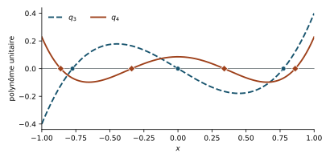

# X MP — Mathématiques B 2025 · Corrigé guidé

*Corrigé rédigé par IA, non officiel. Signalez toute erreur.*

**Attribution archivée** · « IA (GPT-6.2 Sol), relue et révisée par IA »

**Révision (tour 2)** · GPT-6.2 Astra Ultra · vitesse non renseignée · 24 novembre 2026

**Révision (tour 3)** · GPT-6.2 Astra Ultra · vitesse non renseignée · 26 novembre 2026

## Présentation du sujet

Quatre parties conduisent de l’interpolation avec multiplicités aux fonctions de type positif sur la sphère. Les outils intermédiaires sont la quadrature, les polynômes orthogonaux et une génératrice développée en série entière.

Les titres et les renvois reprennent les 44 questions et sous-questions du fascicule.

## Première partie — Interpolation avec multiplicités

### Question 1a

> [!INDICATION]
> Comptez les zéros de la dérivée aux points donnés, puis dans les intervalles qui les séparent.

#### Solution

Au point $c_i$, les annulations imposées à $h$ donnent un ordre d’annulation d’au moins $k_i-1$ à $h'$.

On ne retient $c_i$ que si cet entier est positif.

Dans chacun des $m-1$ intervalles $]c_i,c_{i+1}[$, Rolle donne un zéro supplémentaire de $h'$, puisqu’aux deux extrémités $h$ vaut zéro.

Les ordres retenus ont pour somme
$$
\sum_{i=1}^m(k_i-1)+(m-1)=N.
$$
Ainsi $h'$ s’annule à l’ordre $N$ au sens de l’énoncé.

### Question 1b

> [!INDICATION]
> Appliquez plusieurs fois la conclusion précédente en diminuant l’ordre d’une unité.

#### Solution

Par Q1a, $h'$ s’annule à l’ordre $N$. On itère tant que l’ordre est au moins deux, en utilisant la régularité de chaque dérivée. Ainsi $h^{(N)}$ s’annule à l’ordre 1, ce qui donne un point $c\in[a,b]$ où elle vaut zéro.

### Question 2a

> [!INDICATION]
> Traduisez les annulations de dérivées en divisibilité polynomiale.

#### Solution

Le développement de Taylor du polynôme $Q$ autour de $t_i$ montre que $(X-t_i)^{k_i}$ le divise.

Ces facteurs sont premiers entre eux deux à deux.

Leur produit, de degré $\deg P$, divise donc $Q$.

Comme $\deg Q<\deg P$, **$Q=0$**.

### Question 2b

> [!INDICATION]
> Comparez le nombre de données prescrites à la dimension de l’espace des polynômes admissibles.

#### Solution

Soit $d=\deg P$. L’application linéaire
$$
Q\longmapsto\bigl(Q^{(k)}(t_i)\bigr)_{i,k}
$$
avec les indices de Q2a va de $\mathbb R_{d-1}[X]$ dans $\mathbb R^d$ puisque $\sum_i k_i=d$.

Son noyau est nul par Q2a.

Les dimensions sont égales, donc c’est un isomorphisme.

Le vecteur des dérivées de $f$ admet ainsi un unique antécédent $H(f,P)$.

Si $P$ est constant non nul, il n’y a aucune condition et $H=0$ dans l’espace réduit à zéro.

### Question 3a

> [!INDICATION]
> Appliquez Taylor avec reste intégral à $g$ autour de $t_i$, puis changez de paramètre dans le reste.

#### Solution

Pour $g=f-H(f,P)$, les dérivées d’ordre strictement inférieur à $k_i$ sont nulles en $t_i$. Le reste intégral à l’ordre $k_i-1$, après la substitution $u=t_i+(x-t_i)s$ dans l’intégrale orientée, donne
$$
g(x)=\frac{(x-t_i)^{k_i}}{(k_i-1)!}
\int_0^1 (1-s)^{k_i-1}g^{(k_i)}(t_i+(x-t_i)s)\,\mathrm ds.
$$
Cette formule inclut $x=t_i$, où les deux membres s’annulent. Le changement de variable $v=1-s$ fournit explicitement
$$g(x)=(x-t_i)^{k_i}\int_0^1\frac{v^{k_i-1}}{(k_i-1)!}\,g^{(k_i)}(t_i v+x(1-v))\,\mathrm dv.$$

### Question 3b

> [!INDICATION]
> Au voisinage de chaque racine, simplifiez le facteur qui s’annule avant de dériver.

#### Solution

Au voisinage de $t_i$, les facteurs $(x-t_j)^{k_j}$ pour $j\ne i$ ne s’annulent pas. La formule Q3a simplifie le facteur $(x-t_i)^{k_i}$ dans le quotient. Il reste la division de l’intégrale de Q3a par le produit des autres facteurs.

Cette intégrale est de classe $C^\infty$ en $x$. À chaque ordre de dérivation, l’intégrande contient une dérivée continue de $g$ évaluée sur le segment $[a,b]$, bornée sur ce segment, et des facteurs en $v$ bornés sur $[0,1]$. Le théorème de dérivation sous l’intégrale s’applique à chaque ordre. On obtient ainsi un prolongement lisse à toutes les racines. Il est unique par continuité, puisque le domaine initial est dense.

### Question 4a

> [!INDICATION]
> Le polynôme interpolateur pour un seul nœud est le polynôme de Taylor tronqué en ce nœud.

#### Solution

Pour $P=(X-s_0)^n$, l’interpolateur est le Taylor d’ordre $n-1$ de $f$ en $s_0$. Le reste intégral de Q3a s’applique aussi si $s_0$ est une extrémité, en restant sur le segment. Après simplification du facteur $(x-s_0)^n$ et passage à la limite,
$$
\boxed{Q(f,(X-s_0)^n)(s_0)=\frac{f^{(n)}(s_0)}{n!}.}
$$
En effet, l’intégrale de $v^{n-1}/(n-1)!$ sur $[0,1]$ vaut $1/n!$.

### Question 4b

> [!INDICATION]
> Décomposez deux fois la fonction en interpolateur plus reste factorisé. Vérifiez le degré du polynôme obtenu.

#### Solution

Pour un polynôme unitaire admissible $P$, on a $f=H(f,P)+P Q(f,P)$, y compris aux racines par continuité. Appliquons cette identité d’abord avec $P_1$, puis à $Q(f,P_1)$ avec $P_2$. Il vient
$$
f=H(f,P_1)+P_1H(Q(f,P_1),P_2)+P_1P_2 Q(Q(f,P_1),P_2).
$$
La somme des deux premiers termes est polynomiale de degré strictement inférieur à $\deg(P_1P_2)$. Le dernier terme s’annule à chaque racine du produit avec les dérivées requises. Ces assertions valent aussi lorsque l’un des facteurs est 1, dont l’interpolateur est nul. Par unicité en Q2b,
$$
H(f,P_1P_2)=H(f,P_1)+P_1H(Q(f,P_1),P_2).
$$
En divisant le reste hors des racines puis en prolongeant, on obtient aussi $Q(f,P_1P_2)=Q(Q(f,P_1),P_2)$.

### Question 5a

> [!INDICATION]
> Vérifiez les ordres aux nœuds et ajoutez le zéro fourni par l’évaluation au point extérieur à la liste.

#### Solution

À chaque $t_i$, les dérivées d’ordre inférieur à $k_i$ des deux termes $f-H(f,P)$ et $\prod_j(X-t_j)^{k_j}$ s’annulent.

Ainsi les mêmes dérivées de $Q_t$ s’annulent en $t_i$.

En outre $Q_t(t)=0$ par définition de $Q(f,P)(t)$.

Le point $t$ est distinct des nœuds et appartient au segment proposé.

La somme des ordres retenus est $\deg P+1$.

### Question 5b

> [!INDICATION]
> Appliquez Q1b et dérivez autant de fois que le degré de $P$.

#### Solution

Posons $d=\deg P$. Par Q5a et Q1b, $Q_t^{(d)}(\xi)=0$ pour un point $\xi$ dans l’intervalle indiqué. La dérivée d’ordre $d$ de l’interpolateur est nulle et celle du produit unitaire est $d!$. Donc $Q(f,P)(t)=f^{(d)}(\xi)/d!$, d’où
$$
\boxed{f(t)-H(f,P)(t)=\frac{f^{(d)}(\xi)}{d!}P(t).}
$$

### Question 6

> [!INDICATION]
> Commencez par un facteur linéaire et étudiez toutes les dérivées de son quotient intégral.

#### Solution

Pour un nœud $s\in]a,b[$, Q3a donne
$$
Q(f,X-s)(x)=\int_0^1 f'(sv+x(1-v))\,\mathrm dv.
$$
Sa dérivée d’ordre $k$ s’obtient sous l’intégrale, par le même contrôle qu’en Q3b.

L’intégrande devient $(1-v)^k f^{(k+1)}(sv+x(1-v))$, qui est positif ou nul.

Le quotient est donc absolument monotone.

La factorisation de $P$ en facteurs linéaires et Q4b permettent d’itérer le résultat.

Un facteur constant non nul ne change ni $H$ ni $Q$, puisque le dénominateur de $Q$ est le produit unitaire.

Dans le cas d’un polynôme constant, le quotient est $f$.

## Deuxième partie — Quadrature et polynômes orthogonaux

### Question 7a

> [!INDICATION]
> Exprimez le polynôme dans la base d’interpolation de Lagrange aux $n$ nœuds.

#### Solution

Soit $L_i=\prod_{j\ne i}(X-r_j)/(r_i-r_j)$. Pour $P\in\mathbb R_{n-1}[X]$, on a $P=\sum_i P(r_i)L_i$, car la différence est de degré au plus $n-1$ et s’annule aux $n$ nœuds. En intégrant, on obtient le résultat avec $\lambda_i=\int_{-1}^1 L_i(x) f(x)\,\mathrm dx$.

### Question 7b

> [!INDICATION]
> Divisez par $D$ et appliquez des arguments distincts au quotient et au reste.

#### Solution

Écrivons $P=QD+R$ par division euclidienne.

Les degrés de $Q$ et de $R$ sont au plus $n-1$.

Par orthogonalité de $D$, le terme $QD$ a une intégrale pondérée nulle.

Il s’annule aussi en chaque $r_i$.

On applique Q7a à $R$ pour retrouver l’égalité (1) pour $P$.

### Question 7c

> [!INDICATION]
> Le polynôme carré proposé ne prend une valeur non nulle qu’au nœud d’indice $i$.

#### Solution

Le polynôme $\prod_{j\ne i}(X-r_j)^2$ est de degré $2n-2$, positif ou nul et non nul. Son intégrale pondérée est strictement positive puisque $f$ est continue strictement positive. Dans (1), le terme d’indice $i$ est le seul qui subsiste, avec une évaluation strictement positive. Donc **$\lambda_i>0$**.

### Question 7d

> [!INDICATION]
> Utilisez la quadrature pour transformer la forme en une somme sur les nœuds qui survivent au facteur $f_j$.

#### Solution

Pour $P,Q$ de degré au plus $n-j-1$, le degré de $PQf_j$ est au plus $2n-j-2\leq2n-1$. Par Q7b,
$$
\langle P,Q\rangle_j=\sum_{i=j+1}^n w_{j,i}P(r_i)Q(r_i).
$$
Ici $w_{j,i}=\lambda_i f_j(r_i)$.
Pour $i\leq j$, $f_j(r_i)=0$. Pour $i>j$, chacun des facteurs de $f_j(r_i)$ est positif, par l’ordre des racines. La forme est bilinéaire, symétrique et positive. Si la forme quadratique s’annule, le polynôme s’annule aux $n-j$ nœuds restants. Son degré étant au plus $n-j-1$, il est nul. C’est un produit scalaire.

### Question 8a

> [!INDICATION]
> Orthogonalisez les monômes sans changer leurs coefficients dominants.

#### Solution

L’orthogonalisation de Gram–Schmidt de $(1,X,\ldots,X^{n-j-1})$ donne à chaque étape $X^i$ moins sa projection sur $\mathbb R_{i-1}[X]$. Le résultat est unitaire de degré $i$, et il est orthogonal à tous les degrés inférieurs. Pour l’unicité, deux candidats au même indice diffèrent d’un polynôme de degré inférieur à $i$, orthogonal à tout cet espace. Sa norme est nulle et il est donc nul.

### Question 8b

> [!INDICATION]
> Faites apparaître le produit $D$ dans la définition du produit scalaire pondéré.

#### Solution

Le produit $q_{n-j}f_j$ est un multiple constant non nul de $D$, car il reprend toutes ses racines.

Ainsi $\langle P,q_{n-j}\rangle_j=0$ pour tout $P$ de degré au plus $n-j-1$, par l’hypothèse sur $D$.

Le polynôme $q_{n-j}$ est unitaire.

Deux candidats diffèrent par un élément de $\mathbb R_{n-j-1}[X]$ orthogonal à cet espace, donc nul par Q7d.

### Question 9a

> [!INDICATION]
> Développez la différence dans la base orthogonale. Pour les petits indices, faites passer $X$ d’un argument à l’autre.

#### Solution

Comme les deux polynômes sont unitaires de degré $i$, $q_i-Xq_{i-1}$ est de degré au plus $i-1$.

Pour $\ell\leq i-3$, le produit avec $q_\ell$ du premier terme s’annule.

Celui du second vaut $\langle q_{i-1},Xq_\ell\rangle_j=0$, car $Xq_\ell$ est de degré au plus $i-2$.

Les coordonnées d’indices au plus $i-3$ sont donc nulles, et il reste
$$
q_i-Xq_{i-1}=a_iq_{i-1}+b_iq_{i-2}.
$$

### Question 9b

> [!INDICATION]
> Prenez le produit scalaire de la relation précédente avec $q_{i-2}$.

#### Solution

Les produits de $q_{i-2}$ avec $q_i$ et $q_{i-1}$ s’annulent. La relation de Q9a donne donc
$$
b_i\langle q_{i-2},q_{i-2}\rangle_j=-\langle Xq_{i-1},q_{i-2}\rangle_j.
$$

### Question 9c

> [!INDICATION]
> Comparez le coefficient dominant de $Xq_{i-2}$ avec celui de $q_{i-1}$.

#### Solution

Le polynôme $Xq_{i-2}-q_{i-1}$ est de degré au plus $i-2$. Il est donc orthogonal à $q_{i-1}$. En faisant passer $X$ de l’autre côté du produit, Q9b donne
$$
\boxed{b_i=-\frac{\langle q_{i-1},q_{i-1}\rangle_j}
{\langle q_{i-2},q_{i-2}\rangle_j}<0.}
$$
Les deux normes sont strictement positives par Q7d puisque $i-1\leq n-j-1$.

### Question 10a

> [!INDICATION]
> Utilisez simplement le degré et le caractère unitaire.

#### Solution

On a $q_0=1$, sans racine. Le polynôme $q_1$ est réel, unitaire et de degré 1, donc possède exactement une racine réelle, simple. Cela vaut également si $q_1$ est le polynôme de Q8b.

### Question 10b

> [!INDICATION]
> Évaluez la relation de Q9a aux racines du polynôme précédent. Comparez les signes entre ces points et aux deux infinis.

#### Solution

On raisonne par récurrence, avec le cas $i=1$ donné par Q10a.

Pour $i\geq2$, notons $s_1<\cdots<s_{i-1}$ les racines de $q_{i-1}$.

Par récurrence, $q_{i-2}$ a une seule racine dans chaque intervalle entre ces points.

Ses valeurs en ces points sont non nulles et alternent de signe.

Cette assertion inclut $i=2$ puisque $q_0=1$.

Par Q9a, $q_i(s_k)=b_iq_{i-2}(s_k)$, et $b_i<0$.

Ainsi $q_i$ a une racine dans chacun des $i-2$ intervalles intérieurs.

Puisque $q_{i-2}$ est unitaire et que toutes ses racines sont entre $s_1$ et $s_{i-1}$, la valeur $q_i(s_{i-1})$ est négative et le signe de $q_i(s_1)$ est $(-1)^{i-1}$.

Le signe de $q_i$ aux deux infinis est celui de $X^i$.

Il existe donc aussi une racine de chaque côté de la liste des $s_k$.

Le degré impose qu’il y a exactement ces $i$ racines et qu’elles sont simples. Par leur localisation, une et une seule racine de $q_{i-1}$ sépare deux racines successives de $q_i$.

### Question 10c

> [!INDICATION]
> Remontez l’entrelacement à partir du polynôme dont la plus grande racine est connue.

#### Solution

Le polynôme $q_{n-j}$ de Q8b a pour plus grande racine $r_{j+1}$.

Par Q10b, la plus grande racine du polynôme précédent est strictement inférieure.

On itère jusqu’à $q_1$.

Chaque $q_i$ de degré positif inférieur à $n-j$ est donc un produit unitaire de facteurs strictement positifs en $r_{j+1}$.

Pour $i=0$, $q_0=1$.

Ainsi **$q_i(r_{j+1})>0$**.

### Question 11a

> [!INDICATION]
> Regardez le degré du quotient de la différence. Il est inférieur aux deux degrés du premier argument.

#### Solution

Posons $r=r_{j+1}$. Le quotient $(q_\ell-q_\ell(r))/(X-r)$ est un polynôme de degré au plus $\ell-1\leq i-1$, ou le polynôme nul si $\ell=0$. Il est orthogonal à $q_i$ et à $q_{i+1}$ par Q8a et Q8b, ce qui donne l’égalité.

### Question 11b

> [!INDICATION]
> Écrivez $q_{i+1}+\alpha_iq_i=(X-r)p_i$. Dans l’intégrale de 11a, le produit devient $p_i(q_\ell-q_\ell(r))$. Développez ensuite $p_i$ dans la base orthogonale.

#### Solution

Par définition intégrale de la forme, on peut écrire Q11a sous la forme $\langle p_i,q_\ell-q_\ell(r)\rangle_j=0$. Dans la base orthogonale, en utilisant $q_0=1$, cela donne
$$
c_\ell\langle q_\ell,q_\ell\rangle_j
=q_\ell(r)c_0\langle q_0,q_0\rangle_j.
$$
Le coefficient multiplicatif de $c_0$ est donc strictement positif par Q7d et Q10c.

Le polynôme $p_i$ est unitaire de degré $i$, d’où $c_i=1$, ce qui impose $c_0>0$ et alors $c_\ell>0$ pour tout $\ell\leq i$.

### Question 12

> [!INDICATION]
> Multipliez par le nouveau facteur qui intervient dans le passage de $f_j$ à $f_{j+1}$.

#### Solution

On a $f_{j+1}=(r-X)f_j$ avec $r=r_{j+1}$. Pour $R\in\mathbb R_{i-1}[X]$,
$$
\langle p_i,R\rangle_{j+1}
=-\langle q_{i+1}+\alpha_iq_i,R\rangle_j=0
$$
par Q8a et Q8b. Pour $i=0$, l’espace à considérer est réduit à zéro. Pour l’indice maximal, l’égalité concerne la forme intégrale prolongée au degré du polynôme terminal, comme en Q8b.

### Question 13

> [!INDICATION]
> Pour chaque niveau, reconnaissez les polynômes du niveau suivant à l’aide de Q12. Propagez ensuite leurs coordonnées vers le niveau zéro.

#### Solution

Notons $q_{j,i}$ le polynôme de degré $i$ du niveau $j$.

Si $0\leq j\leq n-2$ et $0\leq i\leq n-j-1$, le polynôme $p_i$ construit au niveau $j$ est unitaire de degré $i$.

Par Q12 et l’unicité en Q8a ou Q8b, il est égal à $q_{j+1,i}$.

Par Q11b, ses coefficients devant $q_{j,\ell}$ sont strictement positifs pour $0\leq\ell\leq i$.

Fixons $j\geq1$ et posons $d=n-j$.

Le produit demandé est $q_{j,d}$.

Ses coordonnées d’indices $0$ à $d$ dans la base du niveau $j-1$ sont strictement positives.

À chaque passage au niveau précédent, les coefficients restent positifs ou nuls, et le terme du plus haut degré $d$, dont le coefficient est positif, contribue positivement à chaque indice $0$ à $d$.

En poursuivant jusqu’au niveau zéro, on obtient les coefficients strictement positifs pour tous ces indices dans la base $(a_0,\ldots,a_n)$, car $q_{0,i}=a_i$.

**La formulation littérale comporte deux exceptions.** Pour $j\geq1$, les coefficients d’indice supérieur à $n-j$ sont nuls par le degré. Pour $j=0$, le produit est $q_{0,n}=a_n$, donc seul son coefficient d’indice $n$ est non nul. Dans tous les cas les coordonnées sont positives ou nulles. C’est la propriété nécessaire pour la Q21.

Par exemple, pour $n=2$ et le poids constant $1$ sur $[-1,1]$, la base unitaire est $a_0=1$, $a_1=X$, $a_2=X^2-1/3$. On a $r_1=1/\sqrt3$ et $r_2=-1/\sqrt3$. Pour $j=1$, $X-r_2=a_1+a_0/\sqrt3$ a donc pour coordonnées $(1/\sqrt3,1,0)$. Pour $j=0$, le produit vaut $a_2$, de coordonnées $(0,0,1)$.

## Troisième partie — Développement et orthogonalité

### Question 14

> [!INDICATION]
> Réécrivez le trinôme comme une somme de termes positifs.

#### Solution

On a $1-2rx+r^2=(r-x)^2+1-x^2>0$ pour $|x|<1$. Le trinôme est lisse et la puissance $u\mapsto u^{-\lambda}$ est lisse sur les réels strictement positifs. Leur composée est **de classe $C^\infty$ sur $]-1,1[^2$**.

### Question 15

> [!INDICATION]
> Développez la puissance en fonction de $-2xr+r^2$ et justifiez le regroupement par degré.

#### Solution

Le développement binomial est
$$
\begin{aligned}
(1+u)^{-\lambda}&=\sum_{k=0}^{\infty}b_k u^k,\\
b_k&=\frac{(-1)^k}{k!}\prod_{j=0}^{k-1}(\lambda+j).
\end{aligned}
$$
Le produit vide vaut 1. Pour $\lambda>0$, le rapport des modules de deux coefficients successifs est $(\lambda+k)/(k+1)$, qui tend vers 1. Le rayon de convergence de cette série en $u$ vaut donc exactement 1.

On y substitue $u=-2xr+r^2$.

Pour $|r|$ suffisamment petit, $2|x||r|+r^2<1$.

Après développement de chaque puissance du binôme, la somme des modules des termes est majorée par la série binomiale des valeurs absolues prise en $2|x||r|+r^2$.

Elle est finie.

On regroupe donc par puissances de $r$, ce qui fournit un développement en série entière au voisinage de zéro.

### Question 16a

> [!INDICATION]
> Dérivez par rapport à $r$, multipliez par le trinôme et identifiez les coefficients.

#### Solution

L’équation différentielle est
$$
(1-2xr+r^2)\,\partial_rF_\lambda=2\lambda(x-r)F_\lambda.
$$
En identifiant le coefficient de degré zéro dans les séries entières, on trouve $a_1=2\lambda xa_0$. Pour $n\geq1$, l’identification du coefficient de $r^n$ donne
$$
(n+1)a_{n+1}-2xn a_n+(n-1)a_{n-1}
=2\lambda x a_n-2\lambda a_{n-1}.
$$
En regroupant, on retrouve la récurrence proposée.

### Question 16b

> [!INDICATION]
> Dans la récurrence, un seul terme peut contribuer au degré maximal.

#### Solution

Comme $F_\lambda(x,0)=1$, $a_0^{(\lambda)}=1$.

La Q16a montre que $a_1^{(\lambda)}=2\lambda X$ et, par récurrence, que chaque $a_n^{(\lambda)}$ est un polynôme de parité $n$.

En effet, multiplier par $X$ change la parité et le terme d’indice $n-1$ a la parité de $n+1$.

Si $c_n$ désigne le coefficient dominant du terme de degré $n$, la récurrence donne $c_{n+1}=2(n+\lambda)c_n/(n+1)$. Tous ces coefficients sont non nuls puisque $\lambda>0$, donc les degrés annoncés sont exacts.
$$
\boxed{c_n=\frac{2^n}{n!}\prod_{j=0}^{n-1}(\lambda+j).}
$$

### Question 17a

> [!INDICATION]
> Utilisez l’expression des coefficients d’une série entière à partir des dérivées au centre.

#### Solution

La série en $r$ est développable à l’origine et se dérive terme à terme dans son intervalle de convergence. À l’origine, la dérivée d’ordre $n$ vaut $n!$ fois le coefficient d’ordre $n$. Ainsi $a_n^{(\lambda)}(x)=\partial_r^nF_\lambda(x,0)/n!$.

### Question 17b

> [!INDICATION]
> Calculez la dérivée en $x$ de la génératrice, puis faites commuter les dérivées partielles.

#### Solution

La génératrice vérifie $\partial_xF_\lambda=2\lambda r F_{\lambda+1}$. Elle est lisse d’après Q14 et les dérivées partielles commutent. D’après Q17a,
$$
\begin{aligned}
(a_n^{(\lambda)})'(x)
&=\frac{2\lambda}{n!}\left.\partial_r^n(rF_{\lambda+1})\right|_{r=0},\\
&=2\lambda a_{n-1}^{(\lambda+1)}(x).
\end{aligned}
$$
La dernière égalité résulte de la formule de Leibniz, le terme ayant encore un facteur $r$ s’annulant en zéro.

### Question 17c

> [!INDICATION]
> Intégrez la dérivée de $t(1-t^2)^{\lambda+1/2}$ et utilisez la récurrence au premier rang.

#### Solution

Le produit $t(1-t^2)^{\lambda+1/2}$ s’annule aux deux bords. En intégrant sa dérivée, continue jusqu’aux bords puisque $\lambda>1/2$, on obtient
$$
\int_{-1}^1(1-t^2)^{\lambda+1/2}\,\mathrm dt
=(2\lambda+1)\int_{-1}^1t^2(1-t^2)^{\lambda-1/2}\,\mathrm dt.
$$
Posons $w(t)=(1-t^2)^{\lambda-1/2}$. Le membre gauche vaut $\int_{-1}^1(1-t^2)w(t)\,\mathrm dt$, donc $\int w=2(\lambda+1)\int t^2w$. La récurrence Q16a donne $a_2^{(\lambda)}=2\lambda(\lambda+1)X^2-\lambda$. Sa moyenne pondérée est donc nulle.

### Question 17d

> [!INDICATION]
> Intégrez par parties pour relier le moment linéaire au moment constant au paramètre suivant. Menez la récurrence pour tous les paramètres simultanément.

#### Solution

Notons $w_\lambda(t)=(1-t^2)^{\lambda-1/2}$. Comme $w_{\lambda+1}'=-(2\lambda+1)t w_\lambda$, l’intégration par parties, sans terme de bord, donne par Q17b
$$
\langle Xa_n^{(\lambda)},1\rangle_\lambda
=\frac{2\lambda}{2\lambda+1}
\int_{-1}^1a_{n-1}^{(\lambda+1)}(t)w_{\lambda+1}(t)\,\mathrm dt.
$$
Les fonctions impliquées sont continues jusqu’aux bords et le poids $w_{\lambda+1}$ y vaut zéro.

Le moment constant est nul pour $n=1$ par parité et pour $n=2$ par Q17c, pour tous les paramètres $\lambda>1/2$.

Supposons les moments constants nuls jusqu’à $n$, avec $n\geq2$, pour tous ces paramètres.

La formule précédente annule le moment linéaire d’indice $n$, car elle fait intervenir le moment constant d’indice $n-1$ au paramètre $\lambda+1$.

En intégrant la récurrence Q16a, les deux termes du membre droit s’annulent et le moment constant d’indice $n+1$ est nul.

Cela prouve par récurrence toutes les annulations constantes, puis la formule donne toutes les annulations linéaires demandées.

### Question 17e

> [!INDICATION]
> Utilisez la récurrence pour contrôler les indices obtenus lorsqu’on multiplie par une puissance de $X$.

#### Solution

Pour $m\geq1$, la relation de Q16a exprime $Xa_m^{(\lambda)}$ comme combinaison de $a_{m-1}^{(\lambda)}$ et $a_{m+1}^{(\lambda)}$, car $2(m+\lambda)\ne0$.

Si $0\leq k<n$, on l’itère $k$ fois pour $X^ka_n^{(\lambda)}$.

Aucun indice ne descend sous $n-k\geq1$.

Tous les termes obtenus ont donc un moment constant nul par Q17d.

Ainsi
$$
\langle a_n^{(\lambda)},X^k\rangle_\lambda=0.
$$
Le poids est strictement positif sur $]-1,1[$, ce qui assure la positivité définie du produit scalaire. Les polynômes ont les degrés successifs et des coefficients dominants non nuls par Q16b. Ils forment donc une base, et l’orthogonalité à chaque degré inférieur donne **une base orthogonale**.

## Quatrième partie — Fonctions de type positif

### Question 18a

> [!INDICATION]
> Calculez directement la forme quadratique de la matrice de rang au plus un.

#### Solution

La matrice $UU^T$ est symétrique. Pour tout $X$, $X^TUU^TX=(U^TX)^2\geq0$, donc $UU^T\in S_n^+$.

### Question 18b

> [!INDICATION]
> Vérifiez l’égalité sur un coefficient quelconque.

#### Solution

Au coefficient $(i,j)$, le membre gauche vaut $a_{ij}(b_{ij}+c_{ij})$, qui est la somme $a_{ij}b_{ij}+a_{ij}c_{ij}$. C’est le coefficient correspondant du membre droit.

### Question 18c

> [!INDICATION]
> Appliquez le théorème spectral et écrivez la matrice diagonale comme somme de matrices de rang un.

#### Solution

La matrice réelle symétrique $M$ se diagonalise en base orthonormée de vecteurs propres $U_1,\ldots,U_n$. Ses valeurs propres $d_i$ sont positives ou nulles, en évaluant la forme quadratique sur ces vecteurs. La décomposition spectrale donne ainsi $M=\sum_i d_iU_iU_i^T$.

### Question 18d

> [!INDICATION]
> Le produit coefficient par coefficient de deux matrices de rang un est encore de cette forme.

#### Solution

Si $u,v$ sont deux vecteurs, le produit coefficient par coefficient de $uu^T$ et de $vv^T$ vaut $ww^T$, avec $w_i=u_iv_i$.

Par Q18a, cette matrice est positive.

Décomposons $A$ et $B$ comme en Q18c.

Par distributivité dans les deux arguments, le produit coefficient par coefficient est une somme de telles matrices à coefficients positifs ou nuls.

Il est donc dans $S_n^+$.

### Question 18e

> [!INDICATION]
> Pour un même choix de points, comparez la matrice du produit aux matrices des deux fonctions.

#### Solution

Pour tout $k$ et tout choix des points $x_i$, la matrice associée au produit de deux fonctions est le produit coefficient par coefficient de leurs matrices respectives. Elles sont positives par hypothèse, donc le produit est positif par Q18d. Cela donne la propriété de type positif.

### Question 19

> [!INDICATION]
> Paramétrez les points du cercle par leurs angles et utilisez la formule du cosinus d’une différence.

#### Solution

Écrivons $x_i=(\cos\theta_i,\sin\theta_i)$.

Le produit scalaire vaut $\cos(\theta_i-\theta_j)$.

L’entrée de la matrice de $T_n$ est donc $\cos(n(\theta_i-\theta_j))$.

En développant cette différence, la matrice est $uu^T+vv^T$, avec $u_i=\cos(n\theta_i)$ et $v_i=\sin(n\theta_i)$.

Elle est positive par Q18a, pour tout choix de points et tout $k$.

Donc **$T_n$ est de type positif en dimension 2**, y compris pour $n=0$.

### Question 20

> [!INDICATION]
> Utilisez la composition des interpolateurs. Vérifiez que la fonction passée au second interpolateur conserve sa monotonie absolue.

#### Solution

Multiplier un polynôme admissible par une constante non nulle conserve les nœuds et leurs multiplicités, donc aussi $H$ et $Q$. Par conséquent on peut appliquer Q4b aux versions unitaires des deux polynômes. Notons $\widehat P_1$ la version unitaire de $P_1$.

Comme toutes les racines de $P_1$ sont dans $]-1,1[$, $P_1(1)$ a le signe de son coefficient dominant. Le choix d’un seul point dans la définition de type positif donne $P_1(1)\geq0$. Comme 1 n’est pas racine, le coefficient dominant est strictement positif. Ainsi $\widehat P_1$ est encore de type positif.

Par Q6, $Q(f,P_1)$ est absolument monotone.

Puisque les deux polynômes sont $N$-conductifs, $H(f,P_1)$ et $H(Q(f,P_1),P_2)$ sont de type positif.

La somme et le produit par $\widehat P_1$ préservent cette propriété, par addition des matrices positives et Q18e.

L’identité de Q4b donne alors la propriété pour $H(f,P_1P_2)$, donc **$P_1P_2$ est $N$-conductif**.

### Question 21

> [!INDICATION]
> Commencez par le facteur associé au plus petit nœud. Pour ajouter un facteur, utilisez les coefficients obtenus en Q13 et la fermeture de Q20.

#### Solution

Fixons $\lambda=(N-1)/2>1/2$ et $w(x)=(1-x^2)^{\lambda-1/2}$. D’après Q17e, le polynôme $D=a_n^{(\lambda)}$ est orthogonal aux degrés strictement inférieurs, et ses racines sont celles de l’énoncé. Bien que $w$ s’annule aux deux bords, la partie II s’applique à ce poids. La positivité définie initiale et la stricte positivité des intégrales de Q7c utilisent seulement la continuité, la positivité au sens large sur le segment et la stricte positivité à l’intérieur. Les autres étapes reposent sur ces propriétés et la quadrature.

Pour $0\leq j\leq n-1$, écrivons $P_j=\prod_{\ell=j+1}^n(X-r_\ell)$. Par Q17e et l’unicité de la base orthogonale unitaire, la base de Q13 pour ce poids est obtenue en divisant chaque $a_i^{(\lambda)}$ par son coefficient dominant, positif par Q16b. Les coordonnées fournies par Q13 sont positives ou nulles. Par le résultat admis de l’énoncé et la stabilité par combinaison linéaire à coefficients positifs ou nuls, **chaque $P_j$ est de type positif en dimension $N$**.

Tout facteur $X-r_\ell$ est $N$-conductif. En effet $H(f,X-r_\ell)$ est la constante $f(r_\ell)\geq0$, et sa matrice sur toute famille de points est une constante positive ou nulle multipliée par la matrice dont toutes les entrées valent 1. Cette dernière est positive par Q18a.

En particulier $P_{n-1}$ est $N$-conductif.

Pour $j=n-1,\ldots,1$, si $P_j$ est $N$-conductif, alors il est aussi de type positif par ce qui précède.

La Q20 appliquée à $P_j$ et à $X-r_j$ montre que $P_{j-1}$ est $N$-conductif.

Ainsi $P_0=\prod_{i=1}^n(X-r_i)$ est $N$-conductif.

Par définition, son interpolateur $H(f,P_0)$ est de type positif en dimension $N$.

## Bilan

- Comptez les conditions d’interpolation avec leurs multiplicités.
- Une quadrature transforme la positivité d’une intégrale pondérée en un calcul sur les nœuds restants.
- Le changement de base et la fermeture du type positif permettent de construire l’interpolateur final.
