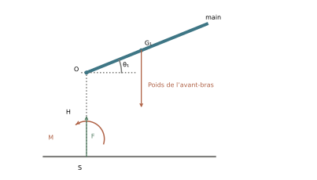
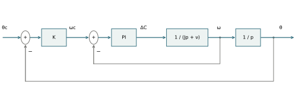
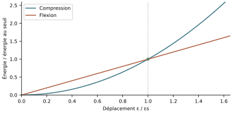
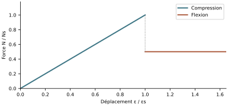
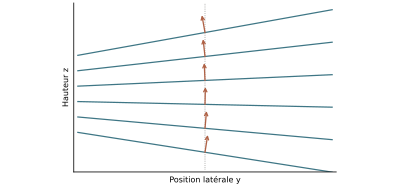
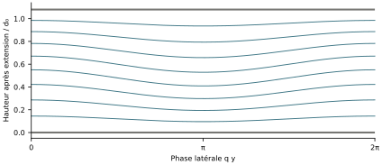
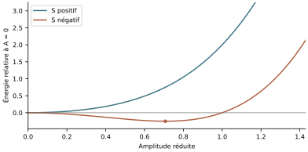
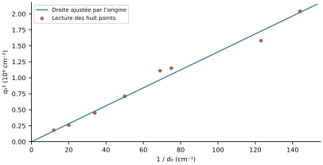

# Physique et SI — Concours MP 2025 · Corrigé guidé

*Corrigé rédigé par IA, non officiel.*

**Rédaction** · GPT-6.2 Astra Ultra · vitesse non renseignée

Le sujet numérote séparément la mécanique de l’exosquelette et la physique des structures élastiques. Les indications reprennent cette double numérotation. Dans le film smectique, les coordonnées des couches au repos servent à écrire les conditions aux limites.

## Sciences de l’ingénieur — Le coude humain

### Question SI.1 — Dynamique du coude

> [!INDICATION]
> Projeter le moment du poids sur l’axe orienté de rotation. L’angle est compté depuis l’horizontale.

#### Solution

Isolons l’avant-bras et la main dans le référentiel du bras fixé au sol. Le théorème du moment cinétique autour de l’axe fixe $(O,x)$ donne $J_1\ddot\theta_1=C_1-\nu_1\dot\theta_1-m_1g l_1\cos\theta_1$. En effet, le bras de levier horizontal du poids vaut $l_1\cos\theta_1$ et la réaction du pivot en $O$ a un moment nul sur l’axe. Au repos horizontal, il faut donc un couple positif $m_1gl_1$.

### Question SI.2 — Masse tenue dans la main

> [!INDICATION]
> Distinguer la distance au carré qui apparaît dans l’inertie de celle qui intervient dans le bras de levier.

#### Solution

Posons $b=OB$. En isolant l’avant-bras, la main et la masse solidaire, l’équation devient $(J_1+mb^2)\ddot\theta_1+\nu_1\dot\theta_1+g(m_1l_1+mb)\cos\theta_1=C_1$. La masse ponctuelle ajoute à la fois le moment d’inertie $mb^2$ et le moment de son poids.

### Question SI.3 — Mesure du premier moment de masse

> [!INDICATION]
> Choisir le patient entier comme système et prendre les moments au point de mesure de la plateforme.

#### Solution

Isolons le patient entier. Le mouvement lent permet d’appliquer la statique à chaque position. La force verticale $F$ équilibre le poids total et reste constante. Le pivot humain et le couple musculaire sont internes. Soit $M_*$ le moment de compensation des poids des segments restés immobiles. Comme $S$ est à la verticale de $O$, le poids de l’avant-bras demande le même moment de compensation en $S$ qu’en $O$. La plateforme indique $M=M_*+gm_1l_1\cos\theta_1$. Pour deux positions avec des cosinus distincts,
$$m_1l_1=\frac{M_b-M_a}{g(\cos\theta_b-\cos\theta_a)}.$$
On peut estimer la pente de $M$ en fonction de $\cos\theta_1$ sur l’ensemble des données, en gardant le tronc fixe. Deux angles opposés ont le même cosinus et ne suffisent pas.

### Question SI.4 — Pic de vitesse

> [!INDICATION]
> L’avant-bras parcourt deux fois l’angle indiqué de chaque côté de l’horizontale.

#### Solution

L’aire sous la courbe triangulaire est l’incrément de l’angle. Ainsi $2\theta_0=T\omega_{\max}/2$, soit $\omega_{\max}=4\theta_0/T=240\ ^\circ\mathrm{s}^{-1}$ pour $30^\circ$ et $0{,}5\ \mathrm s$.

## Interaction avec l’exosquelette

### Question SI.5 — Fermeture géométrique

> [!INDICATION]
> Utiliser le vecteur allant de l’axe du robot à celui du coude pour écrire le triangle des liaisons.

#### Solution

La fermeture $\overrightarrow{O'A}=\overrightarrow{O'O}+\overrightarrow{OA}$ donne $\lambda\cos\theta_2=d\cos\alpha+L_1\cos\theta_1$ et $\lambda\sin\theta_2=d\sin\alpha+L_1\sin\theta_1$. Le quotient fournit
$$\tan\theta_2=\frac{L_1\sin\theta_1+d\sin\alpha}{L_1\cos\theta_1+d\cos\alpha}.$$
Le dénominateur est positif dans la configuration indiquée.

### Question SI.6 — Décalage des axes

> [!INDICATION]
> Projeter la même relation sur les directions de l’avant-bras et de sa normale.

#### Solution

Dans la base tournée de $\theta_1$, on obtient $\tan(\theta_2-\theta_1)=d\sin(\alpha-\theta_1)/(L_1+d\cos(\alpha-\theta_1))$. Ainsi $\theta_2-\theta_1=(d/L_1)\sin(\alpha-\theta_1)+O((d/L_1)^2)$ en radians. Les angles coïncident à l’ordre zéro.

### Question SI.7 — Puissances appliquées à l’ensemble mobile

> [!INDICATION]
> Une puissance de couple s’obtient en multipliant son moment algébrique par la vitesse angulaire.

#### Solution

Isolons $1+2+3$, sans le bâti, et posons $\omega=\dot\theta$. Les couples humain et moteur fournissent $(C_1+C_2)\omega$. Les frottements visqueux dissipent $(\nu_1+\nu_2)\omega^2$ et le couple sec spécifié fournit $-C_s\omega$ sur le mouvement considéré. Les poids fournissent $-g(m_1l_1+m_2l_2)\cos\theta\,\omega$. La somme de ces puissances algébriques est la puissance extérieure. Les réactions aux points fixes ont une puissance nulle. La puissance intérieure totale est nulle, les liaisons entre les solides mobiles étant parfaites.

### Question SI.8 — Énergie cinétique

> [!INDICATION]
> Préciser le point de réduction de chaque moment d’inertie avant d’ajouter les énergies.

#### Solution

Les deux pièces massives tournent chacune autour d’un axe fixe, à la même vitesse angulaire dans l’approximation retenue. La masse et l’inertie du solide 3 sont négligées. Ainsi $E_c=\tfrac12(J_1+J_2)\dot\theta^2$, les deux moments fournis étant déjà rapportés aux axes de rotation.

### Question SI.9 — Équation d’ensemble

> [!INDICATION]
> Regrouper les termes d’inertie, de dissipation visqueuse et de pesanteur.

#### Solution

Le théorème de l’énergie cinétique, appliqué à $1+2+3$ dans le référentiel du bâti, donne $\mathrm dE_c/\mathrm dt=\mathcal P_{\rm ext}+\mathcal P_{\rm int}$. En substituant les deux résultats précédents puis en simplifiant par $\dot\theta$ en mouvement, on obtient
$$J\ddot\theta+\nu\dot\theta+f(\theta)=C_1+C_2-C_s,$$
avec $J=J_1+J_2$, $\nu=\nu_1+\nu_2$ et $f(\theta)=g(m_1l_1+m_2l_2)\cos\theta$. L’équation se prolonge aux instants isolés de vitesse nulle.

### Question SI.10 — Linéarisation autour de l’horizontale

> [!INDICATION]
> Déterminer d’abord le couple constant, puis dériver le terme de pesanteur autour de zéro.

#### Solution

À l’équilibre $C_1=0$, $\theta=0$, d’où $C_0=C_s+g(m_1l_1+m_2l_2)$. Puis $\cos\theta=1+O(\theta^2)$. En soustrayant l’équilibre, le modèle linéarisé est $J\ddot\theta+\nu\dot\theta=\Delta C$. La dérivée du couple de pesanteur est nulle à l’horizontale.

## Pilotage en position

### Question SI.11 — Deux boucles imbriquées

> [!INDICATION]
> Construire d’abord la chaîne couple–vitesse, fermer la boucle interne, puis intégrer et fermer la boucle de position.

#### Solution

L’erreur $\theta_c-\theta$ entre dans le gain $K$, qui produit $\omega_c$. Le deuxième comparateur forme $\omega_c-\omega$. Le PI $H_c$ fournit $\Delta C$, le procédé $1/(Jp+\nu)$ donne $\omega$ et l’intégrateur $1/p$ fournit $\theta$. Les deux retours sont unitaires et négatifs. En pratique la vitesse réinjectée est estimée par le codeur de position.

### Question SI.12 — Lecture du codeur

> [!INDICATION]
> Distinguer la mesure brute de fronts du calcul de vitesse sur un intervalle temporel.

#### Solution

Un codeur incrémental émet des impulsions à chaque incrément angulaire. Deux voies en quadrature permettent d’identifier le sens grâce à l’ordre des transitions. Avec $N$ incréments effectivement comptés par tour, la variation signée $\Delta n$ pendant $\Delta t$ donne $\widehat\omega=2\pi\Delta n/(N\Delta t)$. À faible vitesse on peut aussi mesurer le temps séparant deux fronts.

### Question SI.13 — Compensation du pôle mécanique

> [!INDICATION]
> Faire coïncider le zéro du correcteur et le pôle du procédé avant de refermer la boucle.

#### Solution

La chaîne ouverte en vitesse vaut $K_p(1+\tau_i p)/[\tau_i p(Jp+\nu)]$. Prenons $\tau_i=J/\nu=10\ \mathrm s$. Après compensation elle vaut $K_p/(Jp)$, ce qui donne $BF_\omega=1/(1+(J/K_p)p)$. Le gain statique est unitaire et la constante de temps $0{,}05\ \mathrm s$ impose $K_p=J/\tau=3\ \mathrm{N\,m\,s\,rad^{-1}}$.

### Question SI.14 — Erreurs permanentes

> [!INDICATION]
> La boucle ouverte de position compte un intégrateur. Appliquer le théorème de la valeur finale aux deux premières entrées.

#### Solution

Pour $K>0$ la boucle fermée est stable. L’erreur de position vérifie $E/\Theta_c=p(1+\tau p)/(K+p+\tau p^2)$. Pour l’échelon unité, $\lim_{p\to0}pE=0$. Pour une rampe unité, la même limite vaut $1/K$. Pour une parabole $t^2/2$, $E(p)\sim 1/(Kp^2)$ et l’erreur croît comme $t/K$. Le niveau numérique de la rampe requiert $K\ge 1/0{,}9\simeq1{,}11\ \mathrm{s^{-1}}$ pour une pente de $1\ \mathrm{rad\,s^{-1}}$. Cette erreur de suivi est un angle. L’exigence d’une erreur finie sur une parabole demeure hors d’atteinte avec ce correcteur.

### Question SI.15 — Marge de phase

> [!INDICATION]
> Évaluer la phase à la pulsation où le module vaut exactement un.

#### Solution

À la pulsation de coupure $\omega_c$, $|BO|=K/[\omega_c\sqrt{1+(\tau\omega_c)^2}]=1$ et $M_\phi=90^\circ-\arctan(\tau\omega_c)$. Pour $45^\circ$, $\omega_c=1/\tau=20\ \mathrm{rad\,s^{-1}}$ et $K=\sqrt{2}/\tau=28{,}3\ \mathrm{s^{-1}}$. La marge décroît lorsque $K$ augmente. Cette valeur est le maximum admissible.

### Question SI.16 — Réponse la plus rapide à cinq pour cent

> [!INDICATION]
> Identifier le second ordre et utiliser le réglage à dépassement de 5 % pour lire la première entrée durable dans la bande.

#### Solution

La boucle fermée vaut $K/(\tau p^2+p+K)$, donc $\omega_n=\sqrt{K/\tau}$ et $\zeta=1/(2\sqrt{K\tau})$. Pour le réglage de rapidité à 5 %, on fait tangenter la limite supérieure de la bande par le premier dépassement. La réponse entre alors dans la bande avant cette première crête. La relation $\exp[-\pi\zeta/\sqrt{1-\zeta^2}]=0{,}05$ donne $\zeta=0{,}690$ et $K=1/(4\tau\zeta^2)\simeq10{,}5\ \mathrm{s^{-1}}$. Avec $\omega_d=\omega_n\sqrt{1-\zeta^2}$, l’erreur d’échelon est $e^{-t/(2\tau)}[\cos(\omega_dt)+\sin(\omega_dt)/(2\tau\omega_d)]$. Son premier passage à $0{,}05$ a lieu vers $0{,}197\ \mathrm s$, conforme aux $0{,}2\ \mathrm s$ demandés.

### Question SI.17 — Suivi avec et sans charge

> [!INDICATION]
> Lire le pic, la valeur finale et la dernière traversée de la bande de tolérance sur les courbes de position.

#### Solution

La figure 8 utilise $K=28{,}3\ \mathrm{s^{-1}}$ et une consigne mobile qui atteint $60^\circ$ à $0{,}5\ \mathrm s$. Les deux angles convergent vers $60^\circ$ avec un retard pendant la montée. À vide, le maximum est proche de $61^\circ$ et l’angle atteint durablement la bande $[57^\circ,63^\circ]$ vers $0{,}44$–$0{,}46\ \mathrm s$. Avec $2\ \mathrm{kg}$, la crête atteint environ $65$–$66^\circ$ vers $0{,}51\ \mathrm s$, la courbe repasse sous $60^\circ$, puis se stabilise. La rentrée durable dans la bande se situe vers $0{,}58$–$0{,}60\ \mathrm s$. La précision finale est conservée, l’amortissement et le temps d’établissement se dégradent. L’inertie additionnelle $mb^2$ modifie la dynamique compensée par le PI. Le critère de $0{,}2\ \mathrm s$ concernait la réponse à un échelon.

## Physique — Structure élancée en compression

### Question P.1 — Compression pure

> [!INDICATION]
> Toutes les arêtes verticales ont la même déformation dans cette configuration.

#### Solution

Chacun des quatre ressorts se raccourcit de $\Delta$. La somme des quatre énergies de Hooke donne $E_C=4K\Delta^2/2=2K\Delta^2=2KL_0^2\varepsilon^2$, avec $\varepsilon=\Delta/L_0$.

### Question P.2 — Arc neutre, corde et rayon

> [!INDICATION]
> Comparer la corde à la longueur de l’arc et conserver le premier terme qui les différencie.

#### Solution

L’arc central conserve sa longueur, $R\theta=L_0$. Sa corde verticale mesure $2R\sin(\theta/2)=L_0-\Delta$. Ainsi $1-\varepsilon=\sin(\theta/2)/(\theta/2)=1-\theta^2/24+O(\theta^4)$. Au premier ordre utile, $\theta\simeq\sqrt{24\varepsilon}$ et $R/L_0\simeq1/\sqrt{24\varepsilon}$. L’angle $\theta$ est ici l’angle au centre sur toute la longueur de l’arc.

### Question P.3 — Domaine du développement

> [!INDICATION]
> L’angle sans dimension de l’arc vaut exactement $L_0/R$.

#### Solution

$\Delta\ll L_0$ exige $\varepsilon\ll1$. La seconde hypothèse $L_0\ll R$ exige $\sqrt{24\varepsilon}\ll1$. Les deux sont donc satisfaites pour $24\varepsilon\ll1$.

### Question P.4 — Énergie de la flexion pure

> [!INDICATION]
> Les ressorts intérieurs et extérieurs voient le même angle, avec des rayons différents.

#### Solution

Les deux ressorts extérieurs parcourent chacun $(R+a)\theta$, les deux intérieurs $(R-a)\theta$. Leurs variations de longueur sont respectivement $+a\theta$ et $-a\theta$. Ainsi $E_F=2Ka^2\theta^2\simeq48Ka^2\Delta/L_0$. Le signe de l’allongement disparaît en prenant son carré.

### Question P.5 — Comparaison à déplacement imposé

> [!INDICATION]
> Comparer les énergies au même déplacement, condition imposée par l’opérateur.

#### Solution

La parabole $E_C=2KL_0^2\varepsilon^2$ et la droite $E_F=48Ka^2\varepsilon$ se coupent à l’origine et à $\varepsilon_s=24(a/L_0)^2$. En dessous du seuil, la structure en compression a l’énergie la plus basse. Au-dessus, la flexion est préférée parmi les deux configurations offertes. La figure utilise des unités réduites dans lesquelles le croisement est $(1,1)$.

### Question P.6 — Force juste avant la transition

> [!INDICATION]
> Prendre la pente de l’énergie de la branche suivie en arrivant au croisement.

#### Solution

En quasi-statique, la force fournie dans le sens de la compression vaut $N=\mathrm dE/\mathrm d\Delta$. Sur la branche comprimée $N=4K\Delta$. Au croisement énergétique, $\Delta_s=24a^2/L_0$ et $N_s=4K\Delta_s=96Ka^2/L_0$. Cette force est la limite obtenue en arrivant par la branche comprimée.

### Question P.7 — Effort après bifurcation

> [!INDICATION]
> Le déplacement étant imposé, un changement de pente de l’énergie apparaît comme un saut sur la courbe d’effort.

#### Solution

Pour $0\le\varepsilon<\varepsilon_s$, $N=4KL_0\varepsilon$. Pour $\varepsilon>\varepsilon_s$, on dérive l’énergie de flexion et l’on trouve $N=48Ka^2/L_0=N_s/2$, à l’ordre retenu. La force chute puis reste sur un plateau dans ce modèle à deux configurations. L’énergie minimale est continue au croisement, ses deux pentes unilatérales diffèrent.

### Question P.8 — Condition d’élancement

> [!INDICATION]
> Tester les hypothèses exactement à la déformation où les deux branches se croisent.

#### Solution

Au seuil, $24\varepsilon_s=24^2(a/L_0)^2$. La condition de petite courbure impose donc $a/L_0\ll1/24$. Il faut une structure suffisamment élancée pour que la transition se produise dans le domaine étudié.

### Question P.9 — Barre carrée en acier

> [!INDICATION]
> Conserver la rigidité axiale totale. Pour fixer sans ambiguïté la position des fibres, on peut aussi conserver le moment quadratique de la section.

#### Solution

Un choix pour représenter la section est d’attribuer à chaque ressort le quart de l’aire, soit $b^2$, et de conserver aussi le moment quadratique de la barre. On prend donc $K=Yb^2/L_0$. Autour de l’axe de flexion, $I=(2b)^4/12=4b^4/3$. Pour les quatre fibres concentrées à la distance $a$, le même moment vaut $4b^2a^2$, d’où $a=b/\sqrt3$. Alors $N_s=32Yb^4/L_0^2$. Avec $b=5\times10^{-3}\ \mathrm m$, $L_0=1\ \mathrm m$ et $Y=2\times10^{11}\ \mathrm{Pa}$, on obtient $N_s=4{,}0\times10^3\ \mathrm N$. Le choix de discrétisation influe sur le facteur numérique. En concentrant chaque quart de section à son centre géométrique, on aurait $a=b/2$, d’où $N_s=3{,}0\ \mathrm{kN}$. L’énoncé demande de préciser ce choix.

### Question P.10 — Flexion diagonale

> [!INDICATION]
> Dans l’énergie, sommer les carrés des distances signées des ressorts à la fibre neutre.

#### Solution

Pour $\varphi=\pi/4$, les écarts signés à la fibre neutre valent $+\sqrt2 a,0,0,-\sqrt2 a$. La somme des carrés vaut $4a^2$, comme pour les quatre écarts $\pm a$ du premier plan. Les énergies des deux branches sont inchangées, donc $N_s=96Ka^2/L_0$ dans les deux plans. Ce modèle ne sélectionne aucune de ces deux directions.

## Élasticité du cristal liquide smectique A

### Question P.11 — Description continue des déplacements

> [!INDICATION]
> Demander à quelle condition un incrément discret entre deux couches représente une dérivée locale.

#### Solution

Les longueurs caractéristiques de variation suivant $y$ et $z$ doivent être grandes devant $a_0$. Les valeurs sur deux couches ou deux cellules voisines sont alors reliées par des développements de Taylor dominés par leurs premiers termes. Pour une modulation de nombres d’onde $q,k$, il faut $qa_0\ll1$ et $ka_0\ll1$. Les dérivées utilisées pour décrire l’orientation et la courbure doivent aussi varier peu à l’échelle d’une cellule. Cette condition porte sur les échelles spatiales, une translation uniforme pouvant avoir une amplitude arbitraire.

### Question P.12 — Module de compression des couches

> [!INDICATION]
> Calculer l’énergie du cube à quatre arêtes longitudinales, puis la rapporter au volume initial.

#### Solution

Pour $u=u(z)$ l’allongement de chacune des quatre arêtes verticales du cube modèle vaut $u(z+a_0)-u(z)\simeq a_0u_z$, où $u_z=\partial u/\partial z$. Les autres arêtes conservent leur longueur. En divisant l’énergie $4K(a_0u_z)^2/2$ par $a_0^3$, on obtient $e_E=Bu_z^2/2$ avec $B=4K/a_0$ en pascals. $K$ est la raideur effective d’une arête du domaine choisi.

### Question P.13 — Indépendance vis-à-vis de la taille du cube

> [!INDICATION]
> Examiner la dépendance de la raideur à la longueur et à la section lorsque toute la cellule est agrandie.

#### Solution

Considérons un cube de côté $na_0$ soumis à la même déformation uniforme. Chaque colonne comprend $n$ éléments en série, et sa raideur est divisée par $n$. La section contient $n^2$ colonnes en parallèle. La raideur totale du cube est donc multipliée par $n$ et la raideur effective de chacune des quatre arêtes du modèle devient $K'=nK$. Le rapport $4K'/(na_0)=4K/a_0$ est invariant. De façon équivalente, l’énergie et le volume croissent tous deux comme $n^3$.

### Question P.14 — Module de flexion

> [!INDICATION]
> Calculer d’abord l’allongement d’une arête par rapport à l’arc médian, puis relier l’écart des normales à la courbure.

#### Solution

L’arc médian de longueur $a_0$ et les deux arcs séparés de $a_0$ interceptent le même angle $\delta\theta$. Les variations de longueur des quatre arêtes tangentielles sont $\pm(a_0/2)\delta\theta$. À faible pente, $|\delta\theta|\simeq a_0|u_{yy}|$. La densité d’énergie est
$$e_{F,y}=\frac{4}{a_0^3}\frac K2\left(\frac{a_0^2}{2}u_{yy}\right)^2=\frac{Ka_0}{2}u_{yy}^2.$$
Ainsi $F=Ka_0$ en newtons et $\lambda=\sqrt{F/B}=a_0/2$. Ce rapport provient de la répartition de l’élasticité sur les arêtes du modèle.

### Question P.15 — Orientation variable entre couches

> [!INDICATION]
> Comparer les normales sur une même verticale, puis dessiner les segments de couches perpendiculaires à ces normales.

#### Solution

À petite pente, $n_y\simeq-u_y$. Le terme $e_{F,z}=F(\partial_z n_y)^2/2$ mesure une orientation qui change avec la hauteur à position latérale fixée. Sur un petit domaine, $u(y,z)=c y z$ en donne un exemple. Chaque couche de cote initiale $z$ y a une pente $cz$, et les normales aux différentes couches tournent lorsqu’on monte. La figure représente une portion locale, sans intersection des couches dans le domaine dessiné.

### Question P.16 — Épaisseur normale aux couches

> [!INDICATION]
> L’écart vertical de deux couches inclinées excède leur écart mesuré perpendiculairement à ces couches.

#### Solution

La distance apparente suivant $z$ vaut $a_0+u(y,z+a_0)-u(y,z)\simeq a_0(1+u_z)$. L’épaisseur réelle est sa projection sur la normale. Comme $\tan\theta\simeq-u_y$, on a $\cos\theta\simeq1-u_y^2/2$. Au premier ordre de correction utile, $a/a_0-1\simeq u_z-u_y^2/2$. L’énergie de compression s’écrit donc $B(u_z-u_y^2/2)^2/2$. On conserve ici le terme géométrique qui couple extension et inclinaison.

## Instabilité du film entre deux plaques

### Question P.17 — Modes compatibles avec les plaques

> [!INDICATION]
> Imposer les déplacements à chaque plaque pour toutes les phases latérales de l’ondulation.

#### Solution

Pour $A_n\ne0$, les conditions $u(y,0)=0$ et $u(y,d_0)=\delta$ à tout $y$ imposent $\sin\phi_n=0$ et $\sin(k_nd_0+\phi_n)=0$. Ainsi $\phi_n=0\pmod\pi$ et $k_n=n\pi/d_0$, $n=1,2,\ldots$. Un changement de signe du mode revient à décaler l’origine en $y$ d’une demi-période. Avec $\phi_1=0$, la couche de cote initiale $z_j$ se trouve à $z'_j=(1+\alpha)z_j+A\sin(\pi z_j/d_0)\cos(qy)$. Les plaques restent planes et l’amplitude est maximale vers le milieu du film.

### Question P.18 — Énergie selon l’amplitude

> [!INDICATION]
> Factoriser la dérivée du polynôme en $A$ et examiner sa courbure à l’origine.

#### Solution

L’équation (11) donne $\langle e\rangle-B\alpha^2/2=(B/8)(SA^2+WA^4)$, avec $W=(3/8)^2q^4>0$. Pour $S>0$ le minimum est en $A=0$. Pour $S<0$ l’origine est un maximum local et le minimum physique sur $A\ge0$ se trouve en $A_*=\sqrt{-S/(2W)}$. L’énergie croît comme $A^4$ aux grandes amplitudes du polynôme. La figure porte les deux courbes sur les mêmes axes.

### Question P.19 — Extension critique et période sélectionnée

> [!INDICATION]
> Minimiser sur la longueur d’onde latérale le seuil propre à chaque mode.

#### Solution

Il y a ondulation si un nombre d’onde $q>0$ donne $S<0$, soit $\alpha>h(q)=k^2/q^2+\lambda^2k^2+\lambda^2q^2$. Le minimum de $h$ est atteint lorsque $k^2/q^2=\lambda^2q^2$, donc $q_s^2=k/\lambda$ et
$$\alpha_s=2\lambda k+(\lambda k)^2,\qquad q_s^2=\frac{\pi}{\lambda d_0}.$$
Au-dessus du seuil, un intervalle de nombres d’onde rend l’état plan instable. Cet intervalle se réduit à $q_s$ au seuil.

### Question P.20 — Échelles du film

> [!INDICATION]
> Comparer les longueurs de variation verticales et latérales à l’épaisseur moléculaire, puis vérifier les petites déformations.

#### Solution

Avec $a_0\sim5\ \mathrm{nm}$ les produits $ka_0\sim1{,}5\times10^{-4}$ et $q_sa_0\sim10^{-2}$ sont tous deux petits. La longueur d’onde latérale $2\pi/q_s\sim3\ \mu\mathrm m$ contient plusieurs centaines de tailles moléculaires. L’épaisseur $d_0\sim10^{-4}\ \mathrm m$ contient environ $2\times10^4$ couches. L’extension relative $\alpha_s\sim3\times10^{-4}$ est petite et $\lambda k\ll1$. À proximité du seuil l’amplitude tend vers zéro, les pentes $Aq_s$ et $Ak$ peuvent donc rester faibles. Les échelles justifient la description continue et les développements près du seuil.

### Question P.21 — Amplitude juste au-dessus du seuil

> [!INDICATION]
> Relever la puissance exacte de $3/8$ imprimée dans le sujet, puis minimiser en amplitude avant de développer au seuil.

#### Solution

Posons $\alpha=\alpha_s+\varepsilon$. Au seuil sélectionné, $S(\alpha_s,k,q_s)=0$ et $\partial_q S=0$. Le changement de $q$ sur la branche optimale n’intervient donc pas au premier ordre, et $S\simeq-\varepsilon q_s^2$. La condition stationnaire de la question 18 donne alors
$$A^2\simeq\frac{\varepsilon q_s^2}{2(3/8)^2q_s^4}=\frac{32\varepsilon}{9q_s^2},\qquad A\simeq\frac{4\sqrt2}{3q_s}\sqrt\varepsilon.$$
Le coefficient dépend du carré qui porte sur tout $3/8$ dans l’équation (12). Le produit $Aq_s$ est sans dimension.

### Question P.22 — Pente expérimentale du CBOOA

> [!INDICATION]
> La pente a la dimension d’une longueur inverse. Tenir compte à la fois de la puissance de dix de l’ordonnée et du centimètre.

#### Solution

La figure 8 aligne approximativement ses huit points sur une droite passant près de l’origine, comme le demande $q_s^2=(\pi/\lambda)(1/d_0)$. Par exemple, le dernier point se lit $(144\ \mathrm{cm^{-1}},\,2{,}04\times10^9\ \mathrm{cm^{-2}})$. La pente obtenue avec l’origine vaut environ $1{,}42\times10^7\ \mathrm{cm^{-1}}$, soit $1{,}42\times10^9\ \mathrm{m^{-1}}$. Une lecture globale des points donne le même ordre, à quelques pour cent près. D’où $\lambda\simeq\pi/(1{,}4\times10^9)\simeq2{,}2\ \mathrm{nm}$. Avec $a_0\sim5\ \mathrm{nm}$, le modèle donne $a_0/2\sim2{,}5\ \mathrm{nm}$. L’échelle et la proportion sont compatibles avec cette mesure à $78\ ^\circ\mathrm C$.

[Sujet officiel](https://www.polytechnique.edu/admission-cycle-ingenieur/sites/admission/files/content/Physique%20et%20SI%20MP%20sujet.pdf) · [Rapport du jury](https://www.polytechnique.edu/admission-cycle-ingenieur/sites/admission/files/content/Ecrits_MP_Physique%20et%20SI%20OK.pdf)
