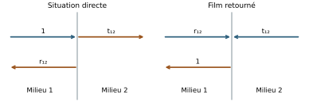
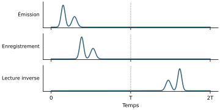
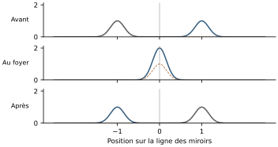
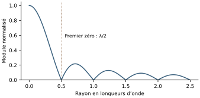
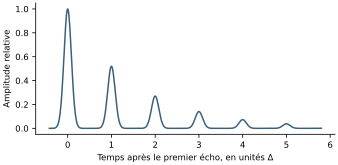
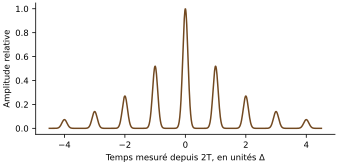

# X PC 2025 — Physique A · Corrigé brut

*Corrigé rédigé par IA, non officiel. Signalez toute erreur.*

**Rédaction** · GPT-6.2 Astra Ultra · vitesse non renseignée

**Révision (tour 2)** · modèle exact non renseigné (famille Claude) · effort non renseigné · vitesse non renseignée · 28 novembre 2026

**Miroirs à retournement temporel.** On adopte la convention harmonique du sujet et on suppose des milieux réciproques sans dissipation quand le film de propagation est inversé.

## Particule et renversement du temps

### Question 1 — Particule chargée dans un champ uniforme

La deuxième loi de Newton donne $m\ddot x=qE_0$ et $\ddot y=\ddot z=0$. Avec la position initiale nulle et la vitesse $v_0\boldsymbol e_x$, l’intégration donne $$\boldsymbol r(t)=\left(v_0t+\frac{qE_0}{2m}t^2\right)\boldsymbol e_x.$$ Le signe de l’accélération dépend du produit $qE_0$.

### Question 2 — Temps inversé et vitesse inversée

Notons $x(t;v_0)$ la solution de Q1. On a $x(-t;-v_0)=(-v_0)(-t)+(qE_0/2m)(-t)^2=x(t;v_0)$. De façon équivalente, la trajectoire $x(-t;v_0)$ est la solution évoluant dans le sens croissant du temps de vitesse initiale $-v_0$. L’accélération reste identique, donc le mouvement est invariant sous renversement du temps.

### Question 3 — Frottement fluide linéaire

Avec $\boldsymbol F=-K\boldsymbol v$ et $K>0$, on obtient $m\dot v=-Kv$, $v(0)=v_0$. En posant $\tau_f=m/K$, $$v(t)=v_0 e^{-t/\tau_f},\qquad x(t)=v_0\tau_f(1-e^{-t/\tau_f}),\qquad y=z=0.$$ Le déplacement tend vers la distance finie $v_0\tau_f$.

### Question 4 — Échec du renversement avec frottement

La transformation simultanée donne $x(-t;-v_0)=v_0\tau_f(e^{t/\tau_f}-1)$, différent de $x(t;v_0)$. La solution retournée demanderait une vitesse dont le module croît avec le temps, ce qu’un frottement, qui ne fait que freiner la particule, ne peut pas produire.

### Question 5 — Rôle de la parité des forces

Dans $m\ddot x=F(x,\dot x)$, remplacer $x(t)$ par $x(-t)$ conserve le signe de l’accélération et inverse celui de la vitesse. Une force électrostatique constante satisfait donc la même équation transformée. Le frottement linéaire change de signe et dissipe l’énergie à raison de $dE_c/dt=-Kv^2$. La force électrique est conservative : elle dérive d’une énergie potentielle, ici $-qE_0x$, et le resterait dans un champ électrostatique non uniforme. Le frottement est dissipatif : là est la différence physique. Dans l’équation différentielle, la dérivée temporelle première est impaire et la dérivée seconde est paire sous ce changement.

## Solutions causales et anti-causales

### Question 6 — Invariance de l’équation d’onde

Pour $v(x,t)=u(x,-t)$, les deux dérivées secondes sont celles de $u$ évaluées à l’instant $-t$. Ainsi $v_{xx}-v_{tt}/c_0^2=0$ partout où $u$ résout l’équation homogène. Le film d’une propagation sans dissipation, lu à l’envers, représente une propagation admissible si les vitesses initiales du milieu et les conditions aux limites sont retournées aussi.

### Question 7 — Deux ondes divergentes

En fixant $u(0,t)=s(t)$ et $s(t)=0$ avant le début de l’émission, on obtient $$u_0(x,t)=\begin{cases}s(t-x/c_0),&x>0,\\s(t+x/c_0),&x<0.\end{cases}$$ Soit $u_0(x,t)=s(t-|x|/c_0)$. À droite, un repère du signal suit $x=c_0(t-t_e)$, et à gauche $x=-c_0(t-t_e)$, où $t_e$ est sa date d’émission. La forme temporelle est transportée avec un retard positif dans les deux directions.

### Question 8 — Solution convergente obtenue par lecture inverse

Si $t'=-t\leq0$, le film retourné s’écrit $u_{\rm inv}(x,t')=u_0(x,-t')=s(-t'-|x|/c_0)$. À droite, un même motif se déplace vers les $x$ décroissants, à gauche vers les $x$ croissants. Les ondes convergent vers l’origine et restituent $s(-t')$. La solution est dite anti-causale par rapport à la source divergente initiale. Dans une réalisation physique, des émetteurs extérieurs préparent les ondes entrantes.

## Deux milieux séparés par une interface

### Question 9 — Situation directe à l’interface

Ce numéro présente les notations. Une onde d’amplitude $1$ arrive de la gauche. Dans le milieu 1 repart une onde d’amplitude $r_{12}$, et dans le milieu 2 part une onde d’amplitude $t_{12}$. Le jury confirme qu’aucun calcul supplémentaire n’était demandé à ce numéro.

### Question 10 — Situation retournée

Les deux ondes sortantes de Q9 deviennent des ondes incidentes. Celle de gauche apporte $r_{12}$ et celle de droite $t_{12}$. Elles reconstituent ensemble une onde sortante d’amplitude **1 à gauche et 0 à droite**. Il y a deux ondes incidentes et une seule onde sortante non nulle. Ici les coefficients de l’interface sans pertes sont réels. En notation harmonique générale le retournement conjugue les amplitudes complexes.

### Question 11 — Relations entre les coefficients

Superposons les deux problèmes de diffusion. Côté gauche les contributions sortantes valent $r_{12}^2$ et $t_{21}t_{12}$. Côté droit elles valent $t_{12}r_{12}$ et $r_{21}t_{12}$. On impose les amplitudes de Q10 et on obtient, pour $t_{12}\ne0$, $$r_{12}^2+t_{21}t_{12}=1,\quad t_{12}(r_{12}+r_{21})=0,\qquad r_{21}=-r_{12},\quad t_{21}=\frac{1-r_{12}^2}{t_{12}}.$$ Les coefficients portent sur les amplitudes du champ.

### Question 12 — Test avec un dioptre optique

À incidence normale pour le champ électrique tangentiel, entre milieux diélectriques non magnétiques transparents, $r_{12}=(n_1-n_2)/(n_1+n_2)$ et $t_{12}=2n_1/(n_1+n_2)$. En échangeant les indices, $r_{21}=-r_{12}$ et $t_{21}=2n_2/(n_1+n_2)$. Leur produit $t_{12}t_{21}=4n_1n_2/(n_1+n_2)^2=1-r_{12}^2$ vérifie la seconde relation.

## Miroirs temporels en milieu homogène

### Question 13 — Signal enregistré au miroir

Le miroir situé en $x_0>0$ reçoit le champ après le temps $t_d=x_0/c_0$. Il enregistre donc $R(t)=s(t-t_d)$. Un événement émis à $t_e$ est enregistré à $t_e+t_d$.

### Question 14 — Lecture du ruban à l’envers

Sur $0\le t\le T$, l’enregistrement est une copie retardée du signal source. Sur $T\le t\le2T$, le miroir relit les échantillons en sens inverse. Un échantillon précédemment reçu à $t_r$ ressort à $2T-t_r$. Sur le schéma, deux lobes successifs de hauteurs différentes permettent de visualiser cette inversion.

### Question 15 — Expression du signal réémis

Dans la fenêtre de lecture, $R_{\rm RT}(t)=R(2T-t)=s(2T-t-x_0/c_0)$. L’argument demandé est $t'=2T-t-x_0/c_0$. Hors de la fenêtre, le miroir est silencieux. Le changement de variable conserve l’amplitude et inverse la chronologie.

### Question 16 — Propagation vers la gauche après la réémission

Le champ en $x\le x_0$ est la réémission retardée de $(x_0-x)/c_0$. On obtient $$u_{\rm RT}(x,t)=R_{\rm RT}\left(t-\frac{x_0-x}{c_0}\right)=s\left(2T-t-\frac{x}{c_0}\right).$$ Cette écriture suppose que l’instant de réémission appartient à la fenêtre. Le temps $x_0/c_0$ du trajet aller se compense avec la partie correspondante du retour.

### Question 17 — Signal revenu à la source

À l’origine on retrouve $s_{\rm RT}(t)=s(2T-t)$. Le dernier événement du signal initial devient le premier événement reçu. Sur l’illustration d’ouverture, le mot « HELLO » part vers le miroir avec le H en tête, puis revient vers le personnage avec le O en tête : la dernière lettre émise arrive la première, le message est entendu à l’envers.

### Question 18 — Superposition des deux miroirs

À l’intérieur de l’intervalle, le miroir de gauche fournit par symétrie $s(2T-t+x/c_0)$ et celui de droite fournit le terme de Q16. Ainsi $$u_{\rm RT2}(x,t)=s(2T-t-x/c_0)+s(2T-t+x/c_0).$$ Au centre l’amplitude vaut $2s(2T-t)$ dans la normalisation adoptée pour chaque émetteur.

### Question 19 — Avant, pendant et après la convergence

Pour une impulsion brève centrée au temps zéro de $s$, les centres des paquets sont à $x=\pm c_0(t-2T)$. Avant $2T$ les deux paquets se rapprochent du centre, à $2T$ leurs amplitudes s’ajoutent, puis ils le traversent et s’éloignent. À l’échelle de la largeur d’impulsion près, la première partie est la solution convergente anti-causale et la seconde la solution divergente causale pour le signal temporel inversé. La source initiale a cessé d’agir pendant cette propagation.

### Question 20 — Supprimer le champ divergent

Il faut retirer les ondes au foyer pendant leur arrivée. Dans le modèle idéal, la source doit elle-même émettre le signal retourné changé de signe, $-s(2T-t)$ : elle crée le champ $-s(2T-t+|x|/c_0)$, qui annule exactement la partie divergente et laisse $u=s(2T-t-|x|/c_0)$, nul après le passage de l’impulsion. La source joue alors le rôle d’un puits d’onde. Un obstacle réfléchissant renverrait une onde. Une simple déclaration d’absorption doit préciser que la réflexion du dispositif est négligeable et que l’absorption agit pendant la focalisation.

## Focalisation sphérique et diffraction

### Question 21 — Équation d’onde radiale

La symétrie sphérique impose $u=u(r,t)$, indépendant des deux angles. Pour $r>0$, $\Delta u=(1/r)\partial_r^2(ru)$. En posant $w=ru$, on obtient $$\partial_r^2 w-\frac{1}{c_0^2}\partial_t^2w=0.$$ La condition à l’origine dépend de la présence ou de l’absence d’une source ponctuelle.

### Question 22 — Équation monochromatique

Dans la convention $u(r,t)=\Re[U(r,\omega)e^{-i\omega t}]$, la dérivée seconde temporelle multiplie par $-\omega^2$. L’amplitude complexe résout $$\frac{d^2(rU)}{dr^2}+k^2(rU)=0,\qquad k=\omega/c_0.$$ L’amplitude $U$ dépend du rayon et de la pulsation.

### Question 23 — Ondes sphériques entrante et sortante

Les deux solutions sont $u_c(r,\omega)=U_c e^{-ikr}/r$ et $u_d(r,\omega)=U_d e^{ikr}/r$. Pour le terme divergent, la phase $kr-\omega t$ imposée constante donne $dr/dt=c_0$. Pour le terme convergent, $-kr-\omega t$ donne $dr/dt=-c_0$. L’amplitude en $1/r$ assure que la puissance traversant une sphère de rayon $r$, proportionnelle à $|u|^2\times4\pi r^2$, ne dépend pas de $r$.

### Question 24 — Régularité au centre

Au voisinage de zéro, $U=(U_c+U_d)/r+ik(U_d-U_c)+O(r)$. Une fois la source éteinte, le champ total doit rester fini au centre. Il faut donc $U_d=-U_c=-U_0$. On en déduit $$U(r)=-2iU_0\frac{\sin kr}{r},\qquad U(0)=-2ikU_0.$$

### Question 25 — Profil de la tache focale

Le module normalisé vaut $|U(r)|/|U(0)|=|\sin(kr)/(kr)|$. Il vaut 1 au centre, s’annule une première fois pour $r=\pi/k=\lambda/2$, puis présente des lobes secondaires sous une enveloppe en $1/r$. Sur un diamètre, la largeur du lobe central entre les premiers zéros est $\lambda$.

### Question 26 — Limite de résolution

Le regroupement d’ondes propagatives de longueur d’onde $\lambda$ donne une tache de largeur finie même pour une sphère complète de transducteurs. C’est la **limite de diffraction**. En microscopie optique, elle fixe par exemple la résolution latérale d’un objectif ordinaire, proportionnelle à la longueur d’onde et inversement proportionnelle à l’ouverture numérique.

### Question 27 — Nombre de capteurs sur la sphère

La surface de rayon $10\lambda$ vaut $4\pi(10\lambda)^2$. Chaque élément échantillonne une surface $\lambda^2/4$. Il faut donc au moins $\lceil1600\pi\rceil=5027$ capteurs dans ce simple comptage de surface, soit environ **cinq mille**. L’agencement discret réel peut demander davantage d’éléments.

## Cavité Fabry-Pérot

### Question 28 — Échos de la cavité à deux interfaces

Le trajet direct a pour durée $t_d=2(x_0-L)/c_1+2L/c_2$ et pour amplitude $b=t_{12}t_{21}$. Un aller-retour supplémentaire dans la couche de largeur $2L$ dure $\Delta=4L/c_2$ et multiplie l’amplitude par $q=r_{21}^2$, car les deux réflexions se font depuis le milieu 2. On obtient $$R(t)=b\sum_{n=0}^{\infty}q^n s(t-t_d-n\Delta),\qquad |q|<1.$$ Une acquisition finie s’arrête au dernier écho reçu dans sa durée $T$.

### Question 29 — Réponse à une gaussienne brève

Pour $s(t)=\exp[-t^2/(2\tau^2)]$, le premier maximum est à $t_d$, d’amplitude $b$. Les suivants sont en $t_d+n\Delta$, de largeur $\tau$ et d’amplitude $bq^n$. Si $\tau\ll\Delta$, ils sont séparés. La décroissance est géométrique sur les hauteurs des pics, tandis que chaque pic individuel reste gaussien.

### Question 30 — Réémission après retournement

Les coefficients sont réels et le système réciproque présente la même réponse en transmission au retour. Si $a_n=bq^n$ et $t_n=t_d+n\Delta$, l’onde retournée puis propagée donne $$s_{\rm RT}(t)=\sum_{n,m\ge0}a_na_m\,s(2T-t+t_m-t_n).$$ En groupant $k=m-n$, $$s_{\rm RT}(t)=\frac{b^2}{1-q^2}\sum_{k\in\mathbb Z}q^{|k|}s(2T-t+k\Delta).$$ Cette formule prend la limite d’un enregistrement long. Dans une expérience finie, les coefficients sont tronqués. Pour une gaussienne brève on voit un pic central à $2T$ et des pics latéraux espacés de $\Delta$. On ne retrouve donc pas le signal émis : le pic central à $2T$, d’amplitude $b^2/(1-q^2)=t_{12}^2t_{21}^2/(1-r_{21}^4)$, est accompagné de répliques à $2T+k\Delta$ d’amplitude relative $r_{21}^{2|k|}$.

### Question 31 — Fonction de transfert

Avec la convention $e^{-i\omega t}$, un retard $t_n$ multiplie l’amplitude par $e^{i\omega t_n}$. La superposition de Q28 est une série géométrique, d’où $$R(\omega)=S(\omega)H(\omega),\qquad H(\omega)=\frac{b e^{i\omega t_d}}{1-q e^{i\omega\Delta}}.$$ Le retard extérieur fixe une phase globale et disparaît du module.

### Question 32 — Fréquences de résonance

On a $|1-qe^{i\omega\Delta}|^2=(1-q)^2+2q[1-\cos(\omega\Delta)]$, avec $q=r_{21}^2\geq0$. Pour $0<q<1$, les maxima de transmission correspondent à $\omega\Delta=2\pi p$, soit $f_p=pc_2/(4L)$. Avec $\lambda_2=c_2/f_p$, **$2L=p\lambda_2/2$**. Le dénominateur est minimal et vaut $1-q$. Pour des interfaces adaptées ($q=0$), le contraste de résonance disparaît.

### Question 33 — Pourquoi le signal n’est pas reconstruit exactement

Le premier passage filtre les fréquences suivant $H(\omega)$. Le retournement conjugue les amplitudes et le retour applique le même $H$. Le signal retourné idéal est ainsi pondéré par $|H(\omega)|^2$, qui est fortement variable dans une cavité résonante. Une lecture inverse seule n’égalise pas les différentes fréquences. Les répliques temporelles de Q30 traduisent cette modulation.

## Cavité à trajets multiples

### Question 34 — Cavité avec de nombreux trajets

Notons $t_n=t_0+n\tau$, $n=0,\ldots,N_t$, et $a_n$ les amplitudes réelles. Au retour le $m$-ième trajet retarde le signal $R(2T-t)$ de $t_m$. Par réciprocité, $$s_{\rm RT}(t)=\sum_{m,n=0}^{N_t}a_ma_n\,s\bigl(2T-t+(m-n)\tau\bigr).$$ Le temps commun $t_0$ s’élimine. Les différences de délais donnent les positions des répliques.

### Question 35 — Amplitude au foyer temporel

L’énoncé espace les échos de la durée $\tau$ de l’impulsion : on admet, comme il le sous-entend, que deux impulsions décalées de $\tau$ ne se recouvrent pas, soit $s(k\tau)\approx0$ pour $k\neq0$. Seuls les termes diagonaux subsistent alors à $2T$ : $$s_{\rm RT}(2T)\simeq s(0)\sum_{n=0}^{N_t}a_n^2.$$ Si les amplitudes indépendantes ont une variance commune $\sigma_a^2$ et une moyenne nulle, l’espérance du maximum vaut $(N_t+1)\sigma_a^2 s(0)$. Si l’on lit « comprise entre $-1$ et $1$ » comme une loi uniforme sur $[-1,1]$, alors $\sigma_a^2=1/3$ et le pic vaudrait en moyenne $(N_t+1)s(0)/3$. Le signe de chaque trajet est perdu dans le carré, d’où l’accumulation cohérente du pic. Pour une impulsion dont les queues se recouvrent, cette dernière expression reste exacte en espérance.

### Question 36 — Valeurs hors du foyer

À $t=2T+k\tau$ et sous la même hypothèse d’impulsions qui ne se recouvrent pas, les couples dominants vérifient $m-n=k$. Avec $l=|k|\le N_t$, $$s_{\rm RT}(2T+k\tau)\simeq s(0)\sum_{n=0}^{N_t-l} a_n a_{n+l}.$$ Pour $k\ne0$, la moyenne est nulle par indépendance. Une réalisation garde toutefois des fluctuations. Si les variances sont identiques, leur écart type vaut $|s(0)|\sigma_a^2\sqrt{N_t+1-l}$. Les covariances croisées sont nulles, même lorsque deux produits partagent une seule amplitude, grâce aux autres facteurs centrés. Pour $l>N_t$ aucune paire d’échos ne se superpose. Si les queues de l’impulsion sont significatives, le profil moyen complet est $(N_t+1)\sigma_a^2s(2T-t)$.

### Question 37 — Rôle de la diversité des trajets

Au centre, le signal croît comme le nombre de contributions indépendantes $N_t+1$. Aux instants décalés, les contributions de signes variés fluctuent comme sa racine carrée. Le rapport typique entre l’amplitude du pic et le fond augmente donc comme $\sqrt{N_t+1}$. Un capteur unique dans une cavité réciproque où l’on enregistre longtemps profite des multiples trajets. Dans la cavité Fabry-Pérot, les amplitudes et les délais sont au contraire fortement corrélés et produisent des échos latéraux systématiques.

[Énoncé de 2025](https://www.polytechnique.edu/admission-cycle-ingenieur/sites/admission/files/content/Physique%20A%20PC%20sujet.pdf) · [Rapport du jury de physique A](https://www.doc-solus.fr/prepa/sci/adc/pdf/rapports.pdf/2025/PC_PHYSIQUE_X_1_2025.rapport.pdf)
