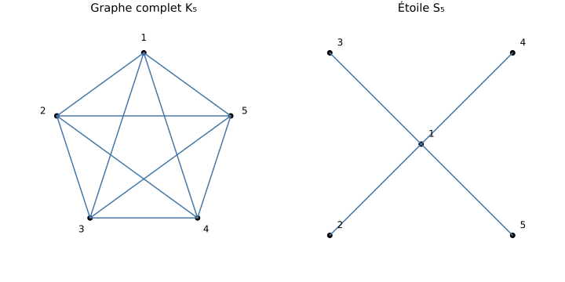
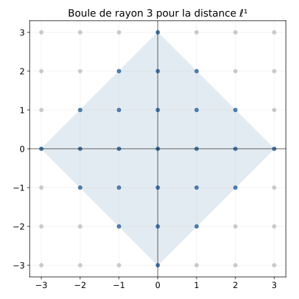
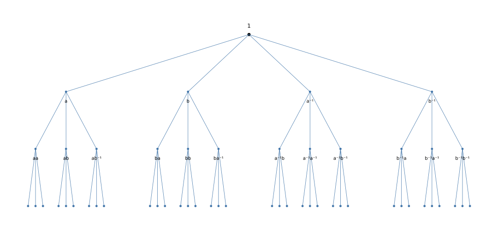

# Agrégation Maths — Mathématiques générales 2026 · Corrigé brut

*Corrigé rédigé par IA, non officiel. Signalez toute erreur.*

Composition de mathématiques générales de l'agrégation externe de mathématiques, session 2026 : 6 heures, tout ouvrage, dictionnaire et matériel électronique (y compris la calculatrice) interdits. Le problème porte sur le spectre du laplacien combinatoire d'un graphe : exemples finis et matrices explicites (parties I–V), graphes de Cayley et croissance des groupes (VI–VII), puis groupe libre $F_2$, bord, marches aléatoires, compactification et problème de Dirichlet (VIII–XII). Douze parties, 50 questions.

**Signalement d'énoncé.** À la question 31, le facteur du terme en $m$ imprimé ($6\lvert m\rvert$) doit être lu $6\sqrt{\lvert m\rvert}$ : seul ce facteur est cohérent avec la minoration de la question 32 pour conclure au degré 4 en question 33. La démonstration publiée traite $6\sqrt{\lvert m\rvert}$.

## I. Préliminaire

### Question 1

On a $J_3^3=I_3$ (permutation d'ordre $3$), donc $P=X^3-1=(X-1)(X-j)(X-j^2)$ est annulateur. Sur $\mathbb C$, $P$ est scindé à **racines simples**, donc $J_3$ est diagonalisable (polynôme annulateur scindé simple). Pour
$\lambda\in\{1,j,j^2\}$ (i.e. $\lambda^3=1$), le vecteur $v_\lambda=(1,\lambda,\lambda^2)^{\mathsf T}$ vérifie, puisque $(J_3v)_1=v_2,\ (J_3v)_2=v_3,\ (J_3v)_3=v_1$ :

$$
\begin{aligned}
J_3 v_\lambda \\
&= (\lambda,\lambda^2,1)^{\mathsf T} \\
&= (\lambda,\lambda^2,\lambda^3)^{\mathsf T} \\
&= \lambda v_\lambda .
\end{aligned}
$$

Ainsi une base de vecteurs propres est

$$
\begin{aligned}
\boxed{\,v_1 = (1,1,1),\quad v_j = (1,j,j^2),\quad v_{j^2} = (1,j^2,j)\,}
\end{aligned}
$$

pour les valeurs propres $1,\ j,\ j^2$. $\qquad\square$

## II. Premiers exemples

### Question 2

$K_n=n\mathrm I_n-\mathrm U_{n,n}$ est **symétrique réelle**. Par le théorème spectral (diagonalisation des matrices symétriques réelles en base orthonormée), il existe $P\in O(n)$ et $D$ diagonale réelle avec $K_n=PDP^{\mathsf T}$. $\square$

### Question 3

Pour $v\perp\mathbf 1$ : $\mathrm U_{n,n}v=\mathbf 1(\mathbf 1^{\mathsf T}v)=0$ ; et $\mathrm U_{n,n}\mathbf 1=n\mathbf 1$. Donc $\mathrm U_{n,n}$ a pour valeurs propres $n$ (simple, vecteur $\mathbf 1$) et
$0$ (multiplicité $n-1$, hyperplan $\mathbf 1^{\perp}$). Dès lors $K_n=n\mathrm I_n-\mathrm U_{n,n}$ a pour valeurs propres $n-n=0$ (vecteur $\mathbf 1$) et
$n-0=n$ (multiplicité $n-1$). D'où

$$
\boxed{\chi_{K_n}=X\,(X-n)^{\,n-1}}.\qquad\square
$$

### Question 4

$K_nv=0\iff nv=(\textstyle\sum_i v_i)\mathbf 1\iff v\in\mathbb R\mathbf 1$. Donc $\ker K_n=\mathbb R\mathbf 1$, de **base $(\mathbf 1)$**.

L'espace propre $E_n=\ker(K_n-n\mathrm I_n)=\ker(-\mathrm U_{n,n})=\ker\mathrm U_{n,n}$ a pour **équation** $\sum_{i=1}^n x_i=0$.

Les vecteurs $b_i=e_i-e_1$ ($2\le i\le n$) vérifient $\sum$ des coordonnées $=0$, donc appartiennent à $E_n$. Ils sont libres : si $\sum_{i\ge2}\lambda_i(e_i-e_1)=0$, la coordonnée
$i\ge2$ donne $\lambda_i=0$. Famille libre de cardinal $n-1=\dim E_n$ : c'est **une base de $E_n$**. $\square$

### Question 5

*Théorème de Gram–Schmidt.* Soit $(v_1,\dots,v_m)$ une famille **libre** d'un espace préhilbertien réel. Il existe une unique famille **orthonormée** $(u_1,\dots,u_m)$ telle que, pour tout $k$, $\mathrm{Vect}(u_1,\dots,u_k)=\mathrm{Vect}(v_1,\dots,v_k)$ et $\langle v_k,u_k\rangle>0$. Elle est donnée par

$$
\begin{aligned}
w_1 \\
&= v_1,\quad u_1 \\
&= \tfrac{w_1}{\|w_1\|};\qquad w_k \\
&= v_k-\sum_{j = 1}^{k-1}\langle v_k,u_j\rangle\,u_j,\quad u_k \\
&= \tfrac{w_k}{\|w_k\|}\ (k\ge2).\qquad\square
\end{aligned}
$$

### Question 6

On applique Gram–Schmidt à $b_i=e_i-e_1$. On obtient, pour $2\le i\le n$,

$$
\boxed{\,e'_i=\frac{1}{\sqrt{i(i-1)}}\Big((i-1)e_i-\sum_{j=1}^{i-1}e_j\Big)\,}.
$$

*Vérification.* Ce vecteur est combinaison de $e_1,\dots,e_i$ de somme des coordonnées nulle (donc $\in E_n$), et $\big\|(i-1)e_i-\sum_{j<i}e_j\big\|^2=(i-1)^2+(i-1)=i(i-1)$, donc $\|e'_i\|=1$. Pour $k<i$, $\langle e'_i,e'_k\rangle=0$ car
$e'_k$ ne fait intervenir que $e_1,\dots,e_k$ et $(i-1)e_i-\sum_{j<i}e_j$ a toutes ses $k$ premières coordonnées égales à $-1$, orthogonales à $e'_k$ (dont la somme des coordonnées est nulle).

**Matrices $P,D$.** On complète par $u_1=\mathbf 1/\sqrt n$ (vecteur propre pour $0$). Alors

$$
\begin{aligned}
P \\
&= \big[\,\mathbf 1/\sqrt n\ \big|\ e'_2\ \big|\ \cdots\ \big|\ e'_n\,\big]\in O(n),\qquad D \\
&= \mathrm{diag}(0,\underbrace{n,\dots,n}_{n-1}),
\end{aligned}
$$

et $K_n=PDP^{\mathsf T}$. $\square$

### Question 7

Dans le corps $\mathbb R(X)$, le bloc $D=(X-1)\mathrm I_{n-1}$ est inversible. Avec $A=(1)$, $B=\mathrm U_{1,n-1}$, $C=\mathrm U_{n-1,1}$,

$$
\delta_n=\det D\cdot\det\!\big(A-BD^{-1}C\big)=(X-1)^{n-1}\Big(1-\tfrac{1}{X-1}\,\mathrm U_{1,n-1}\mathrm U_{n-1,1}\Big).
$$

Or $\mathrm U_{1,n-1}\mathrm U_{n-1,1}=n-1$, donc $1-\tfrac{n-1}{X-1}=\tfrac{X-n}{X-1}$, d'où

$$
\delta_n=(X-1)^{n-1}\cdot\frac{X-n}{X-1}=\boxed{(X-n)(X-1)^{\,n-2}}
$$

dans $\mathbb R(X)$, donc comme égalité de polynômes. $\square$

### Question 8

$X\mathrm I_n-S_n=\begin{pmatrix} X-n+1 & \mathrm U_{1,n-1}\\ \mathrm U_{n-1,1}&(X-1)\mathrm I_{n-1}\end{pmatrix}$. Dans $\mathbb R(X)$,

$$
\chi_{S_n}=(X-1)^{n-1}\Big((X-n+1)-\tfrac{n-1}{X-1}\Big)=(X-1)^{n-2}\big[(X-1)(X-n+1)-(n-1)\big].
$$

Or $(X-1)(X-n+1)-(n-1)=X^2-nX=X(X-n)$, donc

$$
\boxed{\chi_{S_n}=X\,(X-n)\,(X-1)^{\,n-2}}.
$$

Spectre : $0$ (mult. $1$), $n$ (mult. $1$), $1$ (mult. $n-2$). Comme
$S_n$ est **symétrique réelle**, elle est diagonalisable : les dimensions des espaces propres égalent les multiplicités :

$$
\begin{aligned}
\dim E_0 \\
&= 1,\qquad \dim E_n \\
&= 1,\qquad \dim E_1 \\
&= n-2.\qquad\square
\end{aligned}
$$

## III. Graphes

### Question 9

*Réflexive* : pour $x$, le $1$‑uplet $(x)$ est un chemin de longueur $0$, donc $x\leftrightarrow x$. *Symétrique* : si $(z_0,\dots,z_p)$ relie
$x$ à $y$, alors $(z_p,\dots,z_0)$ relie $y$ à $x$ car $\sim$ est symétrique. *Transitive* : la concaténation d'un chemin
$x\to y$ et d'un chemin $y\to z$ est un chemin $x\to z$. Donc $\leftrightarrow$ est une relation d'équivalence. $\square$

### Question 10

$\Gamma$ étant connexe, l'ensemble des longueurs de chemins $x\to y$ est une partie **non vide** de $\mathbb N$, qui admet un minimum : $d(x,y)$ est bien défini, $\ge0$. $d(x,y)=0$ ssi il existe un chemin de longueur
$0$ de $x$ à $y$, ssi $x=y$. Symétrie : par retournement (Q9). Inégalité triangulaire : la concaténation de chemins minimaux $x\to y$ et $y\to z$ donne un chemin
$x\to z$ de longueur $d(x,y)+d(y,z)$, donc $d(x,z)\le d(x,y)+d(y,z)$. Ainsi $d$ est une distance. $\square$

### Question 11

Pour $x\ne y$, $d(x,y)\ge1$, donc $B(x,\tfrac12)=\{x\}$ est ouvert : tout singleton est ouvert, et par réunion **toute partie de $S$ est ouverte** (topologie discrète). Par conséquent **toute** application $S\to\mathbb R$ est continue. $\square$

## IV. Laplacien

### Question 12

Pour tout $x$, $\deg(x)\le K$ est fini, la somme $\sum_{y\sim x}f(y)$ est finie : $\Delta f(x)\in\mathbb R$ bien défini. La linéarité de $f\mapsto\Delta f$ est immédiate ; $\Delta$ est donc un endomorphisme de
$E$. Enfin $\Delta\mathbf 1(x)=\deg(x)\cdot1-\sum_{y\sim x}1=\deg(x)-\deg(x)=0$, donc $\mathbf 1\in\ker\Delta$ avec $\mathbf 1\ne0$ : $\Delta$ **n'est pas injectif**. $\square$

### Question 13

**(a) $\Gamma_{\mathbb N}$.** $\Delta f(0)=f(0)-f(1)$, $\Delta f(n)=2f(n)-f(n-1)-f(n+1)$ ($n\ge1$). Si $f$ harmonique : $f(1)=f(0)$ puis
$f(n+1)-f(n)=f(n)-f(n-1)$, donc $f(n+1)-f(n)=f(1)-f(0)=0$ : $f$ constante. Ainsi $\ker\Delta=\mathbb R\mathbf 1$ est **une droite**.
Surjectivité : donné $g$, on pose $f(0)=0$, $f(1)=-g(0)$, puis $f(n+1)=2f(n)-f(n-1)-g(n)$ ($n\ge1$) : cette récurrence construit une solution de $\Delta f=g$. Donc
$\Delta$ **surjectif**.

**(b) $\Gamma_{\mathbb Z}$.** Harmonicité $\iff f(n+1)-f(n)=f(n)-f(n-1)$ pour tout $n\in\mathbb Z$ $\iff (f(n))$ arithmétique : $\ker\Delta=\{n\mapsto an+b\}$, **de dimension $2$**.
Surjectivité : pour $g$ donné, on fixe $f(0),f(1)$ arbitraires et on étend par les récurrences avant ($f(n+1)=2f(n)-f(n-1)-g(n)$) et arrière ($f(n-1)=2f(n)-f(n+1)-g(n)$). Donc $\Delta$ **surjectif**. $\square$

### Question 14

Un graphe connexe de degré borné a un ensemble de sommets **au plus dénombrable** (les boules sont finies). Si $S$ fini : toute fonction a une somme finie, $H=E$. Si $S$ infini : $\mathbf 1\in E$ mais $\sum_x 1=+\infty$, donc $\mathbf 1\notin H$, d'où
$H\ne E$. Ainsi $H=E\iff S$ fini. $\square$

### Question 15

Soit $f\in H$. Pour l'opérateur d'adjacence $Af(x)=\sum_{y\sim x}f(y)$, Cauchy–Schwarz donne $|Af(x)|^2\le \deg(x)\sum_{y\sim x}f(y)^2\le K\sum_{y\sim x}f(y)^2$, d'où

$$
\begin{aligned}
\sum_x|Af(x)|^2 &\le K\sum_x\sum_{y\sim x}f(y)^2 \\
&= K\sum_y \deg(y)f(y)^2 \\
&\le K^2\|f\|_2^2.
\end{aligned}
$$

Donc $\|Af\|_2\le K\|f\|_2$. Comme $\|\deg\cdot f\|_2\le K\|f\|_2$, on a $\Delta f\in H$ avec $\|\Delta f\|_2\le 2K\|f\|_2$ : **$H$ est stable par $\Delta$**.
$\square$

### Question 16

Par Q15, $\|\Delta_H f\|_2\le 2K\|f\|_2$ : $\Delta_H$ est **linéaire continu** (de norme $\le 2K$). $\square$

### Question 17

*Notation.* Le terme $(f(x)-f(y))(g(x)-g(y))$ est **symétrique en $(x,y)$**, donc bien défini sur la paire $\{x,y\}$.

*Existence (absolue convergence).* $\sum_{\{x,y\}\in A}(f(x)-f(y))^2=\tfrac12\sum_{(x,y):x\sim y}(f(x)-f(y))^2\le \sum_{(x,y):x\sim y}(f(x)^2+f(y)^2)=2\sum_x\deg(x)f(x)^2\le 2K\|f\|_2^2<\infty$, de même pour $g$. Par Cauchy–Schwarz (indexé par $A$), $\sum_{\{x,y\}}\big|(f(x)-f(y))(g(x)-g(y))\big|<\infty$.

*Calcul.* 

$$
\langle f,\Delta_Hg\rangle=\sum_x\deg(x)f(x)g(x)-\sum_x\sum_{y\sim x}f(x)g(y)=\sum_{(x,y):x\sim y}f(x)\big(g(x)-g(y)\big).
$$

En développant la somme sur les couples **ordonnés** adjacents :

$$
\sum_{(x,y):x\sim y}\!\!(f(x)-f(y))(g(x)-g(y))=2\sum_{(x,y):x\sim y}\!\!f(x)(g(x)-g(y))=2\,\langle f,\Delta_Hg\rangle,
$$

(par symétrie $\sum f(x)g(x)=\sum f(y)g(y)$, $\sum f(x)g(y)=\sum f(y)g(x)$). Comme chaque arête est comptée deux fois,

$$
\boxed{\ \langle f,\Delta_Hg\rangle=\sum_{\{x,y\}\in A}(f(x)-f(y))(g(x)-g(y))\ }.
$$

Le membre de droite étant symétrique en $(f,g)$ : $\langle f,\Delta_Hg\rangle=\langle \Delta_Hf,g\rangle$, donc **$\Delta_H$ est autoadjoint**. $\square$

## V. Cas fini

### Question 18

$\Delta$ est un endomorphisme non injectif (Q12) d'un espace de dimension finie, donc **non surjectif**. $L$ étant symétrique réelle, $\Delta$ est **diagonalisable** (théorème spectral). $\square$

### Question 19

Ici $H=E$. Par Q17, $f\in\ker\Delta\Rightarrow\langle f,\Delta f\rangle=\sum_{\{x,y\}\in A}(f(x)-f(y))^2=0$, donc $f(x)=f(y)$ pour toute arête. Par **connexité**, $f$ est constante. Ainsi $\ker\Delta\subseteq\mathbb R\mathbf 1$, et comme $\mathbf 1\in\ker\Delta$,
$\ker\Delta=\mathbb R\mathbf 1$ est **une droite**. $\square$

### Question 20

$\Delta$ autoadjoint $\Rightarrow \operatorname{Im}\Delta=(\ker\Delta^{\ast})^\perp=(\ker\Delta)^\perp=(\mathbb R\mathbf 1)^\perp$ (Q19). Or $(\mathbb R\mathbf 1)^\perp=\{f:\langle f,\mathbf 1\rangle=0\}$, d'où

$$
\begin{aligned}
\boxed{\operatorname{Im}\Delta = \Big\{f\in E:\ \textstyle\sum_{x\in S}f(x) = 0\Big\}}.\qquad\square
\end{aligned}
$$

### Question 21

La matrice $K_5$ (diagonale $4$, hors‑diagonale $-1$) est le laplacien du **graphe complet $K_5$** ; $S_5$ (sommet $1$ de degré
$4$ relié à $2,3,4,5$ de degré $1$) est le laplacien du **graphe étoile**.

Schéma attendu : à gauche, $5$ sommets $1,\dots,5$ tous reliés deux à deux (graphe complet) ; à droite, un sommet central $1$ relié par un segment à chacun des $4$ sommets $2,3,4,5$ (étoile).. $\square$

### Question 22

Chaque sommet du cycle est de degré $2$, voisin de $i\pm1$ (modulo $n$) ; la matrice d'adjacence est $J_n+J_n^{-1}$ (car $J_n^{-1}=J_n^{\mathsf T}$). D'où

$$
\boxed{C_n=2\mathrm I_n-J_n-J_n^{-1}}.\qquad\square
$$

### Question 23

Posons $v=(\omega_n^{(p-1)(k-1)})_{k=1}^n$. Comme $(J_nv)_i=v_{i+1}$ (indices mod $n$, $v_{n+1}=v_1$),

$$
\begin{aligned}
(J_nv)_i &= v_{i+1} = \omega_n^{(p-1)i} \\
&= \omega_n^{p-1}\,\omega_n^{(p-1)(i-1)} = \omega_n^{p-1}\,v_i,
\end{aligned}
$$

et $v_1=1\ne0$ : $v$ est **vecteur propre de $J_n$** pour la valeur propre $\omega_n^{p-1}$. $\square$

### Question 24

Les $n$ valeurs propres $\omega_n^{p-1}$ ($p=1,\dots,n$) sont **distinctes** (racines $n$‑ièmes de l'unité), donc $(v^{(p)})_{p=1}^n$ est une **base de $\mathbb C^n$** diagonalisant
$J_n$. Chaque $v^{(p)}$ est aussi vecteur propre de $J_n^{-1}$ (valeur $\omega_n^{-(p-1)}$), d'où

$$
\begin{aligned}
C_nv^{(p)} &= \big(2-\omega_n^{p-1}-\omega_n^{-(p-1)}\big)v^{(p)} \\
&= \Big(2-2\cos\tfrac{2\pi(p-1)}{n}\Big)v^{(p)} \\
&= 4\sin^2\!\tfrac{\pi(p-1)}{n}\,v^{(p)}.
\end{aligned}
$$

**Spectre** : $\lambda_k=4\sin^2(\pi k/n)$, $k=0,\dots,n-1$. Comme $\cos\tfrac{2\pi k}{n}=\cos\tfrac{2\pi(n-k)}{n}$, les valeurs se regroupent :
- $k=0$ : $\lambda=0$, **multiplicité $1$** ;
- si $n$ pair, $k=n/2$ : $\lambda=4$, **multiplicité $1$** ;
- les autres, $4\sin^2(\pi k/n)$ pour $1\le k\le\lfloor(n-1)/2\rfloor$, sont de **multiplicité $2$** (paires $k,\,n-k$). $\square$

### Question 25

**(a)** Posons $C_{2n}x=\lambda x$, i.e. $2x_i-x_{i-1}-x_{i+1}=\lambda x_i$ (indices mod $2n$). Pour $x'=(x_i)_{i=1}^n$ et $2\le i\le n-1$ : $(L_nx')_i=2x_i-x_{i-1}-x_{i+1}=\lambda x_i$. Aux bords :

$$
\begin{aligned}
(L_nx')_1 &= x_1-x_2 \\
&= 2x_1-x_{2n}-x_2 && (x_{2n}=x_1)\\
&= \lambda x_1,
\end{aligned}
$$

$$
\begin{aligned}
(L_nx')_n &= x_n-x_{n-1} \\
&= 2x_n-x_{n-1}-x_{n+1} && (x_{n+1}=x_n)\\
&= \lambda x_n.
\end{aligned}
$$

Donc $L_nx'=\lambda x'$. (Le caractère non nul de $x'$ est assuré par les vecteurs explicites construits en (b).) $\square$

**(b)** Pour $\alpha=\tfrac{\pi k}{n}$, les suites $x_j=\cos(\alpha(j-c))$ vérifient $x_{j-1}+x_{j+1}=2\cos\alpha\,x_j$, donc sont « propres » pour la récurrence du cycle $C_{2n}$ de valeur $2-2\cos\alpha$ dès que $\alpha\cdot2n\in2\pi\mathbb Z$, i.e.
$\alpha=\tfrac{\pi k}{n}$. La symétrie $j\mapsto 2n+1-j$ (qui échange $n\leftrightarrow n+1$ et $1\leftrightarrow 2n$) impose le centre $c=\tfrac{2n+1}{2}$, donnant, à un signe près,

$$
\begin{aligned}
x^{(k)}_j &= \cos\!\Big(\frac{\pi k\,(2j-1)}{2n}\Big), \\
&\qquad j=1,\dots,n,\quad k=0,\dots,n-1.
\end{aligned}
$$

combinaison explicite $x^{(k)}=\cos(\tfrac{\pi k}{2n})\,(\cos\tfrac{\pi kj}{n})_j+\sin(\tfrac{\pi k}{2n})\,(\sin\tfrac{\pi kj}{n})_j$ des vecteurs propres de $C_{2n}$. Par (a), $x^{(k)}$ est vecteur propre de $L_n$ pour

$$
\begin{aligned}
\mu_k &= 2-2\cos\tfrac{\pi k}{n} \\
&= \boxed{4\sin^2\tfrac{\pi k}{2n}},\qquad k=0,\dots,n-1.
\end{aligned}
$$

Les $\mu_k$ sont **deux à deux distinctes** ($\cos\tfrac{\pi k}{n}$ strictement décroissant sur $[\![0,n-1]\!]$) : les $n$ vecteurs $x^{(k)}$ forment une base propre, chaque valeur propre est **simple**. ($x^{(0)}=\mathbf 1$ pour
$\mu_0=0$.) $\square$

## VI. Graphe de Cayley et croissance

### Question 26

Tout graphe de Cayley $\Gamma(G,Z)$ est $|Z|$‑régulier : les voisins de $x$ sont les $xa$ ($a\in Z$), distincts ($xa=xa'\Rightarrow a=a'$) et
$\ne x$ (car $1_G\notin Z$).
- $\Gamma_{\mathbb Z}$ (13b) : **oui**, $(\mathbb Z,+)$, $Z=\{1,-1\}$.
- $C_n$ (22) : **oui**, $(\mathbb Z/n\mathbb Z,+)$, $Z=\{\bar1,\overline{-1}\}$ ($n\ge3$).
- graphe de $K_5$ (21) : **oui**, $(\mathbb Z/5\mathbb Z,+)$, $Z=\{1,2,3,4\}$ (complet).
- $\Gamma_{\mathbb N}$ (13a) : **non**, non régulier ($\deg0=1\ne2$).
- graphe de $S_5$ (étoile, 21) : **non**, non régulier.
- $L_n$ (chemin, 25) : **non** pour $n\ge3$ (sommets extrêmes de degré $1$, internes de degré $2$). Pour $n=2$, $L_2$ (une arête) **est** Cayley de
$(\mathbb Z/2\mathbb Z,+)$, $Z=\{\bar1\}$. $\square$

### Question 27

$\beta(k)-\beta(k-1)=\#\{x:|x|=k\}=:|S_k|$. On a $|S_1|=C$ (voisins de $1_G$, i.e. $Z$). Pour $k\ge2$ : tout $x\in S_k$ a au moins un voisin dans
$S_{k-1}$ (par une géodésique) ; et tout $y\in S_{k-1}$ a au moins un voisin dans $S_{k-2}$, donc au plus $C-1$ voisins dans $S_k$. En comptant les arêtes entre $S_{k-1}$ et
$S_k$ : $|S_k|\le (C-1)|S_{k-1}|$, d'où par récurrence

$$
\boxed{\beta(k)-\beta(k-1)=|S_k|\le C(C-1)^{k-1}}.
$$

*Commentaire exigé.* Pour $C\ge3$, $\beta(k)\le1+\sum_{j=1}^kC(C-1)^{j-1}=O\big((C-1)^k\big)$. Pour $C=2$, cette somme donne $\beta(k)\le1+2k$ ; pour $C\le1$, le groupe est fini et $\beta$ est bornée. Dans tous les cas $\beta(k)=O(a^k)$ pour un réel $a>1$ : la croissance est **au plus exponentielle** (de base $\le C-1$). La croissance exponentielle (un $c>1$ avec $c^k=O(\beta)$) est donc le **type maximal** possible. « Intermédiaire » désigne alors les groupes dont la croissance est plus rapide que tout polynôme mais plus lente que toute exponentielle — type strictement compris entre les deux, qui existe effectivement. $\square$

### Question 28

La distance est la distance $\ell^1$ (Manhattan) : $d\big((0,0),(a,b)\big)=|a|+|b|$. La boule $B((0,0),k)=\{(a,b):|a|+|b|\le k\}$ est un **losange**.

Schéma attendu : losange de sommets $(\pm k,0),(0,\pm k)$, points entiers du réseau $\mathbb Z^2$ à l'intérieur..

Nombre de points : $\beta(k)=1+\sum_{j=1}^k 4j=1+2k(k+1)=\boxed{2k^2+2k+1}$ (croissance **polynomiale de degré $2$**). $\square$

### Question 29

**(a)** Soient $Z,Z'$ deux systèmes, $M=\max\big(\max_{a\in Z'}|a|_Z,\ \max_{a\in Z}|a|_{Z'}\big)$. Chaque générateur de $Z'$ est un $Z$‑mot de longueur $\le M$, donc $|x|_Z\le M|x|_{Z'}$ et symétriquement :
$\tfrac1M|x|_{Z'}\le|x|_Z\le M|x|_{Z'}$. Donc $B_Z(1,k)\subseteq B_{Z'}(1,Mk)$ et l'inverse, soit $\beta_Z(k)\le\beta_{Z'}(Mk)$ et $\beta_{Z'}(k)\le\beta_Z(Mk)$. On en déduit :
- $\beta_Z=O(k^n)\iff\beta_{Z'}=O(k^n)$, et $k^n=O(\beta_Z)\iff k^n=O(\beta_{Z'})$ (via $\beta_{Z'}(k)\ge\beta_Z(k/M)$) : **type et degré polynomial préservés** ;
- $c^k=O(\beta_Z)\Rightarrow\beta_{Z'}(k)\ge\beta_Z(k/M)\ge c'\,(c^{1/M})^k$ avec $c^{1/M}>1$ : **exponentialité préservée**.

**(b)** Soit $G$ abélien engendré par $Z=\{a_1,\dots,a_r\}$ (symétrique). Comme $G$ est commutatif, tout mot de longueur $\le k$ s'écrit $a_1^{n_1}\cdots a_r^{n_r}$ avec $\sum|n_i|\le k$. Le nombre de tels
$(n_1,\dots,n_r)$ est $\le(2k+1)^r$, donc $\beta(k)\le(2k+1)^r=O(k^r)$ : croissance **polynomiale**. $\square$

## VII. Groupe de Heisenberg discret

### Question 30

**(a)** $S^k=\mathrm I+kE_{21}$, $T^\ell=\mathrm I+\ell E_{32}$, $U^m=\mathrm I+mE_{31}$ (carrés nuls). Le calcul donne

$$
f(k,\ell,m):=S^kT^\ell U^m=\begin{pmatrix}1&0&0\\k&1&0\\ m&\ell&1\end{pmatrix}.
$$

L'application $f:\mathbb Z^3\to H_3$ est **injective** (on lit $k,\ell,m$ aux positions $(2,1),(3,2),(3,1)$). Son image $N=\{f(k,\ell,m)\}$ contient $S,T,U$ et, par (b), est stable par produit et inverse : c'est un **sous‑groupe** contenant les générateurs, donc $H_3\subseteq N$ ; et
$N\subseteq H_3$ car chaque $f(k,\ell,m)=S^kT^\ell U^m\in H_3$. Donc $N=H_3$ et $f$ est **bijective**. $\square$

**(b)** Produit matriciel :

$$
f(k,\ell,m)f(k',\ell',m')=f\big(k+k',\ \ell+\ell',\ m+m'+\ell k'\big),
$$

soit $\boxed{k''=k+k',\ \ell''=\ell+\ell',\ m''=m+m'+\ell k'}$. L'inverse $f(k,\ell,m)^{-1}=f(-k,-\ell,\ \ell k-m)$ appartient à $N$ : $N$ est bien un sous‑groupe.
Non‑commutativité : le terme $m''$ fait intervenir $\ell k'$ (asymétrique). Par exemple $ST=f(1,1,0)$, $TS=f(1,1,1)$ : $ST\ne TS$, donc **$H_3$ n'est pas commutatif**.
Enfin, $[S,T]=S^{-1}T^{-1}ST=f(-1,-1,0)f(1,1,0)=f(0,0,-1)=U^{-1}$, donc $U\in\langle S,T\rangle$ : **$\langle S,T\rangle=H_3$**. $\square$

### Question 31

> *Coquille corrigée : le majorant est $|k|+|\ell|+6\sqrt{|m|}$.*

Par Q30(b), $S^aT^bS^{-a}T^{-b}=f(0,0,-ab)=U^{-ab}$, mot de longueur $2(|a|+|b|)$. Pour $m\ge0$, posons $a=\lfloor\sqrt m\rfloor$, $s=m-a^2\ (0\le s\le2a)$ :

$$
U^{m}=U^{a^2}\,U^{s}=\big(T^aS^aT^{-a}S^{-a}\big)\,U^{s},
$$

de longueur $\le 4a+s\le 6a\le 6\sqrt m$ (idem pour $m<0$). Comme $S^kT^\ell=f(k,\ell,0)$ coûte $|k|+|\ell|$, on obtient par concaténation

$$
\boxed{\ \big|S^kT^\ell U^m\big|\le |k|+|\ell|+6\sqrt{|m|}\ }.\qquad\square
$$

### Question 32

Soit $X=f(k,\ell,m)$, $N=|X|$, et $g_1\cdots g_N$ un mot géodésique ($g_i\in Z$), de produits partiels $P_j=g_1\cdots g_j=f(k_j,\ell_j,m_j)$.

**(i)** $\pi:f(a,b,c)\mapsto(a,b)$ est un morphisme vers $\mathbb Z^2$ (Q30b), avec $\|\pi(g_i)\|_1\le1$. Donc $|k|+|\ell|=\|\pi(X)\|_1\le\sum_i\|\pi(g_i)\|_1\le N$ :

$$
\boxed{|k|+|\ell|\le|S^kT^\ell U^m|}.
$$

**(ii)** En appliquant (i) à $P_j$ : $|\ell_j|\le j$. Les incréments de $m_j$ valent (Q30b) : $0$ pour un pas $T^{\pm1}$, $\pm1$ pour
$U^{\pm1}$, et $\pm\ell_{j}$ pour $S^{\pm1}$ ; donc $|m_{j+1}-m_j|\le\max(|\ell_j|,1)\le N$ pour $0\le j\le N-1$. Par télescopage $m_0=0$ :

$$
\begin{aligned}
|m| &= |m_N| \\
&\le \sum_{j=0}^{N-1}|m_{j+1}-m_j| \\
&\le N\cdot N = N^2,
\end{aligned}
$$

soit

$$
\boxed{|m|\le|S^kT^\ell U^m|^2}.
$$

**(iii)** De (i) et (ii) : $|X|\ge|k|+|\ell|$ et $|X|\ge\sqrt{|m|}$, donc $2|X|\ge(|k|+|\ell|)+\sqrt{|m|}$ :

$$
\boxed{\tfrac12\big(|k|+|\ell|+\sqrt{|m|}\big)\le\big|S^kT^\ell U^m\big|}.\qquad\square
$$

### Question 33

Par bijection $f$, $\beta(R)=\#\{(k,\ell,m):|f(k,\ell,m)|\le R\}$.
*Majoration.* $|X|\le R\Rightarrow\tfrac12(|k|+|\ell|+\sqrt{|m|})\le R\Rightarrow|k|,|\ell|\le2R,\ |m|\le4R^2$, d'où $\beta(R)\le(4R+1)^2(8R^2+1)=O(R^4)$.
*Minoration.* Si $|k|,|\ell|\le R$ et $|m|\le R^2$ alors (Q31) $|X|\le R+R+6\sqrt{R^2}=8R$ ; le nombre de tels triplets est $\ge(2R+1)^2(2R^2+1)\ge cR^4$, donc $\beta(8R)\ge cR^4$, i.e. $R^4=O(\beta(R))$.
Ainsi la croissance de $H_3$ est **polynomiale de degré $4$**. $\square$

## VIII. Groupe libre

### Question 34

**(a)** Soit $z$ un voisin de $y$ sur une géodésique $x\to y$ : $d(x,z)=p-1$ (il est $\le p-1$, et $\ge p-1$ sinon
$d(x,y)<p$). Tout voisin $w$ de $y$ vérifie $d(x,w)\in\{p-1,p,p+1\}$. Supposons $w\ne z$ et $d(x,w)\le p$. Les géodésiques
$Q:x\to z$ (distances $0,\dots,p-1$) et $P:x\to w$ (distances $0,\dots,\le p$) **évitent $y$** (qui est à distance $p$), donc évitent l'arête
$a=\{y,z\}$. Le chemin $z\xrightarrow{Q^{-1}}x\xrightarrow{P}w\to y$ relie $z$ à $y$ dans $\Gamma'=(S,A\setminus\{a\})$, contredisant la minimalité de l'arbre. Donc $z$ est l'**unique** voisin à distance
$p-1$, et tout autre voisin est à distance $p+1$ (aucun à distance $p$).

*Lacet.* Soit $(z_0,\dots,z_p)$ un lacet ($z_0=z_p$), $p\ge1$, **sans** aller‑retour. Posons $x=z_0$. Alors $d(x,z_0)=0<d(x,z_1)=1$ ; et si $d(x,z_{i-1})<d(x,z_i)=:p_i$, le point
$z_{i-1}$ est l'unique voisin de $z_i$ à distance $p_i-1$, donc $z_{i+1}\ne z_{i-1}$ est à distance $p_i+1$. Par récurrence $d(x,z_i)$ est **strictement croissante**, d'où
$d(x,z_p)\ge p\ge1>0=d(x,z_0)$ : contradiction. Donc tout lacet de longueur $\ge1$ admet un aller‑retour. $\square$

**(b)** *Existence.* Une géodésique $x\to y$ n'a pas d'aller‑retour (sinon on raccourcit) : c'est un chemin réduit.
*Unicité.* Parmi les couples $(P,Q)$ de chemins réduits **distincts** de mêmes extrémités $x,y$, prenons‑en un de longueur totale minimale. Le lacet $P\overline Q$ admet un aller‑retour (a) ; $P,Q$ étant réduits, il ne peut se situer qu'à la **jointure** $y$ : $u_{s-1}=v_{t-1}$. Alors
$P'=(u_0,\dots,u_{s-1})$, $Q'=(v_0,\dots,v_{t-1})$ sont réduits, distincts (sinon $P=Q$), plus courts : contradiction. Donc le chemin réduit est **unique**, et c'est la géodésique (de longueur $d(x,y)$). $\square$

### Question 35

$\Gamma=\Gamma(F_2,Z)$ est l'**arbre $4$‑régulier**. Boule de rayon $3$ : racine $1$, $4$ voisins à distance $1$
($a,b,a^{-1},b^{-1}$), $12$ sommets à distance $2$, $36$ à distance $3$.

Schéma attendu : arbre enraciné en $1$ de profondeur $3$, chaque sommet ayant (hormis la racine) $3$ enfants. Sommets à distance $\le2$ nommés :
distance $1$ : $a,\ b,\ a^{-1},\ b^{-1}$ ;
distance $2$ : $a^2,ab,ab^{-1}\ |\ b^2,ba,ba^{-1}\ |\ a^{-2},a^{-1}b,a^{-1}b^{-1}\ |\ b^{-2},b^{-1}a,b^{-1}a^{-1}$.. $\square$

### Question 36

À une écriture $x=x_1\cdots x_k$ correspond le chemin $1,x_1,x_1x_2,\dots,x$ dans $\Gamma$ ; « pas de simplification » ($x_{i+1}\ne x_i^{-1}$) équivaut à « pas d'aller‑retour » ($x_1\cdots x_{i+1}\ne x_1\cdots x_{i-1}$). Comme $\Gamma$ est un **arbre**, Q34(b) donne un **unique** chemin réduit de
$1$ à $x$, donc une **unique écriture réduite**. L'existence vient de ce qu'on peut retirer les simplifications (la longueur décroît, procédé fini). $\square$

### Question 37

Le nombre de mots réduits de longueur $j$ vaut $1$ si $j=0$, $4\cdot3^{j-1}$ si $j\ge1$. Donc

$$
\begin{aligned}
\beta(k) &= 1+\sum_{j=1}^k 4\cdot3^{j-1} \\
&= 1+2(3^k-1) \\
&= \boxed{2\cdot3^k-1}.
\end{aligned}
$$

Comme $3^k=O(\beta)$, la croissance est **exponentielle**. Elle est **maximale** au sens de Q27 : $\beta(k)-\beta(k-1)=4\cdot3^{k-1}=C(C-1)^{k-1}$ avec $C=4$ ; chaque sphère atteint le cardinal maximal autorisé (ramification maximale, aucune relation). $\square$

### Question 38

Montrons que $\Delta$ est **surjectif**. Soit $g\in E$. Enracinons $\Gamma$ en $1$. Posons $f(1)=0$, et pour les $4$ voisins
$n_1,\dots,n_4$ de $1$ : $f(n_1)=f(n_2)=f(n_3)=0$, $f(n_4)=-g(1)$ (l'équation au sommet $1$, $4f(1)-\sum f(n_i)=g(1)$, est satisfaite). Par récurrence sur la profondeur
$d$ : supposons $f$ définie jusqu'à la profondeur $d$ avec toutes les équations vérifiées aux profondeurs $\le d-1$. Pour chaque $u$ de profondeur $d$, l'équation
$4f(u)-f(\text{parent})-\sum_{\text{3 enfants}}f=g(u)$ ne contient qu'une inconnue si l'on fixe à $0$ deux des trois enfants et qu'on résout le troisième. On définit ainsi tous les sommets de profondeur $d+1$ et l'équation en $u$ est satisfaite. D'où $\Delta f=g$ : **$\Delta$ surjectif**.
$\square$

### Question 39

Par l'indication, chaque $x$ a un voisin avec $b_\varphi=b_\varphi(x)-1$ et trois avec $b_\varphi(x)+1$. Pour $f(x)=\lambda^{b_\varphi(x)}$ :

$$
\Delta f(x)=4\lambda^{b}-\big(\lambda^{b-1}+3\lambda^{b+1}\big)=\lambda^{b}\big(4-\lambda^{-1}-3\lambda\big),
$$

nul ssi $3\lambda^2-4\lambda+1=0$, i.e. $\lambda\in\{1,\tfrac13\}$. On prend $\lambda=\tfrac13$ :

$$
\boxed{f(x)=3^{-b_\varphi(x)}}.
$$

Alors $f(1)=3^{-b_\varphi(1)}=3^0=1$. Pour $\psi\ne\varphi$, notons $r$ le premier indice de divergence : pour $p\ge r$, $m(\psi_{\to p},\varphi)=r-1$ et $|\psi_{\to p}|=p$, donc
$b_\varphi(\psi_{\to p})=p-2(r-1)\to+\infty$ et $f(\psi_{\to p})=3^{-(p-2(r-1))}\to0$. Enfin $b_\varphi(\varphi_{\to p})=p-2p=-p$, donc $f(\varphi_{\to p})=3^{p}\to+\infty$. $\square$

### Question 40

On a $m(x,\varphi)\le q\iff x_{\to q+1}\ne\varphi_{\to q+1}$, i.e. $x\in\mathcal T$ := composante de $w=\varphi_{\to q}$ dans $\Gamma$ privé de l'arête $e=\{\varphi_{\to q},\varphi_{\to q+1}\}$. Dans $\mathcal T$,
$w$ a $3$ voisins, les autres sommets $4$ (seule $e$ sort de $\mathcal T$) ; $h$ est harmonique en tout
$x\in\mathcal T\setminus\{w\}$ (tous ses voisins restent dans $\mathcal T$), et $h(w)=0$.

Soit $B_n$ la boule de $\mathcal T$ de rayon $n$ centrée en $w$, $V_n$ sa sphère. Sur $B_n$,
$h$ est harmonique en tout sommet « intérieur » (distance $1\le d\le n-1$), donc **le maximum de $h$ sur $B_n$ est atteint sur $\{w\}\cup V_n$** (principe du maximum discret). Comme $h(w)=0$ : si
$\max_{B_n}h>0$, il est atteint sur $V_n$, et $a_n:=\max_{V_n}h=\max_{B_n}h$ est **croissant** dès qu'il est $>0$.

Supposons $a_{n_0}=a>0$ pour un $n_0\ge1$. Construisons un rayon $z_{n_0},z_{n_0+1},\dots$ : $z_{n_0}=\arg\max_{V_{n_0}}h$ (alors $h(z_{n_0})=a_{n_0}\ge a_{n_0-1}\ge h(\text{parent})$). Si $h(z_j)\ge h(\text{parent}(z_j))$, l'harmonicité
$4h(z_j)=h(\text{parent})+\sum_{\text{3 enfants}}h$ donne $\sum_{\text{enfants}}h\ge 3h(z_j)$, donc un enfant $z_{j+1}$ avec $h(z_{j+1})\ge h(z_j)$, et parent$(z_{j+1})=z_j$ conserve la propriété. On obtient un rayon avec $h(z_j)\ge a>0$ pour tout
$j$, convergeant vers un $\psi\in\partial F_2$ **dans $\mathcal T$** (donc $\psi_{\to q+1}\ne\varphi_{\to q+1}$), le long duquel $\lim_p h(\psi_{\to p})\ge a>0$ : **contradiction** avec l'hypothèse. Donc $\max_{V_n}h\le0$ pour tout
$n$, puis $\max_{B_n}h=0$, soit $h\le0$ sur $\mathcal T$. En appliquant à $-h$ (mêmes hypothèses) : $h\ge0$. Donc

$$
\boxed{h\equiv0\ \text{sur}\ \{x:m(x,\varphi)\le q\}=\mathcal T}.
$$

**Unicité de $f$ (=:$p_\varphi$, Q39).** Soient $f_1,f_2$ harmoniques avec $f_i(1)=1$ et $\lim_p f_i(\psi_{\to p})=0$ pour $\psi\ne\varphi$. Alors
$h=f_1-f_2$ est harmonique, $h(1)=0$, et $\lim_p h(\psi_{\to p})=0$ pour tout $\psi\ne\varphi$. Montrons par récurrence $h(\varphi_{\to q})=0$ pour tout $q$ :
- $q=0$ : $h(\varphi_{\to0})=h(1)=0$.
- Hérédité : si $h(\varphi_{\to q})=0$, les hypothèses de cette question sont réunies (les $\psi$ avec $\psi_{\to q+1}\ne\varphi_{\to q+1}$ sont $\ne\varphi$), donc $h=0$ sur $\{m\le q\}$. Les voisins de
$\varphi_{\to q}$ autres que $\varphi_{\to q+1}$ (à savoir $\varphi_{\to q-1}$ et deux sommets de niveau $m=q$) sont dans $\{m\le q\}$, donc d'image nulle ; l'harmonicité en $\varphi_{\to q}$ donne
$0=4h(\varphi_{\to q})=h(\varphi_{\to q+1})+0$, soit $h(\varphi_{\to q+1})=0$.
Ainsi $h=0$ sur $\bigcup_q\{m\le q\}=F_2$ : $f_1=f_2$. $\square$

### Question 41

Pour $\varphi^{(1)},\dots,\varphi^{(r)}$ distincts, si $\sum_i\lambda_i p_{\varphi^{(i)}}=0$, on évalue le long du rayon $\varphi^{(j)}$ : $p_{\varphi^{(i)}}(\varphi^{(j)}_{\to p})\to0$ ($i\ne j$) et $\to+\infty$
($i=j$). Si $\lambda_j\ne0$, la somme tendrait vers $\pm\infty\ne0$ : impossible. Donc tous les $\lambda_j=0$ : la famille $(p_{\varphi})_{\varphi}$ est **libre**. $\partial F_2$ étant infini,
$\ker\Delta$ contient des familles libres arbitrairement grandes :

$$
\boxed{\dim\ker\Delta=+\infty}.\qquad\square
$$

## IX. Marche au hasard et vitesse de fuite

### Question 42

Les incréments $D_k=b_\varphi(X_k)-b_\varphi(X_{k-1})$ valent $-1$ ssi $Y_k$ est le générateur « vers $\varphi$ » (l'unique voisin décroissant $b_\varphi$), donc $\mathbb P(D_k=-1\mid\mathcal F_{k-1})=\tfrac14$, constante : les
$D_k$ sont **i.i.d.**, $+1$ w.p. $3/4$. Avec $b_\varphi(X_0)=0$ et $N_n=\#\{k:D_k=+1\}\sim\mathcal B(n,3/4)$ :

$$
\begin{aligned}
b_\varphi(X_n) &= \sum_{k=1}^n D_k \\
&= 2N_n-n,
\end{aligned}
$$

donc

$$
\boxed{\frac{b_\varphi(X_n)+n}{2}=N_n\sim\mathcal B\left(n,\frac34\right)}.
$$

Pour $n\geq1$,

$$
\left|\frac{b_\varphi(X_n)}{n}-\frac12\right|
=2\left|\frac{N_n}{n}-\frac34\right|.
$$

L'inégalité de Hoeffding, appliquée avec $p=3/4$ et le seuil $\varepsilon/2$, donne

$$
\begin{aligned}
\mathbb P\left(\left|\frac{b_\varphi(X_n)}{n}-\frac12\right|\geq\varepsilon\right)
&=\mathbb P\left(\left|\frac{N_n}{n}-\frac34\right|\geq\frac{\varepsilon}{2}\right) \\
&\leq 2e^{-2n(\varepsilon/2)^2} \\
&=\boxed{2e^{-n\varepsilon^2/2}}.
\end{aligned}
$$

$\square$

### Question 43

Par Hoeffding (Q42) et Borel–Cantelli (série $\sum 2e^{-n\varepsilon^2/2}$ convergente), $\tfrac{b_\varphi(X_n)}{n}\to\tfrac12$ **p.s.** ; en particulier $b_\varphi(X_n)\to+\infty$ p.s. Comme $b_\varphi(x)=|x|-2m(x,\varphi)\le|x|$, on a $|X_n|\ge b_\varphi(X_n)$, d'où $|X_n|\to+\infty$ p.s. et

$$
\liminf_n \tfrac{|X_n|}{n}\ge\tfrac12\quad\text{p.s.}
$$

*Majoration.* Les incréments $\delta_k=|X_k|-|X_{k-1}|\in\{+1,-1\}$ vérifient $\mathbb E[\delta_k\mid\mathcal F_{k-1}]=\tfrac12$ dès que $X_{k-1}\ne1$ (prob. de simplification $=1/4$), et $=1$ si $X_{k-1}=1$. Comme
$|X_n|\to\infty$ p.s., le sommet $1$ n'est visité **qu'un nombre fini de fois** ($V_\infty<\infty$ p.s.). La martingale $M_n=\sum_{k=1}^n(\delta_k-\mathbb E[\delta_k\mid\mathcal F_{k-1}])$ est à incréments bornés, donc $M_n/n\to0$ p.s. (critère de Kolmogorov) ; et $\tfrac1n\sum_{k\le n}\mathbb E[\delta_k\mid\mathcal F_{k-1}]=\tfrac12+\tfrac{V_n}{2n}\to\tfrac12$. Donc
$\tfrac{|X_n|}{n}=\tfrac1n\sum\delta_k\to\tfrac12$ p.s. :

$$
\boxed{\frac{d(1,X_n)}{n}\xrightarrow[n\to\infty]{}\frac12\quad\text{p.s.}}\qquad\square
$$

### Question 44

$E$ fini est inclus dans la boule $B(1,R)$, $R=\max_{x\in E}|x|$. Comme $|X_n|\to+\infty$ p.s. (Q43), il existe p.s. $N$ tel que $|X_n|>R$ pour
$n\ge N$, donc $X_n\notin E$. Ainsi $\mathbb P(\exists N,\forall n\ge N,\ X_n\notin E)=1$. $\square$

## X. Compactification

### Question 45

Si $x,y$ coïncident jusqu'au rang $p$ et $y,z$ jusqu'au rang $q$, alors $x,z$ coïncident jusqu'au rang $\min(p,q)$, d'où
$d'(x,z)\le\max(d'(x,y),d'(y,z))$ : $d'$ est **ultramétrique**. C'est une distance : $d'\ge0$, $d'(x,y)=0\iff x_{\to p}=y_{\to p}\ \forall p\iff x=y$ ; symétrie claire ; l'ultramétrie entraîne l'inégalité triangulaire.

*Restriction à $F_2$.* Pour $x\in F_2$ de longueur $k$ et $y\in F_2$, $y\ne x$ : $d'(x,y)\ge e^{-k}$ (coïncider au‑delà du rang
$k$ imposerait $y_{k+1}=1$, donc $y=x$). Donc $x$ est isolé : $(F_2,d')$ est **discret**. $(F_2,d)$ l'est aussi : les deux induisent la **topologie discrète** sur
$F_2$, donc $d'|_{F_2\times F_2}$ et $d$ sont topologiquement équivalentes.

*Boules.* $d'(x,y)\le e^{-p}\iff x_{\to p}=y_{\to p}\iff x\in C(y,p)$ : la **boule fermée** de rayon $e^{-p}$ est $C(y,p)$ ; la **boule ouverte** de rayon $e^{-p}$ est $C(y,p+1)$. Chaque $C(y,p)$ est fermé (boule fermée) et ouvert (égal à
$\{d'<e^{-(p-1)}\}$) : **clopen** (propriété des espaces ultramétriques). $\square$

### Question 46

$A$ fini, $A^{\mathbb N^\star}$ muni de $d'$ est **compact** (produit dénombrable de finis discrets ; $d'$ induit la topologie produit). $\overline{F_2}$ est l'ensemble des suites vérifiant les conditions « pas de simplification » et « traîne de $1$ », qui sont des conditions **fermées** (portant sur des coordonnées finies) :
$\overline{F_2}$ est fermé dans un compact, donc **compact**.
*Densité.* Pour $y\in\overline{F_2}$ et $\varepsilon>0$, choisir $p$ avec $e^{-p}<\varepsilon$ ; alors $x=y_{\to p}\in F_2$ vérifie $d'(x,y)\le e^{-p}<\varepsilon$. Donc
$F_2$ est **dense**. $\square$

### Question 47

Tout $x\in F_2$ est **isolé dans $\overline{F_2}$** (même argument qu'en Q45 : coïncider au‑delà de $|x|$ force $y=x$), donc $F_2$ est ouvert et $\partial F_2$ fermé dans
$\overline{F_2}$ : **compact**.
*Sans point isolé.* Pour $\varphi\in\partial F_2$ et $p\in\mathbb N$, on construit $\psi\ne\varphi$ dans $I(\varphi,p)$ : prendre $\psi_{\to p}=\varphi_{\to p}$, $\psi_{p+1}\ne\varphi_{p+1}$ (et
$\ne\varphi_p^{-1}$), puis prolonger réduit à l'infini ($3$ choix à chaque pas). Tout voisinage de $\varphi$ contient donc un autre point du bord : **aucun singleton n'est ouvert**.
*Totalement discontinu.* Pour $\varphi\ne\psi$, soit $p+1$ le premier rang de divergence : $I(\varphi,p+1)$ est clopen dans $\partial F_2$, contient $\varphi$ et non $\psi$. Deux points distincts sont séparés par une partition clopen, donc la **composante connexe** de chaque point est un **singleton**.
$\square$

## XI. Sortie de la marche au hasard

### Question 48

Soit $T_k=\sup\{n:|X_n|\le k\}$, p.s. fini car $|X_n|\to+\infty$. Pour $n>T_k$, la marche reste dans $\{|x|>k\}$, dont les composantes connexes sont les sous‑arbres $\{x:x_{\to k+1}=w\}$ ($w$ de niveau
$k+1$) ; la marche, par pas voisins, demeure dans **une** composante, donc $X_n{}_{\to k}$ est **constant** $=:\varphi_{\to k}$ pour $n>T_k$. Ces préfixes sont compatibles et définissent $\varphi\in\partial F_2$. Pour $n>T_k$,
$d'(X_n,\varphi)\le e^{-k}$, donc $X_n\to X_\infty:=\varphi\in\partial F_2$ p.s. $\square$

### Question 49

La marche issue de $x$ est $xX_n\to x\cdot X_\infty$, donc $\mu_x=x_\ast\mu_1$ et

$$
\mu_x\big(x\cdot I(\varphi,p)\big)=\mu_1\big(I(\varphi,p)\big).
$$

*Calcul de $\mu_1(I(\varphi,p))$.* $X_\infty\in I(\varphi,p)$ ssi le rayon vers $X_\infty$ passe par $\varphi_{\to1},\dots,\varphi_{\to p}$. Par symétrie de l'arbre et de la marche : $\mathbb P(\text{passe par }\varphi_{\to1})=\tfrac14$, et conditionnellement au passage par $\varphi_{\to j-1}$, le rayon continue vers l'un des
$3$ enfants de façon équiprobable, d'où $\mathbb P(\varphi_{\to j}\mid\varphi_{\to j-1})=\tfrac13$. Donc

$$
\begin{aligned}
\mu_x\big(x\cdot I(\varphi,p)\big) &= \mu_1\big(I(\varphi,p)\big) \\
&= \boxed{\frac{1}{4\cdot3^{\,p-1}}},
\end{aligned}
$$

pour $p\ge 1$.
**indépendant de $x$ et de $\varphi$.**

*Formule de Poisson.* Posons $p_\varphi(x)=3^{-b_\varphi(x)}$ (Q39–40). Pour $\psi\in\partial F_2$, choisissons un entier $p>|x|$ et $m=m(x,\psi)$, la translation des cylindres donne $x^{-1}\cdot I(\psi,p)=I(x^{-1}\psi,\ |x|+p-2m)$, d'où

$$
\begin{aligned}
\mu_x\big(I(\psi,p)\big) &= \mu_1\big(I(x^{-1}\psi,|x|+p-2m)\big) \\
&= \frac{1}{4\cdot3^{\,p-1}}\cdot3^{-(|x|-2m)} \\
&= 3^{-b_\psi(x)}\,\mu_1\big(I(\psi,p)\big).
\end{aligned}
$$

Or pour $\varphi\in I(\psi,p)$ avec $p>|x|$, $b_\varphi(x)=b_\psi(x)$, donc le membre de droite est $\int_{I(\psi,p)}p_\varphi(x)\,d\mu_1(\varphi)$. Les cylindres $I(\psi,p)$ ($p>|x|$) forment un
$\pi$‑système engendrant la tribu borélienne ; les mesures $B\mapsto\mu_x(B)$ et $B\mapsto\int_B p_\varphi(x)\,d\mu_1$ (toutes deux de masse $1$, car $\int p_\varphi(x)\,d\mu_1=1$) y coïncident. Par le **lemme de Dynkin** :

$$
\boxed{\ \mu_x(B)=\int_B p_\varphi(x)\,d\mu_1(\varphi)\quad\text{pour tout borélien }B\ }.\qquad\square
$$

## XII. Problème de Dirichlet

### Question 50

*Existence.* Définissons $f|_{\partial F_2}=g$ et, sur $F_2$,

$$
\begin{aligned}
h(x) &= \int_{\partial F_2}g(\varphi)\,d\mu_x(\varphi) \\
&= \int_{\partial F_2}g(\varphi)\,p_\varphi(x)\,d\mu_1(\varphi)
\end{aligned}
$$

(Q49).
**Harmonicité.** $\Delta_x$ est une combinaison **finie** d'évaluations ($\Delta h(x)=4h(x)-\sum_{y\sim x}h(y)$) ; comme $g$ est bornée (continue sur le compact $\partial F_2$) et $p_\varphi(x)\le 3^{|x|}$ intégrable,

$$
\Delta h(x)=\int g(\varphi)\,\Delta_x p_\varphi(x)\,d\mu_1(\varphi)=0,
$$

car chaque $p_\varphi$ est harmonique : $h$ est **harmonique** sur $F_2$.
**Continuité au bord.** Soit $\varphi_0\in\partial F_2$. Comme $\int p_\varphi(x)\,d\mu_1=1$,

$$
|h(x)-g(\varphi_0)|\le\int_{\partial F_2}|g(\varphi)-g(\varphi_0)|\,p_\varphi(x)\,d\mu_1.
$$

Pour $\varepsilon>0$, choisir $p$ tel que $|g-g(\varphi_0)|<\varepsilon$ sur $I(\varphi_0,p)$ (continuité, $I(\varphi_0,p)$ base de voisinages). Pour $x\to\varphi_0$ (i.e.
$j(x):=m(x,\varphi_0)\to\infty$, $j(x)\ge p$) et $\varphi\notin I(\varphi_0,p)$ : $m(x,\varphi)=m(\varphi,\varphi_0)\le p-1$, donc $b_\varphi(x)\ge j(x)-2(p-1)$ et $p_\varphi(x)\le 3^{2(p-1)-j(x)}$. Ainsi

$$
|h(x)-g(\varphi_0)|\le \varepsilon\cdot1+2\|g\|_\infty\cdot 3^{2(p-1)-j(x)}\xrightarrow[x\to\varphi_0]{}\varepsilon,
$$

et $\varepsilon$ étant arbitraire, $h(x)\to g(\varphi_0)$. Comme les points de $F_2$ sont isolés et $g$ continue sur $\partial F_2$, $f$ est **continue sur
$\overline{F_2}$**, harmonique sur $F_2$, de trace $g$.

*Unicité.* Si $f_1,f_2$ conviennent, $u=f_1-f_2$ est continue sur le **compact** $\overline{F_2}$, harmonique sur $F_2$, nulle sur $\partial F_2$. Soit $M=\max_{\overline{F_2}}u$. Si
$M>0$, il est atteint en $x^\ast\in F_2$ (sur $\partial F_2$, $u=0$). L'harmonicité $u(x^\ast)=\tfrac14\sum_{y\sim x^\ast}u(y)$ force tous les voisins à valoir $M$ ; par connexité,
$u\equiv M$ sur $F_2$, puis par densité et continuité $u\equiv M$ sur $\overline{F_2}$, donc $M=0$ (trace nulle) : contradiction. Donc $M\le0$ ; de même
$\min\ge0$, d'où $u\equiv0$ et

$$
\boxed{\ \text{il existe une unique telle }f,\quad f(x)=\int_{\partial F_2}g(\varphi)\,p_\varphi(x)\,d\mu_1(\varphi)\ \text{ sur }F_2.}\qquad\square
$$

*Fin de la composition.*
