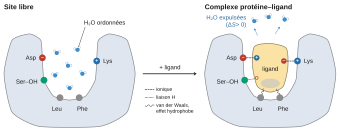
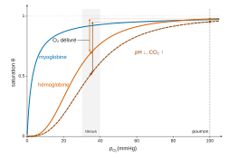
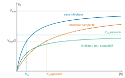
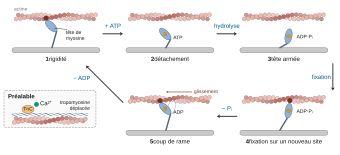
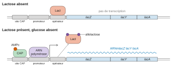
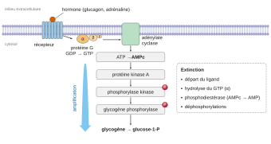

# Agro-Véto BCPST — Biologie 2026 · Corrigé brut

*Corrigé rédigé par IA, non officiel. Signalez toute erreur.*

Épreuve de synthèse, 3 heures, sans calculatrice ni document. Sujet unique : **« Les interactions protéines – ligands »**, accompagné d'un formulaire de biochimie en annexe (acides gras, glycérol, éthanolamine, choline, cholestérol, oses et polyosides, bases azotées, NAD⁺, coenzyme A, les vingt acides α-aminés).

---

## Introduction

Une bactérie comme *Escherichia coli* renferme quelques millions de molécules protéiques, de plusieurs milliers d'espèces différentes, plongées dans un cytoplasme encombré où diffusent des centaines de métabolites. Chaque protéine n'y fixe pourtant, parmi toutes ces molécules, qu'un très petit nombre de partenaires.

Une **protéine** est un polymère linéaire d'acides α-aminés de la série L unis par des liaisons peptidiques. Sa séquence, codée par un gène, détermine un repliement tridimensionnel (structures secondaire, tertiaire et parfois quaternaire) qui rapproche des résidus éloignés dans la chaîne et façonne, en surface ou au fond d'une cavité, des **sites de liaison**. Un **ligand** (du latin *ligare*, lier) est toute entité chimique qui se fixe de manière spécifique sur un tel site, avec une affinité donnée, par des liaisons faibles : ion (Ca²⁺, Fe²⁺), gaz (O₂, CO₂), petite molécule organique (oses, acides gras, nucléotides, coenzymes comme le NAD⁺ ou le coenzyme A de l'annexe), ou macromolécule (autre protéine, acide nucléique, polyoside). L'**interaction protéine – ligand** est la formation d'un complexe protéine–ligand stabilisé par des liaisons **non covalentes** ; elle est donc **réversible** et régie par un équilibre chimique.

On la distingue d'une modification covalente de la protéine (phosphorylation, glycosylation), qui est une transformation chimique et non une association : une telle modification n'entre dans le sujet que parce qu'elle change l'affinité d'un site. L'appariement des bases azotées entre deux acides nucléiques (codon – anticodon compris) n'est pas non plus une interaction protéine – ligand. Le pluriel du libellé invite à envisager la diversité des ligands, des liaisons et des fonctions.

**Problématique.** Comment des liaisons individuellement faibles, de l'ordre de l'agitation thermique, peuvent-elles produire une reconnaissance à la fois spécifique et réversible, et comment cette double propriété fait-elle de l'interaction protéine – ligand le mécanisme élémentaire commun à la catalyse, au transport, à la communication, à la reconnaissance et à la régulation du vivant ?

**Annonce du plan.** Nous établirons d'abord les bases moléculaires et la description quantitative de l'interaction : un complexe non covalent, spécifique, saturable et réversible, dont l'affinité peut être modulée (I). Nous montrerons ensuite que ce mécanisme sous-tend les grandes fonctions cellulaires : catalyse, transport, architecture, mouvement et lecture du génome (II). Nous verrons enfin que, parce qu'elle est modulable, cette interaction porte l'information, fonde la reconnaissance du soi et du non-soi, permet la régulation intégrée de l'organisme et constitue une cible pour l'évolution comme pour l'Homme (III).

---

## I. Un complexe non covalent, spécifique, saturable et réversible

### I.1. Le repliement de la protéine crée un site de liaison complémentaire du ligand

Le squelette peptidique est plan et rigide au niveau de la liaison peptidique ; la liberté de rotation autour des carbones α permet la formation d'hélices α (liaisons hydrogène entre le C=O du résidu *i* et le N–H du résidu *i* + 4) et de feuillets β. En milieu aqueux, le repliement tertiaire est dominé par l'**effet hydrophobe** : les chaînes latérales apolaires (Val, Leu, Ile, Phe, Met) se regroupent au cœur de la protéine, les chaînes polaires et ionisables (Ser, Thr, Asn, Gln, Asp, Glu, Lys, Arg, His) restent au contact de l'eau. La surface obtenue est irrégulière, creusée de poches et de sillons.

Un site de liaison présente avec son ligand une **double complémentarité** :

- **stérique** : la forme de la cavité épouse celle du ligand, ce qui maximise la surface de contact et exclut les molécules de taille ou de géométrie inadaptée ;
- **chimique** : face à un donneur de liaison hydrogène du ligand se trouve un accepteur de la protéine ; face à un groupement chargé négativement (phosphate d'un nucléotide, carboxylate d'un acide gras) se trouve une chaîne latérale de Lys ou d'Arg protonée ; face à une chaîne carbonée ou un cycle aromatique, un environnement apolaire.

Ces contacts engagent surtout les **chaînes latérales** (radicaux) des acides aminés du site, et non les groupements C=O et N–H des liaisons peptidiques, déjà engagés pour l'essentiel dans les structures secondaires. Le site n'est donc défini ni par la seule séquence ni par la seule forme : il naît du rapprochement, par le repliement, de résidus parfois très éloignés dans la structure primaire.

Cette double complémentarité fonde la **spécificité** : une protéine ne fixe qu'un ligand ou une famille étroite de ligands apparentés. Le modèle « clé – serrure » (Fischer) est à nuancer : les protéines sont dynamiques et la fixation du ligand s'accompagne souvent d'un réarrangement du site, l'**ajustement induit** (Koshland). Dans l'hexokinase, les deux lobes de l'enzyme se referment sur le glucose fixé, ce qui exclut l'eau du site et place le glucose face au phosphate terminal de l'ATP.

**Argument : l'expérience d'Anfinsen sur la ribonucléase A.** Cette enzyme est une chaîne de 124 acides aminés stabilisée par quatre ponts disulfure.

1. Traitée par l'urée à 8 mol·L⁻¹, qui rompt les liaisons faibles, et par le β-mercaptoéthanol, qui réduit les ponts disulfure, elle se déplie et perd toute activité.
2. Si l'on retire les deux agents par dialyse puis que l'on laisse les thiols se réoxyder à l'air, l'enzyme retrouve l'essentiel de son activité : la séquence suffit à déterminer la conformation native.
3. Si l'on réoxyde au contraire les thiols en présence d'urée, les quatre ponts se forment au hasard entre les huit cystéines et l'activité ne dépasse pas 1 % environ. Une trace de β-mercaptoéthanol, ajoutée après le retrait de l'urée, permet aux ponts de se réarranger et l'activité revient.

Ce sont donc les **liaisons faibles** qui dirigent le repliement ; les ponts disulfure, covalents, ne font que stabiliser une conformation déjà choisie. L'activité, c'est-à-dire la fixation du substrat, n'existe que dans la conformation native : le site de liaison est un produit du repliement.

### I.2. Des liaisons faibles, nombreuses et additives

Les liaisons qui stabilisent le complexe sont, à de rares exceptions près, non covalentes ; leur énergie individuelle est comparable à l'énergie thermique $RT \approx 2{,}5\ \mathrm{kJ\cdot mol^{-1}}$ à 298 K.

| Type d'interaction | Ordre de grandeur (en milieu aqueux) | Exemple dans un complexe |
|---|---|---|
| Liaison hydrogène | quelques kJ·mol⁻¹ à environ 20 kJ·mol⁻¹ | OH d'une Ser / groupement C=O ou N d'un ligand |
| Interaction ionique | quelques kJ·mol⁻¹ à environ 20 kJ·mol⁻¹, très atténuée par l'eau | Arg⁺ / phosphate d'un nucléotide |
| Interactions de van der Waals | environ 1 à 4 kJ·mol⁻¹ par contact | chaîne de Leu / chaîne carbonée d'un acide gras |
| Effet hydrophobe | contribution surtout entropique, proportionnelle à la surface apolaire enfouie | poche apolaire fixant le cholestérol |
| Liaison de coordination | plus forte, variable | Fe²⁺ de l'hème / O₂ ; Zn²⁺ / His |
| *Liaison covalente (pour comparaison)* | 200 à 500 kJ·mol⁻¹ | pont disulfure entre deux Cys d'une même chaîne : il stabilise la conformation mais ne fixe pas le ligand |

Deux conséquences en découlent.

- **La spécificité résulte de l'additivité.** Les liaisons hydrogène et de van der Waals n'agissent qu'à très courte distance (quelques dixièmes de nanomètre) et avec une orientation précise : seul un ligand de forme exactement complémentaire établit simultanément des dizaines de contacts sur une interface de quelques nm² (quelques centaines d'Ų). Un analogue mal ajusté n'en établit que quelques-uns et se dissocie aussitôt.
- **La liaison est réversible.** Aucune liaison isolée ne résiste à l'agitation thermique ; le complexe se fait et se défait en permanence : c'est un équilibre chimique.

Les rares interactions covalentes entre une protéine et une petite molécule relèvent soit de la catalyse (intermédiaire acyl-enzyme transitoire des protéases à sérine), soit d'une inhibition irréversible (acétylation de la cyclo-oxygénase par l'aspirine, voir III.4) : elles sortent du cadre de l'équilibre.

### I.3. Description quantitative : constante de dissociation, saturation, affinité

Pour une protéine P à un site et un ligand L :

$$\mathrm{P} + \mathrm{L} \;\underset{k_{-1}}{\overset{k_{1}}{\rightleftharpoons}}\; \mathrm{PL}$$

La constante de dissociation, homogène à une concentration ($\mathrm{mol\cdot L^{-1}}$), s'écrit :

$$\begin{aligned}
K_d &= \frac{[\mathrm{P}][\mathrm{L}]}{[\mathrm{PL}]} \\
&= \frac{k_{-1}}{k_{1}}
\end{aligned}$$

La fraction de sites occupés s'obtient en reportant $[\mathrm{PL}] = [\mathrm{P}][\mathrm{L}]/K_d$ :

$$\begin{aligned}
\theta &= \frac{[\mathrm{PL}]}{[\mathrm{P}] + [\mathrm{PL}]} \\
&= \frac{[\mathrm{P}][\mathrm{L}]/K_d}{[\mathrm{P}] + [\mathrm{P}][\mathrm{L}]/K_d} \\
&= \frac{[\mathrm{L}]}{K_d + [\mathrm{L}]}
\end{aligned}$$

$$\boxed{\theta = \frac{[\mathrm{L}]}{K_d + [\mathrm{L}]}}$$

La concentration de complexe en découle :

$$[\mathrm{PL}] = B_{\max}\,\frac{[\mathrm{L}]}{K_d + [\mathrm{L}]}$$

où $B_{\max}$ est la concentration totale de sites et $[\mathrm{L}]$ la concentration de ligand **libre**.

- La courbe $\theta = f([\mathrm{L}])$, tracée en fonction de la concentration de ligand et non du temps, est une **hyperbole** qui tend vers 1 : la liaison est **saturable** parce que les sites sont en nombre fini. C'est le critère expérimental d'une liaison spécifique ; une fixation non spécifique croît au contraire linéairement avec la concentration. On le vérifie en incubant la protéine (ou des cellules) avec un ligand marqué à des concentrations croissantes : la fixation atteint un plateau, et un excès de ligand non marqué déplace le ligand marqué, ce qui prouve que tous deux occupent le même site.
- Pour $[\mathrm{L}] = K_d$, on a $\theta = 1/2$ : **$K_d$ est la concentration de ligand qui occupe la moitié des sites**. Une forte affinité correspond à un **petit** $K_d$.
- **Affinité et spécificité ne sont pas synonymes.** L'affinité mesure, pour un couple donné, la tendance à former le complexe ; $K_d$ la chiffre. La spécificité est la capacité du site à discriminer : elle se lit en comparant les affinités d'une même protéine pour plusieurs ligands. Les deux propriétés dépendent de la conformation du site et de la nature des chaînes latérales qui le bordent.
- L'enthalpie libre standard d'association vaut, en prenant $c^\circ = 1\ \mathrm{mol\cdot L^{-1}}$ :

$$\begin{aligned}
\Delta_r G^\circ_{\text{assoc}} &= -RT \ln K_a \\
&= RT \ln \frac{K_d}{c^\circ}
\end{aligned}$$

Sans calculatrice, $RT\ln 10 \approx 2{,}5 \times 2{,}3 \approx 5{,}7\ \mathrm{kJ\cdot mol^{-1}}$ par décade. Pour $K_d = 10^{-6}\ \mathrm{mol\cdot L^{-1}}$ :

$$\boxed{\Delta_r G^\circ_{\text{assoc}} \approx -6 \times 5{,}7 \approx -34\ \mathrm{kJ\cdot mol^{-1}}}$$

et pour $K_d = 10^{-10}\ \mathrm{mol\cdot L^{-1}}$, $\Delta_r G^\circ_{\text{assoc}} \approx -57\ \mathrm{kJ\cdot mol^{-1}}$. Même une affinité très élevée correspond à une énergie bien inférieure à celle d'une seule liaison covalente : elle s'obtient par la somme de quelques liaisons faibles bien placées.

**L'affinité est ajustée à la fonction et non maximisée :**

| Complexe | $K_d$ (ou $K_M$) typique, mol·L⁻¹ | Signification |
|---|---|---|
| Enzyme / substrat métabolique | $10^{-6}$ à $10^{-3}$ | le complexe se forme puis évolue vite |
| Récepteur / hormone | $10^{-10}$ à $10^{-8}$ | détecter des messagers très dilués |
| Anticorps / antigène | $10^{-11}$ à $10^{-7}$ | neutralisation durable |
| Répresseur LacI / opérateur | de l'ordre de $10^{-13}$ | occupation quasi permanente du site |
| Avidine / biotine | de l'ordre de $10^{-15}$ | liaison quasi irréversible, outil de laboratoire |

Une enzyme qui fixerait trop fortement son substrat le stabiliserait dans le complexe enzyme–substrat, ce qui augmenterait la barrière à franchir vers l'état de transition : la catalyse exige une liaison du substrat modérée.

### I.4. Quand les sites communiquent : coopérativité et allostérie

Lorsqu'une protéine oligomérique porte plusieurs sites, la fixation d'un ligand sur l'un peut modifier l'affinité des autres : c'est la **coopérativité** (effet homotrope). La courbe de saturation devient **sigmoïde** ; on la décrit par l'équation de Hill

$$\theta = \frac{[\mathrm{L}]^{n}}{K^{n} + [\mathrm{L}]^{n}}$$

où $n$ vaut 1 sans coopérativité, et reste inférieur au nombre de sites en cas de coopérativité positive.

**Myoglobine et hémoglobine** fixent le même ligand, O₂, par une liaison de coordination sur le Fe²⁺ d'un même groupement prosthétique, l'hème, mais diffèrent par leur structure quaternaire.

- La **myoglobine**, monomérique, présente une courbe hyperbolique de $P_{50} \approx 3\ \mathrm{mmHg}$ (environ 0,4 kPa). Encore saturée à plus de 90 % à 30 mmHg, elle ne cède son O₂ qu'aux très faibles pressions partielles : c'est une protéine de **réserve** musculaire.
- L'**hémoglobine**, tétramère $\alpha_2\beta_2$ à quatre hèmes, présente une courbe sigmoïde ($n \approx 2{,}8$ ; $P_{50} \approx 26\ \mathrm{mmHg}$, environ 3,5 kPa). Saturée à environ 97 % dans les capillaires pulmonaires (100 mmHg), elle n'est plus saturée qu'à 60 à 75 % dans les tissus (30 à 40 mmHg) : la sigmoïdicité transforme une variation modérée de pression partielle en une forte variation de saturation. C'est une protéine de **transport**.

*Courbes tracées avec les valeurs ci-dessus (Mb : $P_{50} \approx 3$ mmHg ; Hb : $n \approx 2{,}8$, $P_{50} \approx 26$ mmHg, inflexion vers 20 mmHg) ; le décalage de la courbe « pH ↓, CO₂ ↑ » est illustratif. Les doubles flèches comparent l'O₂ délivré entre le poumon (100 mmHg) et les tissus (35 mmHg).*

Le mécanisme est **allostérique** : l'hémoglobine est une protéine allostérique, non une enzyme. L'allostérie suppose qu'une fixation sur un site modifie un **autre site, distant** ; un simple ajustement induit, limité au site occupé, n'en est pas une. La fixation d'O₂ attire le Fe²⁺ dans le plan de l'hème, ce qui déplace l'histidine proximale et l'hélice qui la porte ; ce mouvement se propage aux interfaces entre sous-unités et fait basculer le tétramère d'un état **T** (tendu, faible affinité, stabilisé par des ponts salins entre sous-unités) vers un état **R** (relâché, forte affinité). Dans le modèle concerté (Monod, Wyman, Changeux), les deux états préexistent en équilibre et le ligand déplace cet équilibre en stabilisant l'état qu'il fixe le mieux.

*Schéma 3 — Transition T ⇄ R.* Deux tétramères côte à côte : à gauche l'état T, sous-unités anguleuses reliées par des ponts salins ; à droite l'état R, sous-unités arrondies portant chacune une molécule d'O₂. Flèche vers R : « O₂ (effecteur homotrope positif) » ; flèche vers T : « H⁺, CO₂, 2,3-BPG (effecteurs hétérotropes négatifs) », ces derniers se fixant sur des sites distincts du site de l'hème.

L'allostérie rend l'affinité **modulable par d'autres ligands** fixés sur des sites distincts (effets hétérotropes) :

- le **2,3-bisphosphoglycérate** des hématies se loge dans la cavité centrale de l'état T et abaisse l'affinité ; sa concentration augmente en altitude ;
- l'**effet Bohr** : H⁺ et CO₂, produits par les tissus actifs, stabilisent l'état T et déplacent la courbe vers la droite, ce qui accroît la délivrance d'O₂ là où elle est utile ;
- l'**hémoglobine fœtale** ($\alpha_2\gamma_2$) fixe moins bien le 2,3-BPG ; son affinité pour O₂ est donc supérieure à celle de l'hémoglobine maternelle, ce qui permet le transfert placentaire.

Trois régulations relèvent ainsi d'un seul mécanisme : le déplacement de l'équilibre T ⇄ R par un ligand.

*Transition.* Spécificité, affinité ajustée, saturabilité, réversibilité et modulation allostérique sont des propriétés physico-chimiques générales ; il reste à montrer qu'elles suffisent à engendrer les grandes fonctions de la cellule.

---

## II. L'interaction protéine – ligand, mécanisme élémentaire des fonctions cellulaires

### II.1. La catalyse enzymatique commence par la fixation du substrat

Une enzyme accélère une réaction thermodynamiquement possible sans modifier son équilibre et sans être consommée. Toute catalyse enzymatique commence par une interaction protéine – ligand : la formation du complexe enzyme – substrat dans le **site actif**.

$$\mathrm{E} + \mathrm{S} \;\underset{k_{-1}}{\overset{k_{1}}{\rightleftharpoons}}\; \mathrm{ES} \;\xrightarrow{\;k_{\mathrm{cat}}\;}\; \mathrm{E} + \mathrm{P}$$

En vitesse initiale et sous l'hypothèse d'un état quasi stationnaire pour ES, on obtient l'équation de Michaelis – Menten, de même forme que l'isotherme de saturation de I.3 :

$$\boxed{v_0 = \frac{V_{\max}\,[\mathrm{S}]}{K_M + [\mathrm{S}]}}$$

avec

$$\begin{aligned}
K_M &= \frac{k_{-1} + k_{\mathrm{cat}}}{k_1} \\
V_{\max} &= k_{\mathrm{cat}}\,[\mathrm{E}]_{\mathrm{tot}}
\end{aligned}$$

Le plateau $V_{\max}$ traduit la saturation des sites actifs. $K_M$ est la concentration de substrat qui donne la moitié de la vitesse maximale. Il ne s'identifie à $K_d$ que si $k_{\mathrm{cat}} \ll k_{-1}$.

Le site actif est plus qu'un site de liaison :

- **il fixe mieux l'état de transition que le substrat** : ses liaisons faibles sont optimales pour la forme déformée du substrat en cours de réaction, ce qui abaisse l'énergie d'activation (le lysozyme distord ainsi un résidu osidique de la paroi bactérienne) ;
- **il assure une spécificité de réaction** en orientant les groupements réactifs et en apportant des chaînes latérales catalytiques (His, Asp, Glu en catalyse acide-base ; Ser nucléophile des protéases) ou un ion métallique. La chymotrypsine montre la division du travail entre résidus : une poche hydrophobe de fixation loge la chaîne latérale aromatique (Phe, Tyr, Trp) du résidu dont la liaison peptidique (côté carboxyle) est coupée, ce qui fait la spécificité de substrat ; la triade Ser – His – Asp, d'autres résidus du site, réalise la catalyse ;
- **il fixe souvent un second ligand, cofacteur ou coenzyme.** Le NAD⁺ de l'annexe accepte un ion hydrure (deux électrons et un proton) lors des oxydations de la glycolyse et du cycle de Krebs ; le coenzyme A porte des groupements acyle sur sa fonction thiol (acétyl-CoA, acyl-CoA de la β-oxydation des acides gras). Ces coenzymes libres sont des cosubstrats qui se fixent, sont modifiés, se détachent et sont régénérés par une autre enzyme : ils couplent des voies métaboliques. D'autres cofacteurs restent fixés à demeure (groupements prosthétiques comme l'hème ou le FAD de la succinate déshydrogénase).

Les enzymes ne catalysent pas que des réactions du catabolisme : la RuBisCO, présentée plus bas, catalyse une étape de l'anabolisme.

**Facteurs qui modifient l'interaction enzyme – substrat.**

- La **quantité d'enzyme** fixe le nombre de sites, donc $V_{\max}$ ; elle se règle par l'expression génétique et la dégradation.
- Les **conditions physico-chimiques** agissent sur le site : le pH fixe l'état d'ionisation des chaînes latérales (His, Asp, Glu, Lys), donc les interactions ioniques avec le substrat ; la température accroît l'agitation moléculaire jusqu'à rompre les liaisons faibles du repliement (dénaturation). D'où un optimum de pH et de température.
- Les **modifications covalentes** de l'enzyme changent sa conformation et donc l'affinité ou l'activité du site : la glycogène phosphorylase phosphorylée par la phosphorylase kinase devient active (III.1).

Les **inhibiteurs** illustrent directement le sujet. Un inhibiteur **compétitif**, analogue structural du substrat, occupe le site actif. Le $K_M$ apparent augmente, mais $V_{\max}$ est inchangée : un excès de substrat déplace l'inhibiteur et lève l'inhibition. Un inhibiteur **non compétitif** se fixe sur un autre site et rend inactive la fraction d'enzyme qu'il occupe. Tout se passe comme si l'enzyme était moins abondante : $V_{\max}$ diminue, $K_M$ ne change pas, et un excès de substrat ne lève pas l'inhibition.

*Unités arbitraires ; la courbe non compétitive atteint la moitié de sa $V_{\max}$ apparente au même $K_M$.*

Deux exemples montrent la portée de cette interaction.

- La **RuBisCO**, enzyme la plus abondante de la biosphère, carboxyle le ribulose-1,5-bisphosphate dans le cycle de Calvin, mais son site actif fixe aussi O₂, **ligand compétiteur** du CO₂ : l'activité oxygénase engage la photorespiration, d'autant plus importante que la température s'élève. Les plantes en C4 concentrent le CO₂ autour de la RuBisCO, ce qui réduit cette compétition.
- L'**ATP synthase** : les trois sites catalytiques β de la tête F₁ changent cycliquement d'affinité pour ADP, Pᵢ et ATP sous l'effet de la rotation de la sous-unité γ, entraînée par le flux de protons à travers F₀. L'énergie du gradient sert surtout à libérer l'ATP formé, très fortement fixé : la synthèse est un cycle de changements d'affinité.

### II.2. Transporter et stocker

Fixer réversiblement une molécule permet de la véhiculer dans un milieu où elle est peu soluble, ou de neutraliser sa toxicité.

- **Gaz.** Grâce à l'hémoglobine, le sang transporte environ 70 fois plus d'O₂ que la quantité dissoute dans le plasma.
- **Molécules hydrophobes.** L'**albumine** plasmatique fixe acides gras (comme l'acide palmitique de l'annexe), bilirubine et de nombreux médicaments. Les **lipoprotéines** (chylomicrons, VLDL, LDL, HDL) associent un cœur de triglycérides et d'esters de cholestérol, une monocouche de phospholipides et de cholestérol, et des apolipoprotéines qui sont aussi les ligands des récepteurs cellulaires (apoB-100 et récepteur des LDL).
- **Ligands réactifs.** Le fer libre catalyse la formation d'espèces réactives de l'oxygène ; il circule fixé à la **transferrine** et est stocké dans la **ferritine** (sous forme Fe³⁺).
- **Traversée des membranes.** Le sens d'un transport est fixé par le **potentiel électrochimique** du soluté de part et d'autre de la membrane.
  - Une **perméase** (GLUT, transporteur du glucose) fixe son substrat sur une face, change de conformation et le libère sur l'autre. Le transport est passif : il suit la diminution du potentiel électrochimique du glucose. Le flux, tracé en fonction de la concentration de glucose, atteint un plateau, alors que la diffusion simple croît linéairement : ce plateau révèle un nombre fini de transporteurs, donc la nature protéique du système.
  - Une **pompe** (Na⁺/K⁺-ATPase) couple ce cycle de fixation et de libération à l'hydrolyse de l'ATP, lui-même ligand : elle fait sortir 3 Na⁺ et entrer 2 K⁺ contre leurs gradients (transport actif primaire).
  - Un **cotransporteur** (SGLT1, symport Na⁺ – glucose de l'entérocyte) fixe à la fois Na⁺ et glucose : la descente de Na⁺ selon son potentiel électrochimique, entretenu par la pompe, fait monter le glucose contre le sien (transport actif secondaire). SGLT1 n'hydrolyse pas d'ATP.
  - Un **canal ligand-dépendant** (récepteur nicotinique de l'acétylcholine) s'ouvre lorsque son ligand se fixe.

*Schéma 5 — Protéines membranaires.* Une bicouche avec, de gauche à droite : une perméase (glucose fixé sur la face externe puis libéré côté cytosol), la Na⁺/K⁺-ATPase (3 Na⁺ sortants, 2 K⁺ entrants, ATP fixé côté cytosol), un canal nicotinique (deux acétylcholines fixées, flux de Na⁺ entrant), un récepteur hormonal. Légende commune : chacune commence par fixer un ligand sur un site spécifique ; elles diffèrent par ce que la liaison déclenche.

### II.3. Quand le ligand est une macromolécule : architecture, mouvement, lecture du génome

Les interactions protéine – protéine et protéine – acide nucléique obéissent aux mêmes règles : complémentarité de surface, liaisons faibles multiples, réversibilité.

**Cytosquelette.** Les monomères d'actine G polymérisent en filaments d'actine F, les dimères de tubuline en microtubules. Un nucléotide fixé contrôle ces assemblages : ATP pour l'actine, GTP pour la tubuline. Son hydrolyse après incorporation affaiblit les contacts entre sous-unités, ce qui produit le renouvellement des filaments d'actine (tapis roulant) et l'instabilité dynamique des microtubules.

**Contraction musculaire.** Le cycle des têtes de myosine met en jeu trois ligands : l'actine, l'ATP et ses produits d'hydrolyse, le Ca²⁺.

1. La tête de myosine, sans nucléotide, est fortement liée à l'actine (état de rigidité).
2. La fixation d'un ATP diminue fortement l'affinité de la tête pour l'actine : la tête se détache.
3. L'hydrolyse de l'ATP en ADP + Pᵢ, qui restent fixés, redresse la tête (tête « armée »).
4. La tête chargée d'ADP + Pᵢ se fixe sur un nouveau site de l'actine.
5. La libération de Pᵢ déclenche le basculement de la tête (coup de rame) qui fait glisser le filament d'actine ; l'ADP est ensuite libéré et l'on revient à l'état 1.

Le Ca²⁺ conditionne ce cycle : en se fixant sur la troponine C, il provoque le déplacement de la tropomyosine qui démasque les sites de fixation de la myosine sur l'actine. La rigidité cadavérique, due à l'absence d'ATP, montre que c'est la **fixation d'un ligand** qui permet le **détachement** : le mouvement naît d'une succession réglée de fixations et de libérations.

**Adhérence.** Les **cadhérines** assurent des liaisons homophiles entre cellules voisines, rigidifiées par la fixation de Ca²⁺ ; les **intégrines** relient le cytosquelette à la matrice extracellulaire en reconnaissant des motifs peptidiques courts, comme la séquence Arg-Gly-Asp (RGD) de la fibronectine. Chez les végétaux, les **expansines**, actives à pH acide, desserrent les liaisons non covalentes entre microfibrilles de cellulose et hémicelluloses, ce qui autorise l'élongation des cellules.

**Lecture du génome.** Les interactions protéine – acide nucléique sont spécifiques ou non d'une séquence.

- Les **histones**, riches en Lys et Arg chargées positivement, fixent les phosphates du squelette de l'ADN quelle que soit la séquence : l'interaction, ionique et non spécifique, compacte la chromatine. Les ARN et ADN polymérases glissent de même sur l'ADN avant de reconnaître un promoteur ou une origine.
- Le grand sillon de l'ADN expose, pour chaque paire de bases, un motif propre de donneurs et d'accepteurs de liaisons hydrogène. Un **facteur de transcription** y engage une hélice α (motifs hélice-tour-hélice, doigt de zinc, glissière à leucine) et reconnaît une séquence sans ouvrir la double hélice : l'interaction est spécifique et permet le contrôle de la transcription. L'**opéron lactose** d'*E. coli* combine deux interactions :

- le répresseur LacI fixé sur l'opérateur empêche la transcription ; l'**allolactose**, issu du lactose, se fixe sur un site allostérique de LacI, qui perd son affinité pour l'opérateur : l'opéron est dérépressé ;
- l'activateur CAP (protéine activatrice du catabolisme) ne se fixe sur son site, en amont du promoteur, qu'après avoir fixé l'**AMP cyclique**, abondant quand le glucose manque ; il favorise alors le recrutement de l'ARN polymérase.

L'opéron n'est fortement transcrit qu'en présence de lactose et en absence de glucose : deux équilibres de liaison réalisent une véritable logique de commande. Chez les eucaryotes, les **récepteurs nucléaires** des hormones stéroïdes (dérivées du cholestérol de l'annexe) sont des facteurs de transcription dont l'activité dépend de la fixation de l'hormone.

*En haut, l'état de CAP, qui dépend du glucose, n'est pas figuré.*

*Transition.* Ces fonctions reposent sur des interactions dont l'affinité peut varier : c'est cette modulabilité qui permet à la cellule et à l'organisme de traiter de l'information.

---

## III. Une interaction modulable : informer, reconnaître, réguler, évoluer

### III.1. Porter l'information : récepteurs et transduction

Un messager (hormone, neurotransmetteur, phytohormone) n'agit que sur les cellules qui expriment son **récepteur** : la spécificité de la réponse réside dans le récepteur, non dans le message.

Le récepteur est une protéine, et sa localisation dépend de la nature chimique du messager. Un messager hydrophile ne traverse pas la bicouche : l'acétylcholine, l'adrénaline (catécholamine dérivée de la tyrosine), le glucagon et l'insuline (peptides) se fixent sur des récepteurs membranaires. Un messager lipophile la traverse : les hormones stéroïdes se fixent sur des récepteurs intracellulaires (II.3).

L'interaction récepteur – ligand est spécifique, de haute affinité ($K_d$ de $10^{-10}$ à $10^{-8}\ \mathrm{mol\cdot L^{-1}}$, adaptée à des messagers très dilués), saturable et réversible ; elle est en outre **transductrice** : la fixation provoque un changement de conformation du récepteur qui déclenche une réponse.

- **Récepteurs canaux** : le récepteur nicotinique de la jonction neuromusculaire s'ouvre en une milliseconde environ lorsqu'il fixe deux molécules d'acétylcholine.
- **Récepteurs couplés aux protéines G** (récepteurs β-adrénergiques, récepteur du glucagon) : le récepteur activé fait échanger le GDP contre du GTP sur la sous-unité α d'une protéine G trimérique, qui active l'adénylate cyclase ; l'AMPc produit active la protéine kinase A (PKA).
- **Récepteurs à activité tyrosine kinase** : le récepteur de l'insuline, dimère préexistant $(\alpha\beta)_2$ lié par des ponts disulfure, change de conformation quand il fixe l'insuline ; ses sous-unités β se phosphorylent mutuellement et recrutent des protéines relais.

Chaque étage d'une cascade est un nouveau couple protéine – ligand (hormone/récepteur, GTP/protéine G, AMPc/PKA), et chaque enzyme activée en active de nombreuses autres : la cascade **amplifie** le signal. Dans l'hépatocyte, la fixation de glucagon ou d'adrénaline aboutit, par la PKA, la phosphorylase kinase puis la glycogène phosphorylase, à la libération de glucose-1-phosphate à partir du glycogène, avec un gain de plusieurs ordres de grandeur.

La réversibilité fournit l'**extinction** du signal : départ du ligand, hydrolyse du GTP par la sous-unité α, dégradation de l'AMPc par la phosphodiestérase, déphosphorylations. Elle permet aussi la **plasticité** : une stimulation prolongée provoque la désensibilisation puis l'internalisation des récepteurs, ce qui diminue $B_{\max}$ ; la cellule règle ainsi sa sensibilité en jouant sur $K_d$ et $B_{\max}$.

### III.2. Reconnaître le soi et le non-soi, reconnaître un partenaire

**Immunité adaptative.** Un **anticorps** est formé de deux chaînes lourdes et deux chaînes légères ; les domaines variables de l'une et de l'autre forment le **paratope**, site complémentaire d'un **épitope** de l'antigène (quelques acides aminés ou quelques oses). L'interface, de l'ordre de 700 à 900 Ų, engage une quinzaine de liaisons faibles ; les $K_d$ atteignent $10^{-11}\ \mathrm{mol\cdot L^{-1}}$. La bivalence des IgG permet de former des complexes immuns.

*Schéma 9 — Anticorps et antigène.* Anticorps en Y : chaînes lourdes et légères, domaines variables à l'extrémité des bras, fragment Fc ; deux paratopes fixant deux épitopes d'un même antigène ; agrandissement de l'interface montrant des liaisons faibles entre résidus.

La diversité des paratopes est produite **avant** toute rencontre avec l'antigène, par recombinaison somatique des segments V(D)J. La **sélection clonale** est un tri par affinité : seuls les lymphocytes B dont le récepteur fixe l'antigène sont activés. La **maturation d'affinité** (hypermutation somatique des domaines variables puis sélection des clones les plus affins dans les centres germinatifs) diminue le $K_d$ au cours de la réponse. Les molécules du **complexe majeur d'histocompatibilité** (CMH) présentent dans leur sillon des peptides de 8 à 10 acides aminés (CMH I) ou de 13 à 25 environ (CMH II) ; le récepteur T reconnaît à la fois le peptide et la molécule de CMH qui le présente : c'est la restriction par le CMH.

**Interactions entre organismes.** La symbiose *Rhizobium* – légumineuse débute par un échange de ligands : les flavonoïdes de la racine sont perçus par une protéine NodD de la bactérie, qui produit alors des **facteurs Nod**, lipo-chito-oligosaccharides dérivés de la chitine de l'annexe ; ces facteurs sont reconnus par des récepteurs-kinases à motifs LysM des cellules racinaires, ce qui déclenche l'incurvation du poil absorbant, le cordon d'infection et l'organogenèse du nodule. La spécificité d'hôte dépend de cette reconnaissance. L'immunité innée des plantes repose sur des récepteurs membranaires qui fixent des motifs microbiens conservés (fragments de chitine fongique, flagelline bactérienne).

**Fécondation.** Chez les Mammifères, des glycoprotéines de la zone pellucide sont reconnues par des protéines de la membrane du spermatozoïde ; cette fixation contribue à la spécificité d'espèce et déclenche la réaction acrosomique.

### III.3. Réguler et intégrer

Réguler, c'est presque toujours modifier une interaction protéine – ligand, soit en changeant la concentration du ligand, soit en changeant l'affinité de la protéine.

**Échelle d'une voie : la phosphofructokinase-1.** La PFK-1 catalyse une étape irréversible de la glycolyse (fructose-6-phosphate + ATP → fructose-1,6-bisphosphate + ADP). C'est une enzyme allostérique : elle présente une coopérativité pour son substrat, le fructose-6-phosphate (effet homotrope), et des effecteurs hétérotropes fixés sur des sites distincts du site actif. L'ATP, à la fois substrat et inhibiteur, se fixe à forte concentration sur un site régulateur et stabilise l'état de faible affinité pour le fructose-6-phosphate ; le citrate et les ions H⁺ inhibent également ; l'AMP, l'ADP et le fructose-2,6-bisphosphate activent. La cellule ajuste ainsi en quelques instants le débit de la glycolyse à sa charge énergétique.

*Schéma 10 — Régulation de la PFK-1.* La glycolyse jusqu'au cycle de Krebs ; la PFK-1 sur l'étape fructose-6-P → fructose-1,6-bisP ; flèches d'activation (AMP, ADP, fructose-2,6-bisP) et d'inhibition (ATP, citrate, H⁺), avec une boucle de rétro-inhibition depuis l'ATP et le citrate produits en aval.

**Échelle de l'organisme : l'homéostasie glycémique.** Dans la cellule β des îlots de Langerhans, la **glucokinase**, de faible affinité pour le glucose (demi-saturation vers 8 mmol·L⁻¹, proche de la glycémie), fait varier le flux glycolytique avec la glycémie : elle est le capteur. L'élévation du rapport ATP/ADP ferme les canaux potassiques sensibles à l'ATP (encore une fixation de ligand), la cellule se dépolarise, le Ca²⁺ entre et l'insuline est sécrétée. L'insuline se fixe sur son récepteur des cellules musculaires et adipeuses, ce qui provoque l'insertion dans la membrane de transporteurs GLUT4 et augmente l'entrée du glucose ; elle stimule aussi la glycogénogenèse hépatique. Le glucagon agit en sens inverse par un récepteur couplé aux protéines G. Une boucle de régulation est une chaîne d'interactions protéine – ligand : détection, transmission, effection.

**Chez les végétaux : l'auxine.** L'auxine se loge à l'interface entre le récepteur TIR1, sous-unité d'un complexe ubiquitine-ligase, et un répresseur de la famille Aux/IAA, dont elle augmente l'affinité pour TIR1 (« colle moléculaire »). Le répresseur est alors ubiquitinylé et dégradé par le protéasome, ce qui libère les facteurs de transcription ARF. Un petit ligand commande ainsi, en modifiant une affinité protéine – protéine, un programme d'expression génétique (élongation cellulaire, rhizogenèse, dominance apicale).

**Échelle du développement.** Le développement embryonnaire enchaîne des interactions protéine – ligand. La fécondation commence par la reconnaissance de la zone pellucide par le spermatozoïde (III.2). Chez les Amphibiens, l'induction du mésoderme repose sur des facteurs protéiques sécrétés par les cellules végétatives (famille du TGF-β), qui se fixent sur des récepteurs membranaires des cellules de la zone marginale et y activent des gènes du mésoderme. La réponse dépend de la concentration du signal, donc du taux d'occupation des récepteurs : une même interaction, lue à des concentrations différentes, spécifie des territoires différents.

### III.4. Une cible pour l'évolution, une cible pour l'Homme

**Évolution.** Les résidus des sites de liaison sont parmi les plus conservés d'une protéine, car leur mutation altère la fonction ; cette conservation aide à repérer les sites fonctionnels dans les alignements. Les **duplications géniques** suivies de divergence créent de nouvelles affinités : la famille des globines (myoglobine, chaînes α, β, γ) dérive d'un gène ancestral, et la divergence a produit des protéines de réserve, de transport adulte et de transfert placentaire. La **coévolution** hôte – pathogène porte sur des interfaces de liaison : une mutation du récepteur cellulaire utilisé par un virus confère une résistance, une mutation de la protéine d'attachement virale la contourne.

**Pharmacologie.** La plupart des médicaments sont des ligands :

- les **agonistes** miment le ligand naturel et déclenchent la réponse (salbutamol sur les récepteurs β₂ bronchiques) ;
- les **antagonistes** occupent le site sans activer le récepteur (β-bloquants ; curare sur le récepteur nicotinique) ; affinité et efficacité sont deux propriétés distinctes ;
- les **inhibiteurs enzymatiques** compétitifs ou non compétitifs ;
- les **inhibiteurs irréversibles** forment une liaison covalente : l'aspirine acétyle une sérine du site actif de la cyclo-oxygénase et bloque la conversion de l'**acide arachidonique** de l'annexe en prostaglandines et thromboxanes.

**Agronomie et biotechnologies.** Le **glyphosate**, analogue du phosphoénolpyruvate, inhibe l'EPSP synthase (5-énolpyruvylshikimate-3-phosphate synthase) de la voie de synthèse des acides aminés aromatiques (Phe, Tyr, Trp), présente chez les végétaux et les micro-organismes et absente chez les animaux. Les insecticides organophosphorés phosphorylent la sérine du site actif de l'acétylcholinestérase ; les résistances observées dans les populations d'insectes tiennent souvent à une mutation de la cible qui diminue son affinité pour l'insecticide.

L'interaction protéine – ligand est enfin un outil : dosage immuno-enzymatique (ELISA) et immunomarquages (anticorps – antigène), couple avidine – biotine, chromatographie d'affinité. Dans cette dernière, un ligand de la protéine recherchée est greffé sur la phase stationnaire. La protéine s'y fixe et est retenue, les autres sont éluées. On la décroche ensuite par un excès de ligand libre, qui entre en compétition pour le site, ou en changeant le pH ou la force ionique, ce qui rompt les liaisons faibles. Une protéine étiquetée par des histidines, retenue par un ion métallique immobilisé, en est une variante.

---

## Conclusion

L'interaction protéine – ligand repose sur un petit nombre de principes : un site de liaison façonné par le repliement d'une chaîne polypeptidique, une complémentarité stérique et chimique avec le ligand, des liaisons non covalentes individuellement faibles mais additives, un équilibre caractérisé par une constante de dissociation, une saturation due au nombre fini de sites, et la possibilité qu'un autre ligand modifie l'affinité du premier. De ces principes découlent la catalyse enzymatique, le transport et le stockage, l'architecture et le mouvement cellulaires, la lecture du génome, la communication hormonale et nerveuse, la reconnaissance immunitaire et symbiotique, et la régulation intégrée du métabolisme.

**La propriété décisive n'est pas la force de la liaison mais sa réversibilité** : parce que chaque liaison est de l'ordre de l'agitation thermique, le complexe se défait, et parce qu'il se défait, il peut être régulé et porter une information. L'affinité n'est pas maximisée mais ajustée à la fonction, et la sélection naturelle agit précisément sur elle.

**Ouverture.** La prédiction des structures protéiques et des complexes protéine – ligand à partir des séquences a beaucoup progressé ces dernières années et permet aujourd'hui de concevoir des ligands, et même des protéines, dotés d'affinités choisies. Mais toute interaction ciblée par l'Homme est aussi un lieu de sélection : les résistances aux herbicides, aux insecticides et aux antibiotiques par modification de la protéine cible rappellent qu'agir sur une interaction moléculaire, c'est agir sur une population qui évolue.
