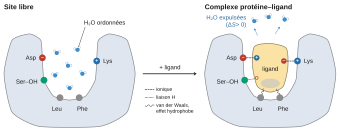
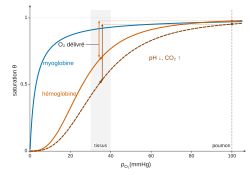
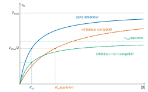
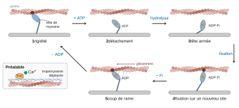
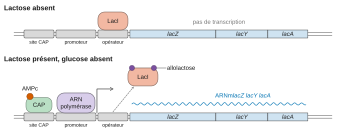
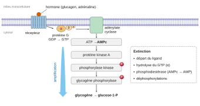

# Agro-Véto BCPST — Biologie 2026 · Corrigé guidé

*Corrigé rédigé par IA, non officiel. Signalez toute erreur.*

## Présentation du sujet

**Nature de l'épreuve.** Synthèse de biologie de 3 heures, sans calculatrice, ni table, ni document. Le sujet tient en un intitulé, **« Les interactions protéines – ligands »**, suivi d'une annexe de quatre pages, le « formulaire de biochimie ». On y trouve :

- deux acides gras (palmitique, saturé ; arachidonique, polyinsaturé), le glycérol, l'éthanolamine, la choline et le cholestérol ;
- des oses et des polyosides : ribose, désoxyribose, fructose, saccharose, amidon, glycogène, cellulose, pectine, chitine et acide hyaluronique (exemple de glycosaminoglycane) ;
- les cinq bases azotées, le NAD⁺ et le coenzyme A ;
- les vingt acides α-aminés de la série L.

Il n'y a ni question intermédiaire, ni document à analyser, ni donnée numérique : tout le travail consiste à construire et à rédiger une démonstration organisée.

**Thème et notions mobilisées.** Le sujet est transversal mais centré sur un chapitre de première année : la relation structure – fonction des protéines. Il mobilise :

- en biochimie : structure des protéines, liaisons faibles, site de liaison, spécificité, affinité, saturation, coopérativité et allostérie (myoglobine et hémoglobine), cinétique enzymatique, inhibitions, coenzymes ;
- en biologie cellulaire : transporteurs membranaires, cytosquelette, contraction, adhérence ;
- en biologie moléculaire : régulation de l'expression génétique (opéron lactose, récepteurs nucléaires) ;
- en physiologie : transduction, régulation de la glycémie, transport de l'O₂ ;
- en immunologie : anticorps, CMH, sélection clonale ;
- en biologie végétale : RuBisCO, symbiose rhizobienne, auxine ;
- enfin, évolution et applications : familles multigéniques, pharmacologie, herbicides, résistances.

**À quoi sert l'annexe.** Elle ne pose aucune question, mais elle indique la largeur attendue : les ligands peuvent être des lipides, des glucides, des nucléotides, des coenzymes, et les chaînes latérales des acides aminés sont « l'alphabet » des sites de liaison. Il faut s'en servir pour **nommer précisément** les molécules et pour justifier la chimie d'un site (Lys et Arg chargées positivement face à un phosphate, Leu et Phe apolaires face à une chaîne carbonée), toujours en lien avec un ligand précis. Attention, l'annexe contient trois coquilles à ne pas recopier : la thréonine est abrégée « Tre » au lieu de Thr, l'asparagine « Asp » au lieu d'Asn, et le tryptophane est dessiné avec un noyau indole mal représenté.

> [!JURY]
> Le formulaire était une nouveauté de la session 2026. Le rapport 2026 regrette qu'il ait été peu et mal utilisé : des copies présentent les radicaux des acides aminés sans lien avec une interaction, d'autres inventent des liaisons fantaisistes entre une protéine et un ligand. Il conclut : « le jury recommande une utilisation raisonnée du formulaire, au service de l'argumentation et en lien direct avec la problématique traitée » (p. 10).

**Difficulté et longueur.** Le sujet est classique, et c'est ce qui le rend exigeant. Tout le monde a de quoi écrire, et la tentation est grande de réciter : un chapitre « structure des protéines », un chapitre « enzymes », un chapitre « hémoglobine ». La différence se fait sur trois points :

- une **définition rigoureuse** du ligand et de l'interaction (non covalente, réversible, spécifique, saturable) ;
- un **formalisme quantitatif** minimal et juste ($K_d$, saturation, Michaelis – Menten, Hill) ;
- une **démonstration** : montrer que les mêmes propriétés expliquent des fonctions très diverses, et que la réversibilité est ce qui rend la régulation possible.

**Ce que le rapport 2026 juge discriminant.** Sur 2 808 copies, la moyenne est de 10,31/20 (écart type 3,73, médiane 10,4). Les compétences de rédaction et d'argumentation pèsent environ un tiers de la note. Le rapport signale, parmi les notions attendues, celles qui ont le plus manqué :

- le lien entre structure tridimensionnelle et **formation du site**, « rarement développé » de façon satisfaisante (p. 11) ;
- les **liaisons faibles** et le rôle des **chaînes latérales**, souvent oubliés ou confondus avec les ponts disulfure et les C=O/N–H de la liaison peptidique ;
- la **réversibilité**, rarement abordée ;
- les **facteurs** qui modifient l'interaction enzyme – substrat (quantité d'enzyme, conditions physico-chimiques, modifications covalentes), très rarement abordés ;
- les **transporteurs**, souvent oubliés, sans lien avec le potentiel électrochimique ;
- les **interactions protéines – acides nucléiques** proprement dites, très rarement évoquées ;
- l'importance de ces interactions au cours du **développement**, souvent oubliée.

Côté forme, la conclusion est le point faible : 41 % des copies y obtiennent 0 ou 1 sur 3. L'argumentation est au contraire présente à un niveau suffisant ou satisfaisant dans 85 % des copies.

**Gestion du temps conseillée.** Environ 30 minutes de brouillon pour analyser les termes, problématiser, bâtir le plan et choisir les exemples et les schémas. Une quinzaine de minutes pour rédiger l'introduction au propre. Environ 2 heures pour le développement, en trois parties équilibrées, en dessinant les schémas au fur et à mesure. Enfin 10 minutes pour la conclusion et 5 minutes de relecture (noms de molécules, unités, flèches).

**Ce qu'il ne faut pas laisser passer.**

- La définition de $K_d$ et sa lecture : c'est la concentration de demi-saturation, et un petit $K_d$ signifie une forte affinité.
- La distinction entre affinité et spécificité.
- La comparaison myoglobine – hémoglobine avec ses deux courbes, et l'équation de Michaelis – Menten reliée à la saturation.
- Deux ou trois arguments expérimentaux réellement exploités, par exemple l'expérience d'Anfinsen et une courbe de saturation.
- Au moins un exemple végétal et un exemple microbien, un transporteur relié au potentiel électrochimique, une interaction protéine – ADN.
- L'extinction du signal comme preuve du rôle de la réversibilité.

## Partie 1 — Préparer la synthèse au brouillon

Le brouillon est l'endroit où se gagne la note : définir chaque terme, transformer l'intitulé en question, choisir un plan qui démontre, et répartir les exemples. Les quatre étapes ci-dessous correspondent aux trente premières minutes.

### Étape 1 — Analyser les termes du sujet

> [!INDICATION]
> Définissez séparément « protéine », « ligand » et « interaction », puis demandez-vous ce que le pluriel et le trait d'union ajoutent.

> [!INDICATION]
> Un bon critère pour délimiter le sujet : qu'est-ce qui distingue une interaction d'une modification chimique de la protéine ? Pensez à la nature des liaisons et à la réversibilité.

> [!INDICATION]
> Faites l'inventaire des tailles de ligands possibles, de l'ion à la macromolécule, et vérifiez que l'annexe en fournit plusieurs familles.

#### Solution

- **Protéine** : polymère d'acides α-aminés de la série L reliés par des liaisons peptidiques, dont la séquence (codée par un gène) détermine un repliement tridimensionnel. Ce repliement crée des **sites de liaison** en rapprochant dans l'espace des résidus éloignés dans la séquence.
- **Ligand** : toute entité qui se fixe de manière spécifique sur un site d'une protéine, avec une affinité donnée, par des liaisons faibles. Ce peut être un ion (Ca²⁺, Fe²⁺, Zn²⁺), un gaz (O₂, CO₂), une petite molécule organique (oses, acides gras, nucléotides, coenzymes, hormones), ou une macromolécule (protéine, ADN, polyoside). Le mot vient du latin *ligare*, lier.
- **Interaction** : formation d'un complexe protéine – ligand stabilisé par des liaisons **non covalentes**. Elle est donc réversible et décrite par un équilibre chimique.

**Délimitation.** Une phosphorylation, une glycosylation ou une acétylation sont des modifications covalentes. Elles ne sont pas en elles-mêmes des interactions protéine – ligand : la fixation de l'ATP sur une kinase en est une, mais le transfert du phosphate sur la protéine cible n'en est pas une. Elles entrent pourtant dans le sujet comme **facteurs de contrôle**, parce qu'elles changent la conformation et donc l'affinité d'un site. Les interactions protéine – protéine et protéine – ADN entrent dans le sujet : un ligand n'est pas nécessairement petit. L'appariement des bases entre deux acides nucléiques, en revanche, n'en fait pas partie.

**Le pluriel** impose une typologie : diversité des ligands, des liaisons et des fonctions. **Le trait d'union** désigne le complexe, c'est-à-dire la relation entre les deux partenaires, et non chacun d'eux isolément.

> [!PIEGE]
> Le hors-sujet le plus fréquent consiste à réciter la synthèse et la structure des protéines (structures primaire à quaternaire) sans jamais parler de liaison d'un ligand. Le rapport 2026 relève que de nombreuses copies ont ainsi perdu beaucoup de temps en première partie. La structure n'est utile que pour expliquer comment naît un site de liaison.

> [!JURY]
> Le rapport 2026 donne la définition attendue : « Un ligand peut être défini comme une molécule se fixant de manière spécifique à une protéine, avec une certaine affinité, via des liaisons faibles. » (p. 2). Il a valorisé les copies qui étendaient le sujet aux interactions protéines – protéines des édifices supramoléculaires (jonctions cellulaires, moteurs moléculaires).

> [!METHODE]
> Pour tout sujet de synthèse, écrivez au brouillon une définition de chaque mot, puis une phrase qui dit ce qui est **exclu** du sujet. Cette phrase de délimitation figurera dans l'introduction.

### Étape 2 — Formuler la problématique

> [!INDICATION]
> Cherchez une tension, voire un paradoxe, entre une propriété physico-chimique de la liaison et ce qu'elle permet en biologie.

> [!INDICATION]
> Comparez l'énergie d'une liaison faible avec l'énergie thermique $RT$. Que faut-il pour qu'un complexe soit à la fois stable et spécifique ? Et que permet le fait qu'il se défasse ?

#### Solution

Les liaisons qui stabilisent un complexe protéine – ligand sont individuellement de l'ordre de l'agitation thermique ($RT \approx 2{,}5\ \mathrm{kJ\cdot mol^{-1}}$ à 298 K). On en tire une problématique en deux temps :

**Comment des liaisons individuellement faibles peuvent-elles produire une reconnaissance à la fois spécifique et réversible, et comment cette double propriété fait-elle de l'interaction protéine – ligand le mécanisme élémentaire commun à la catalyse, au transport, à la communication, à la reconnaissance et à la régulation du vivant ?**

Le premier temps (faiblesse, puis spécificité) appelle une partie physico-chimique. Le second (réversibilité, puis régulation et information) appelle les parties fonctionnelles.

> [!JURY]
> Le rapport 2026 rappelle que « reformuler le sujet sous une forme interrogative ne consiste pas en une problématisation de ce dernier, et n'est donc pas satisfaisant » (p. 3). Il met aussi en garde contre les problématiques trop complexes, nées d'un désir d'originalité, et propose une formulation qui suffisait : « Quelles modalités régissent les interactions protéines-ligands, quelles en sont les conséquences aux différentes échelles de l'organisme et comment ces interactions sont-elles contrôlées ? » (p. 4). La problématique ci-dessus est plus ambitieuse ; elle n'est utile que si chaque partie y répond explicitement.

> [!PIEGE]
> L'introduction ne doit pas traiter à l'avance le développement. Le rapport 2026 cite l'exemple d'introductions trop longues qui expliquaient déjà la réversibilité des interactions au niveau d'un site spécifique. Une phrase de définition suffit ; la démonstration vient en partie I.

### Étape 3 — Construire le plan

> [!INDICATION]
> Un plan progressif va du mécanisme à ses conséquences. Demandez-vous quelle partie doit fournir le vocabulaire et le formalisme aux suivantes.

> [!INDICATION]
> Méfiez-vous des plans « par types de ligands » (ions, petites molécules, macromolécules) ou « par disciplines » (biochimie, physiologie animale, biologie végétale) : ils obligent à répéter trois fois la même chose.

> [!INDICATION]
> Pour la dernière partie, cherchez ce qu'apporte la réversibilité en plus de la spécificité : l'information, la régulation et l'action de l'évolution ou de l'Homme.

#### Solution

Plan retenu, progressif :

| Partie | Idée directrice | Sous-parties et exemples-clés |
|---|---|---|
| I. Un complexe non covalent, spécifique, saturable et réversible | les propriétés et leur description quantitative | I.1 site de liaison et complémentarité ; I.2 liaisons faibles additives ; I.3 $K_d$, saturation, énergie, affinité ajustée ; I.4 coopérativité et allostérie (myoglobine / hémoglobine) |
| II. Mécanisme élémentaire des fonctions cellulaires | ces propriétés suffisent à engendrer les fonctions | II.1 catalyse (Michaelis – Menten, état de transition, coenzymes, inhibiteurs, RuBisCO, ATP synthase) ; II.2 transport et stockage (Hb, albumine, lipoprotéines, transferrine, perméases, pompes, canaux) ; II.3 ligands macromoléculaires (cytosquelette, myosine, adhérence, expansines, facteurs de transcription, opéron lactose) |
| III. Une interaction modulable | la réversibilité rend possibles l'information et la régulation | III.1 récepteurs et transduction ; III.2 reconnaissance (anticorps, CMH, facteurs Nod, fécondation) ; III.3 régulation (PFK-1, glycémie, auxine) ; III.4 évolution et applications (globines, coévolution, médicaments, glyphosate, outils) |

Prévoir 8 à 10 schémas : site de liaison, courbes Mb/Hb, transition T ⇄ R, cinétique avec inhibiteurs, protéines membranaires, cycle de la myosine, opéron lactose, cascade de transduction, anticorps – antigène, régulation de la PFK-1. Un **schéma-bilan** final peut récapituler les propriétés et les fonctions.

> [!JURY]
> Le rapport 2026 constate que beaucoup de plans « par fonctions » montrent bien l'importance des interactions mais oublient leurs modalités moléculaires. Il indique qu'« il était possible de traiter d'abord des modalités des interactions protéines-ligands, avant d'aborder les grandes fonctions dans lesquelles interviennent ces interactions, ainsi que les contrôles associés » (p. 5). C'est la logique du plan retenu ici.

> [!METHODE]
> Vérifiez l'équilibre de votre plan avec une grille : chaque grande partie doit contenir au moins un exemple animal, un exemple végétal ou microbien, et un schéma. Pour ce sujet, cela donne par exemple RuBisCO et opéron lactose en II, facteurs Nod et auxine en III.

### Étape 4 — Rédiger l'introduction

> [!INDICATION]
> Une introduction complète comporte une accroche, des définitions, une délimitation, une problématique et l'annonce du plan.

> [!INDICATION]
> Pour l'accroche, cherchez un fait concret qui montre que la reconnaissance entre molécules est un problème difficile dans une cellule réelle.

#### Solution

Une bactérie comme *Escherichia coli* renferme quelques millions de molécules protéiques, de plusieurs milliers d'espèces différentes, plongées dans un cytoplasme encombré où diffusent des centaines de métabolites. Chaque protéine n'y fixe pourtant, parmi toutes ces molécules, qu'un très petit nombre de partenaires.

Une **protéine** est un polymère linéaire d'acides α-aminés de la série L unis par des liaisons peptidiques ; sa séquence détermine un repliement tridimensionnel qui façonne des **sites de liaison**. Un **ligand** est toute entité chimique qui se fixe de manière spécifique sur un tel site, avec une affinité donnée, par des liaisons faibles : ion, gaz, petite molécule organique (oses, acides gras, nucléotides, coenzymes comme le NAD⁺ ou le coenzyme A) ou macromolécule. L'**interaction protéine – ligand** est la formation d'un complexe stabilisé par des liaisons non covalentes. Elle est réversible et régie par un équilibre chimique, ce qui la distingue d'une modification covalente comme la phosphorylation ; celle-ci n'entre dans le sujet que parce qu'elle change l'affinité d'un site.

**Problématique** : celle de l'étape 2.

**Annonce du plan.** Nous établirons d'abord les bases moléculaires et la description quantitative de l'interaction (I). Nous montrerons ensuite que ce mécanisme sous-tend les grandes fonctions cellulaires (II). Nous verrons enfin que, parce qu'elle est modulable, cette interaction porte l'information, fonde la reconnaissance, permet la régulation intégrée et constitue une cible pour l'évolution comme pour l'Homme (III).

> [!PIEGE]
> Ne pas annoncer un plan différent de celui qui est réellement suivi : les titres des parties doivent reprendre les termes de l'annonce.

## Partie 2 — Rédiger le développement

Le développement doit **démontrer**. Chaque paragraphe commence par une idée, l'illustre par un exemple précis et se termine par une phrase qui le rattache au fil directeur (spécificité, affinité, saturation, réversibilité, modulation).

### Étape 5 — Partie I : un complexe non covalent, spécifique, saturable et réversible

> [!INDICATION]
> Partez du repliement de la protéine pour expliquer l'existence d'un site, puis de la nature des liaisons pour expliquer la spécificité et la réversibilité.

> [!INDICATION]
> Écrivez l'équilibre P + L ⇌ PL et sa constante de dissociation, puis exprimez la fraction de sites occupés en fonction de la seule concentration du ligand libre.

> [!INDICATION]
> Pour argumenter, cherchez une expérience qui sépare le rôle des liaisons faibles de celui des ponts disulfure dans l'acquisition de la conformation, puis reliez cette conformation à l'activité.

> [!INDICATION]
> Pour l'allostérie, une comparaison à deux protéines est plus démonstrative qu'une description isolée : choisissez deux protéines qui fixent le même ligand mais diffèrent par leur structure quaternaire.

#### Solution

**I.1. Le repliement crée un site de liaison complémentaire du ligand.** Le squelette peptidique est plan au niveau de la liaison peptidique ; les rotations autour des carbones α permettent hélices α (liaisons hydrogène entre le C=O du résidu *i* et le N–H du résidu *i* + 4) et feuillets β. En milieu aqueux, l'**effet hydrophobe** regroupe les chaînes apolaires (Val, Leu, Ile, Phe, Met) au cœur de la protéine et laisse au contact de l'eau les chaînes polaires et ionisables (Ser, Thr, Asn, Gln, Asp, Glu, Lys, Arg, His). La surface est creusée de poches.

Le site présente avec son ligand une **complémentarité stérique**, de forme, et une **complémentarité chimique** : un donneur de liaison hydrogène fait face à un accepteur, un phosphate ou un carboxylate fait face à une Lys ou une Arg protonée, une chaîne carbonée fait face à des résidus apolaires. Ces contacts engagent surtout les **chaînes latérales** des acides aminés du site, et non les C=O et N–H des liaisons peptidiques, déjà engagés pour l'essentiel dans les structures secondaires. Le repliement rapproche ainsi des résidus parfois très éloignés dans la structure primaire.

Cette double complémentarité fonde la **spécificité**. Le modèle « clé – serrure » de Fischer est complété par l'**ajustement induit** de Koshland : le site se réorganise lors de la fixation. Dans l'hexokinase, les deux lobes de l'enzyme se referment sur le glucose fixé, ce qui exclut l'eau du site et place le glucose face au phosphate terminal de l'ATP.

**Argument : l'expérience d'Anfinsen sur la ribonucléase A**, une chaîne de 124 acides aminés stabilisée par quatre ponts disulfure.

1. L'urée à 8 mol·L⁻¹ rompt les liaisons faibles, le β-mercaptoéthanol réduit les ponts disulfure : l'enzyme se déplie et perd toute activité.
2. On retire les deux agents par dialyse, puis on laisse les thiols se réoxyder à l'air : l'enzyme retrouve l'essentiel de son activité. La séquence suffit à déterminer la conformation native.
3. On réoxyde au contraire les thiols en présence d'urée : les quatre ponts se forment au hasard entre les huit cystéines et l'activité ne dépasse pas 1 % environ. Une trace de β-mercaptoéthanol, ajoutée après retrait de l'urée, permet le réarrangement des ponts et l'activité revient.

Ce sont donc les **liaisons faibles** qui dirigent le repliement ; les ponts disulfure, covalents, ne font que stabiliser une conformation déjà choisie. L'activité, c'est-à-dire la fixation du substrat, n'existe que dans la conformation native : le site est un produit du repliement.

**I.2. Des liaisons faibles, nombreuses et additives.** L'énergie de chaque liaison est comparable à $RT \approx 2{,}5\ \mathrm{kJ\cdot mol^{-1}}$ à 298 K.

| Interaction | Ordre de grandeur en milieu aqueux | Exemple |
|---|---|---|
| Liaison hydrogène | quelques kJ·mol⁻¹ à environ 20 kJ·mol⁻¹ | OH d'une Ser / C=O d'un ligand |
| Interaction ionique | quelques kJ·mol⁻¹ à environ 20 kJ·mol⁻¹, atténuée par l'eau | Arg⁺ / phosphate |
| Van der Waals | 1 à 4 kJ·mol⁻¹ par contact | Leu / chaîne d'acide gras |
| Effet hydrophobe | surtout entropique, proportionnel à la surface apolaire enfouie | poche à cholestérol |
| Coordination | plus forte, variable | Fe²⁺ de l'hème / O₂ ; Zn²⁺ / His |
| *Covalente (comparaison)* | 200 à 500 kJ·mol⁻¹ | pont disulfure Cys – Cys : stabilise la conformation, ne fixe pas le ligand |

Les liaisons hydrogène et de van der Waals n'agissent qu'à quelques dixièmes de nanomètre et avec une orientation précise. Seul un ligand exactement complémentaire établit simultanément des dizaines de contacts sur une interface de quelques nm², soit quelques centaines d'Ų : **la spécificité naît de l'additivité**. Aucune liaison isolée ne résiste à l'agitation thermique : **le complexe est réversible**, c'est un équilibre. Les rares liaisons covalentes entre une protéine et une petite molécule (intermédiaire acyl-enzyme des protéases à sérine, acétylation de la cyclo-oxygénase par l'aspirine) relèvent de la catalyse ou d'une inhibition irréversible et sortent du cadre de l'équilibre.

**I.3. Description quantitative.** Pour une protéine à un site :

$$\mathrm{P} + \mathrm{L} \;\underset{k_{-1}}{\overset{k_{1}}{\rightleftharpoons}}\; \mathrm{PL}$$

La constante de dissociation, homogène à une concentration, s'écrit :

$$\begin{aligned}
K_d &= \frac{[\mathrm{P}][\mathrm{L}]}{[\mathrm{PL}]} \\
&= \frac{k_{-1}}{k_{1}}
\end{aligned}$$

Avec $[\mathrm{PL}] = [\mathrm{P}][\mathrm{L}]/K_d$, la fraction de sites occupés est :

$$\begin{aligned}
\theta &= \frac{[\mathrm{PL}]}{[\mathrm{P}]+[\mathrm{PL}]} \\
&= \frac{[\mathrm{P}][\mathrm{L}]/K_d}{[\mathrm{P}] + [\mathrm{P}][\mathrm{L}]/K_d} \\
&= \frac{[\mathrm{L}]}{K_d+[\mathrm{L}]}
\end{aligned}$$

$$\boxed{\theta = \frac{[\mathrm{L}]}{K_d+[\mathrm{L}]}}$$

La concentration de complexe en découle :

$$[\mathrm{PL}] = B_{\max}\,\frac{[\mathrm{L}]}{K_d+[\mathrm{L}]}$$

où $B_{\max}$ est la concentration totale de sites et $[\mathrm{L}]$ la concentration de ligand libre.

- La courbe, tracée en fonction de la concentration de ligand, est une **hyperbole** qui tend vers 1 : la liaison est **saturable**, car les sites sont en nombre fini. C'est le critère expérimental d'une liaison spécifique, alors qu'une fixation non spécifique croît linéairement. On le montre avec un ligand marqué : la fixation plafonne, et un excès de ligand non marqué déplace le ligand marqué, preuve qu'ils occupent le même site.
- Pour $[\mathrm{L}] = K_d$, on a $\theta = 1/2$. La constante $K_d$ est donc la concentration de demi-saturation, et **un petit $K_d$ signifie une forte affinité**.
- **Affinité et spécificité ne sont pas synonymes.** L'affinité mesure, pour un couple donné, la tendance à former le complexe ; $K_d$ la chiffre. La spécificité est la capacité du site à discriminer entre ligands ; elle se lit en comparant les affinités d'une même protéine pour plusieurs ligands. Les deux dépendent de la conformation du site et de la nature de ses chaînes latérales.
- L'enthalpie libre standard d'association, avec $c^\circ = 1\ \mathrm{mol\cdot L^{-1}}$, s'écrit $\Delta_r G^\circ_{\text{assoc}} = RT\ln(K_d/c^\circ)$. Sans calculatrice, on compte $RT\ln 10 \approx 5{,}7\ \mathrm{kJ\cdot mol^{-1}}$ par décade. Pour $K_d = 10^{-6}\ \mathrm{mol\cdot L^{-1}}$ :

$$\boxed{\Delta_r G^\circ_{\text{assoc}} \approx -6 \times 5{,}7 \approx -34\ \mathrm{kJ\cdot mol^{-1}}}$$

et pour $K_d = 10^{-10}\ \mathrm{mol\cdot L^{-1}}$, environ $-57\ \mathrm{kJ\cdot mol^{-1}}$. Ces valeurs restent bien inférieures à l'énergie d'une seule liaison covalente.

**L'affinité est ajustée à la fonction** :

| Complexe | $K_d$ ou $K_M$ typique (mol·L⁻¹) | Signification |
|---|---|---|
| Enzyme / substrat | $10^{-6}$ à $10^{-3}$ | liaison modérée, compatible avec une catalyse rapide |
| Récepteur / hormone | $10^{-10}$ à $10^{-8}$ | détection de messagers très dilués |
| Anticorps / antigène | $10^{-11}$ à $10^{-7}$ | neutralisation durable |
| LacI / opérateur | de l'ordre de $10^{-13}$ | site occupé en permanence en l'absence d'inducteur |
| Avidine / biotine | de l'ordre de $10^{-15}$ | outil de laboratoire quasi irréversible |

Une enzyme qui fixerait trop fortement son substrat le stabiliserait dans le complexe ES et augmenterait la barrière à franchir vers l'état de transition.

**I.4. Coopérativité et allostérie.** Quand une protéine oligomérique porte plusieurs sites, la fixation d'un ligand sur l'un modifie l'affinité des autres : c'est la **coopérativité**, ou effet homotrope. La courbe devient **sigmoïde** et l'on utilise l'équation de Hill :

$$\theta = \frac{[\mathrm{L}]^n}{K^n + [\mathrm{L}]^n}$$

Le coefficient $n$ vaut 1 sans coopérativité ; en cas de coopérativité positive, il reste inférieur au nombre de sites.

La **myoglobine**, monomère, a une courbe hyperbolique ($P_{50} \approx 3$ mmHg, environ 0,4 kPa). Encore saturée à plus de 90 % à 30 mmHg, c'est une protéine de **réserve**. L'**hémoglobine**, tétramère $\alpha_2\beta_2$, a une courbe sigmoïde ($n \approx 2{,}8$ ; $P_{50} \approx 26$ mmHg, environ 3,5 kPa). Saturée à environ 97 % à 100 mmHg dans le poumon, elle ne l'est plus qu'à 60 à 75 % dans les tissus (30 à 40 mmHg) : la sigmoïde amplifie la différence de saturation entre les deux sites. C'est une protéine de **transport**.

*Le décalage de la courbe « pH ↓, CO₂ ↑ » est illustratif ; tissus pris à 35 mmHg.*

Le mécanisme est **allostérique** ; l'hémoglobine est une protéine allostérique, non une enzyme. L'allostérie suppose qu'une fixation sur un site modifie un **autre site, distant** ; un ajustement induit limité au site occupé n'en est pas une. La fixation d'O₂ attire le Fe²⁺ dans le plan de l'hème, entraîne l'histidine proximale et son hélice ; le mouvement se propage aux interfaces et fait basculer le tétramère de l'état **T** (tendu, faible affinité, ponts salins entre sous-unités) vers l'état **R** (relâché, forte affinité). Dans le modèle concerté de Monod, Wyman et Changeux, T et R préexistent en équilibre et le ligand stabilise l'état qu'il fixe le mieux.

*Schéma 3.* Tétramère T à gauche (ponts salins), tétramère R à droite (quatre O₂). Flèche vers R : O₂. Flèche vers T : H⁺, CO₂, 2,3-BPG, fixés sur des sites distincts de l'hème.

Des effecteurs **hétérotropes**, fixés sur d'autres sites, modulent l'affinité. Le **2,3-BPG** se loge dans la cavité centrale de l'état T et abaisse l'affinité ; sa concentration augmente en altitude. Par l'**effet Bohr**, H⁺ et CO₂ des tissus actifs déplacent la courbe vers la droite. L'**hémoglobine fœtale** ($\alpha_2\gamma_2$) fixe moins le 2,3-BPG, d'où une affinité supérieure qui permet le transfert placentaire.

*Transition* : ces propriétés physico-chimiques suffisent-elles à rendre compte des fonctions cellulaires ?

> [!METHODE]
> Pour toute courbe de saturation, donnez trois lectures : la forme (hyperbole ou sigmoïde, et pourquoi), le plateau (saturation, nombre fini de sites) et la demi-saturation ($K_d$, $K_M$ ou $P_{50}$, mesure inverse de l'affinité).

> [!PIEGE]
> Trois confusions sur les courbes et l'allostérie. Une forte affinité correspond à un **petit** $K_d$, non à un grand. Une courbe de saturation se trace en fonction de la concentration de ligand : le rapport 2026 cite des copies qui portaient le temps en abscisse. Enfin, la coopérativité n'est pas opposée à l'allostérie : c'est l'effet **homotrope** (le ligand module sa propre fixation), et l'allostérie englobe aussi les effets **hétérotropes**. L'étymologie aide : *allos*, « autre », et *stereos*, « solide, forme dans l'espace ».

> [!PIEGE]
> Un pont disulfure est une liaison **covalente**, pas une interaction faible. Et les liaisons qui retiennent le ligand partent surtout des chaînes latérales du site, non des C=O et N–H de la liaison peptidique. Le rapport 2026 relève ces deux erreurs comme fréquentes.

> [!JURY]
> Le rapport 2026 juge que l'allostérie est souvent mal comprise. Il relève de nombreuses copies présentant l'hémoglobine comme une « enzyme allostérique », et de fréquentes confusions avec l'ajustement induit : « une modification locale de conformation lors de la fixation du ligand ne constitue pas un phénomène allostérique si elle n'affecte pas un autre site distant de la protéine » (p. 11). Les meilleures copies distinguent effets homotropes et hétérotropes et citent d'autres protéines allostériques, comme la PFK-1.

> [!JURY]
> L'expérience d'Anfinsen a été citée par beaucoup de candidats, mais selon le rapport 2026 « le principe permettant de déterminer l'importance relative de ces deux types de liaisons dans la structure protéique est rarement compris » (p. 8). Il faut donc donner le protocole, les résultats et ce qu'ils montrent. Le jury ne demande pas d'argumenter chaque notion, mais de le faire « 2 à 3 fois lorsque ceci s'y prête le mieux » (p. 8).

### Étape 6 — Partie II : un mécanisme élémentaire des fonctions cellulaires

> [!INDICATION]
> Prenez trois grandes fonctions (catalyser, transporter, construire et lire) et montrez pour chacune que la première étape est la fixation d'un ligand.

> [!INDICATION]
> Pour la catalyse, comparez la forme de l'équation de Michaelis – Menten à celle de l'isotherme de la partie I, et précisez à quelle condition $K_M$ mesure une affinité.

> [!INDICATION]
> Pour le muscle, reconstruisez le cycle de la myosine en vous demandant, à chaque étape, quel ligand est fixé à la tête et quelle est alors son affinité pour l'actine.

#### Solution

**II.1. Catalyse enzymatique.** Une enzyme accélère une réaction thermodynamiquement possible sans modifier l'équilibre et sans être consommée. La catalyse commence par une interaction protéine – ligand : la formation du complexe ES dans le **site actif**.

$$\mathrm{E} + \mathrm{S} \;\underset{k_{-1}}{\overset{k_{1}}{\rightleftharpoons}}\; \mathrm{ES} \;\xrightarrow{\;k_{\mathrm{cat}}\;}\; \mathrm{E} + \mathrm{P}$$

En vitesse initiale, avec l'hypothèse d'un état quasi stationnaire pour ES :

$$\boxed{v_0 = \frac{V_{\max}[\mathrm{S}]}{K_M + [\mathrm{S}]}}$$

avec

$$\begin{aligned}
K_M &= \frac{k_{-1}+k_{\mathrm{cat}}}{k_1} \\
V_{\max} &= k_{\mathrm{cat}}[\mathrm{E}]_{\mathrm{tot}}
\end{aligned}$$

C'est la même forme que l'isotherme de I.3. Le plateau traduit la saturation des sites actifs. $K_M$ est la concentration de demi-vitesse maximale ; il ne s'identifie à $K_d$ que si $k_{\mathrm{cat}} \ll k_{-1}$.

Le site actif fait plus que fixer :

- il fixe **mieux l'état de transition** que le substrat, ce qui abaisse l'énergie d'activation (le lysozyme distord un résidu osidique de la paroi bactérienne) ;
- il assure une **spécificité de réaction**, grâce à l'orientation des groupements et aux chaînes catalytiques : His, Asp, Glu en catalyse acide-base, Ser nucléophile, ions métalliques. Dans la chymotrypsine, une poche hydrophobe loge la chaîne aromatique (Phe, Tyr, Trp) du résidu dont la liaison peptidique est coupée (spécificité de substrat), tandis que la triade Ser – His – Asp réalise la catalyse ;
- il fixe souvent un **coenzyme**. Le NAD⁺ de l'annexe accepte un ion hydrure, soit deux électrons et un proton (glycolyse, cycle de Krebs). Le coenzyme A porte des groupements acyle sur son thiol (acétyl-CoA, acyl-CoA de la β-oxydation). Ces cosubstrats se fixent, sont modifiés, se détachent et sont régénérés ailleurs : ils **couplent** des voies métaboliques. Les groupements prosthétiques (hème, FAD lié), eux, restent fixés à demeure.

Les enzymes ne catalysent pas que des réactions du catabolisme : la RuBisCO, présentée plus bas, catalyse une étape de l'anabolisme.

**Facteurs qui modifient l'interaction E – S.**

- La **quantité d'enzyme** fixe le nombre de sites, donc $V_{\max}$ ; elle se règle par l'expression génétique et la dégradation.
- Le **pH** fixe l'ionisation des chaînes latérales du site (His, Asp, Glu, Lys), donc les interactions ioniques avec le substrat. La **température** accroît l'agitation moléculaire jusqu'à rompre les liaisons faibles du repliement. D'où un optimum de pH et de température.
- Une **modification covalente** change la conformation, donc l'affinité ou l'activité du site : la glycogène phosphorylase phosphorylée par la phosphorylase kinase devient active (III.1).

Les **inhibiteurs** sont des ligands concurrents. Un inhibiteur compétitif, analogue du substrat, occupe le site actif. Le $K_M$ apparent augmente, mais $V_{\max}$ est inchangée : un excès de substrat déplace l'inhibiteur. Un inhibiteur non compétitif se fixe ailleurs et rend inactive la fraction d'enzyme qu'il occupe. Tout se passe comme si l'enzyme était moins abondante : $V_{\max}$ diminue, $K_M$ ne change pas, et l'excès de substrat ne lève pas l'inhibition.

*Unités arbitraires.*

Deux exemples à forte portée :

- La **RuBisCO** carboxyle le ribulose-1,5-bisphosphate (cycle de Calvin), mais O₂ est un **ligand compétiteur** du CO₂ dans son site actif. L'activité oxygénase engage la photorespiration, plus forte quand la température augmente. Les plantes en C4 concentrent le CO₂ autour de l'enzyme.
- Dans l'**ATP synthase**, les trois sites β de F₁ changent cycliquement d'affinité pour ADP, Pᵢ et ATP sous l'effet de la rotation de γ, entraînée par le flux de protons dans F₀ ; l'énergie sert surtout à **libérer** l'ATP formé.

**II.2. Transporter et stocker.** La fixation réversible solubilise, véhicule ou neutralise.

- Grâce à l'hémoglobine, le sang transporte environ 70 fois plus d'O₂ que le plasma n'en dissout.
- L'**albumine** fixe les acides gras (acide palmitique de l'annexe), la bilirubine et de nombreux médicaments. Les **lipoprotéines** associent un cœur de triglycérides et d'esters de cholestérol, une monocouche de phospholipides et des apolipoprotéines, qui sont aussi les ligands des récepteurs (apoB-100 et récepteur des LDL).
- Le fer, générateur d'espèces réactives de l'oxygène, est fixé par la **transferrine** et stocké dans la **ferritine**.
- Aux membranes, le sens du transport est fixé par le **potentiel électrochimique** du soluté.
  - Une **perméase** (GLUT) fixe le glucose sur une face, change de conformation et le libère sur l'autre, dans le sens de la diminution du potentiel électrochimique du glucose (transport passif). Le flux plafonne quand la concentration de glucose augmente, alors que la diffusion simple croît linéairement : ce plateau révèle un nombre fini de transporteurs, donc leur nature protéique.
  - Une **pompe** (Na⁺/K⁺-ATPase : 3 Na⁺ sortent, 2 K⁺ entrent) couple ce cycle à l'hydrolyse de l'ATP et transporte contre les gradients (transport actif primaire).
  - Un **cotransporteur** (SGLT1, symport Na⁺ – glucose de l'entérocyte) fixe Na⁺ et glucose : la descente de Na⁺ selon son potentiel électrochimique, entretenu par la pompe, fait monter le glucose contre le sien (transport actif secondaire, sans hydrolyse d'ATP).
  - Un **canal ligand-dépendant** (récepteur nicotinique) s'ouvre quand il fixe l'acétylcholine.

*Schéma 5.* Une bicouche avec une perméase, une pompe, un canal et un récepteur : chacune fixe un ligand ; elles diffèrent par ce que la liaison déclenche.

**II.3. Quand le ligand est une macromolécule.**

*Cytosquelette.* L'actine G polymérise en actine F, la tubuline en microtubules ; un nucléotide fixé (ATP pour l'actine, GTP pour la tubuline) contrôle l'assemblage. Son hydrolyse après incorporation affaiblit les contacts, d'où le renouvellement en tapis roulant des filaments d'actine et l'instabilité dynamique des microtubules.

*Contraction.* Le cycle de la tête de myosine comporte cinq étapes :

1. sans nucléotide, la tête est fortement fixée à l'actine (état de rigidité) ;
2. la fixation de l'ATP fait chuter l'affinité pour l'actine, et la tête se détache ;
3. l'hydrolyse en ADP + Pᵢ, qui restent fixés, arme la tête ;
4. la tête chargée d'ADP + Pᵢ **se fixe** sur un nouveau site de l'actine ;
5. la libération de Pᵢ déclenche le coup de rame, puis l'ADP est libéré et l'on revient à l'étape 1.

Le Ca²⁺, en se fixant sur la troponine C, déplace la tropomyosine et démasque les sites de fixation de la myosine sur l'actine. La rigidité cadavérique (absence d'ATP) montre que la **fixation** de l'ATP est nécessaire au **détachement**.

*Adhérence et paroi.* Les **cadhérines** établissent des liaisons homophiles, rigidifiées par le Ca²⁺. Les **intégrines** reconnaissent le motif Arg-Gly-Asp (RGD) de la fibronectine. Chez les végétaux, les **expansines**, actives à pH acide, desserrent les liaisons non covalentes entre microfibrilles de cellulose et hémicelluloses, ce qui permet l'élongation cellulaire.

*Lecture du génome.* Les interactions protéine – ADN sont spécifiques ou non d'une séquence. Les **histones**, riches en Lys et Arg, fixent les phosphates du squelette quelle que soit la séquence : l'interaction ionique, non spécifique, compacte la chromatine. Le grand sillon expose au contraire, pour chaque paire de bases, un motif de donneurs et d'accepteurs de liaisons hydrogène. Un **facteur de transcription** y engage une hélice α (hélice-tour-hélice, doigt de zinc, glissière à leucine) et reconnaît une séquence précise : c'est la base du contrôle de la transcription. Dans l'**opéron lactose** :

- le répresseur LacI, fixé sur l'opérateur, bloque la transcription ; l'**allolactose** se fixe sur un site allostérique de LacI, qui perd son affinité pour l'opérateur, et l'opéron est dérépressé ;
- l'activateur CAP (protéine activatrice du catabolisme) ne se fixe en amont du promoteur qu'après avoir fixé l'**AMPc**, abondant quand le glucose manque.

Deux équilibres de liaison réalisent ainsi une logique « lactose présent ET glucose absent ». Chez les eucaryotes, les **récepteurs nucléaires** des hormones stéroïdes (dérivées du cholestérol) sont des facteurs de transcription dont l'activité dépend de la fixation de l'hormone.

*En haut, l'état de CAP, qui dépend du glucose, n'est pas figuré.*

*Transition* : ces interactions sont réversibles et leur affinité peut changer ; c'est ce qui permet de traiter de l'information.

> [!METHODE]
> Un exemple ne vaut que par ce qu'il démontre. Annoncez-le par sa fonction démonstrative : la RuBisCO montre les limites de la spécificité, la myosine le rôle de la réversibilité, l'opéron lactose la combinaison de deux équilibres.

> [!PIEGE]
> Les conséquences des inhibiteurs sont souvent inversées ; le rapport 2026 relève « de très nombreuses confusions sur les conséquences de la fixation d'inhibiteurs compétitifs et non compétitifs » (p. 12). Raisonnez sur le site : le compétitif occupe le site actif, il est déplacé par le substrat, donc $V_{\max}$ est conservée et seul le $K_M$ apparent augmente. Le non compétitif retire des enzymes du jeu : $V_{\max}$ baisse, $K_M$ ne change pas.

> [!PIEGE]
> Ne confondez pas SGLT et Na⁺/K⁺-ATPase, confusion que le rapport 2026 dit très fréquente. La pompe hydrolyse l'ATP et crée le gradient de Na⁺ ; le cotransporteur SGLT utilise ce gradient sans hydrolyser d'ATP.

> [!JURY]
> Sur les transporteurs, souvent oubliés ou traités sommairement, le rapport 2026 attendait un lien avec le potentiel électrochimique du ligand transporté et ajoute : « C'était aussi l'occasion de mettre en évidence la nature protéique du transporteur par son plateau de saturation. » (p. 12). Il regrette aussi les schémas d'entérocyte qui n'insistent ni sur GLUT ni sur SGLT.

> [!PIEGE]
> L'appariement codon – anticodon ou la complémentarité des bases lors de la réplication ne sont pas des interactions protéine – ligand : le rapport 2026 le rappelle explicitement (p. 13). Il regrette aussi le hors-sujet fréquent sur le fonctionnement général de la transcription et de la traduction, alors que les interactions spécifiques entre protéines et acides nucléiques ont été très rarement traitées.

> [!PIEGE]
> Dans le cycle de la myosine, l'erreur fréquente est d'oublier l'étape de **refixation** de la tête armée sur l'actine avant le coup de rame, ou d'attribuer le détachement à l'hydrolyse de l'ATP. C'est la **fixation** de l'ATP qui détache la tête. Autre piège : ne pas parler d'instabilité dynamique pour l'actine, le terme est réservé aux microtubules.

### Étape 7 — Partie III : une interaction modulable

> [!INDICATION]
> Montrez d'abord que la spécificité d'une réponse hormonale réside dans le récepteur, puis que chaque étage d'une cascade est un nouveau couple protéine – ligand.

> [!INDICATION]
> Pour la régulation, distinguez deux leviers : changer la concentration du ligand ou changer l'affinité de la protéine. Rangez vos exemples selon ces deux leviers et selon l'échelle (voie métabolique, organisme, plante).

> [!INDICATION]
> Pour la dernière sous-partie, demandez-vous pourquoi les sites de liaison sont une cible privilégiée, à la fois pour la sélection naturelle et pour les médicaments ou les pesticides.

#### Solution

**III.1. Récepteurs et transduction.** Un messager n'agit que sur les cellules qui expriment son récepteur : **la spécificité de la réponse est dans le récepteur**. Ce récepteur est une protéine, placée selon la nature chimique du messager. Les messagers hydrophiles, qui ne traversent pas la bicouche, ont des récepteurs membranaires : acétylcholine, adrénaline (catécholamine dérivée de la tyrosine), glucagon et insuline (peptides). Les hormones stéroïdes, lipophiles, ont des récepteurs intracellulaires. L'interaction récepteur – ligand est spécifique, de haute affinité ($K_d$ de $10^{-10}$ à $10^{-8}\ \mathrm{mol\cdot L^{-1}}$), saturable et réversible, et elle est en plus **transductrice** : la fixation change la conformation du récepteur.

- Les **récepteurs canaux** (récepteur nicotinique, deux acétylcholines) s'ouvrent en une milliseconde environ.
- Les **récepteurs couplés aux protéines G** (récepteurs β-adrénergiques, récepteur du glucagon) font échanger le GDP contre du GTP sur la sous-unité α. Celle-ci active l'adénylate cyclase, et l'AMPc active la protéine kinase A (PKA).
- Les **récepteurs à activité tyrosine kinase** : le récepteur de l'insuline, dimère préexistant $(\alpha\beta)_2$ relié par des ponts disulfure, change de conformation en fixant l'insuline, puis ses sous-unités β se phosphorylent mutuellement.

Chaque étage est un nouveau couple protéine – ligand (hormone/récepteur, GTP/protéine G, AMPc/PKA) et chaque enzyme activée en active de nombreuses autres : la cascade **amplifie**. Dans le foie, glucagon et adrénaline aboutissent, par PKA, phosphorylase kinase et glycogène phosphorylase, à la libération de glucose-1-phosphate à partir du glycogène.

La réversibilité assure l'**extinction** : départ du ligand, hydrolyse du GTP, phosphodiestérase, phosphatases. Elle permet aussi la **désensibilisation** : une stimulation prolongée provoque l'internalisation des récepteurs et diminue $B_{\max}$. La cellule règle sa sensibilité sur $K_d$ et $B_{\max}$.

**III.2. Reconnaître.** Un **anticorps** comporte deux chaînes lourdes et deux chaînes légères ; leurs domaines variables forment le **paratope**, complémentaire d'un **épitope** (quelques acides aminés ou oses). L'interface fait environ 700 à 900 Ų et compte une quinzaine de liaisons faibles ; les $K_d$ descendent jusque vers $10^{-11}\ \mathrm{mol\cdot L^{-1}}$. La diversité des paratopes est produite avant toute rencontre avec l'antigène, par recombinaison V(D)J.

- La **sélection clonale** est un tri par affinité : seuls les lymphocytes B dont le récepteur fixe l'antigène sont activés.
- La **maturation d'affinité** (hypermutation somatique puis sélection dans les centres germinatifs) diminue le $K_d$ au cours de la réponse.
- Le **complexe majeur d'histocompatibilité** (CMH) présente dans son sillon des peptides de 8 à 10 acides aminés (classe I) ou d'environ 13 à 25 (classe II). Le récepteur T reconnaît le couple peptide – CMH : c'est la **restriction par le CMH**.

*Schéma 9.* Anticorps en Y (chaînes lourdes et légères, domaines variables, Fc), deux paratopes fixant deux épitopes, agrandissement de l'interface.

Chez les végétaux, la symbiose *Rhizobium* – légumineuse débute par un échange de ligands. Les flavonoïdes racinaires sont perçus par la protéine NodD de la bactérie, qui produit des **facteurs Nod** (lipo-chito-oligosaccharides dérivés de la chitine). Ceux-ci sont reconnus par des récepteurs-kinases à motifs LysM, d'où l'incurvation du poil absorbant, le cordon d'infection et la formation du nodule. L'immunité innée végétale repose, elle, sur des récepteurs de motifs microbiens conservés (chitine, flagelline). Chez les Mammifères, enfin, la fixation de glycoprotéines de la zone pellucide par le spermatozoïde déclenche la réaction acrosomique.

**III.3. Réguler et intégrer.** Réguler, c'est changer la concentration d'un ligand ou l'affinité d'une protéine.

- **PFK-1.** Elle catalyse fructose-6-P + ATP → fructose-1,6-bisP + ADP, étape irréversible de la glycolyse. Elle est **coopérative** pour le fructose-6-P (effet homotrope). L'ATP, **substrat** de la réaction, est aussi un **inhibiteur allostérique** : à forte concentration, il se fixe sur un site régulateur distinct et stabilise la forme de faible affinité. Le citrate et H⁺ inhibent, l'AMP, l'ADP et le fructose-2,6-bisP activent. La glycolyse s'ajuste ainsi en quelques instants à la charge énergétique.
- **Glycémie.** Dans la cellule β, la **glucokinase**, de faible affinité (demi-saturation vers 8 mmol·L⁻¹, proche de la glycémie), sert de capteur : son flux suit la glycémie. La hausse du rapport ATP/ADP ferme les canaux K⁺ sensibles à l'ATP, la cellule se dépolarise, le Ca²⁺ entre et l'insuline est sécrétée. L'insuline fait insérer les transporteurs GLUT4 dans la membrane des cellules musculaires et adipeuses, et stimule la glycogénogenèse hépatique. Le glucagon agit en sens inverse par un récepteur couplé aux protéines G.
- **Auxine.** Elle se loge à l'interface entre TIR1 (sous-unité d'une ubiquitine-ligase) et un répresseur Aux/IAA, dont elle augmente l'affinité pour TIR1 (« colle moléculaire »). Le répresseur est ubiquitinylé puis dégradé, ce qui libère les facteurs ARF et la transcription des gènes de réponse.
- **Développement.** La fécondation commence par la reconnaissance de la zone pellucide (III.2). Chez les Amphibiens, l'induction du mésoderme repose sur des facteurs protéiques de la famille du TGF-β, sécrétés par les cellules végétatives et fixés par des récepteurs membranaires des cellules de la zone marginale. La réponse dépend de la concentration du signal, donc du taux d'occupation des récepteurs : une même interaction, lue à des concentrations différentes, spécifie des territoires différents.

*Schéma 10.* La glycolyse, la PFK-1 et ses effecteurs (activateurs AMP, ADP, fructose-2,6-bisP ; inhibiteurs ATP, citrate, H⁺), avec une boucle de rétro-inhibition.

**III.4. Une cible pour l'évolution et pour l'Homme.** Les résidus des sites de liaison sont parmi les plus conservés, ce qui permet de les repérer dans les alignements. Les **duplications géniques** suivies de divergence créent de nouvelles affinités : la famille des globines a produit des protéines de réserve, de transport adulte et de transfert placentaire. La **coévolution** hôte – pathogène se joue sur des interfaces de liaison (récepteur viral muté, protéine d'attachement mutée en retour).

La plupart des médicaments sont des ligands :

- les **agonistes** activent le récepteur (salbutamol sur les récepteurs β₂) ;
- les **antagonistes** occupent le site sans l'activer (β-bloquants, curare) ;
- les **inhibiteurs** enzymatiques agissent de façon compétitive ou non ;
- les **inhibiteurs irréversibles** sont covalents : l'aspirine acétyle une sérine de la cyclo-oxygénase et bloque la conversion de l'acide arachidonique en prostaglandines.

Le **glyphosate**, analogue du phosphoénolpyruvate, inhibe l'EPSP synthase (5-énolpyruvylshikimate-3-phosphate synthase) de la voie des acides aminés aromatiques, absente chez les animaux. Les organophosphorés phosphorylent la sérine active de l'acétylcholinestérase, et les résistances tiennent souvent à une mutation de la cible qui en diminue l'affinité. Ces interactions sont enfin des outils : dosage immuno-enzymatique (ELISA), immunomarquage, couple avidine – biotine, chromatographie d'affinité. Dans cette dernière, un ligand de la protéine recherchée est greffé sur la phase stationnaire : la protéine est retenue, les autres sont éluées. On la décroche ensuite par un excès de ligand libre, qui entre en compétition pour le site, ou par un changement de pH ou de force ionique.

> [!PIEGE]
> Trois erreurs à éviter dans cette partie. La première est d'écrire qu'une enzyme allostérique « n'est pas régulée par son substrat » : l'ATP est à la fois substrat et inhibiteur de la PFK-1, et la PFK-1 est coopérative pour le fructose-6-P. La deuxième est de dire que l'insuline « fait dimériser » son récepteur : c'est un dimère préexistant. La troisième est d'écrire que le glucose est « détecté par GLUT2 » : le transporteur fait entrer le glucose, c'est la glucokinase qui joue le rôle de capteur.

> [!METHODE]
> Pour rattacher un exemple de physiologie au sujet, nommez explicitement la protéine, son ligand et la grandeur qui varie : la concentration du ligand, l'affinité ($K_d$) ou le nombre de sites ($B_{\max}$). Cette phrase suffit à transformer une récitation en démonstration.

> [!JURY]
> Le rapport 2026 regrette des connaissances exposées sans être remises dans le contexte de la problématique, et des exemples présentés sans que l'interaction en jeu soit désignée. Le remède est simple : « une simple phrase précisant l'interaction mise en jeu dans la notion étudiée était souvent suffisante pour faire référence au sujet en début de paragraphe » (p. 4). L'identification claire des interactions sur les schémas a aussi été valorisée.

> [!JURY]
> Pour les récepteurs, le rapport 2026 note que le lien entre la nature protéique du récepteur et sa fonction manque souvent, que la voie de transduction présentée comporte souvent des erreurs, et qu'il y a parfois confusion sur la nature des neurotransmetteurs ou des hormones (p. 12). Il rappelle enfin que l'importance de ces interactions au cours du **développement** a été souvent oubliée (p. 13).

### Étape 8 — Rédiger la conclusion

> [!INDICATION]
> La conclusion répond à la problématique. Reprenez les deux temps de votre question : comment la faiblesse donne la spécificité, et ce que la réversibilité rend possible.

> [!INDICATION]
> Pour l'ouverture, cherchez un prolongement qui découle réellement du développement : une avancée récente sur la prédiction des complexes, ou une conséquence évolutive de l'action humaine sur ces interactions.

#### Solution

L'interaction protéine – ligand repose sur un petit nombre de principes :

- un site de liaison façonné par le repliement ;
- une complémentarité stérique et chimique avec le ligand ;
- des liaisons non covalentes individuellement faibles mais additives ;
- un équilibre caractérisé par une constante de dissociation ;
- une saturation due au nombre fini de sites ;
- la possibilité qu'un autre ligand modifie l'affinité du premier.

De ces principes découlent la catalyse, le transport et le stockage, l'architecture et le mouvement cellulaires, la lecture du génome, la communication, la reconnaissance immunitaire et symbiotique et la régulation intégrée.

**La propriété décisive n'est pas la force de la liaison mais sa réversibilité** : parce que chaque liaison est de l'ordre de l'agitation thermique, le complexe se défait, et parce qu'il se défait, il peut être régulé et porter une information. L'affinité n'est pas maximisée mais ajustée à la fonction, et c'est sur elle qu'agit la sélection naturelle.

**Ouverture.** La prédiction des structures protéiques et des complexes protéine – ligand à partir des séquences a beaucoup progressé ces dernières années et permet de concevoir des ligands, voire des protéines, aux affinités choisies. Mais toute interaction ciblée par l'Homme devient un lieu de sélection : les résistances aux herbicides, aux insecticides et aux antibiotiques par modification de la cible rappellent qu'agir sur une interaction moléculaire, c'est agir sur une population qui évolue.

> [!PIEGE]
> Une conclusion qui se contente de résumer le plan, ou qui ouvre sur un sujet sans rapport (« et les lipides ? »), ne rapporte presque rien. La première phrase doit répondre à la problématique.

> [!JURY]
> La conclusion est le point le plus faible de la session : selon le rapport 2026, « la majorité des candidats s'est contentée d'une conclusion trop courte, résumant chaque paragraphe sans répondre à la problématique posée » (p. 6-7). Pour l'ouverture, il cite comme pertinentes l'utilisation des interactions protéines – ligands dans les techniques de laboratoire, ou leur rôle dans le développement de certaines maladies. Il juge en revanche étonnante une ouverture qui propose d'étudier les modalités des interactions, c'est-à-dire le cœur du sujet.

## Bilan

**Méthodes à retenir.**

- Définir chaque terme et délimiter le sujet, en particulier en distinguant interaction non covalente et modification covalente.
- Construire un plan progressif (mécanisme, puis fonctions, puis modulation et intégration) plutôt qu'un plan par catégories.
- Faire de chaque exemple une démonstration : protéine, ligand, grandeur qui varie, conséquence fonctionnelle.
- Lire toute courbe de saturation par sa forme, son plateau et sa demi-saturation.
- Faire les calculs de tête avec des repères : $RT \approx 2{,}5$ kJ·mol⁻¹, $RT\ln 10 \approx 5{,}7$ kJ·mol⁻¹ par décade de $K_d$.

**Points discriminants selon le rapport 2026.** Le jury a surtout départagé les copies sur des notions souvent absentes : structure tridimensionnelle reliée à la formation du site, liaisons faibles portées par les chaînes latérales, réversibilité, facteurs modifiant l'activité enzymatique, transporteurs et potentiel électrochimique, interactions spécifiques protéines – acides nucléiques, rôle dans le développement. Sur la forme, la conclusion a été le critère le moins bien réussi.

**Prérequis à revoir.**

- Liaisons faibles et effet hydrophobe ; structure des protéines ; expérience d'Anfinsen (protocole, résultats, conclusion).
- Isotherme de saturation, équation de Michaelis – Menten (démonstration en état quasi stationnaire), équation de Hill.
- Myoglobine et hémoglobine (courbes, T/R, 2,3-BPG, effet Bohr, HbF).
- Inhibitions compétitive et non compétitive ; facteurs de l'activité enzymatique.
- Transports passif, actif primaire et actif secondaire (GLUT, Na⁺/K⁺-ATPase, SGLT1).
- Cycle de la myosine en cinq étapes ; opéron lactose ; trois familles de récepteurs ; cascade de l'AMPc.
- Régulation de la PFK-1 et de la glycémie ; facteurs Nod ; auxine.

**Questions transposables.** Ce schéma de pensée resservira pour de nombreux sujets proches :

- « Les protéines, des molécules de la reconnaissance » ;
- « Spécificité et affinité en biologie » ;
- « Les enzymes allostériques » ;
- « Les récepteurs » ;
- « La communication cellulaire » ;
- « Relations structure – fonction des protéines ».

Dans tous les cas, la même démarche s'applique : partir des propriétés physico-chimiques du complexe, montrer qu'elles engendrent les fonctions, puis que leur modulation fonde la régulation.
