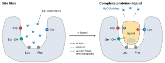
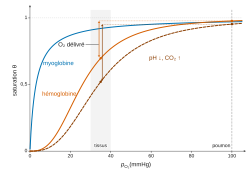
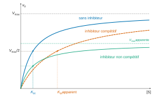
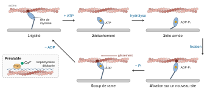
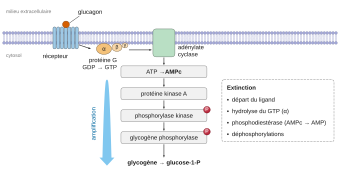
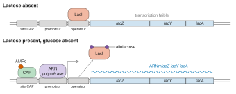

# Agro-Véto BCPST — Biologie 2026 · Corrigé guidé

*Corrigé rédigé par IA, non officiel. Signalez toute erreur.*

**Rédaction** · modèle non renseigné · effort non renseigné · vitesse non renseignée

**Révision (tour 1)** · modèle non renseigné · effort non renseigné · vitesse non renseignée

**Révision (tour 2)** · GPT-6.2 Astra Ultra · vitesse non renseignée

**Les interactions protéines – ligands.** Épreuve de synthèse de trois heures avec formulaire de biochimie.

## Préparer la composition

Le livret comporte quatre pages et le formulaire commence sur la première. Il accompagne un sujet unique. Pour exploiter les formules, repérez une chaîne latérale chargée, un hydroxyle et une surface apolaire, puis nommez le type de partenaire auquel chacun peut contribuer à se lier. Le jury invite à relier ces propriétés à la formation d’un site et à ses conséquences biologiques.

## Introduction

> [!INDICATION]
> **Partir d’un contraste de fonction.** Prenez le même ligand et deux protéines distinctes. Que fait le glucose lorsqu’il se fixe à un transporteur intestinal, puis à une enzyme ? Construisez à partir de ce contraste une question portant à la fois sur les modalités de la liaison et sur ses effets.

#### Rédaction possible

Après un repas, du glucose traverse la paroi intestinale. Dans le muscle, ce même sucre peut être phosphorylé et engagé dans la glycolyse. Le passage d’une membrane et la transformation chimique commencent tous deux par la fixation du glucose à une protéine, mais leurs résultats diffèrent.

Une protéine comprend une ou plusieurs chaînes polypeptidiques. Leur organisation spatiale forme des sites susceptibles de fixer des partenaires, les **ligands**. Un ligand peut être un ion, une petite molécule comme le glucose, une protéine ou un acide nucléique. La reconnaissance fait généralement intervenir plusieurs contacts non covalents et demeure réversible aux échelles de temps adaptées à la fonction.

**Comment les propriétés d’un site de fixation déterminent-elles à la fois le choix d’un partenaire, l’effet de sa fixation et le contrôle de cet effet dans l’organisme ?** Nous relierons d’abord les interactions moléculaires à l’occupation d’un site, puis la nature de la protéine aux fonctions exercées. Nous examinerons enfin comment les cellules règlent ces interactions pour coordonner leurs activités.

> [!JURY]
> Le rapport de synthèse 2026 valorise une délimitation explicite du ligand et une question directrice qui relie les échelles. La diversité des exemples sert le raisonnement. Le formulaire permet d’appuyer la nature chimique d’un contact.

## I. La structure et le milieu déterminent l’occupation d’un site

> [!INDICATION]
> **Interpréter une saturation.** Écrivez le bilan de la protéine totale avant d’isoler la fraction occupée. Sur les courbes de l’oxygène, placez deux pressions partielles correspondant au poumon et à un tissu. Pour chaque protéine, comparez les deux ordonnées.

#### Rédaction possible

### I.1. Le repliement forme un site sélectif

Deux résidus éloignés le long d’une chaîne peuvent devenir voisins lorsque celle-ci se replie. Une poche peut ainsi réunir des groupes de polarités, de charges et d’orientations adaptées à un partenaire. Les groupements hydroxyle du glucose, par exemple, peuvent participer à des liaisons hydrogène. L’hexokinase se referme autour du glucose fixé. Le rapprochement de ses deux domaines positionne le substrat auprès du phosphate à transférer et limite l’accès de l’eau. Il s’agit d’un ajustement induit.

Le formulaire de biochimie permet d’expliquer une telle complémentarité. Une chaîne latérale de lysine protonée peut attirer un groupe négatif. Celle de la sérine porte un hydroxyle susceptible de former une liaison hydrogène. Les surfaces apolaires peuvent se rapprocher tout en libérant des molécules d’eau, et leurs atomes établissent des contacts de van der Waals à courte distance. Il faut que plusieurs contacts favorables soient réalisables dans la même orientation. Le dessin illustre ces possibilités chimiques sur un site fictif.

Une observation sur la ribonucléase A relie la structure à la fonction. Quand la chaîne perd son repliement natif, l’activité catalytique disparaît. Elle peut revenir lorsque la protéine retrouve une conformation et des ponts disulfure appropriés. La mesure porte sur la transformation de l’ARN. Elle montre que la conformation contribue à un site fonctionnel, sans permettre à elle seule de distinguer un défaut de fixation d’un défaut de catalyse.

### I.2. L’occupation d’un site dépend des concentrations et des interactions entre sites

Pour une protéine à un site, à l’équilibre, on écrit

$$\mathrm{P+L}\rightleftharpoons\mathrm{PL},\qquad
K_d=\frac{[\mathrm P][\mathrm L]}{[\mathrm{PL}]},\qquad
\theta=\frac{[\mathrm{PL}]}{[\mathrm P]+[\mathrm{PL}]}=
\frac{[\mathrm L]}{K_d+[\mathrm L]}.$$

La concentration $[\mathrm L]$ est celle du ligand libre. La fraction occupée $\theta$ vaut un demi pour $[\mathrm L]=K_d$. Une petite valeur de $K_d$ indique une forte **affinité**. La **spécificité** s’évalue en comparant les partenaires que le site accepte et leurs affinités respectives. Quand presque tous les sites sont occupés, ajouter du ligand augmente très peu la fixation. Ce plateau indique que le nombre de sites disponibles est fini.

La myoglobine musculaire possède un hème dont le fer ferreux peut fixer un dioxygène. Sa saturation en fonction de la pression partielle d’oxygène suit une hyperbole. L’hémoglobine adulte du sang possède quatre sous-unités et quatre hèmes. Une première oxygénation favorise, par les interfaces entre sous-unités, des conformations de plus forte affinité pour les fixations suivantes. La courbe est sigmoïde. C’est une **coopérativité positive** et un exemple d’**allostérie**, puisque l’occupation d’un site modifie un autre site distant.

Entre environ 100 mmHg dans les poumons et 35 mmHg dans un tissu, la figure montre une baisse de saturation beaucoup plus forte pour l’hémoglobine que pour la myoglobine. L’hémoglobine délivre donc de l’oxygène tandis que la myoglobine en conserve une fraction importante dans le muscle à cette pression. Une baisse du pH ou une hausse de la pression partielle de CO₂ favorise la délivrance par l’hémoglobine lors du passage dans un tissu actif. À pression d’oxygène donnée, on lit une saturation plus faible sur la courbe déplacée vers la droite.

> [!METHODE]
> Dans le modèle à un site, une molécule présente à $K_d/10$ occupe environ 9 % des sites, et à $10K_d$ environ 91 %. Ces proportions dépendent du ligand libre. Pour l’hémoglobine, la demi-saturation se décrit par une pression $P_{50}$. Le déplacement de toute la courbe par le pH et la coopérativité entre les sites répondent à deux questions distinctes.

## II. Un complexe réversible peut catalyser, transporter ou produire un mouvement

> [!INDICATION]
> **Choisir la grandeur qui traduit une fonction.** Pour une enzyme, cherchez la vitesse initiale. Pour un transporteur, cherchez la direction du flux et son couplage énergétique. Pour un moteur, identifiez ce qui provoque la séparation des deux partenaires.

#### Rédaction possible

### II.1. Fixer un substrat permet une réaction contrôlée

Dans une enzyme, des résidus reconnaissent le substrat tandis que d’autres participent directement à la réaction. Chez la chymotrypsine digestive, une poche accueille préférentiellement une chaîne latérale aromatique et oriente une liaison peptidique du substrat près des résidus catalytiques. L’enzyme facilite la transformation en abaissant la barrière d’activation. Elle est régénérée après libération des produits. La catalyse concerne aussi les synthèses. Dans un chloroplaste, la RuBisCO associe le CO₂ au ribulose-1,5-bisphosphate lors de la fixation photosynthétique du carbone.

Dans le modèle simple de Michaelis et Menten, la vitesse initiale varie avec la concentration du substrat selon

$$v_0=\frac{V_{\max}[\mathrm S]}{K_M+[\mathrm S]},\qquad V_{\max}=k_{\mathrm{cat}}[\mathrm E]_{\mathrm{tot}}.$$

Le plateau traduit la saturation des sites actifs. Doubler la quantité d’enzyme double $V_{\max}$ dans ces conditions. Le pH modifie l’ionisation des résidus du site, la température agit sur les vitesses et peut aussi déstabiliser le repliement. Dans ce modèle $K_M$ est une concentration de demi-vitesse. Elle dépend de la fixation et de la transformation du substrat. Elle approche $K_d$ lorsque la dissociation du complexe est rapide devant l’étape catalytique.

À concentration fixe d’inhibiteur compétitif, il faut davantage de substrat pour atteindre la même demi-vitesse, mais le plateau est conservé. À l’inverse, dans le cas **non compétitif pur** de la figure, l’inhibiteur peut se lier avec la même affinité à l’enzyme libre et au complexe enzyme–substrat. La vitesse limite diminue alors, et la concentration de demi-vitesse reste inchangée. La fixation d’un ligand peut donc contrôler la transformation d’un autre.

### II.2. Alterner entre fixation et libération produit un transport ou un mouvement

Dans l’intestin, le glucose entre au pôle apical de l’entérocyte par le symport SGLT1. La fixation de sodium et de glucose permet au transporteur de changer de conformation. Le sodium entre dans le sens décroissant de son potentiel électrochimique. L’énergie ainsi disponible autorise l’entrée du glucose même contre son gradient de concentration. La Na⁺/K⁺-ATPase de la membrane basolatérale entretient ce gradient de sodium en expulsant trois Na⁺ et en faisant entrer deux K⁺ par ATP hydrolysé. Au même pôle, GLUT2 permet au glucose de gagner le milieu interstitiel lorsque sa concentration est plus élevée dans la cellule. Ces transports dépendent tous de sites occupables, mais diffèrent par la source d’énergie et le sens permis du flux.

Dans le muscle strié squelettique, la myosine change d’affinité pour l’actine au cours du cycle de ses nucléotides. La fixation d’ATP détache la tête de l’actine. Après hydrolyse, la tête portant ADP et phosphate peut reprendre appui sur un nouveau site. Le renforcement de la liaison et la libération du phosphate sont associés au mouvement de la tête, puis l’ADP est libéré. La fixation de Ca²⁺ à la troponine C rend les sites de l’actine accessibles en déplaçant la tropomyosine. Une série d’associations réversibles, couplée à l’hydrolyse de l’ATP, produit ainsi un glissement dirigé à l’échelle du sarcomère.

> [!METHODE]
> La saturation de la fixation et la saturation de la vitesse renseignent sur deux grandeurs différentes. Le plateau enzymatique dépend de la quantité de sites actifs autant que de la cadence de chaque enzyme. De même, une courbe de flux saturable est compatible avec un nombre fini de transporteurs. La stœchiométrie des ions et la dépendance envers l’ATP permettent de comparer SGLT1 et la pompe.

## III. L’occupation d’un site informe et règle l’activité de la cellule

> [!INDICATION]
> **Suivre un signal à travers plusieurs échelles.** Sur la cascade hépatique, distinguez les étapes de fixation, les réactions catalytiques et les mécanismes d’arrêt. Dans l’opéron lactose, repérez quel partenaire est un acide nucléique et quelle petite molécule change l’affinité du site.

#### Rédaction possible

### III.1. Une fixation transitoire peut amplifier un signal

Quand la glycémie baisse, les cellules alpha du pancréas libèrent du glucagon. Ce messager se lie sur la face extracellulaire d’un récepteur des hépatocytes. Le changement de conformation du récepteur favorise l’échange de GDP contre du GTP sur la sous-unité alpha d’une protéine Gs. Cette sous-unité active l’adénylate cyclase qui forme de l’AMP cyclique à partir d’ATP. L’AMP cyclique se fixe aux sous-unités régulatrices de la protéine kinase A. Une cascade de phosphorylations stimule alors la glycogène phosphorylase et mobilise le glycogène du foie.

Une adénylate cyclase activée produit de nombreuses molécules de second messager, et une kinase active peut modifier de nombreuses molécules cibles. La concentration initiale du signal peut ainsi être faible. Sa durée demeure contrôlée. Le récepteur peut perdre son ligand, la protéine G hydrolyse le GTP, une phosphodiestérase dégrade l’AMP cyclique et des phosphatases inversent les phosphorylations. La fixation d’un messager et les transformations covalentes qui la suivent ont donc des rôles distincts.

La même logique participe au développement chez les végétaux. L’auxine augmente l’association d’un répresseur Aux/IAA avec TIR1, qui appartient à un complexe ubiquitine-ligase. La dégradation du répresseur permet à des facteurs de transcription ARF d’agir sur des gènes sensibles à l’auxine. La distribution de cette hormone contribue ainsi, selon le tissu et son état, à des réponses différenciées comme l’initiation de racines latérales.

### III.2. Les ligands peuvent régler l’accès à l’ADN et le débit d’une voie

Dans l’utilisation naturelle du lactose par une bactérie, LacI reconnaît une séquence d’ADN, l’opérateur. Lorsque le répresseur l’occupe, la transcription des gènes concernés est faible. L’allolactose, dérivé du lactose, se fixe à LacI et réduit son affinité pour l’opérateur. Un autre apport de régulation dépend de l’AMP cyclique. Quand le glucose est peu disponible, l’association CAP–AMP cyclique favorise le recrutement de l’ARN polymérase au promoteur. L’abondance des enzymes de l’utilisation du lactose dépend donc de plusieurs couples protéine–ligand. L’ADN est ici lui-même le ligand d’une protéine dont la reconnaissance dépend de la séquence.

Une voie métabolique peut également être réglée plus rapidement par fixation directe d’un effecteur à une enzyme déjà présente. Dans la glycolyse, l’ATP est un substrat de la phosphofructokinase-1. À forte concentration, il peut aussi occuper un site régulateur qui abaisse l’affinité apparente pour le fructose-6-phosphate. À l’inverse, l’AMP signale une disponibilité énergétique plus faible et favorise l’activité. Une même molécule peut ainsi jouer deux rôles selon le site occupé.

> [!JURY]
> Le rapport de 2026 signale des confusions sur les partenaires des interactions protéine–acide nucléique. Ici LacI reconnaît un site d’ADN et l’allolactose se fixe à LacI. En identifiant les deux partenaires de chaque liaison, on explique comment la petite molécule influence la transcription.

## Conclusion

> [!INDICATION]
> **Répondre à la question de départ.** Choisissez un exemple où la dissociation achève directement la fonction et un autre où la fixation déclenche un événement qui se poursuit après elle. Que partagent-ils, et pourquoi leurs effets diffèrent-ils ?

#### Rédaction possible

Les propriétés chimiques et la disposition spatiale d’un site rendent certains complexes plus favorables que d’autres. Leur taux d’occupation dépend de la quantité de ligand disponible, du nombre de sites et de l’influence éventuelle d’autres ligands. Ce qui suit la fixation dépend de la protéine. La libération du dioxygène alimente un tissu, celle d’un produit renouvelle un cycle catalytique et l’activation d’un récepteur modifie le comportement d’une cellule entière. La réversibilité donne à chacune de ces fonctions la possibilité de suivre les variations du milieu. Cette sélectivité a aussi une application expérimentale, par exemple lorsqu’un anticorps reconnaît l’insuline et permet de la localiser dans des cellules pancréatiques par immunomarquage.

> [!JURY]
> Les pages 10 à 13 du rapport de synthèse rapprochent les dimensions moléculaires des fonctions cellulaires et du développement. Une conclusion peut revenir au devenir du ligand et au contrôle de la réponse, puis proposer une application issue du mécanisme étudié.
