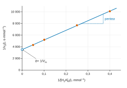
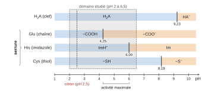
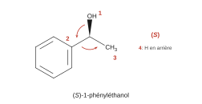
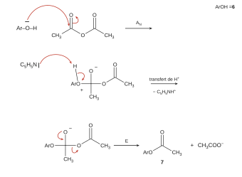
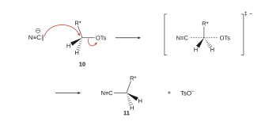

# Agro-Véto BCPST — Chimie 2026 · Corrigé brut

*Corrigé rédigé par IA, non officiel. Signalez toute erreur.*

Épreuve de 3 heures, calculatrice autorisée. Sujet : **« La chimie des fruits & légumes »**, trois parties largement indépendantes, 44 questions. Les données sont regroupées en fin d'énoncé. Notation : $c^\circ = 1\ \mathrm{mol\cdot L^{-1}}$ et $\dfrac{RT}{\mathcal F}\ln 10 = 0{,}06$ V à 298 K.

---

## Partie I — Des fruits pour lutter contre le vieillissement

### I.A — Aspect thermodynamique du brunissement des pommes

#### Q1

$\mathrm{H_2A}$ (4-méthylbenzène-1,2-diol, $\mathrm{C_7H_8O_2}$) et $\mathrm Q$ (4-méthylcyclohexa-3,5-diène-1,2-dione, $\mathrm{C_7H_6O_2}$) diffèrent de deux atomes H. Demi-équation électronique :

$$\boxed{\mathrm{Q_{(aq)}} + 2\,\mathrm{H^+_{(aq)}} + 2\,\mathrm{e^-} = \mathrm{H_2A_{(aq)}}}$$

$\mathrm Q$ capte les électrons : c'est l'**oxydant** du couple, et $\mathrm{H_2A}$ en est le **réducteur**.

Un antioxydant est une espèce qui s'oxyde à la place des molécules qu'il protège. $\mathrm{H_2A}$ est un réducteur : il cède ses électrons aux oxydants du milieu ($\mathrm{O_2}$, radical hydroxyle…), qui ne s'attaquent donc plus aux biomolécules. **$\mathrm{H_2A}$ est bien un antioxydant**, et il est consommé en quinone brune : le brunissement est la trace visible de ce rôle.

#### Q2

Plus la base conjuguée est stable, plus l'acide est fort et plus son p$K_a$ est faible.

- 4-méthylcatéchol : la première acidité est celle d'un **phénol**. Dans l'ion phénolate, l'oxygène est lié à un carbone du cycle aromatique et sa charge négative est **délocalisée par mésomérie** sur le cycle : il existe trois formes limites de plus, avec la charge sur les carbones en ortho et en para. La base est stabilisée. La liaison hydrogène intramoléculaire entre $\mathrm{O^-}$ et l'OH voisin la stabilise encore.
- *cis*-cyclohexane-1,2-diol : les OH sont portés par des carbones tétragonaux d'un cycle saturé. La base conjuguée est un **alcoolate**, dont la charge reste **localisée** sur l'oxygène, faute de système $\pi$. Elle est bien moins stable.

$$\boxed{\mathrm pK_{a1}(\text{catéchol}) = 9{,}23 \ll \mathrm pK_{a1}(\text{diol}) = 14{,}50 \text{ : délocalisation de la charge du phénolate}}$$

#### Q3

Nombres d'oxydation des deux atomes de carbone fonctionnels, ceux qui portent l'oxygène :

- dans $\mathrm{H_2A}$, chaque carbone est lié à deux carbones et à un groupe OH, d'où un n.o. de **+I** ;
- dans $\mathrm Q$, chaque carbone est lié à deux carbones et doublement lié à un oxygène, d'où un n.o. de **+II**.

Ces deux carbones gagnent chacun une unité, soit deux électrons au total, comme dans la demi-équation de Q1. $\mathrm Q$ est la forme oxydée.

Sur un diagramme $E$–pH, la forme oxydée occupe les potentiels élevés. Une frontière verticale sépare un acide de sa base conjuguée. La frontière verticale de la figure 2 se lit vers pH ≈ 9,2, soit $\mathrm pK_{a1} = 9{,}23$ (avec la convention de concentrations égales aux frontières).

$$\boxed{\begin{aligned}
\mathbf A &= \mathrm{H_2A} \\
\mathbf B &= \mathrm{HA^-} \\
\mathbf C &= \mathrm Q
\end{aligned}}$$

C est au-dessus de la frontière oblique : c'est la forme oxydée. A et B sont les formes réduites, A pour pH < 9,23 (forme protonée) et B pour pH > 9,23 (monoanion). La seconde acidité n'apparaît pas dans la fenêtre du diagramme.

#### Q4

Couple $\mathrm Q/\mathrm{H_2A}$ : $\mathrm Q + 2\mathrm H^+ + 2\mathrm e^- = \mathrm{H_2A}$. Relation de Nernst à 298 K :

$$E = E^\circ + \frac{0{,}06}{2}\log\frac{[\mathrm Q]\,[\mathrm H^+]^2}{[\mathrm{H_2A}]\,c^{\circ 2}}$$

À la frontière, $[\mathrm Q] = [\mathrm{H_2A}]$ :

$$\boxed{E_{A/C} = E^\circ(\mathrm Q/\mathrm{H_2A}) - 0{,}06\,\mathrm{pH} = 0{,}53 - 0{,}06\,\mathrm{pH}\ \ (\mathrm V)}$$

La pente vaut −0,06 V par unité de pH (le pH est sans dimension, la pente s'exprime donc en volts). Elle est **négative** : $\mathrm H^+$ est du côté de l'oxydant, et le potentiel de frontière diminue quand le pH augmente.

Comparaison avec la figure 2 :

- **ordonnée à l'origine** : à pH = 0, le trait plein part de 0,53 V, légèrement au-dessus de 0,5 V ;
- **pente** : à pH = 13, on lit $E \approx -0{,}25$ V, d'où une pente $(-0{,}25 - 0{,}53)/13 \approx -0{,}060$ V par unité de pH ;
- **point particulier** : la droite coupe $E = 0$ vers pH = 8,8 et vaut −0,02 V à pH = 9,23, à la rencontre de la verticale.

La droite est parallèle aux frontières de l'eau, de même pente. **L'expression est en accord avec la figure.**

#### Q5

Dans les cellules de la pomme, pH = 4,5 < p$K_{a1}$ = 9,23 : la forme réduite qui prédomine est $\mathrm{H_2A}$ (domaine A). Le domaine de $\mathrm{O_2}$, au-dessus de $E = 1{,}23 - 0{,}06\,\mathrm{pH}$, est disjoint du domaine A (à pH 4,5 comme à tout pH) : $\mathrm{O_2}$ et $\mathrm{H_2A}$ réagissent.

$$\begin{aligned}
\mathrm{O_{2(g)}} + 4\,\mathrm H^+_{(aq)} + 4\,\mathrm e^- &= 2\,\mathrm{H_2O_{(\ell)}} \\
2\,\mathrm{H_2A_{(aq)}} &= 2\,\mathrm{Q_{(aq)}} + 4\,\mathrm H^+_{(aq)} + 4\,\mathrm e^-
\end{aligned}$$

$$\boxed{2\,\mathrm{H_2A_{(aq)}} + \mathrm{O_{2(g)}} = 2\,\mathrm{Q_{(aq)}} + 2\,\mathrm{H_2O_{(\ell)}}}$$

Les potentiels sont égaux à l'équilibre, et $n = 4$ électrons sont échangés :

$$\begin{aligned}
\log K^\circ &= \frac{4\,\big(E^\circ(\mathrm{O_2/H_2O}) - E^\circ(\mathrm{Q/H_2A})\big)}{0{,}06} \\
&= \frac{4\times 0{,}70}{0{,}06} \\
&= 46{,}7
\end{aligned}$$

$$\boxed{K^\circ = 10^{46{,}7} \approx 5\times10^{46}}$$

$K^\circ \gg 10^4$ : la réaction est **thermodynamiquement totale**. Au contact de l'air, le 4-méthylcatéchol de la pomme doit être entièrement oxydé en quinone brune. Seule la vitesse peut limiter le brunissement.

#### Q6

Les deux frontières concernées ont la même pente :

$$\begin{aligned}
E_{\mathrm{O_2/H_2O}} &= 1{,}23 - 0{,}06\,\mathrm{pH} \\
E_{\mathrm{Q/H_2A}} &= 0{,}53 - 0{,}06\,\mathrm{pH}
\end{aligned}$$

Leur écart vaut 0,70 V **quel que soit le pH**. À pH 2,5 (citron) comme à pH 4,5, on est sous p$K_{a1}$ = 9,23 : l'espèce réduite prédominante reste $\mathrm{H_2A}$.

En superposant les deux diagrammes, on lit 1,08 V et 0,38 V à pH 2,5, contre 0,96 V et 0,26 V à pH 4,5. Les domaines de $\mathrm{O_2}$ et de $\mathrm{H_2A}$ restent disjoints exactement de la même façon. $K^\circ$ ne dépend pas du pH et la réaction reste thermodynamiquement possible et totale.

**L'action du jus de citron ne s'explique pas par la thermodynamique.** Son origine est cinétique (voir Q14).

### I.B — Aspect cinétique du brunissement des pommes

#### Q7

La vitesse de réaction se définit par $v = \dfrac{1}{\nu_i}\dfrac{\mathrm d[\mathrm B_i]}{\mathrm dt}$ ($\nu_i$ algébrique, volume constant). Dans l'équation de Q5, $\nu_{\mathrm Q} = +2$ :

$$\begin{aligned}
v &= \frac12\frac{\mathrm d[\mathrm Q]}{\mathrm dt} \\
&= -\frac12\frac{\mathrm d[\mathrm{H_2A}]}{\mathrm dt} \\
&= -\frac{\mathrm d[\mathrm{O_2}]}{\mathrm dt}
\end{aligned}$$

Comme $v_{\mathrm Q} = \dfrac{\mathrm d[\mathrm Q]}{\mathrm dt}$, on obtient

$$\boxed{v = \frac{v_{\mathrm Q}}{2}}\quad (1)$$

#### Q8

Somme des quatre actes, les équilibres étant pris dans le sens direct :

$$\mathrm E + \mathrm{O_2} + \mathrm{EO_2} + \mathrm{H_2A} + \mathrm{EO_2P} + \mathrm{EO} + \mathrm{H_2A} \rightarrow \mathrm{EO_2} + \mathrm{EO_2P} + \mathrm{EO} + \mathrm Q + \mathrm{SP_1} + \mathrm E + \mathrm Q + \mathrm{SP_2}$$

soit après simplification

$$\mathrm{O_2} + 2\,\mathrm{H_2A} \rightarrow 2\,\mathrm Q + \mathrm{SP_1} + \mathrm{SP_2}$$

L'enzyme E est régénérée (catalyseur), et $\mathrm{EO_2}$, $\mathrm{EO_2P}$ et EO sont des intermédiaires. On retrouve l'équation de Q5 si $\mathrm{SP_1} + \mathrm{SP_2} = 2\,\mathrm{H_2O}$ : **le mécanisme est cohérent avec le bilan**.

Conservation des éléments acte par acte :

- acte 3 : $\mathrm{EO_2P} = \mathrm E\cdot\mathrm{O_2}\cdot\mathrm{C_7H_8O_2}$ donne $\mathrm{EO} + \mathrm{C_7H_6O_2} + \mathrm{SP_1}$, d'où $\mathrm{SP_1}$ contient O + 2 H ;
- acte 4 : $\mathrm{EO} + \mathrm{C_7H_8O_2}$ donne $\mathrm E + \mathrm{C_7H_6O_2} + \mathrm{SP_2}$, d'où $\mathrm{SP_2}$ contient O + 2 H.

$$\boxed{\mathrm{SP_1} = \mathrm{SP_2} = \mathrm{H_2O}}$$

#### Q9

Chaque étape du mécanisme est un acte élémentaire. D'après la **loi de van't Hoff**, sa vitesse est proportionnelle au produit des concentrations de ses réactifs, chacune élevée à son coefficient stœchiométrique (ordres partiels égaux aux molécularités).

Q se forme aux actes 3 et 4 :

$$v_{\mathrm Q} = k_3[\mathrm{EO_2P}] + k_4[\mathrm{EO}][\mathrm{H_2A}]$$

AEQS appliquée à EO :

$$\frac{\mathrm d[\mathrm{EO}]}{\mathrm dt} = k_3[\mathrm{EO_2P}] - k_4[\mathrm{EO}][\mathrm{H_2A}] \approx 0$$

On en déduit $v_{\mathrm Q} = 2k_3[\mathrm{EO_2P}]$, puis, par (1), $v = k_3[\mathrm{EO_2P}]$.

Équilibres rapides (actes 1 et 2) : les vitesses directe et inverse de chaque acte sont égales, par exemple $k_1[\mathrm E][\mathrm{O_2}] = k_{-1}[\mathrm{EO_2}]$. Donc

$$\begin{aligned}
[\mathrm{EO_2}] &= \frac{k_1}{k_{-1}}[\mathrm E][\mathrm{O_2}] \\
[\mathrm{EO_2P}] &= \frac{k_2}{k_{-2}}[\mathrm{EO_2}][\mathrm{H_2A}] \\
&= \frac{k_1k_2}{k_{-1}k_{-2}}[\mathrm E][\mathrm{O_2}][\mathrm{H_2A}]
\end{aligned}$$

$$\boxed{v = \frac{k_1k_2k_3}{k_{-1}k_{-2}}\,[\mathrm E]\,[\mathrm{O_2}]\,[\mathrm{H_2A}]}$$

#### Q10

On note $K_1 = k_1/k_{-1}$ et $K_2 = k_2/k_{-2}$. Conservation de l'enzyme, avec [EO] négligeable :

$$[\mathrm E]_0 = [\mathrm E] + [\mathrm{EO_2}] + [\mathrm{EO_2P}] = [\mathrm E]\left(1 + K_1[\mathrm{O_2}] + K_1K_2[\mathrm{O_2}][\mathrm{H_2A}]\right)$$

En reportant dans Q9, puis en divisant numérateur et dénominateur par $K_1$ :

$$v = \frac{k_3K_2[\mathrm E]_0\,[\mathrm{O_2}][\mathrm{H_2A}]}{\dfrac1{K_1} + [\mathrm{O_2}] + K_2[\mathrm{O_2}][\mathrm{H_2A}]}$$

C'est la forme (2), en identifiant :

$$\boxed{\begin{aligned}
K_{m1} &= \frac{k_{-1}}{k_1} \\
K_{m2} &= \frac{k_{-2}}{k_2} \\
V_m &= k_3\,[\mathrm E]_0
\end{aligned}}$$

On vérifie le numérateur : $V_m/K_{m2} = k_3K_2[\mathrm E]_0$. $K_{m1}$ et $K_{m2}$ sont des concentrations et $V_m$ une vitesse volumique.

#### Q11

Avec $[\mathrm{O_2}]_0$ fixé, on inverse (2) (linéarisation de Lineweaver-Burk) :

$$\boxed{\frac1{v_0} = \underbrace{\frac{K_{m2}\,(K_{m1} + [\mathrm{O_2}]_0)}{V_m\,[\mathrm{O_2}]_0}}_{a}\times\frac1{[\mathrm{H_2A}]_0} + \underbrace{\frac1{V_m}}_{b}}$$

On trace $1/v_0$ en fonction de $1/[\mathrm{H_2A}]_0$ avec les quatre points du tableau 1. La régression linéaire donne :

- pente $a = 1{,}65\times10^4$ s (rapport de L·s·mmol⁻¹ à L·mmol⁻¹) ;
- ordonnée à l'origine $b = 3{,}52\times10^3$ L·s·mmol⁻¹ ;
- coefficient de corrélation $r = 0{,}9999$.

Validation : les résidus valent −35, +20, +42 et −27 L·s·mmol⁻¹, soit moins de 1 % des valeurs de $1/v_0$. Ils changent de signe sans tendance ni courbure. Le modèle affine est validé, avec la réserve que quatre points seulement sont disponibles.

$$\boxed{V_m = \frac1b = 2{,}8\times10^{-4}\ \mathrm{mmol\cdot L^{-1}\cdot s^{-1}}}$$

$$\begin{aligned}
K_{m2} &= \frac{a\,V_m\,[\mathrm{O_2}]_0}{K_{m1} + [\mathrm{O_2}]_0} \\
&= \frac{1{,}65\times10^4\times2{,}84\times10^{-4}\times0{,}14}{1{,}7 + 0{,}14}
\end{aligned}$$

$$\boxed{K_{m2} = 0{,}36\ \mathrm{mmol\cdot L^{-1}}}$$

#### Q12

TON est la vitesse volumique maximale de formation de Q rapportée à la concentration totale d'enzyme : $\mathrm{TON} = v_{\mathrm Q,\max}/[\mathrm E]_0$, en s⁻¹.

Dans (2), on a $[\mathrm{O_2}] \gg K_{m1}$, donc le dénominateur tend vers $[\mathrm{O_2}]\left(1 + [\mathrm{H_2A}]/K_{m2}\right)$. Comme de plus $[\mathrm{H_2A}] \gg K_{m2}$, il tend vers $[\mathrm{O_2}][\mathrm{H_2A}]/K_{m2}$, d'où $v_{\max} = V_m$. D'après (1), $v_{\mathrm Q,\max} = 2V_m$, donc

$$\boxed{\mathrm{TON} = \frac{2V_m}{[\mathrm E]_0}}\quad (3)$$

#### Q13

Le tableau 1 a été obtenu à pH 4,5 et à 25 °C, comme la figure 3. On compare donc au point d'abscisse pH = 4,5.

$$\mathrm{TON} = \frac{2\times2{,}84\times10^{-4}}{2{,}5\times10^{-7}} = 2{,}3\times10^3\ \mathrm{s^{-1}}$$

La figure 3 donne, à pH = 4,5, $\mathrm{TON} \approx 2{,}2\times10^3$ s⁻¹. L'écart, de quelques pour cent, est compatible avec la précision de la lecture et de la régression : **la figure 3 est en accord avec le tableau 1**.

#### Q14

**Diagrammes de prédominance sur la fenêtre étudiée (pH 2 à 6,5)**

Dans une protéine, les fonctions α-COOH et α-NH₃⁺ sont engagées dans les liaisons peptidiques : seuls comptent les p$K_a$ des chaînes latérales.

- **La « clef » ($\mathrm{H_2A}$)** : p$K_{a1}$ = 9,23 > 6,5. $\mathrm{H_2A}$ prédomine sur toute la fenêtre. La structure de la clef ne change pas, alors que l'activité varie d'un facteur supérieur à 100. La première hypothèse est donc écartée.
- **La « serrure » (le site actif de l'enzyme)** : la chaîne latérale de l'acide glutamique passe de $-\mathrm{COOH}$ à $-\mathrm{COO^-}$ vers pH 4,25, et l'imidazole de l'histidine passe de ImH⁺ à Im vers pH 6,00. Le thiol de la cystéine (p$K_a$ = 8,18) ne change pas dans la fenêtre. La charge et le réseau de liaisons hydrogène du site actif changent donc deux fois entre pH 2 et 6,5. Cela modifie la forme et la polarité de la serrure, donc la formation du complexe $\mathrm{EO_2P}$.

L'activité est maximale vers pH 5, entre 4,25 et 6,00, c'est-à-dire lorsque coexistent $-\mathrm{COO^-}$ (Glu) et ImH⁺ (His). Elle chute de part et d'autre, d'où l'allure en cloche de la figure 3. **L'effet du pH vient de la serrure** : la protonation des résidus modifie la conformation de l'enzyme (seconde hypothèse).

Retour à Q6 : à pH 2,5, Glu est sous forme COOH et la serrure n'a plus sa forme active. La figure 3 donne TON ≈ 0. **Le jus de citron inactive (dénature) la polyphénol oxydase**. L'oxydation reste thermodynamiquement totale, mais elle n'est plus catalysée et devient très lente : le citron bloque le brunissement **cinétiquement**.

---

## Partie II — Les fruits, sources de molécules naturelles d'intérêt

### II.A — Extraction de la caféine des baies de guarana

#### Q15

Équation de dissolution (la caféine est une molécule neutre) :

$$\mathrm{caféine_{(s)}} = \mathrm{caféine_{(aq)}}$$

Le solvant n'apparaît pas dans l'équation. Si on l'écrit, il figure des deux côtés et sa contribution s'annule. Loi de Hess :

$$\begin{aligned}
\Delta_{\rm diss}H^\circ &= \Delta_fH^\circ(\mathrm{caféine_{(aq)}}) - \Delta_fH^\circ(\mathrm{caféine_{(s)}}) \\
&= -300 - (-342)
\end{aligned}$$

$$\boxed{\Delta_{\rm diss}H^\circ = +42\ \mathrm{kJ\cdot mol^{-1}}}$$

La dissolution est **endothermique**.

#### Q16

$$\begin{aligned}
\Delta_{\rm diss}G^\circ &= \Delta_{\rm diss}H^\circ - T\Delta_{\rm diss}S^\circ \\
&= 42{,}0\times10^3 - 298\times105{,}3 \\
&= 1{,}06\times10^4\ \mathrm{J\cdot mol^{-1}}
\end{aligned}$$

Le produit de solubilité est la constante de l'équilibre de dissolution. Le solide pur a une activité égale à 1, donc $K_s = [\mathrm{caféine}]_{\rm éq}/c^\circ$ et

$$\begin{aligned}
K_s &= \exp\left(-\frac{\Delta_{\rm diss}G^\circ}{RT}\right) \\
&= \exp\left(-\frac{1{,}062\times10^4}{8{,}314\times298}\right) \\
&= \mathrm e^{-4{,}29}
\end{aligned}$$

$$\boxed{K_s(298\ \mathrm K) = 1{,}4\times10^{-2}}$$

#### Q17

À 25 °C, $s = K_s\,c^\circ = 1{,}38\times10^{-2}$ mol·L⁻¹, soit en masse

$$\boxed{s = 1{,}38\times10^{-2}\times194{,}2 = 2{,}7\ \mathrm{g\cdot L^{-1}}}$$

Dans 500 mL, on peut dissoudre au plus $2{,}7\times0{,}500 = 1{,}3$ g de caféine. Les 100,0 mg de baies en contiennent environ $0{,}09\times100{,}0 = 9{,}0$ mg, soit environ 150 fois moins : **toute la caféine peut se dissoudre à 25 °C**.

À 70 °C, la loi de van't Hoff donne $\dfrac{\mathrm d\ln K_s}{\mathrm dT} = \dfrac{\Delta_{\rm diss}H^\circ}{RT^2} > 0$ car la dissolution est endothermique. $K_s$ augmente avec $T$, donc la solubilité à 70 °C dépasse 2,7 g·L⁻¹. Dans l'approximation d'Ellingham, $\Delta G^\circ(343\ \mathrm K) = 5{,}9$ kJ·mol⁻¹, $K_s \approx 0{,}13$ et $s \approx 25$ g·L⁻¹. **A fortiori, toute la caféine peut se dissoudre à 70 °C.**

#### Q18

La solubilité n'est pas limitante, même à 25 °C. Le chauffage ne sert donc pas à dissoudre davantage : il a un **intérêt cinétique**. Il accélère la sortie de la caféine hors de la matrice végétale broyée (diffusion à travers les tissus, fragilisation des parois cellulaires) et la dissolution, de sorte que l'extraction est plus complète en 30 min.

### II.B — Analyse du filtrat F

#### Q19

Le site basique de la caféine est l'azote $\mathrm{N_5}$, dont le doublet non liant n'est pas délocalisé. Le chloroforme anhydre n'a pas de propriété acido-basique, donc $\mathrm{CH_3SO_3H}$ y reste moléculaire et protone directement la caféine :

$$\boxed{\mathrm{RN_{5\,(org)}} + \mathrm{CH_3SO_3H_{(org)}} = \mathrm{RN_5H^+_{(org)}} + \mathrm{CH_3SO_3^-{}_{(org)}}}$$

Le cation et l'anion restent associés en paire d'ions dans ce solvant peu dissociant. Le BBT vire au premier excès d'acide.

#### Q20

Dans l'eau, $\mathrm{CH_3SO_3H}$ ($\mathrm pK_a < 0$) est un acide fort, totalement dissocié en $\mathrm{H_3O^+}$. La réaction de titrage serait :

$$\mathrm{RN_{5\,(aq)}} + \mathrm{H_3O^+_{(aq)}} = \mathrm{RN_5H^+_{(aq)}} + \mathrm{H_2O_{(\ell)}}$$

L'espèce titrante est $\mathrm{H_3O^+}$, acide du couple $\mathrm{H_3O^+/H_2O}$ de p$K_a$ = 0 :

$$\begin{aligned}
K^\circ &= \frac{[\mathrm{RN_5H^+}]\,c^\circ}{[\mathrm{RN_5}][\mathrm{H_3O^+}]} \\
&= \frac1{K_a(\mathrm{RN_5H^+/RN_5})} \\
&= 10^{0{,}7 - 0}
\end{aligned}$$

$$\boxed{K^\circ = 5{,}0}$$

$K^\circ \ll 10^3$ (le seuil usuel pour une réaction de titrage quantitative) : la réaction n'est pas quantitative et ne présente pas de saut de pH exploitable. **Le titrage dans l'eau est impossible.** La caféine ($\mathrm pK_a = 0{,}7$) est une base à peine plus forte que l'eau ($\mathrm pK_a(\mathrm{H_3O^+/H_2O}) = 0$), qui entre en compétition avec elle pour le proton. Dans le chloroforme, cette compétition disparaît.

#### Q21

- Quantité d'acide versée à l'équivalence : $n_a = C\,V_{\rm éq} = 1{,}0\times10^{-3}\times4{,}0\times10^{-3} = 4{,}0\times10^{-6}$ mol.
- Stœchiométrie 1 : 1 (Q19), donc la caféine extraite de 100 mL de F vaut $4{,}0\times10^{-6}$ mol.
- Les 100 mL représentent 1/5 du filtrat. Dans les 500 mL : $n = 5\times4{,}0\times10^{-6} = 2{,}0\times10^{-5}$ mol.
- Masse : $m = nM = 2{,}0\times10^{-5}\times194{,}2 = 3{,}9\times10^{-3}$ g.

$$\boxed{m_{\text{caféine extraite}} = 3{,}9\ \mathrm{mg}}$$

Pourcentage en masse de caféine extraite des baies :

$$\boxed{w = \frac{3{,}9}{100{,}0} = 3{,}9\ \%}$$

Les baies contiennent environ 9 % de caféine. On n'en récupère que $3{,}9/9{,}0 \approx 43\,\%$ : l'extraction est incomplète. Les pertes possibles sont l'extraction aqueuse partielle des baies (30 min), l'extraction au dichlorométhane non quantitative, et les pertes lors des transferts et de l'évaporation. La valeur de 9 % n'est par ailleurs qu'un ordre de grandeur.

#### Q22

$w = 100\,\dfrac{5\,C\,V_{\rm éq}\,M}{m_{\rm baies}}$ est un produit et un quotient. Seule $V_{\rm éq}$ porte une incertitude, donc

$$\frac{u(w)}{w} = \frac{u(V_{\rm éq})}{V_{\rm éq}}$$

« Précision de 1 mL » : $V_{\rm éq} \in [3 ; 5]$ mL, avec une loi uniforme de demi-largeur 1 mL, d'où $u(V_{\rm éq}) = 1/\sqrt3 = 0{,}58$ mL.

$$u(w) = 3{,}88\ \%\times\frac{0{,}58}{4{,}0}$$

$$\boxed{u(w) = 0{,}6\ \%}$$

L'incertitude porte sur le pourcentage en masse demandé : $w = (3{,}9 \pm 0{,}6)\ \%$.

L'incertitude relative est de 14 %. Si l'on prend directement $u(V_{\rm éq}) = 1$ mL, on trouve $u(w) = 1{,}0\,\%$.

#### Q23

Un photon d'énergie $E_{\rm abs} = hc/\lambda_{\rm abs}$ porte la molécule dans un niveau vibrationnel élevé de l'état électronique excité. Une partie de cette énergie est d'abord perdue de façon non radiative (relaxation vibrationnelle, cédée au solvant sous forme de chaleur). Le photon de fluorescence est émis ensuite, donc $E_{\rm ém} < E_{\rm abs}$ et

$$\frac{hc}{\lambda_{\rm ém}} < \frac{hc}{\lambda_{\rm abs}}\qquad\Rightarrow\qquad\boxed{\lambda_{\rm ém} > \lambda_{\rm abs}}$$

Le spectre d'émission est décalé vers les grandes longueurs d'onde : c'est le **déplacement de Stokes**. La figure 5 le confirme : absorption maximale vers 278 nm, émission maximale vers 355 nm.

En énergie, $E = hc/\lambda$ donne environ 4,5 eV pour le photon absorbé et 3,5 eV pour le photon émis. Environ 1 eV par photon est dissipé avant l'émission.

#### Q24

*Validation.* Les résidus de la figure 6 sont faibles devant les intensités mesurées : au plus 7,2 u.a. en valeur absolue, pour des intensités allant jusqu'à 400 u.a. Ils sont répartis aléatoirement de part et d'autre de zéro, sans courbure ni tendance avec $m$. Le modèle linéaire $I_f = a\,m$ est validé sur 0,5–8,8 mg. Le poids relatif des résidus est plus grand pour les deux étalons les plus dilués (13 % et 17 %).

*Justification.* D'après le document 3, $I_f = k\,C$. Tous les étalons sont préparés dans des fioles jaugées **de même volume** $V = 100$ mL, donc $C = \dfrac{m}{MV}$ et

$$\boxed{I_f = \frac{k}{MV}\,m = a\,m}$$

$$a = \frac{k}{MV} = 45{,}196\ \mathrm{u.a.\cdot mg^{-1}}$$

$k$, $M$ et $V$ sont des constantes : le modèle est linéaire et passe par l'origine. Les concentrations restent faibles (au plus $4{,}5\times10^{-4}$ mol·L⁻¹ pour l'étalon 5), ce qui respecte la condition du document 3.

#### Q25

La solution 6 est le filtrat non dilué (100 mL de F dans une fiole de 100 mL). Masse de caféine dans les 100 mL dosés, à l'intérieur du domaine d'étalonnage :

$$\begin{aligned}
m_6 &= \frac{I_f(6)}{a} \\
&= \frac{34{,}0}{45{,}196} \\
&= 0{,}752\ \mathrm{mg}
\end{aligned}$$

Les 100 mL dosés représentent 1/5 du filtrat :

$$m_{\rm totale} = 5\times0{,}752 = 3{,}76\ \mathrm{mg}$$

Rapportée aux 100,0 mg de baies :

$$\boxed{w = 3{,}8\ \%\ \text{en masse}}$$

Ce résultat est compatible avec celui du titrage (3,9 ± 0,6 %). Le dosage par fluorescence porte directement sur F, sans extraction au dichlorométhane. L'accord suggère donc que l'écart à 9 % vient surtout de l'extraction des baies (document 1).

#### Q26

Le code n'attribue d'incertitude non nulle qu'à deux grandeurs. La masse de chaque étalon a $u(m) = 1$ mg, soit de 200 % (0,5 mg) à 11 % (8,8 mg) en relatif ; d'où $u(a)/a \approx 10\,\%$. La masse de baies a $u(m_{\rm baies}) = 1$ mg, soit 1 %. Les intensités ont une incertitude nulle. La contribution dominante est donc la pesée des étalons. Deux modifications possibles :

1. **Préparer les étalons par dilution d'une solution mère** obtenue en pesant une masse importante de caféine (par exemple 100,0 mg dans une fiole de 1,000 L), avec une balance plus précise, puis en prélevant à la pipette jaugée. L'incertitude relative sur la masse de caféine de chaque étalon tombe à moins de 1 %.
2. **Augmenter la prise d'essai de baies** (par exemple 1,000 g au lieu de 100 mg) ou peser sur une balance plus précise. L'incertitude relative sur $m_{\rm baies}$ passe de 1 % à 0,1 %. Il faut alors diluer la solution 6 pour rester dans le domaine d'étalonnage.

On peut aussi multiplier les étalons et répéter les mesures.

#### Q27

Deux arguments en faveur de la spectrofluorimétrie :

1. **Précision et rapidité** : l'incertitude-type est plus faible (0,4 % contre 0,6 %). La mesure est instrumentale, sans repérage visuel d'un virage mal défini. Elle est directe sur le filtrat, sans extraction, séchage, évaporation ni titrage, donc rapide et automatisable pour de grandes séries.
2. **Sécurité et environnement** : on supprime le dichlorométhane (danger pour la santé, cancérogène suspecté) et le chloroforme (pictogrammes santé et toxicité aiguë), ainsi que le coût de traitement de leurs déchets halogénés. Le dosage ne consomme que de l'eau.

---

## Partie III — Des fruits et légumes dans l'assiette des chimistes organiciens

### III.A — La carotte et le céleri comme bio-réducteurs

#### Q28

La réduction du groupe C=O de **1** donne le 1-phényléthanol $\mathrm{C_6H_5{-}CH(OH){-}CH_3}$. Le carbone fonctionnel porte quatre groupes différents et devient asymétrique.

Classement CIP : OH (O, Z = 8) > $\mathrm{C_6H_5}$ (C lié à C, C, C) > $\mathrm{CH_3}$ (C lié à H, H, H) > H.

**Structure du (S)-1-phényléthanol** : OH en **coin plein**, vers l'observateur, et H en arrière (implicite). H étant en arrière, la séquence OH → Ph → CH₃ tourne dans le sens trigonométrique : configuration **(S)**.

$$\boxed{\text{produit majoritaire : (S)-1-phényléthanol}}$$

Justification : l'acétophénone est prochirale, ses deux faces sont énantiotopes. Le réducteur enzymatique est chiral : il différencie les deux faces et forme majoritairement un énantiomère, le (S) d'après l'énoncé.

#### Q29

Loi de Biot (additivité) :

$$\boxed{\alpha = \ell\sum_i[\alpha]_i\,C_i}$$

avec $\ell$ en dm, $C_i$ concentrations en masse (g·mL⁻¹) et $[\alpha]_i$ pouvoirs rotatoires spécifiques.

Seules les espèces chirales **dissoutes** contribuent au pouvoir rotatoire. Les morceaux de carotte ou de céleri et les enzymes ont été retirés par filtration : ils ne sont pas dans la solution analysée. Espèces présentes après filtration :

- l'eau et l'acétophénone résiduelle ($\tau = 0{,}97$) sont achirales et ne contribuent pas ;
- les deux énantiomères (S) et (R) du 1-phényléthanol sont chiraux, avec $[\alpha]_R = -[\alpha]_S$ ;
- les éventuelles autres espèces chirales solubles extraites du légume sont supposées en quantité négligeable.

D'où $\alpha = [\alpha]^S\,\ell\,(C_S - C_R)$.

#### Q30

Les deux énantiomères ont la même masse molaire $M_S$, donc $ee = \dfrac{[\mathrm S]-[\mathrm R]}{[\mathrm S]+[\mathrm R]} = \dfrac{C_S - C_R}{C_S + C_R}$.

L'alcool formé vaut $\tau\,n_{\mathbf 1,0}$ avec $n_{\mathbf 1,0} = C_0V/M_{\mathbf 1}$. Sa concentration en masse vaut donc

$$C_S + C_R = \frac{\tau\,n_{\mathbf 1,0}\,M_S}{V} = \tau\,C_0\,\frac{M_S}{M_{\mathbf 1}}$$

Par conséquent $\alpha = [\alpha]^S\,\ell\,ee\,\tau\,C_0\,\dfrac{M_S}{M_{\mathbf 1}}$, soit

$$\boxed{ee = \frac{\alpha}{[\alpha]^S\,\ell\,\tau\,C_0}\,\frac{M_{\mathbf 1}}{M_S}}\quad (4)$$

#### Q31

On a $C_0 = 50\ \mathrm{mg}/50\ \mathrm{mL} = 1{,}0\times10^{-3}$ g·mL⁻¹. L'alcool est $\mathbf 1 + 2\,\mathrm H$, donc $M_S = 120{,}4 + 2\times1{,}0 = 122{,}4$ g·mol⁻¹.

$$\begin{aligned}
ee &= \frac{-0{,}77}{(-42)\times20\times0{,}97\times1{,}0\times10^{-3}}\times\frac{120{,}4}{122{,}4} \\
&= 0{,}945\times0{,}984
\end{aligned}$$

$$\boxed{ee = 0{,}93}$$

Le mélange contient 96,5 % de (S) et 3,5 % de (R).

Avec $\mathrm{NaBH_4}$, réactif achiral en milieu achiral, les deux faces énantiotopes de la cétone sont attaquées avec la même probabilité : on obtient un racémique, et $\boxed{ee = 0}$. La bioréduction est donc nettement énantiosélective.

#### Q32

La cétone se lie au Zn²⁺ du site actif par son oxygène, ce qui active le C=O et fixe son orientation. Le phényle, encombrant, ne trouve sa place que dans une poche précise du site chiral, et le méthyle occupe l'autre position. Une seule face du carbonyle (la face *Re*) est donc tournée vers le carbone C4 du NADH, maintenu à proximité. L'hydrure est transféré sur cette face uniquement, et la protonation de l'alcoolate donne l'alcool (S).

### III.B — Synthèse de la vitamine E

#### III.B.1 — Obtention du synthon (−)-3

#### Q33

Dans **6**, le carbone C2 du chromane porte un groupe OMe, l'oxygène du cycle, un méthyle et un CH₂. Ce carbone tétragonal est lié à deux groupes OR et provient du carbonyle de la but-3-én-2-one.

$$\boxed{\text{fonction formée : acétal (cétal mixte, cyclique)}}$$

#### Q34

L'anhydride éthanoïque, en présence de pyridine, acyle le seul groupe nucléophile de **6**, l'OH phénolique. L'acétal est inchangé. **7** est l'ester acétique de ce phénol, l'éthanoate de 2-méthoxy-2,5,7,8-tétraméthylchroman-6-yle. On retrouve le squelette de **6**, où $\mathrm{HO{-}}$ est remplacé par $\mathrm{CH_3{-}CO{-}O{-}}$.

$$\boxed{\mathbf 6 + (\mathrm{CH_3CO})_2\mathrm O + \mathrm{C_5H_5N} = \mathbf 7 + \mathrm{CH_3COO^-} + \mathrm{C_5H_5NH^+}}$$

La pyridine capte l'acide éthanoïque formé. La constante de cette réaction vaut $10^{5{,}2-4{,}7} = 10^{0{,}5} > 1$, donc la réaction est favorable. On peut aussi écrire le bilan $\mathbf 6 + (\mathrm{CH_3CO})_2\mathrm O = \mathbf 7 + \mathrm{CH_3COOH}$.

#### Q35

Mécanisme d'addition nucléophile suivie d'élimination ($\mathrm{ArOH}$ = **6**) :

1. **Addition nucléophile** : un doublet non liant de l'oxygène phénolique attaque le carbone d'un C=O de l'anhydride, et le doublet $\pi$ du C=O bascule sur l'oxygène. On obtient un intermédiaire tétraédrique, avec $\mathrm{O^-}$ d'un côté et $\mathrm{Ar{-}O^+(H){-}}$ de l'autre.
2. **Transfert de proton** : la pyridine arrache le proton de l'oxygène chargé positivement, ce qui forme l'ion pyridinium.
3. **Élimination** : le doublet de $\mathrm{O^-}$ reforme la double liaison C=O et expulse l'ion éthanoate $\mathrm{CH_3COO^-}$, bon nucléofuge (base faible stabilisée par mésomérie). On obtient l'ester **7**.

#### Q36

Hydrolyse acide de l'acétal : **8** porte la cétone libérée ($\mathrm{{-}CH_2CH_2COCH_3}$) et un phénol libre, issu de l'oxygène du cycle. L'ester acétique est conservé. Mécanisme (catalyse par $\mathrm{H^+}$) :

1. Protonation de l'oxygène du groupe OMe par $\mathrm{H_3O^+}$.
2. Départ de $\mathrm{CH_3OH}$, assisté par le doublet de l'oxygène du cycle. On obtient un ion oxocarbénium cyclique, stabilisé par mésomérie : $\mathrm{C^+{-}O{-}Ar} \leftrightarrow \mathrm{C{=}O^+{-}Ar}$. Ce carbocation tertiaire est en outre stabilisé par l'oxygène voisin : la substitution de MeOH par l'eau suit donc un mécanisme de type $\mathrm{S_N1}$ (départ du nucléofuge, puis attaque de l'eau), et non $\mathrm{S_N2}$.
3. Addition nucléophile de l'eau sur le carbone de l'oxocarbénium, puis déprotonation par l'eau. On obtient un hémiacétal cyclique.
4. Protonation de l'oxygène du cycle (lié à l'aromatique).
5. Ouverture du cycle : le doublet de l'OH reforme le C=O et expulse le phénol $\mathrm{ArOH}$. On obtient la cétone protonée.
6. Déprotonation par l'eau, qui donne la cétone **8** et régénère $\mathrm{H_3O^+}$.

$$\text{acétal } \mathbf 7 \xrightarrow{\mathrm{H^+},\ -\mathrm{MeOH}} \text{oxocarbénium} \xrightarrow{\mathrm{H_2O},\ -\mathrm{H^+}} \text{hémiacétal} \xrightarrow{\mathrm{H^+}} \text{cétone } \mathbf 8 \text{ (phénol libre)} + \mathrm{H^+}$$

#### Q37

**9** porte deux esters : l'acétate du phénol et l'ester méthylique de la chaîne. **3** porte un phénol et un acide carboxylique. Conditions :

1. **Saponification** : soude aqueuse en excès (au moins 3 équivalents : deux esters plus le phénol, qui est déprotoné), dans un mélange eau–méthanol, au reflux. La réaction est totale.
2. **Acidification** par HCl aqueux jusqu'à pH ≈ 1–2, après refroidissement. On reprotone le carboxylate et le phénolate, puis on récupère (±)-3 par filtration ou extraction.

$$\boxed{\text{1) NaOH aq. (excès), } \mathrm{H_2O/MeOH},\ \text{reflux}\quad\text{2) } \mathrm{HCl}\ \text{aq.}}$$

Aucune liaison du carbone asymétrique n'est rompue : le produit reste racémique.

#### Q38

| $\tilde\nu$ (cm⁻¹) | Attribution |
|---|---|
| 3500 | O–H lié (élongation) du phénol libéré |
| 3400–2300 (large) | O–H lié d'acide carboxylique (dimères liés par liaisons hydrogène) |
| 1670 | C=O de l'acide carboxylique |

On observe l'apparition des bandes O–H du phénol et de l'acide, absentes dans **9**. On n'observe plus de bande C=O d'ester vers 1750 cm⁻¹ : les deux esters de **9** ont été hydrolysés. La bande C=O à 1670 cm⁻¹ est plus basse que la valeur tabulée pour un acide (1760 cm⁻¹) : les liaisons hydrogène des dimères affaiblissent la liaison C=O. **Le spectre est cohérent avec (±)-3.**

#### III.B.2 — Obtention du synthon 4

#### Q39

$\mathrm{CN^-}$ compte $4 + 5 + 1 = 10$ électrons de valence, soit 5 doublets. Schéma de Lewis :

$$\boxed{\left[\,|\mathrm C{\equiv}\mathrm N|\,\right]^-\quad\text{(triple liaison, un doublet non liant sur C et sur N, charge formelle } -1 \text{ sur C)}}$$

Charges formelles : C a $4 - (2 + 3) = -1$ et N a $5 - (2 + 3) = 0$.

Le site nucléophile est le **carbone** : il porte la charge formelle négative, et il est moins électronégatif que N, donc son doublet est plus disponible. Le produit **11** est bien un nitrile $\mathrm{R{-}C{\equiv}N}$ : la nouvelle liaison est C–C.

#### Q40

Le carbone portant le tosylate est **primaire**, le nucléofuge $\mathrm{TsO^-}$ est excellent et $\mathrm{CN^-}$ est un bon nucléophile. Le mécanisme est une **substitution nucléophile bimoléculaire $\mathrm{S_N2}$**, concertée. Le carbocation primaire, trop instable, exclut la $\mathrm{S_N1}$.

$$\mathrm{N{\equiv}C|^-} + \mathrm{R^*{-}CH_2{-}OTs} \rightarrow \left[\mathrm{N{\equiv}C\cdots CH_2(R^*)\cdots OTs}\right]^{-\,\ddagger} \rightarrow \mathrm{N{\equiv}C{-}CH_2{-}R^*} + \mathrm{TsO^-}$$

L'inversion de Walden porte sur un $\mathrm{CH_2}$ sans conséquence stéréochimique. Le carbone asymétrique voisin n'est pas touché et garde sa configuration spatiale.

#### Q41

$\mathrm{HO^-}$ est une base forte, donc un très mauvais nucléofuge : l'alcool ne subirait pas la substitution. $\mathrm{TsO^-}$ est la base conjuguée d'un acide fort, sa charge est délocalisée sur les trois oxygènes du sulfonate : c'est un excellent nucléofuge. Activer l'alcool par protonation n'est pas possible ici : en milieu acide, $\mathrm{CN^-}$ serait protoné en HCN (p$K_a$ ≈ 9), espèce peu nucléophile et très toxique. **La tosylation (TsCl, pyridine) réalise l'activation électrophile de l'alcool**, sans milieu acide et sans toucher au stéréocentre : le carbone lié à OTs devient un bon site électrophile, porteur d'un excellent groupe partant.

#### Q42

$\mathbf{12} = {}^t\mathrm{BuO{-}CH_2{-}CH(CH_3){-}CH_2{-}CHO}$.

| δ (ppm) | Intégration | Multiplicité | Attribution |
|---|---|---|---|
| 9,67 | 1 H | singulet | H de l'aldéhyde $\mathrm{{-}CHO}$ : zone 9,5–10,0 ppm, un seul H |
| 1,23 | 9 H | singulet | les trois $\mathrm{CH_3}$ équivalents du *tert*-butyle, liés à un C quaternaire sans H voisin |
| 1,07 | 3 H | doublet | le $\mathrm{CH_3}$ porté par le CH du stéréocentre (couplé à 1 H, d'où $n + 1 = 2$) |

Les deux méthyles sont un peu plus déblindés que la zone tabulée $\mathrm{CH_3{-}C}$ (0,8–1,0 ppm), en raison de la proximité de l'oxygène de l'éther (et, pour le doublet, du groupe CHO). Le CHO, couplé au $\mathrm{CH_2}$ voisin, devrait être un triplet. La constante $^3J$ aldéhydique est faible (1–2 Hz), d'où le singulet observé.

#### Q43

$\mathbf{13} = \mathrm{CH_3{-}C{\equiv}C{-}Li}$ s'additionne sur le C=O de l'aldéhyde (addition nucléophile), puis $\mathrm{NH_4Cl}$ aqueux protone l'alcoolate. On obtient l'alcool propargylique secondaire :

$$\mathbf{14},\ \mathbf{14^*} = {}^t\mathrm{BuO{-}CH_2{-}\overset{*}{C}H(CH_3){-}CH_2{-}\overset{*}{C}H(OH){-}C{\equiv}C{-}CH_3}$$

Le carbone carbinol est un **nouveau stéréocentre**, créé par attaque sur l'une ou l'autre face du C=O. Le stéréocentre préexistant, lui, garde sa configuration (celle de **12**). **14** et **14*** ont donc la même configuration au carbone méthylé et des configurations opposées, (R) et (S), au carbone porteur de OH. Le classement CIP à ce carbone est OH > C≡C > CH₂ > H.

$$\boxed{\mathbf{14}\text{ et }\mathbf{14^*}\text{ sont diastéréoisomères (épimères au carbone porteur de OH)}}$$

Le stéréocentre préexistant n'induit presque aucune sélectivité, d'où environ 50 % de chaque.

#### Q44

Comparaison des squelettes :

$$\mathbf{15}:\ {}^t\mathrm{BuO{-}CH_2{-}CH(CH_3){-}(CH_2)_3{-}CH(CH_3){-}CH_2{-}COOEt}$$

$$\mathbf 4:\ {}^t\mathrm{BuO{-}CH_2{-}CH(CH_3){-}(CH_2)_3{-}CH(CH_3){-}CH_2{-}\underbrace{CH_2{-}CH_2{-}CH(CH_3)_2}_{\text{à construire}}}$$

Le carbone de l'ester doit devenir un $\mathrm{CH_2}$ lié à un groupe 2-méthylpropyle $\mathrm{{-}CH_2CH(CH_3)_2}$ (4 C). Rétrosynthèse : la liaison C–C à créer relie ce $\mathrm{CH_2}$ au groupe 2-méthylpropyle. On l'obtient par substitution nucléophile d'un organomagnésien sur un dérivé activé de l'alcool primaire $\mathrm{R{-}CH_2{-}CH_2OH}$, lui-même issu de la réduction de l'ester.

On note $\mathrm R = {}^t\mathrm{BuO{-}CH_2{-}CH(CH_3){-}(CH_2)_3{-}CH(CH_3){-}}$.

1. **Réduction de l'ester** : $\mathrm{LiAlH_4}$ en excès, éther diéthylique ou THF anhydre, à 0 °C puis à température ambiante. On hydrolyse ensuite par une solution aqueuse acide diluée, à froid. On obtient l'alcool primaire $\mathrm{R{-}CH_2{-}CH_2OH}$ (et de l'éthanol). $\mathrm{LiAlH_4}$ réduit directement l'ester en alcool, sans saponification préalable.
2. **Activation électrophile de l'alcool** : chlorure de tosyle TsCl, pyridine (solvant et base), à température ambiante. On obtient le tosylate primaire $\mathrm{R{-}CH_2{-}CH_2{-}OTs}$.
3. **Substitution nucléophile par un organomagnésien** : bromure de 2-méthylpropylmagnésium $(\mathrm{CH_3})_2\mathrm{CHCH_2MgBr}$, préparé à partir de magnésium et de 1-bromo-2-méthylpropane dans l'éther anhydre. On le fait réagir sur le tosylate dans le THF anhydre, puis on hydrolyse par $\mathrm{NH_4Cl}$ aqueux. Le carbone nucléophile de l'organomagnésien remplace $\mathrm{TsO^-}$ sur le carbone primaire ($\mathrm{S_N2}$) et donne **4**.

$$\boxed{\mathbf{15}\xrightarrow{\text{1) LiAlH}_4\text{, Et}_2\text{O ; 2) H}_3\text{O}^+}\mathrm{R{-}CH_2CH_2OH}\xrightarrow{\text{TsCl, pyridine}}\mathrm{R{-}CH_2CH_2OTs}\xrightarrow{i\mathrm{BuMgBr,\ THF}}\mathbf 4}$$

On ne fait pas réagir directement l'organomagnésien sur l'ester **15** : il s'y additionnerait deux fois et donnerait un alcool tertiaire. Les deux stéréocentres ne sont touchés à aucune étape. L'éther de *tert*-butyle résiste aux milieux basiques, aux hydrures et aux organomagnésiens. Seule l'hydrolyse de l'étape 1 est acide, et elle reste brève, diluée et à froid.
