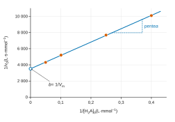
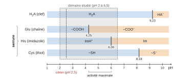
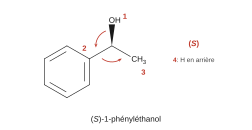
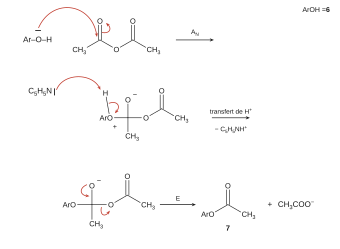
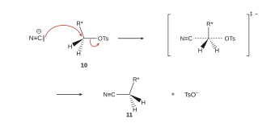

# Agro-Véto BCPST — Chimie 2026 · Corrigé guidé

*Corrigé rédigé par IA, non officiel. Signalez toute erreur.*

## Présentation du sujet

**Thème.** « La chimie des fruits & légumes » : cinq végétaux (pomme, guarana, carotte, céleri, mûre) servent de fil conducteur à un sujet de chimie générale et organique. Épreuve de 3 heures, calculatrice autorisée, 44 questions. Toutes les données sont regroupées en fin d'énoncé : potentiels standard, enthalpies de formation, p$K_a$ dont trois acides aminés, pictogrammes, pouvoir rotatoire, tables RMN et IR, formules de propagation des incertitudes et code Python Monte-Carlo en annexe.

**Découpage.**

| Partie | Questions | Contenu | Notions du programme |
|---|---|---|---|
| I.A | Q1–Q6 | Diagramme $E$–pH du 4-méthylcatéchol, oxydation par $\mathrm{O_2}$ | demi-équations, Nernst, lecture de diagramme, constante d'équilibre redox |
| I.B | Q7–Q14 | Cinétique de la polyphénol oxydase | vitesse de réaction, mécanisme, AEQS, pré-équilibres rapides, linéarisation, diagrammes de prédominance |
| II.A | Q15–Q18 | Extraction de la caféine par l'eau chaude | loi de Hess, $\Delta_rG^\circ$, $K_s$, solubilité, van't Hoff |
| II.B | Q19–Q27 | Dosage de la caféine : titrage en milieu organique, puis spectrofluorimétrie | acide-base hors de l'eau, constante de réaction, dosage, incertitudes-types, étalonnage, résidus, lecture de code |
| III.A | Q28–Q32 | Bioréduction énantiosélective de l'acétophénone | CIP, loi de Biot, excès énantiomérique, sélectivité enzymatique |
| III.B | Q33–Q44 | Deux synthons de la vitamine E | acétal, acylation, hydrolyse d'acétal, saponification, IR, Lewis, $\mathrm{S_N2}$, tosylates, RMN, organométalliques, stéréochimie, stratégie de synthèse |

**Difficulté et longueur.** Le sujet est long mais très progressif. Beaucoup de questions sont des applications directes du cours : Q1, Q4, Q5, Q7, Q15, Q16, Q20, Q21, Q28, Q33, Q34 et Q39. Elles sont à sécuriser dans l'ordre où on les rencontre. Les questions qui demandent le plus de rédaction sont Q10 (calcul littéral), Q11 (régression), Q14 (synthèse argumentée), Q35–Q36 (mécanismes complets) et Q44 (stratégie ouverte).

**Ce qu'en dit le rapport 2026.** Moyenne 10,07/20, écart-type 4,56. Le barème répartit les points entre la restitution du cours et son application directe (42 %), les applications à plusieurs étapes (39 %) et les raisonnements demandant du recul (19 %). La partie I a été la mieux traitée. La partie II est la moins réussie : 20,7 % des points en moyenne, avec les bilans de matière comme principal écueil. La partie III donne 24,6 % des points en moyenne. Les questions les plus **discriminantes**, au sens où presque personne n'y obtient le maximum, sont Q44 (aucune copie), Q5, Q14, Q22, Q26 et Q37 (1 % des copies), puis Q17, Q20 et Q31 (2 %). Les reproches les plus fréquents portent sur les états physico-chimiques absents des équations, les lectures graphiques non justifiées et les résultats arrêtés avant le pourcentage demandé.

**Gestion du temps.** Les trois parties sont indépendantes. Une répartition raisonnable est d'environ 65 min pour la partie I, 50 min pour la II et 65 min pour la III. Dans la partie I, les questions s'enchaînent (Q5 → Q7 → Q8, Q9 → Q10 → Q11 → Q12 → Q13), mais l'énoncé donne les résultats intermédiaires (1), (2) et (3) : on peut toujours repartir.

---

## Partie I.A — Aspect thermodynamique du brunissement des pommes

On étudie le couple quinone / 4-méthylcatéchol dans l'eau : demi-équation, diagramme $E$–pH superposé à celui de l'eau, puis constante de la réaction avec le dioxygène. Il faut surtout savoir lire les pentes des frontières.

### Question 1

> [!INDICATION]
> Comparer les formules brutes de $\mathrm{H_2A}$ et de Q : qu'est-ce qui a été perdu ?

> [!INDICATION]
> Équilibrer en milieu acide (H⁺ et électrons), puis repérer de quel côté de la demi-équation figurent les électrons.

#### Solution

$\mathrm{H_2A}$ ($\mathrm{C_7H_8O_2}$) et Q ($\mathrm{C_7H_6O_2}$) diffèrent de deux atomes H, c'est-à-dire de 2 H⁺ et 2 e⁻ :

$$\boxed{\mathrm{Q_{(aq)}} + 2\,\mathrm{H^+_{(aq)}} + 2\,\mathrm{e^-} = \mathrm{H_2A_{(aq)}}}$$

Q capte les électrons, c'est l'**oxydant**, et $\mathrm{H_2A}$ est le **réducteur**. Un antioxydant s'oxyde à la place des molécules qu'il protège. Réducteur, $\mathrm{H_2A}$ cède ses électrons aux oxydants du milieu ($\mathrm{O_2}$, radical hydroxyle) : il protège les biomolécules en se sacrifiant, et la quinone brune formée en est la trace visible. **$\mathrm{H_2A}$ est bien un antioxydant.**

> [!PIEGE]
> « Antioxydant » ne veut pas dire « oxydant ». C'est un **réducteur** sacrificiel, qui s'oxyde à la place des autres espèces.

> [!JURY]
> Le rapport 2026 note que la demi-équation est bien établie, mais que seules 13 % des copies obtiennent le maximum. Beaucoup affirment qu'un réducteur est forcément un antioxydant « sans expliciter son rôle sacrificiel, celui de s'oxyder à la place des constituants cellulaires à protéger ».

### Question 2

> [!INDICATION]
> Comparer la stabilité des **bases conjuguées** plutôt que celle des acides.

> [!INDICATION]
> Quelle est la différence de nature entre un oxygène porté par un carbone aromatique et un oxygène porté par un carbone d'un cycle saturé ?

#### Solution

Plus la base conjuguée est stabilisée, plus l'acide est fort.

- La première acidité du 4-méthylcatéchol est celle d'un **phénol**. Dans le phénolate, la charge négative de l'oxygène est **délocalisée par mésomérie** dans le cycle aromatique : trois formes limites portent la charge sur les carbones en ortho et en para. La liaison hydrogène intramoléculaire avec l'OH voisin stabilise encore l'anion.
- Le *cis*-cyclohexane-1,2-diol est un **alcool** : ses OH sont portés par des carbones tétragonaux d'un cycle saturé. L'alcoolate n'a aucun système $\pi$ pour délocaliser sa charge, qui reste localisée sur l'oxygène.

$$\boxed{\mathrm pK_{a1} = 9{,}23 \ll 14{,}50 \text{ : le phénolate est stabilisé par délocalisation, l'alcoolate ne l'est pas}}$$

> [!METHODE]
> Pour comparer des acidités, on écrit les bases conjuguées et on cherche ce qui stabilise leur charge : mésomérie, effets inductifs, liaison hydrogène, solvatation.

> [!PIEGE]
> Le mot « cycle » ne suffit pas : un cycle saturé ne délocalise rien. Il faut un système $\pi$ conjugué avec l'atome qui porte la charge. De même, citer la mésomérie sans écrire les formes limites ne justifie rien.

> [!JURY]
> Le rapport 2026 rappelle que « la discussion du pKa d'un couple acide/base doit porter sur la stabilité de la base conjuguée chargée, et non sur celle de la forme acide neutre ». Il ajoute que le seul mot « mésomérie », non développé, n'a pas suffi (taux de réussite moyen : 33 %).

### Question 3

> [!INDICATION]
> Classer les espèces selon le nombre d'oxydation d'un **atome** bien choisi : où se trouve la forme oxydée ?

> [!INDICATION]
> Une frontière verticale sépare deux formes acido-basiques. Lire son abscisse et la comparer aux p$K_a$ fournis.

#### Solution

On compare les nombres d'oxydation des deux carbones qui portent l'oxygène. Dans $\mathrm{H_2A}$, chacun est lié à deux carbones et à un OH : n.o. **+I**. Dans Q, chacun est lié à deux carbones et doublement lié à un O : n.o. **+II**. Q est donc la forme oxydée, et les deux électrons de Q1 correspondent à ces deux gains d'une unité.

Dans le diagramme, la forme oxydée occupe les hauts potentiels. Les formes les plus déprotonées occupent les pH élevés.

- **C** (au-dessus de la frontière oblique) : forme oxydée, **Q**.
- **A** (sous la frontière oblique, pH < 9,2) : forme réduite protonée, **$\mathrm{H_2A}$**.
- **B** (sous la frontière oblique, pH > 9,2) : forme réduite monodéprotonée, **$\mathrm{HA^-}$**.

$$\boxed{\begin{aligned}
\mathbf A &= \mathrm{H_2A} \\
\mathbf B &= \mathrm{HA^-} \\
\mathbf C &= \mathrm Q
\end{aligned}}$$

La verticale est à pH ≈ 9,2, soit p$K_{a1}$ = 9,23, comme l'impose la convention de concentrations égales aux frontières. La seconde acidité est hors du diagramme.

> [!JURY]
> Le rapport 2026 regrette l'usage « d'un nombre d'oxydation attribué à une molécule entière plutôt qu'à un atome précisément identifié », ce qui prive la justification de sens.

### Question 4

> [!INDICATION]
> Écrire la relation de Nernst du couple de Q1, en gardant $[\mathrm H^+]$ dans le logarithme.

> [!INDICATION]
> Appliquer la convention de frontière de la légende de la figure 2. Pour commenter, comparer une ordonnée et une pente lues sur la figure.

#### Solution

$$\begin{aligned}
E &= E^\circ + \frac{0{,}06}{2}\log\frac{[\mathrm Q][\mathrm H^+]^2}{[\mathrm{H_2A}]\,c^{\circ2}} \\
&= E^\circ + 0{,}03\log\frac{[\mathrm Q]}{[\mathrm{H_2A}]} - 0{,}06\,\mathrm{pH}
\end{aligned}$$

Avec $[\mathrm Q] = [\mathrm{H_2A}]$ à la frontière :

$$\boxed{E_{A/C} = 0{,}53 - 0{,}06\,\mathrm{pH}\ \ (\mathrm V)}$$

La pente vaut −0,06 V par unité de pH. Elle est négative car $\mathrm H^+$ est du côté de l'oxydant, et elle s'exprime en volts puisque le pH est sans dimension.

Vérification sur la figure 2 :

- ordonnée à l'origine : le trait plein part de 0,53 V à pH 0, juste au-dessus de 0,5 V ;
- pente : on lit environ −0,25 V à pH 13, d'où $(-0{,}25 - 0{,}53)/13 \approx -0{,}060$ V par unité de pH ;
- point particulier : environ −0,02 V à pH 9,23, à la rencontre de la verticale.

La droite est parallèle aux frontières de l'eau. **Accord avec la figure.**

> [!PIEGE]
> Le facteur $0{,}06/2$ multiplie $\log[\mathrm H^+]^2$ : la pente est −0,06 V par unité de pH, pas −0,03. La pente vaut $-0{,}06\,m/n$, où $m$ est le nombre de H⁺ et $n$ le nombre d'électrons.

> [!JURY]
> Le rapport 2026 : « Le jury attend une vérification graphique systématique, comparant l'ordonnée à l'origine et la pente obtenues aux valeurs lues sur le diagramme E-pH ». La pente est trop souvent donnée sans que son signe ou son unité soient justifiés (10 % des copies au maximum).

### Question 5

> [!INDICATION]
> Repérer sur la figure 2 deux espèces dont les domaines sont disjoints à pH 4,5.

> [!INDICATION]
> Combiner les deux demi-équations pour éliminer les électrons, puis écrire l'égalité des potentiels à l'équilibre pour obtenir $\log K^\circ$.

#### Solution

À pH 4,5 < p$K_{a1}$ = 9,23, la forme réduite prédominante est $\mathrm{H_2A}$ (domaine A). Le domaine de $\mathrm{O_2}$ (au-dessus de $1{,}23 - 0{,}06\,\mathrm{pH}$) et le domaine A sont disjoints : ces deux espèces réagissent.

$$\begin{aligned}
\mathrm{O_{2(g)}} + 4\,\mathrm H^+_{(aq)} + 4\,\mathrm e^- &= 2\,\mathrm{H_2O_{(\ell)}} \\
2\,\mathrm{H_2A_{(aq)}} &= 2\,\mathrm{Q_{(aq)}} + 4\,\mathrm H^+_{(aq)} + 4\,\mathrm e^-
\end{aligned}$$

$$\boxed{2\,\mathrm{H_2A_{(aq)}} + \mathrm{O_{2(g)}} = 2\,\mathrm{Q_{(aq)}} + 2\,\mathrm{H_2O_{(\ell)}}}$$

À l'équilibre, les deux potentiels de Nernst sont égaux. Avec $n = 4$ :

$$\begin{aligned}
\log K^\circ &= \frac{4\,(1{,}23 - 0{,}53)}{0{,}06} \\
&= 46{,}7
\end{aligned}$$

$$\boxed{K^\circ = 10^{46{,}7} \approx 5\times10^{46}}$$

La réaction est **totale** : le brunissement est thermodynamiquement inévitable, et seule sa vitesse peut être limitée.

> [!PIEGE]
> Une équation sans états physico-chimiques est incomplète : (aq), (g), (ℓ) font partie de la réponse.

> [!JURY]
> C'est la question la plus discriminante de la partie I : 1 % des copies obtiennent le maximum. Selon le rapport 2026, « l'écriture de l'équation de la réaction n'est presque jamais accompagnée des états physico-chimiques des espèces, alors qu'ils sont indispensables ». Peu de candidats justifient aussi le choix des réactifs : $\mathrm{H_2A}$ prédomine à pH 4,5 et son domaine est disjoint de celui de $\mathrm{O_2}$.

> [!METHODE]
> $\log K^\circ = n\,(E^\circ_{\rm ox} - E^\circ_{\rm red})/0{,}06$, où $n$ est le nombre d'électrons échangés **dans l'équation écrite**. Changer les coefficients de l'équation change $n$ et $K^\circ$.

### Question 6

> [!INDICATION]
> Que deviennent, quand le pH baisse, les deux frontières qui délimitent les domaines de $\mathrm{O_2}$ et de $\mathrm{H_2A}$ ?

> [!INDICATION]
> Comparer leurs pentes, et se rappeler de quoi dépend $K^\circ$.

#### Solution

On superpose les deux diagrammes :

$$\begin{aligned}
E_{\mathrm{O_2/H_2O}} &= 1{,}23 - 0{,}06\,\mathrm{pH} \\
E_{\mathrm{Q/H_2A}} &= 0{,}53 - 0{,}06\,\mathrm{pH}
\end{aligned}$$

Les deux frontières ont la même pente et leur écart vaut 0,70 V **à tout pH**. À pH 2,5 comme à pH 4,5, on reste sous p$K_{a1}$ : l'espèce réduite prédominante est toujours $\mathrm{H_2A}$.

À pH 2,5, on lit 1,08 V et 0,38 V, contre 0,96 V et 0,26 V à pH 4,5. Les domaines restent disjoints exactement de la même façon. $K^\circ$ ne dépend que des $E^\circ$ et ne change pas : la transformation reste thermodynamiquement possible.

**L'effet du jus de citron ne s'explique pas par la thermodynamique.** Seules des considérations cinétiques peuvent en rendre compte (Q14).

> [!PIEGE]
> Dire que « le potentiel de $\mathrm{O_2}$ augmente en milieu acide » ne suffit pas : celui du couple $\mathrm{Q/H_2A}$ augmente d'autant. C'est la **position relative** des deux domaines qui compte.

> [!JURY]
> Le rapport 2026 juge la question mal traitée, souvent tranchée au hasard. Il attend la superposition des deux diagrammes, l'identification de l'espèce prédominante au pH de la chair de la pomme, puis la conclusion : domaines disjoints, donc seule la cinétique explique l'absence de brunissement.

---

## Partie I.B — Aspect cinétique du brunissement des pommes

On établit la loi de vitesse d'une catalyse enzymatique à deux substrats, puis on l'exploite : linéarisation, détermination des constantes, nombre de cycles catalytiques (TON) et effet du pH sur l'enzyme.

### Question 7

> [!INDICATION]
> Revenir à la définition de la vitesse de réaction à partir de la dérivée d'une concentration et d'un coefficient stœchiométrique.

#### Solution

À volume constant, $v = \dfrac1{\nu_i}\dfrac{\mathrm d[\mathrm B_i]}{\mathrm dt}$. Avec l'équation de Q5, $\nu_{\mathrm Q} = 2$, donc

$$\begin{aligned}
v &= \frac12\frac{\mathrm d[\mathrm Q]}{\mathrm dt} \\
&= -\frac12\frac{\mathrm d[\mathrm{H_2A}]}{\mathrm dt} \\
&= -\frac{\mathrm d[\mathrm{O_2}]}{\mathrm dt}
\end{aligned}$$

Avec $v_{\mathrm Q} = \mathrm d[\mathrm Q]/\mathrm dt$ :

$$\boxed{v = \frac{v_{\mathrm Q}}{2}}$$

> [!PIEGE]
> La vitesse de réaction $v$ dépend de la façon dont l'équation est écrite, pas la vitesse de formation $v_{\mathrm Q}$. Confondre les deux fait perdre le facteur 2 de l'équation (3).

### Question 8

> [!INDICATION]
> Additionner les quatre actes, puis simplifier les espèces présentes des deux côtés.

> [!INDICATION]
> Pour identifier chaque sous-produit, faire un bilan d'atomes **acte par acte**, en écrivant $\mathrm{EO_2P} = \mathrm E\cdot\mathrm{O_2}\cdot\mathrm{H_2A}$.

#### Solution

La somme des quatre actes donne, après simplification de E (régénérée) et des intermédiaires $\mathrm{EO_2}$, $\mathrm{EO_2P}$ et EO :

$$\mathrm{O_2} + 2\,\mathrm{H_2A} \rightarrow 2\,\mathrm Q + \mathrm{SP_1} + \mathrm{SP_2}$$

On retrouve l'équation de Q5 si $\mathrm{SP_1} + \mathrm{SP_2} = 2\,\mathrm{H_2O}$. L'enzyme apparaît des deux côtés : c'est un catalyseur. **Le mécanisme est cohérent.**

- Acte 3 : $\mathrm E\cdot\mathrm{O_2}\cdot\mathrm{C_7H_8O_2} \rightarrow \mathrm E\cdot\mathrm O + \mathrm{C_7H_6O_2} + \mathrm{SP_1}$, donc $\mathrm{SP_1}$ contient un O et deux H.
- Acte 4 : $\mathrm E\cdot\mathrm O + \mathrm{C_7H_8O_2} \rightarrow \mathrm E + \mathrm{C_7H_6O_2} + \mathrm{SP_2}$, donc $\mathrm{SP_2}$ contient un O et deux H.

$$\boxed{\mathrm{SP_1} = \mathrm{SP_2} = \mathrm{H_2O}}$$

> [!JURY]
> D'après le rapport 2026, l'eau est le plus souvent identifiée, mais la justification attendue manque souvent : la somme de toutes les étapes du mécanisme, qui doit redonner l'équation bilan.

### Question 9

> [!INDICATION]
> Exprimer $v_{\mathrm Q}$ à partir des actes qui produisent Q, puis utiliser l'AEQS sur EO pour relier ces deux termes.

> [!INDICATION]
> Les actes 1 et 2 sont des équilibres rapides : écrire leurs constantes en fonction des $k$ pour éliminer $[\mathrm{EO_2}]$ et $[\mathrm{EO_2P}]$.

#### Solution

Chaque étape est un acte élémentaire : d'après la **loi de van't Hoff**, sa vitesse est proportionnelle au produit des concentrations de ses réactifs (ordres égaux aux coefficients stœchiométriques).

$$v_{\mathrm Q} = k_3[\mathrm{EO_2P}] + k_4[\mathrm{EO}][\mathrm{H_2A}]$$

L'AEQS sur EO donne $k_3[\mathrm{EO_2P}] = k_4[\mathrm{EO}][\mathrm{H_2A}]$. On en déduit $v_{\mathrm Q} = 2k_3[\mathrm{EO_2P}]$, puis, par (1), $v = k_3[\mathrm{EO_2P}]$.

Pour les équilibres rapides, vitesses directe et inverse sont égales :

$$\begin{aligned}
\frac{[\mathrm{EO_2}]}{[\mathrm E][\mathrm{O_2}]} &= \frac{k_1}{k_{-1}} \\
\frac{[\mathrm{EO_2P}]}{[\mathrm{EO_2}][\mathrm{H_2A}]} &= \frac{k_2}{k_{-2}}
\end{aligned}$$

Donc

$$\boxed{v = \frac{k_1k_2k_3}{k_{-1}k_{-2}}\,[\mathrm E][\mathrm{O_2}][\mathrm{H_2A}]}$$

> [!METHODE]
> AEQS et équilibre rapide sont deux hypothèses différentes. L'AEQS s'écrit $\mathrm d[\mathrm I]/\mathrm dt \approx 0$. L'équilibre rapide s'écrit « quotient de réaction = $k_{\rm direct}/k_{\rm inverse}$ ». On applique chacune là où l'énoncé l'autorise.

> [!JURY]
> Le rapport 2026 décrit une question réussie « sur un mode plutôt binaire ». Il ajoute : « Le jury regrette que la loi de van't Hoff, nécessaire pour justifier l'expression de la vitesse d'un acte élémentaire, soit très rarement citée explicitement. »

### Question 10

> [!INDICATION]
> [E] n'est pas connue : écrire la conservation de l'enzyme sous toutes ses formes, puis utiliser l'hypothèse sur EO.

> [!INDICATION]
> Pour faire apparaître la forme (2), diviser numérateur et dénominateur par une constante bien choisie avant d'identifier terme à terme.

#### Solution

On pose $K_1 = k_1/k_{-1}$ et $K_2 = k_2/k_{-2}$. En négligeant [EO] :

$$[\mathrm E]_0 = [\mathrm E] + [\mathrm{EO_2}] + [\mathrm{EO_2P}] = [\mathrm E]\left(1 + K_1[\mathrm{O_2}] + K_1K_2[\mathrm{O_2}][\mathrm{H_2A}]\right)$$

$$\begin{aligned}
v &= \frac{k_3K_1K_2[\mathrm E]_0[\mathrm{O_2}][\mathrm{H_2A}]}{1 + K_1[\mathrm{O_2}] + K_1K_2[\mathrm{O_2}][\mathrm{H_2A}]} \\
&= \frac{k_3K_2[\mathrm E]_0[\mathrm{O_2}][\mathrm{H_2A}]}{\dfrac1{K_1} + [\mathrm{O_2}] + K_2[\mathrm{O_2}][\mathrm{H_2A}]}
\end{aligned}$$

L'identification avec (2) donne

$$\boxed{\begin{aligned}
K_{m1} &= \frac{k_{-1}}{k_1} \\
K_{m2} &= \frac{k_{-2}}{k_2} \\
V_m &= k_3[\mathrm E]_0
\end{aligned}}$$

On vérifie le numérateur : $V_m/K_{m2} = k_3K_2[\mathrm E]_0$.

> [!PIEGE]
> L'identification n'est légitime qu'une fois les deux expressions mises sous la même forme. Ici, le coefficient de $[\mathrm{O_2}]$ au dénominateur doit valoir 1.

> [!JURY]
> Selon le rapport 2026, la conservation de l'enzyme est bien écrite, mais beaucoup de candidats s'arrêtent là ou se trompent dans le calcul qui suit : il faut mener l'identification jusqu'aux trois constantes.

### Question 11

> [!INDICATION]
> $[\mathrm{O_2}]_0$ est constant : passer aux inverses pour obtenir une relation affine. Le tableau 1 fournit d'ailleurs les bonnes variables.

> [!INDICATION]
> Identifier ce que représentent l'ordonnée à l'origine et la pente, puis faire une régression linéaire à la calculatrice.

#### Solution

$$\boxed{\frac1{v_0} = \frac{K_{m2}(K_{m1} + [\mathrm{O_2}]_0)}{V_m[\mathrm{O_2}]_0}\,\frac1{[\mathrm{H_2A}]_0} + \frac1{V_m}}$$

La régression de $1/v_0$ en fonction de $1/[\mathrm{H_2A}]_0$ donne :

- pente $a = 1{,}65\times10^4$ s ;
- ordonnée à l'origine $b = 3{,}52\times10^3$ L·s·mmol⁻¹ ;
- $r = 0{,}9999$.

Les résidus (−35, +20, +42 et −27 L·s·mmol⁻¹) restent inférieurs à 1 % des valeurs de $1/v_0$ et changent de signe sans tendance : le modèle affine est validé, sur quatre points seulement.

$$\boxed{V_m = \frac1b = 2{,}8\times10^{-4}\ \mathrm{mmol\cdot L^{-1}\cdot s^{-1}}}$$

$$\begin{aligned}
K_{m2} &= \frac{a\,V_m\,[\mathrm{O_2}]_0}{K_{m1} + [\mathrm{O_2}]_0} \\
&= \frac{1{,}65\times10^4\times2{,}84\times10^{-4}\times0{,}14}{1{,}84}
\end{aligned}$$

$$\boxed{K_{m2} = 0{,}36\ \mathrm{mmol\cdot L^{-1}}}$$

> [!PIEGE]
> Avec deux substrats, la pente ne vaut pas $K_{m2}/V_m$. Elle contient le facteur $(K_{m1} + [\mathrm{O_2}]_0)/[\mathrm{O_2}]_0 \approx 13$, qu'on ne doit pas oublier.

> [!METHODE]
> Avant de calculer, vérifier les unités : la pente est un temps, l'ordonnée à l'origine l'inverse d'une vitesse volumique.

> [!JURY]
> Le rapport 2026 : « Lorsqu'un modèle linéaire est recherché, le jury attend qu'un candidat en justifie la validité en examinant la répartition des points expérimentaux autour de la droite et en discutant des résidus ». Les unités de la pente et de l'ordonnée à l'origine sont souvent omises (4 % des copies au maximum).

### Question 12

> [!INDICATION]
> Traduire la définition de TON en formule. Que devient l'équation (2) lorsque les deux concentrations dépassent largement $K_{m1}$ et $K_{m2}$ ?

> [!INDICATION]
> TON porte sur la vitesse de formation de Q, et pas sur $v$.

#### Solution

La définition se traduit par $\mathrm{TON} = v_{\mathrm Q,\max}/[\mathrm E]_0$.

Si $[\mathrm{O_2}] \gg K_{m1}$, le dénominateur de (2) tend vers $[\mathrm{O_2}](1 + [\mathrm{H_2A}]/K_{m2})$. Si de plus $[\mathrm{H_2A}] \gg K_{m2}$, il tend vers $[\mathrm{O_2}][\mathrm{H_2A}]/K_{m2}$.

On obtient $v_{\max} = V_m$. Avec (1), $v_{\mathrm Q,\max} = 2V_m$, et

$$\boxed{\mathrm{TON} = \frac{2V_m}{[\mathrm E]_0}}$$

> [!JURY]
> Question peu abordée (28 % des copies). Le rapport 2026 explique l'échec par la difficulté à traduire mathématiquement la définition de l'activité enzymatique : c'est la première ligne à écrire.

### Question 13

> [!INDICATION]
> À quel pH et à quelle température le tableau 1 a-t-il été obtenu ?

> [!INDICATION]
> Calculer TON à partir de Q11 et de (3), puis le comparer à la valeur lue au point correspondant de la figure 3.

#### Solution

Le tableau 1 a été obtenu à pH 4,5 et 25 °C, comme la figure 3.

$$\mathrm{TON} = \frac{2\times2{,}84\times10^{-4}}{2{,}5\times10^{-7}} = 2{,}3\times10^3\ \mathrm{s^{-1}}$$

La figure 3 donne environ $2{,}2\times10^3$ s⁻¹ à pH 4,5. L'écart, de quelques pour cent, est compatible avec la précision de lecture : **accord**.

> [!PIEGE]
> La « donnée appropriée » est le point à pH 4,5, pas le maximum de la courbe (pH 5).

> [!JURY]
> Le rapport 2026 insiste : « une lecture graphique était attendue au pH de l'étude, soit pH = 4,5, et non à pH = 5, valeur à laquelle l'enzyme est pourtant la plus efficace ».

### Question 14

> [!INDICATION]
> Tracer le diagramme de prédominance du substrat sur la fenêtre pH 2–6,5. Sa forme change-t-elle ?

> [!INDICATION]
> Parmi les p$K_a$ des acides aminés fournis, lesquels concernent des chaînes latérales, et lesquels tombent dans la fenêtre ? Dans une protéine, les fonctions α-aminées et α-carboxyliques sont engagées dans les liaisons peptidiques.

> [!INDICATION]
> Rapprocher la position du maximum de la figure 3 des deux p$K_a$ retenus, puis revenir au pH du jus de citron.

#### Solution

**Diagrammes de prédominance (pH 2 à 6,5)**

- **Clef** : p$K_{a1}$(H₂A) = 9,23, donc $\mathrm{H_2A}$ prédomine sur toute la fenêtre. La clef ne change pas alors que l'activité varie de presque 0 à 2 700 s⁻¹. La première hypothèse est écartée.
- **Serrure** : la chaîne latérale de l'acide glutamique (p$K_a$ = 4,25) passe de COOH à COO⁻, et l'imidazole de l'histidine (p$K_a$ = 6,00) passe de ImH⁺ à Im. Le thiol de la cystéine (8,18) ne change pas dans la fenêtre. Les charges, les liaisons hydrogène et les ponts salins du site actif changent donc deux fois, ce qui modifie la conformation de l'enzyme et sa complémentarité avec la clef.

L'activité est maximale vers pH 5, entre 4,25 et 6,00, lorsque coexistent Glu sous forme COO⁻ et His sous forme ImH⁺. Elle s'effondre de part et d'autre : c'est la cloche de la figure 3. **L'origine de l'effet du pH est la serrure, dont l'état de protonation, donc la structure, est modifié (seconde hypothèse).**

Jus de citron (pH 2,5) : Glu est sous forme COOH et TON ≈ 0 sur la figure 3. **L'enzyme est inactivée** et le brunissement, toujours thermodynamiquement favorable (Q5, Q6), n'est plus catalysé : le blocage est **cinétique**.

> [!METHODE]
> Pour interpréter une activité enzymatique en cloche, on cherche deux groupes ionisables dont les p$K_a$ encadrent l'optimum. L'un doit être déprotoné, l'autre protoné.

> [!PIEGE]
> Les p$K_a$ des fonctions α-COOH et α-NH₃⁺ des acides aminés libres ne concernent pas une protéine, où ces fonctions forment les liaisons peptidiques. Attention aussi à l'ordre des p$K_a$ de la cystéine : 8,18 est le thiol, 10,28 l'ammonium.

> [!JURY]
> Question très discriminante : 16 % des copies l'abordent et 1 % obtiennent le maximum. Le rapport 2026 indique que les rares candidats qui ont mobilisé correctement le modèle clé-serrure ont été valorisés.

---

## Partie II.A — Extraction de la caféine des baies de guarana

On montre que la solubilité n'est pas le facteur limitant de l'extraction, ce qui conduit à interpréter le chauffage du point de vue cinétique.

### Question 15

> [!INDICATION]
> La caféine est une molécule neutre : quelle est l'équation de sa dissolution ?

> [!INDICATION]
> Appliquer la loi de Hess avec les deux enthalpies de formation fournies.

#### Solution

$$\mathrm{caféine_{(s)}} = \mathrm{caféine_{(aq)}}$$

$$\begin{aligned}
\Delta_{\rm diss}H^\circ &= \Delta_fH^\circ(\mathrm{caféine_{(aq)}}) - \Delta_fH^\circ(\mathrm{caféine_{(s)}}) \\
&= -300 + 342
\end{aligned}$$

$$\boxed{\Delta_{\rm diss}H^\circ = +42\ \mathrm{kJ\cdot mol^{-1}}}$$

La dissolution est **endothermique**.

> [!PIEGE]
> Si l'on fait figurer l'eau dans l'équation, elle doit apparaître des deux côtés, et sa contribution s'annule. Le rapport 2026 relève deux erreurs fréquentes : l'eau écrite parmi les réactifs seulement, et une enthalpie standard de formation de l'eau prise nulle à tort (ce n'est pas un corps simple).

### Question 16

> [!INDICATION]
> $K_s$ est la constante de l'équilibre écrit en Q15 : passer par $\Delta_rG^\circ$.

> [!INDICATION]
> Attention aux unités : kJ d'un côté, J·K⁻¹ de l'autre.

#### Solution

$$\begin{aligned}
\Delta_{\rm diss}G^\circ &= \Delta_{\rm diss}H^\circ - T\Delta_{\rm diss}S^\circ \\
&= 42{,}0\times10^3 - 298\times105{,}3 \\
&= 1{,}06\times10^4\ \mathrm{J\cdot mol^{-1}}
\end{aligned}$$

Le solide a une activité égale à 1, donc $K_s = [\mathrm{caféine}]_{\rm éq}/c^\circ$ et

$$\begin{aligned}
K_s &= \exp\left(-\frac{\Delta_{\rm diss}G^\circ}{RT}\right) \\
&= \exp\left(-\frac{1{,}062\times10^4}{8{,}314\times298}\right)
\end{aligned}$$

$$\boxed{K_s = 1{,}4\times10^{-2}}$$

Le terme entropique ($-T\Delta S^\circ = -31{,}4$ kJ·mol⁻¹) compense presque le coût enthalpique.

> [!PIEGE]
> Le rapport 2026 relève des erreurs de signe, de facteur 1 000 entre J et kJ, et même des relations fausses entre $\Delta_rG^\circ$, $\Delta_rH^\circ$ et $\Delta_rS^\circ$. On convertit tout en J avant de calculer.

### Question 17

> [!INDICATION]
> Passer de $K_s$ à une solubilité massique, puis comparer des grandeurs comparables : masses dans le même volume.

> [!INDICATION]
> Pour 70 °C, utiliser le signe de $\Delta_{\rm diss}H^\circ$ dans la relation de van't Hoff.

#### Solution

L'activité du solide pur vaut 1, donc $s = K_s\,c^\circ$ en quantité de matière, puis :

$$\begin{aligned}
s &= K_s\,c^\circ\,M \\
&= 1{,}38\times10^{-2}\times194{,}2
\end{aligned}$$

$$\boxed{s(25\,^\circ\mathrm C) = 2{,}7\ \mathrm{g\cdot L^{-1}}}$$

Dans 500 mL, on peut dissoudre jusqu'à 1,3 g. Les baies apportent environ $0{,}09\times100{,}0 = 9{,}0$ mg de caféine, environ 150 fois moins : **la dissolution totale est possible à 25 °C**.

D'après la relation de van't Hoff, $\dfrac{\mathrm d\ln K_s}{\mathrm dT} = \dfrac{\Delta_{\rm diss}H^\circ}{RT^2} > 0$ : $K_s$ croît avec $T$. La solubilité est donc plus grande à 70 °C (environ 25 g·L⁻¹ dans l'approximation d'Ellingham, avec $K_s \approx 0{,}13$). **La dissolution totale est a fortiori possible à 70 °C.**

> [!JURY]
> 2 % des copies obtiennent le maximum. Le rapport 2026 cite trois manques : une activité du solide pur différente de 1, la donnée des 9 % de caféine non exploitée, et la loi de van't Hoff très rarement mobilisée pour l'effet de la température.

### Question 18

> [!INDICATION]
> Q17 montre que la solubilité n'est pas limitante. Quel autre aspect de l'extraction la température peut-elle améliorer ?

#### Solution

Le chauffage n'augmente pas la quantité de caféine extractible, puisque tout pouvait déjà se dissoudre à 25 °C. Son intérêt est **cinétique** : il accélère la diffusion de la caféine hors de la matrice végétale broyée, fragilise les parois cellulaires et accélère la dissolution. L'extraction est ainsi plus complète en 30 min.

> [!PIEGE]
> Répondre « pour augmenter la solubilité » contredit le résultat qu'on vient d'établir à Q17. D'après le rapport 2026, la question précédente a justement orienté beaucoup de candidats vers une explication thermodynamique, alors que le phénomène est cinétique.

---

## Partie II.B — Analyse du filtrat F

Deux dosages de la même solution F sont comparés : un titrage acide-base en milieu organique et un étalonnage par fluorescence. On traite aussi les incertitudes, y compris la lecture d'un code Monte-Carlo.

### Question 19

> [!INDICATION]
> Le chloroforme n'a pas de propriété acido-basique : sous quelle forme l'acide méthanesulfonique y est-il présent ?

#### Solution

L'azote $\mathrm{N_5}$ est le site basique. Dans le chloroforme, l'acide reste moléculaire et protone directement la caféine :

$$\boxed{\mathrm{RN_{5\,(org)}} + \mathrm{CH_3SO_3H_{(org)}} = \mathrm{RN_5H^+_{(org)}} + \mathrm{CH_3SO_3^-{}_{(org)}}}$$

Les ions restent associés en paire d'ions. Le BBT vire au premier excès d'acide.

> [!PIEGE]
> Il n'y a pas d'eau, donc pas de $\mathrm{H_3O^+}$ dans cette équation. Toutes les espèces, réactifs et produits, sont dissoutes dans le chloroforme et portent l'indice (org).

> [!JURY]
> Taux de réussite moyen de 19 %. Le chloroforme n'a souvent pas été identifié comme le solvant de la réaction. Le rapport 2026 rappelle que « les phases doivent systématiquement être précisées dans l'écriture d'une équation de réaction, y compris pour les espèces en phase aqueuse ».

### Question 20

> [!INDICATION]
> Dans l'eau, un acide fort est entièrement transformé en une autre espèce : laquelle titre alors la caféine ?

> [!INDICATION]
> Exprimer la constante de cette réaction à l'aide du p$K_a$ de la caféine et la comparer au seuil d'une réaction de titrage.

#### Solution

Dans l'eau, $\mathrm{CH_3SO_3H}$ (p$K_a$ < 0) est un acide fort, totalement dissocié : il est nivelé en $\mathrm{H_3O^+}$, acide du couple $\mathrm{H_3O^+/H_2O}$ de p$K_a$ = 0. La réaction de titrage serait

$$\mathrm{RN_{5\,(aq)}} + \mathrm{H_3O^+_{(aq)}} = \mathrm{RN_5H^+_{(aq)}} + \mathrm{H_2O_{(\ell)}}$$

$$\begin{aligned}
K^\circ &= \frac1{K_a(\mathrm{RN_5H^+/RN_5})} \\
&= 10^{0{,}7 - 0}
\end{aligned}$$

$$\boxed{K^\circ = 5{,}0}$$

$K^\circ$ est très inférieur à $10^3$ : la réaction n'est pas quantitative et il n'y a pas de saut de pH exploitable. **Le titrage est impossible dans l'eau.** La caféine est une base à peine plus forte que l'eau, avec laquelle elle est en compétition pour le proton.

> [!METHODE]
> Une réaction de titrage doit être quantitative, en pratique $K^\circ \gtrsim 10^3$ à $10^4$. Pour une base faible B titrée par un acide fort dans l'eau, $K^\circ = 10^{\mathrm pK_a(\mathrm{BH^+/B})}$.

> [!JURY]
> Question parmi les moins réussies (16 % de réussite moyenne). Le rapport 2026 attend que l'on reconnaisse l'acide fort totalement dissocié dans l'eau, donc une réaction de titrage avec les ions oxonium, de p$K_a$ nul.

### Question 21

> [!INDICATION]
> Remonter la chaîne : volume équivalent, quantité d'acide, quantité de caféine dans le prélèvement, puis quantité dans tout le filtrat.

> [!INDICATION]
> Quelle fraction du filtrat a été titrée ?

#### Solution

- $n_a = C\,V_{\rm éq} = 1{,}0\times10^{-3}\times4{,}0\times10^{-3} = 4{,}0\times10^{-6}$ mol, ce qui est aussi la quantité de caféine dans 100 mL de F (réaction 1 : 1).
- Dans les 500 mL de F : $n = 5\times4{,}0\times10^{-6} = 2{,}0\times10^{-5}$ mol.
- $m = nM = 2{,}0\times10^{-5}\times194{,}2 = 3{,}9\times10^{-3}$ g.

$$\boxed{m = 3{,}9\ \mathrm{mg}}$$

Rapportée aux 100,0 mg de baies :

$$\boxed{w = 3{,}9\ \%\ \text{en masse}}$$

Les baies contiennent environ 9 % de caféine : on n'en récupère qu'environ 43 %. L'extraction est incomplète. Les pertes possibles sont l'extraction aqueuse partielle des baies, l'extraction au dichlorométhane incomplète et les pertes de manipulation. La valeur de 9 % n'est en outre qu'une moyenne.

> [!PIEGE]
> Oublier le facteur 5 (on titre 100 mL sur 500 mL) donne un résultat cinq fois trop faible.

> [!JURY]
> Selon le rapport 2026, la relation à l'équivalence est généralement juste. Mais beaucoup de candidats oublient ce facteur 5, ou s'arrêtent à la masse extraite sans calculer le pourcentage en masse dans les baies, qui permet seul de commenter.

### Question 22

> [!INDICATION]
> Écrire $w$ comme un produit et un quotient de grandeurs, et repérer celle qui porte l'incertitude.

> [!INDICATION]
> Passer de la « précision » donnée à une incertitude-type, en choisissant une loi de probabilité adaptée.

#### Solution

$w = 100\,\dfrac{5\,C\,V_{\rm éq}\,M}{m_{\rm baies}}$, donc $\dfrac{u(w)}{w} = \dfrac{u(V_{\rm éq})}{V_{\rm éq}}$.

Avec une précision de ±1 mL et une loi uniforme, $u(V_{\rm éq}) = 1/\sqrt3 = 0{,}58$ mL.

$$u(w) = 3{,}88\ \%\times\frac{0{,}58}{4{,}0}$$

$$\boxed{u(w) = 0{,}6\ \%}$$

On écrit $w = (3{,}9 \pm 0{,}6)\ \%$. Si l'on prend $u(V_{\rm éq}) = 1$ mL directement, on trouve $u(w) = 1{,}0\,\%$.

> [!PIEGE]
> L'incertitude s'arrondit à un ou deux chiffres significatifs, et le résultat au même rang décimal. Elle porte sur la grandeur demandée, le pourcentage, et pas sur le volume ou la masse.

> [!JURY]
> Question très peu abordée (22 % des copies). Le rapport 2026 : « L'incertitude type a le plus souvent été exprimée sur la masse plutôt que sur le pourcentage massique de caféine demandé », ce qui révèle une confusion entre source d'incertitude et incertitude-type.

### Question 23

> [!INDICATION]
> Relier énergie du photon et longueur d'onde. Le photon émis a-t-il la même énergie que le photon absorbé ?

> [!INDICATION]
> Que devient une partie de l'énergie reçue entre l'absorption et l'émission ?

#### Solution

L'absorption porte la molécule dans un niveau vibrationnel élevé de l'état excité. Une partie de l'énergie est perdue de façon non radiative (relaxation vibrationnelle, chaleur cédée au solvant) avant l'émission. Donc $E_{\rm ém} < E_{\rm abs}$, et comme $E = hc/\lambda$ :

$$\boxed{\lambda_{\rm ém} > \lambda_{\rm abs}}$$

C'est le **déplacement de Stokes**. Sur la figure 5, l'absorption est maximale vers 278 nm et l'émission vers 355 nm. Avec $E = hc/\lambda$, cela correspond à environ 4,5 eV absorbés et 3,5 eV émis : environ 1 eV par photon est dissipé.

> [!JURY]
> Le rapport 2026 regrette « que le déplacement de Stokes soit souvent cité sans être expliqué », alors que l'énoncé demandait de raisonner sur l'énergie des photons, au-delà d'une comparaison des longueurs d'onde.

### Question 24

> [!INDICATION]
> Sur le graphe des résidus, regarder l'ordre de grandeur et surtout la répartition des points (tendance, courbure).

> [!INDICATION]
> Partir de $I_f = kC$ et exprimer $C$ à partir de la masse pesée dans une fiole de volume fixé.

#### Solution

*Validation.* Les résidus sont faibles devant les intensités : au plus 7,2 u.a. pour des intensités allant jusqu'à 400 u.a. Ils sont répartis aléatoirement de part et d'autre de 0, sans tendance ni courbure : le modèle linéaire est validé. Leur poids relatif est plus grand pour les deux étalons les plus dilués.

*Justification.* Tous les étalons sont préparés dans des fioles **de même volume** $V = 100$ mL. Donc $C = m/(MV)$, et

$$\boxed{I_f = \frac{k}{MV}\,m}$$

$$\frac{k}{MV} = 45{,}196\ \mathrm{u.a.\cdot mg^{-1}}$$

C'est une constante : le modèle est linéaire et passe par l'origine. Les concentrations (au plus $4{,}5\times10^{-4}$ mol·L⁻¹) restent faibles, comme l'exige le document 3.

> [!METHODE]
> Un modèle est validé par des résidus **sans structure**. De petits résidus alignés sur une courbe invalideraient le modèle.

> [!JURY]
> D'après le rapport 2026, la linéarité est trop souvent justifiée par le seul constat que la droite passe par les points. Il attend une discussion de la répartition des résidus et la mention que les étalons ont été préparés dans des fioles de même volume.

### Question 25

> [!INDICATION]
> La solution 6 est-elle diluée par rapport au filtrat ?

> [!INDICATION]
> Inverser la droite d'étalonnage, puis ramener le résultat au filtrat entier et à la masse de baies.

#### Solution

La solution 6 est le filtrat non dilué. Masse de caféine dans les 100 mL dosés, dans le domaine d'étalonnage :

$$m_6 = \frac{34{,}0}{45{,}196} = 0{,}752\ \mathrm{mg}$$

Dans les 500 mL de F :

$$m = 5\times0{,}752 = 3{,}76\ \mathrm{mg}$$

Rapportée aux 100,0 mg de baies :

$$\boxed{w = 3{,}8\ \%\ \text{en masse}}$$

Ce résultat est compatible avec celui du titrage (3,9 ± 0,6 %). Ici, on dose F sans extraction au dichlorométhane : l'écart à 9 % vient donc vraisemblablement surtout de l'extraction des baies.

> [!JURY]
> Le rapport 2026 constate que la masse dans les 100 mL dosés est souvent bien calculée, mais que le pourcentage en masse dans les baies, qui est la grandeur demandée, l'est beaucoup moins souvent.

### Question 26

> [!INDICATION]
> Dans le code, repérer les grandeurs dont l'incertitude-type est non nulle.

> [!INDICATION]
> Calculer leurs incertitudes **relatives** et agir sur la plus grande.

#### Solution

Seules $m$ (étalons, `sigma_m = 1` mg) et $m_{\rm baies}$ (`u_mbaie = 1` mg) sont incertaines. Les intensités ont `sigma_If = 0` et `u_If6 = 0`. En relatif, les étalons sont incertains de 200 % à 11 %, ce qui donne $u(a)/a \approx 10\,\%$, contre 1 % pour les baies. La pesée des étalons domine. L'exécution du code donne bien une incertitude-type d'environ 0,4 %.

1. **Préparer les étalons par dilution d'une solution mère** obtenue par pesée d'une masse importante de caféine (par exemple 100,0 mg dans 1,000 L), sur une balance plus précise, puis par prélèvements à la pipette jaugée. L'incertitude relative sur la masse de caféine de chaque étalon tombe sous 1 %.
2. **Augmenter la masse de baies** (par exemple 1,000 g) ou la peser plus précisément : $u(m_{\rm baies})/m_{\rm baies}$ passe à 0,1 %. Il faut alors diluer la solution 6 pour rester dans la gamme d'étalonnage.

> [!PIEGE]
> Proposer d'améliorer la mesure de $I_f$ ne répond pas à la question : le code lui attribue une incertitude nulle.

> [!JURY]
> Selon le rapport 2026, les modifications proposées sont souvent pertinentes mais trop brèves. Chacune doit nommer la source d'incertitude de la simulation sur laquelle elle agit.

### Question 27

> [!INDICATION]
> Comparer les deux protocoles sur la précision, la durée, l'automatisation, les solvants employés et la sécurité. Les pictogrammes des données servent ici.

#### Solution

1. **Précision et rapidité** : incertitude plus faible (0,4 % contre 0,6 %), mesure instrumentale sans virage coloré mal défini, analyse directe du filtrat sans extraction, séchage, évaporation ni titrage. La méthode est rapide et automatisable pour un grand nombre d'échantillons.
2. **Sécurité et environnement** : on supprime le dichlorométhane (danger pour la santé) et le chloroforme (danger pour la santé et toxicité aiguë), ainsi que le traitement coûteux de déchets halogénés. Le dosage n'utilise que de l'eau.

---

## Partie III.A — La carotte et le céleri comme bio-réducteurs

Réduction énantiosélective de l'acétophénone par des enzymes végétales. On mesure l'excès énantiomérique par polarimétrie et on l'interprète à l'aide du mécanisme au NADH.

### Question 28

> [!INDICATION]
> Quel produit donne la réduction d'une cétone ? Repérer le carbone qui devient asymétrique.

> [!INDICATION]
> Classer ses substituants par les règles CIP, puis placer H en arrière pour dessiner la configuration demandée.

#### Solution

On obtient le 1-phényléthanol $\mathrm{C_6H_5{-}CH(OH){-}CH_3}$, dont le carbone fonctionnel devient asymétrique. Ordre CIP : OH > C₆H₅ (C lié à C, C, C) > CH₃ (C lié à H, H, H) > H.

**Dessin** : **OH en coin plein** et H en arrière. La séquence OH → Ph → CH₃ tourne dans le sens trigonométrique, H étant à l'arrière : configuration **(S)**.

$$\boxed{\text{(S)-1-phényléthanol}}$$

L'acétophénone est prochirale (faces énantiotopes). L'enzyme, chirale, différencie ces faces et forme majoritairement un énantiomère.

> [!PIEGE]
> Si H est dessiné en avant, le sens lu est l'inverse du vrai sens : il faut alors inverser la conclusion.

> [!JURY]
> Les règles CIP sont connues, mais selon le rapport 2026, le sens de rotation 1→2→3, observé avec le groupe de rang 4 à l'arrière, est « rarement représenté ou explicité avec rigueur ». Il faut le dessiner sur la représentation de Cram.

### Question 29

> [!INDICATION]
> Rappeler la loi de Biot pour un mélange : comment se combinent les contributions ?

> [!INDICATION]
> Passer en revue les espèces présentes après filtration. Lesquelles sont chirales ? Quelle relation lie les pouvoirs rotatoires de deux énantiomères ?

#### Solution

$$\boxed{\alpha = \ell\sum_i[\alpha]_iC_i}$$

avec $C_i$ en g·mL⁻¹ et $\ell$ en dm. Seules les espèces chirales **dissoutes** comptent : les morceaux de légume et les enzymes ont été retirés par filtration.

Eau et acétophénone résiduelle sont achirales et ne contribuent pas. On garde les deux énantiomères de l'alcool, avec $[\alpha]_R = -[\alpha]_S$. Les autres espèces chirales solubles éventuellement extraites du légume sont supposées négligeables. On obtient $\alpha = [\alpha]^S\ell\,(C_S - C_R)$.

> [!PIEGE]
> Dans la loi de Biot, $C_i$ est une concentration **en masse** : l'unité de $[\alpha]$ fournie le rappelle.

> [!JURY]
> Le rapport 2026 relève que certains candidats tiennent la carotte ou le céleri pour chiraux, « alors que seules les espèces chirales en solution contribuent au pouvoir rotatoire ». La loi de Biot est aussi rarement écrite sous forme additive, alors que deux composés chiraux sont présents.

### Question 30

> [!INDICATION]
> Exprimer $ee$ avec des concentrations en masse : pourquoi est-ce possible ici ?

> [!INDICATION]
> Exprimer la concentration massique totale en alcool à l'aide de $\tau$, de $C_0$ et des masses molaires.

#### Solution

Les deux énantiomères ont la même masse molaire, donc $ee = \dfrac{C_S - C_R}{C_S + C_R}$.

La réaction n'est pas totale. L'alcool formé vaut $\tau\,n_{\mathbf 1,0} = \tau C_0V/M_{\mathbf 1}$ en quantité de matière, d'où $C_S + C_R = \tau C_0\,M_S/M_{\mathbf 1}$. Avec Q29 :

$$\alpha = [\alpha]^S\ell\,ee\,\tau C_0\frac{M_S}{M_{\mathbf 1}}$$

$$\boxed{ee = \frac{\alpha}{[\alpha]^S\ell\tau C_0}\frac{M_{\mathbf 1}}{M_S}}$$

> [!JURY]
> Le rapport 2026 : la concentration initiale « n'est égale à la somme des concentrations des énantiomères R et S que si la réaction est totale, ce qui n'était pas le cas ici ». C'est le rôle du facteur $\tau$ (3 % des copies au maximum).

### Question 31

> [!INDICATION]
> $M_S$ n'est pas donnée : comment se déduit-elle de $M_{\mathbf 1}$ ? Mettre $C_0$ dans l'unité imposée par $[\alpha]$.

> [!INDICATION]
> Pour NaBH₄, se demander si un élément chiral peut différencier les deux faces du carbonyle.

#### Solution

$C_0 = 1{,}0\times10^{-3}$ g·mL⁻¹ et $M_S = 120{,}4 + 2\times1{,}0 = 122{,}4$ g·mol⁻¹.

$$ee = \frac{-0{,}77}{(-42)\times20\times0{,}97\times1{,}0\times10^{-3}}\times\frac{120{,}4}{122{,}4}$$

$$\boxed{ee = 0{,}93}$$

Le mélange contient 96,5 % de (S). Avec NaBH₄, réactif achiral, les faces énantiotopes sont attaquées de façon équiprobable : on obtient un racémique, $\boxed{ee = 0}$.

> [!PIEGE]
> Si l'on trouve $ee > 1$, on a fait une erreur d'unité : $C_0$ doit être en g·mL⁻¹.

> [!JURY]
> Le rapport 2026 relève de nombreuses erreurs d'unités et une concentration rarement convertie en g/mL. Il regrette surtout que très peu de candidats aient discuté l'absence de stéréosélectivité de la réduction par NaBH₄, d'où un excès énantiomérique nul.

### Question 32

> [!INDICATION]
> Sur la figure 8, regarder comment la cétone est fixée et où se loge le phényle.

> [!INDICATION]
> Combien de faces du carbonyle sont accessibles à l'hydrure du NADH ? Rédiger en 5 lignes au plus.

#### Solution

La cétone se lie au Zn²⁺ par son oxygène, ce qui active le C=O et fixe son orientation. Le phényle se loge dans une poche précise du site actif chiral et le méthyle occupe l'autre position. Une seule face du carbonyle (la face *Re*) est tournée vers le carbone C4 du NADH. L'hydrure n'est transféré que sur cette face, et la protonation de l'alcoolate donne l'alcool (S).

> [!PIEGE]
> L'encombrement du phényle ne suffit pas à expliquer la sélectivité : sans environnement chiral, les deux faces resteraient équivalentes.

---

## Partie III.B.1 — Obtention du synthon (−)-3

Construction du chromane de la vitamine E : acétalisation, protection du phénol par acétylation, ouverture sélective de l'acétal, puis saponification. L'IR sert à contrôler le résultat.

### Question 33

> [!INDICATION]
> Regarder le carbone C2 du nouveau cycle de **6** : combien de liaisons C–O porte-t-il ?

#### Solution

Le carbone C2 de **6** porte le groupe OMe et l'oxygène du cycle. Ce carbone tétragonal, lié à deux groupes OR, est issu du carbonyle de la but-3-én-2-one.

$$\boxed{\text{fonction acétal (cétal mixte cyclique)}}$$

> [!PIEGE]
> « Éther-oxyde » est insuffisant : deux liaisons C–O sur le **même** carbone définissent un acétal, hydrolysable en milieu acide (Q36). Le rapport 2026 signale aussi des confusions avec un ester ou un énol. Ne pas reconnaître l'acétal ici bloque ensuite Q36.

### Question 34

> [!INDICATION]
> Quel est le seul site nucléophile de **6** face à un anhydride d'acide ?

> [!INDICATION]
> Que devient le second « morceau » de l'anhydride, et quel rôle joue la pyridine ? Les p$K_a$ fournis aident.

#### Solution

L'OH phénolique est acylé et l'acétal n'est pas touché. **7** est l'éthanoate de 2-méthoxy-2,5,7,8-tétraméthylchroman-6-yle : le squelette de **6** où $\mathrm{HO{-}}$ devient $\mathrm{CH_3COO{-}}$.

$$\boxed{\mathbf 6 + (\mathrm{CH_3CO})_2\mathrm O + \mathrm{C_5H_5N} = \mathbf 7 + \mathrm{CH_3COO^-} + \mathrm{C_5H_5NH^+}}$$

La pyridine capte l'acide éthanoïque. Cette réaction a pour constante $10^{5{,}2 - 4{,}7} = 10^{0{,}5} > 1$.

> [!JURY]
> Selon le rapport 2026, la réaction d'un anhydride sur un alcool n'est pas strictement au programme : le jury a accepté toute équation correctement ajustée. La structure de **7** se déduit de celle de **8**.

### Question 35

> [!INDICATION]
> Un dérivé d'acide acylé par un nucléophile oxygéné : quel enchaînement d'étapes connaissez-vous ?

> [!INDICATION]
> Faire apparaître un intermédiaire tétraédrique, préciser qui capte le proton et quel est le groupe partant.

#### Solution

Mécanisme d'addition nucléophile suivie d'élimination :

1. **Addition** : un doublet de l'O phénolique attaque le C d'un C=O de l'anhydride, et le doublet $\pi$ passe sur l'O. On obtient un intermédiaire tétraédrique, avec $\mathrm{O^-}$ d'un côté et $\mathrm{ArO^+H}$ de l'autre.
2. **Transfert de proton** à la pyridine, qui devient l'ion pyridinium.
3. **Élimination** : $\mathrm{O^-}$ reforme le C=O et expulse $\mathrm{CH_3COO^-}$, bon nucléofuge stabilisé par mésomérie. On obtient l'ester **7**.

> [!METHODE]
> En addition-élimination sur un dérivé d'acide, l'intermédiaire tétraédrique doit apparaître explicitement. Chaque flèche part d'un doublet.

> [!PIEGE]
> Ne pas commencer par déprotoner le phénol avec la pyridine. Le rapport 2026 a pénalisé cette étape : la pyridine (p$K_a$ ≈ 5) ne peut pas déprotoner quantitativement un phénol (p$K_a$ ≈ 10). Elle n'intervient qu'après l'addition, sur l'oxygène chargé positivement.

### Question 36

> [!INDICATION]
> Comparer **7** et **8** : quelle fonction a disparu, et quelles fonctions sont apparues ?

> [!INDICATION]
> L'hydrolyse d'un acétal en milieu acide passe par un ion oxocarbénium, puis par un hémiacétal.

#### Solution

L'acétal est hydrolysé. **8** porte une cétone ($\mathrm{{-}CH_2CH_2COCH_3}$) et un phénol libre, issu de l'oxygène du cycle. L'ester acétique est conservé.

1. Protonation de OMe par $\mathrm{H_3O^+}$.
2. Départ de MeOH assisté par le doublet de l'O du cycle. On obtient un oxocarbénium cyclique, carbocation tertiaire stabilisé par mésomérie avec l'oxygène voisin. La substitution est donc de type $\mathrm{S_N1}$ : départ du nucléofuge, puis attaque de l'eau.
3. Addition de l'eau sur le carbone de l'oxocarbénium, puis déprotonation. On obtient un hémiacétal.
4. Protonation de l'O du cycle.
5. Le doublet de l'OH reforme le C=O et expulse le phénol, ce qui ouvre le cycle. On obtient la cétone protonée.
6. Déprotonation : on obtient la cétone **8** et $\mathrm{H^+}$ est régénéré.

> [!PIEGE]
> $\mathrm{MeO^-}$ et $\mathrm{ArO^-}$ ne partent jamais sans protonation préalable : ce sont de mauvais nucléofuges. C'est pour cette raison qu'il faut catalyser par un acide.

> [!JURY]
> Le rapport 2026 rappelle que « la stabilisation du carbocation intermédiaire oriente ce mécanisme vers une substitution nucléophile de type SN1 plutôt que SN2 ».

### Question 37

> [!INDICATION]
> Comparer les fonctions de **9** et de **3** : combien de fonctions faut-il transformer, et en quoi ?

> [!INDICATION]
> Choisir une hydrolyse totale, sans oublier sous quelle forme on récupère les produits en fin de réaction.

#### Solution

Il faut hydrolyser les deux esters (acétate d'aryle et ester méthylique).

1. **NaOH aqueux en excès** (au moins 3 équivalents), eau–méthanol, reflux : saponification totale.
2. **Acidification par HCl aqueux** jusqu'à pH 1–2 : on reprotone le carboxylate et le phénolate, puis on isole (±)-3.

$$\boxed{\text{1) NaOH aq., } \mathrm{H_2O/MeOH},\ \text{reflux}\quad\text{2) HCl aq.}}$$

Le stéréocentre n'est pas touché : le produit reste racémique.

> [!PIEGE]
> Sans l'acidification finale, on isole le carboxylate et pas l'acide.

> [!JURY]
> 1 % des copies obtiennent le maximum. Selon le rapport 2026, peu de candidats ont vu qu'il fallait hydrolyser les **deux** fonctions ester, en milieu acide ou en milieu basique suivi d'une protonation.

### Question 38

> [!INDICATION]
> Attribuer les trois bandes à l'aide de la table, puis se demander quelles bandes de **9** ont disparu.

#### Solution

| $\tilde\nu$ (cm⁻¹) | Attribution |
|---|---|
| 3500 | O–H lié du phénol |
| 3400–2300 (large) | O–H lié d'acide carboxylique (dimères) |
| 1670 | C=O de l'acide carboxylique |

Les bandes O–H apparaissent et il n'y a plus de bande C=O d'ester vers 1750 cm⁻¹ : les deux esters ont été hydrolysés. La valeur de 1670 cm⁻¹, plus basse que la valeur tabulée, s'explique par les liaisons hydrogène des dimères. **Le spectre est cohérent avec (±)-3.**

> [!METHODE]
> Pour contrôler une transformation par IR, on regarde les bandes qui apparaissent **et** celles qui disparaissent.

> [!JURY]
> Le rapport 2026 note que les candidats attribuent les bandes sans expliquer en quoi l'IR distingue le produit du réactif. Il relève aussi une confusion entre liaison et fonction, et des nombres d'onde donnés sans unité.

---

## Partie III.B.2 — Obtention du synthon 4

Construction de la chaîne latérale : substitution sur un tosylate, réduction ménagée d'un nitrile, addition d'un organolithien, puis stratégie de synthèse sur le dernier fragment.

### Question 39

> [!INDICATION]
> Compter les électrons de valence de l'ion, puis calculer les charges formelles.

> [!INDICATION]
> Regarder quelle liaison est formée dans **11**.

#### Solution

$\mathrm{CN^-}$ compte 10 électrons de valence, soit 5 doublets : $\left[\,|\mathrm C{\equiv}\mathrm N|\,\right]^-$, avec une triple liaison et un doublet non liant sur chaque atome. Charges formelles : C a $4 - (2 + 3) = -1$ et N a 0.

$$\boxed{\text{site nucléophile : le carbone}}$$

C porte la charge formelle et, moins électronégatif que N, il retient moins son doublet. **11** est un nitrile : c'est bien une liaison C–C qui s'est formée.

> [!PIEGE]
> Le carbone lié au tosylate est le site **électrophile** de **10**, pas un site nucléophile. Le rapport 2026 relève cette confusion entre nucléophilie et électrophilie.

### Question 40

> [!INDICATION]
> Classe du carbone électrophile, qualité du nucléofuge, force du nucléophile : quel mécanisme en découle ?

#### Solution

Le carbone est primaire, $\mathrm{TsO^-}$ est un excellent nucléofuge et $\mathrm{CN^-}$ est chargé, donc bon nucléophile : le mécanisme est une **$\mathrm{S_N2}$** concertée. La $\mathrm{S_N1}$ est exclue, car elle passerait par un carbocation primaire.

$$\mathrm{N{\equiv}C|^-} + \mathrm{R^*CH_2{-}OTs} \rightarrow [\mathrm{N{\equiv}C\cdots CH_2R^*\cdots OTs}]^{-\,\ddagger} \rightarrow \mathrm{N{\equiv}C{-}CH_2R^*} + \mathrm{TsO^-}$$

Le stéréocentre voisin n'est pas touché et garde sa configuration spatiale.

> [!PIEGE]
> Le descripteur CIP du stéréocentre peut changer de **10** à **11** sans aucune inversion, car l'ordre des priorités change (CH₂OTs > CH₂O*t*Bu dans **10**, mais CH₂O*t*Bu > CH₂CN dans **11**). Il ne faut pas en conclure à une inversion.

> [!JURY]
> Selon le rapport 2026, le mécanisme est bien écrit, mais sa justification par le caractère primaire du substrat manque souvent, et le groupe partant $\mathrm{TsO^-}$ est souvent oublié dans les produits.

### Question 41

> [!INDICATION]
> Comparer les qualités des deux groupes partants en raisonnant sur la force des bases correspondantes.

> [!INDICATION]
> Pourrait-on activer l'alcool par un acide en présence de cyanure ?

#### Solution

$\mathrm{HO^-}$ est une base forte, donc un très mauvais nucléofuge. $\mathrm{TsO^-}$, base conjuguée d'un acide fort dont la charge est délocalisée sur trois oxygènes, est un excellent nucléofuge. Activer l'alcool par protonation est impossible ici : en milieu acide, $\mathrm{CN^-}$ serait transformé en HCN (p$K_a$ ≈ 9), peu nucléophile et très toxique. **La tosylation réalise l'activation électrophile de l'alcool en milieu non acide.**

> [!JURY]
> Question bien réussie, mais le rapport 2026 note que le terme « activation » est peu souvent employé. Autant le nommer.

### Question 42

> [!INDICATION]
> Écrire **12**, puis exploiter dans l'ordre l'intégration (combien de H équivalents ?), le déplacement chimique (table) et la multiplicité (H voisins).

#### Solution

$\mathbf{12} = {}^t\mathrm{BuO{-}CH_2{-}CH(CH_3){-}CH_2{-}CHO}$.

| δ (ppm) | Intégration, multiplicité | Attribution |
|---|---|---|
| 9,67 | 1 H, s | H aldéhydique (zone 9,5–10,0 ppm) |
| 1,23 | 9 H, s | 3 CH₃ du *t*Bu, portés par un C quaternaire sans H |
| 1,07 | 3 H, d | CH₃ porté par le CH (un H voisin) |

Les deux méthyles sont légèrement déblindés par rapport à la zone 0,8–1,0 ppm, à cause de la proximité de l'oxygène de l'éther et du groupe CHO. Le couplage $^3J$ entre CHO et CH₂ (1–2 Hz) n'est pas résolu, d'où le singulet.

> [!JURY]
> Une attribution RMN complète s'appuie sur les trois critères demandés : déplacement, intégration et multiplicité. Le rapport 2026 juge la question correctement traitée, notamment pour l'hydrogène aldéhydique justifié par la table de déplacements chimiques de l'annexe.

### Question 43

> [!INDICATION]
> Un organolithien sur un aldéhyde : quelle classe d'alcool obtient-on ?

> [!INDICATION]
> Combien de stéréocentres le produit possède-t-il, et lesquels ont été créés pendant la réaction ?

#### Solution

L'addition nucléophile de $\mathrm{CH_3C{\equiv}CLi}$ sur le CHO, suivie de l'hydrolyse par $\mathrm{NH_4Cl}$, donne l'alcool propargylique secondaire

$$\mathbf{14},\ \mathbf{14^*} = {}^t\mathrm{BuO{-}CH_2{-}\overset{*}{C}H(CH_3){-}CH_2{-}\overset{*}{C}H(OH){-}C{\equiv}C{-}CH_3}$$

Le carbone carbinol est un nouveau stéréocentre, (R) dans l'un et (S) dans l'autre, avec l'ordre CIP OH > C≡C > CH₂ > H. Le carbone méthylé a la même configuration que dans **12**.

$$\boxed{\mathbf{14}\text{ et }\mathbf{14^*}\text{ sont diastéréoisomères (épimères au carbone porteur de OH)}}$$

Le stéréocentre en β n'induit presque aucune sélectivité, d'où environ 50/50.

> [!PIEGE]
> Un mélange 50/50 n'est pas forcément racémique. Ici, un stéréocentre est commun aux deux produits : ils ne sont pas énantiomères. Le rapport 2026 relève justement une confusion fréquente entre énantiomères et diastéréoisomères, même avec des structures correctes.

### Question 44

> [!INDICATION]
> Écrire **15** et **4** l'un sous l'autre : combien d'atomes de carbone ajouter, et que doit devenir le carbone de l'ester ?

> [!INDICATION]
> Repérer la liaison C–C à créer. Un organomagnésien peut-il remplacer un bon groupe partant porté par un carbone primaire ?

> [!INDICATION]
> Pour disposer de ce groupe partant, passer par l'alcool primaire : quel réducteur transforme directement un ester en alcool, et comment active-t-on ensuite un alcool (Q41) ?

#### Solution

$$\mathbf{15}:\ {}^t\mathrm{BuO{-}CH_2{-}CH(CH_3){-}(CH_2)_3{-}CH(CH_3){-}CH_2{-}COOEt}$$

$$\mathbf 4:\ {}^t\mathrm{BuO{-}CH_2{-}CH(CH_3){-}(CH_2)_3{-}CH(CH_3){-}CH_2{-}CH_2{-}CH_2{-}CH(CH_3)_2}$$

Le carbone de l'ester doit devenir un CH₂ lié à un groupe $\mathrm{{-}CH_2CH(CH_3)_2}$ (4 C). La liaison C–C à créer relie ces deux fragments. On note $\mathrm R = {}^t\mathrm{BuO{-}CH_2{-}CH(CH_3){-}(CH_2)_3{-}CH(CH_3){-}}$.

1. **$\mathrm{LiAlH_4}$** en excès, éther diéthylique ou THF anhydre, 0 °C puis température ambiante, puis hydrolyse acide diluée à froid : alcool primaire $\mathrm{R{-}CH_2{-}CH_2OH}$. $\mathrm{LiAlH_4}$ réduit directement l'ester, sans saponification préalable.
2. **TsCl, pyridine** : activation électrophile, qui donne le tosylate primaire $\mathrm{R{-}CH_2{-}CH_2{-}OTs}$.
3. **$(\mathrm{CH_3})_2\mathrm{CHCH_2MgBr}$**, préparé à partir de Mg et de 1-bromo-2-méthylpropane dans l'éther anhydre, puis réaction sur le tosylate dans le THF anhydre et hydrolyse par NH₄Cl aqueux. La substitution nucléophile ($\mathrm{S_N2}$ sur un carbone primaire) donne le synthon **4**.

$$\boxed{\mathbf{15}\xrightarrow{\text{1) LiAlH}_4\text{ ; 2) H}_3\text{O}^+}\mathrm{R{-}CH_2CH_2OH}\xrightarrow{\text{TsCl, pyridine}}\mathrm{R{-}CH_2CH_2OTs}\xrightarrow{i\mathrm{BuMgBr,\ THF}}\mathbf 4}$$

Aucune liaison des deux stéréocentres n'est rompue. L'éther de *tert*-butyle résiste aux hydrures, aux bases et aux organomagnésiens. Seule l'hydrolyse de l'étape 1 est acide, et on la garde brève, diluée et à froid.

Une autre voie, plus longue, reste cohérente : réduction ménagée de l'ester en aldéhyde (DIBAL-H, −78 °C), addition de l'organomagnésien, puis désoxygénation de l'alcool secondaire (tosylation, élimination E2 par *t*BuOK, hydrogénation sur Pd/C).

> [!METHODE]
> Pour une stratégie de synthèse, on compare d'abord les squelettes (nombre de carbones, position des fonctions, degré d'oxydation). Ensuite seulement, on choisit les réactions, en vérifiant leur compatibilité avec les groupes à préserver.

> [!PIEGE]
> Faire agir l'organomagnésien directement sur l'ester **15** ne marche pas : il s'additionne deux fois et donne un alcool tertiaire, avec deux groupes 2-méthylpropyle de trop.

> [!JURY]
> Dernière question, la plus discriminante du sujet : 16 % des copies l'abordent et aucune n'obtient le maximum. Le rapport 2026 attendait cette courte rétrosynthèse : réduction de l'ester par $\mathrm{LiAlH_4}$ suivie d'une hydrolyse acide, activation électrophile de l'alcool, puis substitution nucléophile par un organomagnésien bien choisi. Il valorise les propositions cohérentes assorties de conditions opératoires adaptées.

---

## Bilan

**Méthodes à retenir**

- Diagramme $E$–pH : la pente d'une frontière vaut $-0{,}06\,m/n$. Deux frontières parallèles gardent un écart indépendant du pH, et l'acidité du milieu ne change alors pas la thermodynamique.
- Cinétique enzymatique : AEQS sur les intermédiaires minoritaires, équilibres rapides en amont, conservation de l'enzyme, puis linéarisation par les inverses. Ne pas oublier les coefficients stœchiométriques ($v = v_{\mathrm Q}/2$).
- Activité enzymatique en fonction du pH : diagrammes de prédominance des chaînes latérales, et optimum encadré par deux p$K_a$.
- Solubilité : $K_s$ à partir de $\Delta_rG^\circ$. Comparer des masses dans un même volume. Van't Hoff donne le sens de variation avec $T$.
- Titrage : constante de réaction quantitative (au moins $10^3$). Une base très faible ne se titre pas dans l'eau, mais peut se titrer dans un solvant aprotique.
- Incertitudes : produit ou quotient, donc incertitudes relatives ; une précision ±Δ correspond à $u = \Delta/\sqrt3$ ; lire un code Monte-Carlo pour savoir quelles sources sont prises en compte.
- Stéréochimie : règles CIP, loi de Biot additive, excès énantiomérique, diastéréoisomères ou énantiomères.
- Organique : acétal (formation, hydrolyse acide de type $\mathrm{S_N1}$), acylation addition-élimination, saponification puis acidification, $\mathrm{S_N2}$ sur tosylate, réduction d'un ester par $\mathrm{LiAlH_4}$, réduction ménagée d'un nitrile par DIBAL-H, organométalliques sur aldéhyde et sur tosylate, compatibilité avec un éther de *tert*-butyle.

**Ce que le rapport 2026 reproche le plus souvent** : des équations sans états physico-chimiques (Q5, Q19) ; des lectures graphiques ou des modèles linéaires validés sans valeurs lues ni résidus (Q4, Q11, Q24) ; des calculs arrêtés avant la grandeur demandée, le pourcentage en masse (Q21, Q22, Q25) ; des lois citées implicitement, comme van't Hoff en cinétique (Q9) et en thermodynamique (Q17). Les questions discriminantes sont Q5, Q14, Q17, Q20, Q22, Q26, Q31, Q37 et Q44.

**Prérequis à revoir** : relation de Nernst et constantes redox ; nombres d'oxydation d'un atome ; AEQS, pré-équilibres et loi de van't Hoff des actes élémentaires ; loi de Hess et relation de van't Hoff ; propagation des incertitudes ; règles CIP ; mécanismes d'addition-élimination et d'hydrolyse d'acétal ; tables IR et RMN.

**Questions classiques transposables** : Q4–Q6 (pentes parallèles et effet du pH), Q9–Q12 (loi de vitesse d'une catalyse enzymatique), Q16–Q17 ($K_s$ et température), Q20 (titrabilité d'une base faible), Q22 (incertitude sur un volume équivalent), Q30 (excès énantiomérique par polarimétrie), Q36 (hydrolyse d'acétal), Q41 (activation d'un alcool) et Q44 (rétrosynthèse : réduction, activation, substitution par un organomagnésien).
