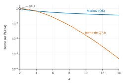
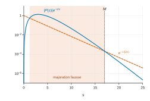
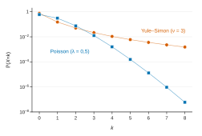

# Agro-Véto BCPST — Mathématiques 2026 · Corrigé brut

*Corrigé rédigé par IA, non officiel. Signalez toute erreur.*

Épreuve « Méthodes de calcul et raisonnement », durée 2 h, sans calculatrice. Toutes les parties sont indépendantes, sauf la question 24.

## Partie I : Approximation de la loi de Poisson

On suppose $N\ge\lambda$, pour que $\lambda/N\in\,]0,1]$ soit une probabilité. Cette hypothèse est sans conséquence, car on fait ensuite tendre $N$ vers $+\infty$.

### 1.

Pour $i\in\{1,\dots,N\}$, notons $B_i$ la variable qui vaut $1$ si la $i$-ème bactérie devient résistante, et donc survit, et $0$ sinon.

Chaque bactérie constitue une expérience de Bernoulli de succès « devenir résistante », de probabilité $\lambda/N$. Les $N$ expériences sont **mutuellement indépendantes**, par hypothèse de l'énoncé.

Le nombre $X_N=\sum_{i=1}^N B_i$ de survivantes compte les succès dans $N$ expériences de Bernoulli indépendantes de même paramètre. Donc $X_N$ suit la loi binomiale :

$$\boxed{X_N\sim\mathcal B\!\left(N,\tfrac{\lambda}{N}\right)}$$

c'est-à-dire, pour tout $k\in\{0,\dots,N\}$ :

$$\boxed{\mathbb P(X_N=k)=\binom Nk\left(\frac\lambda N\right)^k\left(1-\frac\lambda N\right)^{N-k}.}$$

### 2.

Soit $k\in\mathbb N$ fixé. Pour $N>\lambda$, on a $0<1-\lambda/N<1$, d'où

$$\left(1-\frac\lambda N\right)^{N-k}=\exp\!\left[(N-k)\ln\!\left(1-\frac\lambda N\right)\right].$$

On étudie l'exposant. Quand $N\to+\infty$, $u_N=-\lambda/N$ tend vers $0$, et $\ln(1+u)\sim u$ en $0$, donc :

$$\ln\!\left(1-\frac\lambda N\right)\sim-\frac\lambda N .$$

Comme $k$ est fixé, $N-k\sim N$. Par produit d'équivalents :

$$(N-k)\ln\!\left(1-\frac\lambda N\right)\sim N\cdot\left(-\frac\lambda N\right)=-\lambda .$$

Une suite équivalente à la constante non nulle $-\lambda$ tend vers $-\lambda$. L'exposant tend donc vers $-\lambda$. Par continuité de l'exponentielle en $-\lambda$ (composition de limites) :

$$\boxed{\lim_{N\to+\infty}\left(1-\frac\lambda N\right)^{N-k}=e^{-\lambda}.}$$

### 3.

Soit $k\in\mathbb N$ fixé et $N\ge\max(k,\lambda)$. On écrit $\binom Nk=\frac{N(N-1)\cdots(N-k+1)}{k!}$ dans la formule de la question 1 :

$$\begin{aligned}
\mathbb P(X_N=k)&=\frac{N(N-1)\cdots(N-k+1)}{k!}\cdot\frac{\lambda^k}{N^k}\cdot\left(1-\frac\lambda N\right)^{N-k}\\
&=c_N\cdot\frac{\lambda^k}{k!}\cdot\left(1-\frac\lambda N\right)^{N-k},
\end{aligned}$$

avec

$$c_N=\prod_{j=0}^{k-1}\left(1-\frac jN\right).$$

Le produit $c_N$ compte un nombre **fixe** $k$ de facteurs, qui tendent chacun vers $1$. Donc $c_N\to1$. Par la question 2, le dernier facteur tend vers $e^{-\lambda}$. Par produit de limites :

$$\boxed{\lim_{N\to+\infty}\mathbb P(X_N=k)=e^{-\lambda}\frac{\lambda^k}{k!}.}$$

### 4.

Si $X\sim\mathcal P(\mu)$ avec $\mu>0$, alors $\mathbb E(X)=\mu$ et $\mathbb V(X)=\mu$. Comme $\mathbb E(X)\neq0$, on peut diviser :

$$\boxed{\frac{\mathbb V(X)}{\mathbb E(X)}=1.}$$

Ce rapport ne dépend pas du paramètre.

## Partie II : Inégalités de concentration

### 5.

Soit $X$ discrète, positive, admettant une espérance, et soit $a>0$. Par définition de l'espérance, la série ci-dessous converge absolument :

$$\mathbb E(X)=\sum_{x\in X(\Omega)}x\,\mathbb P(X=x).$$

On sépare cette somme selon que $x\le a$ ou $x>a$.

- Les termes avec $x\le a$ sont positifs, car $x\ge0$. On peut donc les retirer en minorant.
- Les termes avec $x>a$ vérifient $x\,\mathbb P(X=x)\ge a\,\mathbb P(X=x)$.

On obtient :

$$\begin{aligned}
\mathbb E(X)&\ge\sum_{x\in X(\Omega),\,x>a}x\,\mathbb P(X=x)\\
&\ge a\sum_{x\in X(\Omega),\,x>a}\mathbb P(X=x)\\
&=a\,\mathbb P(X>a).
\end{aligned}$$

La dernière égalité vient de ce que $\{X>a\}$ est la réunion disjointe, au plus dénombrable, des $\{X=x\}$ pour $x>a$ (σ-additivité). Comme $a>0$ :

$$\boxed{\mathbb P(X>a)\le\frac{\mathbb E(X)}a.}$$

### 6.

Soit $t\ge0$.

**Cas $t=0$.** On a $Z_0=1$ et $\psi(0)=\ln1=0$. L'inégalité s'écrit $\mathbb P(X>a)\le1$, ce qui est vrai.

**Cas $t>0$.** La fonction $u\mapsto e^{tu}$ est strictement croissante sur $\mathbb R$. Pour tout $\omega$, on a donc $X(\omega)>a$ si et seulement si $e^{tX(\omega)}>e^{ta}$, d'où l'égalité d'événements :

$$\{X>a\}=\{Z_t>e^{ta}\}.$$

On vérifie les hypothèses de l'inégalité de Markov pour $Z_t$ :

- $Z_t$ est une variable réelle positive ;
- elle admet une espérance, puisque $\psi(t)=\ln\mathbb E(Z_t)$ est définie ;
- le seuil $e^{ta}$ est strictement positif.

(La question 5 a été démontrée pour une variable discrète. Si $X$ est discrète, $Z_t$ l'est aussi, ce qui suffit pour la question 7.) La question 5 donne alors :

$$\begin{aligned}
\mathbb P(X>a)&=\mathbb P(Z_t>e^{ta})\\
&\le\frac{\mathbb E(Z_t)}{e^{ta}}\\
&=e^{\psi(t)}e^{-ta}.
\end{aligned}$$

Dans les deux cas :

$$\boxed{\forall t\ge0,\quad \mathbb P(X>a)\le e^{\psi(t)-ta}.}$$

### 7.a.

On a $X(\Omega)=\mathbb N$ et $\mathbb P(X=k)=e^{-\lambda}\lambda^k/k!$. Soit $t\ge0$.

Par le théorème de transfert, $Z_t=e^{tX}$ admet une espérance si et seulement si la série $\sum_k e^{tk}e^{-\lambda}\lambda^k/k!$ converge absolument. Ses termes sont positifs : il suffit qu'elle converge. Or :

$$\begin{aligned}
\sum_{k=0}^{+\infty}e^{tk}e^{-\lambda}\frac{\lambda^k}{k!}&=e^{-\lambda}\sum_{k=0}^{+\infty}\frac{(\lambda e^t)^k}{k!}\\
&=e^{-\lambda}e^{\lambda e^t},
\end{aligned}$$

car la série exponentielle converge en tout réel, ici $\lambda e^t$.

Donc $Z_t$ admet une espérance, et $\mathbb E(Z_t)=e^{\lambda(e^t-1)}$. Ce réel est strictement positif, donc son logarithme existe. La fonction $\psi$ est bien définie sur $\mathbb R_+$ :

$$\boxed{\forall t\ge0,\quad\psi(t)=\lambda\,(e^t-1).}$$

### 7.b.

Par 6 et 7.a, pour tout $t\ge0$, on a $\mathbb P(X>a)\le e^{\varphi(t)}$, avec :

$$\varphi(t)=\lambda(e^t-1)-ta .$$

La fonction $\varphi$ est dérivable et $\varphi'(t)=\lambda e^t-a$. Cette dérivée est positive si et seulement si $t\ge t^*$, où $t^*=\ln(a/\lambda)$. Comme $\lambda\le a$, on a $t^*\ge0$.

La fonction $\varphi$ décroît donc sur $[0,t^*]$, puis croît sur $[t^*,+\infty[$. Son minimum sur $\mathbb R_+$ vaut :

$$\begin{aligned}
\varphi(t^*)&=\lambda\left(\frac a\lambda-1\right)-a\ln\frac a\lambda\\
&=a\ln\lambda-a\ln a+a-\lambda .
\end{aligned}$$

En prenant $t=t^*$ dans l'inégalité de la question 6, on obtient, si $\lambda\le a$ :

$$\boxed{\mathbb P(X>a)\le\exp\left(a\ln\lambda-a\ln a+a-\lambda\right).}$$

### 7.c.

Ici $\mathbb E(X)=\lambda$. Les deux bornes valent :

- borne de Markov : $B_5(a)=\lambda/a$ ;
- borne de la question 7.b, pour $a\ge\lambda$ : $B_7(a)=\exp\left(-a\ln\frac a\lambda+a-\lambda\right)$.

Le logarithme de leur rapport vaut :

$$\begin{aligned}
\ln\frac{B_7(a)}{B_5(a)}&=-a\ln\frac a\lambda+a-\lambda+\ln\frac a\lambda\\
&=-(a-1)\ln\frac a\lambda+a-\lambda .
\end{aligned}$$

Quand $a\to+\infty$, on a $(a-1)\ln\frac a\lambda\sim a\ln a$, et $a-\lambda=o(a\ln a)$. Donc :

$$\ln\frac{B_7(a)}{B_5(a)}\underset{a\to+\infty}{\sim}-a\ln a .$$

Ce logarithme tend vers $-\infty$, donc $B_7(a)/B_5(a)\to0$.

**Lorsque $a\to+\infty$, la borne de la question 7.b est la meilleure : $B_7(a)=o(B_5(a))$.** Elle décroît comme $e^{-a\ln a}$, alors que la borne de Markov décroît seulement en $1/a$.

## Partie III : Étude d'un endomorphisme

### 8.

Soit $\nu>0$, et soit $P=\sum_{j=0}^n a_js^j$. Pour $s\ge0$, on a :

$$|P(s)|\le\sum_{j=0}^n|a_j|s^j .$$

Par croissances comparées, $s^je^{-s/(2\nu)}\to0$ quand $s\to+\infty$, pour chaque $j$. Par somme finie, $|P(s)|e^{-s/(2\nu)}\to0$.

Par définition de la limite, appliquée avec $\varepsilon=1$, il existe un réel $M\ge0$ tel que $|P(s)|e^{-s/(2\nu)}\le1$ pour tout $s>M$. En multipliant par $e^{-s/(2\nu)}>0$ :

$$\boxed{\exists M\ge0,\ \forall s>M,\quad |P(s)|\,e^{-s/\nu}\le e^{-s/(2\nu)}.}$$

La fonction $f:s\mapsto P(s)e^{-s/\nu}$ est continue sur $[0,+\infty[$. Le seul problème de convergence est donc en $+\infty$.

- Sur le segment $[0,M]$, l'intégrale de $f$ existe, par continuité.
- Sur $[M,+\infty[$, la fonction positive $|f|$ est majorée par la fonction positive $s\mapsto e^{-s/(2\nu)}$, dont l'intégrale converge :

$$\int_M^{+\infty}e^{-s/(2\nu)}\,\mathrm ds=\lim_{A\to+\infty}2\nu\left(e^{-M/(2\nu)}-e^{-A/(2\nu)}\right)=2\nu e^{-M/(2\nu)}.$$

Par le critère de comparaison des intégrales de fonctions positives, $\int_M^{+\infty}|f(s)|\,\mathrm ds$ converge. L'intégrale de $f$ sur $[M,+\infty[$ converge donc absolument, donc converge. Par la relation de Chasles, **$L_P(\nu)$ est bien défini**.

### 9.

Pour $k\in\mathbb N$, posons $J_k=\int_0^{+\infty}s^ke^{-s/\nu}\,\mathrm ds$. Cette intégrale converge par la question 8, appliquée au polynôme $P=X^k$.

On montre par récurrence sur $k$ la propriété $\mathcal H_k$ : « $J_k=k!\,\nu^{k+1}$ ».

- **Initialisation.** Pour $A>0$, on a $\int_0^Ae^{-s/\nu}\,\mathrm ds=\nu\left(1-e^{-A/\nu}\right)$, qui tend vers $\nu$. Donc $J_0=\nu=0!\,\nu^1$, et $\mathcal H_0$ est vraie.
- **Hérédité.** Soit $k\ge1$ tel que $\mathcal H_{k-1}$ soit vraie, et soit $A>0$. On pose $u(s)=s^k$ et $v(s)=-\nu e^{-s/\nu}$.

Les fonctions $u$ et $v$ sont de classe $\mathcal C^1$ sur $[0,A]$. Leurs dérivées sont $u'(s)=ks^{k-1}$ et $v'(s)=e^{-s/\nu}$.

Une intégration par parties sur le segment $[0,A]$ donne :

$$\int_0^As^ke^{-s/\nu}\,\mathrm ds=\left[-\nu s^ke^{-s/\nu}\right]_0^A+k\nu\int_0^As^{k-1}e^{-s/\nu}\,\mathrm ds .$$

Le crochet vaut $-\nu A^ke^{-A/\nu}$, qui tend vers $0$ quand $A\to+\infty$, par croissances comparées. L'intégrale de droite tend vers $J_{k-1}$. En faisant $A\to+\infty$ :

$$\begin{aligned}
J_k&=k\nu J_{k-1}\\
&=k\nu\cdot(k-1)!\,\nu^{k}\\
&=k!\,\nu^{k+1}.
\end{aligned}$$

Donc $\mathcal H_k$ est vraie. Par récurrence, $\mathcal H_k$ est vraie pour tout $k\in\mathbb N$. En divisant par $\nu$ :

$$\boxed{\forall k\in\mathbb N,\quad\frac1\nu\int_0^{+\infty}s^ke^{-s/\nu}\,\mathrm ds=k!\,\nu^k.}$$

Si $P=\sum_{k=0}^n a_kX^k$, la linéarité de l'intégrale s'applique, car $L_P(\nu)$ est une somme finie d'intégrales convergentes :

$$\boxed{L_P(\nu)=\sum_{k=0}^n k!\,a_k\,\nu^k.}$$

### 10.

**$L$ va de $\mathbb R_d[X]$ dans $\mathbb R_d[X]$.** L'écriture $P=\sum_{k=0}^d a_kX^k$ dans la base $(1,X,\dots,X^d)$ est unique, donc $L(P)$ est bien défini.

Le polynôme $L(P)=\sum_{k=0}^d k!\,a_kX^k$ ne fait intervenir que des puissances $X^k$ avec $k\le d$. Il est donc de degré au plus $d$, et appartient à $\mathbb R_d[X]$.

**Linéarité.** Soient $P=\sum_{k=0}^d a_kX^k$ et $Q=\sum_{k=0}^d b_kX^k$ dans $\mathbb R_d[X]$, et $\mu\in\mathbb R$.

Le polynôme $\mu P+Q$ s'écrit $\sum_{k=0}^d(\mu a_k+b_k)X^k$ : ses coefficients sont les $\mu a_k+b_k$. Par définition de $L$ :

$$\begin{aligned}
L(\mu P+Q)&=\sum_{k=0}^dk!\,(\mu a_k+b_k)X^k\\
&=\mu\sum_{k=0}^dk!\,a_kX^k+\sum_{k=0}^dk!\,b_kX^k\\
&=\mu L(P)+L(Q).
\end{aligned}$$

**$L$ est un endomorphisme de $\mathbb R_d[X]$.**

### 11.

$$\boxed{\dim\mathbb R_d[X]=d+1.}$$

### 12.

Par définition, le noyau de $L$ est l'ensemble des polynômes de $\mathbb R_d[X]$ que $L$ envoie sur le polynôme nul :

$$\ker L=\{P\in\mathbb R_d[X]\ :\ L(P)=0\}.$$

Soit $P=\sum a_kX^k$. Un polynôme est nul si et seulement si tous ses coefficients sont nuls.

Donc $L(P)=0$ équivaut à $k!\,a_k=0$ pour tout $k$.

Comme $k!\neq0$, cela équivaut à $a_k=0$ pour tout $k$, soit $P=0$. Donc :

$$\boxed{\ker L=\{0\}.}$$

### 13.

$L$ est un endomorphisme injectif (question 12) de $\mathbb R_d[X]$, espace de **dimension finie** $d+1$ (question 11). Par le théorème du rang :

$$\operatorname{rg}L=d+1-\dim\ker L=d+1 .$$

Donc $\operatorname{Im}L=\mathbb R_d[X]$.

**Oui, $L$ est surjectif**, et même bijectif. On le voit aussi directement : $\sum b_kX^k=L\left(\sum\frac{b_k}{k!}X^k\right)$.

### 14.

On a $L(1)=1$, $L(X)=X$, $L(X^2)=2X^2$ et $L(X^3)=6X^3$. Dans la base canonique $(1,X,X^2,X^3)$ :

$$\boxed{\operatorname{Mat}(L)=\begin{pmatrix}1&0&0&0\\0&1&0&0\\0&0&2&0\\0&0&0&6\end{pmatrix}.}$$

### 15.

Soit $P=\sum_{k=0}^d a_kX^k$ et $\mu\in\mathbb R$. En identifiant les coefficients, $L(P)=\mu P$ équivaut à :

$$\forall k\in\{0,\dots,d\},\quad(k!-\mu)\,a_k=0 .$$

- Si $\mu$ n'est égal à aucun des $k!$, la seule solution est $P=0$, et $\mu$ n'est pas valeur propre.
- Si $\mu=k_0!$, les solutions sont les $P$ dont les seuls coefficients non nuls sont ceux des $X^k$ tels que $k!=k_0!$.

Or $0!=1!=1$, et $k\mapsto k!$ est strictement croissante sur $\mathbb N^*$. Les valeurs propres de $L$ sont donc les $k!$ pour $0\le k\le d$ :

$$\boxed{\operatorname{Sp}(L)=\{1,2,6,\dots,d!\}.}$$

Les sous-espaces propres, engendrés par des polynômes, sont :

$$\boxed{E_1(L)=\operatorname{Vect}(1,X)}$$

de dimension $2$, et, pour $2\le k\le d$ :

$$\boxed{E_{k!}(L)=\operatorname{Vect}(X^k).}$$

Pour $d=1$, on a $\operatorname{Sp}(L)=\{1\}$ et $L=\mathrm{id}$.

### 16.

Pour tout $d\in\mathbb N^*$, la base canonique est formée de vecteurs propres de $L$ : la matrice de $L$ dans cette base est $\mathrm{diag}(0!,1!,\dots,d!)$, qui est diagonale. De façon équivalente, la somme des dimensions des sous-espaces propres vaut $2+(d-1)=d+1$.

**$L$ est diagonalisable pour toute valeur de $d\in\mathbb N^*$.**

### 17.a.

On vérifie les trois points de la caractérisation des sous-espaces vectoriels.

- **Inclusion.** Par définition, $C(A)$ est formé de matrices de $\mathcal M_3(\mathbb R)$, donc $C(A)\subset\mathcal M_3(\mathbb R)$.
- **Non vide.** La matrice nulle vérifie $A\,0_3=0_3=0_3\,A$, donc $0_3\in C(A)$.
- **Stabilité par combinaison linéaire.** Soient $M,N\in C(A)$ et $\mu\in\mathbb R$. Par distributivité du produit matriciel, puis car $AM=MA$ et $AN=NA$ :

$$\begin{aligned}
A(\mu M+N)&=\mu AM+AN\\
&=\mu MA+NA\\
&=(\mu M+N)A .
\end{aligned}$$

Donc $\mu M+N\in C(A)$.

**$C(A)$ est un sous-espace vectoriel de $\mathcal M_3(\mathbb R)$.**

### 17.b.

On calcule les deux produits :

$$AM=\begin{pmatrix}0&0&0\\0&0&0\\g&h&k\end{pmatrix}$$

et

$$MA=\begin{pmatrix}0&0&c\\0&0&f\\0&0&k\end{pmatrix}.$$

Deux matrices sont égales si et seulement si leurs neuf coefficients le sont. En identifiant, on obtient la condition nécessaire et suffisante :

$$\boxed{M\in C(A)\iff(c,f,g,h)=(0,0,0,0).}$$

Autrement dit, $C(A)$ est l'ensemble des matrices de la forme $\begin{pmatrix}a&b&0\\d&e&0\\0&0&k\end{pmatrix}$, avec $a,b,d,e,k$ réels.

### 17.c.

Notons $E_{i,j}$ les matrices élémentaires de $\mathcal M_3(\mathbb R)$.

$$\boxed{\text{Base de }C(A)\text{ : }(E_{1,1},E_{1,2},E_{2,1},E_{2,2},E_{3,3})}$$

$$\boxed{\dim C(A)=5.}$$

### 17.d.

Pour $\alpha,\beta\in\mathbb R$, $\alpha I_3+\beta A=\mathrm{diag}(\alpha,\alpha,\alpha+\beta)$. Tout élément de $\operatorname{Vect}(I_3,A)$ est donc diagonal.

Prenons $M_0=E_{1,2}$, matrice dont l'unique coefficient non nul est un $1$ en position $(1,2)$.

- On a $M_0\in C(A)$, car ses coefficients $c,f,g,h$ sont nuls (question 17.b).
- On a $M_0\notin\operatorname{Vect}(I_3,A)$, car son coefficient $(1,2)$ vaut $1\neq0$ alors que $M_0$ devrait être diagonale.

$$\boxed{E_{1,2}=\begin{pmatrix}0&1&0\\0&0&0\\0&0&0\end{pmatrix}\in C(A)\setminus\operatorname{Vect}(I_3,A).}$$

## Partie IV : Loi de Yule–Simon

### 18.

Soit $k\in\mathbb N$. La fonction $f_k:s\mapsto(1-e^{-s})^ke^{-(\nu+1)s}$ est continue sur $[0,+\infty[$ : l'intégrale n'est généralisée qu'en $+\infty$. Pour $s\ge0$, on a $0\le1-e^{-s}<1$, donc :

$$0\le f_k(s)\le e^{-(\nu+1)s}.$$

De plus, $\int_0^{+\infty}e^{-(\nu+1)s}\,\mathrm ds$ converge, car $\nu+1>0$, et vaut $\frac1{\nu+1}$. Par le critère de comparaison des intégrales de fonctions positives, **l'intégrale définissant $p_k$ converge**. On a de plus $0\le p_k\le\frac\nu{\nu+1}$.

### 19.

Soit $A>0$. La fonction $\varphi:s\mapsto e^{-s}$ est de classe $\mathcal C^1$ sur $[0,A]$, avec $\varphi'(s)=-e^{-s}$.

Elle est strictement décroissante, de $[0,A]$ sur $[e^{-A},1]$. La fonction $g:t\mapsto t^\nu(1-t)^k$ est continue sur $[e^{-A},1]$.

Pour $s\in[0,A]$, on a $1-e^{-s}=1-\varphi(s)$ et $e^{-(\nu+1)s}=\varphi(s)^\nu\cdot\big(-\varphi'(s)\big)$. Le changement de variable $t=\varphi(s)$ donne donc :

$$\begin{aligned}
\int_0^A(1-e^{-s})^ke^{-(\nu+1)s}\,\mathrm ds&=-\int_0^Ag\big(\varphi(s)\big)\varphi'(s)\,\mathrm ds\\
&=-\int_1^{e^{-A}}t^{\nu}(1-t)^k\,\mathrm dt\\
&=\int_{e^{-A}}^1t^{\nu}(1-t)^k\,\mathrm dt .
\end{aligned}$$

Quand $A\to+\infty$, le membre de gauche tend vers $p_k/\nu$ (question 18).

À droite, $g$ est continue sur le segment $[0,1]$, car $\nu>0$. La fonction $x\mapsto\int_x^1g(t)\,\mathrm dt$ est donc continue en $0$, et $e^{-A}\to0$.

En multipliant par $\nu$ :

$$\boxed{\forall k\in\mathbb N,\quad p_k=\nu\int_0^1t^\nu(1-t)^k\,\mathrm dt.}$$

### 20.a.

C'est une somme géométrique de raison $1-t$. Cette raison vaut $1$ seulement pour $t=0$, cas qu'on traite à part.

$$\boxed{\sum_{k=0}^N(1-t)^k=\begin{cases}\dfrac{1-(1-t)^{N+1}}{t}&\text{si }t\in\,]0,1],\\[2mm] N+1&\text{si }t=0.\end{cases}}$$

Pour $t=1$, la formule donne bien $1$ : seul le terme $k=0$ vaut $1$, les autres sont nuls.

### 20.b.

Comme $\nu-1>0$, la fonction $t\mapsto t^{\nu-1}$ est croissante sur $\mathbb R_+$. Pour $t\in[0,1]$, on a donc :

$$0\le t^{\nu-1}\le1^{\nu-1}=1 .$$

On multiplie cette inégalité par le réel positif $(1-t)^{N+1}$ :

$$0\le t^{\nu-1}(1-t)^{N+1}\le(1-t)^{N+1}.$$

Les deux fonctions sont continues sur le segment $[0,1]$. Par croissance de l'intégrale :

$$\boxed{\int_0^1t^{\nu-1}(1-t)^{N+1}\,\mathrm dt\le\int_0^1(1-t)^{N+1}\,\mathrm dt.}$$

Le majorant vaut $\left[-\frac{(1-t)^{N+2}}{N+2}\right]_0^1=\frac1{N+2}$.

### 20.c.

Il suffit de montrer que les $p_k$ sont positifs et que $\sum_{k=0}^{+\infty}p_k=1$. La positivité vient de la question 18.

Soit $N\in\mathbb N$. Par la question 19 et la linéarité de l'intégrale (somme finie) :

$$\begin{aligned}
\sum_{k=0}^Np_k&=\sum_{k=0}^N\nu\int_0^1t^\nu(1-t)^k\,\mathrm dt\\
&=\nu\int_0^1t^\nu\sum_{k=0}^N(1-t)^k\,\mathrm dt .
\end{aligned}$$

Par 20.a, sur $]0,1]$, on a :

$$t^\nu\sum_{k=0}^N(1-t)^k=t^{\nu-1}\big(1-(1-t)^{N+1}\big).$$

Les deux membres sont continus sur $[0,1]$ et valent $0$ en $t=0$, car $\nu>1$. L'égalité vaut donc sur tout $[0,1]$, et :

$$\begin{aligned}
\sum_{k=0}^Np_k&=\nu\int_0^1t^{\nu-1}\,\mathrm dt-\nu\int_0^1t^{\nu-1}(1-t)^{N+1}\,\mathrm dt\\
&=1-R_N,
\end{aligned}$$

où l'on a posé :

$$R_N=\nu\int_0^1t^{\nu-1}(1-t)^{N+1}\,\mathrm dt .$$

Par 20.b, $0\le R_N\le\frac\nu{N+2}$, qui tend vers $0$. La série $\sum p_k$ converge donc et sa somme vaut $1$.

La suite $(p_k)_{k\in\mathbb N}$ est formée de réels positifs de somme $1$ : c'est une loi de probabilité sur $\mathbb N$. **Il existe donc une variable aléatoire discrète $X$ telle que $\mathbb P(X=k)=p_k$ pour tout $k\in\mathbb N$.**

## Partie V : Calculs de moments

Ici $\nu>2$.

### 21.a.

Soient $n,p\in\mathbb N$. Les fonctions $u:t\mapsto\frac{t^{n+1}}{n+1}$ et $v:t\mapsto(1-t)^{p+1}$ sont de classe $\mathcal C^1$ sur $[0,1]$.

Leurs dérivées sont $u'(t)=t^n$ et $v'(t)=-(p+1)(1-t)^p$. On intègre par parties :

$$I_{n,p+1}=\left[\frac{t^{n+1}}{n+1}(1-t)^{p+1}\right]_0^1+\frac{p+1}{n+1}\int_0^1t^{n+1}(1-t)^p\,\mathrm dt .$$

Le crochet est nul aux deux bornes, car $n+1\ge1$ et $p+1\ge1$. Donc :

$$\boxed{(n+1)\,I_{n,p+1}=(p+1)\,I_{n+1,p}.}$$

### 21.b.

On montre par récurrence sur $p$ la propriété $\mathcal H_p$ : « pour tout $n\in\mathbb N$, $I_{n,p}=\frac{n!\,p!}{(n+p+1)!}$ ».

- **Initialisation.** Pour tout $n$, $I_{n,0}=\frac1{n+1}=\frac{n!\,0!}{(n+1)!}$, donc $\mathcal H_0$ est vraie.
- **Hérédité.** Supposons $\mathcal H_p$ vraie et soit $n\in\mathbb N$. On applique 21.a, puis $\mathcal H_p$ à l'entier $n+1$ :

$$\begin{aligned}
I_{n,p+1}&=\frac{p+1}{n+1}\,I_{n+1,p}\\
&=\frac{p+1}{n+1}\cdot\frac{(n+1)!\,p!}{(n+p+2)!}\\
&=\frac{n!\,(p+1)!}{(n+(p+1)+1)!}.
\end{aligned}$$

Donc $\mathcal H_{p+1}$ est vraie. Par récurrence :

$$\boxed{\forall n,p\in\mathbb N,\quad I_{n,p}=\frac{n!\,p!}{(n+p+1)!}.}$$

### 21.c.

Par 21.b avec $n=1$ et $p=N$ :

$$\begin{aligned}
(N+1)\int_0^1t(1-t)^N\,\mathrm dt&=(N+1)\,I_{1,N}\\
&=(N+1)\frac{N!}{(N+2)!}\\
&=\frac1{N+2}.
\end{aligned}$$

Donc :

$$\boxed{\lim_{N\to+\infty}(N+1)\int_0^1t(1-t)^N\,\mathrm dt=0.}$$

### 22.a.

Soit $N\in\mathbb N$. Pour $t\neq0$, la raison $1-t$ est différente de $1$. La formule de 20.a vaut donc sur l'intervalle ouvert $]0,2[$, qui contient $]0,1]$ :

$$\sum_{k=0}^N(1-t)^k=\frac{1-(1-t)^{N+1}}t .$$

Les deux membres sont dérivables sur $]0,2[$. On les dérive par rapport à $t$, sans oublier le signe : la dérivée de $t\mapsto(1-t)^k$ est $t\mapsto-k(1-t)^{k-1}$.

À gauche, on obtient $-\sum_{k=1}^Nk(1-t)^{k-1}$. À droite :

$$\begin{aligned}
\frac{\mathrm d}{\mathrm dt}\left(\frac{1-(1-t)^{N+1}}t\right)&=\frac{(N+1)(1-t)^N\,t-\big(1-(1-t)^{N+1}\big)}{t^2}\\
&=\frac{(N+1)(1-t)^N}t-\frac1{t^2}+\frac{(1-t)^{N+1}}{t^2}.
\end{aligned}$$

En changeant les signes, pour tout $t\in\,]0,1]$ :

$$\boxed{\sum_{k=1}^Nk(1-t)^{k-1}=\frac1{t^2}-\frac{(1-t)^{N+1}}{t^2}-\frac{(N+1)(1-t)^N}t.}$$

### 22.b.

Le réel $\nu$ n'est pas supposé entier : on ne peut pas utiliser la question 21, et l'on calcule directement. Comme $\nu>2$, la fonction $t\mapsto\nu t^{\nu-2}(1-t)$ est continue sur $[0,1]$, et :

$$\begin{aligned}
\int_0^1\nu\,t^\nu(1-t)\frac1{t^2}\,\mathrm dt&=\nu\int_0^1\left(t^{\nu-2}-t^{\nu-1}\right)\mathrm dt\\
&=\nu\left(\frac1{\nu-1}-\frac1\nu\right)\\
&=\frac{\nu}{\nu-1}-1 .
\end{aligned}$$

Sous forme de fraction irréductible :

$$\boxed{\int_0^1\nu\,t^\nu(1-t)\frac1{t^2}\,\mathrm dt=\frac1{\nu-1}.}$$

### 22.c.

Les termes $kp_k$ sont positifs. $X$ admet donc une espérance si et seulement si la suite des sommes partielles $\Sigma_N=\sum_{k=1}^Nkp_k$ converge.

Par la question 19 et la linéarité (somme finie), en factorisant $(1-t)$ :

$$\Sigma_N=\nu\int_0^1t^\nu(1-t)\sum_{k=1}^Nk(1-t)^{k-1}\,\mathrm dt .$$

On remplace la somme par l'expression de 22.a, valable sur $]0,1]$. On obtient :

$$\Sigma_N=T-R_N^{(1)}-R_N^{(2)},$$

où les trois termes valent :

$$\begin{aligned}
T&=\nu\int_0^1t^{\nu-2}(1-t)\,\mathrm dt,\\
R_N^{(1)}&=\nu\int_0^1t^{\nu-2}(1-t)^{N+2}\,\mathrm dt,\\
R_N^{(2)}&=\nu(N+1)\int_0^1t^{\nu-1}(1-t)^{N+1}\,\mathrm dt.
\end{aligned}$$

Les trois intégrandes sont continues sur $[0,1]$, car $\nu-2>0$, ce qui justifie la séparation de l'intégrale. Les égalités ont lieu sur $]0,1]$ et s'étendent en $0$ par continuité.

- Par 22.b, $T=\frac1{\nu-1}$.
- Comme $0\le t^{\nu-2}\le1$ sur $[0,1]$, on a $0\le R_N^{(1)}\le\nu\int_0^1(1-t)^{N+2}\,\mathrm dt$. Ce majorant vaut $\frac\nu{N+3}$ et tend vers $0$.
- Comme $\nu-2>0$, on a $t^{\nu-1}=t\cdot t^{\nu-2}\le t$ sur $[0,1]$. Avec $(1-t)^{N+1}\le(1-t)^N$, on obtient $0\le R_N^{(2)}\le\nu\,(N+1)\int_0^1t(1-t)^N\,\mathrm dt$. Ce majorant tend vers $0$ par 21.c.

Donc $\Sigma_N\to\frac1{\nu-1}$, la série $\sum kp_k$ converge, et **$X$ admet une espérance** :

$$\boxed{\mathbb E(X)=\frac1{\nu-1}.}$$

### 23.a.

Pour $t\in\,]0,1]$, on développe $(1-t)^2$ :

$$\nu t^\nu(1-t)^2\frac2{t^3}=2\nu\left(t^{\nu-3}-2t^{\nu-2}+t^{\nu-1}\right).$$

Comme $\nu-3>-1$, l'intégrale $\int_0^1t^{\nu-3}\,\mathrm dt$ converge et vaut $\frac1{\nu-2}$. C'est une intégrale de Riemann en $0$, généralisée si $\nu<3$. Les deux autres termes sont continus sur $[0,1]$. Donc :

$$\begin{aligned}
\mathbb E((X-1)X)&=2\nu\left(\frac1{\nu-2}-\frac2{\nu-1}+\frac1\nu\right)\\
&=2\nu\cdot\frac{\nu(\nu-1)-2\nu(\nu-2)+(\nu-1)(\nu-2)}{\nu(\nu-1)(\nu-2)}\\
&=2\nu\cdot\frac{2}{\nu(\nu-1)(\nu-2)}.
\end{aligned}$$

Après simplification :

$$\boxed{\mathbb E((X-1)X)=\frac4{(\nu-1)(\nu-2)}.}$$

### 23.b.

On a $X^2=(X-1)X+X$. Les variables $(X-1)X$ (énoncé) et $X$ (question 22.c) admettent une espérance. Par linéarité, $X^2$ admet une espérance. Donc $X$ admet un moment d'ordre 2, et par conséquent une variance.

Par la formule de König–Huygens, $\mathbb V(X)=\mathbb E(X^2)-\mathbb E(X)^2$, d'où :

$$\begin{aligned}
\mathbb V(X)&=\mathbb E((X-1)X)+\mathbb E(X)-\mathbb E(X)^2\\
&=\frac4{(\nu-1)(\nu-2)}+\frac1{\nu-1}-\frac1{(\nu-1)^2}\\
&=\frac{4(\nu-1)+(\nu-1)(\nu-2)-(\nu-2)}{(\nu-1)^2(\nu-2)}.
\end{aligned}$$

Le numérateur vaut $4\nu-4+\nu^2-3\nu+2-\nu+2=\nu^2$, donc :

$$\boxed{\mathbb V(X)=\frac{\nu^2}{(\nu-1)^2(\nu-2)}.}$$

### 23.c.

Comme $\mathbb E(X)>0$, on peut diviser :

$$\frac{\mathbb V(X)}{\mathbb E(X)}=\frac{\nu^2}{(\nu-1)^2(\nu-2)}\cdot(\nu-1)=\frac{\nu^2}{(\nu-1)(\nu-2)}.$$

Le dénominateur $(\nu-1)(\nu-2)$ est strictement positif, car $\nu>2$. De plus :

$$\nu^2-(\nu-1)(\nu-2)=3\nu-2>0 .$$

Donc :

$$\boxed{\frac{\mathbb V(X)}{\mathbb E(X)}=\frac{\nu^2}{(\nu-1)(\nu-2)}>1.}$$

### 24.

Les deux modèles se distinguent par l'indice de dispersion $\mathbb V(X)/\mathbb E(X)$ :

- dans la partie I (loi de Poisson), il vaut $1$ (question 4). Pour la binomiale exacte $\mathcal B(N,\lambda/N)$, il vaut $1-\lambda/N\le1$ ;
- dans la partie V (loi de Yule–Simon), il vaut $\frac{\nu^2}{(\nu-1)(\nu-2)}>1$ (question 23.c), quel que soit $\nu>2$.

À partir d'un échantillon $x_1,\dots,x_n$ (nombres de bactéries survivantes dans $n$ cultures indépendantes, menées dans les mêmes conditions), on calcule :

- la moyenne empirique $\bar x=\frac1n\sum x_i$, qui estime $\mathbb E(X)$ par la loi faible des grands nombres ;
- la variance empirique $s^2=\frac1{n-1}\sum(x_i-\bar x)^2$, estimation usuelle de $\mathbb V(X)$ ;
- puis l'indice empirique $\widehat D=s^2/\bar x$.

**Règle :** si $\widehat D$ est proche de $1$, on privilégie le modèle de la partie I (mutations induites par l'exposition). Si $\widehat D$ est nettement supérieur à $1$ (sur-dispersion), on privilégie le modèle de la partie V (mutations spontanées transmises à la descendance). « Nettement » s'apprécie en fonction de la taille de l'échantillon.

