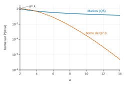
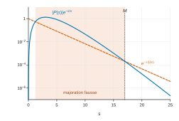
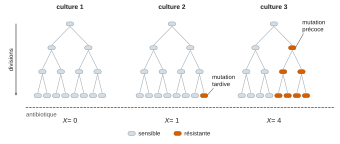
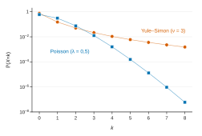

# Agro-Véto BCPST — Mathématiques 2026 · Corrigé guidé

*Corrigé rédigé par IA, non officiel. Signalez toute erreur.*

## Présentation du sujet

**Thème.** Le sujet suit l'expérience de Luria et Delbrück (1943), qui a montré que les mutations de résistance apparaissent au hasard au fil des divisions cellulaires, et non en réponse à l'exposition. Mathématiquement, on oppose deux modèles pour le nombre $X$ de bactéries survivantes :

- un modèle « mutation induite », dans lequel chaque bactérie mute indépendamment. On obtient une loi binomiale, approchée par une loi de Poisson ;
- un modèle « mutation spontanée transmise », qui conduit à la loi de Yule–Simon.

Les deux modèles se distinguent par l'**indice de dispersion** $\mathbb V(X)/\mathbb E(X)$. Il vaut $1$ dans le premier modèle et dépasse strictement $1$ dans le second.

**Format.** L'épreuve dure 2 heures, sans calculatrice, et le sujet tient en 4 pages. Elle compte 37 questions. Il n'y a aucune donnée numérique. Les parties sont indépendantes, sauf la question 24.

**Découpage.**

| Partie | Questions | Contenu | Notions mobilisées |
|---|---|---|---|
| I | 1–4 | Approximation binomiale de la loi de Poisson | schéma de Bernoulli, limites avec $\exp\circ\ln$, espérance et variance de lois usuelles |
| II | 5–7 | Inégalités de Markov et de Chernoff | espérance discrète, théorème de transfert, série exponentielle, étude de fonction, croissances comparées |
| III | 8–17 | Transformée $L_P$, endomorphisme $\sum a_kX^k\mapsto\sum k!\,a_kX^k$, commutant d'une matrice | intégrales généralisées, intégration par parties, noyau, théorème du rang, éléments propres, diagonalisation, sous-espaces vectoriels |
| IV | 18–20 | Construction de la loi de Yule–Simon | comparaison d'intégrales, changement de variable, somme géométrique, existence d'une variable discrète de loi donnée |
| V | 21–24 | Espérance et variance de la loi de Yule–Simon, conclusion | intégration par parties, récurrence, dérivation d'une identité, séries à termes positifs, König–Huygens, estimation |

**Difficulté et longueur.** Le sujet est long pour 2 heures, mais très guidé.

- Beaucoup de questions sont des questions de cours ou des applications immédiates : 1, 4, 5, 10, 11, 12, 13, 14, 16, 17.a, 17.c, 20.a et 21.c. Il ne faut pas les laisser passer.
- Les questions les plus techniques sont 3, 7.b, 7.c, 19, 20.c et surtout 22.c, qui assemble quatre résultats précédents.
- La question 24 est une question de synthèse. Elle se rédige même sans avoir fait la partie V, puisque le résultat de 23.c est donné par l'énoncé.

**Ce que le rapport 2026 juge discriminant.** Le jury rappelle que la justification porte « une partie très importante des points ». Des questions réputées faciles ont en réalité trié les copies :

- question 1 : seule la moitié des copies a tous les points, faute de citer l'indépendance ;
- question 5 (Markov) : abordée par la moitié des candidats, et la majorité n'a eu aucun point ;
- question 8 : la moitié des copies qui l'abordent n'a aucun point ;
- question 10 : 12 % des copies seulement ont tous les points ;
- question 14 : correcte dans un tiers des copies ; question 17.a : moins d'un tiers des copies a tous les points ;
- question 18 : les trois quarts des copies qui l'abordent n'ont aucun point ;
- question 20.a : 10 % des copies qui l'abordent ont tous les points.

À l'inverse, les questions 4 (près de 70 %) et 11 (80 %) sont bien réussies. Sur la partie I, les candidats n'ont en moyenne obtenu que la moitié des points.

**Gestion du temps.** Comptez environ 20 minutes pour la partie I, 25 pour la II, 30 pour la III, 15 pour la IV et 30 pour la V. Si le temps manque, traitez en priorité les questions 10 à 17, très rentables si elles sont justifiées, puis la question 24. Le jury déconseille un « grappillage très rarement fructueux » : mieux vaut rédiger complètement moins de questions.

## Partie I — Approximation de la loi de Poisson

On montre que le nombre de survivantes, qui suit une loi binomiale de paramètres $N$ et $\lambda/N$, converge vers une loi de Poisson. On en tire ensuite la propriété caractéristique de cette loi : l'espérance et la variance y sont égales.

### Question 1

> [!INDICATION]
> Chaque bactérie est une épreuve à deux issues. Quelles hypothèses de l'énoncé permettent de reconnaître une loi usuelle ?

> [!INDICATION]
> Écrivez $X_N$ comme une somme de variables indicatrices, puis citez précisément l'hypothèse d'indépendance.

#### Solution

On suppose $N\ge\lambda$, pour que $\lambda/N\in\,]0,1]$ soit une probabilité. Ce n'est pas restrictif, car la suite du sujet fait tendre $N$ vers $+\infty$.

Pour $i\in\{1,\dots,N\}$, notons $B_i$ la variable qui vaut $1$ si la $i$-ème bactérie devient résistante, donc survit, et $0$ sinon.

Chaque bactérie est une expérience de Bernoulli de paramètre $\lambda/N$, et ces $N$ expériences sont **mutuellement indépendantes** par hypothèse. La variable $X_N=\sum_{i=1}^NB_i$ compte les succès. Donc :

$$\boxed{X_N\sim\mathcal B\!\left(N,\tfrac\lambda N\right)}$$

c'est-à-dire, pour $k\in\{0,\dots,N\}$ :

$$\boxed{\mathbb P(X_N=k)=\binom Nk\left(\frac\lambda N\right)^k\left(1-\frac\lambda N\right)^{N-k}.}$$

> [!JURY]
> Rapport 2026 : « Il fallait justifier qu'il s'agissait d'une loi binomiale en évoquant des expériences de Bernoulli indépendantes. » Seule la moitié des copies a eu tous les points sur cette question pourtant traitée par presque tous. Donnez aussi le support et les probabilités élémentaires : la formule sert dès la question 3.

### Question 2

> [!INDICATION]
> On a une forme indéterminée du type « $1^\infty$ ». Comment transformer une puissance dont l'exposant varie ?

> [!INDICATION]
> Passez par $\exp\big((N-k)\ln(1-\lambda/N)\big)$, puis utilisez l'équivalent usuel de $\ln(1+u)$ en $0$. Rappelez-vous que $k$ ne dépend pas de $N$.

#### Solution

Soit $k$ fixé. Pour $N>\lambda$, on a $1-\lambda/N\in\,]0,1[$ et

$$\left(1-\frac\lambda N\right)^{N-k}=\exp\!\left[(N-k)\ln\!\left(1-\frac\lambda N\right)\right].$$

On étudie l'exposant. Comme $\lambda/N\to0$ et $\ln(1+u)\sim u$ en $0$, on a $\ln(1-\lambda/N)\sim-\lambda/N$. Comme $k$ est fixé, $N-k\sim N$. Par produit d'équivalents :

$$(N-k)\ln\!\left(1-\frac\lambda N\right)\sim-\lambda .$$

Une suite équivalente à une constante non nulle tend vers cette constante : l'exposant tend vers $-\lambda$. Par continuité de l'exponentielle (composition de limites) :

$$\boxed{\lim_{N\to+\infty}\left(1-\frac\lambda N\right)^{N-k}=e^{-\lambda}.}$$

> [!METHODE]
> Pour une limite de la forme $u_N^{v_N}$, écrivez toujours $e^{v_N\ln u_N}$ et cherchez la limite de l'exposant. Une variante consiste à séparer $(1-\lambda/N)^N\,(1-\lambda/N)^{-k}$, dont le second facteur tend vers $1$.

> [!PIEGE]
> Écrire « $1^\infty=1$ », ou écrire un équivalent de l'exponentielle à partir d'un équivalent de l'exposant. Le rapport 2026 rappelle que « l'on ne peut pas passer les équivalents dans l'exponentielle » : on conclut sur la **limite** de l'exposant, puis par continuité. Il relève aussi des oublis fréquents de parenthèses en écrivant $(N-k)\ln(\dots)$.

> [!PIEGE]
> Oublier que $k$ est fixé. Si $k$ dépendait de $N$, par exemple $k=N/2$, la limite ne serait plus $e^{-\lambda}$.

### Question 3

> [!INDICATION]
> Partez de la formule de la question 1 et isolez le facteur traité à la question 2.

> [!INDICATION]
> N'écrivez pas $\binom Nk$ avec $N!$. Utilisez plutôt le produit $N(N-1)\cdots(N-k+1)$, qui compte $k$ facteurs, et divisez chacun par $N$.

#### Solution

Pour $N\ge\max(k,\lambda)$ :

$$\begin{aligned}
\mathbb P(X_N=k)&=\frac{N(N-1)\cdots(N-k+1)}{N^k}\cdot\frac{\lambda^k}{k!}\cdot\left(1-\frac\lambda N\right)^{N-k}\\
&=\prod_{j=0}^{k-1}\left(1-\frac jN\right)\cdot\frac{\lambda^k}{k!}\cdot\left(1-\frac\lambda N\right)^{N-k}.
\end{aligned}$$

Le produit compte un nombre **fixe** $k$ de facteurs, qui tendent chacun vers $1$, donc il tend vers $1$. Le dernier facteur tend vers $e^{-\lambda}$ (question 2). Ainsi :

$$\boxed{\lim_{N\to+\infty}\mathbb P(X_N=k)=e^{-\lambda}\frac{\lambda^k}{k!}.}$$

> [!PIEGE]
> Le passage à la limite dans un produit n'est licite que si le **nombre** de facteurs ne dépend pas de $N$. C'est le cas ici, car $k$ est fixé.

> [!JURY]
> Il faut démontrer le résultat, pas le citer. Rapport 2026 : « Les étudiants qui ont cité ce résultat directement (sans en vérifier d'ailleurs les hypothèses) n'ont pas répondu à la question. » Le jury signale aussi des raisonnements qui partent d'une question 2 fausse et retombent « miraculeusement » sur le résultat demandé.

### Question 4

> [!INDICATION]
> Question de cours : rappelez l'espérance et la variance d'une loi de Poisson.

#### Solution

Si $X\sim\mathcal P(\mu)$ avec $\mu>0$, alors $\mathbb E(X)=\mu$ et $\mathbb V(X)=\mu$, et $\mathbb E(X)\ne0$. Donc :

$$\boxed{\frac{\mathbb V(X)}{\mathbb E(X)}=1.}$$

Ce rapport ne dépend pas du paramètre, ce qui en fait une signature de la loi de Poisson testable sur des données. C'est l'idée de la question 24.

## Partie II — Inégalités de concentration

On démontre l'inégalité de Markov, puis on l'applique à $e^{tX}$ pour obtenir une famille de bornes, qu'on optimise en $t$ (méthode de Chernoff). Le cas de la loi de Poisson montre que la seconde borne est bien meilleure.

### Question 5

> [!INDICATION]
> Partez de la définition de $\mathbb E(X)$ comme somme sur les valeurs prises par $X$.

> [!INDICATION]
> Coupez la somme en deux selon la position des valeurs par rapport à $a$. Une des deux parties peut être minorée par $0$, l'autre par un multiple de $\mathbb P(X>a)$.

#### Solution

Soit $X$ discrète positive admettant une espérance, et soit $a>0$. On a $\mathbb E(X)=\sum_{x\in X(\Omega)}x\,\mathbb P(X=x)$, série absolument convergente.

- Les termes avec $x\le a$ sont positifs, car $X\ge0$. On peut donc les retirer en minorant.
- Pour $x>a$, on a $x\,\mathbb P(X=x)\ge a\,\mathbb P(X=x)$.

D'où :

$$\begin{aligned}
\mathbb E(X)&\ge\sum_{x>a}x\,\mathbb P(X=x)\\
&\ge a\sum_{x>a}\mathbb P(X=x)\\
&=a\,\mathbb P(X>a).
\end{aligned}$$

La dernière égalité vient de ce que $\{X>a\}$ est la réunion disjointe des $\{X=x\}$ pour $x>a$. Comme $a>0$ :

$$\boxed{\mathbb P(X>a)\le\frac{\mathbb E(X)}a.}$$

> [!JURY]
> Question de cours abordée par la moitié des candidats seulement, et la majorité n'y a eu aucun point (rapport 2026). Le rapport rappelle en introduction : « Lorsqu'il est explicitement demandé de prouver un résultat, on ne peut pas se contenter de dire qu'il apparaît dans le cours ou de citer son nom. » Faites apparaître chaque hypothèse là où elle sert : la positivité de $X$ pour retirer des termes, $a>0$ pour diviser.

### Question 6

> [!INDICATION]
> Traduisez l'événement $\{X>a\}$ en un événement portant sur $Z_t$.

> [!INDICATION]
> La stricte croissance de $u\mapsto e^{tu}$ demande $t>0$. Le cas $t=0$ se traite à part, et il est immédiat.

#### Solution

**Cas $t=0$.** On a $\psi(0)=\ln1=0$, et l'inégalité $\mathbb P(X>a)\le1$ est vraie.

**Cas $t>0$.** La fonction $u\mapsto e^{tu}$ est strictement croissante, donc $\{X>a\}=\{Z_t>e^{ta}\}$.

On vérifie les hypothèses de Markov : $Z_t$ est positive, elle admet une espérance puisque $\psi(t)$ est définie, et le seuil $e^{ta}$ est strictement positif. La question 5 donne :

$$\begin{aligned}
\mathbb P(X>a)&=\mathbb P(Z_t>e^{ta})\\
&\le\frac{\mathbb E(Z_t)}{e^{ta}}\\
&=e^{\psi(t)-ta}.
\end{aligned}$$

Dans les deux cas :

$$\boxed{\forall t\ge0,\quad\mathbb P(X>a)\le e^{\psi(t)-ta}.}$$

La question 5 n'a été démontrée que pour une variable discrète. Si $X$ est discrète, $Z_t$ l'est aussi, ce qui suffit pour la question 7.

> [!METHODE]
> L'inégalité vaut pour **tout** $t\ge0$. On peut donc ensuite choisir le $t$ qui rend la borne la plus petite. C'est exactement ce que fait la question 7.b.

> [!JURY]
> Rapport 2026 : « Avant d'appliquer le résultat précédent, il faut en vérifier les hypothèses. » Le jury attend aussi que l'égalité des événements soit justifiée par l'injectivité ou la stricte croissance de l'exponentielle, ce qui impose la disjonction de cas selon que $t$ est nul ou non.

### Question 7.a

> [!INDICATION]
> Pour l'existence comme pour le calcul, utilisez le théorème de transfert : l'espérance de $e^{tX}$ s'exprime comme une série.

> [!INDICATION]
> Regroupez $e^{tk}\lambda^k$ en une seule puissance $k$-ième et reconnaissez une série de référence, convergente pour tout réel.

#### Solution

Soit $t\ge0$. Par le théorème de transfert, $Z_t$ admet une espérance si et seulement si la série $\sum_ke^{tk}e^{-\lambda}\lambda^k/k!$ converge absolument. Ses termes sont positifs, il suffit donc qu'elle converge. Or :

$$\begin{aligned}
\sum_{k=0}^{+\infty}e^{tk}e^{-\lambda}\frac{\lambda^k}{k!}&=e^{-\lambda}\sum_{k=0}^{+\infty}\frac{(\lambda e^t)^k}{k!}\\
&=e^{-\lambda}e^{\lambda e^t},
\end{aligned}$$

la série exponentielle convergeant sur $\mathbb R$. Donc $\mathbb E(Z_t)=e^{\lambda(e^t-1)}$.

Ce réel est **strictement** positif, donc son logarithme existe, et $\psi$ est bien définie sur $\mathbb R_+$, avec :

$$\boxed{\psi(t)=\lambda\,(e^t-1).}$$

> [!JURY]
> Rapport 2026 : « L'objectif de la question n'a pas été comprise. » Il fallait d'abord établir que $\exp(tX)$ admet une espérance, et non se contenter de sa positivité pour justifier le logarithme. Pour le calcul, « il fallait évoquer le théorème de transfert et s'intéresser à la convergence absolue de la série ».

> [!PIEGE]
> Le jury note « de très fréquentes erreurs sur les exponentielles ». Typiquement : écrire $\sum(\lambda e^t)^k/k!=e^\lambda e^t$ au lieu de $e^{\lambda e^t}$, ou oublier le facteur $e^{-\lambda}$.

### Question 7.b

> [!INDICATION]
> Vous disposez d'une borne $e^{\varphi(t)}$ valable pour tout $t\ge0$. Que faire de ce paramètre libre ?

> [!INDICATION]
> Étudiez les variations de $\varphi(t)=\lambda(e^t-1)-ta$ sur $\mathbb R_+$. L'hypothèse $\lambda\le a$ sert à placer le point critique dans $\mathbb R_+$.

#### Solution

D'après les questions 6 et 7.a, $\mathbb P(X>a)\le e^{\varphi(t)}$ pour tout $t\ge0$, avec :

$$\varphi(t)=\lambda(e^t-1)-ta .$$

On a $\varphi'(t)=\lambda e^t-a$, positif si et seulement si $t\ge t^*$, où $t^*=\ln(a/\lambda)$. Comme $\lambda\le a$, on a $t^*\ge0$.

La fonction $\varphi$ décroît sur $[0,t^*]$ puis croît, et son minimum vaut :

$$\begin{aligned}
\varphi(t^*)&=\lambda\left(\frac a\lambda-1\right)-a\ln\frac a\lambda\\
&=a\ln\lambda-a\ln a+a-\lambda .
\end{aligned}$$

En prenant $t=t^*$, on obtient, si $\lambda\le a$ :

$$\boxed{\mathbb P(X>a)\le\exp(a\ln\lambda-a\ln a+a-\lambda).}$$

> [!PIEGE]
> Sans l'hypothèse $\lambda\le a$, on aurait $t^*<0$. Le minimum sur $\mathbb R_+$ serait alors atteint en $t=0$, ce qui ne donne que la borne triviale $1$.

### Question 7.c

> [!INDICATION]
> Explicitez la borne de Markov dans le cas de la loi de Poisson : que vaut $\mathbb E(X)$ ?

> [!INDICATION]
> Les deux bornes tendent vers $0$. Pour les comparer, étudiez la limite de leur **rapport**, ou du logarithme de ce rapport.

#### Solution

Pour $a\ge\lambda$, on compare la borne de Markov $B_5(a)=\lambda/a$ et la borne de 7.b :

$$B_7(a)=\exp\left(-a\ln\frac a\lambda+a-\lambda\right).$$

Le logarithme de leur rapport vaut :

$$\begin{aligned}
\ln\frac{B_7(a)}{B_5(a)}&=-(a-1)\ln\frac a\lambda+a-\lambda\\
&\underset{a\to+\infty}{\sim}-a\ln a ,
\end{aligned}$$

car $a-\lambda=o(a\ln a)$. Il tend vers $-\infty$, donc $B_7(a)/B_5(a)\to0$.

**La borne de la question 7.b est la meilleure quand $a\to+\infty$**, et $B_7(a)=o(B_5(a))$. Elle décroît comme $e^{-a\ln a}$, plus vite que toute exponentielle, alors que la borne de Markov ne décroît qu'en $1/a$.

Par exemple, pour $\lambda=2$ et $a=14$, on trouve $B_5\approx0{,}14$ et $B_7\approx2{,}4\times10^{-7}$. Les deux bornes valent $1$ en $a=\lambda$.

> [!PIEGE]
> Constater que $B_7(a)\to0$ ne suffit pas, puisque $B_5(a)\to0$ aussi. C'est la comparaison des vitesses qui répond à la question.

> [!JURY]
> Rapport 2026 : « Il ne s'agit pas de répondre "la première" ou "la seconde". Toute réponse doit être justifiée. »

## Partie III — Étude d'un endomorphisme

Les questions 8 et 9 montrent que $L_P(\nu)$ se calcule en multipliant chaque coefficient de $P$ par $k!$, ce qui motive l'endomorphisme $L$. On en étudie ensuite le noyau, la surjectivité, la matrice et les éléments propres. La question 17, indépendante, porte sur un commutant de matrice.

### Question 8

> [!INDICATION]
> Que dire de $|P(s)|\,e^{-s/(2\nu)}$ quand $s\to+\infty$ ?

> [!INDICATION]
> Appliquez la définition de la limite avec $\varepsilon=1$. Pour l'intégrale, séparez un segment $[0,M]$ et une demi-droite $[M,+\infty[$ où vous comparez.

#### Solution

Soit $P=\sum_{j=0}^na_js^j$. Pour $s\ge0$, on a $|P(s)|\le\sum|a_j|s^j$, et chaque $s^je^{-s/(2\nu)}$ tend vers $0$ par croissances comparées. Donc $|P(s)|e^{-s/(2\nu)}\to0$.

Par définition de la limite (avec $\varepsilon=1$), il existe $M\ge0$ tel que $|P(s)|e^{-s/(2\nu)}\le1$ pour $s>M$. En multipliant par $e^{-s/(2\nu)}>0$ :

$$\boxed{\forall s>M,\quad|P(s)|e^{-s/\nu}\le e^{-s/(2\nu)}.}$$

La fonction $s\mapsto P(s)e^{-s/\nu}$ est **continue** sur $[0,+\infty[$ : l'intégrale n'est généralisée qu'en $+\infty$.

- Sur $[0,M]$, son intégrale existe, car c'est une intégrale sur un segment.
- Sur $[M,+\infty[$, sa valeur absolue est majorée par la fonction positive $s\mapsto e^{-s/(2\nu)}$. L'intégrale de celle-ci converge et vaut $2\nu e^{-M/(2\nu)}$. Par comparaison de fonctions **positives**, l'intégrale converge absolument, donc converge.

Par la relation de Chasles, **$L_P(\nu)$ est bien défini**.

> [!METHODE]
> Pour l'intégrabilité d'un « polynôme × exponentielle décroissante », on garde la moitié de l'exponentielle pour absorber le polynôme, et l'autre moitié pour dominer. Tout facteur $\theta\in\,]0,1[$ conviendrait à la place de $1/2$.

> [!PIEGE]
> La majoration est fausse sur une plage intermédiaire. Pour $P(s)=s^3$ et $\nu=1$, elle n'est vraie qu'au-delà de $s\approx17$. On ne peut donc pas comparer sur tout $[0,+\infty[$.

> [!JURY]
> Le rapport 2026 parle de « graves lacunes » : « quasiment aucune copie n'évoque la continuité de la fonction », et « le critère de comparaison porte sur les fonctions positives ». Une justification rapide de la convergence de l'intégrale du majorant était attendue. La moitié des copies qui ont abordé la question n'a eu aucun point.

### Question 9

> [!INDICATION]
> Établissez une relation de récurrence entre l'intégrale d'exposant $k$ et celle d'exposant $k-1$.

> [!INDICATION]
> Intégrez par parties sur un segment $[0,A]$, puis faites tendre $A$ vers $+\infty$. Rédigez une vraie récurrence, et contrôlez votre formule sur $k=0$.

#### Solution

Posons $J_k=\int_0^{+\infty}s^ke^{-s/\nu}\,\mathrm ds$, qui converge par la question 8 appliquée à $P=X^k$. On montre par récurrence la propriété $\mathcal H_k$ : « $J_k=k!\,\nu^{k+1}$ ».

- **Initialisation.** On a $\int_0^Ae^{-s/\nu}\,\mathrm ds=\nu(1-e^{-A/\nu})$, qui tend vers $\nu$. Donc $J_0=\nu$, et $\mathcal H_0$ est vraie.
- **Hérédité.** Soit $k\ge1$ tel que $\mathcal H_{k-1}$ soit vraie. Sur $[0,A]$, les fonctions $s\mapsto s^k$ et $s\mapsto-\nu e^{-s/\nu}$ sont de classe $\mathcal C^1$. Une intégration par parties donne :

$$\int_0^As^ke^{-s/\nu}\,\mathrm ds=-\nu A^ke^{-A/\nu}+k\nu\int_0^As^{k-1}e^{-s/\nu}\,\mathrm ds .$$

Le crochet $-\nu A^ke^{-A/\nu}$ tend vers $0$ par croissances comparées. En faisant $A\to+\infty$ :

$$\begin{aligned}
J_k&=k\nu J_{k-1}\\
&=k\nu\cdot(k-1)!\,\nu^k\\
&=k!\,\nu^{k+1}.
\end{aligned}$$

Par récurrence, $\mathcal H_k$ est vraie pour tout $k$. En divisant par $\nu$ :

$$\boxed{\frac1\nu\int_0^{+\infty}s^ke^{-s/\nu}\,\mathrm ds=k!\,\nu^k.}$$

Pour $P=\sum_{k=0}^na_kX^k$, la linéarité s'applique (somme finie d'intégrales convergentes) :

$$\boxed{L_P(\nu)=\sum_{k=0}^nk!\,a_k\,\nu^k.}$$

> [!PIEGE]
> Oublier un facteur $\nu$ : $J_k$ vaut $k!\,\nu^{k+1}$, et c'est le facteur $1/\nu$ de l'énoncé qui ramène à $k!\,\nu^k$. Le contrôle $J_0=\nu$ tranche immédiatement.

> [!JURY]
> Rapport 2026 : « La rédaction propre d'une récurrence est un attendu de base. » Pour l'intégration par parties, il faut préciser la régularité des fonctions et la limite du crochet. Le jury note enfin que trop de copies ont oublié la seconde partie de la question, l'expression de $L_P(\nu)$.

### Question 10

> [!INDICATION]
> Un endomorphisme est une application linéaire d'un espace dans lui-même. Il y a deux choses à vérifier.

#### Solution

Les coefficients d'un polynôme dans la base $(1,X,\dots,X^d)$ sont uniques, donc $L$ est bien définie.

L'image $\sum k!\,a_kX^k$ ne contient que des puissances $X^k$ avec $k\le d$. Elle est de degré au plus $d$, donc elle appartient à $\mathbb R_d[X]$.

Soient $P=\sum a_kX^k$, $Q=\sum b_kX^k$ et $\mu\in\mathbb R$. Les coefficients de $\mu P+Q$ sont les $\mu a_k+b_k$, donc :

$$\begin{aligned}
L(\mu P+Q)&=\sum_{k=0}^dk!\,(\mu a_k+b_k)X^k\\
&=\mu L(P)+L(Q).
\end{aligned}$$

**$L$ est un endomorphisme de $\mathbb R_d[X]$.**

> [!JURY]
> Rapport 2026 : « Au final, seul 12% des copies ont tous les points. » Le calcul de $L(\mu P+Q)$ doit faire apparaître les coefficients du polynôme $\mu P+Q$. Et pour l'espace d'arrivée, « une rapide justification était attendue ».

> [!PIEGE]
> Nommer deux polynômes $P$ et $P'$, comme le relève le jury : la notation $P'$ désigne déjà la dérivée. Prenez $P$ et $Q$.

### Question 11

> [!INDICATION]
> Comptez les éléments de la base canonique, sans oublier le degré $0$.

#### Solution

$$\boxed{\dim\mathbb R_d[X]=d+1.}$$

### Question 12

> [!INDICATION]
> Donnez d'abord la définition, puis traduisez $L(P)=0$ sur les coefficients.

#### Solution

Par définition :

$$\ker L=\{P\in\mathbb R_d[X]\ :\ L(P)=0\}.$$

Si $P=\sum a_kX^k$, alors $L(P)=0$ équivaut à $k!\,a_k=0$ pour tout $k$.

Comme $k!\ne0$, cela équivaut à $a_k=0$ pour tout $k$. Donc :

$$\boxed{\ker L=\{0\}.}$$

> [!JURY]
> Quand une question demande une définition, il faut l'écrire. Le rapport 2026 note un « grand flottement dans l'écriture formelle ensembliste ou logique », et des notations mal choisies. Par exemple, appeler $X$ l'élément générique de $\mathbb R_d[X]$ entre en conflit avec l'indéterminée $X$.

### Question 13

> [!INDICATION]
> Que dit le théorème du rang pour un endomorphisme d'un espace de dimension finie dont le noyau est nul ?

#### Solution

$L$ est un endomorphisme de $\mathbb R_d[X]$, de **dimension finie** $d+1$. Le théorème du rang donne :

$$\operatorname{rg}L=d+1-\dim\ker L=d+1 .$$

Donc $\operatorname{Im}L=\mathbb R_d[X]$.

**$L$ est surjectif**, et même bijectif. Directement : $\sum b_kX^k=L\left(\sum\frac{b_k}{k!}X^k\right)$.

> [!PIEGE]
> Rapport 2026 : « Tout endomorphisme injectif n'est pas forcément surjectif. » Il fallait préciser que $\mathbb R_d[X]$ est de dimension finie. En dimension infinie, l'endomorphisme $P\mapsto XP$ de $\mathbb R[X]$ est injectif sans être surjectif : le polynôme $1$ n'a pas d'antécédent.

### Question 14

> [!INDICATION]
> Calculez l'image de chaque vecteur de la base canonique et rangez les coordonnées en colonnes.

#### Solution

On a $L(1)=1$, $L(X)=X$, $L(X^2)=2X^2$ et $L(X^3)=6X^3$. Dans la base $(1,X,X^2,X^3)$ :

$$\boxed{\begin{pmatrix}1&0&0&0\\0&1&0&0\\0&0&2&0\\0&0&0&6\end{pmatrix}.}$$

> [!PIEGE]
> Attention, $0!=1$ et non $0$. Les deux premiers coefficients diagonaux sont donc égaux, ce qui compte aux questions 15 et 16.

> [!PIEGE]
> Une matrice dans une base est un tableau de **nombres**. Le rapport 2026 relève que les matrices obtenues « contiennent souvent des $X$ ou des $a_k$ » ; la question n'est correctement traitée que dans un tiers des copies.

### Question 15

> [!INDICATION]
> La base canonique est formée de vecteurs propres. Repérez cependant les valeurs de $k!$ qui coïncident.

> [!INDICATION]
> Pour obtenir les sous-espaces propres, résolvez $L(P)=\mu P$ coefficient par coefficient.

#### Solution

On a $L(P)=\mu P$ si et seulement si $(k!-\mu)\,a_k=0$ pour tout $k\in\{0,\dots,d\}$. Donc $\mu$ est valeur propre si et seulement si $\mu=k!$ pour un certain $k$.

Le sous-espace propre associé est alors engendré par les $X^j$ tels que $j!=\mu$. Comme $0!=1!=1$ et que $k\mapsto k!$ est strictement croissante sur $\mathbb N^*$ :

$$\boxed{\operatorname{Sp}(L)=\{1,2,6,\dots,d!\}}$$

Les sous-espaces propres, engendrés par des polynômes, sont :

$$\boxed{E_1(L)=\operatorname{Vect}(1,X)}$$

et, pour $2\le k\le d$ :

$$\boxed{E_{k!}(L)=\operatorname{Vect}(X^k).}$$

Il y a donc $d$ valeurs propres distinctes, et $\dim E_1(L)=2$. Pour $d=1$, $L=\mathrm{id}$.

> [!PIEGE]
> Annoncer « $d+1$ valeurs propres distinctes » est faux, car $0!=1!$.

> [!JURY]
> Rapport 2026 : on revient au cas $d$ quelconque, et les sous-espaces propres doivent être engendrés par des **polynômes**, non par des vecteurs colonnes. Les bonnes copies ont vu que l'espace propre associé à la valeur propre $1$ est de dimension $2$.

### Question 16

> [!INDICATION]
> La formulation suggère une condition sur $d$. Regardez la matrice de $L$ dans la base canonique : est-elle déjà diagonale ?

#### Solution

Pour tout $d\in\mathbb N^*$, la base canonique est une base de vecteurs propres. La matrice de $L$ dans cette base, $\mathrm{diag}(0!,1!,\dots,d!)$, est diagonale. On peut aussi additionner les dimensions des sous-espaces propres : $2+(d-1)=d+1$.

**$L$ est diagonalisable pour toute valeur de $d\in\mathbb N^*$.**

> [!PIEGE]
> Une valeur propre multiple n'empêche pas la diagonalisabilité. Ce qui compte, c'est la dimension du sous-espace propre : ici, $\dim E_1=2$.

> [!JURY]
> Le théorème spectral s'applique, mais le rapport 2026 le juge « très largement disproportionné » : « une matrice diagonale est diagonalisable ».

### Question 17.a

> [!INDICATION]
> Utilisez la caractérisation d'un sous-espace vectoriel : combien de points faut-il vérifier ?

#### Solution

On vérifie les trois points de la caractérisation.

- **Inclusion.** Par définition, $C(A)\subset\mathcal M_3(\mathbb R)$.
- **Non vide.** On a $A\,0_3=0_3=0_3\,A$, donc $0_3\in C(A)$.
- **Stabilité.** Soient $M,N\in C(A)$ et $\mu\in\mathbb R$. Par distributivité, puis car $AM=MA$ et $AN=NA$ :

$$\begin{aligned}
A(\mu M+N)&=\mu AM+AN\\
&=\mu MA+NA\\
&=(\mu M+N)A .
\end{aligned}$$

**$C(A)$ est un sous-espace vectoriel de $\mathcal M_3(\mathbb R)$.**

Variante : $C(A)$ est le noyau de l'application linéaire $M\mapsto AM-MA$ de $\mathcal M_3(\mathbb R)$ dans lui-même.

> [!JURY]
> Rapport 2026 : « Trois points sont à vérifier. » L'inclusion dans $\mathcal M_3(\mathbb R)$ est à préciser. La stabilité porte sur une combinaison linéaire de **matrices du commutant**, $\mu M+N$ : il ne fallait pas considérer $C(\mu A+B)$. Moins d'un tiers des copies a tous les points.

### Question 17.b

> [!INDICATION]
> Multiplier à gauche par une matrice diagonale agit sur les lignes ; multiplier à droite agit sur les colonnes.

#### Solution

On calcule les deux produits :

$$AM=\begin{pmatrix}0&0&0\\0&0&0\\g&h&k\end{pmatrix}$$

et

$$MA=\begin{pmatrix}0&0&c\\0&0&f\\0&0&k\end{pmatrix}.$$

En identifiant les neuf coefficients, on obtient la condition nécessaire et suffisante :

$$\boxed{M\in C(A)\iff(c,f,g,h)=(0,0,0,0).}$$

Les éléments de $C(A)$ sont donc les matrices $\begin{pmatrix}a&b&0\\d&e&0\\0&0&k\end{pmatrix}$.

> [!METHODE]
> Pour $A$ diagonale, on a $(AM)_{ij}=A_{ii}M_{ij}$ et $(MA)_{ij}=M_{ij}A_{jj}$. Donc $AM=MA$ équivaut à $(A_{ii}-A_{jj})M_{ij}=0$ pour tous $i,j$. Les coefficients situés entre deux valeurs propres distinctes sont nuls, les autres sont libres.

> [!JURY]
> Une condition nécessaire et suffisante s'énonce par une **équivalence**, pas par « il faut que ». Rapport 2026 : « Les confusions ou les négligences entre condition nécessaire/suffisante sont évidemment sanctionnées dans une épreuve de raisonnement. »

### Question 17.c

> [!INDICATION]
> Lisez la forme générale obtenue en 17.b : combien de paramètres libres ?

#### Solution

Notons $E_{i,j}$ les matrices élémentaires de $\mathcal M_3(\mathbb R)$.

$$\boxed{(E_{1,1},E_{1,2},E_{2,1},E_{2,2},E_{3,3})\ \text{est une base de }C(A)}$$

$$\boxed{\dim C(A)=5.}$$

> [!PIEGE]
> Donner une base formée de vecteurs colonnes ou de matrices d'une autre taille : les éléments de la base sont des matrices $3\times3$. Le rapport 2026 indique que le jury a valorisé les copies dont la dimension était cohérente avec leur base.

### Question 17.d

> [!INDICATION]
> Décrivez explicitement les éléments de $\operatorname{Vect}(I_3,A)$ : quelle forme ont-ils ?

> [!INDICATION]
> Choisissez dans $C(A)$ une matrice qui n'a pas cette forme. Il faut justifier les deux appartenances, l'une positive et l'autre négative.

#### Solution

Les éléments de $\operatorname{Vect}(I_3,A)$ s'écrivent $\alpha I_3+\beta A=\mathrm{diag}(\alpha,\alpha,\alpha+\beta)$ : ils sont tous diagonaux.

La matrice $E_{1,2}$ appartient à $C(A)$, car $c=f=g=h=0$ (question 17.b). Son coefficient $(1,2)$ vaut $1\neq0$, donc elle n'est pas diagonale et n'appartient pas à $\operatorname{Vect}(I_3,A)$.

$$\boxed{E_{1,2}=\begin{pmatrix}0&1&0\\0&0&0\\0&0&0\end{pmatrix}\in C(A)\setminus\operatorname{Vect}(I_3,A).}$$

L'argument de dimension confirme l'existence d'une telle matrice : $\dim\operatorname{Vect}(I_3,A)=2<5=\dim C(A)$.

> [!JURY]
> Rapport 2026 : « Il ne suffisait pas de trouver une matrice qui convenait, il fallait évidemment justifier qu'elle convenait. »

## Partie IV — Loi de Yule–Simon

On montre que les $p_k$ sont bien définis, on les écrit comme des intégrales sur $[0,1]$, puis on vérifie que leur somme vaut $1$. Ils définissent alors une loi de probabilité sur $\mathbb N$.

### Question 18

> [!INDICATION]
> L'intégrande est positive. Majorez le facteur $(1-e^{-s})^k$ par une constante.

#### Solution

La fonction $f_k:s\mapsto(1-e^{-s})^ke^{-(\nu+1)s}$ est continue sur $[0,+\infty[$. Pour $s\ge0$, on a $0\le1-e^{-s}<1$, donc :

$$0\le f_k(s)\le e^{-(\nu+1)s}.$$

L'intégrale $\int_0^{+\infty}e^{-(\nu+1)s}\,\mathrm ds$ converge, car $\nu+1>0$, et vaut $\frac1{\nu+1}$. Par comparaison de fonctions positives, **l'intégrale définissant $p_k$ converge**. De plus, $0\le p_k\le\frac\nu{\nu+1}$.

> [!PIEGE]
> Rapport 2026 : « Un trop grand nombre de candidats considèrent que la limite finie de l'intégrande est suffisante pour justifier la convergence de l'intégrale. » Une limite finie en $+\infty$ ne suffit pas : la fonction constante $1$ a une limite finie, et son intégrale sur $[0,+\infty[$ diverge.

> [!JURY]
> Même difficulté qu'à la question 8 : les trois quarts des copies qui ont abordé la question n'ont obtenu aucun point (rapport 2026). Continuité, positivité, majorant intégrable : les trois mots doivent apparaître.

### Question 19

> [!INDICATION]
> Le résultat attendu fait apparaître $1-t$ là où l'on avait $1-e^{-s}$. Quel changement de variable s'impose ?

> [!INDICATION]
> Effectuez le changement de variable sur un segment $[0,A]$, puis faites tendre $A$ vers $+\infty$. Attention au facteur provenant de $\mathrm ds$.

#### Solution

Soit $A>0$. On pose $t=e^{-s}$.

La fonction $s\mapsto e^{-s}$ est de classe $\mathcal C^1$ et strictement décroissante de $[0,A]$ sur $[e^{-A},1]$, et $t\mapsto t^\nu(1-t)^k$ est continue sur $[e^{-A},1]$.

On a $\mathrm dt=-e^{-s}\,\mathrm ds$ et $e^{-(\nu+1)s}=t^{\nu}\cdot e^{-s}$, d'où, en échangeant les bornes pour absorber le signe :

$$\int_0^A(1-e^{-s})^ke^{-(\nu+1)s}\,\mathrm ds=\int_{e^{-A}}^1t^\nu(1-t)^k\,\mathrm dt .$$

Le membre de gauche tend vers $p_k/\nu$ (question 18). La fonction $t\mapsto t^\nu(1-t)^k$ est continue sur le segment $[0,1]$, car $\nu>0$. Donc $x\mapsto\int_x^1t^\nu(1-t)^k\,\mathrm dt$ est continue en $0$.

En faisant $A\to+\infty$ et en multipliant par $\nu$ :

$$\boxed{p_k=\nu\int_0^1t^\nu(1-t)^k\,\mathrm dt.}$$

> [!PIEGE]
> Oublier le $1/t$ issu de $\mathrm ds=-\mathrm dt/t$ fait apparaître $t^{\nu+1}$ au lieu de $t^\nu$. Contrôle simple : pour $k=0$, les deux expressions doivent donner $\frac\nu{\nu+1}$.

> [!JURY]
> Le changement de variable n'est pas donné. Rapport 2026 : la plupart l'ont trouvé, « mais trop peu rappellent les hypothèses pour qu'il soit légitime. Le résultat étant donné, on attendait un minimum d'explications. »

### Question 20.a

> [!INDICATION]
> Somme géométrique : quelle est la raison, et pour quelle valeur de $t$ vaut-elle $1$ ?

#### Solution

$$\boxed{\sum_{k=0}^N(1-t)^k=\begin{cases}\dfrac{1-(1-t)^{N+1}}{t}&\text{si }t\in\,]0,1],\\[2mm] N+1&\text{si }t=0.\end{cases}}$$

Pour $t=1$, la formule donne $1$, ce qui est bien la valeur de la somme : seul le terme $k=0$ est non nul.

> [!PIEGE]
> L'énoncé autorise $t=0$, où la raison vaut $1$ : il faut distinguer ce cas. Le rapport 2026 précise que le cas $t=1$, lui, n'est pas un cas particulier et ne donne pas $0$. Seules 10 % des copies qui ont abordé la question ont tous les points.

> [!JURY]
> Rapport 2026 : « De façon générale, lorsque l'on manipule un quotient, il est préférable que le dénominateur soit non nul. »

### Question 20.b

> [!INDICATION]
> Comparez $t^{\nu-1}$ à $1$ sur $[0,1]$, en utilisant le signe de $\nu-1$.

#### Solution

Comme $\nu-1>0$, la fonction $t\mapsto t^{\nu-1}$ est croissante sur $\mathbb R_+$. Pour $t\in[0,1]$, on a donc :

$$0\le t^{\nu-1}\le1 .$$

On multiplie par le réel positif $(1-t)^{N+1}$. Les fonctions obtenues sont continues sur $[0,1]$. Par croissance de l'intégrale sur un segment :

$$\boxed{\int_0^1t^{\nu-1}(1-t)^{N+1}\,\mathrm dt\le\int_0^1(1-t)^{N+1}\,\mathrm dt.}$$

Le majorant vaut $\frac1{N+2}$.

> [!METHODE]
> Calculez tout de suite le majorant, $\frac1{N+2}$ : c'est lui qui sert en 20.c.

> [!JURY]
> Le rapport 2026 attend une justification soigneuse de l'inégalité entre fonctions : multiplication par une quantité positive, croissance de $t\mapsto t^\alpha$ sur $\mathbb R_+$ pour $\alpha$ positif. Puis la croissance de l'intégrale, « sans rajouter une équivalence fausse ».

### Question 20.c

> [!INDICATION]
> Une suite $(p_k)$ définit une loi de probabilité sur $\mathbb N$ si deux conditions sont remplies. Lesquelles ?

> [!INDICATION]
> Calculez la somme partielle $\sum_{k=0}^Np_k$ en échangeant somme **finie** et intégrale, puis utilisez 20.a et 20.b.

> [!INDICATION]
> Vous devez trouver $1$ moins un reste que 20.b permet de majorer.

#### Solution

Il faut montrer que les $p_k$ sont positifs, ce que donne la question 18, et que $\sum_{k=0}^{+\infty}p_k=1$.

Par la question 19 et la linéarité de l'intégrale (somme finie) :

$$\begin{aligned}
\sum_{k=0}^Np_k&=\sum_{k=0}^N\nu\int_0^1t^\nu(1-t)^k\,\mathrm dt\\
&=\nu\int_0^1t^\nu\sum_{k=0}^N(1-t)^k\,\mathrm dt .
\end{aligned}$$

Sur $]0,1]$, la question 20.a donne :

$$t^\nu\sum_{k=0}^N(1-t)^k=t^{\nu-1}\big(1-(1-t)^{N+1}\big).$$

Les deux membres sont continus sur $[0,1]$ et nuls en $0$, car $\nu>1$. L'égalité vaut donc sur $[0,1]$, et :

$$\begin{aligned}
\sum_{k=0}^Np_k&=\nu\int_0^1t^{\nu-1}\,\mathrm dt-\nu\int_0^1t^{\nu-1}(1-t)^{N+1}\,\mathrm dt\\
&=1-R_N .
\end{aligned}$$

Par 20.b, $0\le R_N\le\frac\nu{N+2}$, qui tend vers $0$. Donc $\sum_{k\ge0}p_k=1$.

La suite $(p_k)_{k\in\mathbb N}$, positive et de somme $1$, est une loi de probabilité. **Il existe une variable aléatoire discrète $X$ telle que $\mathbb P(X=k)=p_k$ pour tout $k$.**

> [!PIEGE]
> Deux oublis fréquents : la positivité des $p_k$, qui est la moitié du critère, et la justification de l'échange somme–intégrale. Cet échange est licite parce que la somme est **finie**.

> [!JURY]
> Le rapport 2026 juge la question difficile, mais rappelle qu'on pouvait au moins vérifier la positivité des $p_k$ et dire ce qu'il restait à montrer, à savoir que la somme des $p_k$ vaut $1$.

## Partie V — Calculs de moments

On calcule les intégrales $I_{n,p}$ (intégrales bêta), puis on obtient l'espérance par les sommes partielles $\sum kp_k$ et la variance à partir du moment factoriel. La comparaison avec la partie I conclut le sujet.

### Question 21.a

> [!INDICATION]
> Intégration par parties : la relation doit faire monter l'exposant de $t$ et baisser celui de $1-t$. Laquelle des deux fonctions faut-il primitiver ?

#### Solution

Les fonctions $t\mapsto\frac{t^{n+1}}{n+1}$ et $t\mapsto(1-t)^{p+1}$ sont de classe $\mathcal C^1$ sur $[0,1]$. On intègre par parties, en primitivant $t^n$ et en dérivant $(1-t)^{p+1}$ :

$$I_{n,p+1}=\left[\frac{t^{n+1}(1-t)^{p+1}}{n+1}\right]_0^1+\frac{p+1}{n+1}\int_0^1t^{n+1}(1-t)^p\,\mathrm dt .$$

Le crochet est nul aux deux bornes. Donc :

$$\boxed{(n+1)\,I_{n,p+1}=(p+1)\,I_{n+1,p}.}$$

> [!JURY]
> Le rapport 2026 signale que les questions 21.a et 21.b figuraient déjà dans le sujet 2025, et que « les mêmes écueils ont été observés ». Les annales récentes sont à travailler.

### Question 21.b

> [!INDICATION]
> Raisonnez par récurrence. Sur quel indice, et que faut-il mettre dans l'hypothèse de récurrence, sachant que la relation 21.a modifie aussi $n$ ?

> [!INDICATION]
> Faites une récurrence sur $p$ avec une propriété « pour tout $n$ ».

#### Solution

On montre par récurrence sur $p$ la propriété $\mathcal H_p$ : « pour tout $n\in\mathbb N$, $I_{n,p}=\frac{n!\,p!}{(n+p+1)!}$ ».

- **Initialisation.** $I_{n,0}=\frac1{n+1}=\frac{n!\,0!}{(n+1)!}$.
- **Hérédité.** Si $\mathcal H_p$ est vraie, on applique 21.a puis $\mathcal H_p$ à l'entier $n+1$ :

$$\begin{aligned}
I_{n,p+1}&=\frac{p+1}{n+1}\cdot\frac{(n+1)!\,p!}{(n+p+2)!}\\
&=\frac{n!\,(p+1)!}{(n+p+2)!}.
\end{aligned}$$

$$\boxed{\forall n,p\in\mathbb N,\quad I_{n,p}=\frac{n!\,p!}{(n+p+1)!}.}$$

> [!PIEGE]
> Une récurrence « à $n$ fixé » ne boucle pas. L'hérédité a besoin de l'hypothèse au rang $n+1$.

### Question 21.c

> [!INDICATION]
> Reconnaissez une intégrale $I_{n,p}$ avec des indices bien choisis.

#### Solution

$$\begin{aligned}
(N+1)\int_0^1t(1-t)^N\,\mathrm dt&=(N+1)\,I_{1,N}\\
&=\frac{(N+1)\,N!}{(N+2)!}\\
&=\frac1{N+2}.
\end{aligned}$$

$$\boxed{\lim_{N\to+\infty}(N+1)\int_0^1t(1-t)^N\,\mathrm dt=0.}$$

Ce résultat servira en 22.c. Selon le rapport 2026, seule la moitié des copies qui ont tenté de « grappiller » cette question l'a réussie.

### Question 22.a

> [!INDICATION]
> La somme cherchée ressemble à la dérivée d'une somme géométrique. Par rapport à quelle variable dériver ?

> [!INDICATION]
> Dérivez par rapport à $t$ les deux membres de l'identité de 20.a, sur un intervalle ouvert où $t\neq0$. Attention au signe venant de la dérivée de $1-t$.

#### Solution

Sur l'intervalle ouvert $]0,2[$, qui contient $]0,1]$, la raison $1-t$ diffère de $1$, et :

$$\sum_{k=0}^N(1-t)^k=\frac{1-(1-t)^{N+1}}t .$$

On dérive les deux membres. La dérivée de $t\mapsto(1-t)^k$ est $t\mapsto-k(1-t)^{k-1}$ :

$$-\sum_{k=1}^Nk(1-t)^{k-1}=\frac{(N+1)(1-t)^Nt-1+(1-t)^{N+1}}{t^2}.$$

En changeant les signes, pour $t\in\,]0,1]$ :

$$\boxed{\sum_{k=1}^Nk(1-t)^{k-1}=\frac1{t^2}-\frac{(1-t)^{N+1}}{t^2}-\frac{(N+1)(1-t)^N}t.}$$

Contrôle pour $t=1$ et $N\ge1$ : les deux membres valent $1$.

> [!METHODE]
> On dérive une identité vraie sur tout un **intervalle** : c'est ce qui autorise à dériver les deux membres. On dérive ici une somme finie, donc sans difficulté.

> [!PIEGE]
> Oublier le signe $-$ de la dérivée de $t\mapsto(1-t)^k$. Le rapport 2026 ajoute : « Essayer ensuite de tromper le jury sur son problème de signe ne le résout pas. »

### Question 22.b

> [!INDICATION]
> Simplifiez la puissance de $t$, développez, puis intégrez des puissances. L'hypothèse $\nu>2$ garantit qu'il n'y a pas de problème en $0$.

#### Solution

L'intégrande $\nu t^{\nu-2}(1-t)$ est continue sur $[0,1]$, car $\nu-2>0$. Alors :

$$\begin{aligned}
\int_0^1\nu\,t^\nu(1-t)\frac1{t^2}\,\mathrm dt&=\nu\left(\frac1{\nu-1}-\frac1\nu\right)\\
&=\frac{\nu}{\nu-1}-1 .
\end{aligned}$$

$$\boxed{\int_0^1\nu\,t^\nu(1-t)\frac1{t^2}\,\mathrm dt=\frac1{\nu-1}.}$$

> [!PIEGE]
> Appliquer la question 21 : elle suppose des exposants entiers, et $\nu$ n'est pas supposé entier (rapport 2026). On intègre directement les puissances $t^{\nu-2}$ et $t^{\nu-1}$.

> [!JURY]
> Rapport 2026 : « Le jury s'attend à ce que le résultat soit donné sous forme de fraction irréductible. »

### Question 22.c

> [!INDICATION]
> L'existence de l'espérance se ramène à la convergence d'une série à termes positifs. Étudiez ses sommes partielles.

> [!INDICATION]
> Écrivez $\sum_{k=1}^Nkp_k$ comme une intégrale, factorisez $1-t$ pour faire apparaître la somme de 22.a, et séparez trois intégrales.

> [!INDICATION]
> Le premier terme est donné par 22.b. Pour les deux restes, majorez la puissance de $t$ : par $1$ pour l'un, par $t$ pour l'autre, ce qui permet d'invoquer 21.c.

#### Solution

Les termes $kp_k$ sont positifs, donc $X$ admet une espérance si et seulement si $\Sigma_N=\sum_{k=1}^Nkp_k$ converge. Par la question 19, en factorisant $1-t$ :

$$\Sigma_N=\nu\int_0^1t^\nu(1-t)\sum_{k=1}^Nk(1-t)^{k-1}\,\mathrm dt .$$

On applique 22.a et l'on sépare l'intégrale en trois : $\Sigma_N=T-R^{(1)}_N-R^{(2)}_N$, avec

$$\begin{aligned}
T&=\nu\int_0^1t^{\nu-2}(1-t)\,\mathrm dt,\\
R^{(1)}_N&=\nu\int_0^1t^{\nu-2}(1-t)^{N+2}\,\mathrm dt,\\
R^{(2)}_N&=\nu(N+1)\int_0^1t^{\nu-1}(1-t)^{N+1}\,\mathrm dt .
\end{aligned}$$

Les trois intégrandes sont continues sur $[0,1]$, car $\nu>2$.

- $T=\frac1{\nu-1}$ par 22.b.
- On a $0\le t^{\nu-2}\le1$, donc $0\le R^{(1)}_N\le\frac\nu{N+3}$, qui tend vers $0$.
- Comme $\nu-1>1$, on a $t^{\nu-1}\le t$. Avec $(1-t)^{N+1}\le(1-t)^N$, on obtient $0\le R^{(2)}_N\le\nu(N+1)\int_0^1t(1-t)^N\,\mathrm dt$. Ce majorant tend vers $0$ par 21.c.

Donc $\Sigma_N\to\frac1{\nu-1}$, et **$X$ admet une espérance** :

$$\boxed{\mathbb E(X)=\frac1{\nu-1}.}$$

> [!PIEGE]
> Pour $R^{(2)}_N$, majorer $t^{\nu-1}$ par $1$ donne $\nu(N+1)/(N+2)$, qui tend vers $\nu$ : on ne peut pas conclure.
> Il faut garder un facteur $t$, ce qui demande $\nu\ge2$.

> [!JURY]
> On ne fait pas passer une somme infinie sous l'intégrale sans justification : on travaille sur des sommes partielles finies, puis on passe à la limite. Question jugée « très difficile » par le rapport 2026, qui précise : « le jury prend en compte le fait de savoir ce qu'il faut démontrer à défaut d'y parvenir ». Écrire que l'espérance existe si et seulement si $\sum kp_k$ converge rapporte déjà.

### Question 23.a

> [!INDICATION]
> Développez $(1-t)^2$, simplifiez par $t^3$ et intégrez trois puissances. Vérifiez d'abord la convergence en $0$.

#### Solution

Pour $t\in\,]0,1]$, on a :

$$\nu t^\nu(1-t)^2\frac2{t^3}=2\nu\left(t^{\nu-3}-2t^{\nu-2}+t^{\nu-1}\right).$$

Comme $\nu-3>-1$, l'intégrale $\int_0^1t^{\nu-3}\,\mathrm dt$ converge et vaut $\frac1{\nu-2}$. C'est une intégrale de Riemann, généralisée en $0$ si $\nu<3$. On obtient :

$$\begin{aligned}
\mathbb E((X-1)X)&=2\nu\left(\frac1{\nu-2}-\frac2{\nu-1}+\frac1\nu\right)\\
&=2\nu\cdot\frac{2}{\nu(\nu-1)(\nu-2)}.
\end{aligned}$$

En effet, au dénominateur commun $\nu(\nu-1)(\nu-2)$, le numérateur vaut $\nu(\nu-1)-2\nu(\nu-2)+(\nu-1)(\nu-2)=2$. Après simplification :

$$\boxed{\mathbb E((X-1)X)=\frac4{(\nu-1)(\nu-2)}.}$$

> [!JURY]
> Rapport 2026 : $\nu$ n'est toujours pas supposé entier, « et il faut simplifier les expressions rationnelles ».

### Question 23.b

> [!INDICATION]
> Exprimez $X^2$ à l'aide de $(X-1)X$ et de $X$.

> [!INDICATION]
> Distinguez deux étapes : l'existence du moment d'ordre 2, qui garantit celle de la variance, puis la formule de König–Huygens pour le calcul.

#### Solution

On a $X^2=(X-1)X+X$. Les deux termes admettent une espérance, donc $X^2$ aussi, par linéarité. Ainsi $X$ admet un moment d'ordre 2, donc une variance. Par la formule de König–Huygens :

$$\begin{aligned}
\mathbb V(X)&=\mathbb E((X-1)X)+\mathbb E(X)-\mathbb E(X)^2\\
&=\frac4{(\nu-1)(\nu-2)}+\frac1{\nu-1}-\frac1{(\nu-1)^2}\\
&=\frac{4(\nu-1)+(\nu-1)(\nu-2)-(\nu-2)}{(\nu-1)^2(\nu-2)}.
\end{aligned}$$

Le numérateur vaut $\nu^2$, donc :

$$\boxed{\mathbb V(X)=\frac{\nu^2}{(\nu-1)^2(\nu-2)}.}$$

> [!PIEGE]
> Écrire $\mathbb E(X)$ au lieu de $\mathbb E(X)^2$ dans König–Huygens.

> [!JURY]
> Rapport 2026 : « Trop peu de copies citent Koenig-Huygens. » Nommez la formule que vous utilisez.

### Question 23.c

> [!INDICATION]
> Simplifiez le quotient, puis comparez numérateur et dénominateur en étudiant leur différence. Vérifiez le signe du dénominateur.

#### Solution

$$\frac{\mathbb V(X)}{\mathbb E(X)}=\frac{\nu^2}{(\nu-1)(\nu-2)}.$$

Comme $\nu>2$, le dénominateur est strictement positif. De plus :

$$\nu^2-(\nu-1)(\nu-2)=3\nu-2>0 .$$

Donc :

$$\boxed{\frac{\mathbb V(X)}{\mathbb E(X)}=\frac{\nu^2}{(\nu-1)(\nu-2)}>1.}$$

Le rapport tend vers $1$ quand $\nu\to+\infty$ et vers $+\infty$ quand $\nu\to2^+$.

### Question 24

> [!INDICATION]
> Rapprochez les questions 4 et 23.c : quelle quantité prend des valeurs différentes dans les deux modèles ?

> [!INDICATION]
> Comment estimer cette quantité à partir d'observations ? Formulez une règle de décision.

#### Solution

L'indice de dispersion $\mathbb V(X)/\mathbb E(X)$ vaut $1$ pour la loi de Poisson de la partie I (question 4). Pour la binomiale exacte $\mathcal B(N,\lambda/N)$, il vaut $1-\lambda/N\le1$. En revanche, il vaut $\frac{\nu^2}{(\nu-1)(\nu-2)}>1$ pour la loi de Yule–Simon de la partie V (question 23.c).

On observe $n$ cultures indépendantes, menées dans les mêmes conditions, et on note $x_1,\dots,x_n$ les nombres de survivantes. On calcule :

- la moyenne empirique $\bar x=\frac1n\sum x_i$, qui estime $\mathbb E(X)$ par la loi des grands nombres ;
- la variance empirique $s^2=\frac1{n-1}\sum(x_i-\bar x)^2$, qui estime $\mathbb V(X)$ ;
- puis $\widehat D=s^2/\bar x$.

**Si $\widehat D$ est proche de $1$, on privilégie le modèle de la partie I. S'il est nettement supérieur à $1$ (sur-dispersion), on privilégie le modèle de la partie V.** L'écart à $1$ s'apprécie selon la taille de l'échantillon.

Biologiquement, une mutation précoce donne une grande « grappe » de résistantes dans certaines cultures (figure 3). La variance augmente sans que la moyenne change beaucoup : c'est la sur-dispersion observée par Luria et Delbrück.

> [!PIEGE]
> Comparer les moyennes ne permet pas de trancher : les deux modèles peuvent avoir la même espérance. Pour $\nu=3$ et $\lambda=0{,}5$, les deux espérances valent $0{,}5$, mais les indices valent $4{,}5$ et $1$.

## Bilan

**Méthodes à retenir.**

- Limite d'une puissance variable : passer à l'écriture $\exp(v_N\ln u_N)$, chercher la limite de l'exposant, puis conclure par continuité de l'exponentielle (Q2, Q3).
- Démonstration de l'inégalité de Markov, et son « amplification » par $e^{tX}$ suivie d'une optimisation en $t$ (Q5 à Q7).
- Intégrale généralisée de type « polynôme × exponentielle » : continuité, croissances comparées, puis domination d'une fonction positive sur $[M,+\infty[$ (Q8, Q18).
- Intégration par parties et changement de variable : les faire sur un segment, en citant la régularité des fonctions, puis passer à la limite (Q9, Q19).
- Endomorphisme diagonal dans la base canonique : noyau, rang, éléments propres, avec attention aux valeurs propres répétées (Q12 à Q16).
- Sous-espace vectoriel : inclusion, vecteur nul, stabilité par combinaison linéaire (Q17.a). Commutant d'une matrice diagonale : $(A_{ii}-A_{jj})M_{ij}=0$ (Q17.b).
- Convergence d'une série définie par des intégrales : sommes partielles finies, échange somme–intégrale licite, reste majoré (Q20.c, Q22.c).
- Intégrales bêta $I_{n,p}$ : intégration par parties et récurrence quantifiée sur l'autre indice (Q21).
- Variance via le moment factoriel : $X^2=X(X-1)+X$, puis König–Huygens (Q23).

**Ce que le rapport 2026 met en avant.** La justification rapporte l'essentiel des points. Les questions qui ont fait la différence sont des questions de cours ou de rédaction : 1, 5, 8, 10, 14, 17.a, 18 et 20.a. Le jury insiste sur la vérification des hypothèses avant d'appliquer un théorème, sur le renvoi explicite à la question utilisée, et sur le bon usage des parenthèses.

**Prérequis à revoir.** Lois binomiale et de Poisson, théorème de transfert, série exponentielle, intégrales de Riemann $\int_0^1t^\alpha\,\mathrm dt$, critère de comparaison pour les fonctions positives, théorème du rang, critères de diagonalisabilité, existence d'une variable aléatoire de loi $(p_k)$ donnée.

**Questions classiques transposables.** L'approximation binomiale–Poisson, l'inégalité de Markov et la borne de Chernoff, le calcul de $\int_0^{+\infty}s^ke^{-s/\nu}\,\mathrm ds$, le commutant d'une matrice diagonale et la formule $I_{n,p}=\frac{n!\,p!}{(n+p+1)!}$ reviennent régulièrement dans les sujets BCPST et au-delà. L'indice de dispersion comme critère de choix entre modèles est une idée de modélisation à retenir pour les questions de synthèse.
