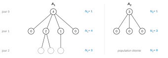
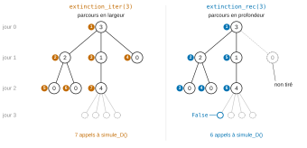
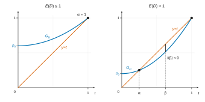
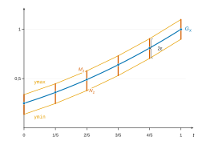

# Agro-Véto BCPST — Modélisation mathématique et informatique 2026 · Corrigé brut

*Corrigé rédigé par IA, non officiel. Signalez toute erreur.*

Convention : $t^0=1$ pour tout réel $t$, y compris $t=0$ (c'est aussi la convention de Python, `0**0` vaut `1`).

## I. Notion de fonction génératrice

### Q 1.1

Soit $t\in[0,1]$. Pour tout $n\in\mathbb N$, on a $0\le t^n\le1$ et $P(X=n)\ge0$, donc :

$$\begin{aligned}
0&\le P(X=n)\,t^n\\
&\le P(X=n).
\end{aligned}$$

Les événements $(X=n)_{n\in\mathbb N}$ sont deux à deux incompatibles. Leur réunion est $\Omega$, car $X$ est à valeurs dans $\mathbb N$.

Par $\sigma$-additivité, la série $\sum P(X=n)$ converge, et sa somme vaut $P(\Omega)=1$.

La série $\sum P(X=n)t^n$ est à termes positifs, majorée terme à terme par une série convergente. Par comparaison des séries à termes positifs, elle converge.

**$G_X$ est définie (au moins) sur $[0,1]$.**

### Q 1.2

En $t=0$, seul le terme $n=0$ est non nul, car $0^0=1$ et $0^n=0$ pour $n\ge1$.

En $t=1$, on somme les $P(X=n)$, de somme $1$ (Q 1.1) :

$$\boxed{G_X(0)=P(X=0)}$$

$$\boxed{G_X(1)=1}$$

### Q 1.3

Soient $s,t$ tels que $0\le s\le t\le1$. Pour tout $n$, la fonction $u\mapsto u^n$ est croissante sur $[0,1]$, donc $s^n\le t^n$.

Comme $P(X=n)\ge0$, on multiplie, puis on somme de $0$ à $N$ :

$$\begin{aligned}
P(X=n)\,s^n&\le P(X=n)\,t^n,\\
\sum_{n=0}^NP(X=n)\,s^n&\le\sum_{n=0}^NP(X=n)\,t^n .
\end{aligned}$$

Les deux séries convergent (Q 1.1). L'inégalité large passe à la limite quand $N\to+\infty$ : $G_X(s)\le G_X(t)$.

**$G_X$ est croissante sur $[0,1]$.**

### Q 1.4

Soit $t\in[0,1]$. $G_X(t)$ est la somme d'une série à termes positifs, donc $G_X(t)\ge0$. Par croissance (Q 1.3) et Q 1.2, $G_X(t)\le G_X(1)=1$.

$$\boxed{\forall t\in[0,1],\ G_X(t)\in[0,1]}$$

### Q 1.5

Soit $t\in[0,1]$. On a $t^X=\varphi(X)$ avec $\varphi:n\mapsto t^n$.

D'après le théorème de transfert, $t^X$ admet une espérance si et seulement si la série $\sum|t^n|P(X=n)$ converge. Cette série est $\sum t^nP(X=n)$, qui converge (Q 1.1). Le même théorème donne alors la valeur :

$$\begin{aligned}
E\big(t^X\big)&=\sum_{n=0}^{+\infty}t^nP(X=n)\\
&=G_X(t).
\end{aligned}$$

$$\boxed{E\big(t^X\big)=G_X(t)}$$


### Q 1.6

Soit $t\in[0,1]$. On a $(t^X)^2=(t^2)^X$, avec $t^2\in[0,1]$.

D'après Q 1.5 appliquée à $t^2$, la variable $(t^X)^2$ admet une espérance, égale à $G_X(t^2)$. Donc $t^X$ admet un moment d'ordre 2, donc une variance. La formule de König-Huygens donne :

$$\begin{aligned}
V\big(t^X\big)&=E\big((t^X)^2\big)-E\big(t^X\big)^2\\
&=G_X(t^2)-G_X(t)^2 .
\end{aligned}$$

$$\boxed{V\big(t^X\big)=G_X(t^2)-G_X(t)^2}$$

Comme $G_X(t)^2\ge0$ et $G_X(t^2)\le1$ (Q 1.4), **$V(t^X)\le1$**.

### Q 2

$X$ est à valeurs dans $\{0,\dots,n\}$ : la série est une somme finie. Pour $t\in[0,1]$, par la formule du binôme :

$$\begin{aligned}
G_X(t)&=\sum_{k=0}^n\binom nk p^k(1-p)^{n-k}t^k\\
&=\sum_{k=0}^n\binom nk(pt)^k(1-p)^{n-k}\\
&=(pt+1-p)^n .
\end{aligned}$$

$$\boxed{\forall t\in[0,1],\ G_X(t)=(pt+1-p)^n}$$

### Q 3.1

**(i) ⇒ (ii).** Supposons $P(X\le m)=1$. Pour tout entier $n>m$, $(X=n)\subset(X>m)$, donc :

$$\begin{aligned}
P(X=n)&\le P(X>m)\\
&=0 .
\end{aligned}$$

Une probabilité étant positive, $P(X=n)=0$ pour tout $n>m$. Pour tout $t\in\mathbb R$, la série définissant $G_X(t)$ n'a donc qu'un nombre fini de termes non nuls : elle converge.

$G_X$ est donc définie sur $\mathbb R$, et pour tout réel $t$, $G_X(t)=\sum_{n=0}^mP(X=n)\,t^n$. C'est une fonction polynomiale : (ii) est établie.

**(ii) ⇒ (i).** Supposons $G_X$ définie sur $\mathbb R$ et égale sur $\mathbb R$ à une fonction polynomiale $Q$.

$Q$ n'est pas nulle, car $Q(1)=G_X(1)=1$. Notons $d$ son degré et $c\neq0$ son coefficient dominant.

Supposons par l'absurde qu'il existe $n_0>d$ tel que $P(X=n_0)>0$. Pour $t>1$, tous les termes de la série sont positifs, et la somme majore chacun d'eux :

$$\frac{Q(t)}{t^d}\ge P(X=n_0)\,t^{n_0-d}.$$

Le membre de droite tend vers $+\infty$ quand $t\to+\infty$, alors que $Q(t)/t^d$ tend vers $c$ : contradiction.

Donc $P(X=n)=0$ pour tout $n>d$. Par $\sigma$-additivité, $P(X>d)=0$, d'où $P(X\le d)=1$ : $m=d$ convient, et (i) est établie.

**Les assertions (i) et (ii) sont équivalentes.**

### Q 3.2

D'après Q 3.1, $P(X=n)=0$ pour tout $n>m$. La série $\sum nP(X=n)$ n'a qu'un nombre fini de termes non nuls : $X$ admet une espérance, et $E(X)=\sum_{n=1}^m nP(X=n)$.

La fonction $G_X$ coïncide sur $\mathbb R$ avec le polynôme $\sum_{n=0}^mP(X=n)t^n$. Elle est donc dérivable sur $\mathbb R$, en particulier en $1$, et

$$\begin{aligned}
(G_X)'(1)&=\sum_{n=1}^m nP(X=n)\\
&=E(X).
\end{aligned}$$

$$\boxed{E(X)=(G_X)'(1)}$$

### Q 4

**(i) ⇒ (ii).** Si $X$ et $Y$ ont même loi, alors $P(X=n)=P(Y=n)$ pour tout $n$.

Les séries définissant $G_X(t)$ et $G_Y(t)$ ont donc les mêmes termes, et $G_X=G_Y$ sur $[0,1]$.

**(ii) ⇒ (i).** $X$ et $Y$ sont à valeurs dans $\{0,\dots,m\}$. Pour $t\in[0,1]$, on a donc :

$$\begin{aligned}
G_X(t)-G_Y(t)&=\sum_{n=0}^mP(X=n)\,t^n-\sum_{n=0}^mP(Y=n)\,t^n\\
&=\sum_{n=0}^m\big(P(X=n)-P(Y=n)\big)t^n .
\end{aligned}$$

Ce polynôme, de degré au plus $m$, s'annule sur $[0,1]$, ensemble infini : c'est le polynôme nul. Donc $P(X=n)=P(Y=n)$ pour $0\le n\le m$. Pour $n>m$, les deux probabilités sont nulles.

**$X$ et $Y$ ont même loi si et seulement si $G_X=G_Y$ sur $[0,1]$.**

## II. Sommes aléatoires : un premier modèle

### II.A. Présentation du modèle

### Q 5

Notons $H_i$ l'indicatrice de l'événement « la jacinthe $i$ atteint vingt centimètres ».

D'après $(A_1)$, $H_i$ suit la loi $\mathcal B(p_1)$. D'après $(A_3)$, les variables $H_1,\dots,H_n$ sont indépendantes.

$J_1=\sum_{i=1}^nH_i$ compte les succès de $n$ épreuves de Bernoulli indépendantes, de même paramètre $p_1$ :

$$\boxed{J_1\hookrightarrow\mathcal B(n,p_1)}$$

c'est-à-dire, pour $0\le i\le n$ :

$$P(J_1=i)=\binom ni p_1^i(1-p_1)^{n-i}.$$

Hypothèses utilisées : $(A_1)$ et $(A_3)$.

### Q 6

D'après Q 5, $J_1\hookrightarrow\mathcal B(2,\tfrac23)$ :

$$\begin{aligned}
P(J_1=0)&=\tfrac19,\\
P(J_1=1)&=\tfrac49,\\
P(J_1=2)&=\tfrac49 .
\end{aligned}$$

Ces trois probabilités sont non nulles. Sachant $(J_1=i)$, les $i$ plantes retenues fleurissent chacune avec probabilité $\tfrac34$, indépendamment, d'après $(A_2)$, $(A_3)$ et $(A_4)$.

La loi conditionnelle de $J_2$ sachant $(J_1=i)$ est donc $\mathcal B(i,\tfrac34)$.

On applique la formule des probabilités totales au système complet $(J_1=i)_{0\le i\le2}$, d'événements de probabilités non nulles :

$$\begin{aligned}
P(J_2=0)&=\tfrac19\cdot1+\tfrac49\cdot\tfrac14+\tfrac49\cdot\tfrac1{16}\\
&=\tfrac{4+4+1}{36}\\
&=\tfrac14,\\[1mm]
P(J_2=1)&=\tfrac49\cdot\tfrac34+\tfrac49\cdot2\cdot\tfrac34\cdot\tfrac14\\
&=\tfrac13+\tfrac16\\
&=\tfrac12,\\[1mm]
P(J_2=2)&=\tfrac49\cdot\tfrac9{16}\\
&=\tfrac14.
\end{aligned}$$

**$J_2\hookrightarrow\mathcal B(2,\tfrac12)$**, avec $\tfrac12=p_1p_2$.

### Q 7.1

```python
def J2(n, p1, p2):
    aux = 0
    l = [0 for i in range(n)]
    for i in range(n):
        if rd.binomial(1, p1) == 1:
            l[i] = 1
    for i in range(n):
        if l[i] == 1:
            if rd.binomial(1, p2) == 1:
                aux = aux + 1
    return aux
```

### Q 7.2

La boucle des lignes 4 à 6 simule la **phase de croissance**. Pour chacune des $n$ jacinthes, un tirage de Bernoulli de paramètre $p_1$, indépendant des autres, décide si elle atteint vingt centimètres. `l[i]` vaut alors $1$ (c'est $H_i$), et `sum(l)` est une réalisation de $J_1$.

La boucle des lignes 7 à 10 simule la **phase de floraison** des seules plantes retenues (`l[i] == 1`). Pour chacune, un tirage de Bernoulli de paramètre $p_2$ décide si elle fleurit, et `aux` compte les plantes retenues qui ont fleuri. La valeur renvoyée est une réalisation de $J_2$.

### II.B. Loi de $J_2$

### Q 8.1

$J_1$ est à valeurs dans $\{0,\dots,n\}$.

- Les événements $(J_1=i)$ sont deux à deux incompatibles : $J_1(\omega)$ ne peut prendre deux valeurs.
- Leur réunion est $\Omega$ : pour tout $\omega$, $J_1(\omega)\in\{0,\dots,n\}$.

**$(J_1=i)_{0\le i\le n}$ est un système complet d'événements.**

### Q 8.2

D'après Q 5, et comme $p_1\in\,]0,1[$ :

$$P(J_1=i)=\binom ni p_1^i(1-p_1)^{n-i}>0 .$$

Sachant $(J_1=i)$, exactement $i$ plantes sont retenues. Chacune fleurit avec probabilité $p_2$ d'après $(A_2)$, indépendamment des autres d'après $(A_3)$.

La floraison est indépendante de la phase de croissance d'après $(A_4)$. Le conditionnement par $(J_1=i)$ ne modifie donc pas la loi des floraisons.

$J_2$ compte ainsi les succès de $i$ épreuves de Bernoulli indépendantes de paramètre $p_2$ :

$$\begin{aligned}
P_{(J_1=i)}(J_2=\ell)&=\binom i\ell p_2^\ell(1-p_2)^{i-\ell}&&\text{si }0\le\ell\le i,\\
P_{(J_1=i)}(J_2=\ell)&=0&&\text{si }\ell>i.
\end{aligned}$$

**La loi conditionnelle de $J_2$ sachant $(J_1=i)$ est la loi binomiale $\mathcal B(i,p_2)$** (loi certaine en $0$ si $i=0$).

### Q 8.3

Soit $\ell\in\{0,\dots,n\}$. On applique la formule des probabilités totales au système complet de Q 8.1, formé d'événements de probabilités non nulles (Q 8.2) :

$$\begin{aligned}
P(J_2=\ell)&=\sum_{i=0}^nP(J_1=i)\,P_{(J_1=i)}(J_2=\ell)\\
&=\sum_{i=\ell}^nP(J_1=i)\,P_{(J_1=i)}(J_2=\ell),
\end{aligned}$$

car les termes d'indice $i<\ell$ sont nuls (Q 8.2). Avec Q 5 et Q 8.2 :

$$\boxed{\begin{aligned}
P(J_2=\ell)=\sum_{i=\ell}^n&\binom i\ell(p_2)^\ell(1-p_2)^{i-\ell}\\
&\times\binom ni(p_1)^i(1-p_1)^{n-i}
\end{aligned}}$$

### Q 8.4

Soient $0\le\ell\le i\le n$. D'une part :

$$\begin{aligned}
\binom i\ell\binom ni&=\frac{i!}{\ell!(i-\ell)!}\cdot\frac{n!}{i!(n-i)!}\\
&=\frac{n!}{\ell!(i-\ell)!(n-i)!}.
\end{aligned}$$

D'autre part :

$$\begin{aligned}
\binom n\ell\binom{n-\ell}{i-\ell}&=\frac{n!}{\ell!(n-\ell)!}\cdot\frac{(n-\ell)!}{(i-\ell)!(n-i)!}\\
&=\frac{n!}{\ell!(i-\ell)!(n-i)!}.
\end{aligned}$$

$$\boxed{\binom i\ell\binom ni=\binom n\ell\binom{n-\ell}{i-\ell}}$$

### Q 8.5

On reporte Q 8.4 dans Q 8.3 et on écrit $p_1^i=p_1^\ell p_1^{i-\ell}$. On pose $k=i-\ell$, qui décrit $\{0,\dots,n-\ell\}$. La formule du binôme donne :

$$\begin{aligned}
P(J_2=\ell)&=\binom n\ell(p_1p_2)^\ell\sum_{k=0}^{n-\ell}\binom{n-\ell}{k}\big(p_1(1-p_2)\big)^k(1-p_1)^{n-\ell-k}\\
&=\binom n\ell(p_1p_2)^\ell\big(p_1(1-p_2)+1-p_1\big)^{n-\ell}\\
&=\binom n\ell(p_1p_2)^\ell(1-p_1p_2)^{n-\ell}.
\end{aligned}$$

Pour tout $\ell\in\{0,\dots,n\}$ :

$$\boxed{P(J_2=\ell)=\binom n\ell(p_1p_2)^\ell(1-p_1p_2)^{n-\ell}}$$

**$J_2$ suit la loi binomiale $\mathcal B(n,p_1p_2)$.**

### Q 9

La ligne 2 simule une variable aléatoire `i` de loi $\mathcal B(n,p_1)$, c'est-à-dire la loi de $J_1$ (Q 5) : c'est la phase de croissance.

La ligne 3 renvoie une réalisation de $\mathcal B(\texttt i,p_2)$, qui est la loi conditionnelle de $J_2$ sachant $(J_1=\texttt i)$ (Q 8.2) : c'est la phase de floraison des plantes retenues.

Notons $M$ la valeur renvoyée. La formule des probabilités totales sur le système $(\texttt i=i)_{0\le i\le n}$ donne pour $P(M=\ell)$ exactement l'expression de Q 8.3.

**`mystere1(n, p1, p2)` simule la variable aléatoire $J_2$ et renvoie une réalisation de $J_2$, de loi $\mathcal B(n,p_1p_2)$**. Elle simule d'abord le nombre de plantes ayant franchi le seuil, puis, parmi elles, le nombre de plantes ayant fleuri.

### Q 10.1

Modélisons l'expérience par des variables indépendantes $H_1,\dots,H_n,F_1,\dots,F_n$ :

- $H_i\hookrightarrow\mathcal B(p_1)$ indique si la plante $i$ atteint le seuil $(A_1)$ ;
- $F_i\hookrightarrow\mathcal B(p_2)$ indique si elle fleurit $(A_2)$ ;
- l'indépendance entre plantes est $(A_3)$, celle entre hauteurs et floraisons est $(A_4)$.

Alors $J_1=\sum_iH_i$ et $J_2=\sum_iH_iF_i$.

Pour $h\in\{0,1\}^n$, soit $\sigma_h$ la permutation de $\{1,\dots,n\}$ qui range d'abord, dans l'ordre croissant, les indices $i$ tels que $h_i=1$, puis les autres. Posons $H=(H_1,\dots,H_n)$ et :

$$X_k(\omega)=F_{\sigma_{H(\omega)}(k)}(\omega).$$

Les indices $\sigma_{H(\omega)}(1),\dots,\sigma_{H(\omega)}(J_1(\omega))$ sont exactement ceux des plantes retenues. Donc :

$$\begin{aligned}
J_2(\omega)&=\sum_{i:\,H_i(\omega)=1}F_i(\omega)\\
&=\sum_{k=1}^{J_1(\omega)}X_k(\omega),
\end{aligned}$$

la somme étant nulle si $J_1(\omega)=0$.

Soient $(x_1,\dots,x_n)\in\{0,1\}^n$ et $i\in\{0,\dots,n\}$. On somme sur les $h$ tels que $h_1+\dots+h_n=i$, et on utilise l'indépendance de $H$ et de $(F_1,\dots,F_n)$ :

$$\begin{aligned}
P(J_1=i,X_1=x_1,\dots,X_n=x_n)&=\sum_{h}P(H=h)\,P\big(F_{\sigma_h(1)}=x_1,\dots,F_{\sigma_h(n)}=x_n\big)\\
&=P(J_1=i)\prod_{k=1}^np_2^{x_k}(1-p_2)^{1-x_k}.
\end{aligned}$$

En effet, $(F_{\sigma_h(1)},\dots,F_{\sigma_h(n)})$ est une permutation fixe de variables indépendantes de loi $\mathcal B(p_2)$.

**Ainsi $X_1,\dots,X_n$ suivent la loi $\mathcal B(p_2)$, les $n+1$ variables $X_1,\dots,X_n,J_1$ sont indépendantes, et $J_2=\sum_{k=1}^{J_1}X_k$.**

### Q 10.2

D'après Q 2 avec $n=1$, $G_{X_1}(t)=p_2t+1-p_2$. D'après Q 2 et Q 5, $G_{J_1}(u)=(p_1u+1-p_1)^n$.

Pour $t\in[0,1]$, $G_{X_1}(t)\in[0,1]$ (Q 1.4), donc la composée a un sens. On compose, on ne multiplie pas :

$$\begin{aligned}
G_{J_2}(t)&=G_{J_1}\big(G_{X_1}(t)\big)\\
&=\big(p_1(p_2t+1-p_2)+1-p_1\big)^n\\
&=(p_1p_2\,t+1-p_1p_2)^n .
\end{aligned}$$

$$\boxed{\forall t\in[0,1],\ G_{J_2}(t)=(p_1p_2\,t+1-p_1p_2)^n}$$

### Q 10.3

Soit $Z\hookrightarrow\mathcal B(n,p_1p_2)$, avec $p_1p_2\in\,]0,1[$. D'après Q 2 et Q 10.2, pour tout $t\in[0,1]$ :

$$\begin{aligned}
G_Z(t)&=(p_1p_2t+1-p_1p_2)^n\\
&=G_{J_2}(t).
\end{aligned}$$

$J_2$ et $Z$ sont à valeurs dans $\{0,\dots,n\}$. Le sens (ii) ⇒ (i) de la question 4, avec $m=n$, donne : **$J_2\hookrightarrow\mathcal B(n,p_1p_2)$**.


### Q 11.1

Une plante est retenue si et seulement si elle atteint le seuil (probabilité $p_1$, d'après $(A_1)$) et fleurit (probabilité $p_2$, d'après $(A_2)$). Ces deux événements sont indépendants d'après $(A_4)$ :

$$\boxed{P(\text{plante retenue})=p_1p_2}$$

### Q 11.2

Soit $R_i$ l'indicatrice de l'événement « la plante $i$ est retenue ». D'après Q 11.1, $R_i\hookrightarrow\mathcal B(p_1p_2)$. D'après $(A_3)$, les variables $R_1,\dots,R_n$ sont indépendantes.

$J_2=\sum R_i$ compte les succès de $n$ épreuves de Bernoulli indépendantes de paramètre $p_1p_2$ : **$J_2\hookrightarrow\mathcal B(n,p_1p_2)$**.

### Q 12

Chaque tour de boucle traite une plante :

- `hauteur_i` simule une variable de loi $\mathcal B(p_1)$ : seuil atteint ou non, d'après $(A_1)$ ;
- `floraison_i` simule une variable de loi $\mathcal B(p_2)$ : floraison ou non, d'après $(A_2)$ ;
- les deux tirages sont indépendants, comme le veut $(A_4)$.

`aux` est incrémenté si et seulement si les deux valent $1$, c'est-à-dire si la plante est finalement retenue (probabilité $p_1p_2$, Q 11.1). Les tours de boucle sont indépendants, comme le veut $(A_3)$. La fonction renvoie donc $\sum_iR_i$.

**`mystere2(n, p1, p2)` simule l'expérience de la question 11 et renvoie une réalisation de la variable aléatoire $J_2$, de loi $\mathcal B(n,p_1p_2)$.** La floraison est tirée même pour les plantes non retenues, ce qui ne change pas la loi grâce à $(A_4)$.

## III. Sommes aléatoires : un second modèle

### III.A. Présentation du modèle

### Q 13

- $(H_3)$ : toutes les euglènes, quel que soit le jour, ont la **même loi de reproduction**, celle de $D$. Les individus sont interchangeables et le milieu est stationnaire au cours du temps.
- $(H_5)$ : une euglène a **au plus $m$ descendants** en une journée : la fécondité est bornée.
- $(H_6)$ : les nombres de descendants des différentes euglènes, le même jour ou des jours différents, sont **indépendants**. Il n'y a aucune interaction entre individus (ni compétition pour les ressources, ni régulation par la densité), ni influence de la lignée.

### Q 14

Comme $N_0=1$, on a $N_1=\sum_{k=1}^{N_0}D_{0,k}=D_{0,1}$. D'après $(H_3)$, $D_{0,1}$ suit la loi de $D$.

**$N_1$ et $D$ suivent la même loi.** (Elles ne sont pas égales pour autant : seule leur loi est commune.)

### Q 15

Par récurrence sur $j$. Pour $j=0$, $N_0=1\in\{0,\dots,m^0\}$.

Supposons $N_j$ à valeurs dans $\{0,\dots,m^j\}$, et soit $\omega\in\Omega$.

$N_{j+1}(\omega)$ est une somme de $N_j(\omega)$ entiers compris entre $0$ et $m$ d'après $(H_5)$, nulle si $N_j(\omega)=0$. C'est donc un entier, et :

$$\begin{aligned}
0\le N_{j+1}(\omega)&\le m\,N_j(\omega)\\
&\le m^{j+1}.
\end{aligned}$$

**Pour tout $j\in\mathbb N$, $N_j$ est à valeurs dans $\{0,\dots,m^j\}$.**

### Q 16

D'après $(H_4)$, $D$ est à valeurs dans $\{0,\dots,m\}$. Donc $p_n=0$ pour tout $n>m$, et **$S\subset\{0,\dots,m\}$**.

De plus, $p_m=P(D=m)>0$ d'après $(H_4)$, donc **$m\in S$**.

### Q 17.1

La racine (euglène du jour 0) porte $D_{0,1}$. Les nœuds du jour 1 portent, de gauche à droite, $D_{1,1},\dots,D_{1,k}$.



Sur $A_1$, il y a $2+1=3$ euglènes au jour 2. Sur $A_2$, la population est éteinte au jour 2.

### Q 17.2

Les variables en jeu sont indépendantes d'après $(H_6)$, et suivent la loi de $D$ d'après $(H_3)$ :

$$\begin{aligned}
P(A_1)&=P(D_{0,1}=4)P(D_{1,1}=0)P(D_{1,2}=2)P(D_{1,3}=1)P(D_{1,4}=0)\\
&=p_0^2\,p_1\,p_2\,p_4,\\[1mm]
P(A_2)&=P(D_{0,1}=3)P(D_{1,1}=0)P(D_{1,2}=0)P(D_{1,3}=0)\\
&=p_0^3\,p_3 .
\end{aligned}$$

$$\boxed{P(A_1)=p_0^2p_1p_2p_4}$$

$$\boxed{P(A_2)=p_0^3p_3}$$

### Q 17.3

L'inclusion $\{0,1,2,3,4\}\subset S$ donne $p_0,p_1,p_2,p_3,p_4>0$. Un produit de réels strictement positifs est strictement positif : **$P(A_1)>0$ et $P(A_2)>0$.**

### Q 17.4

Sur $A_1$, $N_1=D_{0,1}=4$, puis :

$$\begin{aligned}
N_2&=D_{1,1}+D_{1,2}+D_{1,3}+D_{1,4}\\
&=0+2+1+0\\
&=3 .
\end{aligned}$$

Donc $A_1\subset(N_2=3)$.

Si l'on avait aussi $A_1\subset(N_2=n')$ avec $n'\neq3$, alors $A_1$ serait inclus dans $(N_2=3)\cap(N_2=n')$, qui est vide. Cela contredit $P(A_1)>0$. **L'unique entier est $n=3$.**

### Q 17.5

Soit $B=(D_{0,1}=3,\ D_{1,1}=1,\ D_{1,2}=1,\ D_{1,3}=1)$.

- Sur $B$, $N_1=3$ et $N_2=1+1+1=3$, donc $B\subset(N_2=3)$.
- $B\cap A_1=\varnothing$, car $D_{0,1}$ vaut $3$ sur $B$ et $4$ sur $A_1$.
- Par $(H_3)$ et $(H_6)$, $P(B)=p_3p_1^3>0$.

Donc, par additivité :

$$\begin{aligned}
P(N_2=3)&\ge P(A_1\cup B)\\
&=P(A_1)+P(B)\\
&>P(A_1).
\end{aligned}$$

**$P(A_1)<P(N_2=3)$.**

### III.B. Étude de la population moyenne

### Q 18.1

Montrons par récurrence que $N_j$ est une fonction de la famille finie $(D_{i,k})_{0\le i\le j-1,\,1\le k\le m^i}$. C'est vrai pour $j=0$, car $N_0=1$.

Si c'est vrai au rang $j$, comme $N_j\le m^j$ (Q 15), on peut écrire :

$$\begin{aligned}
N_{j+1}&=\sum_{k=1}^{N_j}D_{j,k}\\
&=\sum_{k=1}^{m^j}\mathbf 1_{\{k\le N_j\}}D_{j,k}.
\end{aligned}$$

C'est une fonction de $N_j$ et de $D_{j,1},\dots,D_{j,m^j}$, donc des $D_{i,k}$ avec $i\le j$ et $k\le m^i$.

La famille finie $(D_{i,k})_{0\le i\le j,\,1\le k\le m^i}$ est indépendante d'après $(H_6)$. Par le lemme des coalitions, $N_j$, fonction des variables d'indice $i\le j-1$, est indépendante des variables $D_{j,1},\dots,D_{j,m^j}$, qui forment un paquet disjoint.

**Les $m^j+1$ variables $D_{j,1},\dots,D_{j,m^j},N_j$ sont indépendantes.**

### Q 18.2

Soient $j\in\mathbb N$ et $n\in\{0,\dots,m^{j+1}\}$. D'après Q 15, $(N_j=\ell)_{0\le\ell\le m^j}$ est un système complet d'événements. Sur $(N_j=\ell)$, on a $N_{j+1}=\sum_{k=1}^\ell D_{j,k}$. La formule des probabilités totales donne :

$$\begin{aligned}
P(N_{j+1}=n)&=\sum_{\ell=0}^{m^j}P(N_j=\ell,\ N_{j+1}=n)\\
&=\sum_{\ell=0}^{m^j}P\Big(N_j=\ell,\ \sum_{k=1}^\ell D_{j,k}=n\Big).
\end{aligned}$$

Comme $\ell\le m^j$, la somme $\sum_{k=1}^\ell D_{j,k}$ est une fonction de $D_{j,1},\dots,D_{j,m^j}$. D'après Q 18.1 et le lemme des coalitions, elle est indépendante de $N_j$. D'où :

$$\boxed{\begin{aligned}
P(N_{j+1}=n)=\sum_{\ell=0}^{m^j}&P(N_j=\ell)\\
&\times P\Big(\sum_{k=1}^\ell D_{j,k}=n\Big)
\end{aligned}}$$

### Q 18.3

$D$ est à valeurs dans $\{0,\dots,m\}$ d'après $(H_4)$.

D'après Q 15, $N_j$ est à valeurs dans $\{0,\dots,m^j\}$, et $N_{j+1}$ dans $\{0,\dots,m^{j+1}\}$.

Ces trois variables prennent un nombre fini de valeurs : elles admettent une espérance.

Pour $0\le\ell\le m^j$, posons $T_\ell=\sum_{k=1}^\ell D_{j,k}$. D'après $(H_5)$, $T_\ell$ est à valeurs dans $\{0,\dots,\ell m\}$, inclus dans $\{0,\dots,m^{j+1}\}$.

Par linéarité de l'espérance et $(H_3)$, $E(T_\ell)=\ell E(D)$.

On multiplie Q 18.2 par $n$, on somme, et on intervertit deux sommes finies :

$$\begin{aligned}
E(N_{j+1})&=\sum_{n=0}^{m^{j+1}}n\sum_{\ell=0}^{m^j}P(N_j=\ell)P(T_\ell=n)\\
&=\sum_{\ell=0}^{m^j}P(N_j=\ell)\sum_{n=0}^{m^{j+1}}nP(T_\ell=n)\\
&=\sum_{\ell=0}^{m^j}P(N_j=\ell)\,\ell E(D)\\
&=E(D)\,E(N_j).
\end{aligned}$$

$$\boxed{E(N_{j+1})=E(D)\,E(N_j)}$$

### Q 18.4

La suite $\big(E(N_j)\big)_{j\in\mathbb N}$ est géométrique de raison $E(D)$ (Q 18.3), de premier terme $E(N_0)=1$. Pour tout $j\in\mathbb N$ :

$$\boxed{E(N_j)=E(D)^j}$$

### Q 19

Si $E(D)>1$, $E(N_j)=E(D)^j$ tend vers $+\infty$ de façon géométrique : la population moyenne croît sans limite. C'est irréaliste dans un milieu fini, où la lumière, la matière organique et le volume sont limités.

Deux hypothèses sont en cause :

- $(H_6)$ : le nombre de descendants d'une euglène est indépendant de ceux des autres euglènes et des générations précédentes, donc de la taille de la population. En réalité, la fécondité baisse quand la densité augmente (compétition pour les ressources).
- $(H_3)$ : la loi de reproduction est la même au début de l'expérience, quand il y a très peu d'euglènes, et quand la population est très grande, ce qui est peu réaliste.

**Le modèle n'est pertinent que pour une population petite devant la capacité du milieu (phase initiale). À long terme, l'hypothèse $(H_6)$ n'est plus réaliste.**

### III.C. Calcul de la probabilité d'extinction : étude d'exemples

### Q 20

Sur $A_2$, on a $N_2=0$. Donc $A_2\subset(N_2=0)\subset E_0$, et $P(E_0\mid A_2)=1$.

Sur $A_1$, on a $N_2=3$ (Q 17.4). Chacune des trois euglènes présentes au jour 2 est à l'origine d'une lignée. D'après $(H_3)$ et $(H_6)$, chaque lignée évolue comme le processus initial issu d'une seule euglène. Elle est indépendante des deux autres lignées et des variables $D_{0,1},D_{1,1},\dots,D_{1,4}$ qui définissent $A_1$.

La population s'éteint si et seulement si les trois lignées s'éteignent, chacune avec probabilité $\alpha$ :

$$\boxed{P(E_0\mid A_1)=\alpha^3}$$

$$\boxed{P(E_0\mid A_2)=1}$$

### Q 21.1

$p_0+p_2=1$, donc $p_n=0$ pour $n\notin\{0,2\}$ : $D$ est à valeurs dans $\{0,2\}\subset\{0,1,2\}$.

On prend $m=2\ge2$, et $P(D=2)=p>0$.

**$(H_4)$ est satisfaite avec $m=2$.**

### Q 21.2

On a $G_D(t)=1-p+pt^2$. L'équation $G_D(t)=t$ s'écrit :

$$pt^2-t+1-p=0 .$$

$1$ est racine évidente. Le produit des racines vaut $\frac{1-p}p$, donc la seconde racine est $\frac{1-p}p$. Or $\frac{1-p}p\le1$ si et seulement si $p\ge\frac12$.

D'après le résultat admis, $\alpha_p$ est la plus petite solution dans $[0,1]$ :

- si $0<p\le\frac12$, la seule solution dans $[0,1]$ est $1$ ;
- si $\frac12\le p\le1$, la plus petite solution est $\frac{1-p}p$.

$$\boxed{\alpha_p=\min\Big(1,\ \frac{1-p}p\Big)}$$

### Q 21.3

La fonction $p\mapsto\alpha_p$ est constante égale à $1$ sur $]0,\frac12]$.

Sur $[\frac12,1]$, $\alpha_p=\frac1p-1$ a pour dérivée $-\frac1{p^2}<0$. Elle décroît strictement de $1$ à $\alpha_1=0$, et elle est continue en $\frac12$.

**$p\mapsto\alpha_p$ est décroissante sur $]0,1]$**, strictement sur $[\frac12,1]$.

**Interprétation** : $E(D)=2p$. Si $E(D)\le1$, l'extinction est certaine. Au-delà du seuil $p=\frac12$, plus une euglène a de chances de se diviser, plus la probabilité d'extinction est faible. Elle est nulle pour $p=1$, où chaque euglène a toujours deux descendants.

### Q 22.1

Au début du tour `i`, `N` contient $N_i$. Les lignes 4 à 6 ajoutent à `aux`, pour chacune des `N` euglènes vivantes, une réalisation indépendante de $D$, son nombre de descendants $D_{i,k}$.

À la fin, `aux` contient $\sum_{k=1}^{N_i}D_{i,k}=N_{i+1}$, que la ligne 7 affecte à `N`. Ces lignes simulent le passage du jour $i$ au jour $i+1$ ; si $N_i=0$, `aux` reste nul.

### Q 22.2

`N1` est le nombre de descendants de l'euglène initiale de l'appel courant, c'est-à-dire une réalisation de $N_1=D_{0,1}$, de même loi que $D$ (Q 14) : **le nombre d'euglènes au jour 1.**

### Q 22.3

**`extinction_iter` réalise un parcours en largeur.** La boucle `for i in range(j)` de la ligne 3 traite toute une génération (toutes les euglènes du jour $i$) avant de passer au jour suivant. Seul l'effectif `N` de la génération courante est conservé.

**`extinction_rec` réalise un parcours en profondeur.** Après avoir tiré le nombre `N1` d'enfants de la racine, la boucle `for k in range(N1)` de la ligne 17 appelle `extinction_rec(j-1)` sur le premier enfant. Cet appel explore entièrement le sous-arbre de cet enfant, en suivant une lignée jusqu'au jour $j$, avant de passer au deuxième enfant.



**Comparaison.** Les deux fonctions renvoient une variable de même loi (l'indicatrice de $N_j=0$).

- `extinction_iter` effectue $N_0+N_1+\dots+N_{j-1}$ appels à `simule_D`, moins si la population s'éteint avant. Ce nombre croît en moyenne comme $E(D)^j$ lorsque $E(D)>1$. La mémoire utilisée est constante.
- `extinction_rec` visite au plus les mêmes nœuds, et s'arrête dès qu'elle a trouvé une euglène vivante au jour $j$ (lignes 18-19). En cas de survie, elle peut conclure après très peu d'appels : elle est alors bien plus efficace.
- En cas d'extinction au jour $j$, les deux visitent tout l'arbre et sont aussi rapides. La version récursive utilise en outre une pile d'appels de profondeur $j$ (risque de dépasser la limite de récursion de Python pour $j$ grand) et un surcoût par appel.

### Q 23.1

$p_0=p_2=\frac12$, donc $D$ est à valeurs dans $\{0,2\}\subset\{0,1,2\}$. On prend $m=2\ge2$, et $P(D=2)=\frac12>0$ : **$(H_4)$ est satisfaite.**

### Q 23.2

On a $G_D(t)=\frac12+\frac12t^2$. Pour $t\in[0,1]$ :

$$G_D(t)-t=\frac{(t-1)^2}2 .$$

Ainsi $G_D(t)=t$ si et seulement si $t=1$, et donc $\boxed{\alpha=1}$.

Comme $N_0=1$, on a $E_0=\bigcup_{j\ge1}(N_j=0)$, c'est-à-dire $E_0=(\mathcal E\neq\varnothing)$. Sur cet événement, $J=\min\mathcal E\ge1$. Donc $(J=0)=(\mathcal E=\varnothing)$, soit $(J=0)=\overline{E_0}$, et :

$$\begin{aligned}
P(J=0)&=1-\alpha\\
&=0 .
\end{aligned}$$

$$\boxed{P(J=0)=0}$$

### Q 23.3

$J$ est à valeurs dans $\mathbb N$ : elle admet une espérance si et seulement si la série $\sum jP(J=j)$ converge.

Or $jP(J=j)\sim\frac2j$ quand $j\to+\infty$. C'est l'équivalent du terme positif d'une série divergente (série harmonique). Par comparaison des séries à termes positifs, $\sum jP(J=j)$ diverge.

**$J$ n'admet pas d'espérance.**

### Q 23.4

Si l'euglène initiale n'a aucun descendant (probabilité $\frac12$), la population disparaît au jour 1. Sinon, elle a deux descendants, dont les lignées sont deux copies indépendantes du processus.

Si ces lignées s'éteignent en `t1` et `t2` jours, comptés à partir du jour 1, la population entière est éteinte au jour $1+\max(\texttt{t1},\texttt{t2})$.

```python
def temps_extinction():
    if rd.binomial(1, 1/2) == 0:
        return 1
    else:
        t1 = temps_extinction()
        t2 = temps_extinction()
        return 1 + max(t1, t2)
```

### III.D. Calcul de la probabilité d'extinction : étude générale

Remarque préliminaire : si $N_j(\omega)=0$, la somme définissant $N_{j+1}(\omega)$ est vide, donc $N_{j+1}(\omega)=0$.

Par récurrence, $N_{j'}(\omega)=0$ pour tout $j'\ge j$. Ainsi $(N_j=0)\subset(N_{j+1}=0)$, et $a_0=P(N_0=0)=0$.

### Q 24.1

Soit $j\in\mathbb N$. Si $\omega\in(N_{j+1}=0,N_j\ne0)$, alors $\omega\in(N_{j+1}=0)\subset E_0$.

Réciproquement, soit $\omega\in E_0$. L'ensemble $\{k\in\mathbb N:N_k(\omega)=0\}$
 est une partie non vide de $\mathbb N$ ; notons $j_0$ son plus petit élément.

Comme $N_0=1$, $j_0\ge1$, et par minimalité $N_{j_0-1}(\omega)\neq0$. Donc $\omega\in(N_{j_0}=0,N_{j_0-1}\ne0)$.

$$\boxed{E_0=\bigcup_{j\in\mathbb N}(N_{j+1}=0,\ N_j\ne0)}$$

Ces événements sont deux à deux incompatibles. Si $j<j'$ et $N_{j+1}(\omega)=0$, alors $N_{j'}(\omega)=0$ d'après la remarque préliminaire, ce qui exclut $N_{j'}(\omega)\ne0$.

### Q 24.2

Soit $j\in\mathbb N$. On découpe selon que $N_j$ est nul ou non. Comme $(N_j=0)\subset(N_{j+1}=0)$, l'événement $(N_{j+1}=0,N_j=0)$ est égal à $(N_j=0)$ :

$$\begin{aligned}
(N_{j+1}=0)&=(N_{j+1}=0,\ N_j\ne0)\cup(N_{j+1}=0,\ N_j=0)\\
&=(N_{j+1}=0,\ N_j\ne0)\cup(N_j=0).
\end{aligned}$$

**On a donc $(N_{j+1}=0)=(N_{j+1}=0,\ N_j\ne0)\cup(N_j=0)$, et cette réunion est disjointe.**

### Q 24.3

La réunion de Q 24.2 est disjointe. Par additivité, pour tout $j\in\mathbb N$ :

$$P(N_{j+1}=0,\ N_j\ne0)=a_{j+1}-a_j .$$

La réunion de Q 24.1 est disjointe. Par $\sigma$-additivité :

$$\begin{aligned}
\alpha&=\sum_{j=0}^{+\infty}P(N_{j+1}=0,\ N_j\ne0)\\
&=\sum_{j=0}^{+\infty}(a_{j+1}-a_j).
\end{aligned}$$

Donc :

$$\boxed{\alpha=\sum_{j=0}^{+\infty}(a_{j+1}-a_j)}$$

### Q 24.4

Pour $r\in\mathbb N^*$, la somme partielle est télescopique :

$$\begin{aligned}
\sum_{j=0}^{r-1}(a_{j+1}-a_j)&=a_r-a_0\\
&=a_r .
\end{aligned}$$

Elle converge vers la somme de la série (Q 24.3) :

$$\boxed{\lim_{j\to+\infty}a_j=\alpha}$$

### Q 25.1

Soit $j\in\mathbb N$. D'après Q 14, $P(N_1=n)=p_n$, et $(N_1=n)_{0\le n\le m}$ est un système complet d'événements. Les termes d'indice $n\notin S$, de probabilité nulle, ne contribuent pas ; pour $n\in S$, la probabilité conditionnelle a un sens. La formule des probabilités totales donne :

$$\boxed{\begin{aligned}
a_{j+1}&=P(N_{j+1}=0)\\
&=\sum_{n\in S}p_n\,P(N_{j+1}=0\mid N_1=n)
\end{aligned}}$$

### Q 25.2

Soient $j\in\mathbb N$ et $n\in S$. Sur $(N_1=n)$, la population au jour $j+1$ est la réunion des descendances, au jour $j+1$, des $n$ euglènes du jour 1.

D'après $(H_3)$ et $(H_6)$, ces $n$ lignées évoluent comme $n$ copies indépendantes du processus initial issu d'une seule euglène, décalées d'un jour, et indépendantes de $D_{0,1}=N_1$.

La population est éteinte au jour $j+1$ si et seulement si chacune des $n$ lignées est éteinte $j$ jours après son départ. Cela arrive pour chacune avec probabilité $P(N_j=0)=a_j$. Par indépendance :

$$\boxed{\begin{aligned}
P(N_{j+1}=0\mid N_1=n)&=\prod_{k=1}^nP(N_j=0)\\
&=(a_j)^n
\end{aligned}}$$

Pour $n=0$, on trouve $1$, ce qui est cohérent.

### Q 25.3

Soit $j\in\mathbb N$. D'après Q 25.1 et Q 25.2, on ajoute des termes nuls ($p_n=0$ hors de $S$) :

$$\begin{aligned}
a_{j+1}&=\sum_{n\in S}p_n\,a_j^n\\
&=\sum_{n=0}^mp_n\,a_j^n .
\end{aligned}$$

Comme $a_j\in[0,1]$, on reconnaît $G_D(a_j)$ :

$$\boxed{a_{j+1}=G_D(a_j)}$$

### Q 25.4

D'après $(H_4)$, $P(D\le m)=1$. D'après Q 3.1, $G_D$ est polynomiale, donc continue.

Comme $a_j\in[0,1]$ et $a_j\to\alpha$ (Q 24.4), on a $\alpha\in[0,1]$. On passe à la limite dans $a_{j+1}=G_D(a_j)$, par continuité de $G_D$ en $\alpha$ :

$$\boxed{\alpha=G_D(\alpha)}$$

### Q 25.5

Soit $t\in\mathcal F$. Montrons par récurrence que $a_j\le t$ pour tout $j$.

- $a_0=0\le t$.
- Si $a_j\le t$, alors, par croissance de $G_D$ sur $[0,1]$ (Q 1.3) et Q 25.3, $a_{j+1}=G_D(a_j)\le G_D(t)=t$.

**Pour tous $t\in\mathcal F$ et $j\in\mathbb N$, $a_j\le t$.**

### Q 25.6

D'après Q 25.4, $\alpha\in[0,1]$ et $G_D(\alpha)=\alpha$, donc $\alpha\in\mathcal F$.

Soit $t\in\mathcal F$. Pour tout $j$, $a_j\le t$ (Q 25.5). Par passage à la limite (Q 24.4), $\alpha\le t$.

**$\alpha$ est le plus petit élément de $\mathcal F$.**

### Q 26

Si $p_0=0$, alors $G_D(0)=p_0=0$ (Q 1.2). Donc $0\in\mathcal F$, et $\alpha=\min\mathcal F=0$ (Q 25.6).

Si $\alpha=0$, alors $G_D(0)=0$ (Q 25.4), soit $p_0=0$ (Q 1.2).

**Ainsi $\alpha=0$ si et seulement si $p_0=0$.**

### Q 27.1

D'après $(H_4)$, $P(D\le m)=1$. La question 3.1 assure alors que $G_D$ est polynomiale, avec $G_D(t)=\sum_{n=0}^mp_nt^n$.

$f$ est donc polynomiale, donc deux fois dérivable sur $[0,1]$, avec :

$$f'(t)=\sum_{n=1}^mnp_nt^{n-1}-1$$

$$f''(t)=\sum_{n=2}^mn(n-1)p_nt^{n-2}$$

### Q 27.2

Pour $t\in[0,1]$, $f''(t)$ est une somme de termes positifs. Le terme d'indice $m$ vaut $m(m-1)p_mt^{m-2}$.

Comme $m\ge2$ et $p_m>0$, ce terme est strictement positif pour $t>0$.


Donc $f''\ge0$ sur $[0,1]$ et $f''>0$ sur $]0,1]$.

Ainsi $f'$ est continue sur $[0,1]$ et strictement croissante sur $]0,1]$, donc **strictement croissante sur $[0,1]$**.

### Q 27.3

En $t=0$, tous les termes $np_nt^{n-1}$ d'indice $n\ge2$ s'annulent : $f'(0)=p_1-1$.

Comme $\sum p_n=1$ et $p_m>0$ avec $m\ne1$, on a $p_1\le1-p_m<1$.

$$\boxed{f'(0)=p_1-1<0}$$

### Q 28.1

D'après $(H_4)$ et Q 3.2, $(G_D)'(1)=E(D)$. Donc :

$$\boxed{f'(1)=E(D)-1\le0}$$

### Q 28.2

$f'$ est strictement croissante (Q 27.2), donc pour $t\in[0,1[$, $f'(t)<f'(1)\le0$.

**$f$ est strictement décroissante sur $[0,1]$**, de $f(0)=p_0$ à $f(1)=G_D(1)-1=0$.

| $t$ | $0$ | | $1$ |
|---|---|---|---|
| $f'(t)$ | | $-$ | $\le0$ |
| $f$ | $p_0$ | décroissante | $0$ |

### Q 28.3

$f$ est strictement décroissante et $f(1)=0$. Donc $f(t)>0$ pour $t\in[0,1[$, et $1\in\mathcal F$.

Ainsi $\mathcal F=\{1\}$, et d'après Q 25.6, $\alpha=\min\mathcal F=1$.

$$\boxed{\mathcal F=\{1\}}$$

$$\boxed{\alpha=1}$$

**Interprétation** : si chaque euglène a en moyenne au plus un descendant, la population s'éteint presque sûrement. C'est vrai même dans le cas $E(D)=1$, où la population moyenne reste constante.

### Q 29.1

D'après $(H_4)$ et Q 3.2, $(G_D)'(1)=E(D)$. Donc :

$$\boxed{f'(1)=E(D)-1>0}$$

### Q 29.2

$f'$ est continue (Q 27.1) et strictement croissante (Q 27.2) sur $[0,1]$. De plus $f'(0)<0<f'(1)$ (Q 27.3, Q 29.1).

Par le théorème de la bijection, **il existe un unique $\beta\in\,]0,1[$ tel que $f'(\beta)=0$.**

### Q 29.3

$f'$ est strictement croissante et s'annule en $\beta$ : $f'<0$ sur $[0,\beta[$ et $f'>0$ sur $]\beta,1]$.

$f$ est strictement décroissante sur $[0,\beta]$ et strictement croissante sur $[\beta,1]$. De plus $f(0)=p_0\ge0$ et $f(1)=0$, et $f(\beta)<f(1)=0$.

| $t$ | $0$ | | $\beta$ | | $1$ |
|---|---|---|---|---|---|
| $f'(t)$ | $<0$ | $-$ | $0$ | $+$ | $>0$ |
| $f$ | $p_0\ge0$ | décroissante | $f(\beta)<0$ | croissante | $0$ |

### Q 29.4

Sur $[\beta,1]$, $f$ est strictement croissante et $f(1)=0$ : son seul zéro sur cet intervalle est $1$.

Sur $[0,\beta]$, $f$ est continue et strictement décroissante, avec $f(0)\ge0>f(\beta)$. Par le théorème de la bijection, elle a un unique zéro $\gamma\in[0,\beta[$.

Donc $\mathcal F=\{\gamma,1\}$, et $\alpha=\min\mathcal F=\gamma<1$ (Q 25.6).

$$\boxed{\mathcal F=\{\alpha,1\}}$$

$$\boxed{\alpha<1}$$



**Interprétation** : si chaque euglène a en moyenne strictement plus d'un descendant, la population survit indéfiniment avec la probabilité strictement positive $1-\alpha$. L'extinction reste possible ($\alpha>0$) dès que $p_0>0$.

### III.E. Une application : calcul numérique de la probabilité d'extinction

### Q 30

D'après Q 28 et Q 29, pour $b\in[0,1]$ : $G_D(b)-b>0$ si et seulement si $b<\alpha$. On maintient l'invariant $a\le\alpha\le c$, et la longueur $c-a$ est divisée par $2$ à chaque tour.

À la sortie, $c-a\le\varepsilon$, donc $\alpha\le c\le\alpha+\varepsilon$ : $c$ est une valeur approchée de $\alpha$ par excès à $\varepsilon$ près.

```python
def proba_extinction(epsilon):
    a = 0
    c = 1
    while c - a > epsilon:
        b = (a+c)/2
        if G_D(b) - b > 0:
            a = b
        else:
            c = b
    return c
```

La boucle s'arrête après $\lceil\log_2(1/\varepsilon)\rceil$ tours. On renvoie `c`, défini avant la boucle : pour `epsilon = 1`, la boucle n'est jamais exécutée et `b` n'existerait pas.

## IV. Tracés de graphes

### Q 31.1

Soit $t\in[0,1]$, et posons $Y_j=t^{X_j}$. Les $Y_j$ sont indépendantes, comme fonctions des $X_j$ indépendantes, et de même loi que $t^X$. D'après Q 1.5 et Q 1.6 :

$$\begin{aligned}
E(Y_j)&=G_X(t),\\
V(Y_j)&\le1 .
\end{aligned}$$

Soit $M=\frac1n\sum_{j=0}^{n-1}Y_j$. Par linéarité, $E(M)=G_X(t)$. Par indépendance :

$$\begin{aligned}
V(M)&=\frac1{n^2}\sum_{j=0}^{n-1}V(Y_j)\\
&\le\frac1n .
\end{aligned}$$

L'inégalité de Bienaymé-Tchebychev donne :

$$\begin{aligned}
P\left(\left|\frac1n\sum_{j=0}^{n-1}t^{X_j}-G_X(t)\right|\ge\varepsilon\right)&\le\frac{V(M)}{\varepsilon^2}\\
&\le\frac1{n\varepsilon^2}.
\end{aligned}$$

### Q 31.2

Soit $i\in\{0,\dots,p\}$, et posons $t_i=\frac ip\in[0,1]$. Le complémentaire $\overline{A_i}$ de $A_i$ est l'événement :

$$\left(\left|\frac1n\sum_{j=0}^{n-1}t_i^{X_j}-G_X(t_i)\right|\ge\varepsilon\right).$$


D'après Q 31.1, $P(\overline{A_i})\le\frac1{n\varepsilon^2}$. Par passage au complémentaire et sous-additivité :

$$\begin{aligned}
P\Big(\bigcap_{i=0}^pA_i\Big)&=1-P\Big(\bigcup_{i=0}^p\overline{A_i}\Big)\\
&\ge1-\sum_{i=0}^pP(\overline{A_i})\\
&\ge1-\frac{p+1}{n\varepsilon^2}.
\end{aligned}$$

### Q 31.3

D'après Q 31.2, il suffit que $\frac{p+1}{n\varepsilon^2}\le\eta$. Une condition suffisante est donc :

$$\boxed{n\ge\frac{p+1}{\eta\,\varepsilon^2}}$$

### Q 32.1

Posons $q=\frac{p+1}{\eta\varepsilon^2}>0$. `int` tronque le réel positif $q$ à sa partie entière, donc $n=\lfloor q\rfloor+1>q$.

La ligne 4 choisit la taille d'échantillon $n$, le plus petit entier strictement supérieur à $q$. Elle vérifie la condition suffisante de Q 31.3, de sorte que $P(\bigcap A_i)\ge1-\eta$.

### Q 32.2

La ligne 5 produit un échantillon $X_0,\dots,X_{n-1}$ de $n$ réalisations indépendantes de $X$. Pour chaque `i` (ligne 6), les lignes 7 et 8 accumulent dans `y_empir[i]`, initialisé à $0$, les termes $x_i^{X_j}/n$. À la fin :

$$\texttt{y\_empir[i]}=\frac1n\sum_{j=0}^{n-1}\Big(\frac ip\Big)^{X_j}.$$

C'est la moyenne empirique qui estime $G_X(i/p)$. Pour $i=0$, `0**0` vaut `1`, et l'on estime $P(X=0)=G_X(0)$.

### Q 32.3

`ymax[i]` vaut `y_empir[i]` $+\varepsilon$ et `ymin[i]` vaut `y_empir[i]` $-\varepsilon$. Ce sont les bornes de l'intervalle $\left]\,\texttt{y\_empir[i]}-\varepsilon,\ \texttt{y\_empir[i]}+\varepsilon\,\right[$, qui contient $G_X(i/p)$ sur l'événement $A_i$.

Les lignes 11 à 13 tracent ces deux lignes brisées. Elles encadrent les $p+1$ valeurs $G_X(i/p)$ simultanément avec probabilité au moins $1-\eta$.

### Q 32.4

$M_i$ et $N_i$ ont même abscisse `x[i]` : le segment $[M_i,N_i]$ est vertical, de longueur $\texttt{ymax[i]}-\texttt{ymin[i]}=2\varepsilon$.

La courbe de $G_X$ rencontre ce segment si et seulement si $\texttt{ymin[i]}\le G_X(i/p)\le\texttt{ymax[i]}$. C'est le cas sur $A_i$, où les inégalités sont même strictes. Donc l'événement « la courbe coupe les $p+1$ segments » contient $\bigcap_{i=0}^pA_i$.

Comme $n\ge\frac{p+1}{\eta\varepsilon^2}$ (Q 32.1), Q 31.2 et Q 31.3 donnent :

$$\begin{aligned}
P\big(\text{la courbe de }G_X\text{ coupe les }p+1\text{ segments}\big)&\ge P\Big(\bigcap_{i=0}^pA_i\Big)\\
&\ge1-\eta .
\end{aligned}$$



### Q 33

Comme $P(X\le m)=1$, on a $G_X(t)=\sum_{n=0}^m\texttt{liste[n]}\,t^n$ (Q 3.1).

```python
def trace2(p, liste):
    x = [i/p for i in range(p+1)]
    y = [0 for i in range(p+1)]
    m = len(liste)-1
    for i in range(p+1):
        for n in range(m+1):
            y[i] = y[i] + liste[n]*x[i]**n
    plt.plot(x, y)
    plt.show()
```

Pour `trace2(10, [0.4, 0.6])`, on obtient les onze points $(\frac i{10},\,0{,}4+0{,}6\cdot\frac i{10})$, de $(0;0{,}4)$ à $(1;1)$. C'est bien le graphe de $G_X(t)=0{,}4+0{,}6t$, fonction génératrice de $\mathcal B(3/5)$.
